# UBC《机器学习（研究生）｜CPSC 540 Machine learning 2013》中英字幕 p13 -13-Machine learning - Random forests applications.zh_en -BV19g2FBBEEq_p13-

Okay， so as I was saying， I'll just cover again quickly how the basic algorithm works。

So the idea is we're going to grow a forest of trees which means basically we're going to have this collection。

 an ensemble of trees， and we're going to grow them each completely independently。

 so there's no interaction between the trees。One tree doesn't influence another or anything like that so really all you have to think about is like how do I grow one tree and then you just do that because on this slide you do it eight times。

So the first step is to draw a bootstrap sample of your data。

Which means you take your data set of endpoints and you sample from it with replacement。😔。

And so so usually you sample endpoints， you can sample less， or I guess you could over。

But basically this just is an additional source of randomness in addition to what is actually in the node optimization procedures well so it encourages the trees。

Be different from each other， which。If you remember， it is sort of。

One keysOne of the key strikes of random forest， you want to have many trees and you want them all to be reasonably good predictors。

 but you want them to make different mistakes so that when you average them and take like a majority vote。

 you end up。Getting the right answer more often。Would for any of the individual trees。

So to grow the tree， it's a recursive procedure that you start the root you grow this binary tree by starting with the root node and you split the root node into two children。

 and then you recursse in the two children， you always take a node and you split into two and you do that。

Until you meet some stopping criteria like， there's too few data in the leaf to split or。😔。

You can't find a good split point or the tree has reached the max depth that you've set beforehand or something like that。

 so there's some sort of criteria for when you actually stop the growing procedure。😔。

And so the real core of what happens in grandite force is what happens in the optimization in the league。

How do you or sorry， in the note and how do you choose？Where to。So the way that works is。

So you have this big data， you have lots and lots of features， in this case you have P variables。

And what you're going to do is you're going to select M of them， typically M will。

Significly smaller than P， so you get a big reduction in computation by doing this。

And you select them just uniformly at random from the available features。

 and then you optimize along each of those dimensions and so this is what I'm describing you're doing access alignlets which is。

And in this case， you just pick one dimension， you choose a threshold lung。

And way you optimize along that is you essentially just look at every possible threshold that takes。

 if that creates a different split along that dimension。

 and you evaluate the information gain you get by partitioning the data in the node。

Along the dimension you're looking at at the threshold you're looking at。Two children。

And so then you can compute the information game you get by making that split and you choose the one that gives you the best information game。

So this won't necessarily be of course， the best information gain you could possibly get if you looked at all the variables。

 but this is one of the things。😔，This is one of the things that sort of deorrelates the truths is that you choose different variables。

And so at the end。Of this fitting procedure， what you output is this ensemble of trees。

 there you have B trees， and each of them makes a prediction and then when you want to predict。

The value for a new data point。你看。Evaluate， you pass it down each tree， each tree makes a prediction。

 and then you take a majority vote over the trees or you average them。So。That's， I guess。

 a summary of。😔，Rand forest that level that week。ここです。所业情况。

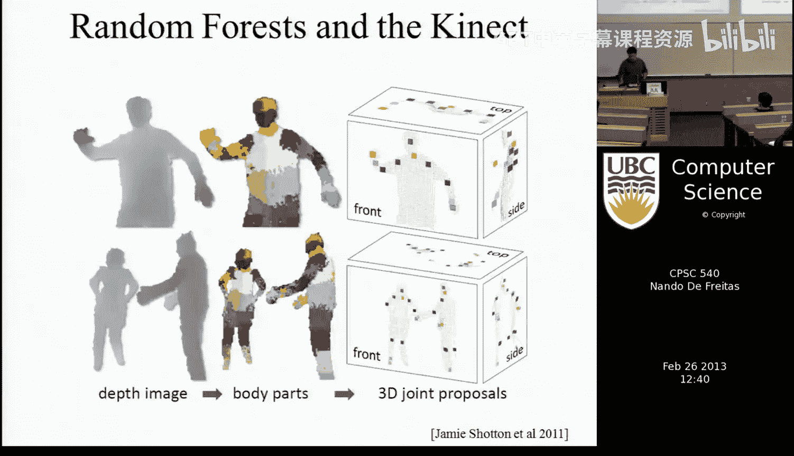

So that's what you talked about last time。😔，And so what today I'm going to talk about is how to do。

Like what type of features you would use？😔，For a real application。

 so I'm going to talk about first this one。😔，For face detection， which is by Bola Jones。

 it's a fairly famous paper and computer vision from 2001， they actually used boosting in this paper。

 but what I'm going to describe sort of the same thing they did up with random forests。你装冇。So。

I guess the， the key thing about this paper is they chose really good features for this。じす。

And so the way。The way they designed features was to take you've got this image of a face。

And that's what。そこ。Okay so we're detecting faces so going we're actually going to have a big image of test time with people in it and we want to find where the faces are so this is what this is showing is training data you have a whole bunch of things。

Well sort well crampped pictures of actual face。But when you test this。

 what you're going to do essentially classifies sort every pixel in like a big image and some of them are going to be faces and some of them are not。

From those classifications， you're going to be able to tell well there's a face here but there's no face。

啊。But， and it but。What you're going to do to do that classifications。

 you're just going to look at every little window in the the task is essentially toify each to classify these little。

😡，Square windows as face or your face。So。The way they do this is they design these features which sort of at first look kind of silly。

 but they end up working very well because you have lots and lots of them。😔，好。

And so you can sort of see in the top。There sort of shows what's happening so the outer square there is just the bounding box that the little rectangle you're classifying and then what you're going to do is you're going to take there's a little black box and a little white box and what you're going to do is you're going to average。

The intensity values of pixels of the black box。You're going to average the intensity values of pixels in the white box。

 and then you're going to subtract the black box from the white box。

 and that's going to give you a number。And then so that's one feature。

 so each of these little boxes defines a single feature， and you can imagine there's many。

 many boxes you can have。Like ones where you've got two black regions on either side a white one。

 ones where there's the split is horizontal， ones where the split is vertical， there's many。

 many of these。Poential features be and each one can be at sort of any location in the image。So。

So essentially you have and so each of those。Is like one dimension in this。

Like they're key dimensional。嗯。So you have many， many these and you don't want to evaluate all of them。

Because there's。Actually， quite a lot because these can be sort of any size。

So the way random forests helps here is you pick them at random。

Rather than I just you essentially take， say a00 of these or 10 of these at each node completely at random。

And then you do the partitioning based on those sort of。

 so you don't have to do this computation of all the features in every node。

But you select some subset。And not。Save schools that'll save you quite a bit of time。这。

That sort of one of the nice things you can do with random forests you can deal with these very。

 very large feature spaces like this one that are even implicitly defined。

 so you never actually will compute the value of every feature。😔。

One particular little sweat that would be this very long。

But you're never going to compute that whole vector explicitly。

 even though that's the feature space you're working。😡。

What you're going to do is you're going to pick little。Things like that。

 and you're going to just compute the values for the ones you need。

So one of the reasons that these features are nice in addition to the fact that they actually work is that you can compute these very。

 very quickly。By using a trick called the integral image。

 which if any of you have taken the vision class， you probably know about。就是啊。今日我当括知道。

So the basic idea for computing these things is what youre going to do I'll draw it in one dimension。

Because it's basically the same as got。You've got this function that sort of goes like this or something。

What your computers？The integrals from here。To wherever and that。not。There。And。

And so what you end up doing is if you want to compute sort of the area here。😔。

So if you want to sum up all the pixels in this area。

 you look at this function and you compute the difference between here and here。So。

For each of these images， you do a preprocessing step where you do like a cumulative sum along two of the dimensions and you get something that's not very interesting to look at。

 but it means you can compute the sum of all the pixels in a rectangle by looking at just four numbers instead。

The whole thing， so these features are very， very fast to compute。

 which is one of the motivations for looking at them。Because there are lots of。

So if you want to be able to try like 100 in each node。另外交补是是。不是。但。是免这个。那个 eight so的。

The equation there is the H is this feature you've chosen this particular rectangle and you' have a volume and so the f is this rectangle。

And you just at you're looking at the difference in your're thresholdholding the difference between these two particular regions。

好。

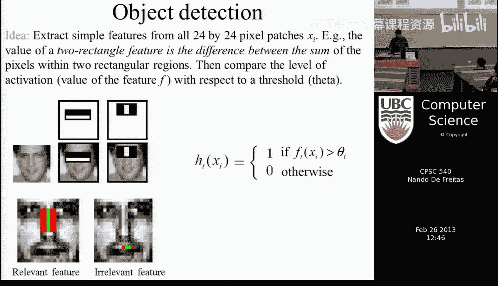

And so here's end slide about examples， you can use this for face detection。

 you can detect cats if you'd like it。Did have any cars and things like also pedestrians？

Useful thing you can do with this like for things like Google's car or it's got to be able to identify other cars on the road。

not hit them， or just like here we've got sort of looks like monitoring some sort of tunnel。

 you can use that。To monitor like traffic flows within a city so you can look at where the congestion and and where。

Better road。Plan the hockey thing you where they're trying hockey players is actually something that is a project that's been going on UC for。

Quite wild in the vision group where they sort of do all kinds of things where they track like hockey players in basketball。

So figure out from videos of these games， like where are the players on the court？

look at how they're moving around so you can get a sort high level view of what's happening in the game。

😔，They're very useful for the coaching。Understanding how the team is behaving。During again。Yes。

 so one of the。So this is a new different application， this is one of the， I guess。

It's a high profile application， although the random forest aspect is perhaps not playing up all that much。

 but Microsoft， I'm sure you all know what the Connect is。anybody doesn't。

 it's a thing that hooks up to your Xbox and it's got this。Camera watches your living room。

And you get up and you sort of wave at your television。Dump around and you can control video games。

That way， instead of sitting on your couch and pressing buttons。

So the way the connected sensor works is it's， like I said。

 it's this device that sits like on your television and it's got a sensor that looks out at your living room and what that sensor looks for is depth。

 so it measures， it projects like lots and lots of。

I think they' infrared rays out and measures the depth or measures how far they travel before that。

Mouns back and so what the image you get or the raw data you get from a connect is。

This sort of gray stale image where dark things are close to you。Likeight things are further away。

I can never remember which way it looks like dark is closer to you。

 so you can think of the value of the pixel is directly proportional to actually the distance。

The right travel。大东。So you end up with these things on the left where it's just sort of this amorphous sort of person shaped blog。

 and so it's easy to segment the background up of this because the background is generally far away。

That's sort of an easy problem。But what's more difficult is figuring out what is this person doing？😔。

It's going to be like meing around and waving their arm。

And you have to be able to in order to use that as a control mechanism。

 you have to be able to figure out essentially what they're doing。

 so the ultimate goal is to get sort of a model of the skeleton of the person so you have。

You figure out where their joints are in 3D space and what angles they're at。

 and then you've got a pretty good idea of。😔，The pose the person is taken。

But you have to get there from just these sort of raw depth images where you。

GodWhere you've subtracted the back？我是难受。The place where the connect comes into this is in this first step。

 which is first you segment the depth image into body parts you want to say。

 well like this block of pixels here corresponds to the left and shoulder， this is the head。

 these are the hands， left and right hand。And Microsoft has a fairly fine grained taxonomy of body parts that they identify because。

You have to be able to identify quite a variety of poses。

And it's easier to do that you can identify if you can separate the top of the leg from the bottom。

So they use the conabatory。I think this is one of the sort of motivating examples for why Microsoft has done so much work on the Connect。

Or， sorry， on the。On random forests in recent years， is they used it in the Connect。Quite successful。

 So I'm going to tell you。I guess a bit about how they do this first step。

 I'm not going to talk about this second one where you go from body parts to。😔。

I'll talk about the first one where you go from a depth image of a person to。

Segmented body parts using them。是。So the first problem here is you need to get training data for this。

 and what they do is kind of neat because this is one of the very few scenarios where this actually works in real life is they generate synthetic data。

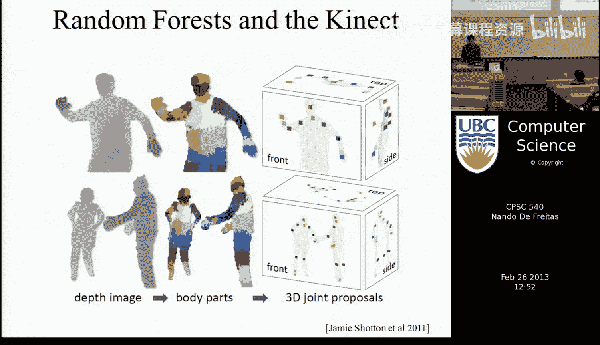

So usually you can't do this， trying to generate synthetic data of real things is of realistic looking things is surprisingly difficult。

八张。

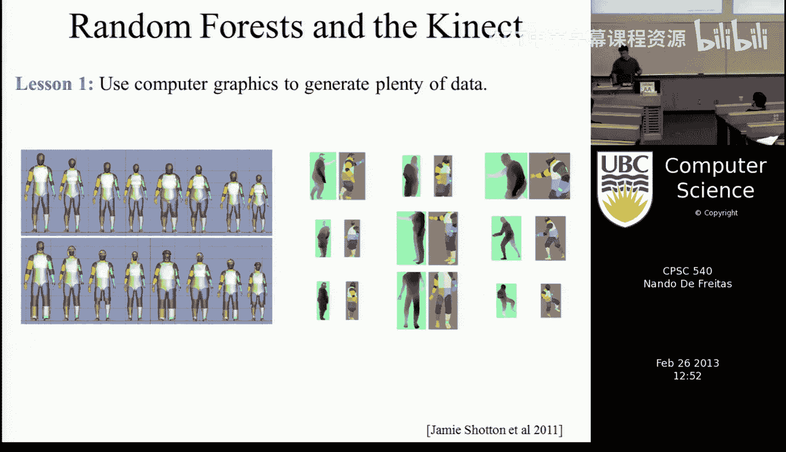

If you look at what you're working with， it's just this depth dimension。

 it's just sort of the silhouette。There's not much detail there at all。

 so you don't need a particularly detailed model of a person to be able to produce these synthetic depth imagess like you don't have to worry about things like。

😔。

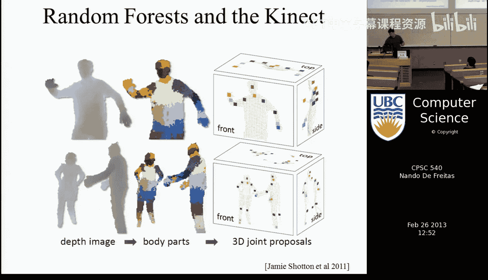

The texture of their face or like what color shirt they're wearing or than it looks。

Because see all the sensor can see is how far away things are。

So what they can do to generate data and to generate lots of data is they have this parameterized model of a person and it's parameterized in。

In sort of all sorts of dimensions like how tall the person is or how stocky they are。

got male and female models and sort of like all sorts of variations， body shapes， because of course。

 this has to work for everyone。You can't just。Fit then because they're going to sell this to the consumer market and people are not going to be happy。

Like they're too short or their kids are too short to be recognized by them。好。

So they actually use the computer to generate。Another reason they need to do this is people will go into the bizarre closes and you're never going to be able to get someone。

In front of these sensors and tell them like do all the weird things you think someone might do when they're living。

😡，Like while waving in their television， you'll never give them wrong people be really concerned。

So anyway， with this model I can generate this value。我系。Pretty wide range of。Pretty wide range poses。

 and then they generate synthetic depth images， like I showed you on the previous slide。

 and that's what they can use。

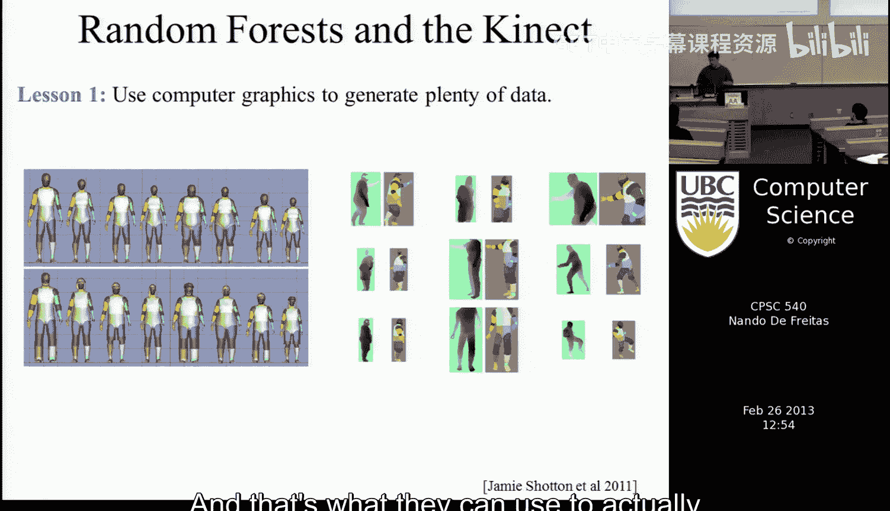

To actually train the model they use in the system。啊。主几高圾。These synthetic images？哦。

So once you've got these synthetic images， the push is like， what features do you use？

To actually classify。And。So the features they use are sort of similar in spirit to the Viola Jones features。

 but a bit different because again， the task is the same。

 you've got this image you class by every pixel in this image like this is a head pixel。

 this is a left arm pixel。And you're going to use the same model。

To do all of that and you're going to use and to classify an individual pixel。

 you're going to use a window around it。Which gives you some context to what is around this pixel。

To be able to figure out what's happened。So it that's a interesting。好。So it is actually。

Features that are even simpler than the Vga。You just thank God。You've got this window。Around。

This pixel in the center， this pixel in the center is the one you're class line。对。送。

Window size around it that you're willing to look at。😔。

And then what they do is they pick two offsetss in this window。Essential two random vectors like。

 say this one。And this will。And look at the pixels。At the end of those factors。

And so this is one feature。We've got this pixel here。this case look here and let's say this is U。

 this is V， course I'll tell you what the normalization there is in a minute。

 just ignore the divided body。So you've got this is x， is the pixel you're classifying。

That D is the depth function， so you look at the depth of x plus u， so you look at this pixel。

 you look at the depth of x plus v， so you look at this pixel and you subtract the depth here from the depth here。

And so， that's。I mean， that's very similar to what Viola Jones did that they had at like。

Windows like this， and then they put them somewhere in the image here we're just going to choose two random offsets and just look at two pixels。

So I believe the way they choose these is they'll actually generate these from a Gaussian distribution。

and so you have a two deep Gaussian that's round when you sample。そ。These offsets。

 and so you might imagine like things closepi more likely。

 but you still have a chance of choosing days far。啊。

This is another one of these implicit feature spaces that I mentioned like Yoola Jones are doing。

 like there's a huge number of these features， right。

 it's sort of like number of pixels in this window square。😔，Whi is just。I mean， it's not intractable。

 at least might be like 32 by 32。That' probably not big that's probably not too big in principle。

 but that's quite out a lot。Quite a lot of features to if you were going to generate this all up front。

But because of the way you actually do this， you never have to generate the full representation。

 you just generate several candidates for this and you just，😔。

You calculate that particular feature about it， which is defined by U andV。

You calculate that as needed to do what you're doing like the fitting of the node and then later when you're doing prediction。

十 one。好。So the reason for that。The normalization term， the thing that's div。U and V is that。

That makes dip thats。That's sort of making distances in the world relative to。

Relative to the point were trying and class that's making them the same。

 no matter how far the object is。😡，From。The actual sensor。

 so if you have like like if you're in a scenario like this where your sensor is here。

 you've got this image plane here that you're looking through。

And then you've got like some some like this stick。Here in the world。

 and so you're going to look out at say this pixel here。And so this is the pixel。

So this is the point that actually corresponds to in the world。😔，那死そ。This distance is one。😔。

This distance。Here。The， this is the action。Thanks。And then you're going to look at an offset from that。

就道わ嘅 something体。Here， and then it's actually this distance here that's safe。

Because this is going to be。Yes。And so what that's going to do- so what dividing by DakX does is essentially move this plane out to here out。

😔，Pixel you're looking at， so that way like if the sensor's over there and it wants to compare like this pixel and this pixel。

But I walk closer the thing I don't do the normalization。

 the actual points it's looking at getting closer together。😔。

So what that normalization term is doing is essentially giving you。是假。In the features。

Because things far away will appear smaller。さ。

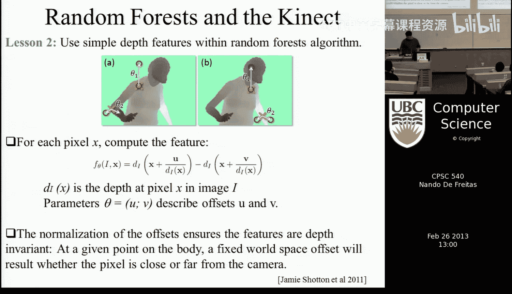

To right here is then。We just。This is basically what I said， but I'll say it again。

 this goes through sort from start from top to bottom， how they fit the trees。

The connect is so what they do is actually slightly different than the algorithm I described right at the beginning。

 when they sample， so in the algorithm I described at the beginning what you do is you sample features and then you optimize the thresholds using all your data。

 so Isof actually does is they sample features and thresholds together so they sample whole split point。

And they optimized over that set。Why do they do that versus？

Optimize over the data it's just like there are many sort of little variants you'll find of the random forests algorithm and this is sort of one of the differences that we find sometimes sometimes people will optimize for part of their note fitting procedure and sometimes they'll be more random。

And。I mean， I don't know that one is better than the other。So of the way you choose to do it anyway。

 they so Microsoft samples， like I said， they sample a feature， which is a U of a V。

And they sample a threshold， which is like a threshold on the difference between this depth and this step。

And they you start。No， so how each show， you'll sample many of those splits。

And you'll compute the partition of your data in your node into two sets that's created by each of those。

And once you' computed the partition for each of them。

 you compute the information gain and again you take。The largest information for you。

Over this whole set and they've got some stopping criteria here。😔。

You stop when you don't have like enough information game。

 it' possible to sort of get stopped with information game where like you end up in a leaf that's say really big。

 but it's all one cloud you're not going to。😔，You don't find any useful split point。

Tlls you anything more because everything in that region belongs to the same classroom suit。😔。

In a scenario like that， you won't be able to find。

A split point which gives you the nice separation game is so that putting a threshold on the minimum gain。

Allow you to stop。Itit scenarios。You're sort of running experience where none of your splits are telling you。

 so there's no point。Continuing to go。So yeah， here's some examples of。Like this algorithm action。

 the stuff on the。Lastft。Is synthetic data？Which I don't know which are training and tests， actually。

😔，Kind of hard to tell。So to get an idea of what these guys are going for。

 you've got to segment these people and these very strange。嗯。And then the stuff on the right。

Is actual test data of real people？So they do do， of course， some testing on actual death of people。

 they don't only use the synthetic day。But what they use the synthetic data for is augmenting。

Amount of real data they have so they can get variety a wider variety of training。没。But。

It's sort see。It does pretty much。

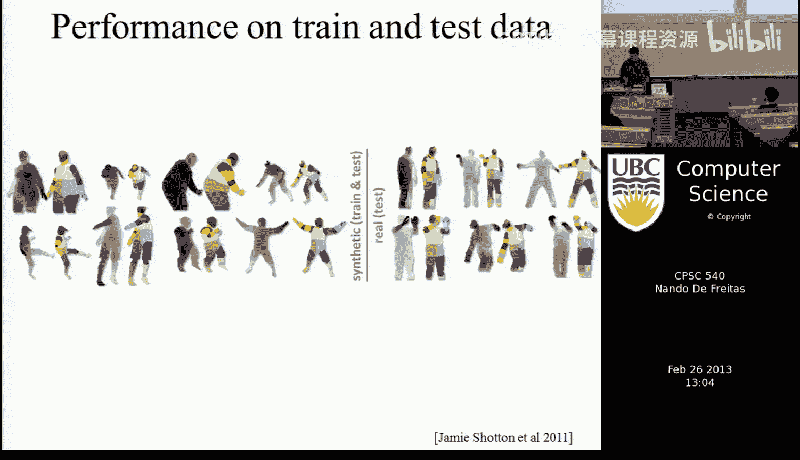

And so there's sort of other applications you can use the same idea for。

 where here I don't actually know what these guys are doing in particular。

Instead of segmenting their body now。I'm not using any prior information， like the normal。

structureuc with the left hand or the left right。So amount of information at。

 no information of like where body parts exist relative。To each other。Yeah。Each body part。

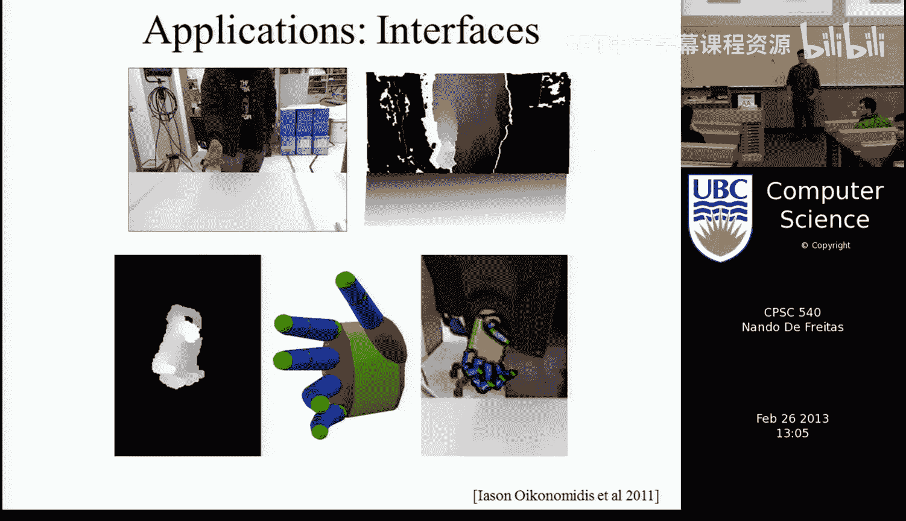

We bought。Yeah， actually each pixel is label。So yeah。

 what you see there is you see they're segmented into colored regions。

 but actually each pixel in this image is classified independent。好。using this sort of thing。

 so each pixel becomes the center of a window and you run the end forest to get a prediction for it。

 and that's the dimension for so that color is just one pixel。And you do that for every pencil。

 so yeah， they're not using any like smoothing information。😔。

Like some sort of additional structure I thought knows about the geometrymetric。な么か。

the fact that pixels belonging to the hand should be。Near other places。Yeah。

 I mean that's definitely possible and a lot of that's done a lot what you do is you use。

You use a Markov random field。A grid。You have connections between latent variables。

 which are the classes， and then you have connections to actually the measurements。

 which are your classifier outputs。The potentials in the hidden field sort of encourage everything to be smoother so that we've got a whole bunch of arm pixels like surrounding like one leg pixel the leg pixel。

But as far as I know， the Microsoft Connect stuff doesn't do that。

 but I mean it's definitely possible。That's done。

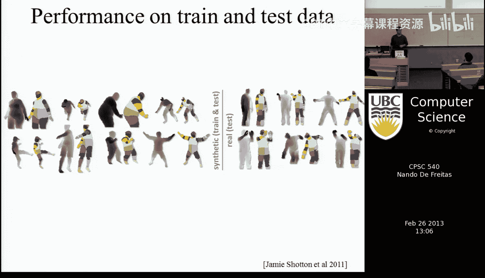

这严的。This is just show me， like I said， I don't actually know what these guys are doing。But。Or I mean。

 I don't know what the purpose of this is， what they're doing is pretty clear as they're doing a sort of a very fine grain segment。

😔，And so like Microsoft， I said， they use like a fairly fine grained taxonomy of body parts。

 but of course you can go by finer， they have like a left and right hand。

pieces of yarn where these guys are just interested in getting a very good idea of what an individual hand is doing and where the fingers are and where。

😔，Individual joints。And。Plays that I'm not entirely sure what they're doing this。

So everybody it's just like another。Application that you can use this same idea for。

 so this could be done in exactly the same way。So yeah， because guess that's one you say。

Any questions for the connect before。嗯。Not specifically about the Connect with ground forests is when choosing between more trees or more branches。

 like and Nada was saying that often in practice， the tree is just a single feature。

 like just a single。Yeah， it's like a stump。 Yeah exactly。

 So how do you choose between the two trade offs between stumps and trees。

So to trade offs feeding some， so trees for a number of trees， it's usually more is always bad。

Generally limited by how much time。You generally don't make。

It's considered like a fixed size for the tree or something。

10 trees are going to be better than five trees， 100 trees are going to be better than 10 trees pretty much always but for a fixed amount of computation know where you can have a million trees of stumps like a million stumps or a0 trees with 1 thousand0 branches so that ends up being problem dependent so for instance the connect the connect example it works。

What works well is very few， very deep。Oh yeah， so I think what they actually use is。Three treats。

And part of that is for computational reasons it takes longer， they have to do this in real time。

So they're very motivated by going quick。So it's actually pretty quick to pass a point through a treatment if you have to do it 100 times that adds up。

 so what they do is they use， I believe it's three that could be wrong。😔，A very small number。

 very deep truth so that the trees might have have like the longest path in the tree might be 6。高长。上。

true。And so yeah， we've seen that as well trying to， there's some connect data。

You really need to train for the connect in particular。😡，是8。So。

And I guess used just cross validation to figure that parameter of。

 but they want to choose the shell trees for the fixed amount。You're saying like。

 so you want to know？这事吗？Yeah， you have to use something like cross validation。

It's generally going to depend on the problem and it's not necessarily obvious just like looking at the problem which is。

😔，Mdfully， as was saying， I know for the connected。It's better to have fewer deep trees than to have。

Not very many， very short trees， people though often use things as short stumps with random forests。

 they're very popular in loose。Which is sort of a similar。睇不到。发张。

Bosting has this sort of boostting is sequential and what it uses is some sort of clever reweighting of the trees you in random forest。

 you just average the trees at the end， they're all completely independent。

 you train them in parallel and you average them so the individual classifiers。

 you do something clever， but the ensemble you do something very not。

So there's another side of this which just like boosted where usually you're usually less smart about the individual classifiers and there it's very common to use like just stops just one line。

 but you do something clever where you fit them in sequence and you fit one and you look at the errors it makes。

 and then you reweight your data and then you fit another line and you look at the errors they make together and you reweight the data again and you end up with like a weighted combination of these things that are each trained on weighted combinations of data。

so you get a sort of fancy combination。Where。How do to actually draw the line between and who I want to recover。

So。But he really has a good answer for other than crossfire。嗯。

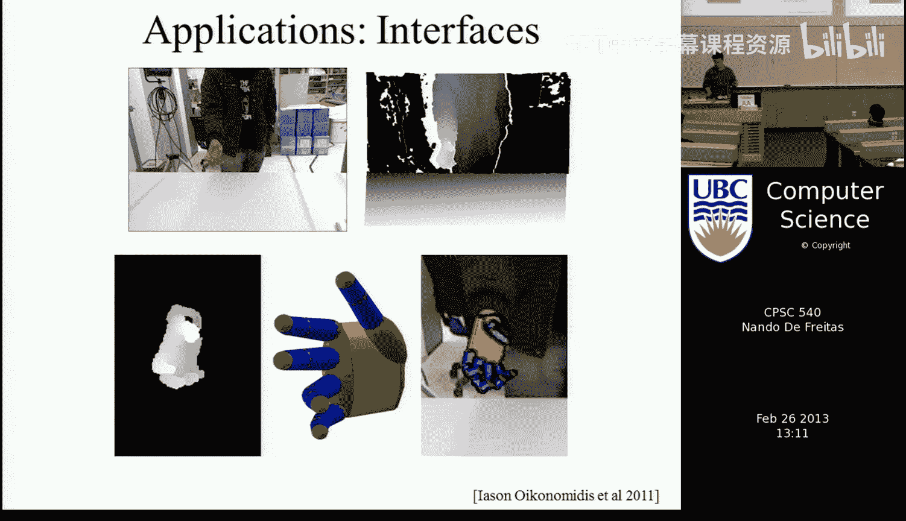

All right， so I guess this actually lost the amount to。发ら。So we've talked。

So I've talked and Nanda's talked about doing classification with these trees。

They are actually very flexible models can do。In addition to classification， you can do regression。

 which is what I'm going to tell you what' going to have。But if you look at the Cririmines book。

It's been telling you about it。You'll see you can not only use classificationation。

 you can do regression， you can do clustering。Density estimation。Manifold learning。

They have this you can send supervised versions of all of these。

And so each of these sort of layers on its own。Additional bits onto the base algorithm。

 usually in how you decide where to so there's two places that these will change。

 how you decide where to put the split points。So like what functions do you actually use like in classification use the information gain。

 but you might change that out for a different function for other tasks。

 it's actually the same in regression。That's sort of。I' two examples。

We're going to show you you can change that out for other objectives。

 or there's also what models do you put in the leaves so in classification'。😔。

Talk about like fitting a histogram， you just fit a histogram。You take the majority。

 you take the highest peak in the history。I mean， for regression。

You like what this slide is showing you where it's actually fitting on a linear model。

See you actually in the second thing if you picked， or sorry in not first。example。

 if you picked that split point where it's got that question mark there， and then you look at like。

You date off on the left， and you can fit something like this Bayian layer。

You have a linear function， and you also have。At each point， you have a Gaussian。

Whose mean andvaris are a function of。好的，1余点。I mean I'm sure you guys have talked about actually just fitting these models to data。

 but you can actually put models like this in the leaves as well， I mean。

 principally you can put whatever you want in the leaves。They practice you。

And you worry a little bit about what will I have with data in the leaves？

Defend because when you're growing a tree， I mean， trees have a lot of leaves。

 like a tree of down of D has something like two the D。Ororder of。It's a fault。

 so that actually is going to partition your data pretty fine you see if you're in high dimensions。

 for instance， you might not have a data。A very complicated one， which is why people use things like。

Whi is why people use really simple things like histograms or some common one for regression。

's actually just to fit a constant function in the leaves and then each tree is sort of this piecewise。

Constant function。how you've divided up your space。

So sometimes it's nice to be able to do these fancy things。

 which you have to remember that you tend to need a lot of data to do something fancy。

I think there's a paper somewhere where people fit like even down your processes。You image with。个快。

So you can't。我会す。But。So。So anyway I'm sort of getting。我觉咯。

Focused here is I wanted to tell you about what you do for the。To fit a Russian juice。

Basic idea of how you would fit。Let's trip it soon。还有。

In a what ways it's exactly the same as you would do in classification。

 you've got this same tree structure。Build and you're going to build trees independently and each tree you're going to build by recursively splitting these nodes until you reach some stopping criteria。

To split each node， what you're going to do is you're going to sample dimensions or you're going to sample dimensions。

😔，哦。Based on optimizing some sub function， you're going to look at all these dimensions and over each of them you're going to optimize。

Some gain function and you're going to choose the rest， so in that sense it's exactly the same。

Pasation。In this sense it's actually in this case， in particular。

 it's actually even more like classification because you're actually going to still optimize an information game。

 and the differences what you're going to do employed before in classification。

 your objective is discrete， so you're going to optimize a discrete information gain。

Whereas in one in this version， you're going to optimize a continuous version of information and it actually looks exactly the same only difference as computing the entry。

So。Remember the information gave？What information day looks like？唔该。So S is your。是。

This is the position。So this is the entropy of。Whatever is in your leaf and you're going to subtract。

It was totract this beed combination。So this S is。Like either don matter the right child。

Created advice。放。So the information bang looks like this where you take the entropy of the distribution。

 you look at where you're going to split it， and you subtract the expected entropy after that split。

And all the changes to go from classification to regression here is how do you compute this entry？So。

And how you compute that entropy is going to depend on what is actually model you're using in H。

So when you're doing the histograms， it's done。So p啲。For this example here what you're doing。

This Bayesian linear model， what you have is at each data point you have you look at the prediction for each data point you've got a Gaussian。

 and so you compute the entropy of that Gaussian。Yes。I'm not going to write that down。

 and it's an integral instead of a sum。So in one dimension， this works out really nicely。

 you're essentially just looking at。The squared error。

 and so this becomes part like this whole thing is proportional。

 this being the squared error of your linear fit。and this is the squared error of the linear fit。清楚。

Or something pretty close。这也是。And so this is sort of what I was talking about with you can do different models。

I lot。Black ones where you just average everything。That's very similar to the histogram。A。

Like one of them。diuctionions histogram， you can fit fancier things。

 I don't think I've ever seen actually seen someone do what they're doing in middle where they have。

Different models。In the least looks like a quadratic on the left and a linear on the right。

There's no reason you can't do that， it's just it's sort of hard to do。Well I gonna be。

Say say if I'm going to give myself like the option of choosing three different models for each leaf。

😔，How do you know which one to choose？Do you really gain a lot by fitting a quadratic versus just like splitting it one more time and fitting too beer？

But the really interesting case is when you start doing these Bayesian。

 so you can do like the Bayesian linear models， like I mentioned where you get confidence intervals。

 you can also do。You also have confidence intervals with the constant version as well。

 where essentially it's a Bayesian version of the constant。吔屎。As well and those are。

Really interesting because。Mando told you about this。ま所。Liten those are interesting is。

You get a very interesting confidence， you get very interesting。I guess confidence intervals for。

Regtions where you don't have data。If you go this way， so like and when you're thinking about this。

 it's like the thing to compare it to is like a Gaussian process。Go some process will give you。

Their example here is you've got a bunch of data here and a bunch of data here。

And I got us through process we give you something like this。There'll be really low answer here。

So this is the kind of thing you get on this example from thegasi。

The point is like each of these x values like I would here。I've got this one Gaussian there's one。

 there's exactly one mode。At the mean and then I've got an interval。

But what the forest is giving to this where they're using。So this one。

 they're using the Bayian linear one。Ands。So as he， there's two leaves。Of。

 this are a very simple problem， so they are in fact just sting this one。I mean。

 very few problems in real life from this。But what you give it the forest。

The date over here you've got the date over here。And you've got these linear fits。です。

We' sort of drawing is too long。You get。Like this， so it's an average of things that go out。Yes是。

And so these things will be chopped off at various points， so like a decision here。

This part but which you can't say if you look right here。Is you get this kind of we have。Listen。

 what you have is actually multimodal。So with a Bayesian linear model， you're actually each。

The thing you get from the forest when you evaluate at a particular axisx is actually a mixture of gas seats。

Like sort of these two modes that you think are interesting。

 one of which is a continuation of this line and one of which is a continuation of this line。

 you haven't seen any data， you don't know what's that。But。煮单子。窗规。

A reallyally interesting property about what you get of。Confidence of with random and chorus。

 you can get these multimodal。So something that would be neat to do。

 which I think Nao mentioned is basic on optimization。With。These models。

 instead of rather than Gaussian processes and see if you do in practice actually gain anything by having。

The sort of more elaborate。Pousiity， more elaborate posteriors。Then get from。家视。我去。So。

 well get these multimodal Gaussians only at this plate。Point boundary， right，えとと。

Where youve seen the。So is that too interesting to。So yeah， so well。

 I guess two things one is like your prediction here is still a mixture of gas。

You get one Gaussian from every tree so what I'm talking about here is doing like in each leaf of the tree you fit a Bayesian linear model。

 so just in one leaf at each X point you have a Gaussian。

And so now you pick a new axe and you put it through the tree and you get a across。

 and you put it through the next tree and get another gase。But through the next tree。

 you get another gassian。And so the actual prediction of the forest is the average of all those gaps folks。

啊。But I mean。The other part of this is you're right。

 in somewhere like here where you have a lot of dense data that's pretty unique。

It's pretty clear this part of this is flat， what up with is you're going to end up with little gausss in the same place。

 like with overwhelming probability， I mean nothing really guarantees that you could have bootstrapped and just like not chosen any data here。

That's very unlikely。晚上。But for something like basing optimization。

 what's really interesting is what's happening in the areas you don't know。😔。

Because you're trying to explore the function， but you're trying to not evaluate it in too many points so when you know something's going to be bad。

 you want to actually avoid searching。😔，And so it's。あ別的。

These posterior estimates in regions of the space that you don't know much about that are。😡。

What are really important for driving the exploration。😔，是。I mean， It like I was saying。

 I don't know if this is a better way to do it than yasing processes。

I don't think anybody's done that， at least not with late。Well base models。 So I mean。

You do get these different things， so it's possible but。Like this could have an interesting problems。

 that's all I'm doing。ます。justThere is this interesting phenomenon。B。I think they're like。

 that's all I have to say actually。I guess the next week you're going to talk about。

Doing optimization。expensive。所以。Yeah。

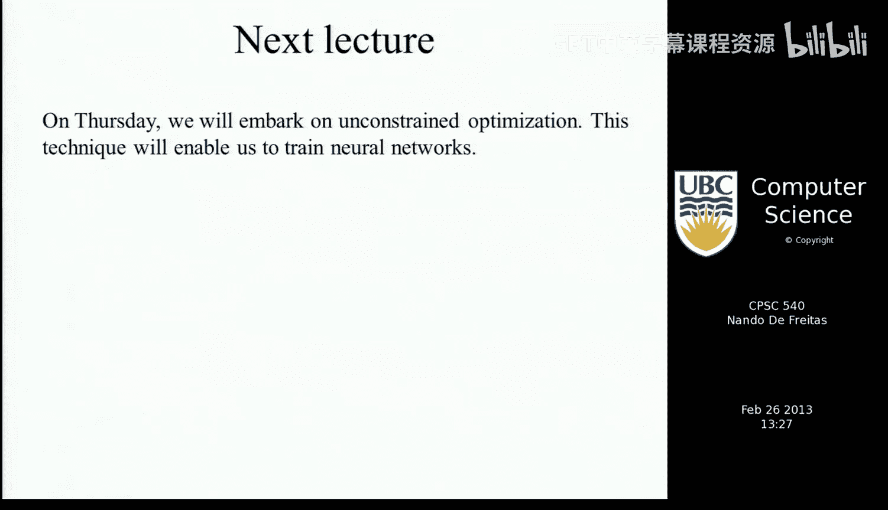