# UBC《机器学习（研究生）｜CPSC 540 Machine learning 2013》中英字幕 p14 -14-Machine learning - Unconstrained optimization.zh_en -BV19g2FBBEEq_p14-

And it's the area of optimization。So I started trying to convey to you the concepts of what is the likelihood。

 what are priors， what is Bayesian learning， whats frequent learning。

 and for that we use the linear model， mainly because the linear model is very tractable。

 you can do everything analytically。With the Gaussian process too， we did everything analytically。

With random forest， we kind of obviated the math but we saw highpopoistic model。

 and we did it in an incremental way， so in an algorithmic perspective。It's possible to。

Take that into an objective function， but sometimes the algorithmic that you optimize。

 but sometimes the algorithmic perspective， is just very clean， very natural to explain。

We're now going to turn up to the problem of optimization。 so in machine learning。

 often when we're dealing with complex models like neural networks or many other models， in fact。

We tend to formulate an objective function that we want to optimize。

 So an objective function also receives the name of an energy function。Or an error function。

 it's something that you need to minimize。嗯。If you take E to the minorrs。The cost。

 you basically get a probability。So maximizing a probability same as minimizing a cost function。

Because of this mapping between the two。 So this in machine learning was called empirical risk minimization。

Emirical because we're using the data and risk is another word for loss or loss or cost or energy。

 so there's a lot of jargon， but it all means the same thing。

So we're trying to minimize this cost function and that's。

for a Gaussian I already made a case that if you minimize a quadratic， you're maximizing a Gaussian。

And particularly， finding the parameters that maximize the Gausse and finding the mean of the Gauss。

嗯。Now， a lot of these problems will not be analytical anymore like they were before。

 and so we're going to rely on optimization techniques to find a minimum and an optimization technique。

 in short， think of a cost function as the mountains and whistle。

And minimizing a cost function means if you want to find the minimum。

 that is you're essentially looking for the place of the lowest altitude。

So the process of learning is start on top of Whistler。And go downhill。

Going downhill is finding a stable configuration is that。

Will be used for some predictive task and the way that I'm going to suggest you go downhill is by looking at the steepest。

 in other words， avoid the green slopes， just go for the double black diamond and follow those because that's the quickest way to get down。

Okay， so today we're going to talk about when we do optimization using the derivative of the function。

 there's essentially two approaches， first order methods， they use the first derivative。

 and then second order methods， as the name implies， they use the second derivative。

First derivatives and second derivatives， when we have vectors are called gradients and hess。Okay。

 so these are just two new fancy words to describe all concepts of calculus。

So we're going to describe then the method for estimating the solution when all we have is the gradient。

 and then I'm going to discuss a method for estimating the solution when we have both the gradient and the hesscin。

 which are the second derivative it。That method is known as Neton's algorithm as well。

 and then we're going to deal with an important problem in optimization。

 which is you might be applying a neural network to Twitter data， for example。

But now the Twitter data keeps increasing， because if you're monitoring tweets。

They keep coming at you every day。 So the data set doesn't stop arriving。

 So we call these streaming applications because the data is streaming in。Same as us。

 we learn to see throughout live and we keep getting data coming into our census。

 it's not like we've collected the data done some analysis cross validation。

 the data is coming in continuously and being captured by our census。And so for these applications。

 the idea of let's store the data first do the computation。Doesn't make sense anymore。

 As the data arrives， we need to update our parameters online recursively in time。

And by recursive here， I mean online， as opposed to recursion in the standard computer science sense。

 there's a recursion in time。All right， and to illustrate these techniques， all of these techniques。

 I'm only going to use the linear model because that's a model that we all understand well by now。

 so we're going to use the linear model and we're going to apply。

 even though the linear model has a direct way of computing the solution。

 the idea is I'm going to show you that these optimization techniques could also find the same answer that our analytical computations in the linear model。

 in fact， they'll be equivalent as us will show。嗯。And then in the next class。

 I'm going to introduce the first step toward building neural networks， which is logistic regression。

 which is essentially a network with one neuro。And we're going to apply all these techniques to logistic regression。

Now， logistic creation is extremely popular in industry， companies like Twitter。

 companies like Google， they use that technique extensively。

 it's sort of one of the workhors for binary classification。

But you'll see that using our ideas of optimization。

 it's going to be very easy to apply logistic regression and practice。

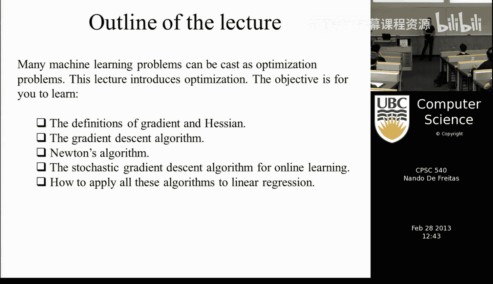

Okay。So。Let's assume we want to optimize a function。And let's assume that this function。

So that I can plot it has two per。So the function is this quadra is this function here。F。

And F has two parameters， Theta n and theta1。So for example， when we do linear regression。

With the cost function that we。So we minimize this cost function。

And then I've argued before many times that if you want to minimize if this is F。Minus f is just。

You know， the same function flipped over。Okay， so if we have a ball and we want to minimize it。

 that's the same as maximizing minus the ball。So we want to maximize this function。

 the negative error。And we have two parameters， theta n and theta 1。

 the function is plotted here in purple in 2D or magenta。And at any point。Or， I should say。

 if I were to cut this function。So I sliced it horizontally。

 then I would get these lines here in black and these are contour lines。And of course。

 a contour line just means same height。Okay so we used to maps。

 we see these in maps on the web all the time so if you want to go ski and you want to know the height of the different peaks。

 most ski resource will give you a map of contours that indicate the height of where you are so those are the lines Now there is a theorem。

That I hope most of you saw in calculus too， because that's what it's proven and that theorem says。

 and if you didn't see it before， I strongly recommend you just like gradient factor space Wikipedia and go to Wikipedia。

The explanation is that。That theorem tells you that the gradient。And the gradient definition。

Is this is the derivative of the function。Of several parameters with respect to each parameter。Okay。

 so for this particular function here。The gradient。Of F of theta n and theta1。

And keep in mind that I'm using the boldal symbol to the node vector。

Which I can't do both with a pencil or I discard it。

And that bulk vector has two components that are scaleald， theta n and theta 1。

 so this is a vector in arc 2。So we're doing a linear regression where theta node is the intercept and theta1 is the slope。

Just like before imagine the machine learning task is you have some Ys。

 you have some x and you're fitting a line and then the slope is theta word。

 the intercept is theta not， so thiss the sort of typical exercise that we've done。

Kind of ad nauseum now in the course。The gradient then is just equal to， in this case。

 there are two parameters， so the gradient is a 2D vector。And it will be the derivative of F。

With respect to Theta。N and the derivative of f with to theta1。Okay， so that would be the gradient。

For this particular function， so the gradient would have to。Two components。

That is the gradient is a vector in 2D。Now the gradient will be a function of theta as well。

 okay because the function is a function of theta if you differentiate。

 there'll be some theta still left。And so。The gradient will change depending on the values of theta n than theta1。

These arrows that I'm plotting here。The blue arrow， that's the grade。Now。

 that theorem says that the gradient， which is 2D in this case。

 is always perpendicular to the contour plots。Okay， that's a classical result。Of calculus。

I won't prove it， but I recommend you go to Wikipedia and look at the pool or how many of you saw this in calculus。

 proving that the gradient is？So about half of you for the other half。

Talk to the ones that loved it I had now or probably saw it and forgot it because it was a long time ago。

 but that's sort of a classical calculus exercise。 if you haven't seen it， go to Wikiped。嗯。Now。

 from this course perspective， what's essentially is that you know the conclusion of that theory。

That theta node that the gradient is perpendicicular liquidor fls。

And what that means is if you go perpendicular to the contour plots。

 you essentially are going in the direction of greatest descent because you going so the contour plots tells you the direction of equal height if you go perpendicularly you essentially are going in the direction with the height changes the most but so in other words。

 again， if you're skiing or' no boarding and you follow the gradient。

 you basically pick in the double black diamond slopes。

 you're trying to go down as fast as you can taking the most risk。If you have， if the function F。

As we'll see later when you use a neural network， this function you could have many parameters。

 the typical networks that people use these days involve like 100，000 parameters。Sorry。

 100 million parameters。 and so the size of the gradient will be a vector of 100 million components。

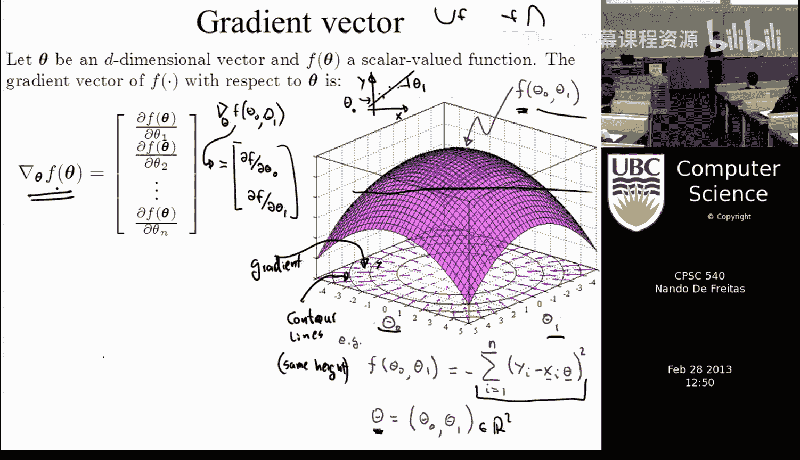

That we try to estimate online。If you do not have a quadratic function。

 but you're trying to minimize a function that's more like what you get for a neural network。

Then the idea is you， you start at some point。And what you do is you take a guess at what you think theta might be。

And then after taking the gas， you followed the gradient to the bottom。

Now if you start it in a different place。And you follow the gradient。

 you would end up at a different solution。With a quadratic， our solution is always here。Okay。

 because a quadratic， no matter where you start， if you're going uphill， you'll get there。

You'll get to the same point。With the function that's non quadratic。

 then it does matter where you start， if you start in Black home as opposed to starting in Whistler。

 which are two different mountains an hour and a half from this classroom。

 you will add up a two different local minimum。One will hit a lake。

 one might hit the village of Whistler。Actually， one will hit another village and I've been part of that experiment because once I hit this other village and I'm like。

 what am I and I had to catch the bus and so on， I don't know how many of you have gone through that experience。

第 for。嗯。Especially if it's the last run of today。See these guys have experienced it too。は怖。

It's one of avoid drinks。冇空明吗？We had a velocity term to that so that。

You're doing your gradient descent each time you iterate it adds to some velocity。

You can overshoot any local minimum。 Yes， indeed。You're doing physics again。Yeah， okay。

 he's a physicist， so physicists immediately think in terms of dynamics， speed， not just position。

 but speed and so on， and indeed optimization people do that。And this speed term。

 something very knowledge to that well speed momentum。And so momentum is just empty。

 some ma times velocity， and so people do add a term to do that， so neural networks。

It's calledThe terminology is momentum， and it's used a lot actually to get quicker conversiongence。

And today I'm going to talk about two tricks to prove the convergence of this。

So but we'll start first with the notion of gradients。

 and then we will introduce more and more complex algorithms。And， of course。Our solutions。

Might be different。But the whole many problems tend to have many solutions。

But each of these solutions is reasonable。And the way we know that it's reasonable is again。

 we conduct some cross validation or put strapping to know that to estimate how good our model is。

So to assess the quality of the model。嗯。But yeah， we're no longer in the world where we can find a unique solution。

 So a neural network in fact， finding the parameters is an NP hard problem。

So this optimization is it's hopeless。To expect that you'll find a global optum because that would take know longer time than。

The sun will exist in our universe that says you what exponential time means。But。

Like I've argued many times before， a lot of the problems that we encounter in nature are not of this worst case scenario。

By the way， I think the major price for science was just awarded to。Professor Toronto Stephen Cookch。

 who works on NP Harness。Ofside and all。嗯。Which it means that computer science keeps getting lots of awards for the top research done in Canada these days。

Good thing for us for those of you here doing computer science。

 actually for all of us because we're all doing computer science right now。But in going back to。

The world is not adversarial as the theory of NP hardness sees it。

 if you have images and the size of images that we sense is of1000 by100 pixels。

 so roughly a billion pixels is what goes through our optic nerve to a vision。嗯。

And so if you consider all the images with 256 possible colors。

 the space of images then would be the total possible set of images for which we'd have to learn would be 256 to the power1 billion。

And 256 to1 million is a huge number， like our brain would never be able to deal with such a huge number。

Which is probably more than the number of atoms in the universe too， but I don't know that for sure。

Physicists， is that correct？So。嗯。But we are able to see- not only are we able to see spiders are able to see。

 as I've argued to you before， you all the creatures have a brain to move around。

 most creatures are capable of seeing。And so。How can it be if the computation is so hard that we can see。

 and the reason is because the set of images we encounter in the world is much smaller than that space of。

256 to the power million。The type of images youve see in your life they tend to be the same。

And if you move away from here and you go and live in Singapore， you'll see the same kind of images。

Trees still look like trees and so。Things are still smooth， there's edges。

And so the average case is much smaller than the worst case。O。

So one should not be worried about the fact is the optimum that we find a local opt。All right。

 so the other concept that I need to introduce is the concept of second derivatives of effect。

Of a function of several arrows。Because here the catch is that this function is a function of more than one variable。

 a function of several variables， so the derivative then becomes this vector of derivatives。

If we want to compute the second derivatives， then we need to consider all the possible cases so you could be differentiating with respect to theta 1 twice or theta 1 and then theta 2。

 or first you differentiate with theta 2 and then differentiate about theta 1。

 so depending on the order in which you pick the parameters you'll end up with a。

And by n such derivatives， so that matrix then of size n by n is what we call a he。

 so that's the matrix of second derivatives。When we have。100 million parameters。

 That's a very large matrix。 It's 100 million。Squared。好少。Okay。So in machine learning。

 so the entire field of optimization is dedicated to optimized functions。

 there's many good courses here at UPC on this。We will be focused here on functions where there is an element of randomness。

And that element of randomness for us is the。So we're going to have a data set。And for now。

 we'll assume that it's a batch， and we will use the term batch。

 which is a term that's used in machine learning to describe a group of data， it's a batch of data。

We have。And such data， if we were doing regression。

 the data would consist each data point consists of an input and an output， an x and a y。

But for simplicity for the notation， I'm just using access here of the ofviated pairs。

And so the function that we want to optimize， which for short， I write as if of theta。

 is really a function of two things， it's a function of theta， and it's a function of the date。

And in particular， it will be a function of this form。There will be an hour over the date。

And when we compute derivatives。We take the robot top with respect to Theta， which is the gradient。

And because of linearity， again， this constant one over n comes out and we can take the derivative derivative inside。

So if you want to compute a derivative of the cost function when you have data。

 you just need to compute a derivative with respect to each data point individual。Here is an example。

 so we know that the cost function， and you could put here or not a one over n。

 it really doesn't matter if you don't have the one over n there because that's a constant factor and disappears。

嗯。But typically in regression， this is our quadratic cost function and we can rewrite our quadratic cost function like this。

 this is just a sum of squared errors and we minimize it to find a least squares estimate。

And as you can see， this is just like this。So this of that form， so each of these guys here。

This is just an F。Of theta and X， I。And in this case， in particular， it's X I and Y I。

Each data point here is a pair X， I，Y I。So。And most cost functions。

 neural networks and in logistic regression on， they will all be of this form。

 They will all be a sum of terms。There will be a different sum of different terms。

 the function will be slightly different， there will be functions that will look like entropy。

Cross entropy。Or like the zero1 error。Which I will define later。But。

The form is still a sum of these error terms。Okay， so。How do we get the gradient of a function？

 So let's do our quadratic cost function。If that's our function， then the gradient of F。

 there's two ways you can go about getting it。If you know matrix differentiation。

 things are a lot quicker， the gradient of F of theta。

It's just equal to the derivative with respect to theta of this gun。And so it's D by the theta。

Of y transpa y-2。嗯。2 y transpose。X theta。Plus。Fter transs x。 transports X Theta。Okay。

 and that's just equal to。Minus2 x transpose y theta。Plus，2 x transpose x。Theta。

 that's a the same calculation we did before when we did linear models。And alternatively。

You could have taken the derivative of this。And if you did。

You would have ended up with the gradient of effort of the。Is equal to there's a two there。

There's a minus2。And then you take the derivative respect to each term， so there's still a sum there。

And then you would have an X transpose。Yi minus X。And these are vectors。你啲系。그。Do I？ Oh， yes。

 I do have an extra data。 Thank you。Okay。And then this expression is the same as this expression。

Okay， so one is in matrix form and one is in vector single component。If you are Tahasian， let's see。

 what did I use for Tahasian as the symbol。Squared。If you want a Hessian。Of F theta。

Then that's derivative with respect theta of the gradient。And so you get0。And then you get plus two。

X transpose x。So I know the words。2 x transpose。That's the he。Now。

So that's essentially the example what in this case， the gradient and the HNR。

 and what I'm going to do next for the rest of the lecture is I'm going to go first describe to you how to follow gradients and then I want tell you how to use the curvature of the function。

 because that's what the second derivative measures， the curvature of the function。

And I will describe the two algorithms that would allow you to optimize a theta。

 and in both algorithms we will be coming back to these expressions。

So so we'll use this particular pool。Forms of the Hassian and the gradient。Okay。

 so the first algorithm is let's just follow the greater。

 let's just pick the direction of the greatest descent and go and follow that direction。

So if you have a quadratic。And you're here。 Let me try to use a。Color with contrast。

You just go down to the minimum。Fit does or if you look at the control plot。

 you would be doing something like this。Where you would be perpendicular to the contour plot and you're going to the minimum。

If your function is like this， then you would be maybe following。This to get to the minimum。

 or if you start here， you would maybe。End up going。That' why。And in each case。

 what you would be doing is you would be going perpendicular to the contours。And so。The gradient。

 as I mentioned before， the gradient always points in the direction of greatest ascent。So。

As we saw in this picture， the gradient is pointing。

The gradient factors are pointing towards where the maximum is。So in other words。

 away from the minimum。 So in this picture， because we're minimizing their people。

They're pointing toward a maximum。So in order to minimize， we just take the old theta。

 so we start at a particular theta K。And we go in the opposite direction of the gradient and we get theta K plus one。

Okay，So the gradient is pointing away from the minimum， so we need to go in the opposite direction。

 and that's why we have a minus。If you want to do maximization。

 all you do is you change the minus for a plus。So you just change the direction。In which you trouble。

And the gradient I'm just using the word GK， and sometimes I will write it like this That's just a question of。

Which symbol you， which symbols you want to use。Now， in addition， I'm going to introduce。

A constant here， a constant term called a step size。Or the learning rate。This tells me by how much。

How much I trust my。How aggressive I want to be？If I want to be。

You know how essentially think of it as the tradeoff as to whether you want to go through a smoother trajectory or whether you want to go too fast。

Now， if you have a ball。Okay， so let's imagine there's a ball here。Now， if I go too fast。

If I decide to go too fast。Down the ball， what's going to happen？ Will I get to the minimum。

If I have something like this， let's see if I can do it then。

So I have a ball like this if I throw a coin。What happened？It didn't stop here， at the minimum。

You overshoot。So if you have too much， if I try to throw it slowly， it might。

Oscillate and then comes back to the minimum， if I throw it too quickly， it overshoots。Right。

So if something is going down， it might just end up oscillating because it's going too fast。

So imagine it's like a super fit snowboard that it's capable of going up， maybe he's holding。

 I don't know， some engine or something， and keeps going up and down。But if you go too slowly。

That is， if I put like bubble gum on the edges of this coin。To slow its progress。

To make it very sticky， then it might go very slowly and then it gets stuck。

 because it's called sort of gum。It makes it sticky， stick to the paper。

So Eta controls essentially the stickness of this coin or the momentum if I make it go too fast in that direction of the gradient。

 it will overshoot， so if E is too large， it will overshoot， if E is too small， it will get stuck。

So there is an issue of tuning E。So。She let me bring that。 So here is that picture。 So in this case。

It is too small。And so we're following。That the new theater is equal to the old theater。Minus Eta。

Finds the gradient。And the gradient as evaluated at the previous the。 So in this case。

 first note that the gradient is always perpendicular。To the contour plot。

But what's happening here is there's bubble gum， so it gets stuck， it never gets to the minimum。

It is too small。In this case， E is too large。And so if ito is too locked。

 then what happens is it starts oscillating。And it doesn't converge to the optimal。

And in the rest of the class， we look at several strategies to deal with the choice of heat。

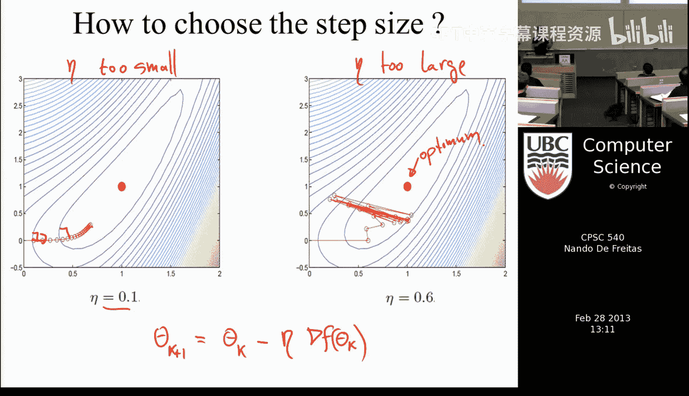

Okay， so let's first see how we do gradient into central linear regression。

 So if we're doing linear regression， we know that the Hasian。Sorry。

 the gradient of EO theta is just equal to minus2 x trans plus y。Plus 2 x trans plus x theta。

In other words， then your algorithm will be theta K plus1 equal to theta K。Minus Eta。

And then we write this expression for the gradient。M-2 x transpa y。Plus，2 x trans x p K。

And that's the algorithm。So you just have a loop over k， so K is the index of the loop。

 and you start with a random theta， and then a teach step， you add to theta this term。Okay。Or。

If you want to rewrite it not in matrix notation， then this would be theta K minus Eta。And then。

still good哦。So there'll be a minus2。And there'll be a sum from I equal1 to pen。X I transport。

Y I minus X， I。Fret。And as you can see that。If you have a good fit to the data。

If you have a good fit then that term is going to be small。 And if that term is small， and this is I。

If this term here is， so this basically is a measure of the fit to the data。If that term。

 if y is equal to x theta， if you have a good line， then that term will be small。

 So when that term is small， that means that what I'm adding to this guy。

It's going to be very little。 So teacher stops changing。But if my error is large。

 then chi theta will change a lot。

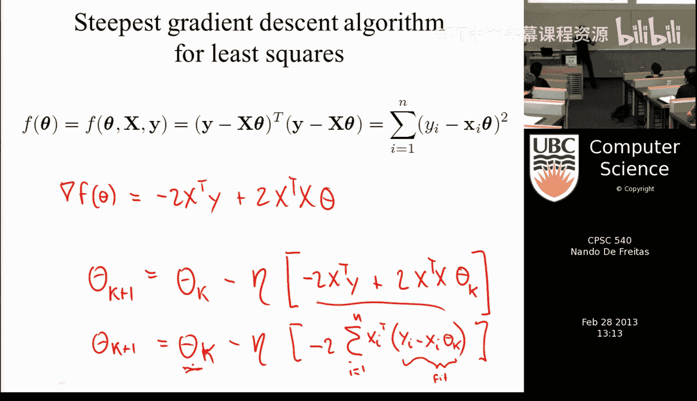

Now， let's look at the second order methods or the Newton methods。So in the new method。

 we're going to introduce the matrix of second derivatives。And the。What we're going to do。

And this is the only difference with the gradient descent is instead of using Eer。

We replaced Eta by a whole matrix。The inverse of the He。

So instead of using Eta because it is hard to figure out what it is。

 you would have to try different ethos and see how which one works best。

How about we use the curvature of the function to decide how quickly it should go？

Sort of makes sense if you have a very steep。Function like this。Then you probably should go slowly。

If your function is very flat like this， then you want to go faster。

 you want to choose a faster eater。Here a large aer， so use a small eater， use a large eater。

So it seems that the eta that you have should be inversed proportionally to the curvature of this function and since the hesian measures curvature we use the hesian to deal with the curvature of course in this case I'm showing you the curvature in one dimension but a function in 2D has curvature in this dimension and curvature in this dimension。

 so we need to look at the curvature in all dimensions and that's what the hesian captures。Okay。Now。

 to。To derive this algorithm， we use a Taylor series。

 How many of you saw Taylor series in your undergrad？Dereee， that's most of you。

What you might not have seen is the Taylor series for multivariate calculus。

 but just like you define a Tayloror series as being the function at the new value。

The function at the new value。 So this is the new value。Or theta， this is the old value。

The function of the new value is the function of the old value。

 and then the series goes plus the derivative times the difference， the delta theta。

So this guy here is the change in theta。The deelta theta。

 and then plus a half or one over two factorial， which is two a delta theta square times the second derivative and so on。

 so here is just the same thing except we use gradients for the first derivatives and we use hasitians for the second order derivatives because in this case theta is a vector that has a matrix。

If we multiply a vector times a vector， we get a scalar。And a vector times matrix sum another vector。

 we again get a scalar， so that ensures that we still have a function， that's a scalar。Okay。

 so what we do next in order to find so essentially what we're doing is we're taking F。

And we're replacing F by a quadratic approximation of F。

 A tailor of approximation of order 2 is essentially saying at theta K。

 make a quadratic approximation。

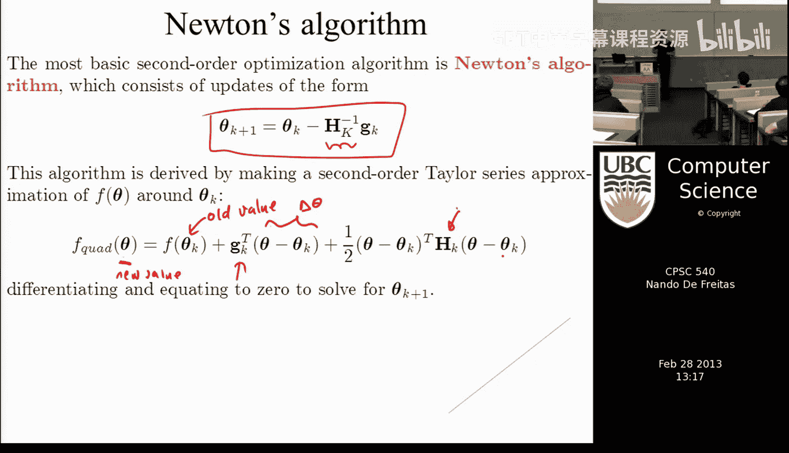

So， the picture。The picture the followed。In red here， this is your f of theta。

And then what we're going to do is we're going to use a quadratic function approximation。

F of F quad of theta。And we make the approximation be accurate around Theta K。Okay so around theta K。

 the approximation is very good， sorry about that so around theta K F quad and F of theta。

 they're both very close to each other。But away from theta K， the approximation can become very bad。

So we're making an approximation that's only good locally。And then we're going to take a step。

And we're going to repeat the approximation。

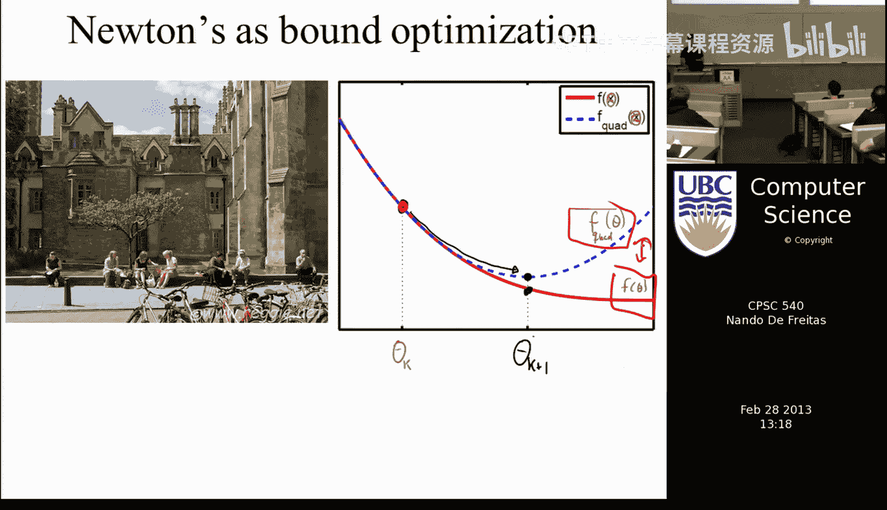

， but let's first derive the algorithm。So in theing the algorithm。What we need to do。Is minimize。

You try to bring another color。We need to minimize the quadratic function。

 so the idea is we have a function is very complex to minimize。

 So instead what we're going to do is we're going to fit a quadratic because that quadratic locally is going to capture the curvature。

And then we minimize the quadratic because we know how to minimize the quadratic。

So it's easy to minimize a pratic because you will find a minimum。And so to minimize this quadratic。

 we find the gradient。Of the quadratic。So we take the derivative respect to theta of this function。

 f quadratic。And then this guy does not depend on theta， so Theta K is just the old value。

 the one that we had already seen， and our free variable here is the new theta。

 which is just simply theta。So the derivative of the first term is zero。嗯。Plus。

 the derivative of the second term， which is shows GK。嗯。Plus。

 and now we need to compute the derivative respect to theta of this。嗯。Oops。And that's just HK。

S the minus3 K。Yeah， I just use my notes here， but you can go and check。They're such harm。Now。

In order to find a minimum， we equate this to zero。Okay， and so we have that。Minus Gk。

At the minimum is equal to hk times theta minus theta k。In other words， the optimal。嗯。Teacher。

Will be equal to。HK multiplies GK on the other side。And then you move the decay K to the other side。

It multi the button by the in for study。And so that's the update for the Newton method。

 that's where it comes from。

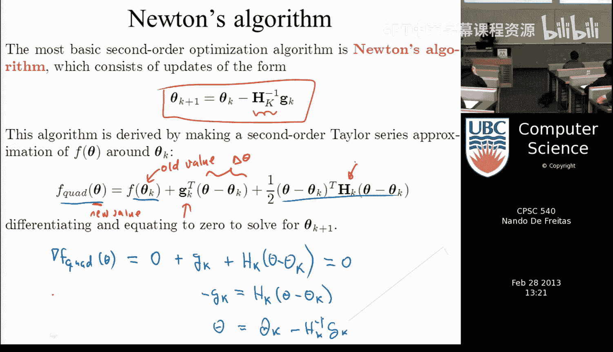

And so in the picture， we're doing a quadratic approximation。We find the minimum of the quadratic。

 which is this point here in blue。So that's theta plus y。

And then what we do at the next iteration is we repeat the process。So once again。

We find a quadratic here。And we minimize this quadratic。And that gives us theta K plus 2。

And that's how we proceed。This is the apple tree。In Trinity College， Cambridge， and Newton was。

He was in this building。 It either of this window or。Wait， just it this window， one of those windows。

 that's when you to news to live。For a while there apple tree actually well obviously that apple trees are tell you know thats the Newton story of the apple falling in his head or whatever。

 but this comes from a town nearby where Newton actually lived。

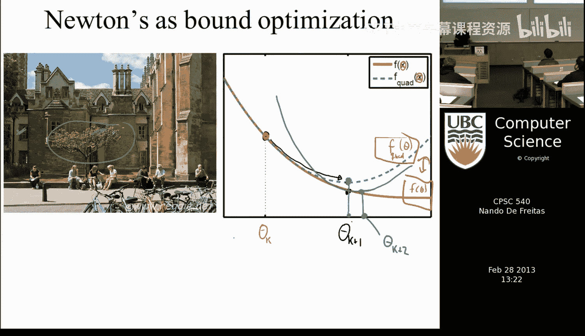

Okay， so let's look at Newton's algorithm for linear regression。 So we know that the gradient。G。

 which is the gradient of F。It's just equal to minus2 x transpo y plus 2 x transpo x theta。

We know that the Hasian。H。Whi is the second derivative。Is equal to x transpose。X。Okay。

So then if we have Newton's method。Then we simply have。Theta K plus one being equal to oops， Theta K。

Minus。And now we're going to write the hes here， which is two x transpose x。In first。Okay。

 x is not invertible because x is n by T， but x transpose x is invertible because it's a quadraic。

Mattrix provided， it has。Full norm。That is that it's full rank。And then times the gradient。

 And in this case， the gradient is just -2 x transpose。Y plus 2 x transpose x。

 and it' the gradient evaluated at theta K。Okay。Now。This is equal to T to K。

And now we're going to multiply these terms。 So the tools， actually。

 because this two is being inverted， that two will cancel with these other two tools。And so。

 minus times minus。Will give us pluss。X transpo eggs。-1 x trans y。

And then we will get minus times plus will give us minus。X transport x。Inverse times x trans x。P k。

Okay， now theta， this cancels with this because a inverse times a is the identity。

And so this theta will then cancel with this theta because you have theta k minus theta K。

And we get that the answer then is just equal to this。Okay that shouldn't be surprising。

 that's the least core solution， and I've argued that if you follow the gradient pay attention to derivatives you'll get to the minimum so with Newton method you're guaranteed in one single iteration。

To get to the minimum。And it makes sense because if you have a quadratic and you approximate a quadratic with a quadratic。

 you will fit it perfectly because all you need is one single step to get to the mill。

With the gradient method， you will get to the minimum， but only if you have the right value of Eta。

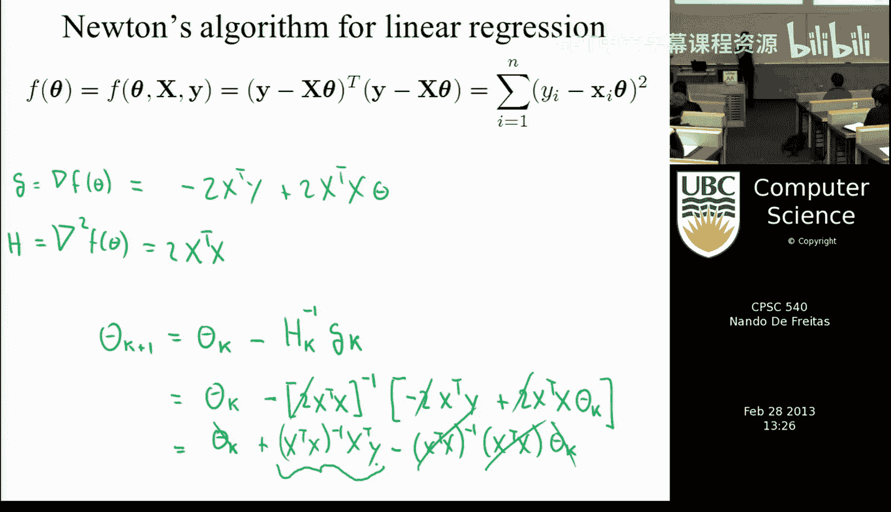

Okay， here is one practical concern when we implement the Newton CG method。Typically。

We write this as theta K plus1 equal theta K plus dk。

Where decay is defined as what it should be minus h inverse times G is de hesian。

But the advantage of doing it this way is that what we do is we solve first a linear system。

Because this guy here， D K equal h-1 G K can bewritten as a linear system。

And so we solved the linear system to get D。And then we add D to feet。

And the reason for doing this is that there are very good iterative methods for computing。

D for solving the linear system， as opposed to having to compute the inverse at each iteration。

And the other advantage of doing it this way is sometimes you don't need to run the iterative method to completion。

 especially in the beginning where you still don't know how far you are from the optimum。

 it might make sense to run the iterative method to get D so you just want to rough decent direction and as you get in closer to the minimum then you want to be much more accurate。

And so that gives so quite often in practice， you'll see that implementation is you first evaluate a gradient。

 you evaluate a hessian。Now， encode code。Most optimization algorithms。

 they require that you write a function that is the grade。

If you have a mathematical expression for the gradient and you'll see that for neural networks and logistic regression and I've already demonstrated it for linear regression。

 we will always have an mathematical expression for the gradient。

If we don't have mathematical expressions for the gradient or the objective， then what do we do？

You differentiation differentiationation？We could do that where is another way of doing optimization when you don't have gradients based in optimization。

So we've seen that in the course how to deal with the case where we don't have a mathematical model。

 but for neural networks we will have a mathematical model and we will have derivatives and if you have information about the curvature and you know the slope of the function。

 then you can do much better than by doing Bayesian optimization。 you can be much more aggressive。

 The other thing that we're doing here is we're being local in Bay optimization we're asking a lot we're asking to do exploration exploitation。

 so we're not being local when we optimize we're searching all over the space trying to be global trying to find the optimal minimum here we're being very aggressive。

 we're just looking for a local opt。And so， in the code。I mean， you'。

 I'm going to be implementing newton map。Very often in practice because there's very good software out there to Newton methods。

 if you're in MAlab， then I strongly recommend you use this function， mint cut。

This is by Mark Schmidt。It's one of the most widely used。

Methods for optimization machine learning using second order methods and on。

And all that code requires， and there's some Python implementations out there， I think， as well。

Its very similar stuff。Marshmid was a PhD here， he went to Paris to do a postdoc。Now。

 and that code indeed， you know， if like the people in Stanford everywhere use this code。

It's very good。And that code just requires that you write a file that is the gradientd。

 so you write grad， you write it as a function in Python， death， grad， the theta。

 and so you pass it theta and K， and it returns back to gradient。

And you do the same thing for the hesian。 So in the code， typically。

 you're not going to write all those steps。 The only thing you're going to write is。

Two functions for these calls。Then a function will return the gradient。

 a function returns that evaluates the hesst。And then there's very good code for solving this in MALB。

If you for can search for Min dress， I think it's called that。

 and I think it's called that in Python as well， so this is part of Nombe。

They are iterative methods for solving linear systems， we teach them in 402 here at UBC。

Does that do something different than soulul？I don't know what solved as N experts。

So is far which you might。该。Yeah， I'm not 100% sure， I'd have to look at the documentation。对啊。

So minre， you could also， it all depends on the properties of this function。

 if the function issymmetric you do Minre， if the matrix is positive definite。

 which it is in this case， then you can use conjugate gradients as well。

So a conjugate gradient is a method for solving systems that's iterative， mint bra。

 it turns out that all these algorithms are actually from the same family。

 a family called curllo methods and if you're interested by this type of nu optimization then next year take。

Take forward to fourth year course here， that's very good。If it's symmetric positive definite。

 are these methods related to L U decomposition。So you could just value the composition。

 but the thing we tell you the composition， you're going to pay the cost of NQ and so with these methods you're paying n square times the number of iterations。

Some of these like conjugate gradient， they're guaranteed to give you the same solution as LDU to compositionposition if the number of iterations is n。

 so if you do the same work at N cube， you get the answer。For a lot of matrices。

 if the matrices happen to have a lot of structure。

And typically machine learning they will have that structure。

 then the number of iterations will usually be much smaller than N。And if that's the case。

 then you profit from using these methods， and that's why we use them。

 It might be that all you need to do is 100 its and you're done。And then again， the same argument。

 as I said before， in the beginning of the optimization。

 if you don't get the gradient perfect and so you're on top of the mountain if you don't really find the best。

 steepest point。IfAs long as you're going downhill a bit， you will go down。

 the problem is when you get to the village down， then it starts mattering more because the slope there becomes flatter。

 so which way you go。It matters because you could get stuck。Iest we add some small di ham。

I see in the matrix。In case it's in a really linear area Yes。

 so then there's a whole family of what people call the quasiite Newton methods。

 which are variations of methods where you could for example。

 do- so your trick a thing as something called Lienburg Markwart。

Roughly similar where you add a diagonal term to the hessian to make sure that the hessian is easy to。

Has good properties， in fact that you can invert it。So people do that。In optimization。

 there's also this thing called preconditioners， which can help。Rishshaped de Hassian。

Without affecting the location of the op。We had a diagonal and the linear case that's equivalent to regularization then right to rich regression Yeah。

 it's very similar to rich regression So here's kind of being done for a different。Purpose。啊。

Optimization is a massive field。I think I don't know how many of you are taking Michael Frilando's course？

One， Michaelfredland War two。He's one of the top optimization people in the world。

And if you care about machine learning。That's probably one of the most important courses to take at TPC。

After this course in order to learn machine learning， because it's very good。

Or a randomized algorithms course。 But I think Nick is not teaching one this term。Finally。

 would love to have anybody in 542G。I'm sure。That's what。Oh yeah。

So Han teaches what they call sparse matrix linear algebra。

 and that's where they use all these methods。So they teach method。

 they're worried about solving linear systems and you kind of might think God。

 that course must be boring if all they're doing is linear solving linear systems。

 we've done that in second year， why bother and that's because solving this problem。

Actually turns out to be very tricky。And if you know how to solve this problem。

 then you can do optimization， and you can do。Neural networks and all sorts of things。

 but this optimization is sort of a sub componentent。Of the bigger problem。

Our optimization also has the element of randomness。The slight difference with the。嗯。

When we doing the perministic optimization。One last thing I didn't mention is this concept of line search。

 so most software in practice also does line search。

 I didn't cover it here so following the presentation， but basically line search is you look ahead。

 say one step。And from that， you sort of try to estimate the curvature。

 you try to decide whether you're going too fast or too slow。Okay。

Because if you look ahead and you see that your error has gone up。

 that means that you probably are going too fast。And if you look ahead and your error hasn't changed。

 that means probably you're going too slow。And so if you look ahead one step and you try to adjust your learning rate。

Then essentially you get something called line search。So most codes out there also have this。

 so like I said， the numerical optimization courses worry about this and this is what you will learn when you take a numerical optimization course for us we will use those procedures。

 they generic。Proceds for optimization， but we just need to know that we need to pass。

These two expressions， so we need to know how to compute derivatives and hassians if we know how to write the expression for the derivative and Hasian of any problem。

 then our job is done， we just now let their optimizes。Do the job。

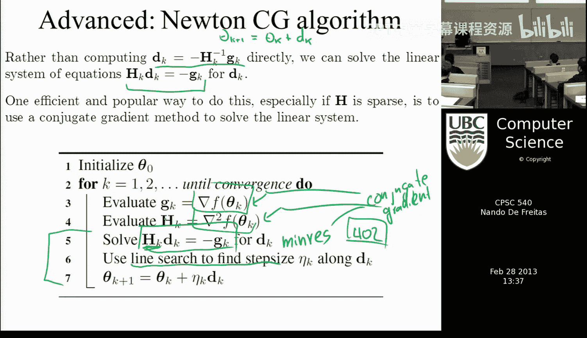

O。Now， let's end with the following problem。 The problem of the data is coming， but it's three。

And so today by the way， I give you an example of how to compute a gradient the hesian for linear model in the next class I will tell you how to compute the gradient and the hesian for a neuron to do binary classification。

 and then next week we're going to look at lots of networks。

 lots of neural networks and I will tell you how to compute the gradient and the hessians。

In those cases。I should also add that I mentioned a Tehessian for a problem with 100。

000 parameters or 100 parameters will be 100 million squared。Okay。And so。

Computing the hesian is actually expensive。Or even if filling it in is not expensive。

 storing the hessian is expensive。Okay，Because you have to store 100 million terms。Square。

 you might half it by using the factor submit。It's positive definite。

 but it's still a lot of parameters that you need to store。

And that gets you in trouble when you're doing very large scale problems。

 using second order methods are sort of preferable。But you pain in memory。

And if you have a problem that is too large。Your machines run out of memory when you use these methods。

So I think last year， in fact， for not the previous term for 340。

 people had to classify tweets and those who tried to use hes methods。

Ended up emailing the TA wondering what was wrong with the machine？And well。

 the problem was actually had run out of memory。So that's sort of there's a trade off there。

 the he is very nice。But it's problematic to store it。O。Assume， let's look at the following problem。

Let's assume that we want to compute。I mean。The mean of just an average。

 so one way to compute an average。Let's， let's say the average。Is it decay？And let's say that。

 that's the average。Of endpoints。Xi。So you have endpoint and you want to compute the average。

 you sum them divide by N。And。あ。That's your feet， and each x now here is K。

So that's one way to compute。Another way to try to compute it is recursively。

How do we compute the same thing recursively， listed the following derivation。

We'll rewrite theta K as Xn。Oh， sorry， I should say I think。Theta N。

And then the subindex for theta just means that it's a function of n Xs。So we take XN。Times 1 over n。

Plus1 over n。The sum from equal1 to n。inus1 of X。Also， all I did was I took the last term。

Out of the sun。Now I'm only going up to n minus1， and I'm going to do one more trick。

 I'm going to multiply n divide by n minus1。Okay， so I haven't done anything。

 but that allows me to nonetheless rewrite this as one over end。X n。Fs。1 over。And might。And-1。Times。

And。-1 over n。The sum from my equal1 to 8-1 X I。Okay so I've just grouped terms slightly different to make it obvious that this is equal now to1 over n Xn。

Plus， n-1 divided by n。Times。Theta and minus-1。Using our definition of the average。In other words。

Theta n is equal to。1 minus-1 over n。Times theta n -1。Plus， one over。X。If you are a computer average。

And your n is very large， and you con all the x's in memory， this is how you would do it。

You would just basically add one at a time and you would compute the average。And of course。

 there are trade offs here because adding one point at a time。

It means you're looking at disk space or some other storage device and you're getting that。

Into memory。And doing the update， now， lookups are very expensive。

Whether it's a disk or whether it's in a network。So you're in a store as much as possible to run。

 always。The problem is that there's limitations in ground。And so what we do is we basically try to。

Store as much as we have。 But be aware that we might have to do disk lookups or network lookups。

And so this is one way of computing the mean， this is the batch way。This is another way。

 and this is the online way。We're going to use the same idea for minimum optimizing gradients in machine learning。

Typically， in machine learning， we have an objective。

 And I say that objective was a function of theta。 but that objective also。Involves some data。

 so that objective。It's a function of theta and x。And there is some distribution over the data from where it comes from。

So the objective of machine learning。Always involve some data。

And think of P of x as the model of the world that generates the date。If we have。Samples。

Haucinations from the world could you know。Realizations of the data， then this gets approximated。

With one over n， the sum from my equal1 to n J of theta comma X I。

hi is what we had before at the beginning of the election。

 where I said the cost is typically a sum of terms。

 the reason why it's sum of terms is because what we're trying to do is we're trying to minimize this expected loss。

Or expected risk。Or expected cost。And this is basically， the empirical cost。

And then cost is also known as risk。In the machine learning。 So a lot of people in machine learning。

 they call themselves empirical risk minimizes。And that's because sort of a knowledge the data is coming from some distribution in the world。

 but we only get to see a few data points， and that why we think of machine learning that's why it's stochastic。

Because the data is are random variable， the frequencies， the data is are random variable。

 same for basins。Bass on top assume that theatertas are unfair there。But for this discussion。

 all we need to realize is that in machine learning。

 we're optimizing a cost function of both data and theta， and then we're integrating over the date。

With this in mind。We can also look at the gradient。

And provided that the functions here are all sort of， we have some nice properties。

We can just write the gradient inside。这 way。For most of the problems that we deal with in this course。

 we certainly can do this。There are， you know， I'm assuming linearity here of expectation。

 but linearity of expectation only applies， there are counter cases there are functions that can break that。

 not the kind of functions we will encounter。Here or that you'll encounter working for a company most like。

Now。嗯。If you do this。Then when we update。Fte okay。When we use gradient to send。We are， essentially。

Running an algorithm of this form。Okay， so that's just the expression for the gradient。And sometimes。

If we let。M be equal to one， so you only draw one sample at a time。You can write this as The Ky。

Mus Eta。J of Theta。Okay， and then。Xk。So you read one data point， you update Theta。

 read another data point， update theta， every time you get a tweet that mentions Obama。

 you update the probability that Obama will win the election。If that's what you are estimating。

He said that was the expression for the training。That's correct。J of theta x is the gradient。

 so a gradient of J of theta is the gradient。So in least squares would be like minus2 x transpo y plus x transpose x the。

O。And here what I'm doing is I'm just marginalizing over x。

 I'm computing the expectation over x to get rid of x。Just by study marginalization property。Now。

 the reason why I've written it this way is because here we're making a hell of an approximation。

 we're only using1 x at a time， but I will argue that this is essentially the same as doing this type of thing。

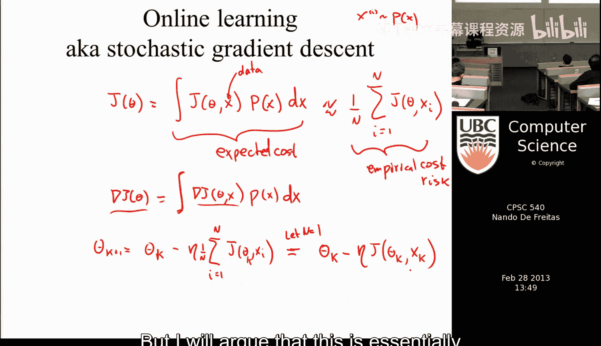

So， in particular。If I choose。

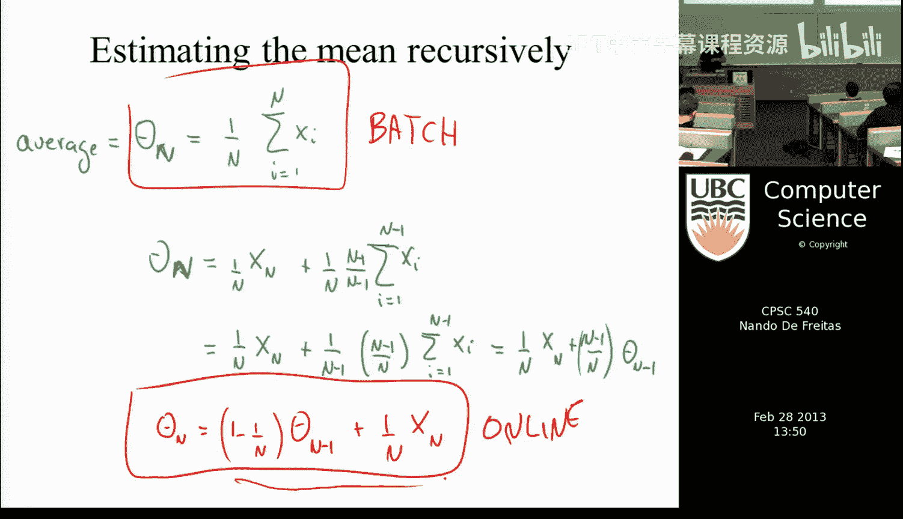

If I choose this eatta to be one over n。It's possible to prove， and that's outside the scores。

 but it's possible to prove that this algorithm will actually converse to the minimum。

 so if you have a quadratic function， it will get to the minimum。

So the theory tells us just choose Eta to be one of n。

And sort of I've given you a taste of it by giving you an example。

To give you a sort of more intuition is because you can write this as theta K。Minus。一er。J of Theta K。

Plus， eat。Times。J of Theta K。My nose。J of Theta K。Com my Xk。

And so what I did there in this line is I subtracted minus theta j of theta k。

 which is the expected gradient， and then I added it。So I added and subtracted。And the reason。

Why I did that。Is because then you can see that this here is the true gradient。That is。

 there is no uncertainty because of the fact that I haven't seen all the data。

 so this would be the gradient if you could compute the expectation。

Wwhichch for most distributions in the world， we will not be able to do it because we actually don't know the distribution that generated the data if you knew the distribution of the world。

 then you would know everything。But we don't know that。But if you write it this way， you can see。

That what we're doing is we're following the true gradient， and then there is a noise term。

That noise term is the difference between the true gradient when we do the full expectation and the gradient that is evaluated at the data that you've observed。

That difference is why these methods are called stochastic gradient descent。

Okay so the stochastic here is only because we haven't seen all the data in the world。

 it's not because we're adding noise， the noise is implicit in the problem。

It's the result of us not having seen all the data。Okay， so to finish。And actually， sorry。

 I went for a couple minutes。There are several ways to compute online the gradient。

 one way is if you have n data points。You can just use the expression for the gradient that we've seen before。

The online gradient。Every time you read an X， you update The and then something in between is the following that's called a mini batchge where you read 20 points。

 assuming that 20 points is what your memory can deal with。

And then you update the gradient for 20 points。So that's equivalent as essentially using this gradient here when your n is 20。

And those are the three methods to implement it for neural networks。

 you will be implementing this sort of thing。And this is going to be another parameter。

So you're going to have now two parameters。How do we estimate these two parameters quickly？

How do we deal with estimating meta parameters？Gussm process is based in optimization。

 So you put a basin optimization on top of this method， and。

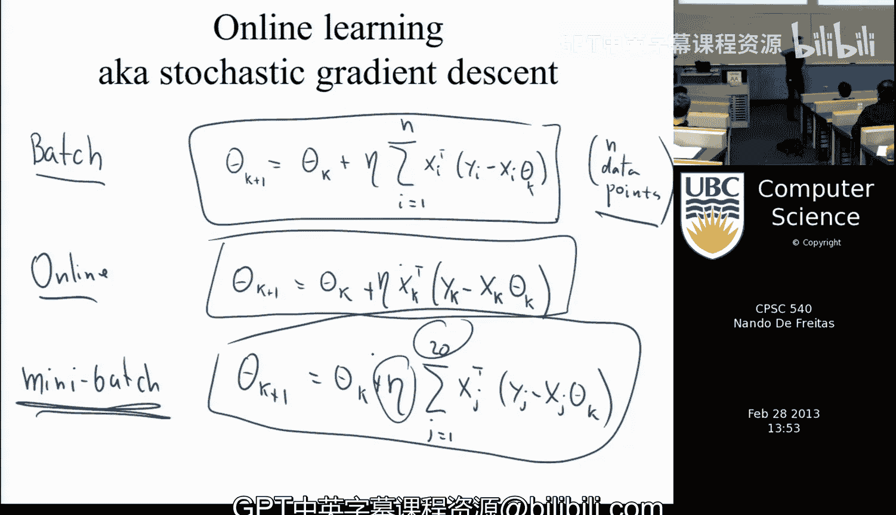