# 机器学习：14：无约束优化

在本节课中，我们将学习机器学习的核心组成部分之一：优化。我们将探讨如何通过最小化一个目标函数（也称为成本函数或误差函数）来找到模型的最佳参数。我们将从梯度下降法开始，然后介绍牛顿法，最后讨论如何处理数据持续到达的在线学习场景。

---

## 梯度与海森矩阵

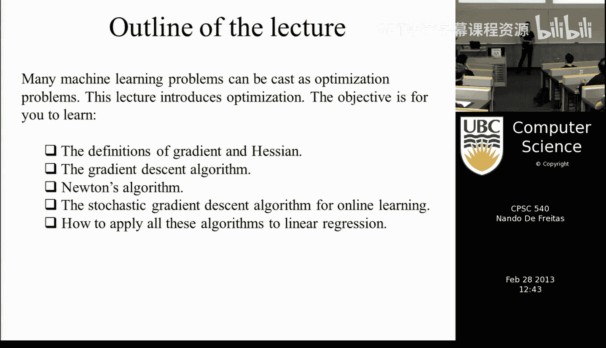

上一节我们介绍了优化的基本概念。本节中，我们来看看优化中两个核心的数学工具：梯度和海森矩阵。

对于一个具有多个参数的函数，例如线性回归中的成本函数，其梯度是一个向量，包含了函数对每个参数的偏导数。对于参数向量 **θ**，梯度 **g** 定义为：

**g(θ) = ∇f(θ) = [∂f/∂θ₁, ∂f/∂θ₂, ..., ∂f/∂θₙ]ᵀ**

梯度指向函数值上升最快的方向。因此，为了最小化函数，我们需要沿着梯度的反方向移动。

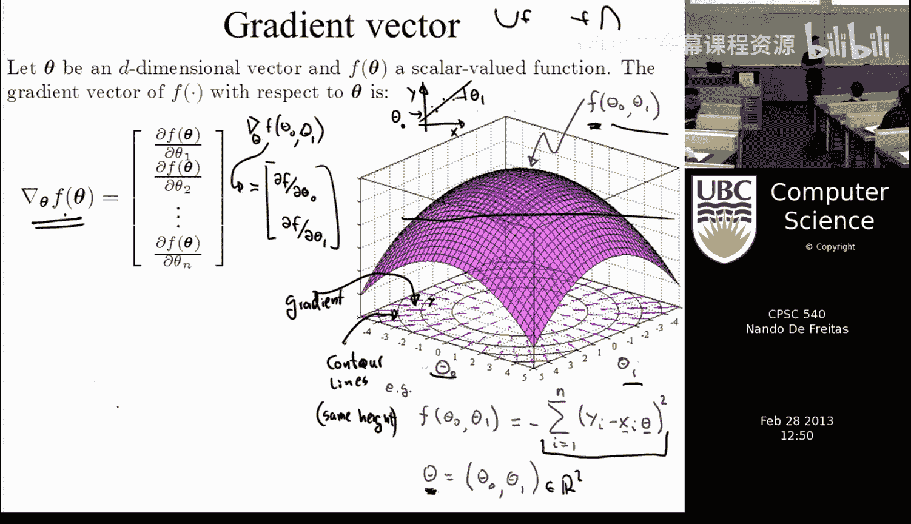

海森矩阵 **H** 是函数的二阶导数矩阵，它描述了函数的曲率。其元素是函数对参数两两组合的二阶偏导数：

**H(θ)ᵢⱼ = ∂²f(θ) / ∂θᵢ∂θⱼ**

海森矩阵是一个对称矩阵（在函数满足一定连续条件下）。在优化中，曲率信息可以帮助我们更智能地选择步长。

---

## 梯度下降法

了解了梯度的概念后，本节我们来看看如何利用它进行优化。最基本的方法是梯度下降法。

梯度下降法的核心思想是：从参数的某个初始猜测值开始，反复沿着当前点梯度的反方向（即最陡下降方向）移动一小步，以逐步逼近函数的最小值。其更新公式为：

**θ_{k+1} = θ_k - η * g(θ_k)**

其中：
*   **θ_k** 是第 k 次迭代的参数值。
*   **η** 是学习率（或步长），是一个正数。
*   **g(θ_k)** 是在 **θ_k** 处计算的梯度。

学习率 **η** 的选择至关重要：
*   如果 **η** 太小，算法收敛会非常缓慢。
*   如果 **η** 太大，参数更新可能会“ overshoot”（越过最小值），导致在最小值附近振荡甚至发散。

对于线性回归，其成本函数是平方误差和，梯度有具体的解析形式。应用梯度下降法时，更新规则可以明确写出。

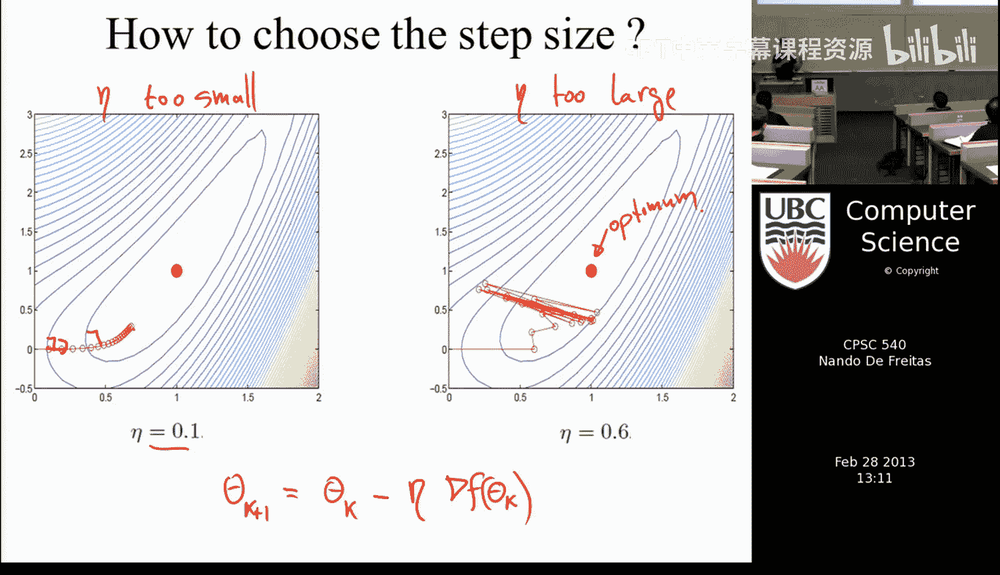

---

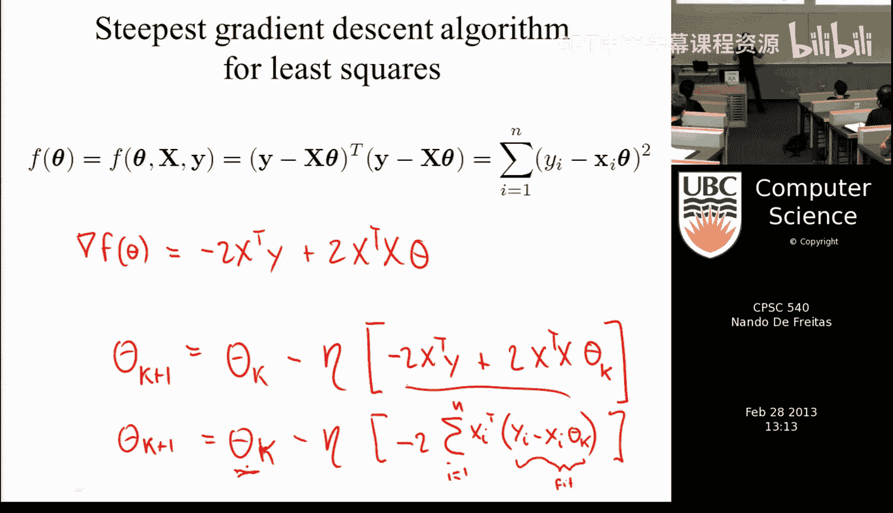

## 牛顿法

梯度下降法只使用了一阶导数信息。本节中，我们来看看利用二阶导数（曲率）信息的牛顿法，它通常能更快地收敛。

牛顿法的思想是：在当前点 **θ_k** 处，用一个二次函数来局部近似原函数 **f(θ)**。这个二次函数的极小点很容易求出，我们就将这个极小点作为下一次迭代的参数值 **θ_{k+1}**。

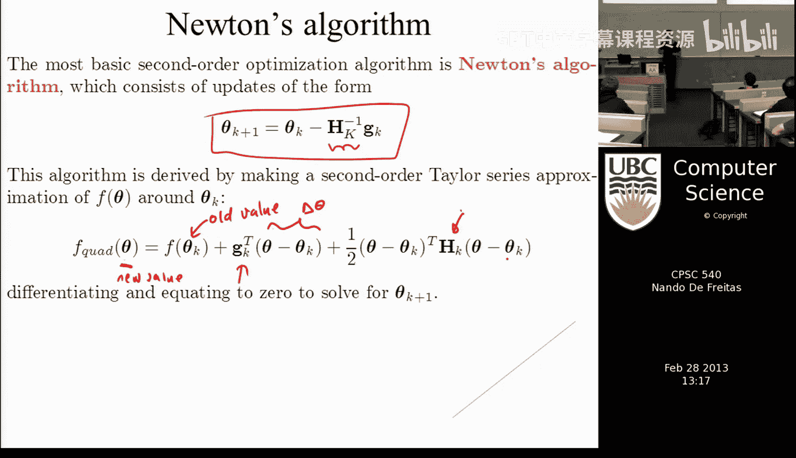

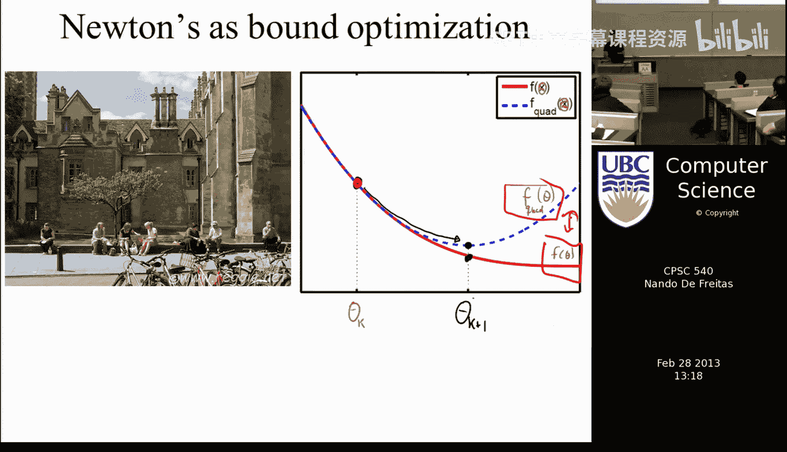

通过泰勒展开和求导，我们可以得到牛顿法的更新公式：

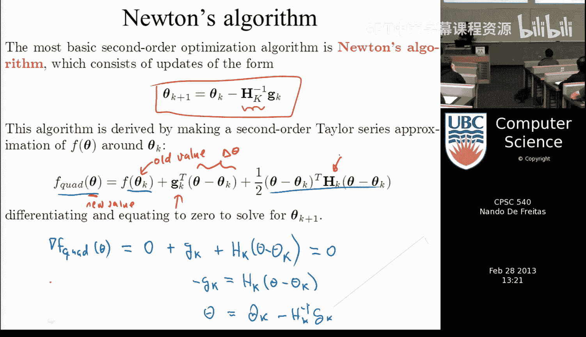

**θ_{k+1} = θ_k - H(θ_k)⁻¹ * g(θ_k)**

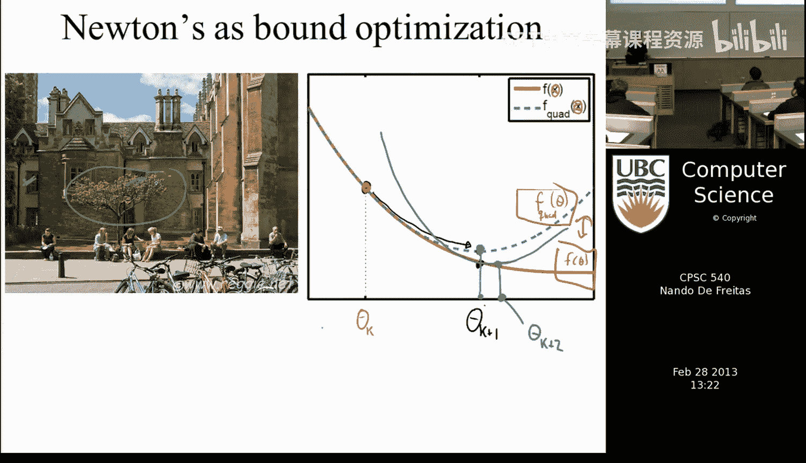

与梯度下降法相比，牛顿法用海森矩阵的逆 **H⁻¹** 替代了固定的学习率 **η**。这相当于根据函数在不同方向上的曲率自适应地调整了步长：在曲率大（陡峭）的方向走小步，在曲率小（平坦）的方向走大步。

对于线性回归这样的二次函数，牛顿法只需一步迭代就能精确收敛到全局最小值，因为它用二次函数近似二次函数是完美的。

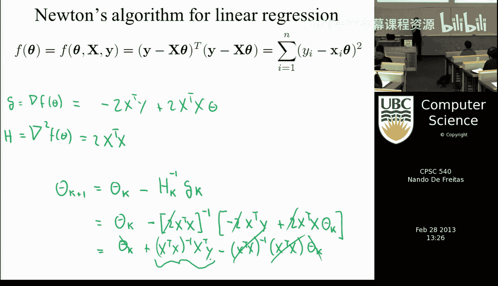

然而，牛顿法需要计算并存储海森矩阵及其逆，当参数数量极大时（例如神经网络有数百万参数），这在计算和存储上都是巨大的挑战。实践中，我们通常求解线性方程组 **H(θ_k) * d = -g(θ_k)** 来得到更新方向 **d**，而不是直接求逆。

---

## 随机梯度下降与在线学习

前面讨论的方法都假设我们拥有一个固定的、完整的数据集（批量学习）。但在现实世界中，数据往往是持续到达的（例如推特流、实时传感器数据）。本节中，我们来看看适用于这种场景的在线优化方法。

机器学习的成本函数通常是期望风险的经验近似：
**J(θ) = E_{x~P}[L(θ; x)] ≈ (1/N) * Σ_{i=1}^N L(θ; x_i)**

批量梯度下降需要计算所有 N 个样本的梯度均值，这在数据源源不断时不可行。随机梯度下降（SGD）的核心思想是：每次迭代只使用一个（或一小批）随机样本来估计梯度，并立即更新参数。其更新规则为：

**θ_{k+1} = θ_k - η_k * ∇L(θ_k; x_k)**

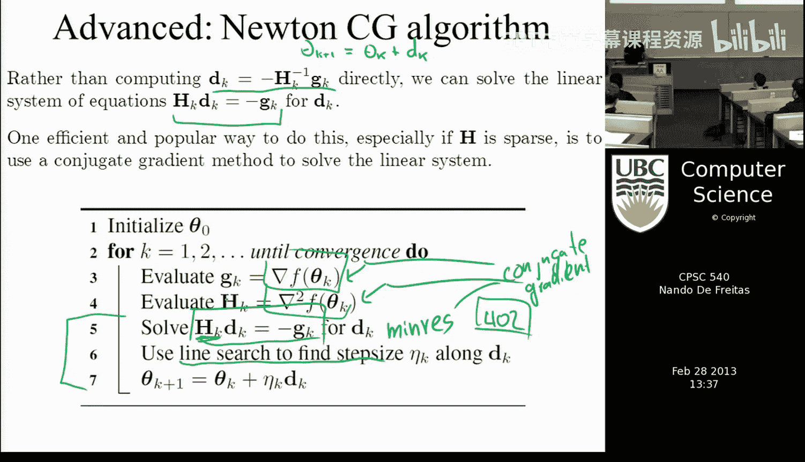

其中 **x_k** 是第 k 次迭代时采样到的单个数据点。

以下是几种常见的梯度下降变体：
*   **批量梯度下降**：使用全部数据计算梯度，准确但计算成本高。
*   **随机梯度下降**：每次使用单个样本，更新快、能处理流数据，但梯度估计噪声大。
*   **小批量梯度下降**：每次使用一小批样本（如 20 个），是前两者的折中，在实践中最常用。

可以证明，当学习率 **η_k** 满足一定条件（例如随时间衰减，如 **η_k = 1/k**）时，SGD 也能收敛到最小值。SGD 的更新可以理解为在沿着真实梯度方向下降的同时，叠加了一个由于采样带来的噪声项。

---

## 总结

本节课中我们一起学习了机器学习中无约束优化的核心方法。

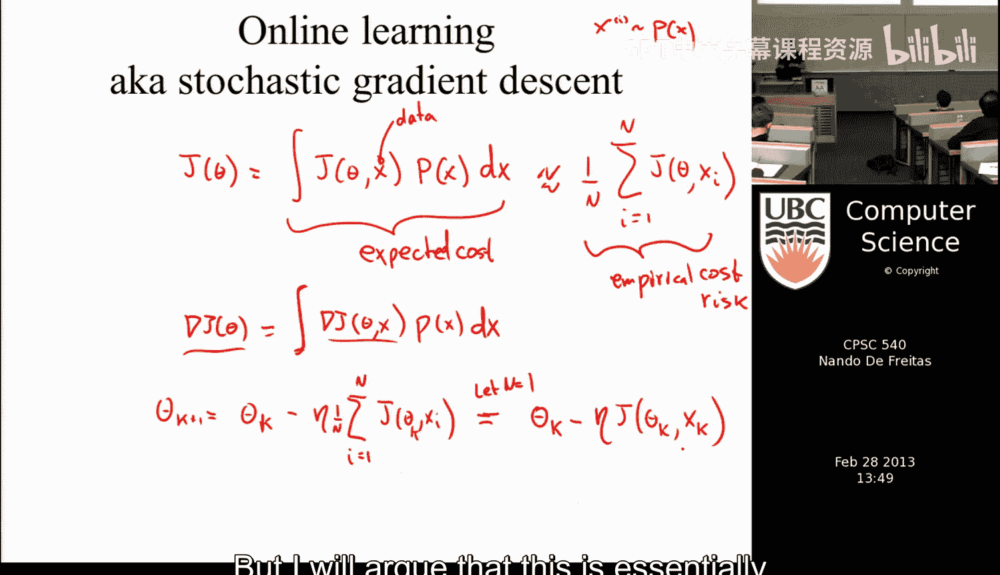

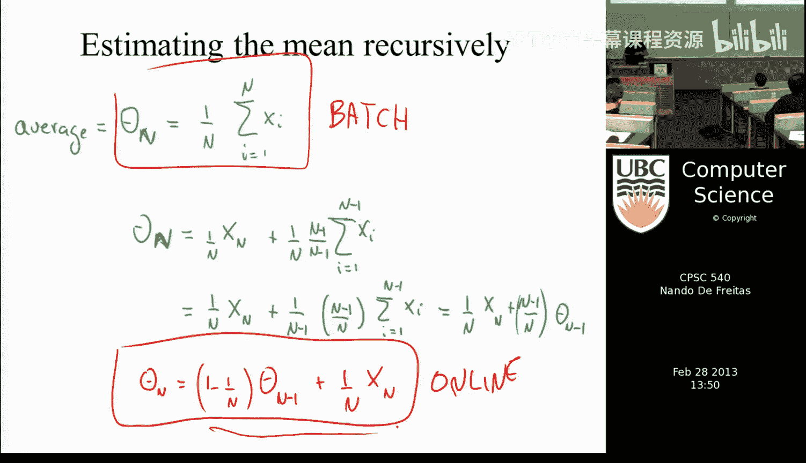

我们首先回顾了梯度和海森矩阵这两个基本数学工具。接着，我们深入探讨了**梯度下降法**，它通过沿负梯度方向迭代来寻找最小值，但其性能高度依赖于学习率的选择。然后，我们介绍了**牛顿法**，它利用海森矩阵包含的曲率信息，能实现更快的收敛，尤其对于二次函数效果极佳，但其计算和存储成本对于大规模问题可能过高。

最后，我们讨论了数据持续到达的场景，引入了**随机梯度下降**及其变体（小批量梯度下降）。这些方法通过每次使用部分数据来估计梯度，使得模型能够在线、增量地学习，这对于处理大规模数据集和流式数据至关重要。

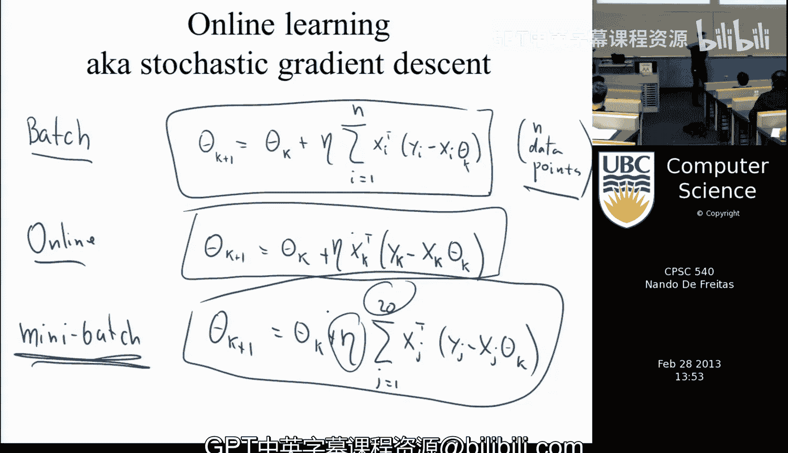

这些优化算法是训练复杂模型（如逻辑回归、神经网络）的基石。在接下来的课程中，我们将把这些方法应用到具体的模型上。