# UBC《机器学习（研究生）｜CPSC 540 Machine learning 2013》中英字幕 p15 -15-Machine learning - Logistic regression.zh_en -BV19g2FBBEEq_p15-

V， we will be regressing on binary variables。 So its probably better to think of it as a classification problem。

 So the idea is we get some features， and then we're trying to decide whether those individuals with those features should be of class 1 or class 2。

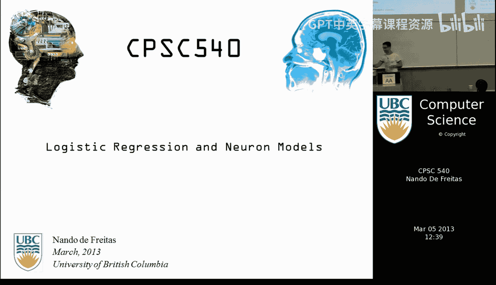

Alright， so。In the class， the idea will be to understand what logistic regression is。

 make a connection of logistic regression to neural networks。The rife。

 the gradient and the hasylog regression。Because once we have the gradient。

 we know how to implement a learning algorithm， we'll be able to just do stochastic gradient descent。

And once we have the hessian， we can implement Newton's method。 So by having the expressions for the。

Rraant and the hesian， you can just try any optimization technique。

And I will actually show you code for doing this using Newton's method。嗯。Logistic regression。

 by the way， is very popular。 Many companies out there their fundamental classification technology is logistic regression。

 It's one of the most widely used techniques。 So if you end up dealing with huge data sets at Google or Twitter。

 quite likely you will be working with logistic regression。It's a very sort of fundamental model。

 It's not analytic in the sense that you can't find the solution for the optimum。

 unlike linear regression。But the gradient and the Hesian are analytic。And so it and moreover。

 as I argued， the cost function that you're optimizing is convex， so you guarantee to find a minimum。

 you guarantee to find the optimal to provide to implement your algorithm， right。

There will be the frequentest approach to learning the parameters and again。

 a reminder the frequentist approach believes there is one true value of the parameters。

 and so we will try to find that single value doing optimization。

I will then discuss how we to do approximate based in computation。 So we will introduce a prior。

Will have a likelihood in a prior that will allow us to derive a posterior distribution。

But that posteror distribution will not be analytical。

That is we will not be able to come up the close form expression for the posterior。 however。

 what we will do is we will introduce Monte Carlo， very cool trick today that will allow us to solve the Bayesian problem to approximate it using just something techniques。

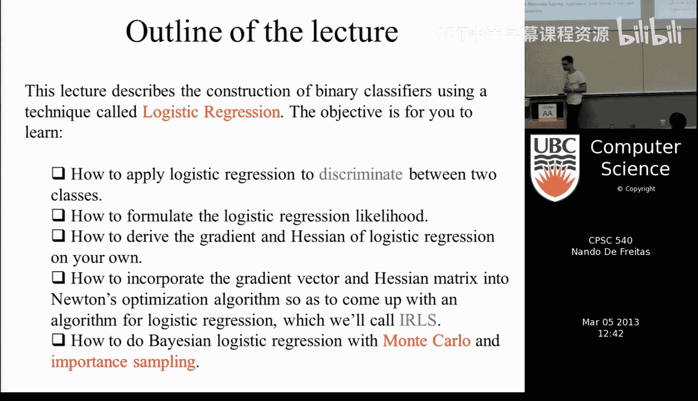

All right， so。嗯。Let's start with a simple model of。It looks like a pyraidal cell。

 the sort of cells that you find in your cortex。嗯。The cells contain。

You can think of a cell as taking。Many input signals from its dendites。

And then depending on how much excitation you'll have a pulse coming here， a spike。

 and depending on how many neurotransmitters you have floating between these devices。

Between the connections between two cells。And the neurotransmitters are the sort of things that you screw up when you take drugs。

 so big warning。Because youre basically altering these connections。

Depending on some neurotransmitters here， we form。嗯。嗯。Basically， the membrane polarizes with ions。

 plasma are negative。And that allows a pulse to be transmitted along the gap。

And when all those pulses reach a certain level of excitation in the cell。

 then the cell fires a pulse。And we're not going to deal with pulses。

 so instead of thinking of dealing with pulses individual visually think of a frequency modulated signal。

 what we do is we're going to take an average over dose pulses and that's going to give us the level of excitation of the cell。

Now， that's essentially the idea of the model of McClo and pits。

And this is a very simplified model of a neuro。 By the way。

 There are neurons out there that they will have like 10 million。No。

 I think I'm excentgerating there about 100，000 dendrites。

 so that are extremely complex and some researchers dedicate all their lives to just study one particular form of motor neuro。

So they're fairly complex objects， but in this abstraction of these parameter cells。

 the idea is you have D inputs。So let's start now abstracting this mathematically。 So we have。

D inputs is just the attributes or D features as we've had before in linear near regression。

 we add a one so that we can have a biased term so we can。Move the function up and down。

And then each of these inputs gets scaled by a parameter theta。

 which in the neural network language is called the synaptic weight or the weight for short。嗯。

You then take that factor， X。Of all your axis， of all your individual inputs of size d by 1。

 and you multiply times the vector theta of size d by1。

 and that just gives you a single scalar Xi theta。And then。

So essentially what we're doing there is were just summing all the inputs。

 so we multiply each input by weight， and then we sum them all。

And that's essentially the same as a dot product effects and theta actors。

And then depending what that input is。The suppose if the input is here。

 then this is the level of firing of the cell。 So now the cell will have this nonlinearity。

 which is given by。And I think this will be much better with。Without the front lights。Okay。

 so does so have this no linearity？Which has this function there in green， which is like a S。

 And because it looks like a S， it's also called a sigmoid function。Or the logistic function。

And that function is simply given by。This expression here。

 which in the next slide I'll go into a bit more detail， but essentially if the level of excitation。

 which is x times theta， is above a certain threshold。

 then neuron is on so that we're on the top part of the green function and if the level of excitation is below a certain threshold。

 then neuron is off。ok。From a statistics perspective， we will be given the data。

 We will given X's and Ys。 So it's going to be a supervised learning problem。

 and the Y's will be binary0 or y。Given the x's and the Y's， our task is to compute the thetaus。

 so it's very much like linear regression， the only thing is that now the Y's instead of being real numbers。

 these y's are now either zero or y so so it's a classification problem。And that's very useful。

 like you can imagine in a search engine because one of the first tasks a search engine has to do is decide given a new message of some sort of document or a tweet or whatever。

 you have to decide whether that's spam or not spam。

That's sort of sort of the fundamental first thing you have to implement when implementing a social change。

Okay， let's look at the sigmoid function。 So the sigmoid function。嗯。

Which is the function pi also often written as sigm。Of Eta。

 where Eta is just the argument is one of a one plus E to the minus E。Again。

 you can also write it as e to the eta divided by e to the eta plus1。

 it's an s function as eta goes to infinity this as symptomsmptos at1。

 so the maximum value is1 and as Eta goes to minus infinity this function goes to0。Okay。

 so it's essentially like a gate function， but the reason why we don't use just a gate function like this of。

Off and on。It's because we will need to compute gradients of this function when we're trying to estimate theta and by having a smooth function。

 it will be possible to compute gradients because the derivative will exist。

Where is here there is a problem of non differentiability where the vertical line is。

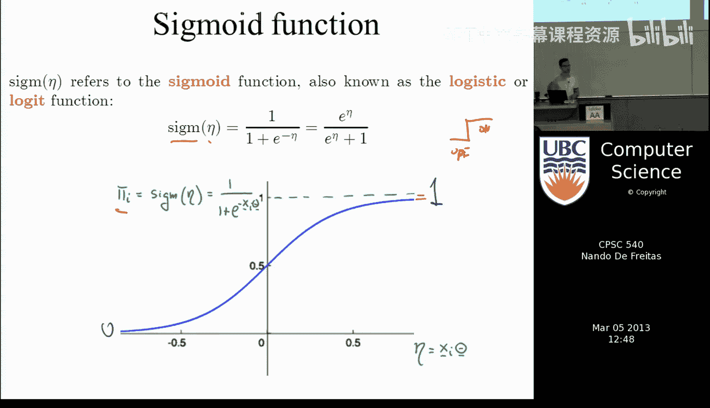

Okay， so how do we use this device， Well， we will be given data。And the data is， basically。

Something like x1， x2， and then Y。So you're given a data set。And that data set might be stuff。

 like 2。3。6ix。28。1。0。9。And then you will get a label。Okay， so that data is given to us。

 We have features。We might have the tweets and we have a label which is happy faced or sad facing the tweet。

And our task is to be able to predict whether any tweet is a happy face or a sad face。

 And if you can do that， then it's very easy to build a sentiment detector and you can predict。

Who's more likely to win the elections and so on？嗯。Now。

' what we're going to do is we're going to call pii。Which is just a sigmoid of X Time theater。

The probability that the neuron is active。We're doing this by construction。

We've constructed a sigmoid function to be between0 and 1。Because it is between zero and 1。

 we can interpret it as a probability。So the probability that the neuron will fire。

 so Yi is one when the neuron fires。Is given by the sigmoid of the input argument xine times the。Now。

If you look at if this is a half。This will be a half when Xi times theta is equal to0。

 so a plane at the origin。AndTo see this， you just take the sigmoid function and if you substitute。

X items times theta zero， you end up with1 over one plus one， so that's a half。

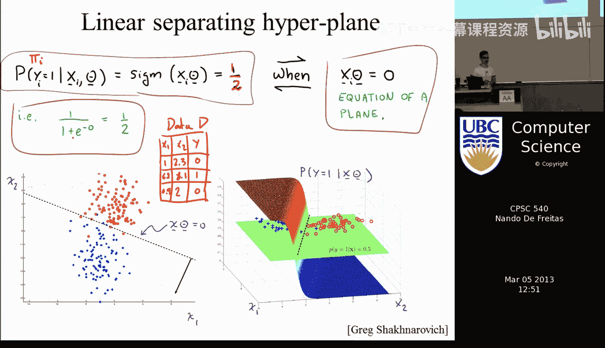

Okay， so again， recall that。The sigmoid function is just。1 over1 plus e to the minus thexi feet。

So excite the is the input。And then you put it through the function one over1 plus each to the minus Xhi the。

If Xi theta is equal to 0。Then。The output of this function will be a half as the picture。

That the picture illustrates here。

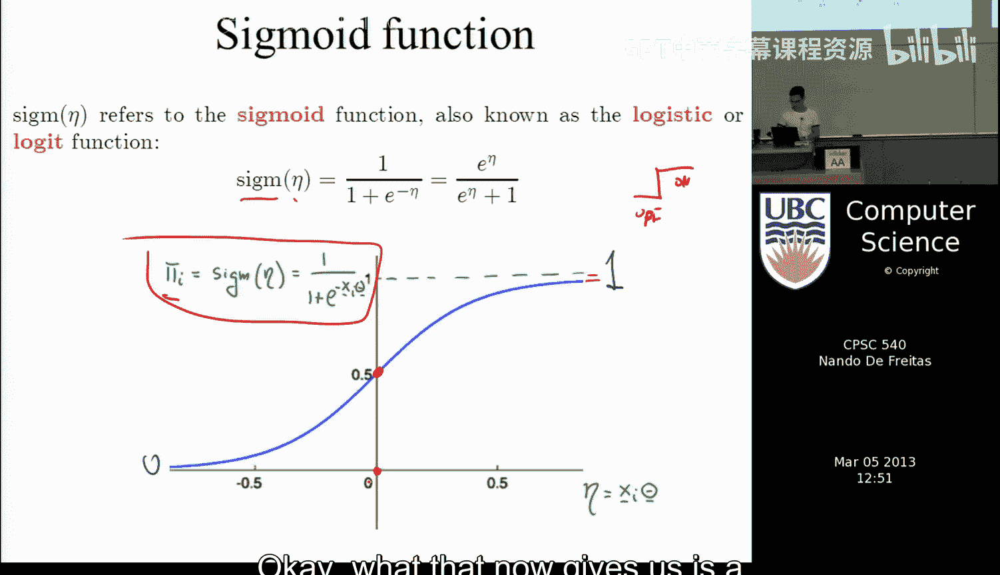

Okay。What that now gives us is a mechanism for doing classification， because essentially。

If we look at this equation， the equation sigmoid of Xi theta a half。

 which is equivalent to the function Xi theta equal to zero。

 we see that that's just the equation of a line， the equation of a plane in general。

So if you have data of two classes， so these are the points y equal one。

And this would be the point with the label y equals zero。 So this is your training data。

Then the plane x times t equal to zero will be this guy here。

 and it will separate the red from the blues， which is what we're doing。

Because essentially what we're doing is so that's the view in terms of the two inputs in 3D。

 if we plot this curve， P of y equal 1。Give an x theta， which is just equal to the sigmoid。

fect eye theater。In 2D， this is still an S， but it's an S in 2 D as shown by the figure。 And now。

 if you cut that S at a half， at height a half， that cut。

As the picture illustrates is giving you this line。 So that's me cutting this at a half。

 and because it's giving and that cut will be exactly a half。

 So logistic regression gives you a linear separating。Disrimininate function。Anything to the right。

 when exide theta is positive， you will get class one， when exile theta is negative。

You will get class zero。In the case the mine's not going to be origin through。可的。Yes。

 that's correct so。Ricll， I mentioned there would be an extra one of the x's is equal to one。

 so that's a good question and so there's an extra parameter there in order to be able to shift it。

So it's through the origin in the original coordinate， it's a good question。

Okay so essentially that's what logistic regression is all about， you get some data in pairs of data。

 X and Ys， your task is to break the Y separate data into two classes so that if you get a new point。

If all of a sudden we get a new point， say this guy over here。

 then we know that that point should be class zero so we can classify it once you have equation of that line。

 you can use the equation of you just evaluate that line if it's less than a half。

So if it's less than zero， then it's class zero， if it's greater then it's class1。

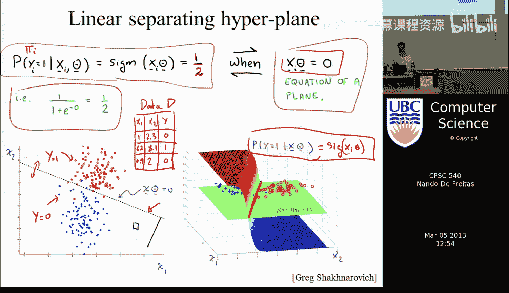

Okay， so now let's look at the probabilistic model of this。嗯。Because the wise。

So just like linear regression。We're going to assume that the inputs are given， the axis are given。

 so there's no uncertainty about the axis。 the axis are deterministic objects。

So there's no need to specify probability distribution on domestic objects。But the wise。

 the labels is where we have uncertainty。 We don't know We need to predict whether something is。

Zero or what， whether a patient has cancer or doesn't have cancer。

And that's where our uncertainty will be。 Now， because the process。Is finery。

Then the right model for binary data is not a Gaussian， but it's a Bernoulli model。

 it's a coin flu model， you either have cancer。Or you don't。Depending whether it heads or tails。

And so now if we have N patients in our data， so we've seen end patients and we've done the tests to and we figure out whether they had cancer or not。

We model each patient as a coin flip， as a pernoulli model， in other words。

These independent patients。We'll have probability pii。Times y I。Times 1 minus pi i。

To're the1 minus y I。Where again， pie eye is just。The success probability。

And then one minus pi I is the failure probability。Now， what this is saying。

Is that this will be equal to pi I。So a single term。

One of these guys will be equal to pi I if y I equal to1。And it would be precisely 1 minus pi I。

When why I？いこせよ。Okay， so that term will light up be pi I or1 minus pi。

 And the way of written it is just a way of summarizing the two things that could happen when you have a cost。

When you have a to。Sorry， when you have a coin flip， with some probability pi。

 it will be head with some probability1 minus pi， it will be tails。And so， just。

What' seemingly being mathematical expression is simply doing a coin flip。Now。

 the other thing that we're doing in this case is instead of just letting。T pie be the parameter。

We're going to make pie be a function。And that function will have a parameter the。

So that's the new thing here。The new thing here is we construct into sort of recursive definition of the probability。

 and that's what's going to be great because we're going to be using these very basic probability distributions like Bernoulian Gaussian。

 but because we're going to over parameterametize them so we're going to take say for example。

 a parameter like the mean of a Gaussian and that mean of the Gaussian will be a whole function with many parameters and that's where the power of these methods will come in that we will be able to do very interesting modeling in this case pii。

Will be it's essentially the success probability of a neuron of the neuron。

 and it will take into account what the input is and what the synaptic weights of the neuron are。

The reason why this makes sense is because piI is guaranteed to be between0 and1。

 so by construction I chose a function that would always be between0 and 1。

 so by construction we have a valid probabilistic model。

So the pi I's are guaranteed to be between0 and1， and then the probability of success is pi。

 the probability of failure is 1 minus pi， if you sum those two， you get one。

 so the probability of both options is one so we have a valid probabilistic model。

And so now the task is， so we have a likelihood。If we have a likelihood。

 how do we get an error function？Let's go back to the linear regression case in linear regression。

 our likelihood was a Gaussian。And then how did we get the least squares cost function？不。

Minus the log， right， So here we do the same thing。

 So there's always this very simple relation between probabilities。And cost functions。

 are also called error functions， risk functions。We just take the negative log of the probability。

 and that gives us the cost function that we need to optimize。So in this case。

 if we take and all the data as before， I this y vector is still n by one。 this x matrix is still。

N by D， and this vector is D by1。So the sizes of these mates just as in linear regression。

 The only thing that has changed from linear regression to logistic regression is that the ys are binary。

Instead of calciuming， everything else is the。So。If we now。I mean， technically speaking is。

N times t plus1。Because we we introduced this extra theta not。

But whether it's DOD plus one is just remember that there is an extra biaser。Now。

 if you take a negative log。Oeal。P of y given X and theta。We get our cost function。

 our objective function。Which for some reason， we always write this J of the。

 and I don't know why we used the J。Capital Cha is always used。No idea。Good question。

 If any of you find out， let me know。嗯。写的是。Jas。Yeah， sometimes you use E， sometimes you use J。

 sorry H， like Hamiltonian。Comes from the control literature curve。Well， we knows。

 it's just an arbitrary letter。And if we do that， if you take the log of the likelihood。

 the log of the product just becomes a sum from equal 1 to n。

And then you have the log of pii to the power YI， which is Yi。Log。Of pi i。F。Y minus Yi。Lolog。

P minus pi。Now， what does this cost function remind you of。

Something we've seen in this course before。Enter。In this case， it's the entropy between y and pi。

 so it receives the name of cross entry。Because it's across two quantities。

So this is neat called a cross entropy。So does this make sense？

Does it make sense to minimize this function？I didn't want to see one nod。Why wouldn't it make sense？

Oh why would it make sense？And。Yeah， entropy is just a measure of uncertainty。

Our goal when learning is always to minimize our uncertainty about the world。

 We want to understand the world， understanding is information。

 Information is the opposite of uncertainty。And information， indeed。

 is the finance the opposite of entropy。So by minimizing the uncertainty we will learn something。

 so everything here makes sense。If you think in terms of cost。

 you would have naturally arrived at this crossenttropy。 if you hadn't thought of probability at all。

 you would arrive at this quantity。But you can see that by doing this negative log。

 there is a very natural mapping between probabilities and。And objective functions that make sense。

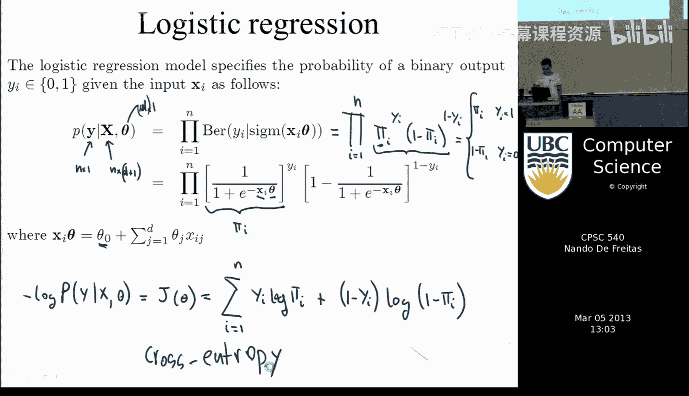

Now， this is not your homework question。诶。I'm going to ask you to。Prove the following thing。

 You're gonna to take that cost function， that J of theta。

And you're going to differentiate it with respect to theta， and you will get this expression。

And that expression is the expression for the gradient。So if you're doing now。

 if you're learning your parameters， if you're doing gradient descent。

 then your gradient descent will just basically be theta T plus 1 is equal to theta t minus whatever the learning rate is that you use。

 and then you just substitute expression for the gradient。X transpose。Phi of theer T。

Because pi is a function of the to T。 Remember that pi is equal to the sigmoid。

1 of plus0 to the minus。Beta x。And then give it here。Mus y T。

So that essentially will your that will be your gradient， or this will be X T。

If you take in the online gradient， if you do the batch gradient。

 you' you consider the sum of all Ts。Okay， and it makes sense to follow the gradient。

If your predictions， remember the pie is your prediction。

Pine is equal to your estimate of the probability that y equal one given x and theta。

Which is equal to1 over1 plus e to the minus x theta。

Pi is your prediction of y being1 if so pi is your prediction y is the label。

 so when the two agree when pi and y are the same。Then the gradient is 0。

So if you can predict the data， if you can predict the labels。

 that means there's nothing else to learn so the gradient should stop pushing。

 moving your parameters， so your parameters become stagnant because you've learned。If however。

 your pies and your ys are very different。So the gradient then will be。Say one。

Here then your theus will change a lot。so this makes perfect sense as soon as we learn the theta stop changing before we learn the thetas will still。

Incor changes。And we can proceed by taking the second derivative。

And then we get that expression for the Hasian， your homework is basically to derive these two expressions。

SoThat's a sort of very simple sort of algebra break。

In your homework I'm also going to ask you to look at the properties of H one properties that is positive definite。

 so you're going to have to look if you've seen what positive definite matrix is before it's fine if you not just look it up on Wikipedia that's a very nice definition basically means it second is a positive and。

The conclusion of having a positive definite May second derivative。Of the second derivative being。

Positive is that it's saying that we have something where this we have a convicx function。

 We have a function that's always that doesn't have。Like an inflection point。

 so there's a single minimum。And that's a very powerful thing。

 because that means that when you do the learning algorithm， you will find that minimal。

we saw that Newton's method only required one step to find a minimum and linear regression。

 in this case it will likely require several steps。Because this function is not。

Exactly quadractic later on， I will show you the picture。

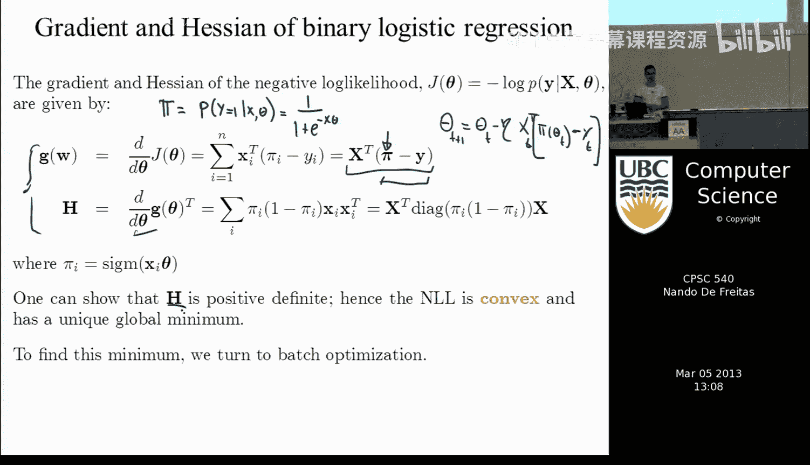

Okay， so。The Newton method。For logistic aggression has a special name。

 it's called the IRLS algorithm or iterative re weightly squares。And essentially。

 once you have the expressions for the gradient and the hessian that you derive in your homework。

The Newton method is just。The to minus the inverse of the He sometimes times the gradient。

And then if you substitute the expressions for the great Anadehesian there， you end up with this。

Type of expression。And that is the iterative rate weighted least square problem。

And the name comes from the fact that we're iterating what seems to be the solution of us for digiteration we're solving a least squares problem。

And at least course problem has a weighting matrix， which is S。

 so this is very much like in collaborative fulling。You had a waiting matrix there， a confidence C。

And so this is exactly the same sort of set。 If you are solving that collaborative filtering at each iteration。

So this weighted least course problem with iteration you would essentially have arrived at this algorithm。

But I think the idea of specifying a likelihood， taking the negative log。

 differentiating to get the gradient he here is sort of much more natural。

 it's also the approach that you would use for any problem in machine learning not just for this model but for any other model When we do neural networks。

 we will follow exactly the same recipe will write the likelihood we will find a derivative and that will give us the learning algorithm So learning in this case is just follow the gradients or follow the gradients weighted by the he。

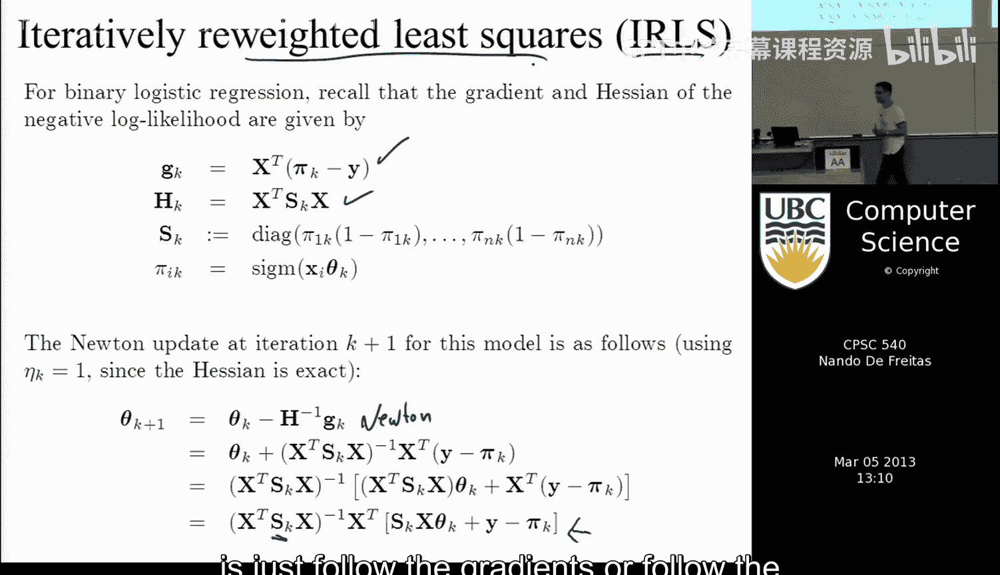

And I've put the code in the slides， which I will make available this afternoon on the website。

YouYou can just cut and paste and， code it and test it。But。I mean。

The point here just being that implementing this is very simple， that the logistic function。

 and then the algorithm is just a few steps。 these algorithms are up being really simple to implement。

All right， but now I want to switch gears and talk about a different way of doing learning。

 and that's the basin way。In the Bayesian way， we still use the likelihood， like infrist learning。

 but we also had to specify a prior on the parameters。So。For linear regression。

 we had a Gaussian likelihood， and we used the Gaussian prior。

 and then you did that exercise of completing squares in your homework。

 and you showed that the posterior is also Gaussian。We were able to do everything by hand。

In this case， we will not be able to do it by hand。But if you do manage to do it by hand。

 you are likely to get a bigger paper you know best paper award。At some conference。

 we not of been even bigger award。嗯。When we write the likelihood， let's assume that we。

A the same prior。In this case， our posterior， the same prior in we did for linear regression。

 That is。 That is we're going to assume that our theetus。A priori are Gaussian。

 the theus are continuous， so we can assume that they come from a multivariate Gaussian and that multivariate Gaussian has some mean mu。

 typicallyyp that mu is0。When we did reached regression。And we said that Rich。

 if we take the log of the prior， we get to theta transpose theta。

 which was our regularized in rich regression， so here it's the same thing。So， the posterior。

And I'm going to assume that for short， I'm going to call the data D。

And that will consist of all the x1， y1。Allold the way up to X and Y N pairs。

x is a vector y is just a01 value。And so the posterior。

 which is the probability of theta given all the data in the training。

That's just going to be equal to the likelihood。理由。Y given an x comma theta。Times。The prior。And so。

We should divide it by P of Y to get a valid distribution。 We should normalize it。

 but we won't be able to normalize that。And the reason why we can't normalize it is because when you multiply those two expressions。

 if you sum over y， the y's are binary。And there are。That sum would end up having size。 sorry。

 So we have this Y set up。 So we have this。Why is there binarying with this expression？

When you multiply this term。Times this term。Which is essentially the likelihood times to pride。

If you were to try to integrate out。Theta in order to obtain P of y to the x。

That that integral is intractable， we don't know how to do that integral by hand。So。

 the problem is that。Be of theta given and D。Requires。It requires that we compute P of Y given x。

In order to normalize it。And PFY given X。Oops。Here why， give an X。

Is equal to the integral of P of y given x and p。ピ of。いせちゃ。

So then the denominator is the sum over all the possible values of the numerators。

 so to make sure that it sums to one。But we don't know how to do this integral in practice。

There's no known analytical way of solving that integral。

 if we can't solve the integral and that there lies the bottleneck of being able to do Bayesian learning and practice is solving that integral。

 in general， solving that integral is on a computational class called Shap P and that's sort of the equivalent of NP hard。

So we would take an exponential amount of time to solve it。 We would require more time than。

The number of years that the sun has ahead of itself of lifetime。

So since we can't compute this normalization constant P of y given x， we cannot compute this exact。

All we can do is try to approximate it after proportionality。Now。

 I'm going to next teach you a trick that allows us to compute integral across， not exactly。

 but approximately。That trick is the Monte Carlo trick。

And it's one of the most useful tricks out there。 And， in fact， if you're on a computer。

 the volume of a convex body in high dimensions。 and that usually happens to be very useful for many problems。

嗯。Then the only known method that can do it in polynomial time。

 the only approximation of bad volume in polynom time is provided by the method that I'm going to describe next by the Monte Carlo method。

 So Monte Carlo is sort of one of the greatest inventions of the last century。嗯。Oh。

 one more integral that's of interest， so computing the normalization constant ist a problem of interest。

Another one that's of interest is computing the predictive distribution。

So the predictive distribution。So we have our data。第 equal个。Basically， all your xs and all your ys。

And we have N pairs。Of them， then given a new point。X n plus1。We want to predict。Y n plus one。

So for a basin， the way to make a prediction is to write down the probability of Y n plus1。

Given the new point。And the date。So that's the distribution that a patient would want。

 What's the probability if I went past one， given all the evidence I've had in the past and given the new input。

For a Bayesian， that function does not depend on parameters。

So frequentists would just say that that's a particular- it's a parameter time X。

 it's a single parameter， but patients believe that you should integrate out the effect of the parameters。

And the way you integrate out the effect of the parameters is by the operation of marginalization。So。

With some overall the possible values of theta。That's what the integral says。😔。

And now we can do a further simplification。By doing conditional probabilities。

 I'm going to take this joint probability of YM plus1 and theta。

 and I'm going to break it into product of the conditional distribution and the marginal distribution for theta。

So in other words， I'm going to rewrite as a P of。In other words。

 I'm using the rules of P of A and B is equal to P of A given B。Times P of B。

And I'm also using the rule， the probability of B。Is equal to the sum over all the A's of P of A and B。

The top id is called conditioning， the bottom id is called marginalization。

And so I can rewrite this as P of Y n+ one， given Theta， Come n plus1， come D。That was P of，Given分。

Xm plus1 comm T。Given the。And I'm going to simplify this。No， theaterta。

Encapsulates the information about the world。I have some input X， and I've got some theta。

 but once I know。Once I know Theta and I know my input X N plus1。

 Theta provides a summary of all the previous data。That's the idea of learning。

That my weights in my brain。They have a memory of everything that happened before。

So I don't need in order to predict the future， I don't need to go and bring back the previous data。

 I just need to look at the weight it's in my brain。

The is T to summarizes information about D so we can drop this D。Okay， because once we know。

Once we know theta， theta is the model， we don't need to keep the data。No。

 we start with some training data， we learn the parameters， like if you are doing linear regression。

 once you fit the line to the points， that equation of the line tells you everything about the problem。

 you don't need to keep track of the data points。So we can discard the points。

And so we can rewrite this as the integral of P of Y n plus1。Given theta and Xm plus1。

Times the posterior， which is P。Theta given。 Now， when you you're posterior。

 your theta given D was computed before you had access to X N plus1。

And because the posterior requires the likelihood， yn plus1。

 these Xm plus one is the domestic signal doesn't do anything to it。

And so we arrive at the standard expression that Bayesians use for prediction when Bayess predict。

They say you take the likelihood of the point of the new point。And they just weight that。

 but every possible value of it。This guy here is simply。Pi。N plus one to the y n plus one。

Times 1 minus pi。And plus1 to the1 minus y n plus1。This guy here is as in the previous page。

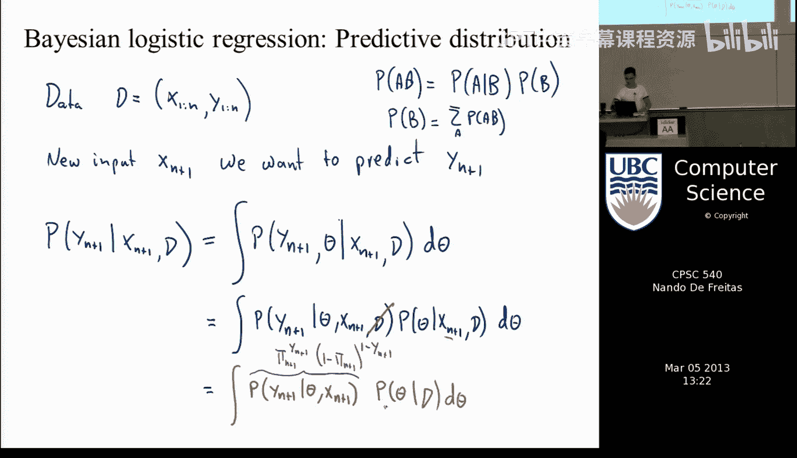

It's that the product of that likelihood and that gas。

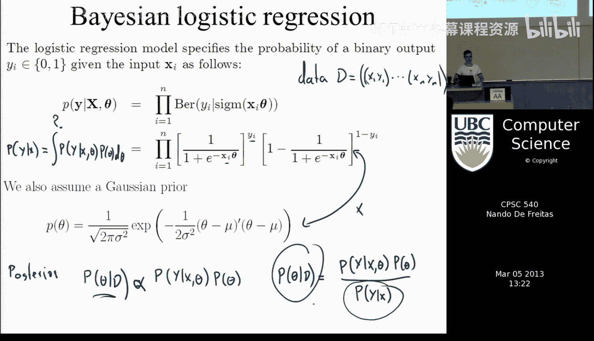

We， of course，'t know we don't actually know its normalization constant。

 but will be able to compute this integral。We will be able to compute a solution。

 even though we don't know the normalization constant of this distribution。

 even if we only know the numerator， we will come up with a very cool trick to solve this problem。

Okay， and of course， pi n plus one。In this expression。

 it shows1 over1 plus e to the minus x n plus1 times the。

Just like before as still the logistic function as before。Okay。

 so that's essentially the idea of for baesing。 A baesin says the predictions will be given by the likelihood。

And then each prediction will be weighted by how probability is。

And how probable is measured according to the posterior distribution。

 which is the quantity that takes into account prior information。And the training date。Okay。

 so how do we solve this integral， how do we approximate it？

We're going to start using this trick called Monte Carlo。

 and I'm going to introduce it with some simple problems。What is imagine that you。

 this square essentially was。A complete covering of this room or this wall。And it's the unit square。

And suppose you were bandaged and you were throwing darts。At this wall。

What would be the probability that your dart would hit the red area？啊，好。No。If we。

 if the red area is a circle， what would the probability be of hitting it？嗯。抱。Just piar square。

 the area of the circle。嗯。And this kind of sort of starts bringing something interesting because the way we measure areas seems to be related to probability。

 and indeed probability is just a measure of certainty。In fact。

 some people call it measuring probability， especially because of this risk。Now。

 what if I have a funny shape， how do compute the probability that you hit the red area？这个。

Partder integration by integration。So and what is integration。

 like if you remember Simpson's rule and so on when you introduce derivatives， so in integrals。

 what you do is you break the area in a very fine grid and then if the little block。

Is red or is mostly red？You count it as a one。And if it's not， you count it as a zero。

 and so the probability。It's just the area。Of the red guy。

 which is the number of red boxes divided by the total number of boxes。

And so you will make errors at the boundary。So what we do is we make those boxes very tiny。

Here is the problem with this approach。If you're in 1 D。You need end boxes。If you're in 2D。

You need n square boxes。Anyone want to take guess how many boxes you need in 3D。And Q 4D。1000。とわ。

So now if your number of parameters in logistic regression is 100。And that's what even if it's just。

13 as in your。Data before， you soon run into a problem。

Because if you going to do discretization to estimate integrals。

You're going to have to be integrating over this exponential size。

 so this thing is called the sort of curse of dimensionality。

If you probabilities by doing just deter deterministic grids。

 you have to deal with an increasing exponential number of such cells。

And so that's not a tractable method。The way around this， oh， what would be the way around this。

 Its first you， if you has an idea。あのさ。Rend them something。

And random sampling is essentially throwing darts。So the solution is exactly what I suggest in the beginning。

 you cover your eyes。You throw dos at the wall。And then you can how many darts fell inside。

And the number of darks inside divided by the total number of darks that you threw at the wall that gives you an estimate of the area。

It's an extremely simple idea。But it's extremely effective as well。So in this case。

Probably be for fifth。 How do you get a better estimate， You just keep throwing more darts。

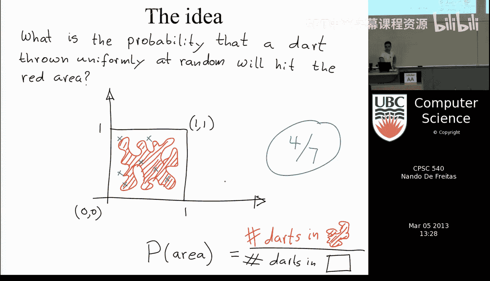

That's essentially the Monte Carlo method。 It goes back to ancient Greece where it was used to compute pi。

In terms of publications， published works， one of the first times it's mentioned is in a paper by。

A guy that used to work for Guinness， the beer manufacturer and he。

Guinness does not allow it or did not allow it to time。It's employees to publish。

 And so he invented a name for himself。 He called himself student。

And the paper was about the student T distribution。

 which is sort of a distribution we use for robust analysis。

That's how that distribution was came to be， and he used them Monte Carlo。

Method to study the student distribution。When it really took off was in the 50s and the '40s and the '50s。

 and in fact， the first ever published paper， Monte Carlo was in 1949。

By two guys called metropolis andlan。嗯。And what drove it was that people were trying to compute probabilities。

And they wanted to compute what the probability， that a particle diffusing through some medium will reach at the end。

 and that kind of probability is equivalent to computing the if you can compute the normalizing constant。

 you can compute basically the time。That will take this particle to hit the other thing。

 And that's sort of a key step in。In the construction of these。Devices that produce beautiful clouds。

 but that have devastating consequences。What they used to do those calculations。

With the that look like this， computers。In those days， those computers did not have the architecture。

 like the one， the architecture youve being taught in school， like CPUU and memory and so on。

 but to program in those days would be to do what these ladies are doing here。

You would be plugging wires from one side， plugging wires on other side when you。

When you're programming homework 3 in front of your nice laptop。Just remember how much worse it was。

And this job was so tedious。 and there'd be so many wires hanging around。That。

That the guy called F Neman decided to sort out the situation and he invented the sort of devices that you guys are using right now in front of your computers。

 so they were doing these monocarlon simulations and this was just too much work to do it this way。

Clloria Fa Neumman， I don't know if shes one of these ladies。

 but was Fnemans wives she was one of the first programmers。Yeah， in those days。

 it was women who were to programmema。The world through its biases and so on。

It has somewhat isolated。Most of the people that worked on the Monte Carlo method initially were physicists and they were metropolis。

 woodland。Polish mathematician， very famous mathematician， Enria Fermi。

It's also big physicists from Italy and of course。One of the fathers of computer science， for。

One of the fathers of gang theory。Quantum mechanics， notation， et cea。

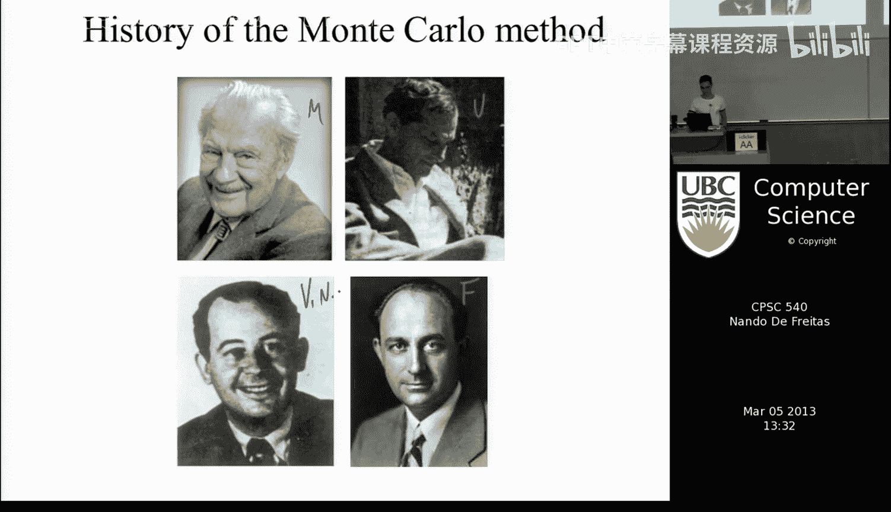

嗯。Here is the method of forment。And this method appears in a letter that he wrote to a friend。

And and in the method he， when he described the method to a friend， he wrote it in steps， step one。

 step two， step three， and he put numbers in those steps。And at the end， he says。

 I have reason to believe that one day our mechanical devices our computer us will be able to understand this type of instructions。

It's kind of an interesting。そて。Initial thought， this is probably the method we're going to look at is what sort of gave rise to people thinking about how to write the first program ever。

Okay， so let's。In an abstract sense， all the problems we're trying to solve are integrals of some arbitrary function。

 I'm just going to call it f of x with respect to some posterior distribution。

 and X is usually the parameter。 We've been using feet up to enough that row。

But I'm just going to make this sort of very abstract。 This is the quantity we're trying to estimate。

 And we want to try to estimate this integral for an arbitrary F in an arbitrary P of x given date。

The way we do this is we assume that we can draw random samples from the distribution。

So that's going to be the requirement。 We will not know how to normalize the distribution。

 but we will assume that we can draw random samples from this distribution。

If we can draw random samples from the distribution， we'll be able to approximate the integral。Okay。

 how do we draw random samples from distribution， Let's assume that the distribution was binary。

 So how do you draw binary random samples。If I tell you。

 I have a distribution that has probability of health。How would you generate that？X time。

So the tricks that I've told you before， you generate uniform random variables。

 you build a cumulative and start， or you just take a coin and you go and if it's one， its put a one。

 if it's0， you put a0 and so on。So that's how we sum， We just imagine。

Sampling is essentially imagining。Close your eyes， see things in your head。

A white unicorn flying over a rainbow。And。That's drawing in sum of images for reality in your head。

So we draw a sample from distribution。If the distribution was Gaussian。

 I've also told you how to deal with a Gaussian distribution。

 your sample uniform that gives you samples from unvariate Gaussians。

 and by tracking the products of unvariate Gaussians， you can build samples from a multivariate gas。

However， the distribution that we need to deal with here is the product of Agaussian times this。

Bno distribution。Which is the problem that we have in logistic regression。

 And I do not know how to draw samples from that distribution。Well come to that。

We have a fix for that， but again here is the idea if you had some arbitrary distribution。

 P of x given data， and if you drew samples X I from that posterior and here are the samples。

Simulating basically means or imagining or hallucinating basically means you will hallucinate more whether is higher proba。

 so you'll throw that variable more often。So you get more samples where the probability is high。

And if you then approximate the。You use a histogram on the samples。

You get an approximation of the true posterior。so the idea is you draw samples and then you just do count because that's what a histogram is。

 you just you bend the data and then you count how many samples hole in each bin。And if you do that。

 then this histogram will be an approximation of the true distribution。

 and the more samples you draw， the better that estimate will be。No if。If we replace this。Guy here。

With a histogram， which is just a bunch of spikes。听。This integral can just be written as a sum。

Because the integral of a function times a spike it will be zero everywhere except where the spike occurs and when the spike occurs。

 the value of the function is well the value of the function where the spike occurs。

 so that's the standard property of the rack or deelta functions as they're known。And so。

So we're able to change this expectation with respect to the posterior with the sample average。

And we do this all the time。 This is how we compute me。Of a distribution， demeo。

 we believe this because we flip a coin 100 times。 And if we want to know the probability of head。

 it's just sum， the number of times it was heads divided by the total number of coin toosis。

 So the empirical sum gives us an estimate of the true expectation。Which is pro。

 which is an integral。So that's the Monte Carlo method。

 the Monte Carlo method just basically says if you have to solve an integral。

 draw samples from a distribution， and then using those samples， replace the integral by a sum。

 and that sum is only over the number of samples and if your number of samples typically is about 10。

000 or 1000， then that sum can be done very quickly in a computer。

The only thing that remains now is for us to figure out how we draw these samples from an arbitrary distribution。

Now enters the method of fornayment。But I'm an argument to follow。He say。In general。

 we need to solve an integral， that integral。Is over some function。ち。Some air feet。

With respect to some distribution。Be of the given a date。And for example， for logistic regression。

 f of theta is just equal to1 over1 plus e to the minus x theta。To why。Okay。

 so for logistic regression。That would be the quantity we would need because if we had that quantity。

That would essentially。Going back。That would give us a way of approximating this integral。

By one over end some。不I括 one。To end。P of y n plus1。TheGiven theta I。Coma X n plus one。

So if I were to draw samples from the posterior， I would be able to change the integral for that sum。

 and that sum is what I would use to predict。Note that that's very similar to what a random forest does。

 You just take an average of predictors。 So you can think of each of these guys。

 the likelihood is which are the frequentest predictors。As just a single predict。

 if you do maximum likelihood， you don't use an ensemble， you just have one guy。

And essentially what you do is you find the best the and your prediction is just P of p n plus1。

 given the best theta and X n plus1， but if you're base in what you do instead of just believing there is one single best the。

And a lot of problems in practice， usually there's two hyposes。So like if I'm tracking a plane。

 for example， in warfare， what planes do is they throw flames。To confuse the radar。

 And so what they're doing there is they're always creating multiple hypothesises as to where they might be located。

 And if your radarer doesn't understand that， then if your radarer just follows one spike。

 usually that plane makes that。Flaing very bright so that the rate follows it。

 And if the rate forgets that there's another hypothesis and least on single parameter。

 then the rate will get lost。Because it will follow the decoy and then deco disappears and it's confused。

 I doesn't know it's going on， but if it maintains multiple hypothesises。

 one hypothesis will go down in probability and then the other one will go up in probability so it keeps track。

And I mean， this is sort of used in warfare， but it's also for image tracking in civilian implications is also。

A problem that happens a lot。 People go behind something。

 there's multiple hypothesisses of what could happen。

That's why the pick who with children works so well。嗯。So we maintain several hyposes。

 we have several predictors， and then we just average less predictors。

So if the single predictor was a tree， then you just take the sum of the tree predictions to generateativeable prediction。

Go ahead。Do you generate the eyes。答我。You use the same。Okay。

 so what we're going to do is the flow will be as follows， and we're going to take all the data。

 the training data。From the training data， we're going to simulate the theta I。

Because the posterior is built on the training data， so we're going to create a theta ice。

And once we generate the N capital andtheides， we're done。

We freeze and then at prediction we use those empty theta thighs。So for any X M plus。

 one you give me any ten new test， I will use my stored theus to generate a new prediction。

There is a variant of this method that deals with the case where thes change over time。

 and that's essentially a particle fault。Which follows straight from what we're about to derive。

But I'm not going to cover that today。If anyone is interested in particle filters。

 who lost me in my office hours。嗯好好好。Okay， so。So that's the setup so if we can solve this integral we can solve this。

 but of course the method I'm going to useF of theta because the method is much more general。

 it's not just for logistic regression， but it also applies to neural networks and all sorts of probabilistic models。

So。So what we're going to do。Since we do not know how to sample from P of theta。

What I'm going to do is I'm going to introduce。I'm going to do the following trick I'm going to introduce。

Que of theater。And this cu of theta excuse me will be a distribution from what it's easy to sample。

So for example， ktheta could be just the Gausian。There's zero mean and some covariance。

And'm going to construct that by hand。And you might wonder what should sigma be and so on。

 I'll come to that question soon。But let's assume I have a Q of theta that's calcium。

And the advantage of having a Q of theta thats Gaussian is that I can sample from a Gaus。

 so I know how to generate samples using Python on my from my Gaus。

And so what Fon Neman did next is he rewrote this as F of Theta。Times P of Peter， given D。

Divided by Q of theta。Times cure theta。Defeit。Very simple trick。So multiply and divide by cure feet。

In other words， this becomes f of theta。The ratio of pure theta to cure theta。We call W of theta。

And the W here means a weight， and this is called importance weight。And if you can draw samples。

Theta eye。From Q of the， if we can simulate from a Gaussian distribution。

 then you can approximate this as1 over n， sum from equal 1 to n of f of the ta。Cs W Paul Vita， aye。

So you draw sample from another distribution and you reweight them。And by reing them。

 you get the right。Apprximation。It's an extremely simple trick。There's a catch in patients。

 and this is often used， for example， in your computer graphics。

 if you're in to simulate light and so on， usually you use some other source and every weight in order to get sort of light coming from behind sort of。

Under the windows， sill or something like that。 a very fine light in big space。

There is a catch to it for the logistic regression case。 and the catch is that we do not。

 this requires that we evaluate W of theta。 So this requires that we know the normalization constant。

But we do not know the normalization constant。 that was one of the problems we had。

 We don't know how to compute P of the to exactly。However。We can do the following thing。Actually。

 I've run out of space。 Let me just。

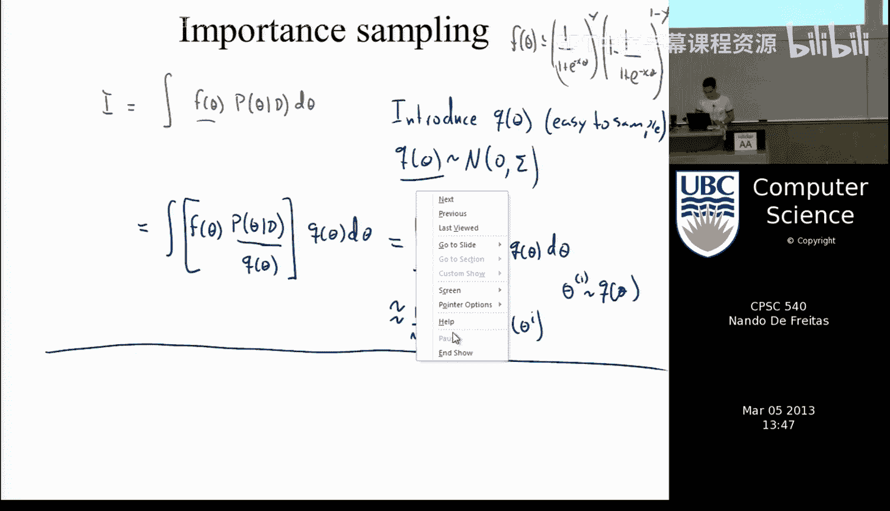

The one thing。I'm going to generate one more slide here under the slide。

Okay， so our problem is we don't know how to evaluate P of theta。So， instead。Because， essentially。

We knew that P of，Given D was equal to。P basically the data， given theta times the prior。

Divided by P of D。But we don't know what P of D is。And so what we do， or for short。

 we usually write this as P of D given theta， times P of theta。By by z。Or is the geotheater。快快声。

So we know how to evaluate geo theta。 Our problem is we don't know how to compute set because that requires that we solve an integral。

Zed。Its the integral of geotheta。And we don't know how to solve that inter controlological regression。

So what we do then is the following。So if you have。The integral of f of theta。Times P of the。Givety。

De。You again introduce this Q distribution。So first we take Z out of the integral。

Because that is not a function of the。And so。We write as as F of Theta times G of theta。第。

And this is just equal to。I for theaterta。 Im geota。And thethe。Divided。拜。The integral of geotheatta。

 the Theta。Which is Z。And that's equal。Should they integral。Of F of theta。Geotheatta。

Divided by Q of theta。Where queue of theaters， again， our friendly distribution like the Gaussian。

I'm sorry if my voice has gone down。然。Starting to run out of it。

And then we do the same thing in the denominator， F of theta。G of Theta oops， sorry no if of theta。

Justtry of theta divided by Q of theta。And then。気をついちゃう。The feature。

And then the next thing we do is we draw samples from our friendly distribution。

And we can do that even beforehand。And then， all this gets approximated。Bye。

Among the ratio of two Monte Carlo estimates。And that's our solution to logistic regression。

When you do this for probabilities， when you do logistic regression。

 you will essentially have something like some prior distribution。In this case， the prior is calcium。

And then we will have a likelihood。When you plot the likelihood of logistic regression。

 you will find that it's not symmetric。One tail is heavy。

 so one tail is much higher than the other tail， the case much more than one side。

 but it still has a unique maximum， so when you do maximum likelihood。

This would have been the theta maximum likelihood。Is the maximum the like？

The posterior combines the prior。And the likelihood。When I do important sampling。

 I draw samples from the。Qe distribution。 and usually you pick a broad queue distribution that includes the entire support of the posteriia。

You draw samples from the kit distribution， the weight them。

 That gives you a Monte Carlo or a histogram approximation of the posterior。And in addition。

 once you have this histogram approximation。You can。For the computer predictive distribution。

We just get samples from P。 and that allows us to approximate the probability of y being one or zero and。

It's a binary case because why is binary so you get a histogram like this？

And that's the basic way of doing。This is。I mean， I've covered a lot。

 but essentially this is the baes way of solving all sorts of statistical methods。

 The baing problem will always be one of not being able to solve the integrals and using Monte Carlo to approximate。

First interval。I think Bobock has your homework there。So if you want， just go to him。

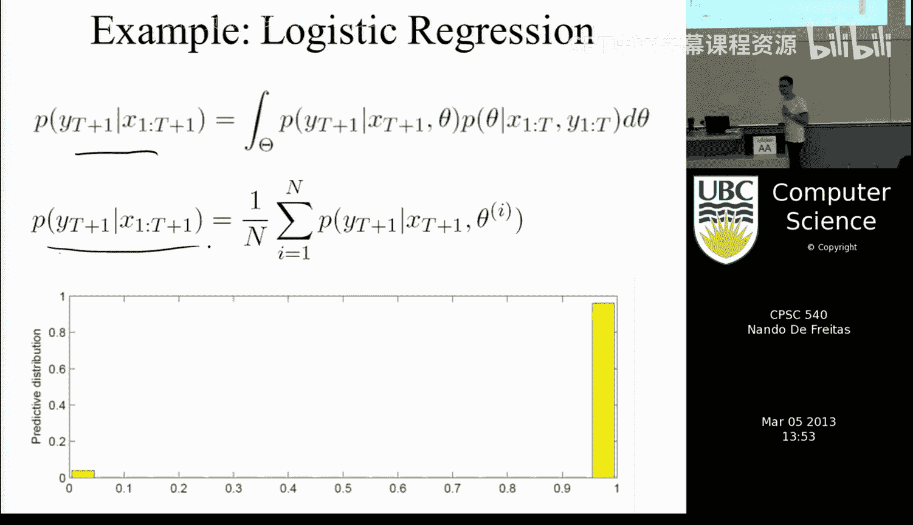

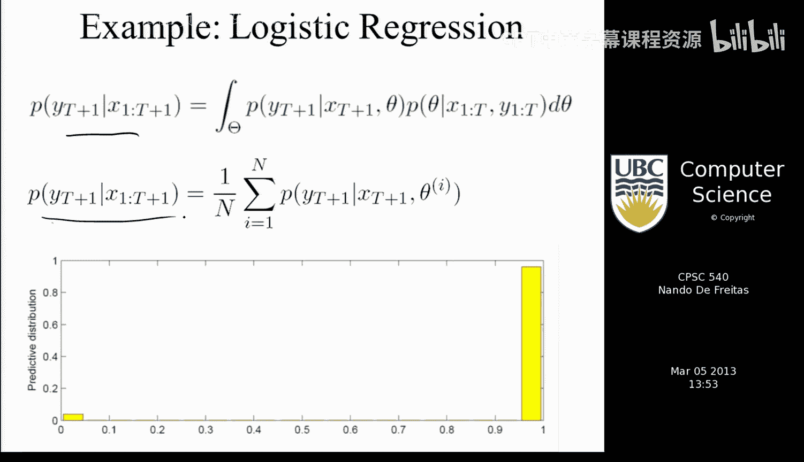