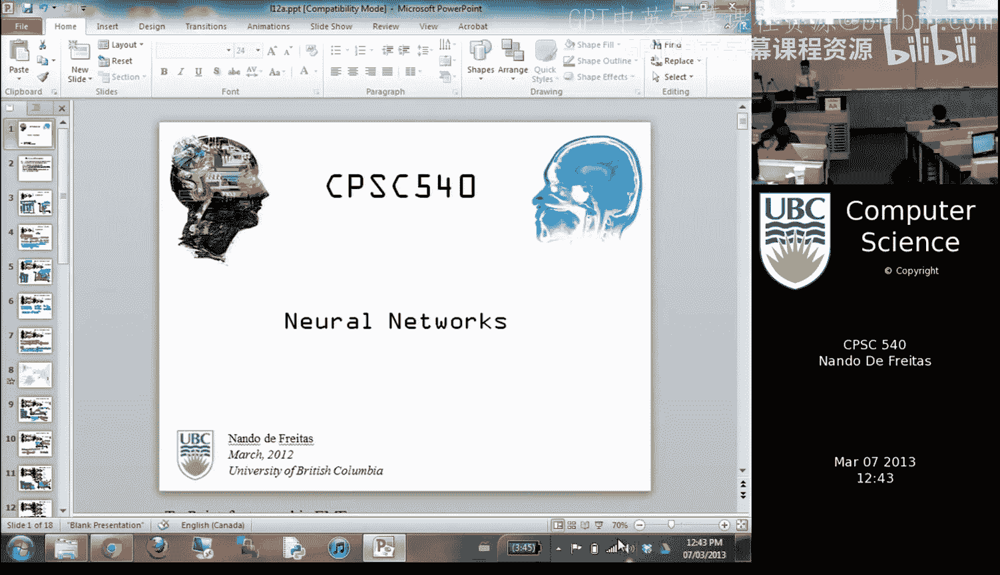
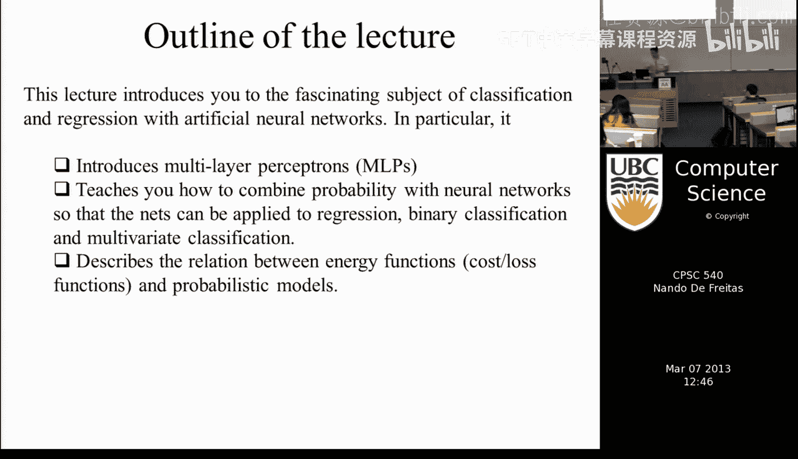
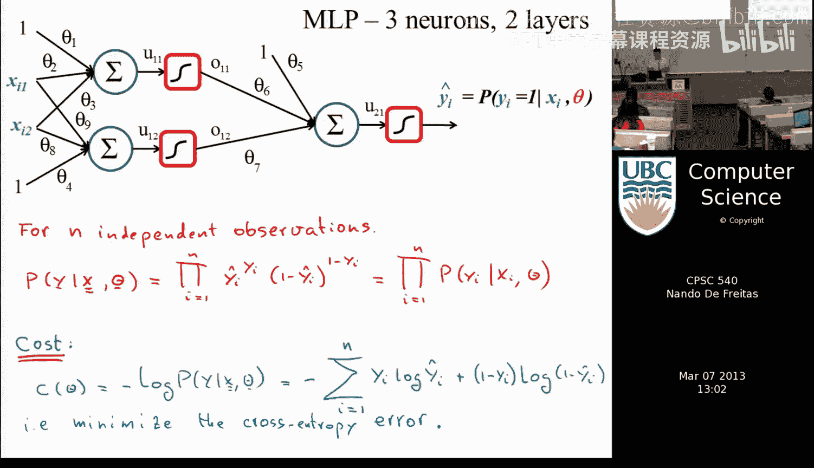
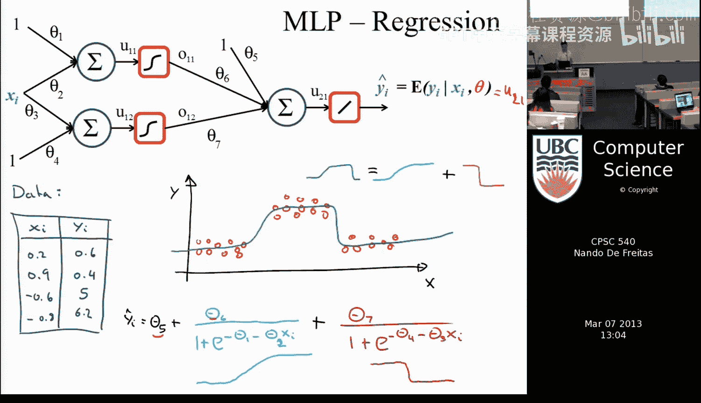
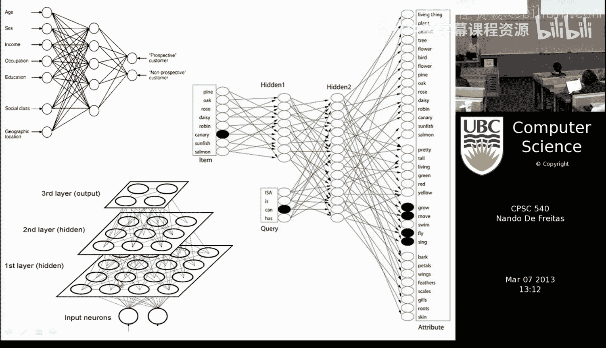
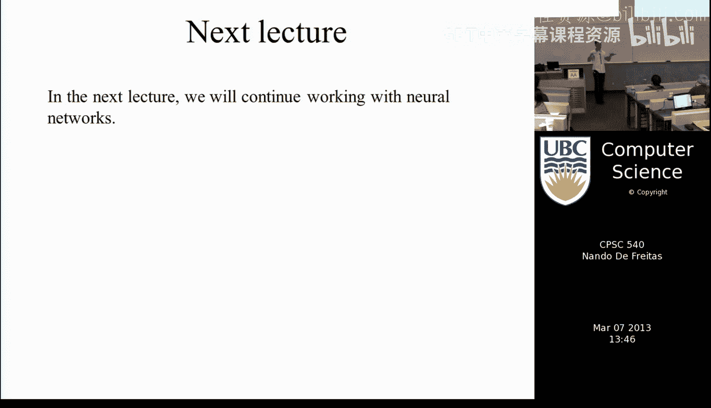
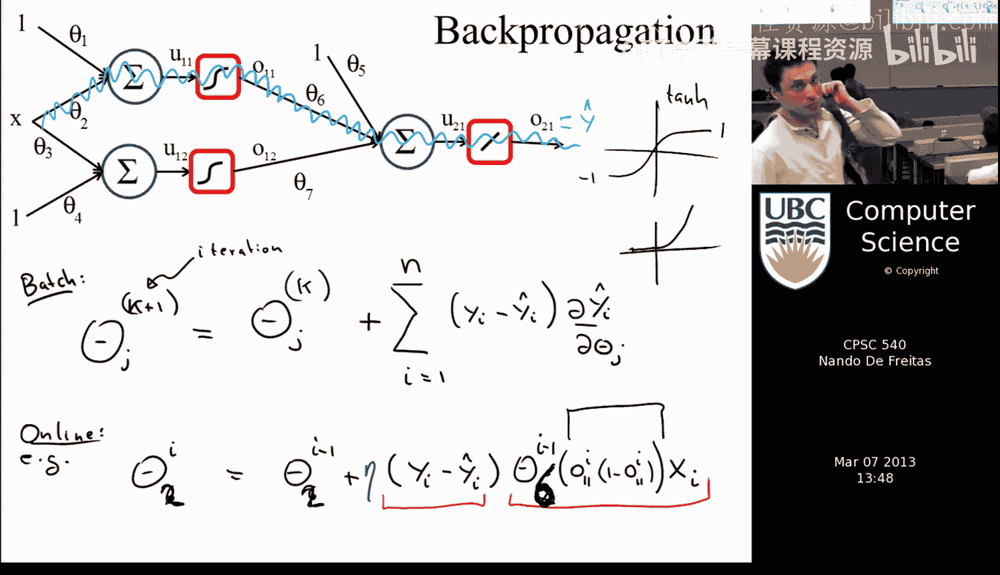

# UBC《机器学习（研究生）｜CPSC 540 Machine learning 2013》中英字幕 p17 -17-Machine learning - Neural networks.zh_en -BV19g2FBBEEq_p17-

Okay so that's pretty much what we're going to cover。 we're going to look at these perceptrons。

 which are just another word for these neural networks。

They are feed forward architectures in in the sense that they take an input and they produce an output。

So it's sort of one directional。Unlike other architectures that exist out there that are recurrent where the output feeds back to the input。

I'm going to mention something about recorded architectures late。Later in the course。And。

What we'll see here is that the ideas that we've been using for learning。

 the idea that you can learn by minimizing a cost function or that you can learn by maximizing the likelihood or a regularized cost function。

 which is equivalent to a likelihood comes up prior。

Still apply and there will be three parameters and to choose those three parameters。

 you do cross validation or put strapping。And if there are too many free parameters。

 then you would use a technique like ba optimization on top to optimize these techniques。

 so everything we've learned。Applies in this domain。And when we have continuous data。

 we will use Gaussian models。When we have discrete binary data， we will use beernoulli models。

 and then when we have more than one category， we will use multinoial probability distributions to model the likelihood。

So。To each different kind of data， there is one type of distribution。

 we take the negative log likelihood， and that gives us the cost function that we need to optimize。

And then optimization is just a question of competing the derivative。

 And once you have the derivative， you just do the gradient descent。

Or if you can compute a second derivative and there are not too many parameters。

 you can do a hesian method。And if you have too much data， then it makes sense to do it online。

 that is to just take a few data points。 So that's essentially the summary。

 We will do what we've done for every other of linear models for logistic regression。

 The only thing that changes now is that the models will。Will it get a bit more complicated。

Okay， so let's go back to。Logistic regression， which， as I said in the last class。

 is a neural network with one neuro。 So you can think of the。

One basic unit here has this Macallo pits model of an neuro。Because。So in this case。

 there's two inputs x1 and x2 at time I， so data point I。

 and there is one output which is this prediction y hat。And if you were doing binary classification。

 that output would be just the probability of y being equal to one。 And because。

Because recall that the sigmoid function will ensure that that output is between 0 and1。

 So the sigmoid function is squashes。You。So that it's between zero one。Okay， so what's the setup。

 let's review it one more time。 So to begin， we are given some data and the data is for a supervised setting。

 so the data consists of pairs， X， Y pairs。The why is a binary。And the axis in this case。

 there's two inputs， but there could be more inputs。I've made my access be continuous。

 but the axis could be continuous or categorical or because we're not modeling the axis。

 the axis are deterministic， so this wouldn't be a problem。If I plot the data。

Basically I plot x1 versus x2 then we'll see that each data point is a point in 2D。

 so these are the input coordinates， x1 and x2 of the point。And the color， whether it's red or green。

 it's essentially whether this y is0 or1。 so if y is 0， the color is red， if y is1。

 the color is green。Usually the input problem is we're giving this cloud of points。

Learning is the task of finding this blue separating surface。So which is essentially a line。

 or in 2D， it would be a plane in higher D， it would be a hyperplane。 And that separating surface。

 that separating plane is often called a discrimininate function because it discriminates。

One class from the other。Okay， so。So this is the input to us， and that's what we're after。

 we're after learning the line and learning the line is equivalent to learning the parameters if you know the parameters。

 you know how to draw the line。Okay， so。Let's review the math we did last week， sorry last Tuesday。

 So again， the idea here is that we。A single neuron takes the inputs。

The bias term and the two actual signal inputs。It weights them by theta。 So in this case。

 for example， Xi 2 gets weighted by theta 3。It adds them all up。And that gives us the signal u。

 So as you can see here， u is a linear combination of theta1 times 1 plus theta2 times xi 1 plus theta 3 times Xi 2。

And then。What you do then is you put this use signal through a sigmoid。Which is this function here。

1 over 1 plus E to the minus1。And then if you squash it。

You get something that's between zero and one。And so we interpret that as the probability of y being equal to one。

In other words， the binary probability， the probability of y given the input and the parameters is this beernoulli distribution。

And the Bernoulli distribution has success Y I hat， that's a probability of Y I being equal to one。

And then favor rate1 minus Y I hat， which is the probability of Y I being zero。And if we expand it。

 then you can see that if Yi was one。Then this term survives and whereas this term would be 1 minus10。

 so this whole thing would be one。In other words， when YI is equal to1。

 this expression simplifies to Yi。And when Yi is 0。

 this whole expression simplifies to1 minus Y I hat。 Okay。

 so this single expression is basically summarizing。That the probability。why I being one。

 given the input， it's just why I had。And the probability of Yi being zero。

 given the input is just1 minus Y I hat。And this is a well defined model because only two things can happen。

 The output is either 0 or1。 In other words， the neuron fires or the neuron doesn't fire。

So it's a gate， it's a binary gate。嗯。And if you add these two， you get one。

 so we have a valid probabilistic model。If you now have and training data。

We assume that the date is independent。It's not always the case， but for most situations。

 well assume that the data is dependent。And if the data is independent。Then we just model it。

The product of all the data is just the product of the individual likelihood。

 So the joint likelihood of the data is just the product of the individual likelihood。

Very much like we did in linear regression， linear regression， each data point was calcium。

And then we multiplied all those calciumusss for each of these data points。

 and that gave us a multivariate calciumusian， which was the distribution over all the observations。

 y。No。So that's a signal in the Europe。嗯。The separating and as picture illustrates。

 we went over this in some pictures in the last class， with a single neuro。

 you can only make linear separating surfaces。Okay， so the boundary。

 the boundary is essentially the equation of a line。Which is given by this。By did you signal。

And so the problem with this is that。嗯。This LED to a lot of controversy back in the 50s。

Because the idea was that a neuron like this was meant to be thought as a gateit。

And just like a gate in semiconductors where you get an gates and ore gates and N gates and so on。

 the difficulty was this。Okay。Which gate does this？Which case gives you this？In other words。Exor。

Texorrogate。Sourgate basically says。When the two inputs are different， then it fires。

It won fire for them being the same。 So the problem with this。

Is that if you want to create a gate that does this with a single neuron， it's impossible。

Because there's no way to make sure that you can group these two guys。And two blue guys separately。

So， a neuron cannot。Moodeled this。Right， simply because if you use a separating plane。

Then here you would have。An element for which the exaggate fires one。

 and an element would exaggate fire 0。And likewise here， if you use this other plane。

 it wouldn't work， this plane wouldn't work anyway， you can drive every plane you might want to。

 none of these planes will give you what you want。So。So the worry was that。You can't。

 You can't generate exorgate with an neuron。 And if you can't create something as simple as exorgate。

 then maybe。There's no point to do any more research in neural networks。

And as silly as that argument might seem， books were written on the topic。

 and the field kind of died for a bit。嗯。Then came to come back answer。I came back。 answer was。

Introduce a more sophisticated neural network in particular。

 make sure that there is what neural net scientists call a hidden leg。Okay。

 so there's usually in the lingo of neural networks， the inputs are the input layer。

So you can think of the inputs as。I don't have photores in the eye。And then， you go through。

A first layer in V1 the back of your head， and then you go to a second layer of processing。

Before you can produce gal。The data is still the same， so nothing's changed。

 it still the same problem， but we've made the model more complex。By making the model more complex。

 the idea is we will build gates。There will be nonlinear。 and if they're nonlinear。

That will allow us to do separating surfaces that look like this。

 and so it becomes possible to do exaggate， so it becomes possible to put the two crosses in one class and the two zeros in another class。

Questions that arise。And we'll soon see how this works precisely。

 but the questions that startris when you do this is how many neurons should you put in each layer？

How many layers should you have？And these are the sort of things for which you will have to cross validate and take computation into consideration and the sort of thing for which patient optimization could do a good job。

Now， once you have that and you have some data。嗯。By having separate and nonlinear surfaces。

Now we go back to the problem that we had when dealing with RBMs because this essentially is very similar to RBM。

 you might have a separating boundary that is smooth like this blue curve。

 but you might have one that is very wly， like the purple curve。Which one is better， by the way？嗯。

smoothth one， because the world tends to be smooth， we tend to prefer things like the blue one。

And the more neurons you add， the more flexible the model is。

 So recall that I showed you before these plots， where if you have a very flexible model。

 it will at least in the regression case， like a higher auto polynomial would be a lot more wobbly。

 it would have a lot more。Variation， so controlling the number of neurons is a way of controlling complexity of the model。

Okay， how does this work？They analyzeize it， step by step。

The nice thing about neural networks is you can analyze them with a picture with a graph。

Or you can analyze them by writing the equations。So they're very easy to visualize， in other words。

How does this work？We have the two inputs， x 1 and x 2。

Each of these inputs gets weighted by a weight。Theer 2 and The 3。

And then they gets summed and that produces U11。 So U11 is for layer 1。

 the sort of intermediate signal in s an neuro。And if you look at the equation of u and1 here。

 you'll see that u and1 is just theta 1 times 1 plus theta2 weighted sorry x1 weighted by theta 2 and then x2 gets weighted by theta 3 so each datata point。

X1 and x2 would be weighted by these in order to produce U11。

Then U and1 goes through a sigmoid in order to produce the output in layer 1 for neuroer 1。

 so the two indus here would be layer one。你有人玩。And the reason why I'm putting these indices is because when you implement this。

 if you're careful monitoring this indices， this whole operation here can be vectorized。So， the sum。

This is obviously just a matrix vector to multiplication for all the data。

And then this is just pointwise valuation。You evaluate each gene of the vector。

 And so you can actually。This type of operations that I'm doing now， it's in code。

 it's very you know， it's very easy to code it。 It's very simple。

 It's just a few matrix factor operations。A couple of lines。

And we do the same from the bottom neuron， we followed the signal， so we have theta 4 times1。

 and then we have theta9 times theta 9 times x1。And then theta times x2。

We also put that signal through a sigmoid to give us the output in layer 1 for neuron2。

Which is given by this squashed output。And then the quaed output gets multiplied by theta 7。

And theta 6 for the top near。 And again， we have a bias term for the output。

That gives us the intermediate signal in。The second layer for the one neuro that's there。

 which is basically theta 5 plus theta 6 times011 plus theta 7 times012。

And then I squash it in order to give me the prediction。The ys are the data。

 So it still as before the wise sub binary。 So we still use a the same likelihood as for logistic regression。

So in terms of probabilistic modeling， nothing changed， everything is the same。

 it's still a Bernoulli model， and you still will learn it the same way， you take the negative log。

 they will give it a cross entropy， and then we just compute derivative。

And optimize of the derivative。Oh speaking of which I just realized I didn't make the homework on the website available this morning。

 it will be there later today。In a few minutes， but go ahead。Reson why theres two ones。So。

 the reason why just to。Two ones in the input layer。不是就是况。Could you get away with just doing one？

Probably， let me think。Yes， that's correct。 There's no need for two ones there。

I could just have a one feeding into signals else。 So I was drawing this and。

Painfully PowerPoint and put an extra one there。So generally you have to round the output of the sigmoid function。

 right？Do you went to round before after you put them into the second layer？嗯。

You might want to round them before， and itll soon be clear。 So the next slide will make that clear。

 The reason why you want to round them before is because you want。You want to sum nonlinear units。

It will be very clear soon。signaloid functions is to introduce non nonlinearity into the process That is correct。

 that is the exact answer， and let me show you how that comes to be。Okay， before。

I， did help this。And go， let me just。Yeah， okay， let me maybe go a bit ahead of myself here in the lecture to be able to answer your questions。

 so now think of a different setting regression。So in regression the output is continuous and just I'll come back to this。

 but just to answer your question。嗯。The output 1，1。011 is essentially a sigmoid function。Right。

 and so all12 is also sigmoid function。As a function of the input。

So you can think of 011 as something like this blue curve， it's a sigmoid。

And you can think of all12 as another curve， say。There's red curve here， red dish brown。Now。

 the nice thing is if my data looks like this。Like a step。Up and down。

Then by just having two of these breaks。I can add them up and I can generate this。

Regress and function。So by having the linearity， what I've done is I've created a ice。Break。

And if I have a break， I'll soon argue that this is a break that I can make。Ft or tall or wide。

 And because I can change the shape of this brick， and I can sort of flip it。

Flippped a sign of the brick。 I can build any function。In approximation theory。

 this's actually a result that says that a one layer neural network is able to approximate any smooth function。

Arbitrarily well as the number of units goes to infinity。

So that's kind of getting ahead。 But let's go back to。 So I'll come back to it。 but let's。

Stick with our extension of logistic regression first。So we have a logistic model。

 so each likelihood for each data point is the logistic function， if you have more points。

 if you now have a whole data set with n independent observations of the input output pairs。

 then we just take the product from one to n。Of their individual likelihood。Now。

 if you take the product。And you want to get the cost function。

 We do exactly what we did for logistic regression。 We just take the negative log likelihood。

 So in other words， minus。Log of a product is just a sum of the log。And then， the log of。

S a quantity to a power is just the power times the log of that quantity。

 So if you take the log of this expression here， that just gives you this error function。

Whi is what we discussed in the last class is the cross entropy and the cross entropy is a measure of uncertainty in the system。

 so by minimizing the cross entropy we're maximizing our information about the date。

So the model is learning， in other words。So this is binary classification。And。

There's binary classification sort of a popular thing in neural networks because youre still thinking of zero1 gates and then you try to build all sorts of cool networks with it So here are some typical networks that you encounter in practice This is sort of the old school networks before the deep learning One network might be taking as input age。

 sex， income occupation education， your social class， your geographic location。

 and then that network predicts whether you're a customer or not a customer。In fact。For many people。

 have have any of you played an IQ test in Facebook。No。And you're actually smart。

 do you have a higher eye here then？诶。I would be tempted， although I wouldn't want My to be revealed。

 but here's the thing。Those making you play that game， they are actually recording your IQ。

And they're collecting data about you， your age， your sex， who your friends are。

 the age and sex of your friends， So they're collecting a huge feature vector。 and they have your IQ。

If they have your IQ and a huge feature vector， what can they do。Predict up was like。Exactly。

Can predict the IQ of any of you and me。So that's。Vte is very powerful。

 You can do all sorts of things with date。And。Paper on this will be coming out。

 hopefully after this video is。系。Published。Not too long after this video published， I mean to say。

So there's sort of very interesting things you can do with it。In this case。

 the application is just to construct a model to predict whether you're going to be。Customer or not。

Neo networks actually used a lot in a very big application。Machine learning， which is credit rates。

 In other words， when you use your credit card， machines automatically very quickly know whether you're credit worthy or not。

If you had a human in the loop， you would take， you know。

 you would use your card and you would have to wait a few hours before you get a reply。

And that was in the old days。 Nowadays， everything is done quickly。 So credit scoring is。

It's been made possible through some machine learning。 It's not a solve problem。

 There are countries like Nigeria， India， Uganda and so on。

 where K's scoring actually works very poorly。And the reason being that， unlike us， here in。

very nice country where。It's very easy to classify people according to income。

 if you if you live in Uganda， you're probably making less than 50 bucks a month and there is no notion of a formal job and so on。

 So it's very hard to actually be able to do credit scoring。

 And this is a huge problem in an area called。W forget what it's called。Micro loans， microfins。

 because you want to help people by doing this microfins and doing microlo。

 but you also want to know how reliable are people。

 how unlikely it said that they will pay back those 50 bagss。

That you've lent them to change their lives。Here's another sort of application from professoror from Stanford。

 I forget his name。I have this cognitive disorder that I always forget names。

 So what he does is he takes two kinds of inputs。First he takes things， nouns， basically。

 objects like oaks。Or roses or sunfish and so on。And then the other type of input is a relation。

Take a verb like or a containment relation like is or can or has。 And so， for example。

If he goes with a canary。As the inputs are a little yellow bird。

 and if the input here is one for can and zero for all the other ones。

 then the neural network does its magic and it predicts that the canary can grow。

 move and fly and sing。So if you have enough data， this is easy to train。

 this would be easy to train in Wikipedia because in Wikipedia。

 you can actually extract all the pairs of data。Let's say canary can fly and so on。

And then you will use that data to train a network like this。And of course。

 a lot of that data will be missing stuff because maybe Wikipedia。

 there's no single entryry that says that a canary can sing。

But if I canary share the same features as a robin or so， then you might predict that。

Canary can also sink。If Robins sing， I know the Robins in England do。The one， the American ones。

 I don't know。嗯。It's also possible to arrange neural networks in different apologies and so a common thing that we will see more throughout the course is to organize them in a grid in a 2D setting。

 and this is sort of good for images because basically the neural net like the neural net mine。

 it looks at a million。Or so， places。And then it propagates them in parallel， so in layers like that。

And that might be connections between the neurons on each layer。

 and then there's connections between the layers。 So this is a very common model for computer vision。

Okay， so。Now let's come back to this slide， which is for regression。

So neural net can also be used for regression where we're trying to predict an output， which is。

A continuous variable， minus1。2 or 0。6 and so on。So everything is pretty much the same。

 except that now the label。Or in this case， I only have one input， but you could have more inputs。

 In this case， the label。Is a continuous number， so it's no longer binary。

Because the label is a continuous number that could be higher than。One or smaller than one。

Instead of having a sigmoid neuron here。I'm going to use a linear nerve。Okay。And I have to。

 because if I had a sigmoid neuron there， I would never be able to get an output that's equal to5 because the sigmoid squashes everything to be between zero and1。

 but if I just have a linear neuron， which is essentially the identity。

 So a linear neuron just basically says that the output here is the same as the input。

 In other words， Yi is equal to u to1。The interpretation we will give this output in terms of probability will be the expectation of y given x and feet。

 and we will soon see Y in the following slide。But。Putting this expectation aside for the time being。

The kind of predict what we really are learning to do here is let's look at the S model。

 the Sigma model says that y hat， which is equal to a u to one。Is equal to theta 5 times 1。

 so theta 5 times 1 that's the equation there。Plus， the 6 times0，1，1。Theta 6 times 1011 is this can。

Thing here。 and that's basically because011 is equal to theta 1 times 1。Plus， theta 2 times Xs。

All added and then squashed through a sigmoid。And then if I look at The seven， same thing。I take。

Theta four times。Plus theta 3 times X。And then I take one plus1 over8 to the minus that quantity。

 which is the sigmoid， and then I multiply it by theta 7。Okay。

 so now each of those is a weighted sigmoid and now you can look at what each parameter does。

 so my function that neural network can be interpreted in two ways so you can either use the picture to look at it or you can just use that equation。

 the equation describes the graph， the graph is a picture for the equation。

The equation simply is' like an RBF。Right， is basically saying the output is a linear combination of placess functions。

The difference with the RBF is that in this case， we're going to optimize all the parameters in the RBf。

 there was this issue that we had to do cross validation for the width of the basis functions and we had to decide how we were going to place the RBFs and so on In this case we were going to。

Estimate all those parameters from data use gradient set。

Now let's look at what each of these parameters does， Theta5， what does theta5 do to the function？

Move it up and down。Theta 6。Yeah， it sort of squashes if theta 6 is large to can curve。

 so you have a taller S and if theta 6 is tiny， it makes that S it' small。

 if theta 6 is negative it actually flips it。Now， what does theta 1 do。Yeah。

 shifts at left and right。Because if you have a function of x minus a， it's just shifted x by a。

And then。Theta 2。Think a few of you are indicator theatre too will just squash it or make it flat。

So basically with those parameters， we have the control for each basis function to do this。

To do this。To move it left and right， to move it up and down， if you can make your bricks fat。

Or taller。And you can move them anywhere。You can build。Cities and towns and so on。

 So that's the idea of an neural network。We use this basic and building。Building blocks。

 which are the neurons and with the neurons we build。Very complex functions。

 arbitrary complex functions。And that's all there is to it。 There is no magic to it。

 We're all we doing is we're approximating very complex functions。

 So learning in a neural network is just about learning a nonlinear function。

And that no nonlinear function could be the function that we have in oops。

 the functions that we have in regression when we're just trying to predict。Input output。

 when we're trying to fit a curve to the data， or in the case of classification would be the separating boundary between the two classes。

All right， now let's look at it Y the expectation。And the reason why the expectation is the same as the linear model。

 This is exactly the same reasoning that we did for the linear model。In other words。

 we assume that each point。Xi。Is Gaussian distributed so sorry that for any point Xi to be precise。

 the Yi is Gaussian distributed， so we assume that we have Gaussian noise in the outputs。

And if we have Gaussian， so this is the probability of Y given x and T。X and the are given。

 So this is just a distribution of the y。 And basically this purple height here indicates probability of this point。

So that height there is pro to Y given X the。 It's exactly what we did for the linear model。

 and we were looking at these squares。And so we can also write a Gaussian。

 so the probability of this single point is just equal to univariate Gaussian distribution。

And this is the data point， and it has variant which we will assume it's known for simplicity for now。

And then。The unknown is this Y I hat， which is a function of parameters。

And if you look at this expression for the Gaussian and you see that why I hat it' just the mean of the Gaussian。

 and that's why I'm saying it's the mean。Expected value。If we want to compute the cost。

 we just take the log of this， the negative log， and then that gives us the cost。

And then there's a constant there， but since the constant doesn't affect the location of there。

Of the the maximum， we just ignore the cost。So it's the same as least squares。

 The co function is the sum of squared  errorss。The only difference is that now my function。

 why I had， my prediction is a neural network， iss a nonlinear function。It's exactly many squares。

 But instead of using a line， now we're using an arbitrary function， which is a combination of。

Sigoids。Okay， so。And then， of course， everything we learned for linear models applies。

If you want to regularize it， if you don't want your functions to oscillate too much。What can we do。

And do an L2。Penalty。So the L2 penalty for neural networks is actually called weight decay。

Because essentially you're asking all the weights to be small。And in the the psychologist。

 when they came up with it independently， they thought of it as trying to make the neurons not fire all the time。

 trying to conserve energy。And。And then the other way to control complexity is via the number of neurons。

 as I said before or the number of layers， so you have a few ways to control complexity。

And if you have a few ways to control complexity and it becomes hard to then tune all these to cross validation。

 you could use calcium processes with pasing optimization on top to tune it。他。Here is。

So that's pretty much it， that's a neural network for regression。When you implement？

The only thing that's left for us to do is to compute a gradient of this。

Once we have an expression for the gradient， we just give it to any optimization toolbox。

And they will give us the answer。If you're doing classification with many classes。

 this is now does involve some new things。 So let's look at examine it。 So we're going to use at。

A technique， a coding technique here， and a coding technique is as follows。 So in this case。

 I'm trying to classify things into being one of three classes。So for example。

 whether something is red， green or blue。What we do。For each class。 So again。

 the data is the same as before。 have as the binary case。 we have two inputs。

And we also have the labels。 So we have two inputs。

 and we have the labels which say whether it's class 1， class 2 or class 3。

But then what we do with this encoding one of k encoding， it's called in this case。

 one of three is that if it's a class two， we put a one。On Y I2， and we put a zero in yet。

If it's class one， we put a one in。Y I1 and so on。 So this is just a way of sort of rewriting the date。

So instead of having a number here that is2， one or three。

 what we will have is this encoding one of k code。What this allows us to do is we then create a neural network that looks like this one here on top where。

Each label， each YI， is going to be a linear combination essentially of the two neurons we have here。

And well soon， so the only thing that will be left is for us to write what is the probabilistic model that describes this network？

And then we're going to take the negative log。 And that's going to give us a cost function。嗯叫 ahead。

More function idea doesn't。We having zero。Pard it last。 so you could have a sigmoid there。

 but as I will see in the next slide， you don't need it。It'll be clear in the next slide。Okay。

 so the task in this case is to learn a separating boundary that looks like this purple one here that separates the three classes。

Okay， so how do we define the likelihood。The way we define the likelihood。

And this is why we don't need these guys to be squashed between0 and1。

I we're going to say the probability of class two， for example， that is class 010。

It's going to be equal to， and I'm going to introduce this function here。

I'm arbitrarily introducing that function。Well， not entirely arbitraryrbitarily。

 I'm interesting that function because that function has some nice properties。Property one。

 can that function be greater than one？No， because it's。

There are only three possible outputs and you're dividing by sum， can that function ever be negative？

Okay， so that function actually is between 0 and 1， and it's positive。

So it will allow me to interpret it as a probability of class 2。

The reason why I didn't need a sigmoid output。Was because just by。Using this function。

 I have something that has the properties that I want。If I had a sigmoid here。It would also work。

 but it's kind of doing extra work。Because it would also be a valuable distribution。

 but there's no point in doing that。Because just by having this exponential， we take care of it。

So that's going to be defined as the probability of class2。

And then I'm going to have to define the problem of class one and class three just the same way。

This function has a special name， it's called a soft max function。I should write to dance。Soft。Max。

the limit becomes sort of a max， it picks the max of three。

But it's sort of a smooth function and doing that。Now， how do we write a probability。

 We're going to write a probability the following way。

E to the y1 divided by E to the y1 plus E to the y2 and e to the y3。

 this is something between 0 and 1。And it has- and this is the probability of class one。

So when Yi is 1， this is the probability of class1， does here， remember is the indicator function。

So the indicator function just to。Refresh your memory。We defined it as。Being equal to。One。

 when Yi is equal。To zero or0 otherwise。And then this is the probability of class2 and the probability of class 3。

 If I sum the probability of class 1 plus probability of class 2 plus probability of class 3， I get1。

Right。でける。Wch should be one。大事。When y I is equal to 1， oh， when y I is equal to one， sorry。

That's a typo thanks for catching it。Sometimes I say something and I write a different thing。Okay。

Or just to make sure that there is absolutely no confusion。If Y I is class 2。

The indicator of class 2 is on。And then Kate basically just tells you which glass you're on。Okay， so。

And so basically， this is just a longer expression。 It's just the same as the Bernoulli。

 but now for three cases。And。When Yi is equal to one。Then。Then it if y I is 1。

 it cannot be 2 and it cannot be3。 So these two terms here get power to the power 0。

Any number to the power theory is1， so the only term that survives is this。

 which is e to the y1 divided by this sum of these three terms。When YI is equal to2。

 only the term survives and when YI is3 only the term survives。

 so this expression is essentially summarizing these three cases here。

AndThe pro of one thing equal equal one。2 or three。That's the likelihood。

 If we take the negative log， negative log， we end up again with the cross entropy。Okay。

 so essentially Y I the log of the Y I had predictions。

And minimizing the cross entropy again gives us。The most informative solution。Okay。

 so I see a few terrorized faces。I'll stop here for questions。Now，Some people here are happy。

Multiple ballot classes， like if something is。3clock。When something is three classes。

 I didn't follow you。's human， it's a guide。It be 18 and 20。

those classes out of multiple10 classes So can you speak up by can't my registers？

So if the classes aren't exclusive， if you can be a member of a member of multiple classes， Oh。

 if you can be a member of multiple classes， you could model that too。

 it's just you would use a different than coding。So you could quite easily have an encoding that allows for more than one of these neurons to fire。

You would have to be careful how you normalize because you still want to have a valid probability distribution。

So it's possible that you just need to make sure that it normalizes appropriate。And that's about it。

 It's just a trick to construct that function， right。The model with different number。

the layers will there be a。发对。Very good point， yes， these models are very non identifiable。

For those of you who haven't come across this concept of identifiability。The simplest way I can say。

Is imagine that I have this equation，2 is equal to x times y。Can I recover X？And the answer is no。

 because there's multiple answers。 I could say， well， it's true when you have this。

 it's also true when you have this。And so on。So there's multiple answers to the problem。

Same with the neural net。 because if we look at the picture。If you actually look at the hidden layer。

 if I were to swap the order of。To neurons。I would get exactly the same answer。

So the parameter for neuron is indeed non identifiable， and that causes trap， actually。

It causes trouble because when you start doing that and when an answer can when a neuron could be have two values you。

The cost function then gets two peaks。 There's two possible solutions。嗯。

And then if you have actually many neurons， you actually end up with the factorial。

Explosion of all the possible combinations of orders in which they could be。

 And so you actually have this factorial number of peaks。In the likelihood。

 So it's no longer a nice calcium， but it's something very spiky。 some of these modes are symmetric。

In which case it's okay for learning because we just need to find one，s up to symmetry we're fine。

 but sometimes there's some areas things so that're superimposed and they creates very nasty cost functions。

And optimizing neural networks is actually very hard。They were very popular in the 90s again。

When I started doing research。And then they fell out of favor for other techniques and the reason why they fell out of favor was because it was extremely hard to optimize them。

 where is there some machine learning techniques that are conves like calciumussian processes like support vector machines。

 which I haven't talked about yet that for which it becomes possible to actually you know solve the optimization problem。

 and so these very complex models were sort of abandoned。Until a few years ago， when。

Enough progress had been made in terms of algorithms and also importantly。

 enough progress had been made in terms of GPUs and being able to store lots of data。

Once we had lots of data and GPUs， which is how you typically you want to code these models。

 then you can actually implement the gradients efficiently。But they are indeed， very problematic。嗯。

There was， I think it was here。A least great costs estimate for performing pioneering class。

You could do that。 It's not my favorite thing to do， but you could use still like Gaussian。

And then if something is greater than 0， you assign it to class 1。

Like you can do calculate the periods of the。Don only modelland。

 especially in terms of implementation。自めて？to大学。Okay， so Im going when we talk about gradients。

 I'm going to come。I'm going to go over that point that you mentioned now。

 so he's mentioned a very important problem with this。I'll come to it， there are solutions around it。

Okay， so that's multi class。 And really， all neural letters are all the same。

 The only thing that I'm doing here is depending on the data。

 whether the data is binary or multiclass or Gaussian， I'm just essentially changing the。

The probability model for why。If my data was Poisson counts。

 then I would use a Poisson distribution to model Y and so on。

 So the output of neural network would be the mean for Poisson。If it was gamut， the same thing。

 if there was an inverse which distribution modeling the same thing。

 So there are two components to this， there is the nonlinear approximation through combining basis functions。

 and then there is the choice of。Probability in the output。Okay。

 let's come now to how we learn the neural net， how we do the training。

Let's assume we're doing for simplicity， I'm going to do the back propagation for the binary case。

 sorry for regression， but if you want to do classification。Come to office hours。Okay。

 so the technique we're going to use is called back propagation because the idea is we're going to do a forward pass through the network。

 so when you do computing with neural networks， we always break the training into steps The first step is we take the input X。

And we feed it through the net。To generate all the O's and U's and Y hats。

 So we generate all the intermediate signals。And the output signal。

And then in order to adjust the parameters， we're going to go backward。

 we're going to go compute gradients。So forward pass and then backward pass。Okay。

So the forward pass we already know how to do because we've seen the operations before， oops， sorry。

 which is basically if you have an input x， that input in the forward pass。

 you essentially you have u and1 is just theta 1 plus theta 2 x。Year 12 is 34 plus each 3 x。

 and then youll squash each of these us through a sigmoid to get a two o's。And then you add them up。

And that gives you the output of the second layer。Okay， so that's the forward pass。

Now let's assume we're doing a regression， so for regression， we need to minimize the squared loss。

In other words， Yi minus Yi。Minus the prediction why I had squared。

 the prediction is just this output， output21， which is the prediction of this network。

With parameters， with vector of parameters theta。And what's left is for us to compute a derivative with respect to any parameter。

And so what we'll do is we'll compute the derivative with respect to each parameter separately。

And that's going to give us a factor of derivatives。

That vector has as many components as there are parameters。So how do we do that， Well。

 this is a quadratic function， so the derivative of a quadratic function。

And here I'm doing it for just one day。One data point， so data point a time I。

 I could also do it for all data points in a batch form。

 but listen the online because the online is easier to get first。

So the derivative of quadratic is just two times。The function times the derivative of the thing that's inside。

 which is the derivative of Yi is just zero， and then the derivative of this function。Okay。

 first important conclusion。In order to compute。The derivatives。Of neural networks。

You will only need a derivative of。Sorry， the derivative for any cost function。

 you only need a derivative for the network。In other words， a derivative for the network。

Is this guy here， This is the derivative。Of the function implemented by the neural network。

 which is a linear combination of two basis functions。

And then it gets weighted by some amount of terms。When you do this calculation for the other probabilistic models。

 the cross enthtropy and so on， you will find the same result。So all we need is a mechanism。

 an efficient mechanism for computing the derivative of the network。

 and that's what back propagation will give us， and back propagation by the way just means the chain rule。

But with a nice graphical interface。And so how do we compute derivatives？Well， 011。

In the previous slide。We know that。We know that white hat is just all。2 one。

Which is equal to theta 5。Plus， theta 6 times0，1，1。Plus， Theta 7 times 0，1，2。Okay。

 so if I compute a derivative of Y hat。With respect to Theta 5。Then I just get one。

Because these guys don't depend on theta 5 that' over to 0 with respect to theta 6 is just。0，1，1。

And the value of 111， I know it because I first did at For pass when I did a forward pass。

 I computed all the use and all the Os and I stored all the use and all the Os。

So so I know this derivative， and then I know this derivative。

 So these derivatives are really easy to compute for the output layer。

 that derivatives is just basically。The inputs to the last year。Okay。

 you can also vectorize it because of that。Now， if you want to compute the derivative respect to a parameter that's further down the line like theta 3。

 then the graph allows us to follow what we need to do。

 essentially we need to follow a path from the output to the input and then we're going to apply the chain rule of calculus。

 the chain rule of calculus tells us that the derivative respect to theta 3。

It's just a derivative of Y hat with respect to all12 times derivative of all12 with respect to12。

 and finally derivative of U12 with respect to the of3。

Okay it's just a chain rule of calculus you cancel the use the os， and the two things are the same。

But by doing this， I know the derivative of U12。U12 is just theta 3 times x plus theta 4 times 1。

 so if I take the derivative of u12 with respect to theta 3， I just get x。

So I just plug in x here for this guy。The derivative of output 12 with respect to U12。H。

 this one is interesting。Theorem， which I recommend you prove， I asked this 3，40， this was an exam。

 right， okay。So all of you practice this show that if you have a sigmoid function。

The derivative of a sigmoid function is just the output of the sigmoid times 1 minus the output of sigmma。

That's another reason why we like sigmoids。 There's a nice close form。

Expressation for the derivative sigma。Okay， you can show this result。So in other words。

 you need to show this， a derivative of1 of a 1 plus equal to the minus x is just equal to this。

It's three lines provided， you know。And finally， we have the derivative of why hat to respect all12。

So why hat？It's just with respect to012， we'll just give you a theta 7， so I plug in here Theta 7。

And theta 7 is the old value of theta 7。That's how I compute derivative。

 And I can by following the same procedure， I computed derivative for any other parameter。Finally。

 if I do have many data points， like if I have n data points。

And I only update every case step after I've seen any data and data points。

 then the batchge implementation would be something like this。And where I just replace here。

The different derivatives for each parameter。其实。And the online case。

If I look at the derivative4 with respect to theta 2， it would be this expression here。

 and then I just plug it， that's a derivative， I followed the derivative。

I think I forgot to put a learning right here。If you're doing gradient descent。

 you would typically just put a learning rate here。And that's all there is to it。

This is the equation that governs how the weights get updated。 So all the time。Forward pass。

you that gives you thes and the use。 And then you just use these expressions。

Here to give you the derivatives， but of course all these derivatives kind of look the same。

 they all have the same direction， so it's also possible to put all this in matrix form。

 so essentially you have a matrix bunch of matrix multiplications forward。

 a bunch of matrix multiplications backward， and that's it and then you update the weights。

That's okay。And the next lecture， we will see how we can then。Just by having an unlabeled data。

 we can apply the same algorithm。 One exercise that I recommend you to in practice for the final exam is try to compute a derivative with respect to each parameter in this network。

H碳。And in the last homework， I will ask you to do that anyway， just make sure you practice。

 and then I will ask you to implement it actually Pyth thing。

One very last remark for the question that was asked at the back。

 So the one of the problems we taking doing this is that if you have a sigmoid。

 so this is actually quite important。 if you have many layers。

 you're basically multiplying a number that's between0 and1 times one minus the number that's between zero and1。

 So with many layers this expression goes to zero very quickly。

 that's called the vanishing gradient problem and that makes it very hard to train big neural networks。

One of the things you can do there's many tricks， but one of them is instead of using sigmoids。

 we often use the hyperbolic tangent function1 H， which is between management and1。

 or even better we use something called rected units which are things that as zero and after a certain amount of time they start increasing as a。

 those tend to behave a bit better。In the next class。

 I will discuss more strategies to deal with this vanishing gradient problem。Thank you。

好。