# UBC《机器学习（研究生）｜CPSC 540 Machine learning 2013》中英字幕 p18 -18-Machine learning - Deep learning I.zh_en -BV19g2FBBEEq_p18-

Networks。嗯。We've seen that a neural network， you could interpret that as just a nonlinear function appro that takes a linear combination of basis functions to basically approximate any function。

 and you could do it for regression where you're trying to approximate the function that maps x to y。

 or you could do it for classification in which case the function that you're approximating is the decision boundary between two classes。

 or we call it the discrimination boundary。In the case of logistic regression。

 we said that we could model a neural network which has outputs that are binary using Bernoulli probabilities。

 and if we were to take the log of this beernoulli probabilities。

 the error function that we would get is this cross entropy。

In order to find the best parameters of the neural network。

 we simply compute a derivative of the cost function。And then optimize the derivative。

 basically implement gradient descent with that derivative， or we try a newton method。

That uses the heie。Or something smarter in between quasi methods and so on。

One problem that came up at the end of last class。Was when I discussed the gradient algorithm。

 just essentially what's there and the equation at the bottom of the slide is the gradient update for the parameter Theta2。

One of the。The things that was mentioned was this vanishing gradient property。 Now。

 what is the vanishing gradient property。It basically has to do with the fact that the derivative of a sigmoid is typically the output of a sigmoid times1 minus the output of a sigmoid。

Now， the output of a sigmoid is always between 0 and 1。AndBy definition。

And so if a unit is very active。Or not very active。That product will be zero。

Itll be big close to zero。Now， if you， this is just for a path with one single layer。

 But now if you had many layers， one after the other。

Then you would have many terms in the gradient that would be of the form o times 1 minus O。

And when you multiply many of those， over than one you said you're multiplying very tiny numbers。

 so very quickly the expression for the gradient becomes0。

And so if the expression for the gradient is  zero， the weights don't change。Basically。

 your new weight is the old weight plus each at times zero。

So and that's essentially what the vanishing property is。

And people have tried to fix it by doing different things， for example。

 by changing the type of activationation function to use either。

A hyperbolic tangent function works slightly better， but not really much better。

 or trying to use these rectified functions， which are kind of hot right now。

Many researchers are using these type of phases functions。Okay。

 what I'm going to describe next is a framework that sort of came up a few years ago。

When was this started probably four years ago or so on， And it started with some work of。

Essentially three research is probably led by Professor Jeffrey Hinton in Toronto。

 Professor Yosha Benon Montreal and Yala Knet at NYU。And essentially they came up with。

Nice way of training these models。And it's a greedy layer wise type of training。

And that kind of LED to。What I would say is a revolution in the field of。And neural networks。

 And certainly， you have big changes in the field of machine learning because it allowed researchers to implement。

Neural networks， essentiallyly what those changes made possible is the implementation of neural networks for very。

Large data sets and very cool applications， including speech recognition at Microsoft and Google and image recognition。

 and if you're following the news just yesterday， I think it was announced in quite a few newspapers that Professor Hinton。

Who has。Lots of awards， including like top scientists in Canada last year， I think。

 just joined Google。可 see。There's plenty of industrial interest in these techniques。Okay。

 so let's see what the whole thing is about。 So my goal is to essentially cover the basics。

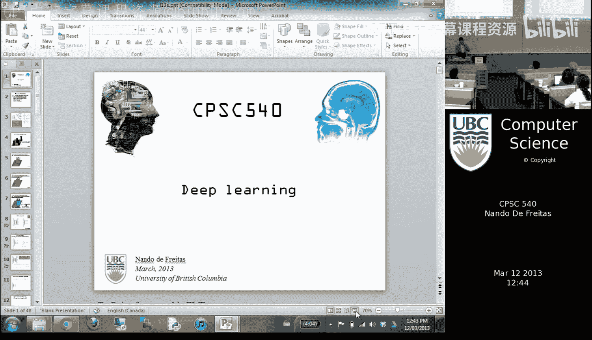

Of what deep learning is about， building on what a previous lecture of neural networks。

Then I would like to discuss the Google network so that Google came up with this neural network too that in an unsupervised way without supervision。

 could learn neurons that would detect， say cats in YouTube or faces。

 so without anyone teaching this network，Giving it any labels， so what is a catver is a person。

 a neuron that only activates when it sees a face emerged。

And that's very cool because we know that we have such neurons in our heads and that we can build a device that is capable of doing this sort of thing just by watching TV。

 it learns something is quite remarkable。So I'm going to go over that。嗯。

And then I'm going to go over a more recent development， something called dropropout nets。

 which is a sort of type of technique that has had some significant success in several competitions。

 several data competitions， and that's the Google network per set sort of the final product and dropout net is something I will cover on Thursday。

 today I'm going to cover the background that will enable us to understand the Google network。

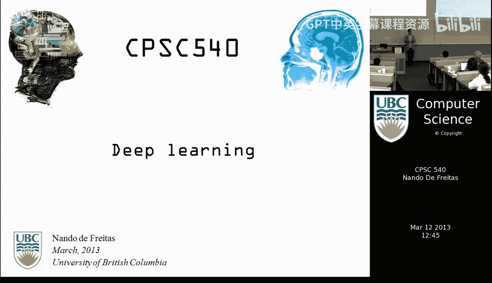

So。Okay， so。Basically， as this slide says， we're going to go over and supervised learning。

 so now we're no longer going to assume that we have labels。

And that's going to give rise to this the bico and not encoder。

 and I'm going to focus on object recognition like from images。

 this applies to sounds or any other in fact， tactile data I suggested for the project。

But I will focus on this in this talk， I will only be talking about images。

 and the only reason why I've chosen images is because images are visual。

 it's easy for me to show you。How it works and provide you with intuitions。And the network。

 in addition to just the sigmoid units has that we've learned about the weights。

 it also has some special devices like pooling and local contrast normalization。

And some very interesting regularization and I will go over those one by one。

 so we're going to dissect all the components of this network and then I'm going to show you this is the network and then I will tell you what were the Google experiments。

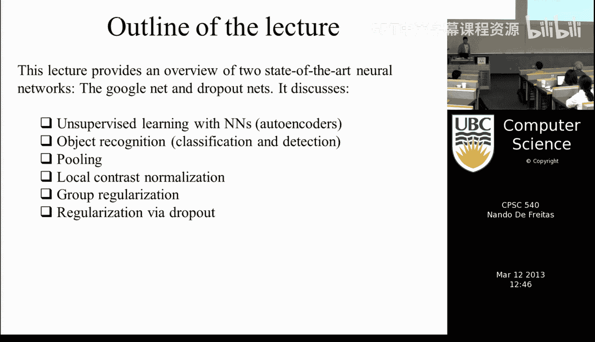

Okay， let's start with some biological motivation， so I think I mentioned this to you at the introduction in the course。

So Huble and Visel， and if you actually go to YouTube and Google Huble and Visel。

 you can get the experiment， you can see how the cat is looking at edges。At different orientations。

And for certain orientations， a particular endance starts firing。

So a neuron will not fire for the say vertical bars， but if the bars are horizontal。

 that neuron will fire， in other words， the cat is able， has neurons that have learned to be tuned。

To each。To its orientation， how do we know that those are learned？

How do you guys would be able to distinguish whether a cat is born with neurons that can detect edges in the world versus。

Having learned them。See if all cats have the same one。Seafo cats have the same one。

 I could do that experiment。 quite likely they many cats passed away in this experiment and had the same。

But that's you know if a cat is sick or has those， you know if you see。

It's kind of going the right direction。Blind cats are different than normal cats。And council can see。

第四。Thats。Censor the profession。So cruel thing is to just actually go and lesion in it。

 sensoror dip weather it's not less cruel。How could you do。How would you go about that experiment？呃。

You're going to have to。And that's precisely what people and Viiesel did。

 so people have done all sorts of not only done， but a lot of people have done all sorts of experiments。

 one is to let kittens grow up in worlds where there's only vertical bars。

And they don't learn to detect horizontal bars。And do you do the controlled experiments as well？

Another thing that you can do is the visual cortex is actually， so you have two eyes right。

 and then the sort is your two optic nerve cross and they hit two different areas here at the back。

And slightlylight separated。 So if you blind one eye。You can look at it different difference。

Between those two areas and see whether one area has actually changed。

 so you blend the eye the moment the kitten is born through actually I wonder how good that is because even in the womb。

 the kitten does get some sensory signal。系啊。Not quite sure I exactly made a control for that but。

I'd have to go back to the papers， but they sort of try to deprive indeed one eye and then do a comparison bandwidthing between the two and that's where you can see what as the cat is developing that it's learning。

 in fact。Ptting it in an environment with its only vertical bars。

 is's also an indication that it has learned because if it didn't get if it had been born with both vertical and a horizontal。

 then it wouldn't have matter whether you put it in an environment that has。Partrtical horizontal。

 It certainly is born with a lot of capacity。 And now babies are born。

 and they recognize their mothers。 They have faced detection already there。But。

A lot of vision is learned。

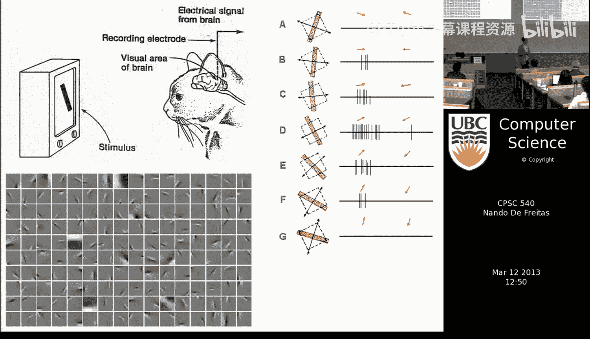

And so what they realized， well， they'd realized that then neurons are tuned to different ages。

 And so the idea here is that。If I have an image patch。

And that image patch is made of different lines。Right， so I'll say eight lines。

Then if you have a neuron。And each of these images is an neuro。 These neurons could detect ages。

 like， for example， this neuron here is good at detecting whether there's an age in the image。So。

What it's actually doing is it's finding whether there's an edge here。

 so there's a change in intensity， so it might be able to detect say this guy。

Whereas you might have another neuron that might be detecting an edge here in the middle。

 which would correspond to say this edge here， which is an edge surrounded by the two regions of light。

 so something black surrounded by two。Wite areas。 So each of these detectors。

 So given an image patch like that one， each of these detectors will be detecting different lines in the world。

 When you compose them， when you add them， you essentially get the image。

Now some detectors fire and some don't fire， so you would add only the ones that fire because the ones that fire is the ones that are telling what's in the image。

 the advantage of having a representation that's local like this is that you can actually cover a bit of the image。

And then some detectors， some of those local detectors don't fire， but the other ones still fire。

So you still know that you're dealing quite likely dealing with a face。

So that's why we use these sort of local detectors because they're sort of robust to occlusion。

 so I can do this and you still know that it's me。Okay， so， so each of these。

Images here is what we call a local reive field。And so the idea is that each neuron has one local receptive field。

Each neuron looks at the patch and if the patch in the world。

 like for this guy happens to have a corner at the bottom here， then this unit will fire。Okay。

When we try to build networks that learn， we essentially get networks to learn。

These features automatically these are the sort ofs no they're not precisely ages there could be little curves and so on。

 and in fact， if you build hierarchies， some of these will be things like noses and eyes and eventually faces。

But at the very lower level， all were understanding is a representation of images in terms of these brush strokes and then some neurons fire and they fire for the brush strokes that are present in the image。

And if we were to add those brush strokes， we would compose the image back。Okay。

When we started the course I showed you some videos that convinced you that your eye。

 you actually don't see the world， but that your eye is actually moving and it moves about two。

 three times a second and so you get glimpses of an image so it's more like your eye only sees a patch and that's why I'm talking about image patches because your eye will only see this particular patch。

And then for that particular patch， some neurons will activate。If I look at。The parameters。

 so think of this as now a neural network that takes each pixel and a patch as the input。

And this is the activation。The output of the network。

Which we're going to call us the activation of that unit。If I look at these。嗯。Connections here。

 I'm going。 That's basically going to be。Awa， if this image here， if this patches。嗯。I don't know。

200 by 200 pixels。This weight here will be of size。😔，嗯。Our。4000。So 200 by 200。Which is。

In other words。It's a matrix of size 200 by 200 of real numbers。

So that's essentially the parameter that scales each input pixel。

 so for each input in the neural network， there is a weight that scales it。

So there's a matrix that is if you have 200 by 200， 200 by 200 m patch。

 then you have weights that are size of 200 by 200。When I visualize this weight。When I visualize it。

 that's one of those images that I just showed you before。It something that looks like this。

So each of these images here。That's one of the way， say W1。W2 and so on。

 So that's essentially all the weights in coming into a neuro。So that would be W1。

 this guy here would be W2 and so on。So that's critical to understand this。

 So exactly what the problem definition is。 So you have。200 by 200 pixels。

 that means that each pixel is an input into the neural network。

 so means that your first layer has 200 by 200 weights。And then when I visualize the weights。

 when I visualize those images， those patches that I'm showing this local receptorceptive fields。

 those are the dos。And that of size 200 by 200 because。They are defined。That way。So that's what。

Its where these guys come from。Then what we're going to do is essentially。

Is we're going to take an image like this， we're going to take many patches from and we could take many patches at random。

And we're going to learn this neural network。And we're going to try to learn it in a way that those Ws that we are going to you use by propagation to learn them or so will happen to be Ws that look like the Ws that。

Much what we observe in the experiments with cats。That's essentially it if we're able to do that。

 then we've actually built a model that's capable of detecting little patches in the world and hopefully will help us to task like object recognition。

 speech recognition， and so on。

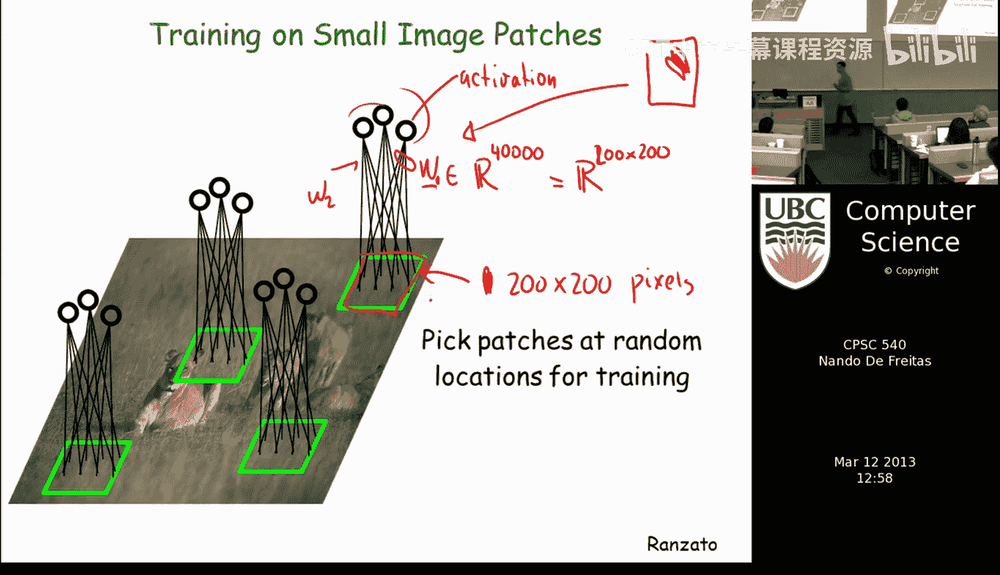

One minor detail when in terms of training， so we're going to just focus on patches。

 but just for some of you who are doing the project。

 quite often instead of just focusing on training just with patches。

 people actually try to train with。

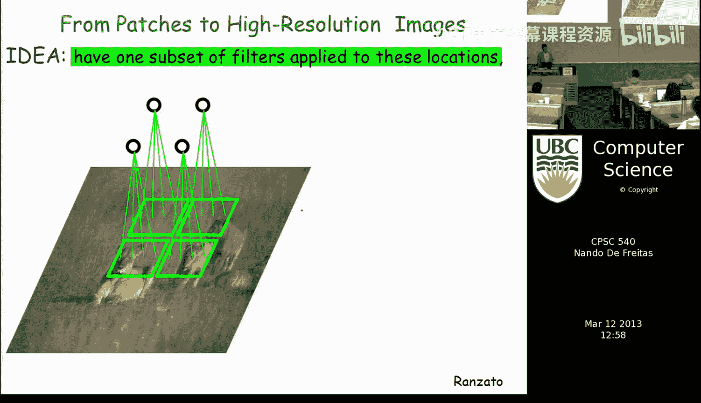

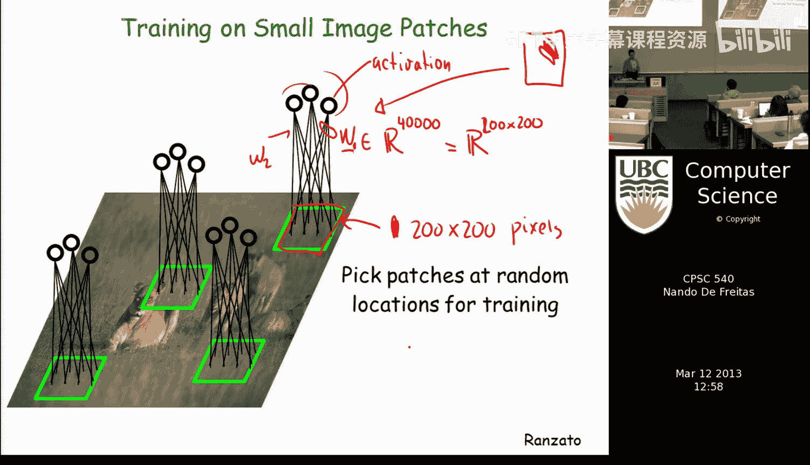

What's called convolutional architectures， which is you take patches and then you shift it by a few pixels one or two。

 and then you essentially create now a network that looks at all the shifted。Patches。

 so at a larger network。 And you try to learn that。 That's a convolutional network。

 I'm not going to go into details into it， but。Really。

 the only difference is that you need to keep track of this sliding window mechanism。

 and then you will have a very large number of parameters。For this。

 I strongly recommend you have a look at the papers of Professor Hinton who and papers by Mar Corelio Ronnzato。

 who actually provided the slides for me because they're very good。

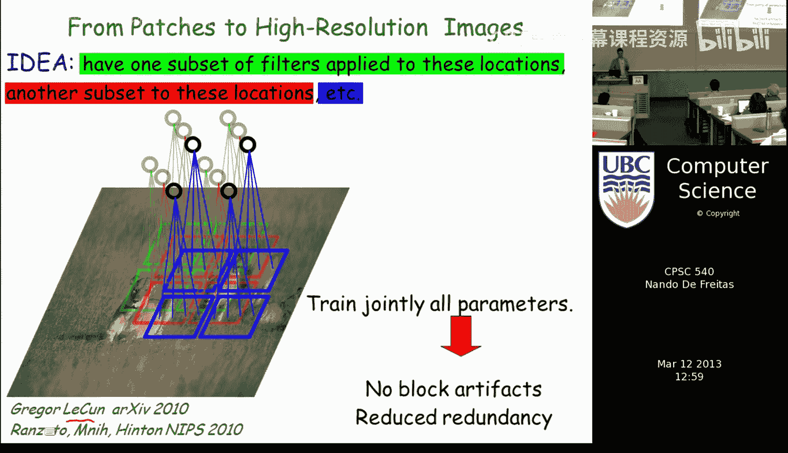

At describing these implementations。Okay， we're going to， though for now for simplicity。

 we'll focus just on patches， so we're going to assume that the input in the real is a patch and we're going to assume that we have a data set of patches。

200 by 200 patches。 That's， in fact， what Google did。They just use these 200 by 200 patch。Now。

 how do we learn in an unsupervised way from data。We， in fact。

 are going to still do things in a supervised way。But we're going to use the same ideas that we use in maximum likelihood and so on。

 so when we went over maximum likelihood， I argued that maximum likelihood is a principal way if you imagine data and if you look at data and if you have to look at the entropy of what we imagined and the entropy of the data。

And you are trying to make the two entros match。Then you would get essentially maximum likelihood。

So it was minimizing， it was trying to match the information in the data。

and the information in your model， if they have the same information。

 then you have learned what reality is about， in other words。

 if you can imagine the world and it is like the world you've imagined。

 that means that you have understood the world。For example。

 the kitten has understood like vertical bars。If the kitten lives in a world of only vertical bars。

And we're going to use that same principle here。In particular。

 we will build networks that look like this， where we're going to take the input。

And use the input also as the label。So if I have two image patches。

 the input as well as the output will be the same image patch。So I'm trying to protect what I see。

I see this， I close my。 I try to predict it。 I open my。 I see it again， you know， I keep。

Keep updating my neurons until what I imagine is the same as what I see。And so this here。

 so here I would have an input image。Of。I don't know another face。

And the same image I'm going to put here。Okay。And I'm going to try to train this network so that it can predict that image。

And the image is a matrix， but you can write it as a vector。 So this is just a very large vector。

Which has 4000 inputs and 4，000 output neurons。Okay。And we know how to train this。

 We just do back propagation for simplicity， I have not before。Instead of just drawing a circle。

 I was using a sum， and then I was using this sort of。Unit as a sigmoid。

So I was using this type of representation now for simplicity， I will just use this circle。

To to represent this。Okay， so one of those green circles involves that multiplying each input。

So times an input， times a parameter。So each input gets scaled times a parameter。 you add them all。

 and then you put them through an all linearity， say a sigma。That's what each neuron is doing。

 So taking we're still working with the Maccalo bits， you take all your inputs， you weight them。

 And then if the weighting is above a certain threshold， the neuron fires otherwise it doesn't fire。

And each of these neurons is of this form， this neuron2 is of that form。Now， having done this。嗯。

Then it's just a case of doing badproagation。Now， why does this make sense。

 What it makes sense is because we've created here a bottleneck。

And it's a bottleneck because it's of size。3。So we're saying that。Our network should be able to take。

Images of size， six pixels。And encode them with only three pixels。Because in order for me。

 in order for me to go， like in order for me to go from here， from three pixels to six pixels。

It must be that those three values encode all the information that I need。

Maybe I need to add another plus one to just shift it the plane up and down。But essentially。

 by creating that bottle neck， we're forcing the neural network to represent the world which consists of six pixels。

With just three neurons。There's just three pixels， if you will。Three main topics pixel。And。

Once we've done that。Once we've trained the network this way。We can just remove the output layer。

And then we left with the trained network。 So this network essentially takes us input an image of six pixels。

And produces a feature vector。Of three pixels。 So this is my feature representation。Okay， so。

To each of these neurons， as I said， each of these guys is a parameter， W1， a vector。

Which is essentially what this matrix is。And then each A essentially is one。

If something that looks like that image is present in the input patch and it's zero otherwise。

So that's the idea， so each a is just a detector or a particular shape in the world。Okay。

 so you might have。You might end up with a detection that might look like something like this。

And that might say， well， there is。Maybe my image is。My image is of B。And you might have。

W1 is an image of this。W2 is an image of this。Actually。Let's make a W3 is an image of that。

And then w。2 is an image of。This。So like that picture shows。In the input image。

In the input image patch， there's two vertical bars。

And if my neurons have been trained and I have a neuron W1 that looks。

That can detect a slanting bar from the left。 And I have a neuron3 that can detect a bar from the right。

 slanted， and then a neuron2 that just detect some squiggle。Then in the input patch。

 there's no squiggle。So Nen2 does not fire。Whereas neurons1 and neurons3 fire。Okay。

 so that's the idea。I haven't told you how you learned these dolings。

Because we're going to have to train the network in order to learn those W。嗯。I will argue， however。

 that all you have to do is by propagation in this network here on the left。

And we're going to have to add one nice regularizer to ensure that we do get those nice shapes。

 If we don't add regularizer， we're not going to get those nice beautiful local features。

 but with a regularisizer we will get them。And that's pretty much the sort of the essential building block for deep learning。

 The rest of deep learning is you just add a bunch of these layers。

 one at a time in a greedy fashion。But the basic concept is this， that you。

Have this molecule colon node encoder that tries to predict itself， that tries to predict the input。

 so you present the data always consists of pairs where the two individuals are the input and the output are the same。

So if your input is a song by bar， your output is a song by bar。

And then the middle layer is something smaller that's forcing the network to learn。

And what are the features of PA that what are the sort of the essential components of the signal that would allow me to make a good prediction of。

of the box song。And if you're capable of learning that， then。At test time。

 given any arbitrary new image， you can just feed the input through the network and depending on which neurons are active。

 then you know what's present in the image。So the nice thing about doing it this way。

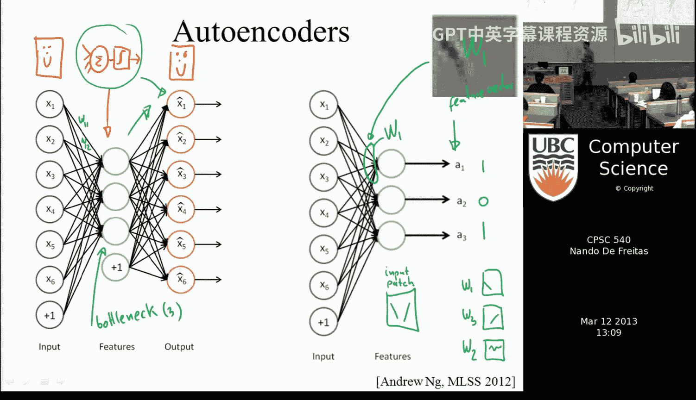

Is that this leads to something called self thought learning。

 as Andrew calls it in Stanford or transfer learning as many people call it as well。

 So the idea there is that if you were to take images，If you happen to be in Beijing。

And you've never been anywhere outside China。You've spent your life looking at images and you've learned to extract to train you。

B cortex to extract these filters， ages and so on。Now， if you then come to UBC。

You should not have to relearn that just because while the images here are different。

 the trees are different， the light is slightly different， you know it's always cloudy。

 maybe there's less smogged than Beijing and so the world is sort of different。

 there's different images。But you don't have to retrain you the whole brain again。

And so the idea is if you've trained。To detect ages。

 because the images in Vancouver will still have lots of edges。

 they tend to have the same regularities as the images anywhere else on the planet。

And so if you've actually prelearn those。Features in one place。

 you can then use those features when you move to a different location。

 So that's the idea of transfer learning and why the word transfer， you transfer the features。

So what you've learned to solving one task can be used to solve other tasks。嗯。If I in Africa。

 learned features of。By looking at images of animals， basically by walking on the African savannna。

 And I probably learned that。Sort of little white spiky things。😔，You know。

 in the mouth of animals are dangerous things， you know， I should avoid lions and so on。

 because they have those white spy teeth。Then when I come to Canada and I go hiking。

 maybe I won't see the。I won't see lions， but if I see a bear。

 even though I have never seen the bear before in my life， if I see those spy white things。

 I' probably run away。Or pretend to be dead or whatever it is。I have to do。嗯。

And so the idea there is essentially， if I have the features。

If I have the basic components of what makes then it's very easy for me to come to Vancouver and retrain a class of fire。

That tells me which animals are dangerous and which animals are harmless。

Even though I have never seen a moose before or a deer or a bear， I can very quickly train my brain。

And I don't need to train the whole system。So in effect， what I would do is。

I would learn this in Africa。I learned my basic local feature detectors in Africa。

 I learned to detect what fur and fangs and so on， and then when I come to Canada。

All I have to do is I take these activations。 And as this picture shows here， So this。

Is essentially the continuation of this。So these green guys are the same， all I have to learn。

Is in order to decide whether an animal is harmless。Is， I need to learn now these features here。

Which is a much smaller set。 I don't need to learn。All the ages and so on。

 I don't need to learn about ages。 I only need to learn。

A few neurons at a higher level that tell me whether that's a dangerous animal or not。

Just for one year。I successful layers wise。Hello。What sort of accuracy do you need to achieve in order that you're capable of training another layer？

Okay。That's a very good question。Let me delay that question。诶。If you're just doing things greedy。

 the easy answer is。You were trying to get something as accurate as possible。

 but as we will see later， we're going to do something at the end。

And so that's because we're going to do that something at the end。

 it might be that the optimal strategy is not always to try to be as accurate as possible necessarily。

There's some trade off， I'll come back to it。

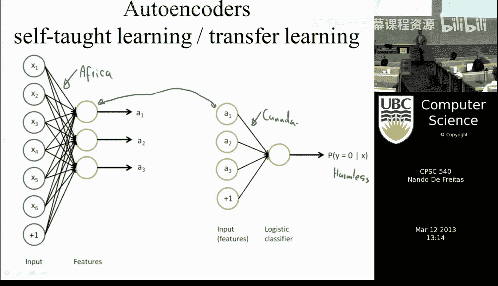

Okay， so that's basically it now how do we train this？嗯。Our cost function。 And first。

 I'm going to assume that we're going to have neurons that are all linear。

 So each of these neurons will essentially be the sum。Followed by。A linear neuro。Okay。

 so I'm going to assume thatops that's not looking very good。So each of these neurons will be linear。

And if they're linear， then essentially what we have here， if I call this a1。

And all the weights coming into a1， let's just call that vector w1。

 So basically I'm saying that a1 is equal to w1 times。X of T。So this is a vector， so w1。Is of size。嗯。

Seven by one。And then the input Xi is also of size。And I'm making them be real for a discrete image。

 it would be 0 to 55。Would also be seven by one。Actually。

To make sure we get the right multiplication。Let's make this one by seven。So in other words。

 the activation is a one by one effect。Okay， so we take。1 by seven vector。

 multiply times 7 by one vector， we get a scalar that subs1 by one， and that's the activation。

And then what we do is we take the vector of activations a。You should have made right to there。

We then take the vector of activations， a。Has input。And we multiply it times W。one front pose。

So now7 by one。And that gives us as an output， the prediction X hat。Okay。

 which is essentially what the picture illustrates。 You go from x to a by multiplying by w。

 and then you transpose to get back。X。In other words。What you're trying to solve。Is。There's problem。

We're trying to minimize。The difference。We're trying to minimize the difference between x and x hat。

 but x hat is just w times x and then w transpose times that。So it's just composing。

And we tie it so that they input weights。Which are called the encoder。

The encoder and the decoder have the same weights。In some implementations。

 folks will allow these two weights to be different。

Like in the Google Net that they were allowing them to be different。

 but typically people just tie them to be the same weights。Okay。

 I haven't told you anything about the regular rights。

 I'll tell you about the regular rights in the next slide。

 But essentially the cost function that we're optimizing is the input must be equal like。

The protection。So if your feed the input multiplied the input times W multiplied by W trans。

 you should get back。Pretection x hat that should look like the input。

 so you want x hat the x to be similar。If you had a neural network with sigmoid functions。

 it would be exactly the same thing， the equations get a bit more involved and there's some terms B and C。

 which is just basically scaling up the functions。Which you can deal with by just having an input that's equal to one so we could get rid of it。

But the idea is still the same。 You want to match the X with。This guy here。

 which is just a prediction of X hat。And you want to do that for all image patches。

 all of the M image patches， so I as an index of image patch， and you want the network。

ThatTo take an image patch and be able to predict that image patch well。Okay。

 if you just have a one layer or two encoder， you would like want that prediction to be as good as possible。

So that's essentially our likelihood。The component of our likelihood。

 the component that involves the data。嗯。Here it now will get a bit more interesting because in addition。

 we're going to add a regular rise。Which is not quite like the L2 regular is that we've used so far。

 but you'll see there's actually bear some similarities。Now。

 if I wanted to do regularization for a network like this。

 the most obvious thing for me to do based on what we've learned in the course is to do an L2 regularize。

 right？So that basically ask each weight。To be small。

So in order to minimize this cost function of a w， I need to one。

 make sure that my predictions are good。And if I use a rich regularizer， that is an L2 regularizer。

AndThen I would basically also be asking for the weights to W to be small。 so however。

 that sort of doesn't make so much sense in the neural network。

 we don't want to make some activation small， what we would love to do is remove entire neurons。

So the key idea。Is that when I see a data point， when I see a particular image。

 I only want a few neurons to file。Okay， because if I saw his face and my whole brain was firing。

It would be very exhausting， you know， the brain consumes the organ that consumes the most energy。

 So you kind of want to keep the firing down。So， for each different object。

 you only want a few neurons to fire。And you also want those to be different。

You want to there to be some commonality so that I still know that I'm seeing faces。

 but you also want differences so that I can distinguish。Different faces。

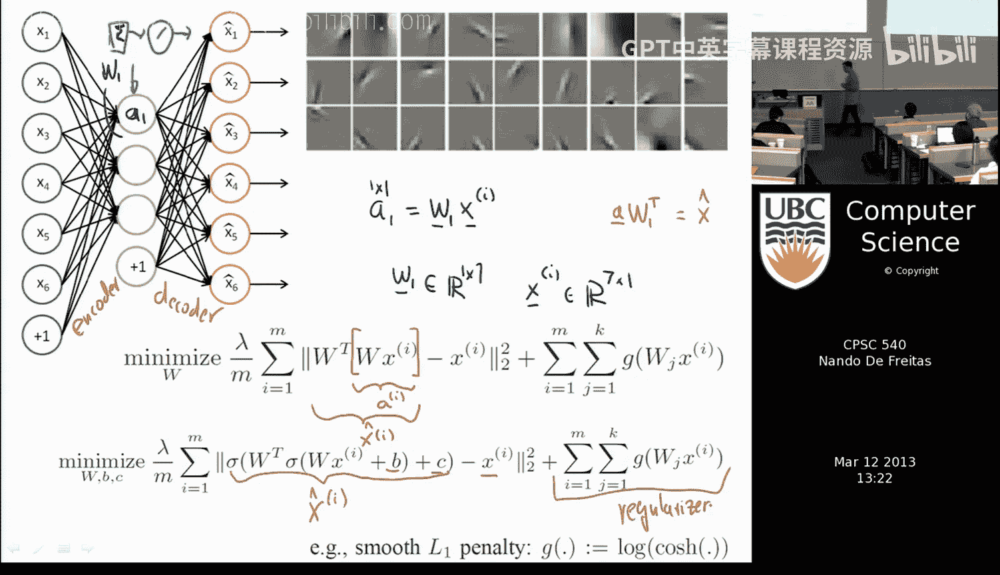

Okay， so this sort of argument leads to the following regular R。

 So there's regular R of the function G。It's usually an approximate its a smooth。

 as a lot of people use here a smooth approximation of the L1 norm。For those who've done 340 with me。

 you should not be troubled by the L1 norm。Because you know how to deal with it。

In optimization I'll come and for the people in 540， I will come to it at the end of the course。

 how to optimize when you have the L1 norm， the difficulty there being that an L1 is essentially an absolute value norm。

And so it is non differentiable， and so we need to figure out how to take derivatives of things that are non differentiable。

 like the absolute that， but there's a nice way around that。Now。

Dis function G then typically would look like something like this， some from I 1 to M。

Some of a j equals1 to k。Absolute value of WJ。Times X i。N Wj times Xi。It's essentially。

Just one of the activations， one of the outputs。So Aj is Wj timesx I。And so what we're saying is。

For if I choose a particular index I， suppose I choose an index I。One data to point。

In order to minimize this cost function。I would need some of my WJs to be zero。

So the vector for the entire near， you would want it to be zero because then you're only firing。

So for a particular eye， only a few features would be active。 So when I see him。

 only some of the neurons will fire， but not all the neurons。Likewise。So likewise。

 I could detect this regular rights and I could just swap the sums。

And I could just write j equal 1 to k， some from my equal 1。To M。And then exactly the same term。

And then what we're saying is for a particular unit J。

 you only want it to fire for a particular set of images。Okay， so in other words。

Putting these things together just amounts to the following intuition。If you have here your features。

Which are these guys here。They call features， they're also called activations。

And if you have here your data。From i equal 1 all the way to i equal m。

Essentially what we're saying is。If you choose a particular data point。

If you choose a particular image patch。You would only want some of the features to fire。

When I see a new thing， I don't want my whole brain to fly， I just want a few things to fire。

Likewise。If I have a particular feature。I only want that particular feature to fire。For some images。

OkayBecause if a neuron fires for all images， then that neuron is useless to me。

 that image is not that I want a neuron that will say only fire when I see a dog。

Because then that neuron is useful， that neuron is now a dog detect。

So we sort of want parrsity in these two ways， we want parrsity so that for a particular feature。

 a particular feature only fires for a few different types of inputs。

 and likewise for a particular input， we only want a few features firing。And that's essentially。

An intuition of why we use this particular type of regularry。I will give another intuitions next。

 which is based on biology。And there's yet another intuation， which is based on optimization。

 which is based on group L1 norms， so those of you who work with Michael Friedlander and so on can you know go back to Michael and talk about group L1 norms and he will give you the whole theory for this and why this makes sense It's essentially a penalizing lens。

As you're penalizing groups of weights in other words entire neurons as opposed to single weights。

 so the optimization guys have done a lot of work in this。

 I'm instead going to take a biological view of this for motivation。O。

And the biological view goes as follows。Scientists。

Researching neuronsn just like doing the experiment as before， find out that yes。

 there are these cells that just fire for these types of inputs。

 but then they also realize that when theres a next level。

 there's a different kind of cell that they call complex cell。

 which seems to apply some take some of the outputs of the simple cells and apply some operation。

 some squaring and square routing and so on。So based on that。

 people trying to replicate those type of cells as well， not just simple cells。

 but also complex cells， and the sort of simple cells in complex cells again。

 goes back to these very old experiments with cats。So。The way this business goes is as follows。

 So we're now going add an extra kind of layer。So we're going to have a network。

And this will consist of n pixels。Has the input， so this is the input X， so the I image patch。

And then that network then gets mapped。To am。Activations。

So this is just essentially the simple cells that we've been described。

 so essentially to each neuron。Each neuron sees all the inputs and weights each of the inputs times a parameter。

And so on。And then I'm going to introduce this other special type of neurons。

I will exaggerate own purpose。And this neurons， the purpose of this neurons。

 well they will have several purposes， one of the purposes who will try to compress them。

Instead of having， it will take the input， say M activations。

 and it will generate k activations where k is going to be much less than M。

They will have another those units will also be important for invariance。 I'll get to it。

 But for now， let's just。Do a description of what the network does first。So。And then， of course。

There are several。Each of these neurons has a full。Fu connectivity。And so on。

So we have the network as we've had so far， so a fully connected network。

 but then we are going to have a second layer which is partially connected。啊。

Of the pulling units that I will soon describe。So these are going to be the activations。

 and then at the end here， I'm going to call these units with a vector P， in this case。

 p is of size 2 because there are two units。Okay， so the idea here。Is that。De case activation。嗯。

Will be equal。To the sum， to essentially the product。From。And inputs。So each input。Oh oops， sorry， J。

 and then I was using for time， I'm just trying to make sure I have the same indices here。嗯。

I'm using teethF as the index over a time。Slide。And so。Yes， there should be an end。Okay。

 so what we're doing is we take in the n inputs。We taken in the end pixels of the image。

And in order to get this guy here， which is the K activation unit。

 I'm just going to multiply WK times that factor in other words。

The vector a is equal to the matrix w times the vector x of T。Okay， so that's just w times x。

 the encoding。After I do that， so that's going to be stage one。Then in stage two。

So stage one is just a network as we had before， and we're still using a linear network。In stage two。

The ice。Unit。It's going to have these no nonlinearities I just told you about。

 It's going to be the sum。Over k equal1 to m。OfH。I。Timed a。So in other words。

 I'm going to introduce another vector of weights here H。Okay。

 so that's H is just number the name of that second layer of weights。And typically。

 I don't learn those weight。Typically those weights are actually chosen beforehand and here theres many ways of doing this many researchers have different ways to go about this if you go to study at MIT you will learn to pick the max so that H will just essentially be a gating matrix that textas input three guys and looks at the one that gives you the maximum activation and that's the one gets chosen。

So in other words， if the three activations are 0。1， 0。8 and 1。2， then the output is 1。2。

So it just takes the value of the max。

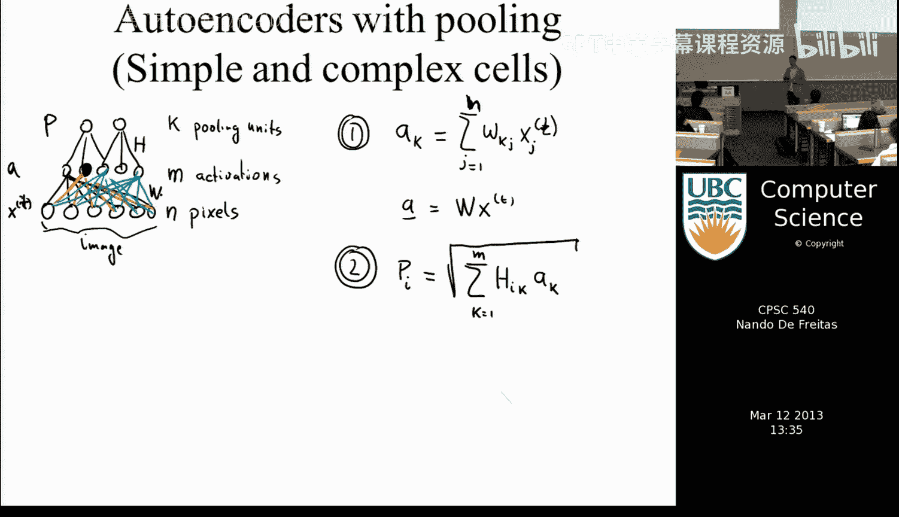

Now， the reason for doing that just going ahead a little bit is that pooling is essentially。

 Puing is doing this operation where you have an image。You have the simple。

 the simple units that give you， say， a block of。In this case，3 by3。

 And then if you pull those three by 3。If I take the input image and I move Einstein a little bit to the left。

Then。It may be the eyebrow was causing this neuron to fire。

And now Einstein moved a better to the left， then this is the unit that will fire for the eyebrow。

And then Pauling is basically saying， regardless of where the firing happens in this window。

 this unit will be active。Okay， so pulling will allow for some invariious because now the image can sort of undergo slight perturbations。

And a pulled unit will still be active， so that's the idea of max pooling。

 and some folks also use average， some guys use like Gaussian windows with averages。

 so this as you go in your projects if you do this there'll be different implementations。

And depending on whether you're looking at the research of Y Le Kon or the research of Yo Pae or Jeff Kton or。

Tommy Pou at MIT。You will come across a slightly different。

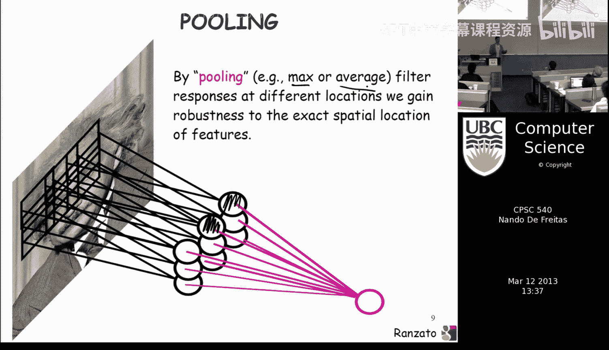

Implementation。Okay， so the other thing we do here， Oh， I hadn't done one thing。

 The other thing we do here。Is we actually square these guys。

So a complex cell is something that's essentially like the L2 norm， it's like a weighted L2 norm。

It takes the inputs， it squared them， it weights them。And then it takes the square root。

 and soon we'll see why that also gives some nice in various properties。

 so this is essentially something that's called L2 pooling。And that's pretty much it。Okay。

 so that's essentially the simple， complex cell。 Now， the Google network uses。

Each layer in the Google net produces simple cells and complex cells。

So it uses exactly these two layers。It will add one more layer。

 which essentially subtracts the meaning device by the variance。

 so we willll add a normalization layer。But these are the basic components。

And they sort of biologically motivated。Okay， so。The whole regular rise then essentially consists of these two stages。

 first， multiply x by a matrix w。Then you square that， multiply by matrix H。And then square root。

And this， of course， I could also write this。In matrix vectorant notation。

As the square root of the matrix H。Times the vector a squared， entry y squared。So。

Let's go back to the initial Netflix。I started the lecture by saying that training a long network。

 a deep network with six layers and so on， as we would want to do to be able to do many tasks is very hard because the gradient vanishes。

 so it's very hard to just a gradient descent。So what folks then do is this greedy procedure。Where。

 first。You take the image。And take the same image。And you learn。The first layer of hidden activation。

 So youll call it H1。You then get rid of this guy。And take H1 and place H1 as the output。

And you try to learn an H。Two。Actually， here。A second layer of weights。

And then you get rid of this guy。And you can keep doing this。 So， basically。You use the image。

And the image is an output as well to learn the first layer。But once you're。Learn the first layer。

 You can try to predict the first layer， and that gives you the second layer。

And then with that second layer， you try to predict itself， and that gives you the third layer。

And so on。 And you can make a network as big as you want by doing this。

And then when you're done at the end， if you want to just show the idea that you've now learned simple。

You're basically learning complex cells， which are nested cells。

So you're looking at combinations in the second layer。

 you'll get combinations of ages and in fact as we will see later as you go up the layers。

 some layers will start detecting compositions of ages。

 which are things like eyes and noses and so on， and eventually compositions of eyes and noses。

 et cetera， they give rise to faces。Okay， so that basically summarizes it。

 We first learned the features of layer one。 We then learn the features of layer2。

 And then at that stage， if you only wanted to learn two layers， you could now use。

If you get supervision。You could do supervised training of the output layer。

This would be a completely。The first two layers I learned in a supervised way。

 so the first two layers are in Africa， I learn about ages and I learn about teeth in the second layer。

And then when I come to Canada in the third layer， I learn about bears and deer。

Now I can combine all these layers， put them all together。

 and that essentially is equivalent to having。A big neural network。

 So I've been able by doing this to train a big neural network with the first two layers I train in a supervised way。

 and the last layer I can try train with using supervision if if my goal is to do classification or prediction。

Now， to answer to who I think I was here， to go back to your question。Once I've done this。

 what folks then do。Is that they do back propagation on the entire network。

 they do one pass of back propagation at the end。Because essentially by doing this greedy。

 by being greedy， you're obviously not getting the optimal answer。

 but you nonetheless are getting a pretty good solution。

 and then if at the end you just do a back propagation。

 you just get some refinement and that usually improves the results by a bit。Okay。

 so once you've done with the stocking， one more pass。

have a kind of approximation to a whole network， then does that reduce the effect of the disappear？

没看到。Sing back property。Values that you mentioned previously。Not much， but it helps。Actually。

 what you you find when you do back propagation here is that the weights will not change much。 but。

 there slight changes to the activations and those slight changes are enough to。

You know in experiments， they're like an extra 5% accurate or whatever。When we look at drop out。

 we'll see that a lot of people have actually， in fact。

There's sort of confounding variables here because what people have done is they've replaced the units by using these very smart regular iss。

 like these regular iss that require features to be only active for some data。

And each data only activated a few features。And by using rectified units and so on。

 it actually has become possible with a lot of data to train these networks just by backropification。

And with this another trick that I'm going to talk about which is to dropout。

 you could actually train this network in a supervised way。

But I still think the unsupervised story is an important one。 The idea that you could learn。

In one domain， and you're able to transfer that knowledge to a different domain。

Because we humans are very good at doing what Josh Tenmo might equal one shot learning that we're given a task that we have to learn and we get it immediately。

 we're very quick at learning things。And the only way we can do that is if we have prelearned a lot of stuff already that allows us to do that next inductively。

So I think the answer to provides story is an important one。It's also the case that。

It's the way it happens in biology， when we're born and so on and grow up。

 it's not like we have people labeling the world for us and telling us most of our learning is done in a unsupervised way。

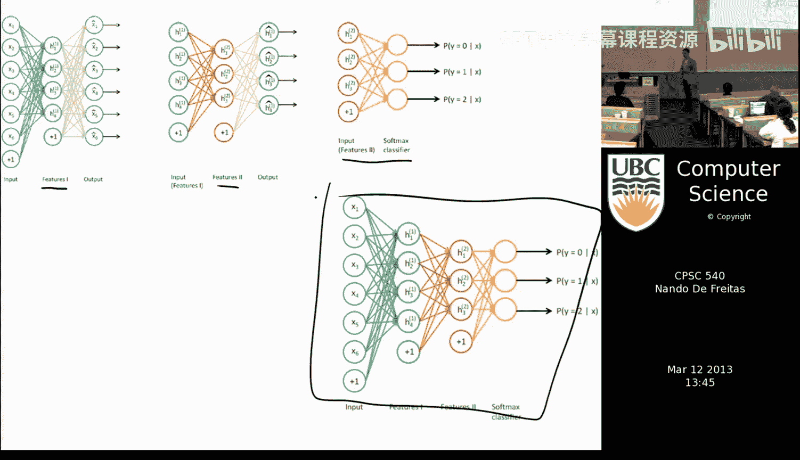

Okay， so I'm going to leave you with this， which is what I'm going to cover in the next lecture and I'm just going to go quickly tell you what's done here and then in the next class I will spend quite a bit of time going over this network。

I've essentially told you the building blocks。For the Google net， except for one building block。

 which is contrast normalization， So an image is contrast normalization that just means you subtract the mean and you divide by the variance。

 So in other words， to make the features compare。So that's the output layer。

 but essentially what the Google network does， it takes 200 by 200 images。Now。

 those images are in color。 So there's three channels， RGB。 and that's why you get our。Qin。B。

 so you get three channels。And then for computational simplicity， instead of connecting each unit。

To all the inputs。Each unit only gets connected to a smaller number of inputs， in this case， 18。

In three color channels， so 18 by3。So， each。In the simple cell。

 each simple cell will only see a limited view。So there's sort of and if the field size is limited。

And that's just for computational tractability。嗯。This ends up having this ends up running over how many course was it。

 I it says 16，000 cores。With 200 by 200 images。From YouTube， you can very quickly get in trouble。

And so they're some of the best culture on the planet where we're working on implementing this。

 and a lot of scientists， actually a lot of students from Toronto from UBC。

 NYU have actually moved to Google and they do internships there and they work on implementing these architectures。

Okay， so。We have a random field of size 1 team。嗯。And then。For each patch image region。

 we allow eight possible features。because in a particular patch。

 you might have a feature that's an edge that's vertical or horizontal and so on。

 so you try to learn to describe a particular region of image with eight possible features。

Your allow rate features per small region。And now that's just a simple neural network。

AsBut just with limited connectivity， and we can just learn it by doing the usual。

Aror minimization in order to compute W。Google then uses。Pulling。

 so there is this extra layer of weight H。And I taughtt you exactly how they construct to that age。

The details， I'll check the paper till you in the next class。

But essentially they so what they are doing is they're using linear units。

 and so this is the actually equation that's in their paper， they allow the units to be different。

 so the encoding and the color are different。And I think they do that for ease of computation。

But this essentially is saying， I want my。Xs hat to be equal to my X。

 so the Google network is learning W in order to be able to predict the input。

And the other term that it has is essentially what we get。

 so you get a vector of input weights times the input that gives you the activations。

 you square the activations you multiply by age。So this is essentially the regular is that we went over before。

 The only difference is that the add is epsilon， which is a small number。

 and that makes the problem better condition。嗯。And so what they're doing is they're penalizing。

For these units， P being active。 So that regularizes and should decide whether a unit is active or not。

 So that's a regularization perspective on the simple， complex cell。

You can look at that regular rights as the output of a complex cell。

 So you want to signal P to be the output of a complex cell。 Or alternative。

 you can think of that as just。Putting it regularizerizer that forces only a few of the complex cells to fire。

 So you want a sparse firing pattern at the pooled level。And pulling again。

 goes from a size of5 to a size of one。 And the final operation is just basically。For each patch。

You compute the mean and the variance of the patch。

And then you subtract the mean divide by the variance。

And that will make all patches comparable so that the neuron will fire。

 and the reason why it's called contourt is because subtracting the mean divide by variance in terms of an image。

 it just basically removes the effects of being too intense lighting or low intensity lighting。

 so it removes the effects due to the lighting。So whether the kitty is in a bright light or the kitty is in a dim light。

 you will still understand that it's a kitty。And that's the Google network。That's a single light。

And then what they do is they do the same trick that I described before。

 they stack one layer after the other layer， and they do it with three layers。And in the next class。

 we'll see what kind of results they get by doing this。

And we'll also go a bit more into detail as to what exactly does the pooling do and why it works well and also how the local conour normalization works。

Yeah。嬉し。

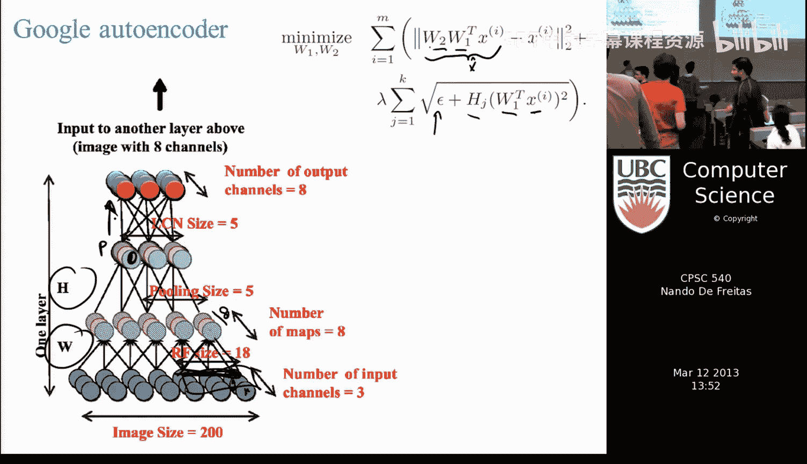

么问。こで。It help now。He covered your。Godspe。对。なです。他一我本上。Yeah， really depends。Yeah。佢系想开。Yeah。

 seems like everyone is。I talk。Or is very good。Yeah。Yeah。What。I training。It。I I't know。It was now。It。

I free you any colors of your reply。Yeah reason white。I。I you。

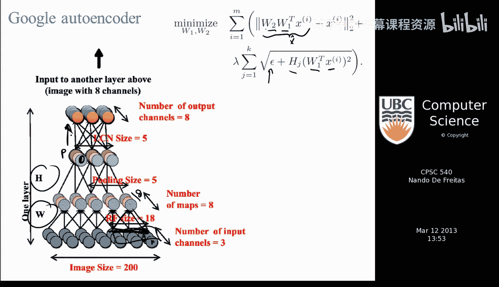

I guess' over。 he wants history for all time。