# 机器学习：18：深度学习 I 🧠

在本节课中，我们将要学习深度学习的基础知识。我们将从回顾神经网络开始，探讨其作为非线性函数逼近器的本质，并引出训练深层网络时遇到的“梯度消失”问题。接着，我们将介绍一种革命性的、分层贪婪的训练框架，这是现代深度学习兴起的关键。最后，我们会聚焦于一个核心组件——自编码器，并了解如何通过无监督学习从图像数据中自动提取有意义的特征。

---

## 神经网络回顾

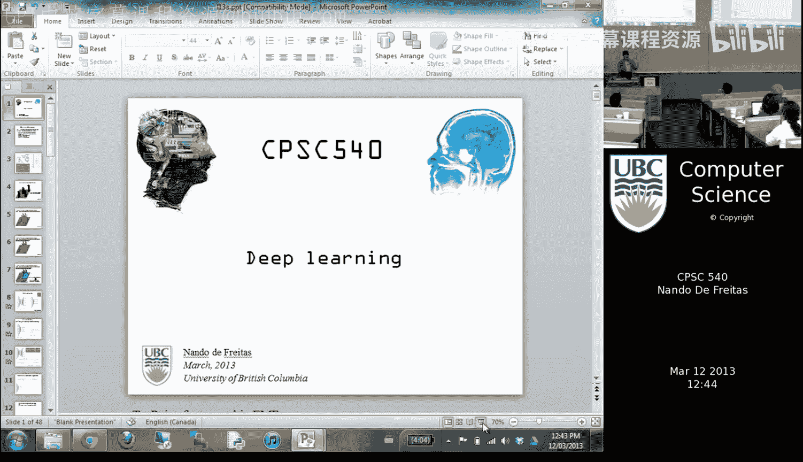

上一节我们介绍了神经网络的基本概念。我们可以将神经网络解释为一个非线性函数逼近器，它通过对基函数的线性组合来近似任何函数。

*   在回归任务中，我们试图逼近从输入 `x` 映射到输出 `y` 的函数。
*   在分类任务中，我们逼近的是两类之间的决策边界，也称为判别边界。

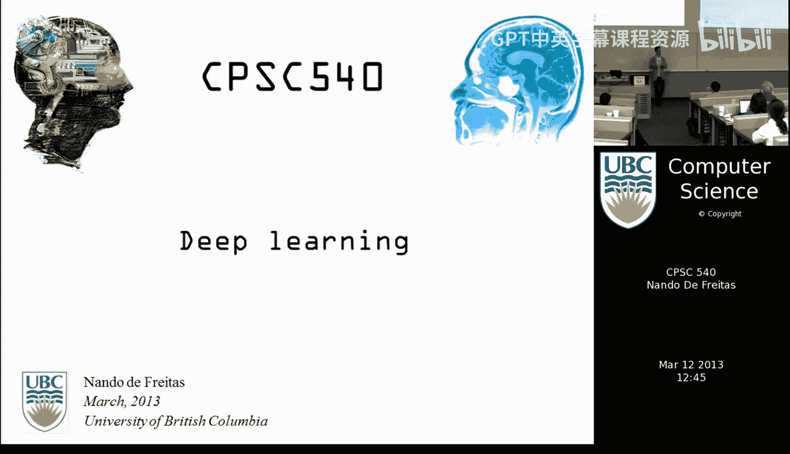

对于逻辑回归，我们可以用伯努利概率来建模具有二进制输出的神经网络。如果我们取这些伯努利概率的对数，得到的误差函数就是交叉熵。

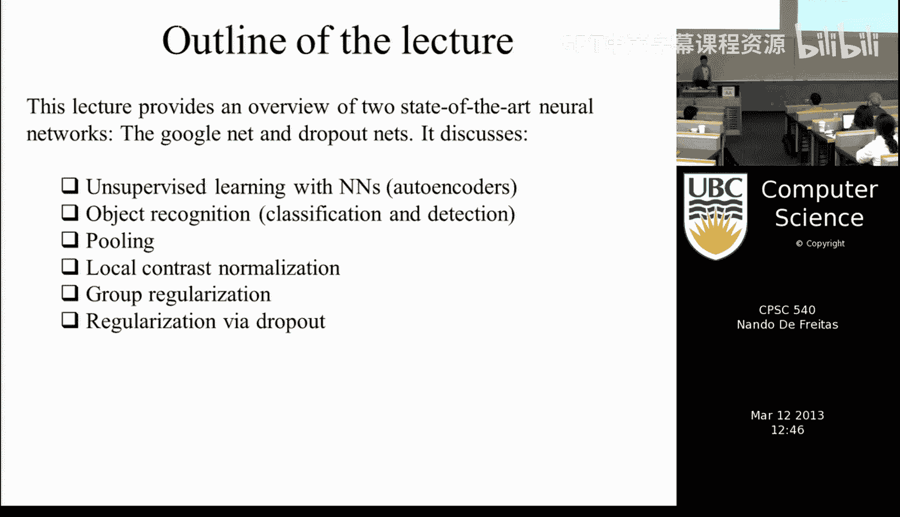

为了找到神经网络的最佳参数，我们只需计算代价函数的导数，然后优化这个导数。这基本上就是使用该导数实现梯度下降，或者尝试使用海森矩阵的牛顿法，以及介于两者之间的拟牛顿法等更聪明的方法。

---

## 梯度消失问题

上一节课末尾讨论梯度算法时，提到了一个关键问题：梯度消失特性。

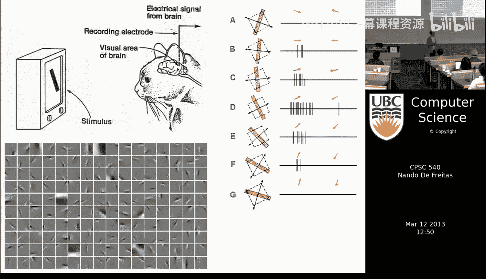

那么，什么是梯度消失特性？它基本上与Sigmoid函数的导数形式有关。Sigmoid函数的导数通常是其输出 `o` 乘以 `(1 - o)`。

现在，Sigmoid函数的输出总是在0和1之间。因此，如果一个神经元非常活跃或非常不活跃，这个乘积就会接近于零。

这还只是针对单层路径的情况。但是，如果你有很多层，一层接一层，那么在梯度中就会有许多形如 `o * (1 - o)` 的项相乘。当你将许多这样的小数相乘时，梯度的表达式会非常迅速地变为零。

如果梯度的表达式为零，权重就不会更新。基本上，新权重等于旧权重加上学习率乘以零。这就是梯度消失特性的本质。

人们尝试通过不同的方法来修复这个问题，例如：
*   改用双曲正切激活函数，效果稍好，但改善不大。
*   尝试使用修正线性单元这类函数，目前这类函数非常热门，许多研究人员都在使用。

---

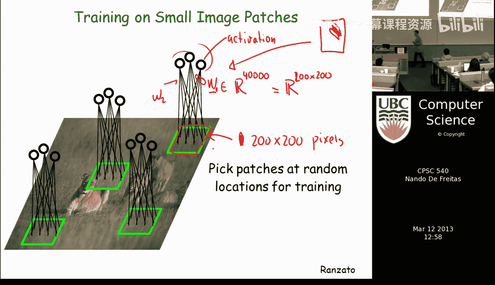

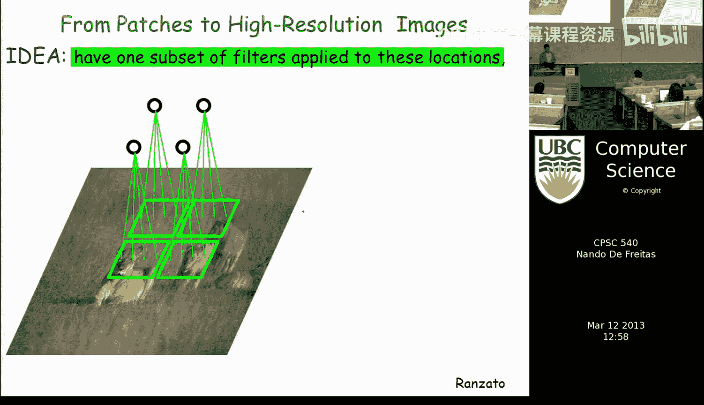

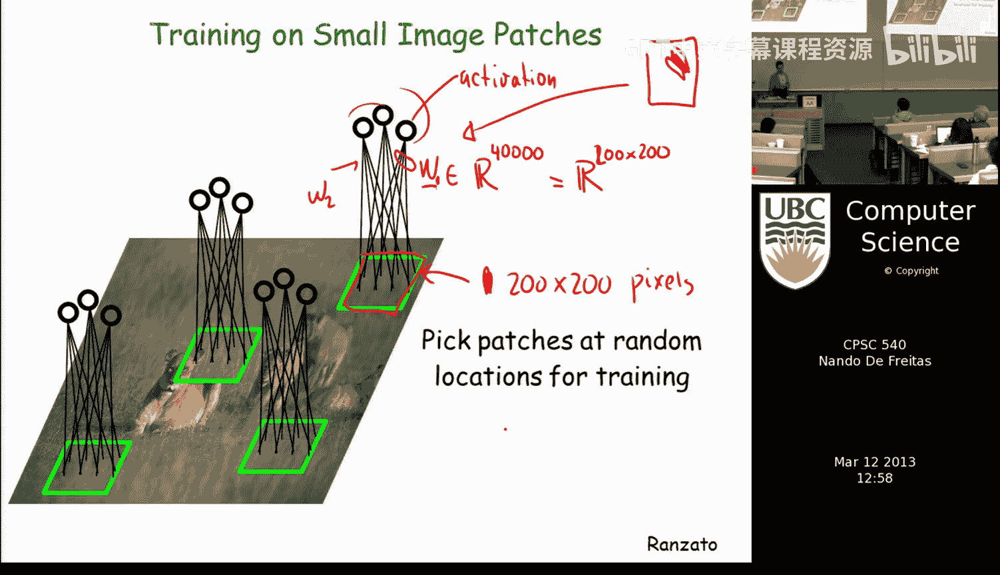

## 深度学习革命：分层贪婪训练

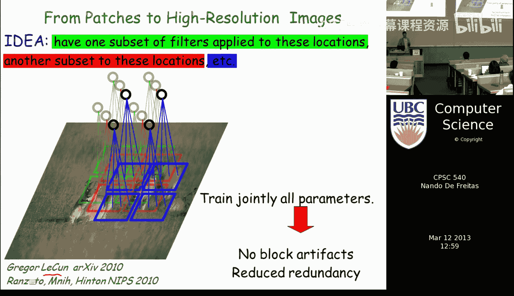

接下来我要描述的是一个大约在四年前兴起的框架。它始于多伦多的Geoffrey Hinton教授、蒙特利尔的Yoshua Bengio教授和纽约大学的Yann LeCun教授等人的研究工作。

他们提出了一种训练这些模型的巧妙方法，即一种**分层贪婪**的训练方式。这引发了我认为是神经网络领域的一场革命，当然也极大地改变了机器学习领域，因为它使得研究人员能够为非常大的数据集和非常酷的应用实现神经网络，包括微软和谷歌的语音识别、图像识别。如果你关注新闻，就在昨天，拥有包括“加拿大年度顶尖科学家”等众多奖项的Hinton教授刚刚加入了谷歌。这表明工业界对这些技术有浓厚的兴趣。

那么，让我们来看看这到底是怎么回事。我的目标是基于之前关于神经网络的讲座，涵盖深度学习的基础知识。

然后，我想讨论一下谷歌网络。谷歌提出了这个神经网络，能够以无监督的方式（无需监督标签）学习检测神经元，例如在YouTube视频中检测猫或人脸。在没有人教这个网络、没有给出任何标签的情况下，一个只在看到人脸时激活的神经元就出现了。这非常酷，因为我们知道我们的大脑中有这样的神经元，并且我们可以构建一个仅通过看电视就能学会这类事情的设备，这相当了不起。我将详细讲解这个。

接着，我会介绍一个更近期的进展，一种称为**Dropout网络**的技术。这类技术在多项数据竞赛中取得了显著成功。谷歌网络可以说是最终产品，而Dropout网络我将在周四的课上讲解。今天，我将讲解能够让我们理解谷歌网络的背景知识。

---

## 无监督学习与自编码器

所以，基本上，正如这张幻灯片所说，我们将要讲解无监督学习。现在我们不再假设我们拥有标签。这将引出**自编码器**的概念。

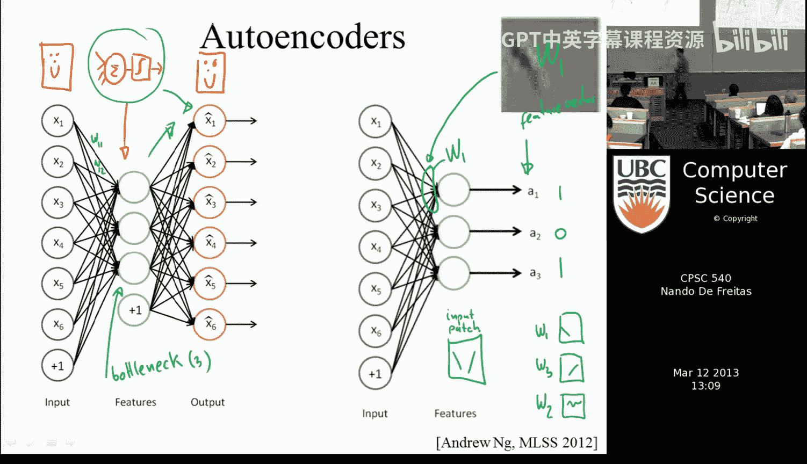

我将专注于像图像这样的物体识别。这同样适用于声音或任何其他数据（事实上，我建议的项目中包括触觉数据），但在这个讲座中，我将只讨论图像。我选择图像的唯一原因是图像是视觉化的，便于我向你们展示其工作原理并提供直观理解。

这个网络除了我们学过的Sigmoid单元和权重外，还有一些特殊的组件，如**池化**和**局部对比度归一化**，以及一些非常有趣的正则化方法。我将逐一剖析这个网络的所有组件，然后向你们展示这个网络，接着告诉你们谷歌的实验是什么。

---

### 生物学动机

我认为在课程介绍中向你们提到过这一点。Hubel和Wiesel的实验（如果你去YouTube搜索他们的名字，可以看到实验视频）展示了猫如何观察不同方向的边缘。对于某些方向，特定的神经元开始放电。例如，一个神经元可能不会对垂直条状物放电，但如果条状物是水平的，该神经元就会放电。换句话说，猫拥有已经学会调谐到特定方向的神经元。

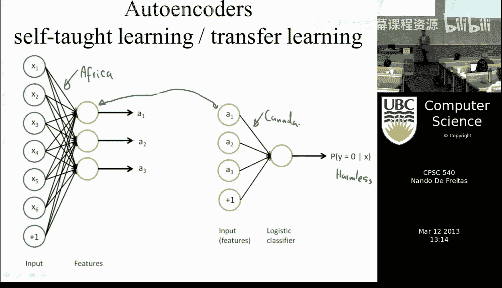

我们如何知道这些是学习得来的？你如何区分猫是生来就拥有能检测世界边缘的神经元，还是后天学会的？如果所有猫都有相同的神经元，我们可以做实验。很可能许多猫在这个实验中经历了相同的过程。但如果你让小猫在一个只有垂直条状物的世界中长大，它们就学不会检测水平条状物。人们也做了对照实验。另一件可以做的事是：视觉皮层实际上接收来自两只眼睛的信号。如果你弄瞎一只眼睛，可以比较大脑两个不同区域（分别对应两只眼睛）的差异，看看一个区域是否发生了变化。研究人员试图在猫出生时就剥夺它的一只眼睛，然后进行比较，从而观察猫在发育过程中是如何学习的。事实上，将其置于只有垂直条状物的环境中，也表明它是学习得来的，因为如果它天生就同时拥有检测垂直和水平的神经元，那么你把它放在只有垂直或水平的环境中就无关紧要了。猫当然天生就拥有很多能力。婴儿出生时就能认出母亲，他们已经具备了面部检测能力。但很多视觉能力是后天学习的。

他们意识到，神经元被调谐到不同的边缘。这里的想法是：如果我有一个图像块，这个图像块由不同的线条组成，比如八条线。那么，如果你有一个神经元，每个这样的图像都是一个神经元。这些神经元可以检测边缘。例如，这里的这个神经元擅长检测图像中是否有边缘。所以，它实际上是在寻找这里是否有强度变化，因此它可能能够检测到这个边缘。而你可能还有另一个神经元，检测中间的边缘，这对应于被两个亮区域包围的黑边。所以，每个检测器都在检测世界中的不同线条。给定一个像那样的图像块，每个检测器将检测世界中的不同线条。当你组合它们、将它们相加时，你基本上就得到了图像。现在，有些检测器放电，有些则不放。你只需要加上那些放电的，因为放电的检测器告诉你图像中有什么。拥有这种局部表示的优势在于，你可以覆盖图像的一部分，然后一些局部检测器不放电，但其他检测器仍然放电。所以你仍然知道你很可能在处理一张人脸。这就是我们使用这类局部检测器的原因，因为它们对遮挡具有鲁棒性。我可以这样做，你仍然知道这是我。

所以，这里的每个图像就是我们所说的**局部感受野**。其思想是每个神经元都有一个局部感受野。每个神经元观察一个图像块，如果世界中的这个图像块（比如这个）恰好在这里的底部有一个角，那么这个单元就会放电。

当我们尝试构建学习的网络时，我们本质上让网络自动学习这些特征。这些特征不完全是边缘，也可能是小曲线等。事实上，如果你构建层次结构，其中一些特征可能是鼻子、眼睛，最终是人脸。但在最底层，我们所理解的都是用这些“笔触”来表示图像，然后一些神经元放电，它们对图像中存在的笔触放电。如果我们将这些笔触相加，就能重新组合出图像。

在课程开始时，我向你们展示了一些视频，让你们相信你的眼睛实际上并不直接“看到”世界，而是你的眼睛在移动，每秒移动两到三次，所以你得到的是图像的“一瞥”。这更像是你的眼睛只看到一个图像块，这就是我谈论图像块的原因，因为你的眼睛只会看到这个特定的图像块。对于那个特定的图像块，一些神经元会被激活。

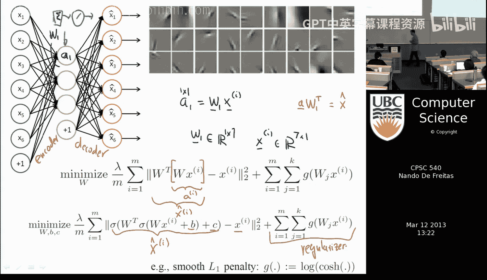

---

### 从权重到特征

如果我观察这些连接，这基本上就是权重 `w`。如果这个图像块是200x200像素，那么这里的权重大小将是200x200，也就是40000。换句话说，它是一个200x200的实数矩阵。这本质上是缩放每个输入像素的参数。因此，对于神经网络中的每个输入，都有一个权重来缩放它。所以，如果你有一个200x200的图像块，那么你就有大小为200x200的权重。

当我可视化这个权重时，那就是我之前展示的那些图像之一。它看起来像这样。所以这里的每个图像，就是其中一个权重，比如 `w1`、`w2` 等等。这本质上就是进入一个神经元的所有权重。所以那将是 `w1`，这里的这个将是 `w2`，依此类推。理解这一点至关重要。

那么，问题的确切定义是什么？你有200x200像素，这意味着每个像素都是神经网络的输入，所以意味着你的第一层有200x200个权重。然后，当我可视化权重时，我展示的那些局部感受野图像块，就是这些权重。它们的大小是200x200，因为它们就是这样定义的。这就是这些图像的来源。

然后，我们要做的是：我们将取一张像这样的图像，从中提取许多图像块。我们可以随机提取许多图像块。我们将学习这个神经网络。我们将尝试以一种方式学习它，使得我们通过反向传播学习的那些 `w` 恰好看起来像我们在猫的实验中观察到的 `w`。本质上就是这样。如果我们能做到这一点，那么我们就构建了一个能够检测世界中局部图像块的模型，并有望帮助我们完成物体识别、语音识别等任务。

---

### 训练细节：卷积架构

关于训练的一个小细节：我们将只专注于图像块。但对于一些做项目的同学，通常人们不只是用图像块训练，而是尝试训练所谓的**卷积架构**。即你取图像块，然后将其移动几个像素（如一两个），然后你基本上创建了一个查看所有平移后图像块的网络，一个更大的网络。然后你尝试学习它。这就是卷积网络。我不会深入细节，但唯一的区别是你需要跟踪这个滑动窗口机制，然后你会有非常多的参数。对于这一点，我强烈建议你们看看Hinton教授的论文，以及为我提供幻灯片（因为它们非常好）的Marc’Aurelio Ranzato的论文。

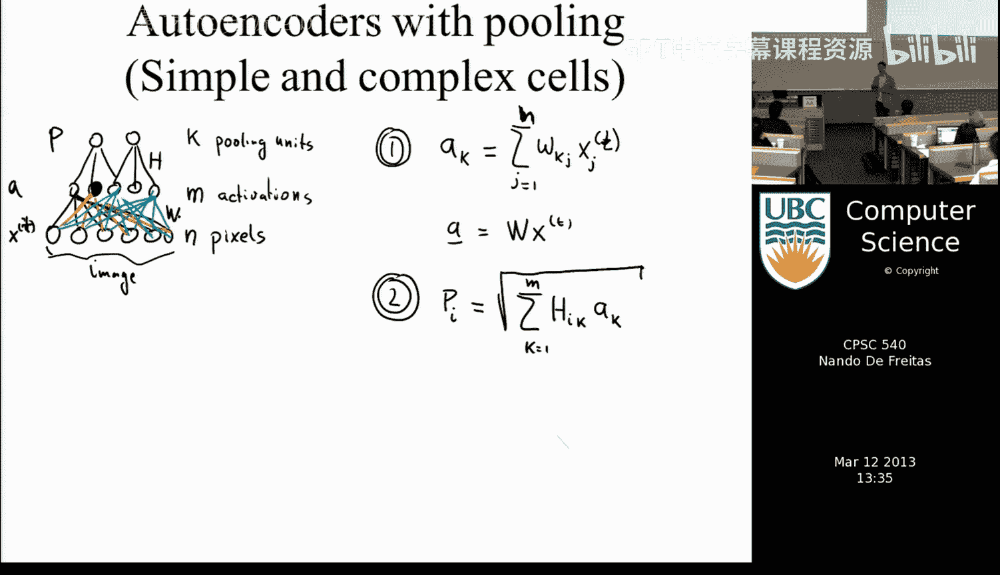

不过，为了简单起见，我们现在将只专注于图像块。因此，我们将假设真实输入是一个图像块，并假设我们有一个200x200图像块的数据集。事实上，谷歌就是这么做的。他们只使用这些200x200的图像块。

---

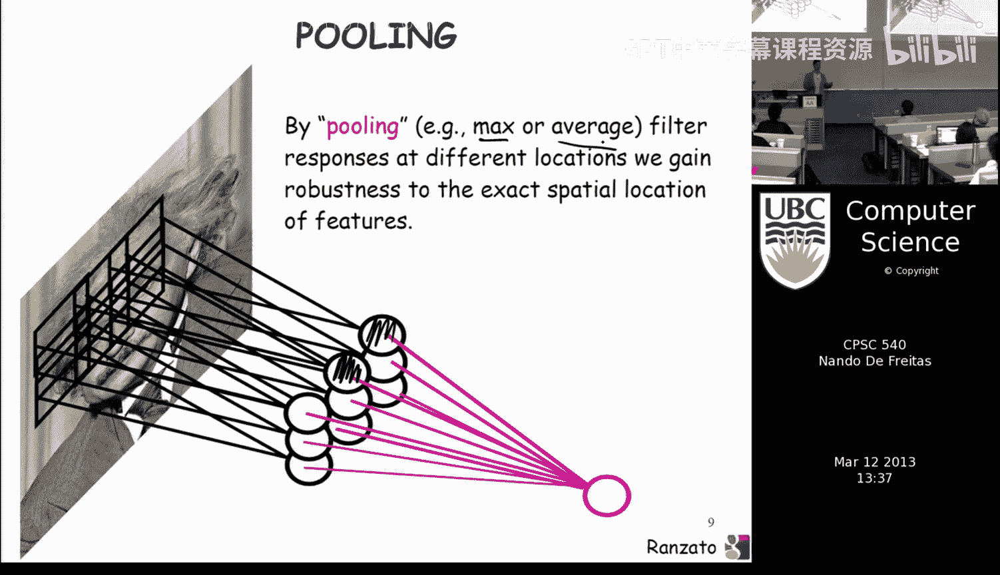

### 无监督学习：自编码器

现在，我们如何从数据中以无监督的方式学习？事实上，我们仍然要以有监督的方式进行，但我们将使用我们在最大似然等方法中用到的相同思想。当我们讲解最大似然时，我认为最大似然是一种原则性的方法：如果你想象数据，并查看数据的熵和你想象的熵，你试图使两个熵匹配，那么你本质上就得到了最大似然。所以它是最小化，是试图匹配数据中的信息和模型中的信息。如果它们有相同的信息，那么你就学会了现实的本质。换句话说，如果你能想象世界，并且它就像你想象的世界，那就意味着你理解了世界。例如，小猫理解了垂直条状物，如果它生活在一个只有垂直条状物的世界里。

我们将在这里使用相同的原理。具体来说，我们将构建看起来像这样的网络，我们将输入也用作标签。所以，如果我有一个图像块，输入和输出将是同一个图像块。我试图预测我所看到的。我看到这个，我闭上眼睛，试图预测它，我睁开眼睛，再次看到它，我不断更新我的神经元，直到我想象的和我看到的一样。所以这里，我会有一个输入图像，比如另一张脸，我会把同样的图像放在这里。我将尝试训练这个网络，使其能够预测那个图像。图像是一个矩阵，但你可以把它写成一个向量。所以这只是一个非常大的向量，有4000个输入和4000个输出神经元。

我们知道如何训练这个。我们只需进行反向传播。为了简单起见，我之前没有画圆圈，而是用求和符号，然后使用这种Sigmoid单元。现在为了简单起见，我将只用这个圆圈来表示。所以，每个绿色圆圈都涉及将每个输入乘以一个参数。每个输入都乘以一个参数进行缩放，然后将它们全部相加，再通过一个非线性函数，比如Sigmoid。这就是每个神经元正在做的事情。所以，我们仍然在处理McCulloch-Pitts模型：你取所有输入，对它们进行加权，然后如果加权和超过某个阈值，神经元就放电，否则不放电。每个神经元都是这种形式，神经元2也是那种形式。

现在，完成这个之后，就只是进行反向传播的情况了。为什么这有意义？它有意义是因为我们在这里创建了一个**瓶颈**。它是一个瓶颈，因为它的尺寸是3。所以我们说，我们的网络应该能够获取大小为6像素的图像，并用只有3个像素（神经元）对它们进行编码。因为为了让我从这里，从3个像素回到6个像素，这三个值必须编码我所需要的所有信息。也许我需要再加一个偏置项来上下平移平面。但本质上，通过创建这个瓶颈，我们迫使神经网络用仅仅三个神经元来表示由六个像素组成的世界。一旦我们完成了这个，一旦我们以这种方式训练了网络，我们就可以移除输出层。然后我们就得到了训练好的网络。所以这个网络本质上将六像素的图像作为输入，并产生一个三像素的特征向量。所以这就是我的特征表示。

对于每个神经元，正如我所说，每个这样的单元都是一个参数向量 `w1`，这本质上就是这个矩阵。然后每个激活值 `a` 本质上是一个指示器：如果输入图像块中存在看起来像那个图像的东西，它就是1，否则是0。所以这就是思想，每个 `a` 只是世界中特定形状的检测器。

所以你可能最终得到一个看起来像这样的检测器。它可能会说，嗯，有……也许我的图像是字母“B”。你可能有一个 `w1` 是这个的图像，`w2` 是这个的图像，`w3` 是那个的图像。就像那张图展示的。在输入图像块中，有两个垂直条。如果我的神经元已经训练好，我有一个神经元 `w1` 可以检测从左倾斜的条，我有一个神经元 `w3` 可以检测从右倾斜的条，然后有一个神经元 `w2` 只检测一些弯曲的线条。那么在输入图像块中，没有弯曲的线条，所以神经元2不放电，而神经元1和神经元3放电。

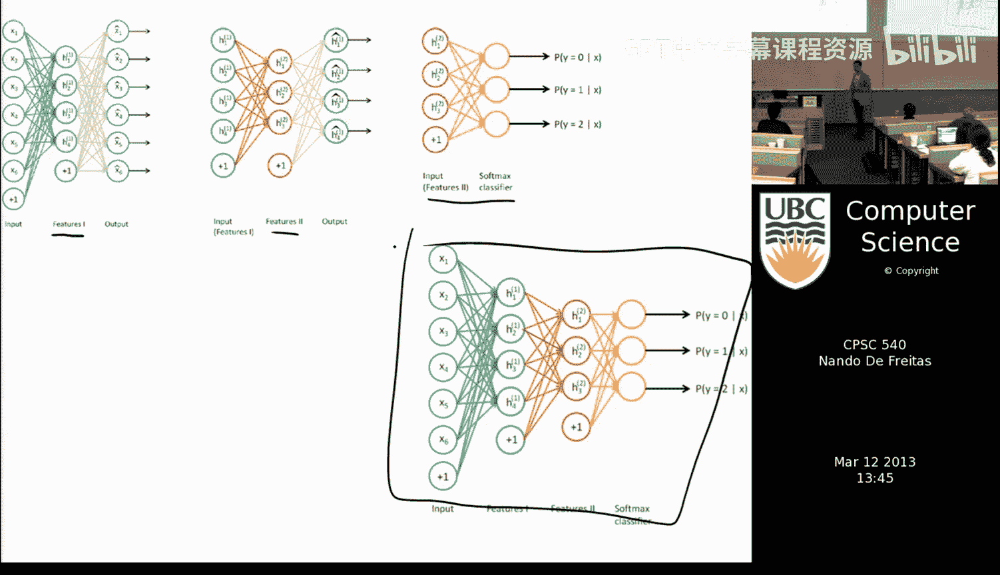

我还没有告诉你们如何学习这些权重，因为我们必须训练网络才能学习那些 `w`。然而，我会论证，你所需要做的只是在这个左边的网络中进行反向传播，并且我们必须添加一个很好的正则化器，以确保我们确实能得到那些漂亮的形状。如果我们不添加正则化器，我们将得不到那些漂亮的局部特征，但有了正则化器，我们就会得到它们。这几乎是深度学习的基本构建模块。深度学习的其余部分就是你以贪婪的方式，一次一个地添加一堆这样的层。但基本概念就是这个：你拥有这个自编码器，它试图预测自身，试图预测输入。所以你呈现的数据总是由成对组成，其中输入和输出是相同的。所以如果你的输入是一首歌曲，你的输出就是同一首歌曲。然后中间层是更小的东西，它迫使网络去学习：信号的哪些基本组成部分能让我很好地预测这首歌曲。如果你能学会这个，那么在测试时，给定任何任意的新图像，你只需将输入馈送到网络中，根据哪些神经元是活跃的，你就知道图像中有什么。

这样做的好处是，它导致了所谓的**自学习**（Andrew在斯坦福这样称呼）或**迁移学习**（许多人也这样称呼）。那里的想法是，如果你要处理图像，假设你在北京，从未去过中国以外的地方。你一生都在看图像，并训练你的视觉皮层来提取这些滤波器、边缘等。现在，如果你来到UBC，你不应该仅仅因为这里的图像不同、树木不同、光线略有不同（总是多云，也许雾霾比北京少）而重新学习这些。世界有些不同，有不同的图像。但你不必重新训练整个大脑。所以想法是，如果你已经训练好检测边缘，因为温哥华的图像仍然会有很多边缘，它们往往与地球上任何其他地方有相同的规律性。所以，如果你在一个地方预先学习了这些特征，当你搬到不同的地方时，你可以使用这些特征。这就是迁移学习的思想，以及为什么叫“迁移”——你迁移了特征。所以你为解决一个任务而学习到的东西可以用来解决其他任务。

如果我在非洲，通过观察动物的图像（基本上是在非洲大草原上行走）学习了特征。我可能学会了那种白色尖尖的东西（动物的牙齿）是危险的，我应该避开狮子等，因为它们有那些白色的尖牙。然后当我来到加拿大去远足时，我可能看不到狮子，但如果我看到一只熊，即使我一生中从未见过熊，如果我看到那些白色的尖东西，我可能会逃跑，或者装死，或者无论我必须做什么。所以那里的想法本质上是，如果我拥有特征，如果我拥有构成事物的基本组成部分，那么对我来说，来到温哥华并重新训练一个分类器来告诉我哪些动物是危险的、哪些是无害的就非常容易，即使我从未见过驼鹿、鹿或熊。我可以非常快速地训练我的大脑，而且我不需要训练整个系统。所以实际上，我要做的是：我在非洲学习这个。我在非洲学习我的基本局部特征检测器，我学会了检测皮毛、尖牙等。然后当我来到加拿大时，我所要做的就是获取这些激活值。正如这张图所示，这本质上是这个的延续。这些绿色的单元是相同的，我需要学习的只是，为了决定一个动物是否无害，我需要学习现在这里的这些特征，这是一个小得多的集合。我不需要学习所有的边缘等，我不需要学习边缘，我只需要学习更高层次的几个神经元，来告诉我那是否是危险的动物。

---

### 分层贪婪训练与微调

现在，关于分层贪婪训练。一个问题：为了能够训练另一层，你需要达到什么样的准确度？这是一个非常好的问题。让我推迟回答这个问题。如果你只是贪婪地做事，简单的答案是：你试图尽可能准确。但正如我们稍后将看到的，我们最后会做一些事情。正因为我们最后会做那件事，可能最优策略并不总是尽可能准确。这里有一些权衡，我稍后会回到这个问题。

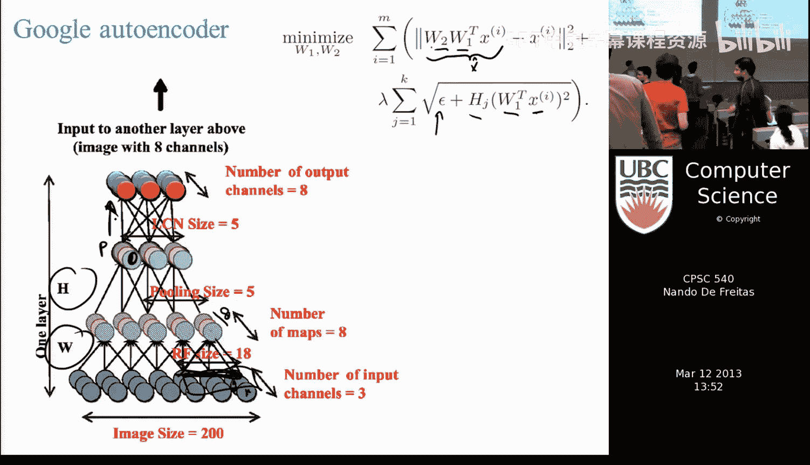

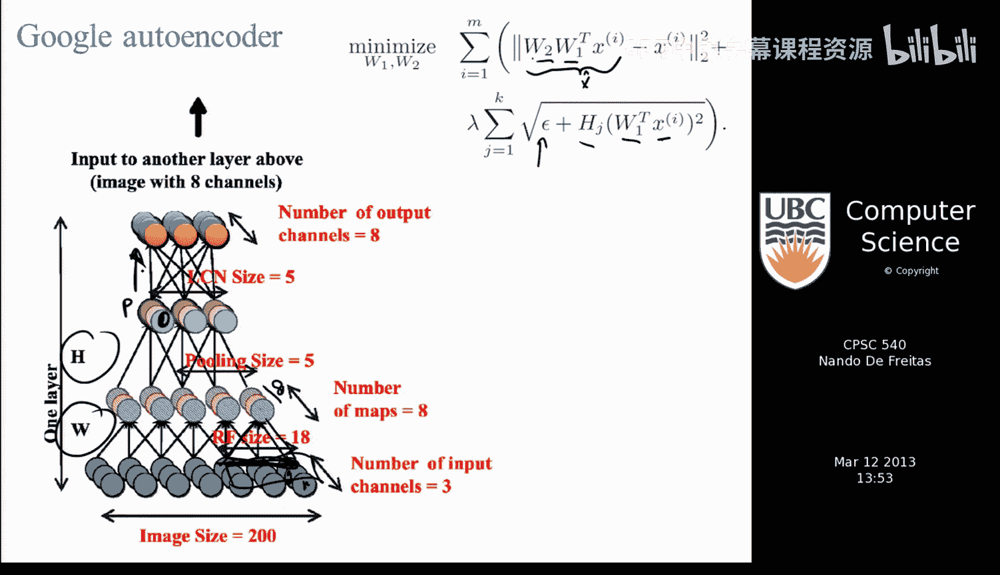

好的，基本上就是这样。现在我们如何训练这个？我们的代价函数。首先，我将假设我们将拥有所有都是线性的神经元。所以每个神经元本质上都是求和，然后是一个线性神经元。所以我要假设每个神经元都是线性的。如果它们是线性的，那么本质上我们这里有什么呢？如果我称这个为 `a1`，所有进入 `a1` 的权重，我们称之为向量 `w1`。所以基本上，`a1` 等于 `w1` 乘以 `x_i`。所以这是一个向量，`w1` 的大小是7x1。然后输入 `x_i` 也是7x1。实际上，为了确保我们得到正确的乘法，让这个为1x7。换句话说，激活值是一个1x1的标量。所以我们取1x7向量乘以7x1向量，得到一个1x1的标量，这就是激活值。然后我们做的是，我们取激活值向量 `a`（它应该是到那里的），然后我们将激活值向量 `a` 作为输入，乘以 `w` 的转置。所以现在是7x1