# UBC《机器学习（研究生）｜CPSC 540 Machine learning 2013》中英字幕 p19 -19-Machine learning - Deep learning II, the Google autoencoders and dropout.zh_ -BV19g2FBBEEq_p19-

Google， I've been talking to you about using these deep nets for image recognition and for speech recognition。

 one of so this professor in Toronto Jeff Hton was two of these students。

Have been doing this and they created a small company about a year ago。

 they were just acquired by Google。So Google' is very interested in this technology。

Cool research to do with the brain， but it's actually a research that is。Practical in making a news。

Immediate impact。We actually， I'm going to go through some of the ideas of what they were doing there。

 Oh， one last thing， one of the things that I haven't done covered in this class。

Because I'm focusing on images is I haven't really covered。

And neural networks for language and neural network for other applications。

But I want you to be aware that it's not just images。

 I've just chosen images so that I can show you pictures and it's easy to understand the pictures because vectors of words are hard too。

Sometimes visualize， but also for language， you can use neural networks to predict sequences and to learn to predict sequences。

 and actually you can actually build some very good language models with these。

What is shown here is a student named Byronno， who an ex student of mine who now works at Google。

 and what he did was he。You know， he trained his neural net and so on。

It's a neural net with some other memory devices。And when he starts typing a sentence。

 he typed the word M。And it automatically completes the sentence。Okay。

 so that text that you're seeing in there。That's not a human， that's machine generated。

 that's a neural network' generating that text。And this was trained in Mobi Dick。

And the book of Mobitita has the kind of language that you get。There's other one。

Was trained in the late source of Kevin Murphy's book。The one that I recommended for this course。

 and as you can see， it's actually pretty good at doing late ticks。

It can even decide when to open bracket， a Gaussian distribution， muo， gamma。It's kind of sensible。

 they're very sensible predictions。And hence why these models are cool， because you can actually。で。

They can actually learn language。Co right。Going back to images， so to recap in that last class。

 we saw that what we're going to be doing is essentially building a neural network and so the input to can think of the input to each unit to each neuron will be a patch and then each。

A pixel in that patch is essentially an input， like in this case there are four lines。

 if you imagine four pixels there those would be the four inputs and each input gets weighted by a parameter and then it goes through an activation function like a sigmoid。

And so the output of the neuron is zero1。And there's many ways in which you can do this do。

Because HD images are very large， just the same as with our eye。

 we can't absorb the whole thing so we just sample it at a few places with these networks you also tend to sample the image and just work with patches。

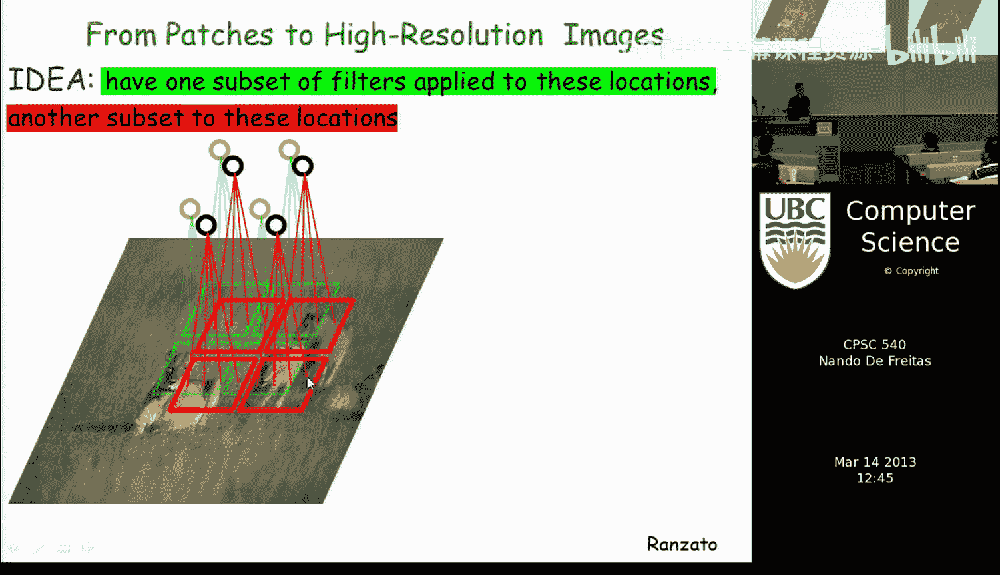

We sort of abstract that and we just basically now consider just a single patch。

 so imagine that the input is a single patch， for example， the patch could be a face。

And these are the pixels that describe a face。And so the key element in building these architectures is this。

Model that we call auto encoders and an o encoder is just a neural network。

 you can think of it as a logistic neural network like we did two classes ago。

 and you can train it with back propagation that is just by doing gradient descent。

And it's done such that there is a bottleneck so that the network is asked to predict the input。

So you feed the network two copies of the same image， and the network has to be able to。

 given that image， be able to predict it。Okay， so if the network lens to reconstruct the world。

Then you hope that since it has。A brain that has less storage than the world。

 and yet it can reconstruct the world， it's because it has captured the things that are important about the world that allow it to reconstruct the world。

And。To each unit here， is each input， each pixel goes into one of the hidden units。

 one of these green circles。And each pixel has a weight。So when we visualize that weight。

 so if we look at all the connections in coming into a neuron， you can。

 because the input is an image patch， the weight is the size of the input and we can also visualize all the weights as an image。

And when we visualize it， o sorry， when we visualize it， we see things like this。

 So we see weights that， for example， detect。Hedges like this is。Think of it as a filter。

 it searches in the image。And where it finds an image。

 a region that is lighter next to an image that is darker？

You know where there's contrast between two regions of damage， which is what happens at an age。

Then that neuron fires so that if you're。When in test time。

 if you have a new test data that consists of two edges。

And if you've trained it so that two units can match these edges。Then you'll。

Then you'll get this neurons firing， the three neurons firing。

 say 101 to indicate that it's detecting these two edges in the input。

And then what we need is another- so essentially what this model is doing is it's extracting the features。

You basically are saying what is this image made out of what age constitute this image？

And you're getting a binary effect telling you what the Hs are。 So this is a hash for the image。

 basically。It's a。And in fact， that's one of the patents that Jeff has is on doing this sort of hashing images by using neural networks。

 and of course if you have a binary hash， it becomes extremely easy just via end operations to do image search on the web so you can very efficiently do large- scale image retrieval once you've converted images to this hash。

 and even if some features are not present because someone might have close their eye or whatever other reason。

 you still will be able to detect knee duplicates。okay， excellent question。

 So PCA is a linear technique。 PCA does exactly something similar to this。

 So if you had no regularizer。And let me actually bring the question。

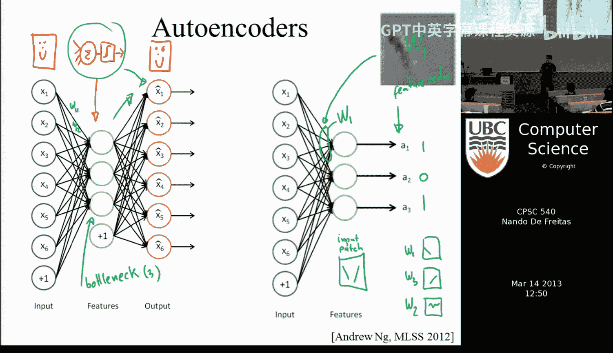

Because it makes it very clear。I， so。So， I also argued。Before fully answering your question that。

The objective function that we try to optimize with these models is essentially minimize the difference between X hat。

Which if you had a linear model would be w times x and then w transpose times。A。So in other words。

 x hat is w times x and then w transpose times x， Wx is what we call a or the vector of activations。

And they hit them there。So we're trying to minimize the difference between x。

 which is the true output image and x hat， which is the prediction of the network。

So X hat is what you imagine this classroom looks like with your eyes closed， X is what you observe。

 and you're just basically trying to match those two differences。If there was no extra term。

 if there was no regular riseor。That would be exactly PCA。Because PC。

I haven't covered it in this course， but in 340， and there's a slide there in 340。

 if you look back that says that if you're trying to minimize the difference between x。

And if you try to minimize the difference between a matrix and the product of two matrices。

Those two mates will end up being the U sigma and then the feet transpose matrixes。

 so it will give you the SVD， so it will give you exactly PCA。Okay， so if you just have linear units。

You'll do PCA in terms of basis functions。The basis functions that we get here。

 they tend to be like this， they tend to detect edges， and they tend to only happen。

 The interesting things are only happening in a small region of the space。

There are a few global basis functions like this one here。But most base functions are local。

Whereas the PCA basis， as you found out in 340， they tend to be more like sinusoids and they're all global because sinusoids at will be one period of the sinusoid two period。

 three periods， they're more like a Fourier series representation this gives you a local representation PCA is a global representation。

Local representations are nice because you're describing objects in terms of parts。

And if some parts are missing， you can still recognize is the object。

And that's a nice thing about these models， actually as well。

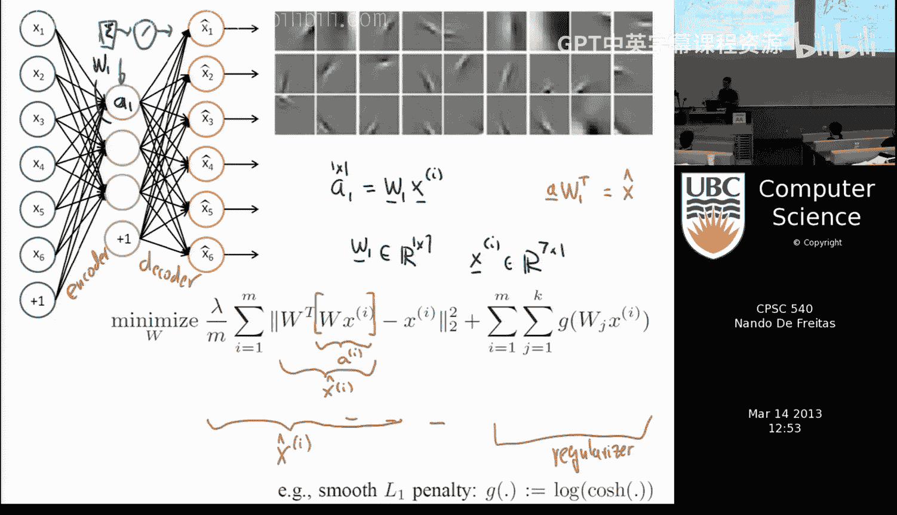

That。When you have a model of this form。A part model。And suppose you have three units。嗯。

3 hidden units， which means you have a feature vector with three entries is the A's are binary。

Then this allows you to talk about two to the three things。Okay。

 so the nice thing about this is that this representation is actually。

 it actually has exponential storage。Whereas if you do things in machine learning like clustering。

 which is bend things into groups。Then something can only be one of K groups。

So that's one possible way of describing students， say the students can be out of K groups。

 they can be， I don't know， A students， B students， C student， D students and so on。

 and so that's a very course representation。This representation is about properties of the student。

So if you have K units， you can talk about two to the K properties。Of the student。

 so every time you get a student， you can say things about the student。

 the student as well in the homeworks， the student sleeps in class， et cetera et cetera。

And that's essentially what we call a distributor representation versus like neuroscientists think of this as a distributor representation。

Which has this。Nice exponential power of memory versus a classroom or wouldn't it take all representation？

Which is also a common model in neuroscience。That I don't think is as cool as this one。Okay， so。

And then of course， we saw that the idea of training it and supervise is that basically what we get out of this。

In a completely unsupervised way is that we learn this type of graph here。

 which allows us to go from an input image which is very high dimensional to a very small hash vector。

For that image， which allows us to do quickly efficient search and allows us to do many out of things。

嗯。But certainly one of the interests of Google is being able to get hashes for YouTube because video takes a lot of storage and if you can hash video。

 you can do video search and not only develop new products。

 but you can make the way you manage data a lot more efficient。

And once you've learned this representation in a supervised way。

 you can also take these as features that you can feed into a classifier。

So when I've taught you linear regression and logistic regression and so on。

 there was always an assumption that we had the inputs， the attributes， all the features。

 but a lot of times and you're finding that in the project， you're looking at EEGs。

 you're looking at arrays， you're whatever you're looking at text。

 a lot of your effort is trying to figure out who will be my features。

Building classifies that's something we teach you in this course like random forest and so on。

 and it's a skill that you need to have， and you need to understand that in order to do machine learning。

 but in terms of machine learning research， that's not like the hot thing。

There's lots of classifiers out there， you go to psyit learn or you go to any other package on the web。

 you go to PMTK， if you want to do it in MALb， you go to WC， if you want to do this in Java。

 wherever you go， then there's a lot of these classifiers have been implemented。

 there's a lot of software。But in terms of techniques to extract features automatically from data。

 that's what you want find match。And that's really what the challenge is。

 is figuring out what are the features。So what makes this area pretty hot is because it allows us to extract features from images or from text。

And hopefully from other signals。Thank吧。Once we have the features。

 then it becomes easy to build a sort of logistic classifier and be able to build different type of。

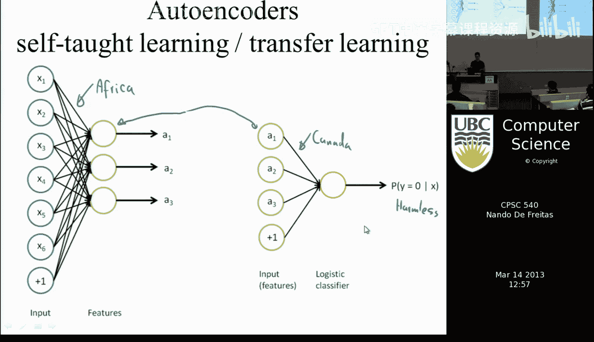

Classifications。Okay， so the other thing we discussed was the regular riseizer。

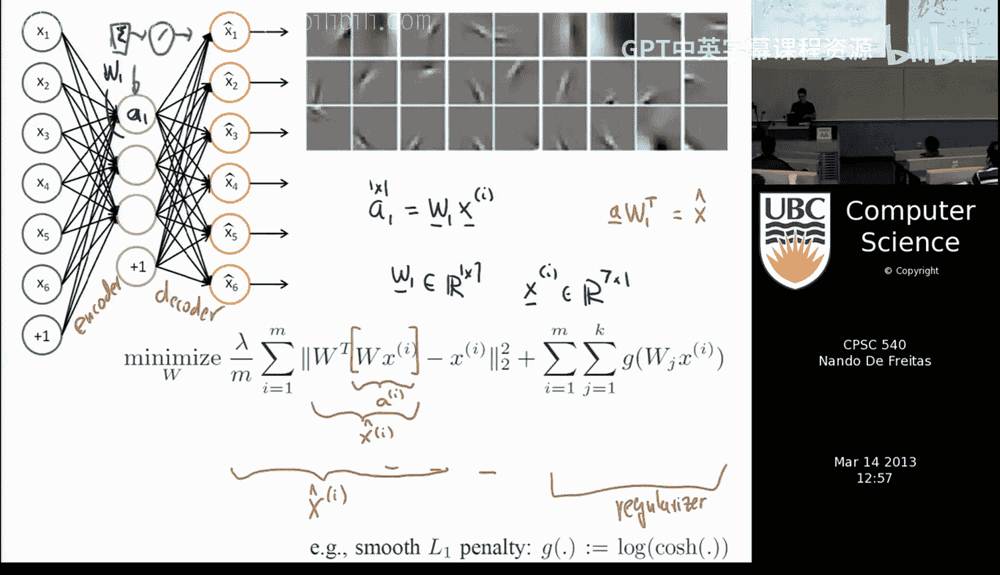

And I mentioned that typically this regularor the function G in this regularisor is just the L1 absolute value。

 and the reason has to do with this as well。Because that regular riseor will be more clear in the last week。

 that regularizeror says you Wj times Xi is just the output of neuron j。And so what we're saying is。

Don't let all the neurons fire。 We're penalizing the way to minimize this cost in order to minimize over W both terms。

You first need to。With the first term。We're trying to minimize。The difference between。This guy here。

Which is just X heart protection。Minus the actual x， so we're trying to minimize this difference。嗯。

But in order to minimize this， you basically could minimize it by making some of this terms zero。

If you pick the WJ， some of the WJs to be0， then that term will be minimized。 And of course。

 there's a tradeoff， which usually we find by doing cross validation。

 So often we have a regular rise。And the regular eyes at this time was placed here。

So this is the sort of lamb that you would use。You would cross validate just like it did in in your homework before。

But here， instead of putting the regular eyes on the weights。

We're putting the regularizer on the neurons， so we're not asking for the synapse to be on and off。

 what we're asking is for the neuron to be entirely on or off。

And so there was this important interpretation that you could swap the sum。

And either have it starting with I or starting with J。And essentially， what this is saying。

Is that for a particular feature。For a particular J。You only want some data sets to file。

So you want a feature， sorry the other way around， you want that feature to fire only for a few data sets。

Okay， so I might have a neuron that is a good neuron that I only want that neuron to fire when I see a human。

 I don't want that neuron to fire for other。Of representation， because if I you know。

 it would be redundant otherwise， it wouldn't be a useful neuron。 Likewise。

 for a particular data set。I don't want too many features to fire。

 you know I don't want my whole brain to fire。When I see something。

 I only want some features to find that all again， helps me distinguish different things in the world。

 different sounds， different people， etctera。So that's the basic。

 then these are the two basic ingredients in the model。

An noting code requires that you minimize reconstruction error。

And then it also requires that you put in a regular riser。

That achieves these properties that gives you basically if you think of the data by features matrix。

 think of it as sparse。

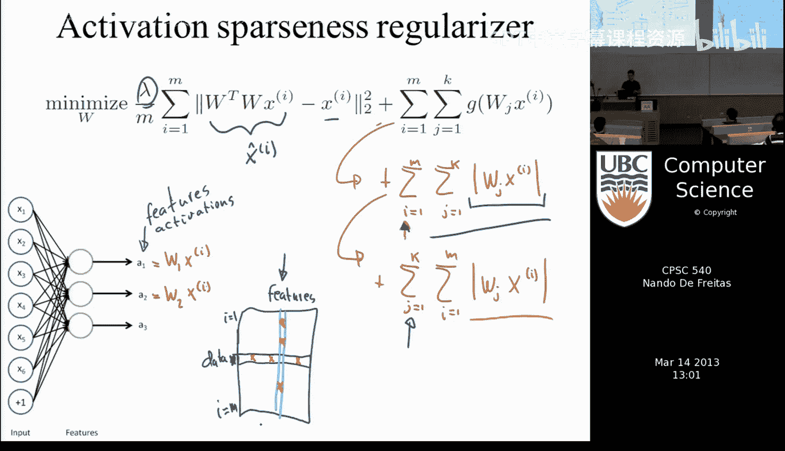

And then of course， I mentioned that in addition to using a linear rot encoder。

 I argue that you could just replace the linear with a logistic unit。

 and then you would have a non nonlinear rot encoder。

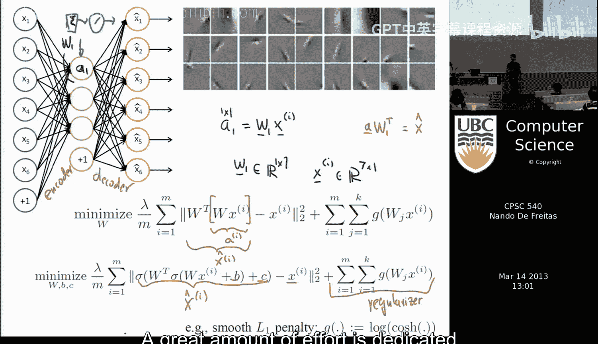

A great amount of Fairfoot is dedicated to solving this optimization problem。

 So if you're doing research and optimization， this is a very cool problem。😊。

If you can find structure in this problem and solve it more efficiently， then you。You。

 that will lead to。Great progress in the field。Same as with the people doing randomized algorithms。

 can you think of doing using randomization here to improve this calculation。

 that's also a very challenging problem and it's one that should have high reward。

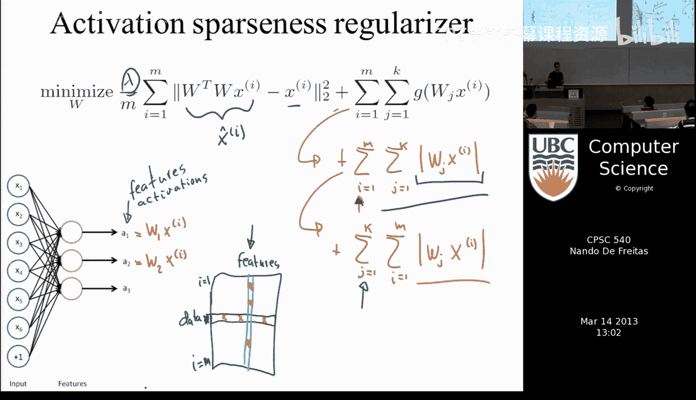

Okay。We then also talked about- and the reason I'm revising all this from last class is because when I'm about to talk about the Google network and it uses all these ideas。

We then talked about complex cells。 So the idea of a complex cell。嗯。Is as follows。 A complex cell。

 But let's first look at simple cells。 A simple cells is what we've been looking at。

 A simple cell will activate。So this unit will activate。Just as before， in other words。

 that unit is just a linear combination of all the input pixels。Okay， in other words。

A equals double your times X。A complex cell takes the output of the simple cell。

 so this guy would be the simple。And this would be the complex cells。

And these are truly motivated by the biology。we have what scientists have researched and found these simple and complex cell properties。

And studying visual cortex in sub mammals。So the complex cell uses a set of hs that is fixed。

 and soon we'll actually see an example of H where H is just the identity matrix。

And it basically squares the inputs， adds them and text the square root， so it's like an L2 norm。

And then it generates an output。

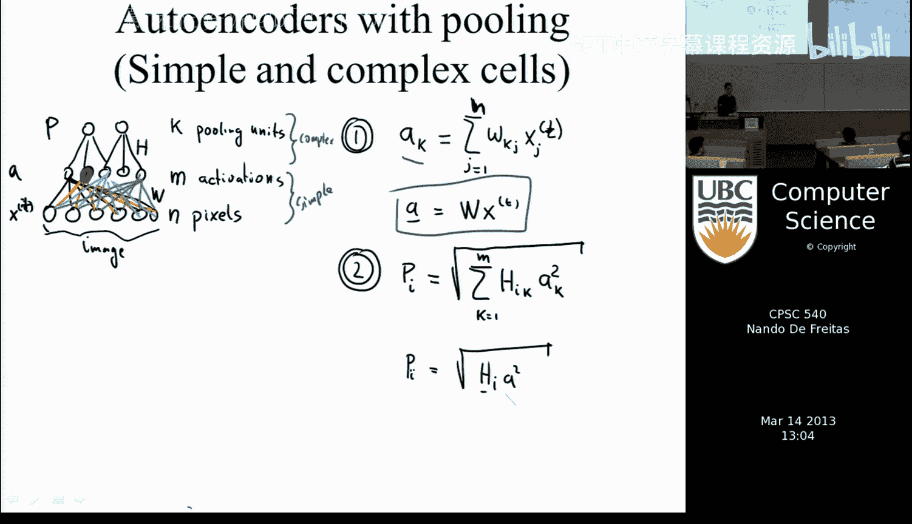

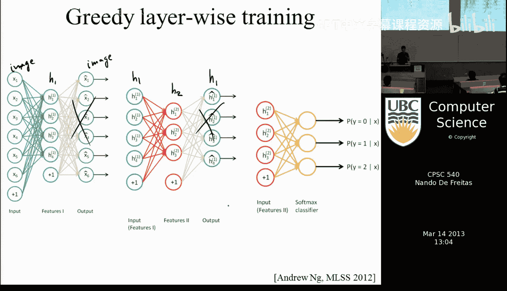

Okay， and。When we look at now the Google network， Google uses an note encoder that is very similar to essentially this simple。

 complex cell， it just has one more thing， and that one more thing is sort of easy to understand。

 it's just contrast normalization， which is something you've all done in this course as well。

 you subtract the mean and you divide by the variance to make all features have the same scale so that they're compare。

And so the Google Ne basically， you take an image patch。And then。

There are eight neurons that look at the same image patch。

And the reason why you want more than one neuro to look at the same image patch is because。

An image patch could contain several different kinds of edges。

 So you w to be able to capture all of them。And so that's why there is a sort of number of maps being equal to eight。

And now each unit， each of these eight units， looks at one patch of the image。

And the main reason why this has done this way is because of computation。

You could have a unit look at the whole image， but that would， you know。

 this network ends up having millions of parameters because each of these ages。

If you have an image that's 200 by 200 and you have 100。Units， now you have something that's 4000 by。

4，00， 200 by 200 by 1000， that gives you  four million parameters。So very quickly。

 these models get out of。The sort of scale that you can handle in the computer easily。

GPU programming is essential here。Unless you're Google， you really have to rely on GPS。

And for using GPUs to program this， these days there's all sorts of good tools like these guys that were just acquired by Google。

 they've actually developed a lot of very nice software that you can get from their homep pages to use to implement neural networks。

Okay， so。So then because of that computation， then also each group of eight units only looks at the patch。

 and then you make the patches overlapping to avoid image artifacts。

Once you have and that's your simple network， so this is where W is here。

 and these are your activations， this is your x， and then you just need to do that basically。

Gives you this first term here。 So the idea is you're going to set the W so that the reconstruction of going from x to a and then back to X。

Allows it to。Going from x to a and then back down allows you to get something that's very close to x so as to minimize the reconstruction。

Yes， that's correct so typically we have just W andW transpo so we just used the same W and tied the weights the Google guys。

 and I took this equation from their paper， this is verbatim copied from their paper to make the case that they're not using even a nonlinear neural network。

 but what's published as a linear neural network， I don't know if they're using nonlinear。

 but at least that's what was published。And in their paper， they argue for using two different Ws。

IfI recall correctly because of computation。Somehow。

 because of the way they implemented their optimizer， it was more efficient to do it this way。

I actually don't know the exact details of that。 I don't think they're well spellelt out in the paper right。

And then finally， there is this matrix H。And I've mentioned that researchers have many forms for this matrix。

In fact， some people don't even use a matrix there， but they just basically pick for a patch。

So they take several inputs。Going into one of the complex cells。 and some people just will pick。

The unit that is excited the most。Or they might even choose H to be just the identity。

 as I will show you soon。 and then the epsilon is just something that again。

 they added there for numerical stability。So if we look at this term。

This is essentially the output of a complex cell。So the whole model。

It's hard to break into a likelihood and a prior as such。

Because you could argue that it's the second term that really is。

The likelihood that's actually telling you how the signal gets transformed， and this is just a prior。

And the prior here， our prior knowledge is that the reconstructions by our model should look like the data that our model looks at。

That's essentially the knowledge that we've encoded in this model。嗯。

It nonetheless is kind of tricky to think of this because it's a data dependent prior。

 if you look at it that way。I think from a statistical perspective， this raises some questions。

And that's pretty much the model。 And then the final stage is just this local contrast normalization。

 which I will review now。

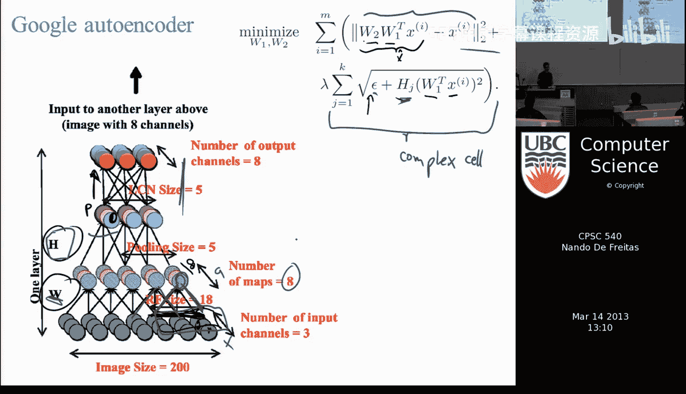

Okay， but basically， let's look at these in the context of the Google net。

 these slides I got from Mark Carreo Ronzata， who is。Previously a postdoc in Toronto。

 he was one of the collaborators in several papers here with our students。

And he's now one of the leading researchers on this brain project at Google。

So here's these very cool slides， which essentially he's saying how they implement the pooling and the contra's normalization。

 so in pooling you just take a patch。Of the previous layer of neurons。And then for that patch。

You essentially would take。All the activations in that patch squared them。

Some them take the square root that gives you the activation at this new location， X Y。

And then contrast normalization， essentially you take the patch on the previous layer。

Your compute mean of the pixels。And you compute standard deviation。

 and then you just subtract the mean and divide by the standard deviation。

And this paper describes very clearly what all these stages are。

The standard deviation is that for the imager for the patch for the patch。

 so it's hence the local so contrast normalization is just subtractive so you're going to do these operations are done per patch。

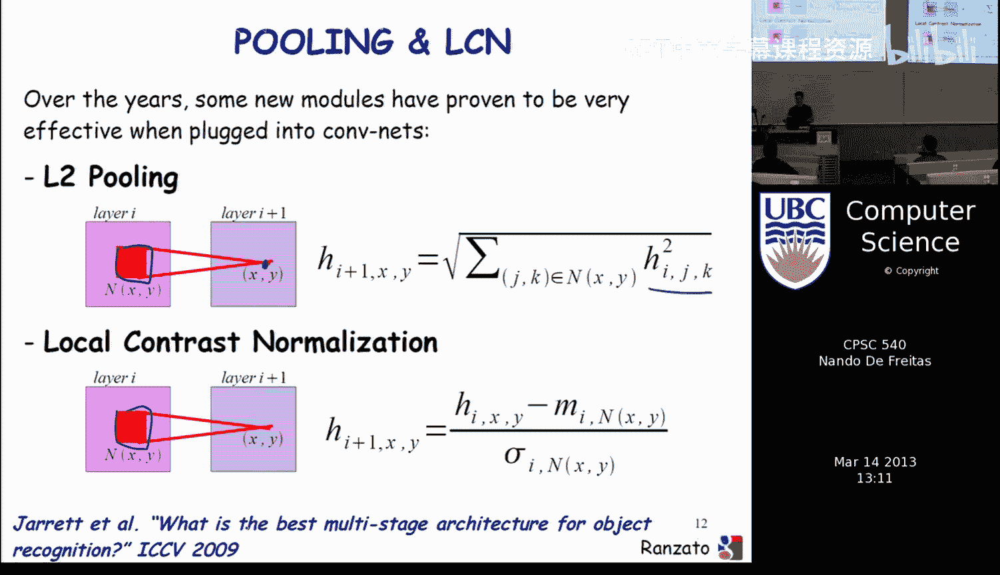

So as you can see here， a pooling unit only sees one particular patch。And again。

 you use overlapped patches to avoid artifacts So very much like。

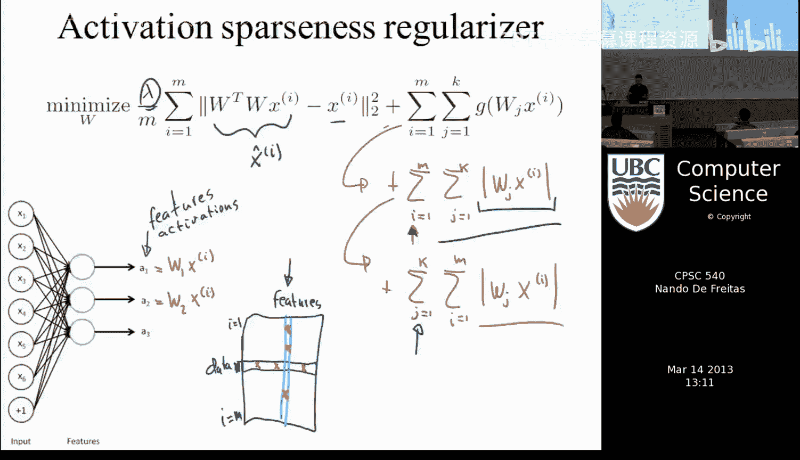

Very much like we had seen in this picture， so we use what there'll be one set of patches another set of patches and then another set of patches like that。

 so that allows you to cover the whole image or if you will cover all the neurons。

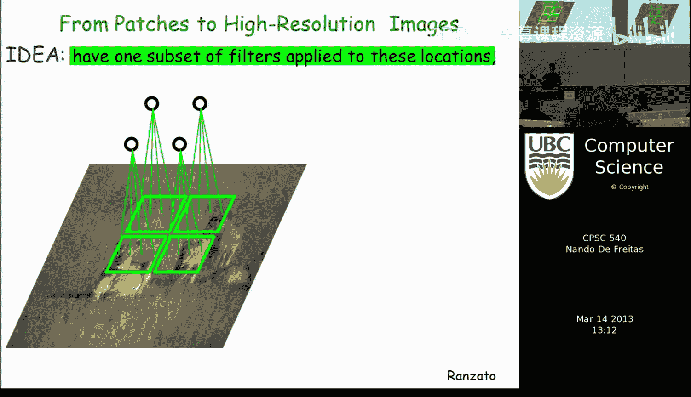

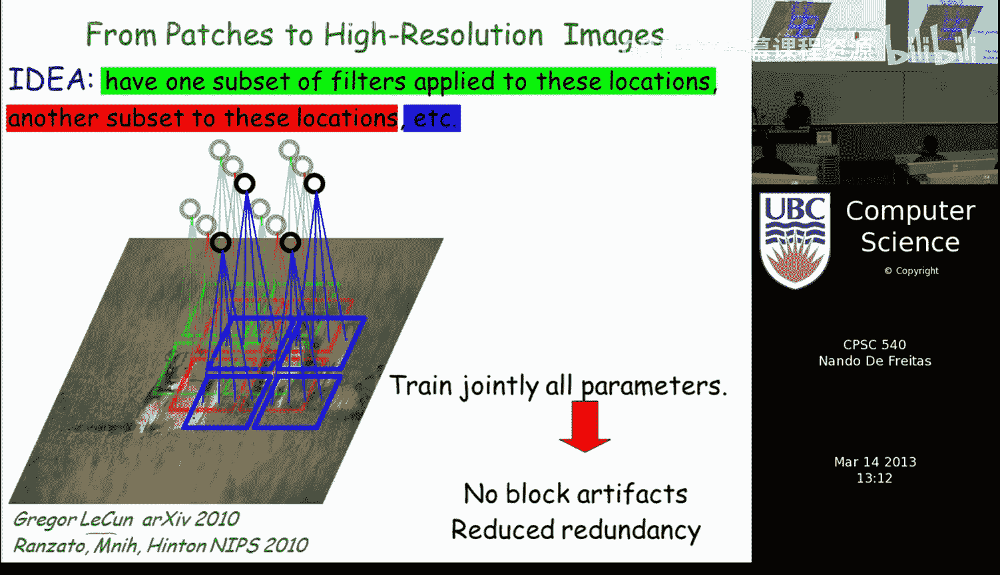

As you go up these nets， you can still interpret。

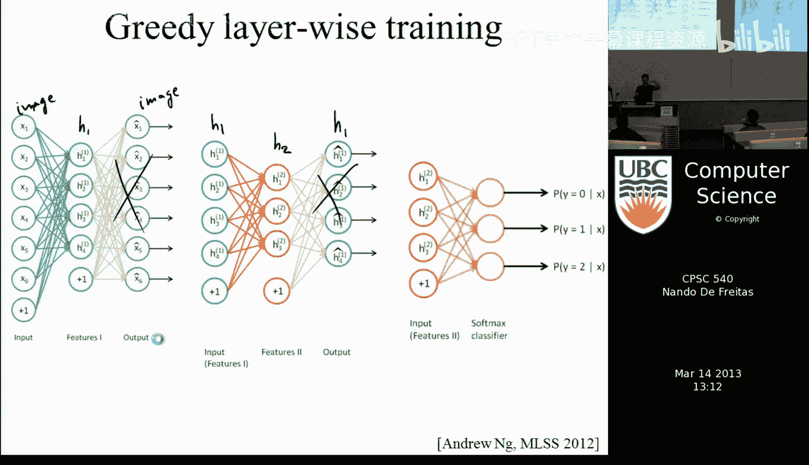

As you go up， you can still interpret these as images。So each layer here is still an image。

 but will be images that are different for solutions and so on。

 and there will be images that highlight， some of them will be like transformations。

 so be images where you see the edges will be intensified like edge maps and so on。

And eventually some of these units at the top where they start will start putting together a subunit and you'll start seeing。

Patches of neurons essentially are detecting noses and eyes。

Stuff like that when you train it with faces。嗯。Right， so。

So those operations are per patch and same as for local contra normalization。

Except that in this case， they were actually using。嗯。But they were using patches of size 5 neurons。

 and I don't know。有。How many replicates of these they would have had？

For the details you'd have to look at the Google paperper。

 I'm assuming that for some layers they would have had， in this case。

 there's only one patch because of the drawing。But in implementation。

 I assumed there would have been several patches。These patches were word up。Oh。

 they do overlap like in the picture。飘。Yeah， they do overlap as well。

 as you can see this patch goes all the way here and then this patch goes all the way here。

So these two patches clearly overlap。啲大。Or in the contras normalization。

 I think they would also overlap。I don't know the answer 100% for sure。

 you'll have to check the paper for details。Based on。The way they're doing it。

 I think to avoid artifacts， you would want them to overlap as well。In this case， they have。Well。

 actually， in this case， it's sort of clear that they do overlap， in fact。Thiss just one thing。Yeah。

 yeah。 that's what I meant。 And this drawing。 But I think it's just because of the size of the drawing。

 It's very hard to draw this。There's only one patch， but you could have several patches。

And hence why local， because you're only contrast normalizing at a local patch。

As opposed to over the entire image。Now， local counter normalization， polling， filtering。

 these are all principles that have been derived from neuroscience。It's from measurements。

 measurements of how neurons fire for some mammals have sort of guided the design of these neural networks。

 so it's one of those areas where work in most sort of mathematical work and optimization。

And you know， in the work of computer scientists and statisticians。

Who studied these models and the work of neuroscience sort of comes together。

 and you're able to build a model that really starts sort of building on。

Some of the most intelligent machines that we know in nature。

 which is basically animals and allows us to。You know， build some very powerful devices。

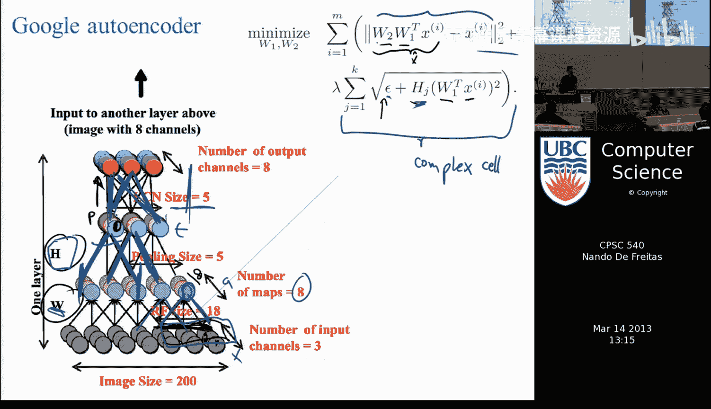

And。And so the story then is very simple， so you just have a patch。

You just take the score of the differences and the normalization。

 and here's an illustration why they work。

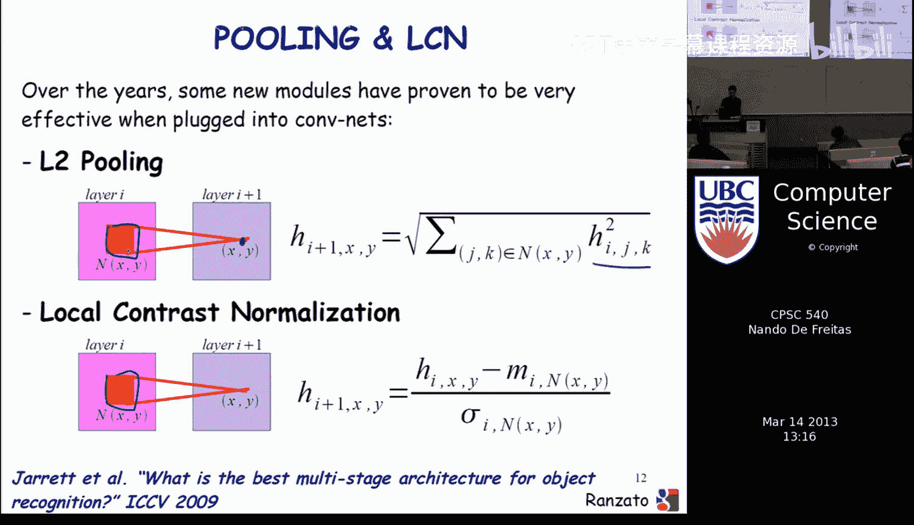

So I argued that the idea of polling is that if you apply some small transformation or rotation to an object。

 if it's in your visual field and you apply a small transformation。

 you would like the complex cell to still fire。In other words。

 you want the neuron to be invariant to perturbations in the date。

And as this sort of exaggerated picture shows you， if the input was this guy here。This po。Yops。Sorry。

 oh there we go。 So if you had this as the patch in the input， if it was something that was like。

You know， this caricature， something that's half gray， half white If that thing was rotated。

 you would still want to somehow detect that that thing exists。And so。In this case。

If this is the input， then in a particular patch of neurons， a group of neurons。

 it might be that this first neuron will fire and because it's anti correlated。

 in other words it's light or where it's dark and dark where it's light， it might fire minus1。

 the other neurons don't look like this so they did don't fire。

Now when you sum the five neurons in the patch。Squared them and take the square root you' just got a one。

 right， because it's one squared0 squared。If that patch gets rotated。

 it still sort of is matched by one of the neurons in the bank。

And so the output of the complex cell is still the same。Okay， so if these units。If these units here。

 I just have captured the various rotations of this object。

Then it really doesn't matter then in which orientation the object is。

The same unit up here will fire。So it captures invariance with respect to perturbations of the input。

 and that's essential because as we observe the world， the world comes at us。

In all sorts of distortions all the time。And hence why we can have a program a computer exactly to see。

So。The message here is L2 pooling， it's using the squared L2 norm， sorry using this L2 norm。

 it helps us with learning representation that are robust to these small perturbations。

Normalization has a similar effect if you have inputs and you just take the mean of all these guys and the standard deviation。

 which is to in them。You know， subtract the mean from all of them and divide by this standard deviation。

 you get an output that say scale2。To these green values。

 if your input were to be in a different scale， when you add those numbers divided by the variance。

 you would get the same green values。So no matter what the scale of the input。

 you would still get the same output firings of the neurons。

So if you're looking at me and I switch on a bright light， you would still recognize it's me。

 even though the light intensity went up then full。And so by doing contrast normalization。

 you essentially。I getting。Invari with respect to the intensity of the variations in much intensity。

If you have Mac flag。

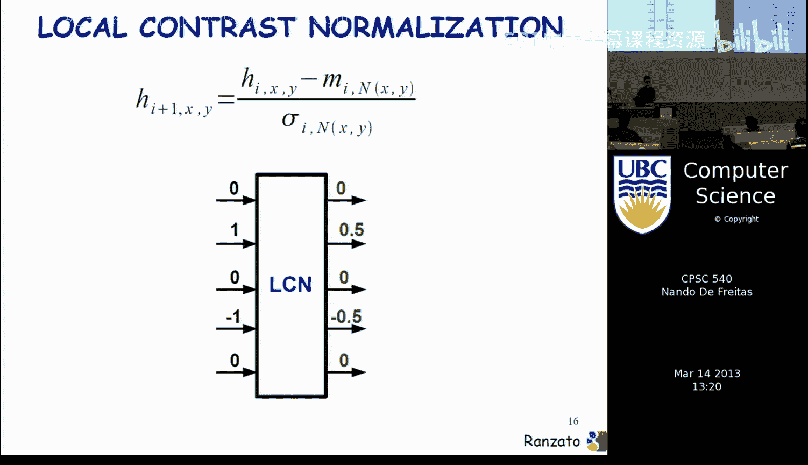

I'm wondering， is there anything that encourages groups of neurons that represent different rotations to then be grouped together at a higher level？

Yes。So I skipped talking about that， but one of。What I mean， that's something。

That's going to take a bit more time office hours I can actually talk about that there's a longer argument。

 but one of the things that we actually get from having these group L1 norms is that we also can construct them so that we actually get topographic maps。

So that we get basically neurons that tend to have the same type of pattern grouped together。

The argument is a bit more involved， so I can cover it in office。

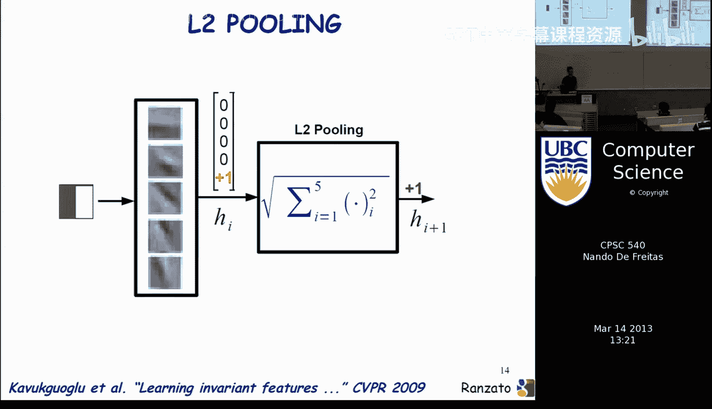

And that we observe in the brain as well， there's topography in the brain， this certain organization。

Okay， so。嗯。Contrast， normalization and ultrapoing essentially help us with invariance。

And that's essential in order to recognize speech。Each of you has a slightly different way of saying a particular phoneme。

 it's essentially that the network be invariant to those perturbations。All right。

 so let's look at the cool work that Google did last year。And by Google， I mean。

People like Poley and Andrew Eang Marcoelio， Jeff De， who's one of。

I keep hearing one of the best programmers alive。That's working came this problem right now。

And they were after what was found in neuroscience experiments so in this neuroscience experiment here that appeared in nature。

 they basically found these cells that tend to fire when you present to the cell pictures of hlaberry。

Even if they're cartoons， so it seems to indicate that， well， somewhere in the brain。

There are these cells that will fire when you identify hla bear。

One of your course projects is actually to do this to actually， in fact。

Show that there are some cells in the brain that are coding for plants。

And that's the data set that Maria shared with you guys and asked you guys to fit。

And then try to do bootstping to evaluate the quality of the fit。嗯。It。

To those of us who believe that everything is down to a machine a biological machine。

 this is not surprising。 It's all encoded in the brain。

 but to the vast majority of people to be able to convince them that you could actually build a machine that can actually。

Is capable of mimicking this is nonetheless a formidable challenge。

 and that's what Andrew did with his group。嗯。So what they decided to do was they took a very large data set of YouTube images。

Each of size 200 by 200。And there's 10。10 million unlabeled frames for 10 million images。

The total network has about 1 billion parameters。OkaySo1 billion is the sort of thing that starts becoming very hard to train。

Or even to load in memory。Their deep net consists of three layers， so as I said last week。

 the basic unit in deep learning is an note encoder。Your train are not encode to predict the input。

Once you've done that， you look at the second layer and you train another rot encoder to predict the second layer。

 and then you train another rot encoder to predict the third layer and you go for as many layers as you wish。

Of course there's a lot of questions here， how many layers， how many units。

 what should the value of Lambda be， what should be the form of pooling that I use。

 and that's where pasing optimization actually comes in beautifully because you can actually automate all this and have this meta decision process that completely configures a neural network。

And in fact， there's been some papers that have addressed this， so James Betra more recently。

Jaspernook and colleagues， Ugula Rochelle， Ryan Adams。

 have kind of all developed facing optimization schemes to tune these parameters。Now each stage。

 each altern encoder， so the deep net consisted of three auto encodes， three stages。

 and for each stage they use these 18 by 18 filters， so that's the simple cells。

 that's just a simple neural network。If you will， with eight units at each location。

 so for each image patch there will be eight neurons looking at that image patch or eight filters。

They use L2 pooling， they use local countries' normalization over five by5 neighborhoods。

So five by five image patches， or if you go higher up， five by five neuron patches。

And then what they do， actually， they try， they actually put all these together。 and。

So here's interesting。They said they will train all of these jointly。

 so instead of training in a greedy wise manner as many groups do。

 they've decided to just rely on some hardcore optimization and use。

 I think 16 million cores and so on to distribute the computation just because they happen to have that power and they decided to train the whole thing。

So just write the objective function for the three layers， basically add those objectives。

Cranch the optimization technique on this。And so in doing that。

 they have to be smart because they have to decide how they're going to distribute the data across different machines。

 and they also have to distribute the parameters。So for people doing distributed computation。

 the surface is actually quite an interesting problem。

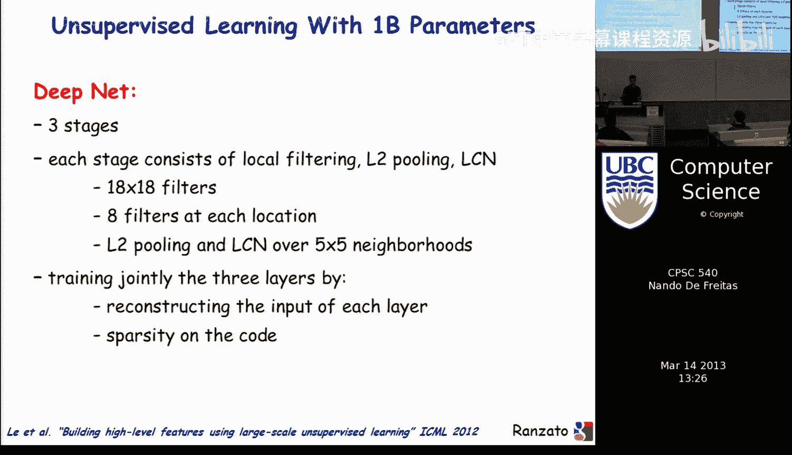

And that's pretty much it， so a single autoender has the filtering stage。

 the simple cells that is it has the complex cells， which is the L2 pulling stage。

 and then it just has this normalization step。Subtract by， divide by the variance。

And the total network consists of three stages like the top stage，1，2，3。

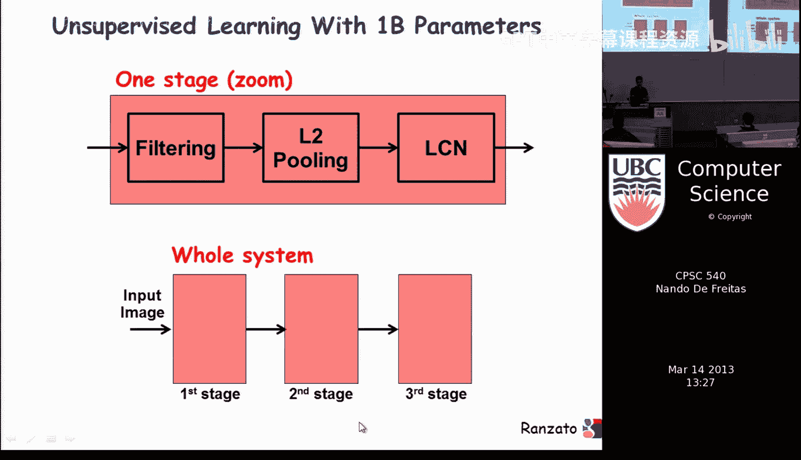

Now how do they validate the results？So what they did is they constructed a test set or validation set which had 50% faces 50% random。

 and then they check how well how do the neurons do in this case now this is not this sort of validation here is not easy because essentially you've taken。

Millions of images， you've through this huge network of images and you' trained this network to reconstruct its input。

So one way to measure performance would be by how well it reconstructs the input。

 but then you wouldn't want a machine that just as capable of reconstructing the input。

 you want this machine to do something special to do something different。嗯。

Could it be that this network has learned what a face is？Or what a kitie is。

And those were the two things that it learned， it learn what faces are， it learn what cats are。

 because I guess that's what you find in YouTube。

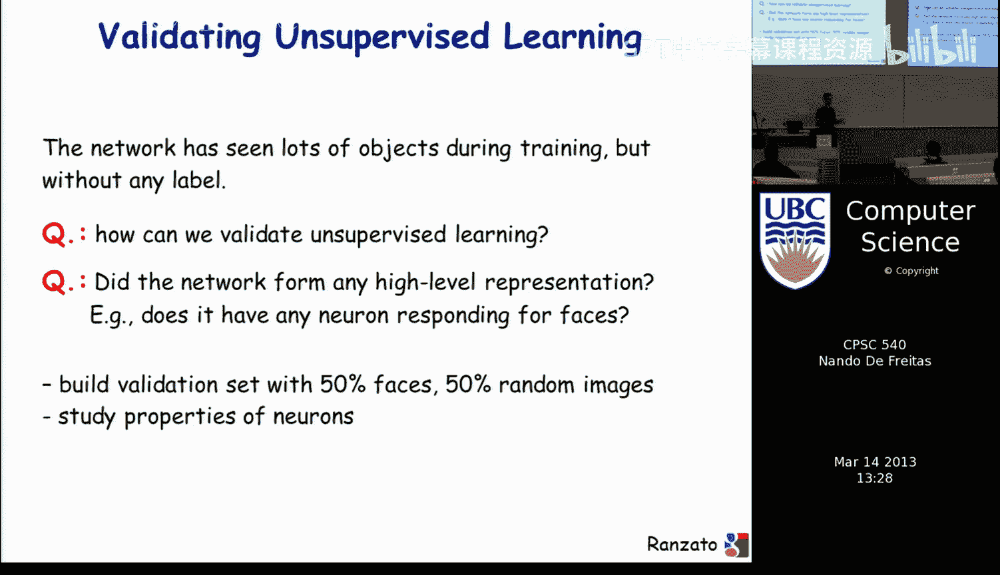

Plenty。And so precisely what they did was that。Then， they took this。

They took different kind of images， some of faces， some not of faces。

 they fed it through the network。And then for each neuron。They did a following test。

 let's say we grab one single neuron。And then for that， Nen。We see how many times it fires。 What's。

 what's its firing。 You look at all its firing rates， possible firing rates。

 And you count how many times for how many face images did it fire at a particular firing rate。

And so you get things like for faces。These tend to be the activation。

 so the most common activation is around minus 0。4。

Whereas for images of nonfaces it tends to be active with mean around phi。

 so if you use these two empirical histograms of the firing of the neuron。

 you can see that this neuron is actually differentiating。

 it's selectively fires differently for whether the input is a face or not the face so this particular neuron has learned。

By doing this and unsupervised， we've actually been able to extract structure in the data。

 and one of the structures is here iss a neuron that detects faces。AndThat's quite。Cool。

How many neurons have they have told？Oh，嗯。

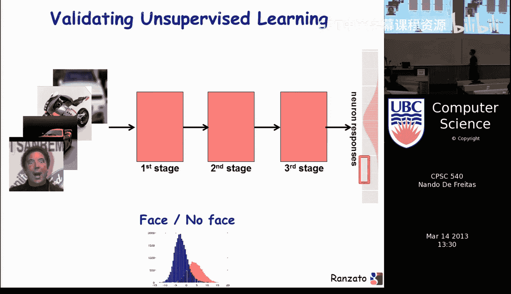

Can one figure it out from this easily？So。They claim what 1 billion parameters。嗯。Okay。

s I'm terrible with arithmetic， but it's just an exercise of arithmetic。 You have 200 by 200。

 and then you have。For for the patch of size 25， you have 18。In other words。

 if you do these calculations for the sizes， you'll be able to figure it out。With 1 billion。

It's millions of neurons。The exact number you could sort of calculate。

Just by adding and multiplying these numberss。

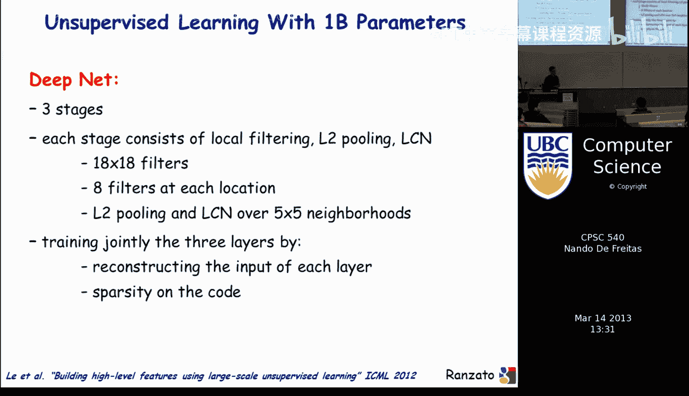

But I think where your question is going is how。How does this huge network。

 How does this compare to the brain of never mind a human， a mouse。It's insignificant。

We really are still at this stage where what we can do with our computers is still of a much smaller scale than our brain。

Like just how our optic nerve has a million fibers going in through。That's 100 by100 image。

 so a much higher resolution that the images that these guys are using。 Our patches are very large。

 Our patches are 1000 by 1000 pixels。So we're still very far from。Capturing what we have。

If there are that many neurons， then would some of the other neurons in there also respond to specific things in the images？

Not just spaces。So they did study what they respond to。

 and the ones that they reported was faces and so on。

 so they haven't reported more results in a completely here conjecture simply because they weren't able to- I think if they had more interesting signals。

 they probably would have reported us。Since then， there's been other groups that have been able to using simple techniques。

 recreate these results， by the way。Is it possible that there's also another type of image that it didn't consider that would fire the same way as for faces。

Oh， that's a very good question。 Could you have a different kind of images that when applied to that neuron would have caused that。

Possibly。Because here all they did was let's take all our data for validation。

At least they know that in terms of validation。嗯。That does not appear based on these results to be any other。

And you that any other kind of image that would have that property。

But if you were to consider a bigger data set to test it。It could be quite the case。

 but let me show you the rest of the evidence before we draw any conclusions。

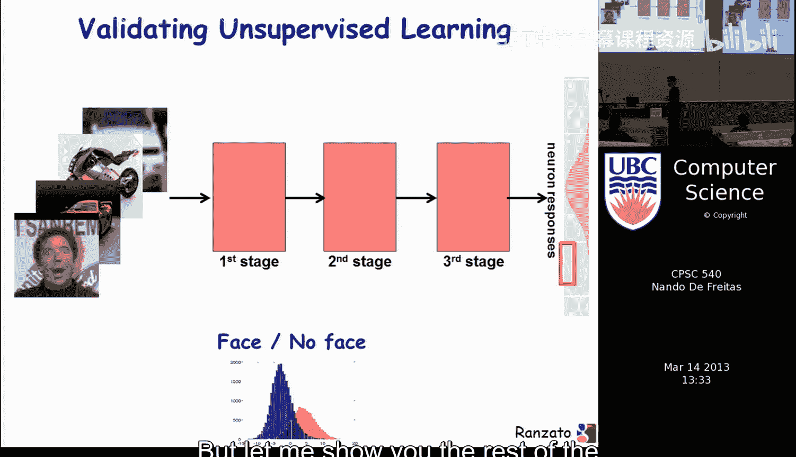

They at then looked at which are the images from this data set， which is not only faces。

 but several things， and of all the images in this data set。

 which are the ones that tend to make this unit fire the most。

And this is what they found those images were。So from here。

 it seems clear that other things would not necessarily be good at making。It fire。 but of course。

 as you can see here， there's an image of a mouse。That's not a face。

 that all makes that near and fire。The other thing that they do。

I think the large extent answers your question is。You have a neural network。

 which is implements the function F， which takes the input X。

 and it has parameters W and H H are fixed W we learn。And it produces some output。

So what you might do then do is you turn the neuron on。So you make the output on。

 and for those weights， you try to figure out what is the input。

What is the input that makes Disney beyond？And so in other words， you solve this operation。

 find the input that maximizes the firing of this neuro。And so in other words。

 you're now computing what would be the input image that would maximally cost this neurons to fire。

 and when they do that， this is what they get。Okay， this is sort of the scary。

Quntessential image of the face that's causing that neuron to fire。

That somehow is kind of saying that Disney or indeed is tuned to faces。What is it neural located。

 is at the third stage or first stage this one I believe it's at the third stage？It's a complex。

Not simple。Yeah， it will be the result of so each stage consists of a simple and complex cells and then contrasts normalization。

So this would be after。Three stages of simple， complex normalization， simple complex normalization。

 simple complex normalization， so it might be that if you look at the neural at the first stage。

There might be a neuro that does it for us。Yeah， they typically when you look at the first stage。

 the weights that typically tend to be just like lines and so you really need layers because the idea is。

The first neurons is just detecting edges， they tend to just respond to images that look like ages。

 like the ones that I've shown you。But if you now take an image on top， that image。

That neuron in the second layer will。Will fire for combinations of edges。And because of pooling。

 it will be at a lower resolution。 So now it could be firing for say a squared or so。

 And at higher levels， then it starts putting together。Combinations of those。 So essentially。

 it's useful what to think of these as park models。

Where the first layer is basically breaking the damage into parts。

 and then the next layer are sort of grouping the parts。To synthesize objects。Please。

The other thing that Google guys did is。They studied in variant， and so， for example。

 they found that。You know they did experiments like what happens if you move the image left and right and up and down so if you move and then they check whether the neuron is still firing and then as you can see by moving it。

It's still fairly robust， so you if you move it just a little bit， the same unit will still file。

Same with vertical。And then they have experiments with rotation and scale。 I do not know。

 I haven't asked them this question， I do not know if they tried to match this with biological。

With psychophysical experiments， we humans are very good at when things move like this up and down。

 you take a car， move it up and down， left right and still a car， but if you're rotated。

 we have more difficulty in recognizing that it's still a car， rotated cars cause trouble。

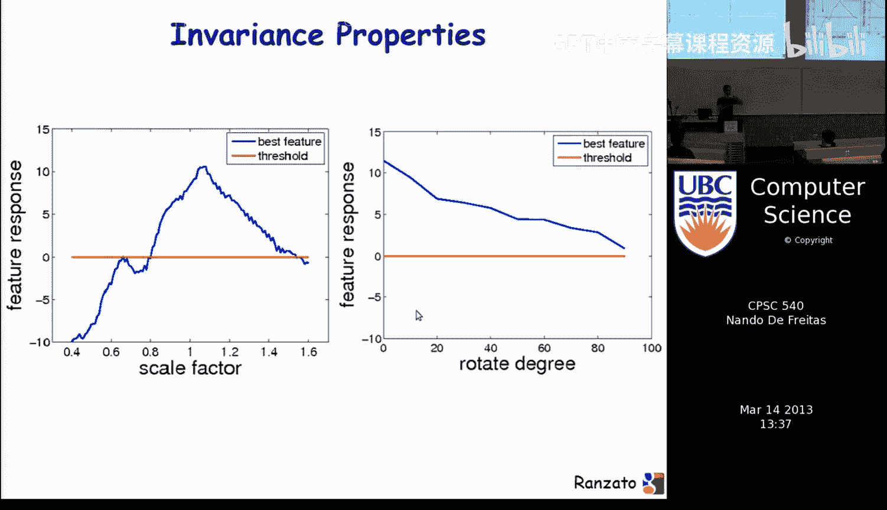

It depends object to like objects that are naturally located to be fine with。

 but we don't see upside on carss。Context matters a lot。

 So these models actually are not because they're just looking at dispatches。

 They're not actually taking so much into consideration context。

One of the things that's very interesting about other models like random forests。

 the problem with random forest is we can't build layers with random forest。

 if you can figure out how to do that in of course project's well that's your thesis。

But so we can't build layers， but on the other hand with random forests。

 especially if you look at the section of regression in Antonio Criminis's report。

When you do regression with random forests， or in fact。

 when you do classification as well for connect。Context is used the pictures that like when you。

When in their experiments they try to predict in their medical images。

 they try to predict whether a particular organ is located， they actually use the other organs。

To provide evidence for where the other organ will be in the image。

 So they're using contextual information。 That to me is kind of important。And。

Doing that with a neural network would be again， a good thesis。This is the cat neuron。

I guess you have to squint to see the car there， but you can sort of see， yeah， it's there。

If thisquit， you'll see it。I think what they would love is to get。

A picture of hollowlaberry in one of these neurons。 And then they。

I guess there is Hallibbaria cat womanman。Of course。

 and these are the images that cause that neuron to fire all the kitties in YouTube。Interestingly。

 there's a mouse here too。😀Yeah。😊，somewhat suspect。Despite Pi all this。

If they look at the accuracy and。100% is the best you could get。 This is the accuracy of this net。15。

8%。But it's state of the out。And this ist a competition that's actually quite large。

 It's a competition that involvess about 16 million images into 20，000 categories。

 and in fact humans actually can do badly there as well， I don't know what the rate is for humans。

 I'd love to know the vision guys， image net。😊，Humans。Probably what 4060 no idea。Okay。

 we'll look it up。 That's the good thing to find out。

 Let's look up how I've seen the figures somewhere， but I forget。But it's a very hard task。

 so even doing 16， 15。8% not back， there is a cartoon， if any of you has it。

 I know the people have emaileded to me， it's one of those XKCD or something like that。

it's a joke about this。About all these layers， all this work， and at the end of the day。

 it's just a little bit better than random。But。It keeps getting better。

 when you do this and speech is a different story。So vision， of course。

 solving the vision problem is not easy。I should say solving the object recognition problem because vision is about more than object recognition。

 in fact， for me knowing that this is a plane and when a hole is there that I shouldn't step on that hole。

 being able to detect and understand 3D structure is perhaps more important and be able to recognize what each thing is spiders that very good at creating spiders have like layers of eyes sort of and they're able to get whole 3D maps of the world that allow them to navigate and。

Detect where the prey is， attack the prey that can do object recognition。

 so even a little tiny spideryr is able to do a lot of very complex vision without having to have all these semantic categories。

So vision is sort of a much more general problem。And we still need to solve it， unfortunately。

 that more general problem is something that's less relevant to Google at present。

 but except for the car。But it's nonetheless still a big challenge in vision for object recognitiondation is very hard。

 speech is a bit easier。 so in speech， Google has actually made huge progress， not on Google。

 but also Microsoft using deep nets。see。By just how many neurons they。In training。Excellent question。

 If you ask some people， they would tell you， we need more data， we need a bigger net。

 This is part of the reason why I believe Jeff Hinton is moving to work with Google。Well。

 you need more data， you need to pick a network and you need more programs。

Build link for you because each of these little details involves a lot of coding。

The code for this is all available， by the way， for some of the recent competitions。

 especially the stuff I'm going to talk about now dropropout nets。

 it's code that you can download and in fact Baa emailed it to me and I shared it in the Google group。

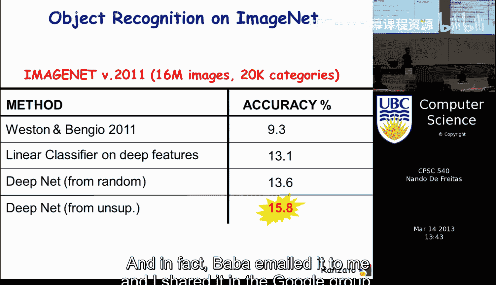

So you can each download this code。Okay。

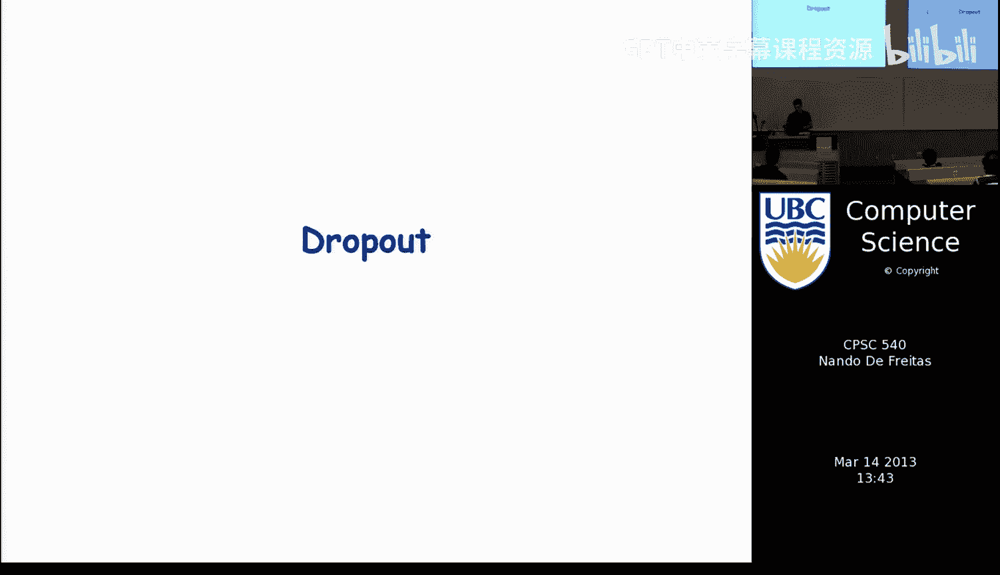

The remaining seven minutes， I'm going to describe one new idea that has made that's sort of been very hot and if you take Jeff Hinson's course online。

 you'll definitely。嗯。Be preached on the value of this technique。 So it's a very cute technique。

 So it's called dropout and Dout has allowed people who build neural networks to win many competitions。

 There's the kggle competitions。And。By now， most of you should know what cargo is if you don't know。

Make sure you visit this website。Kgos iss website that just has data for machine learning competitions。

And often there's prices with the data that's like $3 million is one prize and so on， but be careful。

Because when you're solving one of these problems， you're solving a problem for a company。

And their intent might not be a very good one。So be very careful。

 especially that $3 million do it with， make sure you're researched。Before you give them a solution。

Okay。This particular problem where they were successful consisted of two challenges。

 one is classification and one is detection， so classification is you' basically given an image。

 you just want to say whether the object is present in image or not。And then detection。

 actually you have to say where in the image is the object and you do it by putting one of these yellow boxes。

 so you say for example， in the second image， this is where the chairs are in the first image。

 this is where the duck is。And the categories that they had is sort of simplet 20 categories and they basically had person bird cat。

 cow， bicycle airplaneeroplane， and for some reason the computer vision people love these。

 and they always use these same categories。Chairs are very hard。

Because there's all sorts of shapes of colors， textures of chairs。

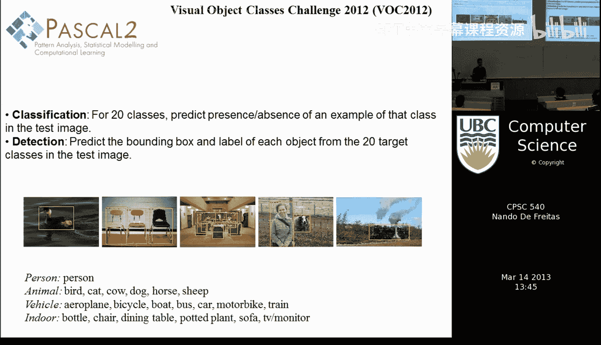

So it's a functional object。And these were the results in classification。

 the neural networks achieved a error rate of 0。15。

Which is considerably lower than the best techniques from computer vision， which achieve cheap。

 So if you look at the computer vision techniques， they're all fighting for that 0。26。

 the some groups from Oxford and so on， and I guess Xerox。And Ra， they're all around the 0。

20 high20s， and these are the guys just basically half the era。Just by building this neural network。

 So it's kind of hot。I was in Oxford a couple of weeks ago。

 one of the things I did there was like immediately when they knew I was there。

 they knew okay there's a guy that knows about dropout here。

 they spent quite a bit of time asking me questions about dropout and why does it work and how do we get to implement so other people that do traditional computer vision and the Oxford group is one of the best at did in the world they're definitely very interested in this neural networks now。

Because they've realized that they've。They they did beat them fair and square。Like a huge margin。

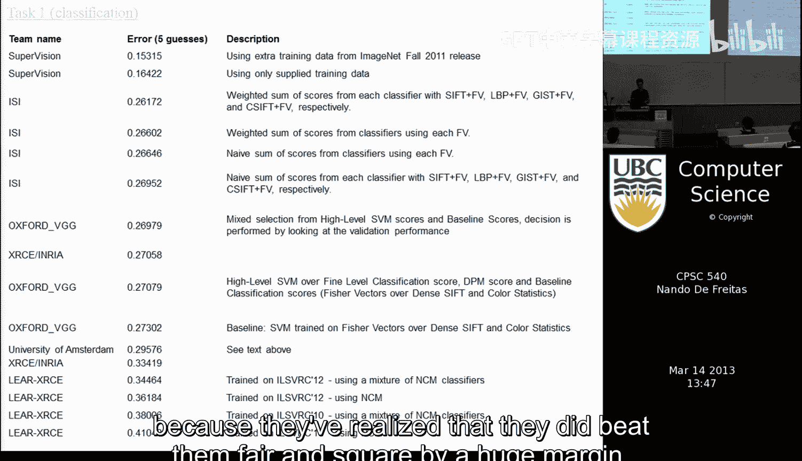

Se in object detection。The other techniques involve a lot of engineering， many years of engineering。

 the neural nets。You could argue they all involved involved many years of engineering。

 but it's a very different path。

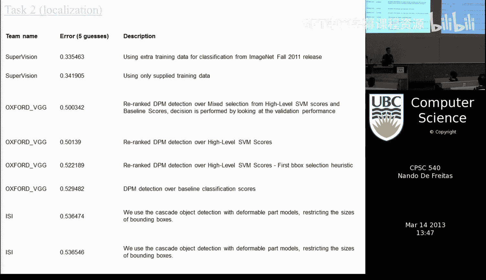

You're engineering them to learn as opposed to engineer them specifically for a few images。Okay。

 so to finish this drop out， dropout is the following idea。 Jeff。

 and here I'm using some slides from。A summer school that we taught at UCLA last year。

 some of these guys went to it， they were there Bavak Mariaia。嗯。

Another reason to do machine learning， right？They spent a few days there at the beach。

Eating big plates of meat。Okay的。Plaed the boat with fun。嗯。Okay。

 so Jeff says that in order to win many competitions。

 and this is something that we've found in many competitions like the Netflix friend Prize and so on。

 people put together ensembles of techniques。And we've in this course， learned about this。

 Random forest is one such ensemble techniques。 You put many。

Things together you tend to get better predictions when it an important sampling， the predictor。

 the basin predictor also takes an average of many individual predictors。

 so because essentially replacing an integral by an average and the prediction of logistically base logistic regression is actually a combination of predictors。

The type of combinations is different。And like Jeff says， here， the connect uses bagging。

 which is essential with。What we did when we did random forest， bagging meanss。

 adding many different models。There's different ways you could combine， you could do that。

The arithmetic mean。03 plus 0。1 divided W。Two， that's what we did with random forces。

 but I could have also taken the geometric me。

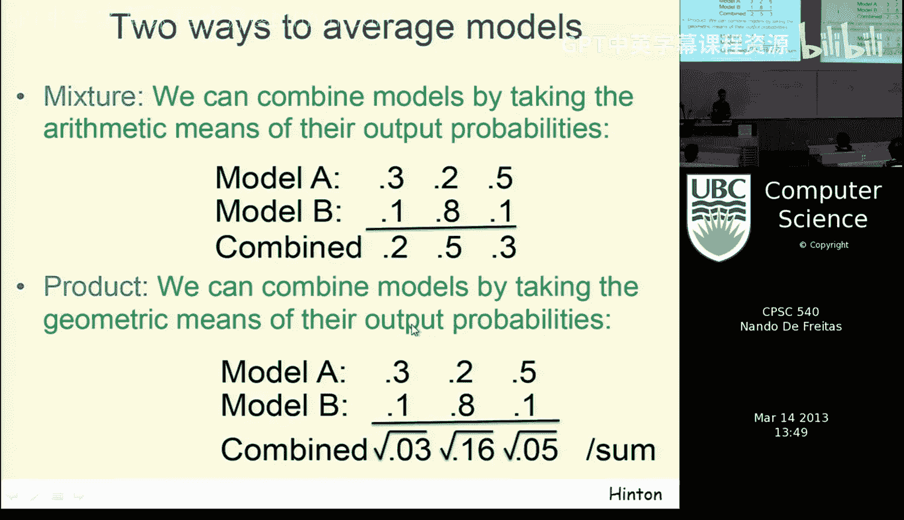

You know， multiiply it and take a square root。So there's more than one way of averaging。

 that's his first point， as we will see later， he will use the second form of averaging。Now。

 the way he does bagging because essentially what Jeff Min is going to do is very similar to a random forest。

 but with a neural net。And what he's going to do is consider a specific layer of the network。

And suppose you're training this network online。 So you're loading a mini batch of data of say 10 points。

 So you load a mini batch。And in fact， that mini batch could be just one point。

 so it could be just online gradient to set。You take one data point。

 you load one data point into memory。And then what you do then。

 instead of training the whole neural network on that data point， all the weights。

You sample at random。Half of the units。And you only change the weight and the direction of the gradient for half of the units。

For the other half， you don't do anything， you leave them freeze the weight。And then at the next it。

 when you load a new data point， you repeat this sampling。

So in a way it's kind of like random forest， where we're randomizing the features that we choose。

 wed only say taking half of the features。And he not only randomizes layer 1。

 but he'll also randomize layer 2。 And in fact， he randomizes the input。 So you only take。

Half of their input features。Of course， because you're using so whether you take them or not is a binary decision。

 and if there are H units， there will be two to the H possibilities。

Or model structures that we sample。

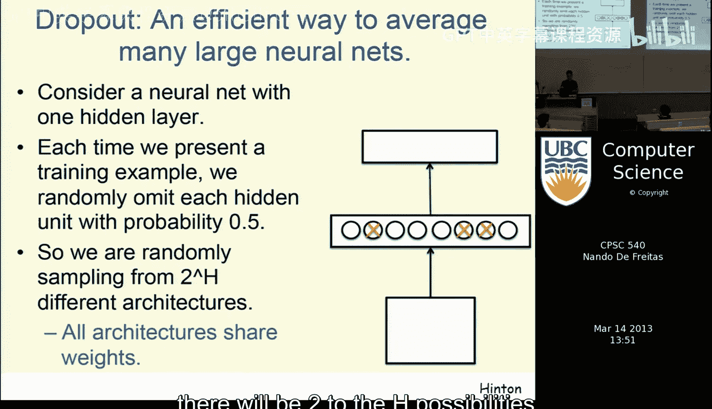

Okay。Because you're only using one data point for each sample。

 he argues that this is an extreme form of bagging。

 so I think I mentioned to you guys that when we do bagging。嗯。

Traditional people just will subs samplele end data from end data so they will get repeat。

 Some people take say， square root n or smaller。Sizes。

 in this case it's been quite extreme because it's only taken one data to point for each randomization of the weights。

And then。Jeff argues that this actually does regularization and it's better at doing regularization than using 1NL2 norms。

And the reason is the following。

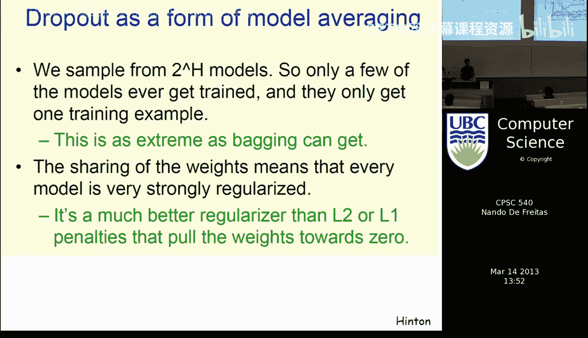

Although in their paper， I should warn you， in their paper。

 they do have something equivalent to an LT regularizer in addition to the trick。So。

When you read all these papers， always be skeptical。

Because these are concepts that we still are learning。

 so even the most experiences marked as researchers often get the wrong intuitions or the wrong results。

The intuition for this is as follows。Think back to the RBF functions。

Because a neural network essentially is a linear combination of basis functions。

 And let's think of the case where we have three basiss， one basis， two basiss， and three basiss。

One basis is located at four， one at two， and one at one。So that's one。To。And4。Now。

 what happens here is you would like to have those bases located there。

That would give you a nice fit， right？ So if each basis was at one of the modes would give you a good fit to the date。

But in practice， when we do machine learning， where we often happen is we learn that the best。

 we might learn that the ideal bases are bases that look like this， one here， one here。

And then one that goes here。

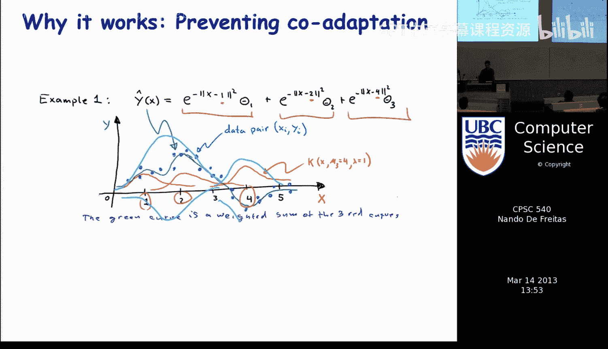