# UBC《机器学习（研究生）｜CPSC 540 Machine learning 2013》中英字幕 p20 -20-Machine learning - Importance sampling and MCMC I.zh_en -BV19g2FBBEEq_p20-

It the metropolis algorithm。

Which in order to approximate， say the volume of a convex spottting high dimensions。

 it's the only sort of approximate polynomial time algorithm that we know of。

It's a remarkable algorithm， it was voted one of the top 10 algorithms of the century of last century。

 so it would be very useful to know that algorithm。

And variations of that algorithm include things like G sampling。

 which probably if you do deep learning， you've come across the term or if you do biology。

or refuge of statistics， and also will lead us to understand hyper Monte Carlo。

 which is a very popular algorithm that combines Monte Carlo and sampling in order to do baseian inference in neural networks。

So this will allow us to attack problems like neural networks from a completely different perspective。

And again， where the basic methods are very good isn't getting confidence intervals and so on。

 If you want to do a robust analysis， if you where you want to put all your prior assumptions and where you want to。

Verified that this。Pri that intus are right by looking at date and predictive tests。 Then。

 the basin scheme is ideal for that。But the problem is it requires the solution of integrals。

We can't do by hand。 Fortunatelyly， when we。Do sampling， we will be able to solve this integral。

So that's what sampling is going to give us。's going to us。

 it's going to give us the machinery for doing base and inference。

Sampling that is Monte Carlo is to base an inference， but optimization is to maximum likelihood。

Or penalized like。

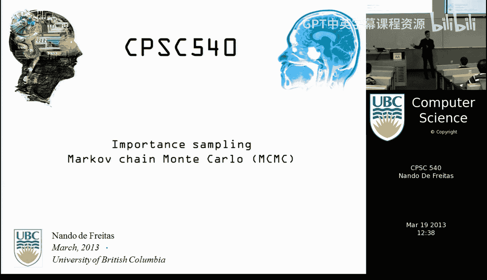

So you either think of the problem as an optimization one where you have a likelihood and a regularizer and you crunch an optimizer。

 or you think of the problem as an integration one where you have also likelihood in a prior。

 but where you need to get the normalization constant in order to get the posterior and the normalization constant is essentially an integral and that。

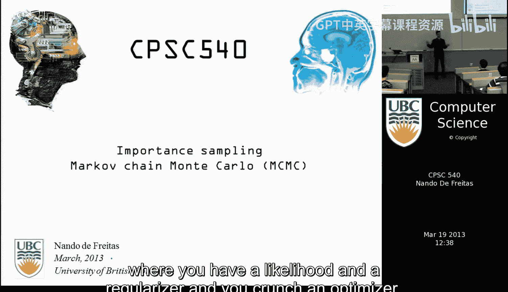

That's intractable， and so we resort to something。

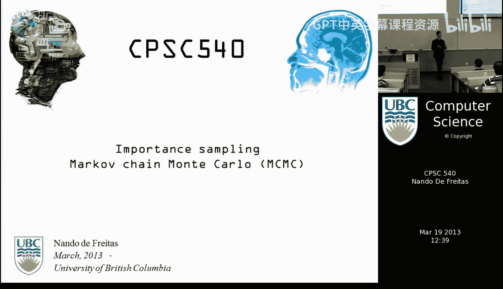

Okay， so let's review some of this material。

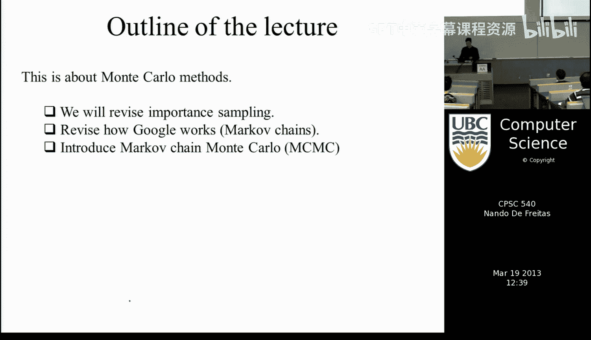

So in the last class。In logistic regression， we went over what the likelihood was for the logistic regression。

 it's benoulli because essentially we're trying to decide whether labels will be binary， zero or1。

 so the success probability。发下的。It's essentially a probability that yi will be equal to1。

 and then1 minus pihi I is the probability。Oops。It would be the probability of it being zero。

Then in Ba inference France， guys， thank you。In Bay inference， we assign a prior to the weight。

And if I put a Gaussian po。And you look at， you take the negative log of that prior and you'll see that a Gaussian prior is just essentially a rage regularizer。

In the optimization context。If I wanted， if instead of putting a theta squared in the exponent of the Gaussian。

 I had an absolute dis sum of the absolute values of the theus， then I would get an L1 regular IF。

And I could even do what we did for autoenrs and have a prior that matches what we do what we did in autoenrs。

 those priors I usually call spikeike and Slab priors it's sort of a bit more advanced we're not going to go into them。

 but they're there。But for simplicity， we're going to put a Gaussian p。 with Gaussian prioror。

 we typically have mu being equal to0。And so essentially。

 what were saying is we want the theus to be small。

Or we believe the thetas that are zero are the most probable ones because the Gaussian prior center at zero just essentially is telling you higher probability at zero。

Okay， so。In order to compute a posterior， all we do is we multiply the likelihood times the prior and we normalize of a theta。

 and the reason why we normalize of a theus is because the posterior is a distribution of a theta。

Given X and Y， which are the date in this case。Now。

 solving that integral for that particular likelihood that we have on the screen in that particular prior is intractable。

 something we can't do by hand。And so we have to resort to numerical computing。

That we have to figure out the way， a smart way of solving that integral。

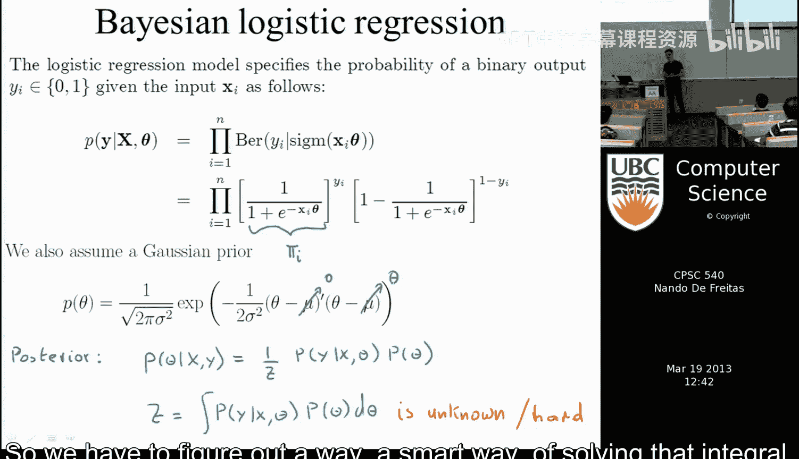

So this is the setup up for all Monte Carlo problems in Ba statistics。 You have a likelihood。

 you have a prior， You don't know that。And so where Monte Carlo always comes in is to give us an approximation of that。

Okay， or later on， as we will see， it will just give us。Without having to approximate it。

 it will allow us to approximate interesting properties of the posterior。

Which will allow us to do based in prediction， which is sort of an ensemble type prediction。Okay。

Questions at this point， because the next 10 slides。Are from。Extensions of this slide。

do we need to know Z we're just maximizing the posterior that's equivalent to maximizing the likelihood so I think we're not maximizing the posterior we is it when we're like integrating with the posterior。

 like finding the mean？Poster。What we're going to find is the whole posterior。

 what we're going to try to do is to do a histogram approximation of the posterior。

So instead of believe some when we。If you take， if you think about the negative log。Posteria。

The negative log。Beo theater。Given X and Y。嗯。And if you think of it in terms of optimizing in terms。

Will essentially give us a constant。Because Z does not depend on theta for these particular models。

 Z doesn't depend on theta， there are models in machine learning but that's not the case like Balsman machines restricted Balsmore machines。

 which some of you might have encountered before in deep learning。

 but in this case we're not concerned with those models， so Z is a constant。In terms of theta。

 Z is not a function of theta。And the reason why it doesn't depend on theta is because we're integrating our theta。

If we integrate our theta with just removing the effect of theta would by marginalization。

So we would get a constant， and then we would get the minus the negative log likelihood of P of y given x comma theta。

Mine knows。The log。Of B of theta。And so that's just a constant。Okay，The negative。

Log likelihood would just be minus。Just some。From mi equal 1 to n of。Essentially the cross entropy。

 Y I log。系啊。Plus1 minus Yi。Lg。1 minus pi I。And then， in addition。If the mean is0。

 we would have this regular isa。Which is minus1 over a two sigma。Squared。Normal theta squared。

That's if we just take the negative log likelihood of the posterior。 So as a function of theta。

 what we're saying is if we want to do logistic regression by optimizing。

 what we would do is we do gradient descent。On exactly that。That objective function。

If you just consider the crossenttropy as you did in your homework。

 you know how to compute a gradient of that， if you want to regularize the model by saying I want some of the thetaus to be small because I want the input to an neural network if they're not too influential。

 I want them to go to zero， in which case you would just add that theta squared。

 the parameter sigma in this case is essentially what lambda was when we discuss reach regression。

So essentially， by adding a Gaussian prioror， you're just adding a rich regularizer to logistic regression and the works。

 the same would work for neural networks。So嗯。When we sample from the posterior。

Do we we haven't done that that's what this class will be about at this point I'm just trying to make the connection of just making sure that you understand what is the prior here。

 why is the likelihood， why are we setting a prior that is a Gaussian prior and I'm trying to argue that the Gaussian prior makes sense because it's just saying that。

You want your feetus to be small， so you're putting a rich regularizer on your probe。

 and there's two ways to approach the problem。The way that we know so far is we would just do the gradient of that objective function。

The J of Theta。

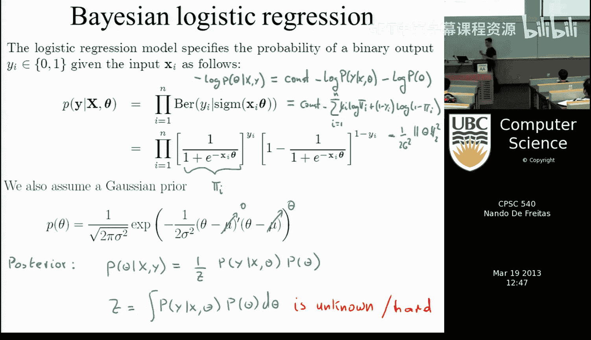

And then we just do gradient tocent and we find one single theta， one theta。

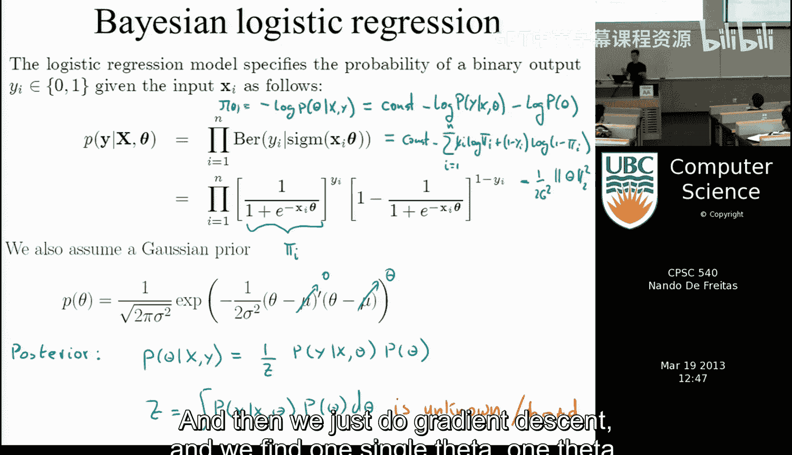

And thats the that we find at sourrans。The Bays will not believe in a single the。

 You will find many thes。 There's not going to be a single answer。 There's going to be many answers。

 It's just very much like when we do a forest， we take many， each tree is an answer。

 and then we combine them。 So this is going to be that way。Alright。

 so I'm going to proceed to move on to the sampling。

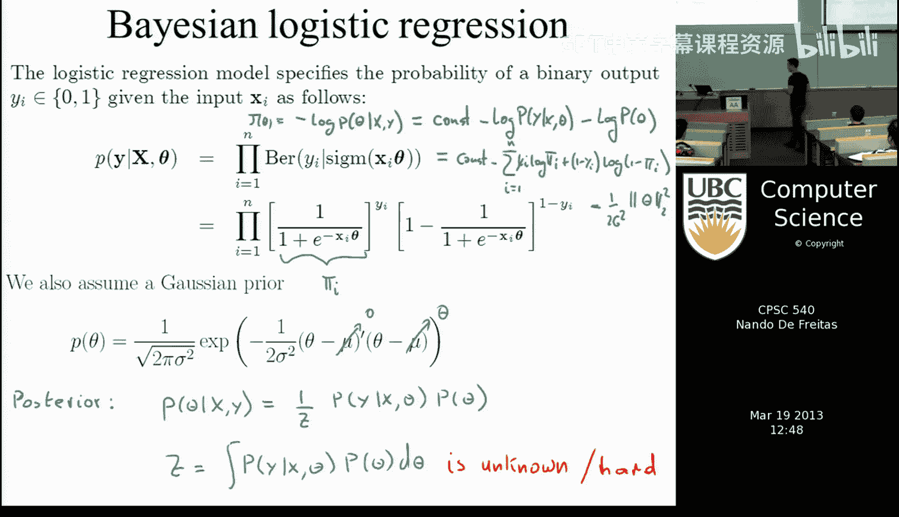

Okay。So key to this is the fact that we need to compute the normalization constant。

Which is the integral。Of the likelihood。Times the prior。The trick we're going to follow。

Is we're going to multiply。And divide。By a distribution queue of theta。对不起。

Now that distribution could be， for example，q of theta equal， I don't know。

 typically you want something with heavy tails， but let's just say that it's a Gaussian。

Which has a huge variance。Okay。So。This cube theta you get to choose。

As a user of a Monte Carlo method， you will design a queue of Theta。

 I will give you next some insights as to how to design this queue of theta。

 but for the time being assumed you can pick a queue of theta。Assuming that we have a queue of theta。

Then what we do next。I。We rename quantities here， this ratio here。We're gonna call W of Theta。

 now you can evaluate W of theta。Because cure theta is a Gaussian， so you can evaluate。

 given a theta， you can evaluate a Gaussian。

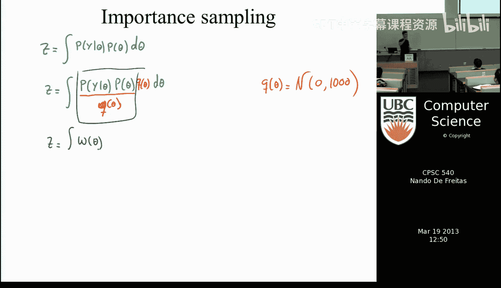

Moreover， the likelihood is Bulli so you can plug in a theta and get the value of the likelihood for that theta。

 and the prior is also a Gaussian， so you can plug in the and C。What value you get， what that ga。

 So we can evaluate W of the。

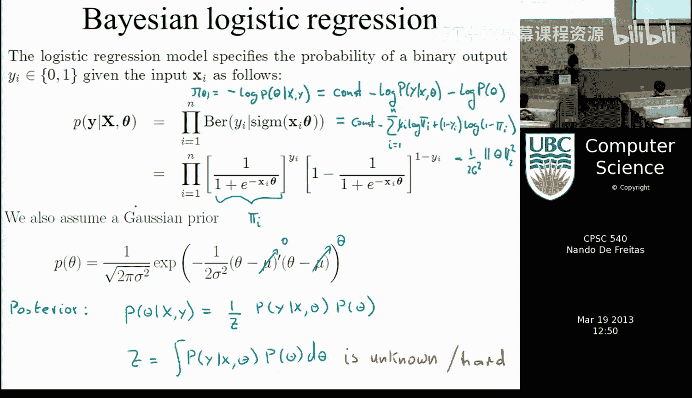

And that's an integral with respect to。Kill of the。Do you theta？

What we're going to do next is we're going to use our computer to draw samples。

So you go to your computer and you say， give me n capital n samples and let those samples be the zero mean and have a variance sigma squared of 1000。

So any computer program can generate samples from a Gaussian distribution。

 and we've seen before how we do that by using the cumulative of the Gaussian。So。In math。

 we just say we're drawing samples from Q of theta。For I equal 1 all the way to n。

Using Python notation。And so what I do next then is I replace。

An expectation with respect to Q of theta， because this is essentially is the expectation of w of theta with respect to a Q of theta by a sample average。

So we're used to flipping coins and using counts that is sample averages。

To estimate the expectation of the coining head。 here， we're going to do the other way around。

 We're going take an integral， and we're going to replace it by a sum。So in other words。

 I flipped this coin n times。A number of places。I'm replacing the expectation with a sample average。

And that's essentially what Monte Carlo is。In terms of solving integral。

Any sample average converges to an expectation， and that's just a consequence of the strong law of large numbers。

The law of large numbers just says you an average converges to an expectation is sort of a very classical result that is more than 100 years old。

And it's in Wikiped。Go ahead does a choice of distribution for Q affect anything with this method。

 Yes， it does indeed。 Some cubes will be very nice。 I cues will be be very bad。

 I'm going to come to tell you what would make a good cu。They're very soon。But for now。

 let's assume we do have a good queue。And if you do have a good queuee。

 let's just accept that we'll be fine。Okay， I have a few plots where I show different cues and that will allow us to see the effect of Q。

Okay。Let's look at this a bit more in detail。 What we're essentially doing is we're coming up with a bend approximation of the posterior。

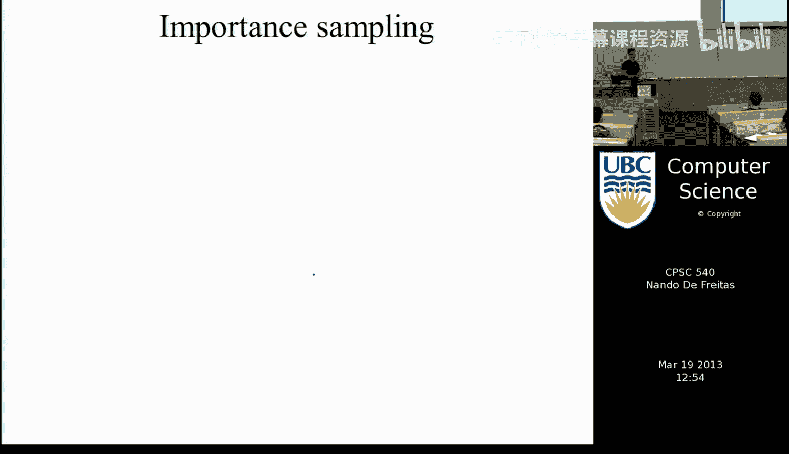

Let's putting this picture here。S session basin。嗯。An important sampling。We and here in 1 D。

 I can actually do numerical computation very precisely so I can actually compute a posterior。

 So what I did is I took some data。And then I did quadrupture in order to compute a posterior distribution。

 and I plot the posterior there， note that the posterior is not Gaussian。

 the right hand side is a bit higher than the left hand side。

And that's a consequence of the likelihood。Being a beernoulli likelihood， it's no longer。

The likelihood in logistic regression is not gassian。It's a product of granoolees。

 And it has that particular shape that is shown there。 If I was doing maximum likelihood。

The answer would be that theta at where the likelihood is maximum。So this is a optional of feature。

If I was doing。Now， let's say I'm doing。Maximma likelihood with a rage prior。

What would answer what would the answer be。こしてるよ。A number。就对。

Because essentially this is the posterior， the location of the maximum of the posterior。

That would be， which is say round two， that's going to be the estimate。In this case。

 I also generated the data from the model， so I know the true theta and the true theta is actually two。

Neither the maximum likelihood nor the posterior。Estimate， which we often call the theem map。

So this guy here， this value。This value over here is what we call the theta map。

Or maximum8 plus terriory。None of these two gave me the right theta。

 the true the that generated data， which was two。What would have to happen for these methods to converge to the true theta？

What is it that we know about maximum likelihood， when does maximum likelihood converge？

Let me rephrase this， why do we bother to do maximum likelihood？Why does maximum make sense？都我们。やし。

When the data Gaussian， but in logistic regression the data is binary and I argued and gave a homework asking he to compute the likelihood。

 so if the data is Gausian it works， but it works in other distributions。Someone had another。今度のる。7。

好的。Good samples。Infinite samples。Samples of what。Kept on the recomp。

Proteior like using the posterior。Exles of data， you mean。That was the result。

We have an exam coming up in two a week。Less than。Less than two weeks。

 make sure you revise your slides。The result for maximumim equity。

 the reason why we do maximum equity is because as z goes infinity，'s the datata cost infinity。

If I had a bigger data set， then that timeM L would concentrate on two。

But I have a five small data set。When you have a small data set。

 the best maximum likelihood answer is not。Necessarily the true mechanism that generated a date。

 I there's variance in this。It does put some probability in it。It's not done。

 Maxim likelihood saying there is some probability that this is the right value。

That whole distribution is really the likelihood of telling me how much each theta is worth。

As a solution to the problem。 And we usually pick the one that。

Ha the highest five would pick a single one。But it's obvious the data grows that maximum likelihood converges to the true solution。

Maximma likelihood also made sense because I argued that when you do maximum likelihood in different settings。

 it's equivalent to matching the statistics of the world with what you imagine that's another good reason to think of why you do maximum likelihood you're just trying to match the bottle。

To reality。The theta map。Takes into consideration。The likelihood。

 So it basically takes this guy here， which is the likelihood。It multiplies at times this guy。

 which is the prior。And that gives us the posterior。

 and then you just sum of all the area under the posterior to make sure that it sum to what。

 And that's how I compute the posterior。Now。As the proposal distribution。

 I decided to use an arbitrary distribution queue of theta。

And that's a distribution that I'm showing there with the dashed line。 just pick， you know。

 sort of a cube that is very flat。When I try to do Monte Carlo estimation。

 what I will be able to do is get an approximation of the posterior。

 that approximation will not be based on a single theta。

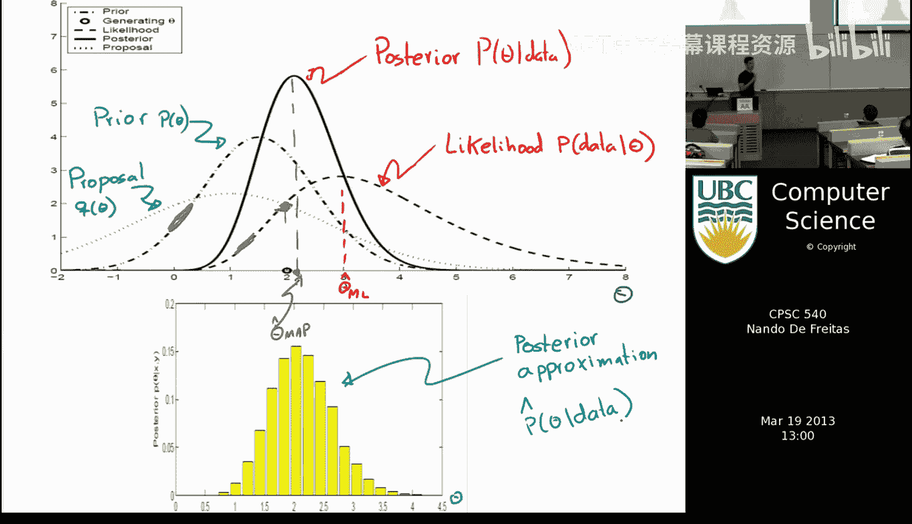

It will be actually a full histogram， as you can see here by these yellow box。

 it's a whole approximation to the posterior。 That's the basin solution。

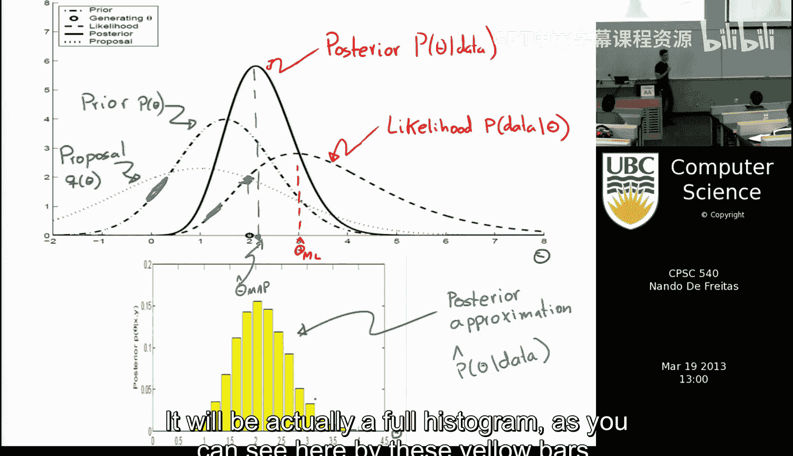

And why does it make sense， It makes sense， Because precisely， like in this example here the。

There is very little distinction between theta equal2 and theta equal3 in terms of the quality of the what they can offer you。

It's important to keep in mind that there is uncertainty。The posterior through its volume。

 through its various。I's keeping track that there isnt in your resume。

Now， how do I write， so essentially what I'm going after is that yellow histogram。

 which is the posterior distribution。How do I write down a histogram in math。

One way to do it is to do the following。I'm going to say that the posteral theta given the data。

Which in logistic regression are the x's and the Y's。Will be good to。First。

 I'm going to make this claim。There is going to be sum of1 over n， I equal 1。To and。嗯。The weight。

Theta I。And then I'm going to introduce a function that's the deelta function。

And what this function will do is it will count how many samples of theta fell in the interval D the。

So let's write that down， Delta theta I， D theta。Is equal to the。Number。Of samples。Cita eye。In the。

Interval。デテ。Now。The sort of picture。To have in mind here， let's assume that theta is one dimensional。

We have a posterior that looks like this， the posterior need not be Gaussian。

 it could be any distribution for the neural network。

 it's more likely that it will look like that than Gaussian。Even if the likelihood is Gaussian。

That's because。You have linearity， nonlinearity in the likelihood combined with the prioror gives rise to a non Gauss and posteria。

I'm going to now make a slide。Important。Concept precise what we mean by density and what we mean by distribution。

 What we mean by probability as opposed to the density function。

 I'm going to say that this curve P of theta。Given the data。Is what we call the density。

Or the probability density function。I'm going to next， consider the interval D theta。

So I'm going to pick an interval D theta。Who's with。Is indeed thetheta。This area here。

Is the probability？Pro is defined as the area under the density。If you have a Gaussian distribution。

And you look at the area under the first half of the calcium distribution。What is that area equal to？

A half， right？ So the probability of a Gaussian number being less than0 for a Gaussian that has mean  zero is a half。

 So probability is the area under the curve of the death。In other words。Probability。

 which we I'm going to write as D theta and now I will be a bit more precise and put a d theta because we measure probability on intervals。

 we measure the probability in areas that's why two weeks ago when I asked you to consider this experiment of darts where you were throwing darts and I ask you what's the probability that you're going to hit the dashed area。

 the square or the circle or the wiggly we always had to measure areas。

Because proing continuous spaces in the Euclidean spaces is assigned to areas。

 So it's assigned in this case， in1 D2 length to interval D the。And the probability。

Sort of using here a very loose approximation is essentially the height of the interval。

 which is P of theta。And I should condition all this on data， given data。Given地。Times day in triple。

来。So the area is the probability， the height is the density， the width is the length of the interval。

Which we also called the measure。Okay， so。What this now is doing is we say the probability is being approximated。

Bye。If these are the samples。What we're essentially doing is we're counting how many samples fall in each interval。

 and then the height is dictated by how many samples fall in each interval。

And that's how I compute those yellow bars Next， I just throw a bunch of samples and then I just do a histogram。

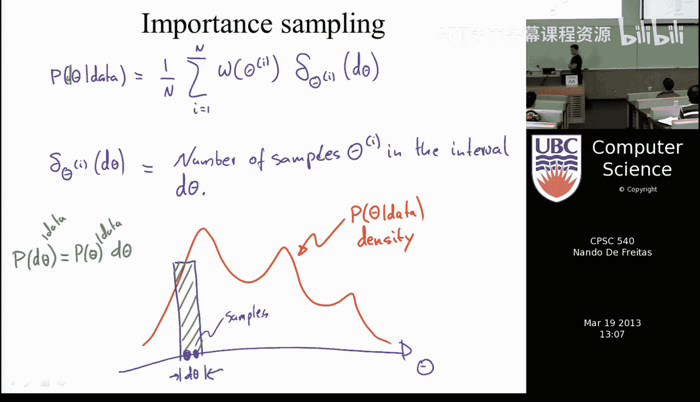

Of those samples， and that gives me an approximation of the posterior distribution。

 I'm just counting how many samples fall in each interval。

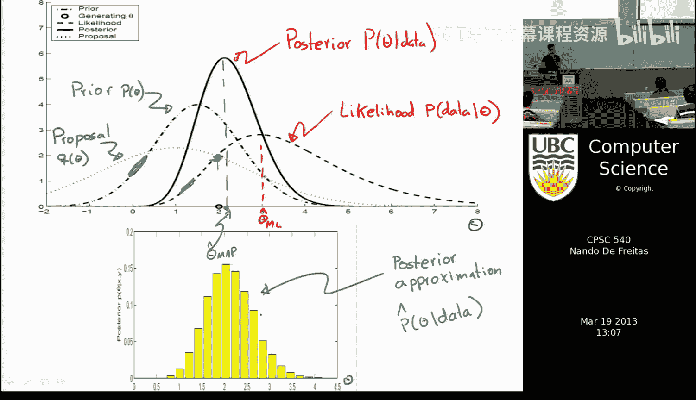

So I need to choose the interval。In doing this。

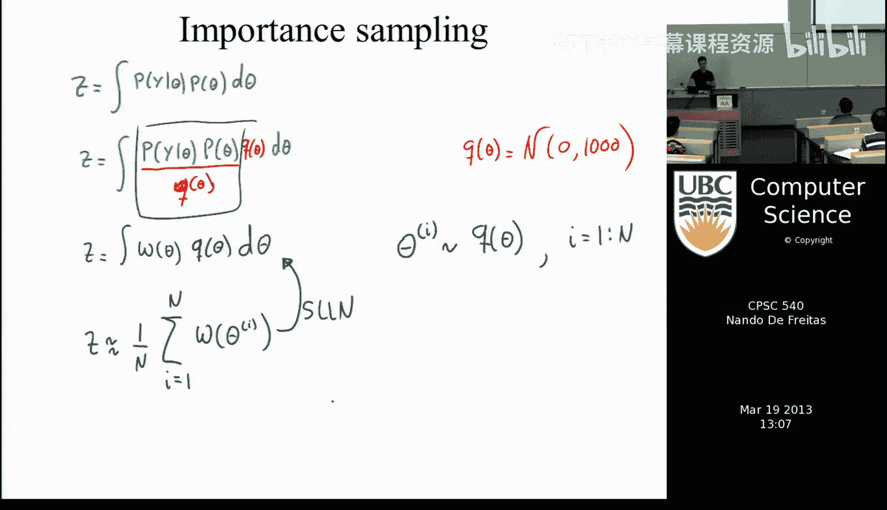

And that's sensor。How we approximate a distribution in Monte Car。Typically in high dimensions。

 we try not to do this because if I was trying to get an approximation of the posteri high dimensions。

 I would still need。In 2D， I would need a grid of n squared points。 And in 3D， I would need n cube。

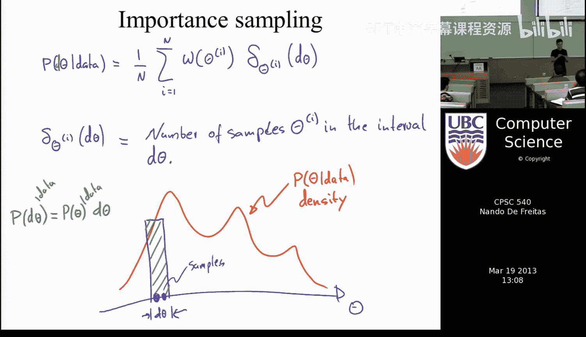

Discrretizations and in D dimensions that would need n to the power D。 So again。

Doing this is subject to the curse of dimensionality if what I'm interested in is in approximating the posterior distribution。

But most of the time we don't care actually about approximating a posterior distribution。

 what we care about is doing some prediction。So we will be able to beat the curse of dimensionality that way。

So we're not going to do this historytogram。

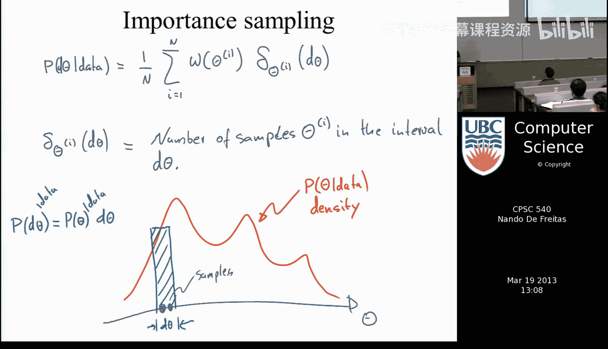

From who's done here， major theory of math。Undergrad math。So。

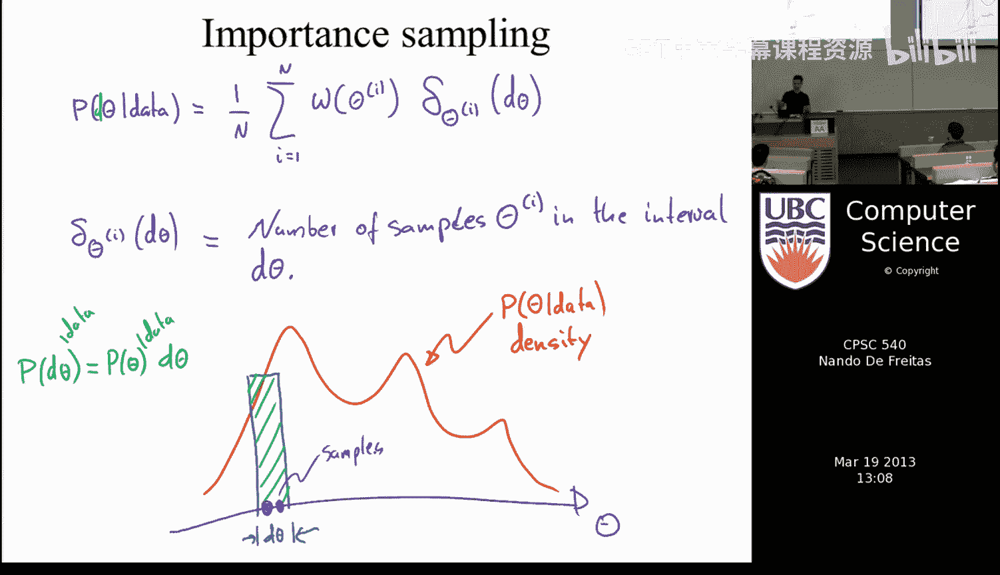

For you， this measure would be the Laic measure， so in probability。

 actually I'm treating these integrals as riman integrals。

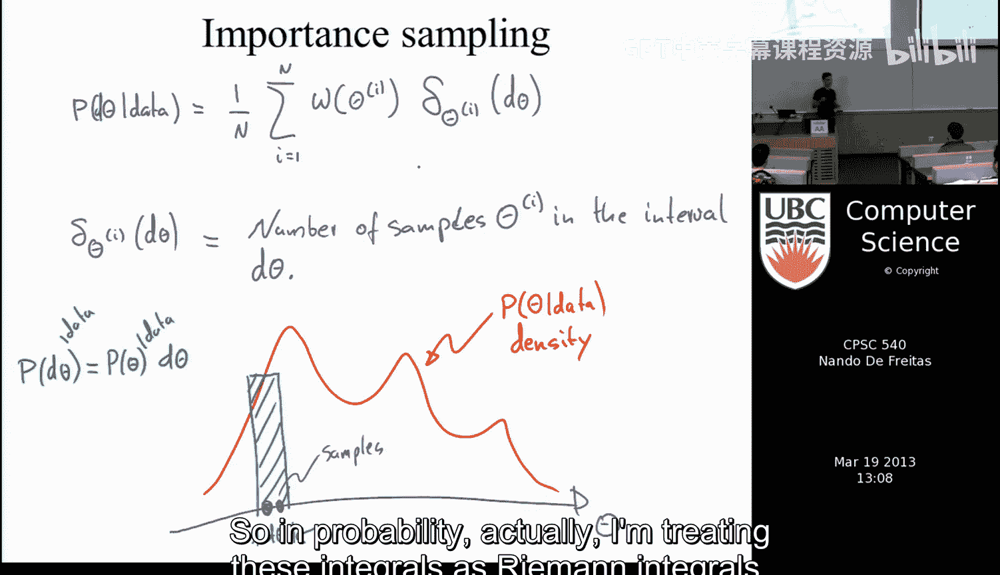

And for this class， it's okay， think of it as re integrals。

 like the sort of re integrals you learn in calculus。But this notation P theta happens quite often。

 it actually means something slightly different， it's called a Labe integral。And it's。

 it's kind of like the Ri integral except that instead of summing。What like this you're summing？

Oversets that involve Y intersections。 And there is a reason for that because you can easily construct functions for which the Ri integral actually doesn't converge。

 So the integral is not well defined。 whereas is the Lebe integral is well defined。

 but we're not going to go into those details。 So we're simply going to assume that。

We're in the Olidean space where everything is nice。哎。Practice in machine learning。

Your usual will be in the plealedan spaces。Or discretere spaces。Okay。

The other thing we can do then to beat the curse of dimensionality。

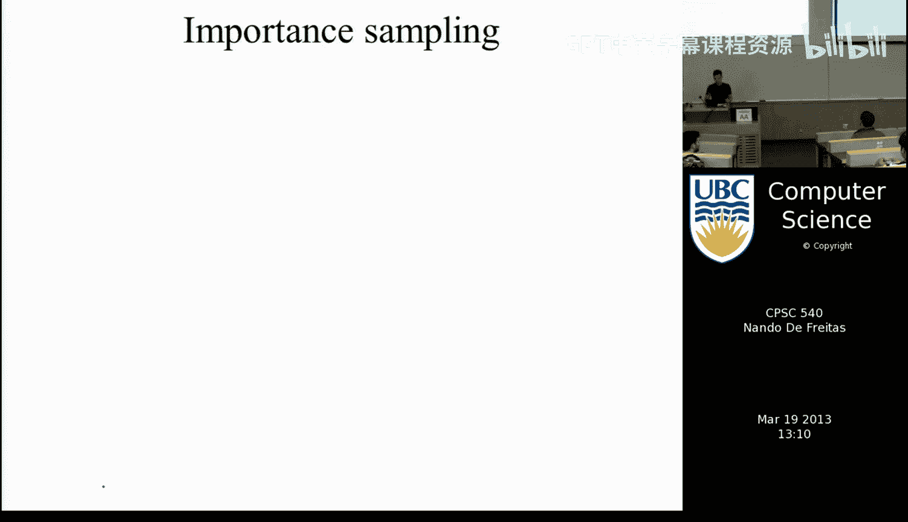

Is。嗯。Know that what we usually care is about making a new prediction。

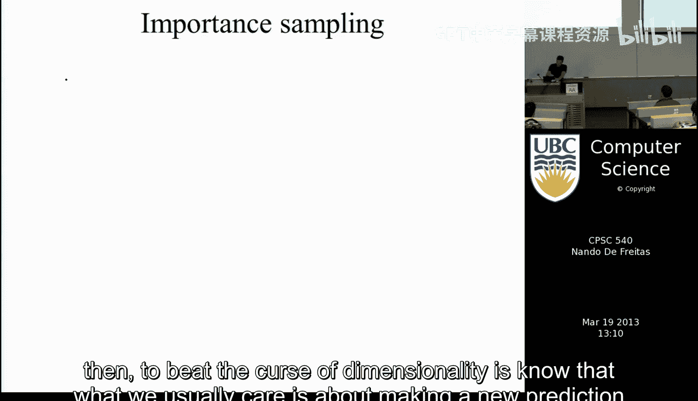

Given a new input。And given a data set， y1 to T and x1 to T。 So if you have。

T labels in your training set and T inputs in your training set。 given a new input T plus one。

 you want to make a prediction。In order to make a prediction， according to basines inference。

 we need to integrate out over all the possible values that the posterior could take。

 so that this becomes the integral。Of P of Yt plus1。Give an X tip plus one。Com a theater。

Time is the probability。Under the theta。Given x1 to T comma y12 T。

And that because of this relation we just learned。Is what we typically write as the density。

Times the measure。So when you're reading papers， you will often find that notation。

Or sometimes it's DP of theta when you come across an notation。

Be aware that the authors are just making precise what's the density， what's the probability。Now。嗯。

That essentially removes the effect of theta because Bayess don't like to the idea that there's a single theta。

 they want to integrate out over all the possible values that theta could take。

 so they want a weighted prediction。Now what I can do is I can write this as the integral of P of Y t plus1。

 I can approximate this。

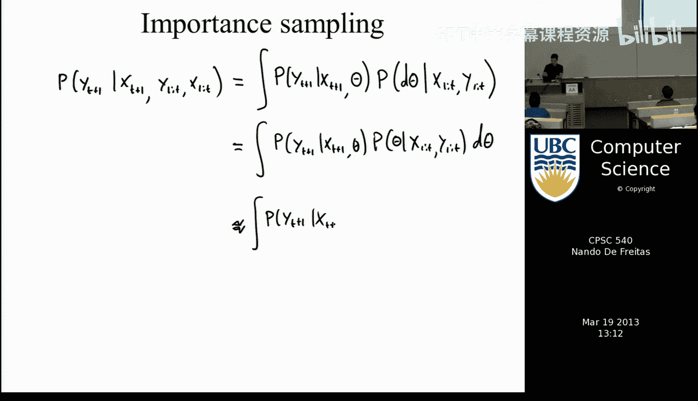

And to approximate this。

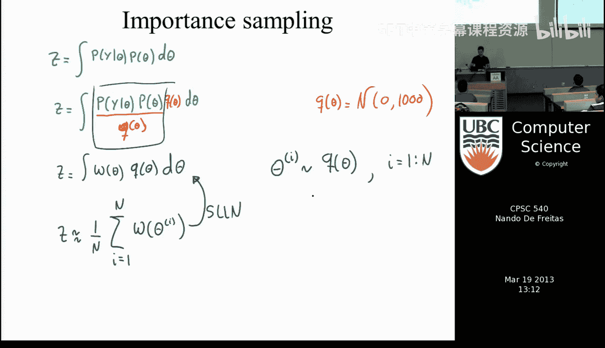

I'm going to use this。Histogram formula。Which is saying the probability that you will fall in an interval is the number of times you were in that interval weighted by the ratio。

Of you know， the likelihood times are divided by by Q。

 And the reason why you need to wait is because the samples are not coming from P。

 The samples are coming from this other distribution Q。 So you need to correct with that weight。

 The fact that your samples didn't come from P。Go ahead。Why is it that we dump'ed， mypo said。Oh。

 because we've actually estimated。

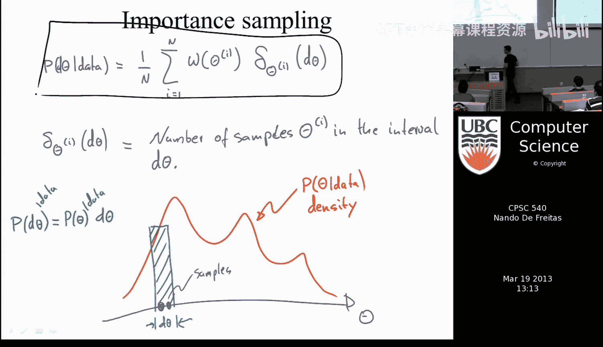

We've actually estimated Z。Vically。So。

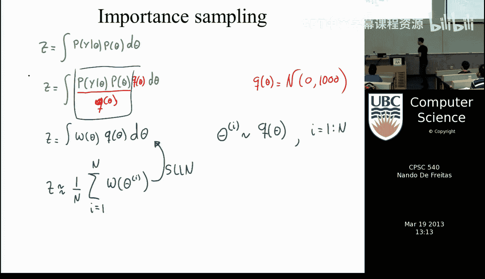

Here we've constructed it so that the weights。We've actually constructed so that it's appropriately normalized。

So we don't need to divide by that。will when I do normalize important something。

 I'm going to make this even a bit more clear。

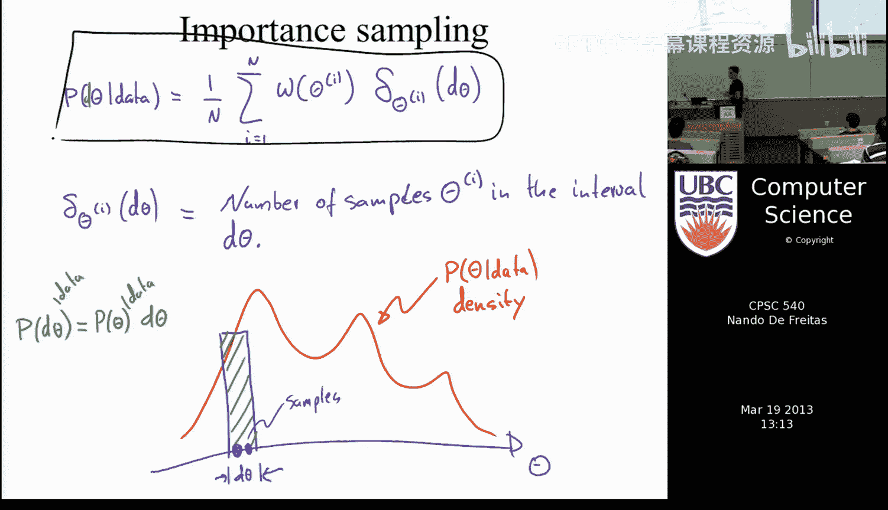

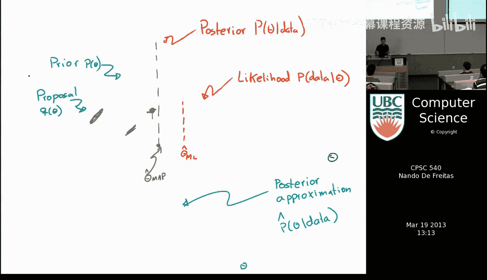

I'll come back to your question。In two lights。For now。

 let's assume that we have that histogram estimator。If you have that histogram estimator。

Then what we can do is we can replace it here。With the sum from micro1 to n。

And now I'm just going to replace。That expression that we had。And I'm going to do manipulation。

 and I'm going to take the1 over n outside integral。

 and I'm going to take the sum outside the integral。Okay。Now。

 what this integral is saying is sum of all theus。But only consider the interval the theta。

 So only look at the where So only look at this infinitesimal small sample， the theta。Now。

 when you integrate。Delta is essentially a direct measure。 It's essentially a spike at theta I。

 So if I'm multiplying a distribution that has whatever shape times a spike。

 I'm just going to basically be evaluating the distribution at a spike。 It sort of。

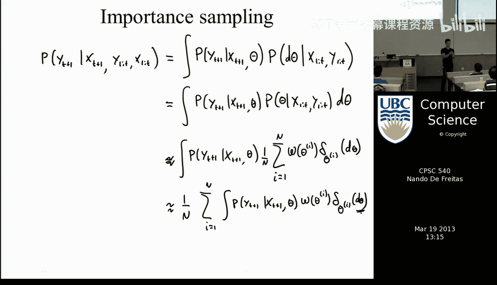

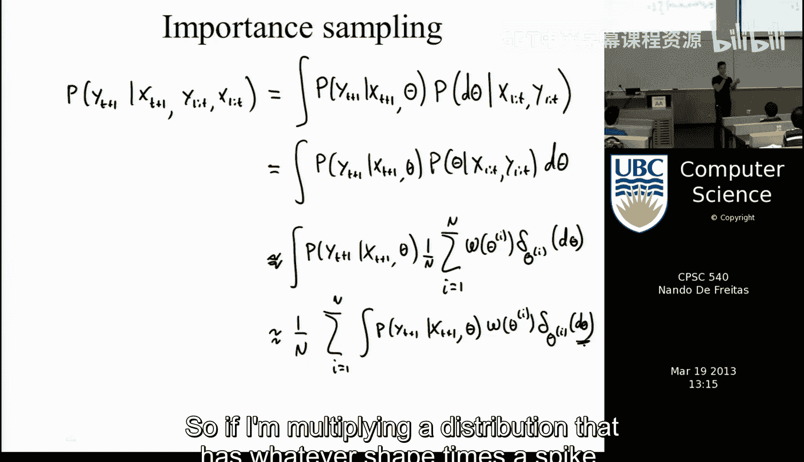

A result。That many of us have seen before and have studied before。

 and so this is essentially P of yt plus 1， given xt plus1 comma theta I。Times W or theta。

So in this case， I'm able to compute a predictive distribution。Which essentially is the likelihood。

 because this is nothing but the likelihood。But weighted by how probable it is， it's weighted by W。

So if example has high posterior probability， the contribution of the likelihood term will be high。

And that's essentially the basin solution， the basin solution take average of all the predictions。

The predictions are the likelihood weight and by W of feet。And for a baes。

 you don't predict a single value， you predict a distribution because when you have a distribution。

 you can， you know the variance， you know how likely each theta is。

 not just the one theta that you chose。And this in bioinformatics。

 it very important because if you're trying to fundamentally say make an observation about either a patient or a fact about biology。

 you don't want to just publish that fact without taking into consideration that you have a very flat distribution and you actually don't know what you're talking about。

That's what it boils down to。 you need to know the uncertainty when you're talking about any scientific fact。

 and that's what makes scientists scientists that we can actually make informed。

Arguments and decisions， so it's important bindinformatics to do this type of analysis。

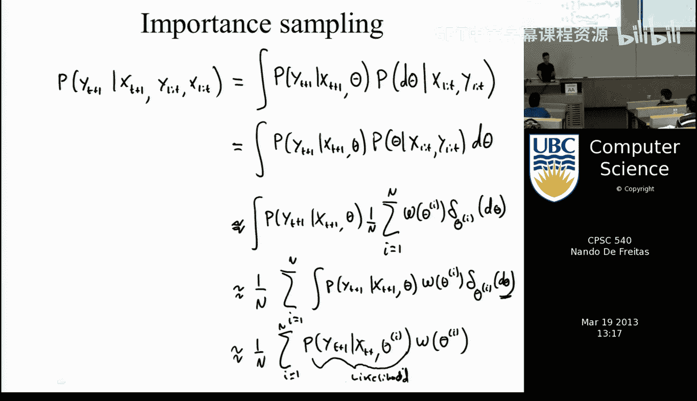

Now。

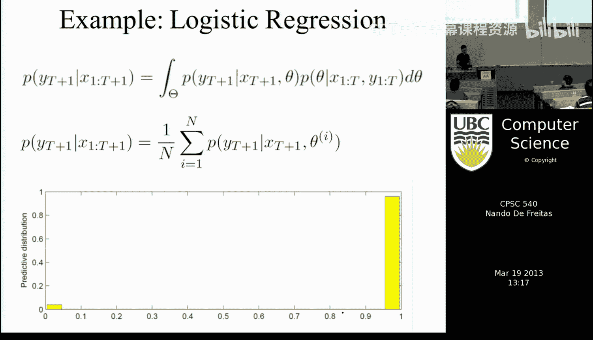

Coming back to the question that was asked before。Most of the time in basin inference。

 we don't know the normalization constant P of theta。And so in logistic regression。

 we actually have to do something slightly different。

I've now what I've been sort of cheatty up to now because。In。

In logistic regression we actually don't know the normalization constant so it's hard to approximate the posterior if I knew the normalization constant of the posterior。

 then I could have used the estimates that we had。So far， but in practice。

 what I have is I have my posterior density here theta given the data。

 I'm just going to use capital D for the data。Just to write less。And that's equal to one of a Z P。D。

 given theta， the likelihood times the prior say Gaussian。And so。

And that's also equal to p of D given theta times p of theta divided by the normalization constant。

 which is the integral of the numerator。So let's assume now that I want to compute any expectation。

The predictive distribution is just one expectation， it' the expectation of the likelihoodli。

Let's do a predictive distribution。P of y t plus1。Given x1 to T plus 1。Does the integral。off。

Fel of why。T plus1， given。And actually， why1 to T。I'm going to write it in yet a different way。

 which will。So the predictive distribution is what's the new Y given the new X and given the date that we had？

It doesn't use a theta because we're integrating over theta。And so that's going to be the likelihood。

Times the posterior。And then the posterior now is P of D given theta times P of theta。And in fact。

Z does not depend on theta， so I can take it out。Right。So now I can rewrite this。

As the integral of P of Y T plus 1。Give an X T plus one comma theta。Times P of D given theta。

 times P of theta。And I'm going to divide。And multiply by Q of theta。

 so I haven't done anything when I do that。And then since Z was taking out。

 I'm going to now expand Zed。And that is just the integral of P。第一。theta， that P of theta。て。

And in fact， I'm going to do one more thing in this line。

Which is I'm going to do the same trick as I did above。Multiply and divide by Q of the。Okay。

So in other words。This whole thing is equal to the integral of p of Yt plus 1， given xt plus1。

Com a theatre。Times W of theta。I'm S of，Theeaer， divided by。The integral of W of theta。Times。

 cure of teacher。Reit。This derivation right now is the most important derivation important something。

 for basic statistics， this is the one you need to know。 This is the most important page。Because in。

In Bayesing sum， a normalized， important sampling is used a lot in saying graphics and so on。

 but in statistics， you never know the Z。So what we're going to be doing is we're going to be approximating two integrals at the same time。

We're approximating the integral for z of theta， and if we're doing the predictive distribution。

 there's also an integral over the posterior on and so we actually are approximating the ratio of two integrals at the same time。

And then what we do is we apply Monte Carlo to each of them。

So we're going to apply Monte Carlo to the top。And we're going to replace that by the sample average。

And we're going to apply Monte Carlo at the bottom as well。Are were going to use the sample average。

And that's it， because that was our estimate of QP。

So we're just replacing the two expectations with respect to Q of theta with sample averages when the samples are coming from the distribution queue of theta。

Okay。And this， we can simplify a little bit more。

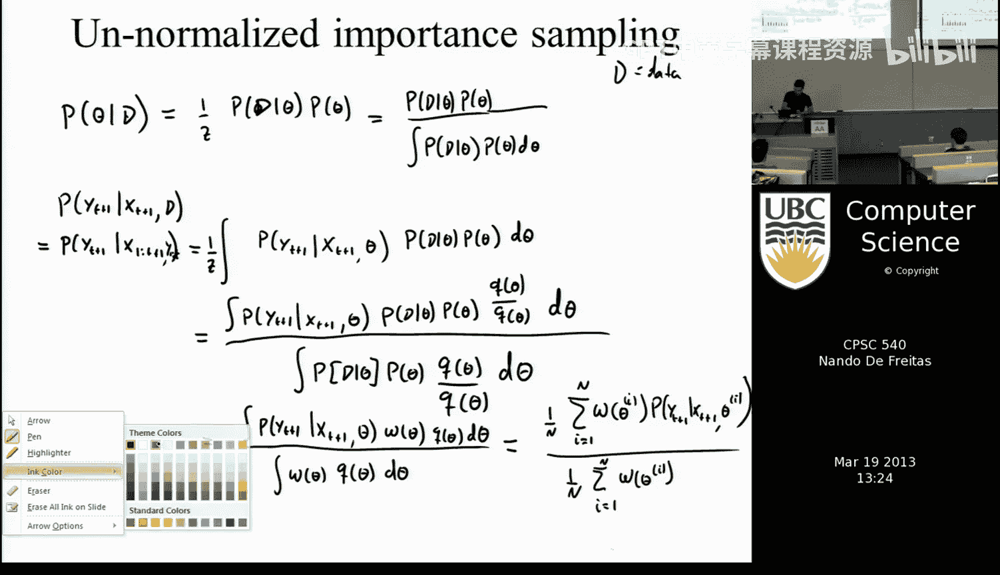

Now get rid of the one over。And， in fact， and now this sort of will answer the question that was asked before。

嗯。The guy that enumerated the sum of the W of feet eyes is essentially。

We can change index here because the index is just an arbitrary index in the sum。So we can use J。

And so since the W at the bottom and the top is the same。

 what we're actually doing is normalizing the weights so that they's sum to one。

So that we have a perfectly weighted。Prediction with respect to an empirical distribution。

And so we typically write this as the sum from Michael 1 to n。W。 Tilda。Where W till the。

It's essentially。W tillil the I is just essentially WI divided by the sum of a J of the Wjs。

W Tilde or theta I。Times PO Yt plus1。G an X T plus one。Commo theta。So in this case， it's clear。Where。

诶。Was essentially Zed has disappeared， Zed has disappeared because I'm ensuring that my histogram。

My posteriia in this case。I'm replacing my posterior by these bins。Of whats the theta。

But I'm ensuring。hos。I'm ensuring that each height， so this would be， say， W。1，W，2， and so on。

I'm ensuring that the sum of these ws sums to one。 So this histogram has area  one。

 so it's a valid probability distribution。If you have a history， it's a discrete quantity。

 all you have is discrete， all you have to do is divide all the heights。

Quite the sum of the height and you get something that sums to1。 Does that make sense。

And that is normalized important something。 And you could use this to do logistic regression for5。

10 parameters。And if you have models in bioinformatics where you only have a few free parameters。

 So if you have six， five parameters， this is a reasonable technique to try out。

Provided that you have the right queue。Now， what would be a bad cue。

Can anyone think of an example of a bad queuee。A uniform distribution， your theta。在。

They could go on forever。That's correct， so hes realized an important fact。

 if my cu is say uniforms are between zero and1， it can only propose thes between zero and1。

And if my true theta happens to be two， I will never propose a theta。

So the proposal distribution must include the support of the posterior。

Where the posterior has positive probability， then Q must have positive probability。Another thing is。

 so all these estimators do converge to the truth as the number of samples goes to infinity。

 they're unbiased as N goes infinity， even the normalized one as N goes infinity， but however。

 they do have high variance。 so there was this bias variance straight of。

 they'll give it the right answer， but they'll sort of be oscillating about the right answer。

And we'll take a long time before we can quench those oscillations by having a better queue withre essentially quenching those oscillations quick。

One of the things we can do in practice if you're using a Qor dys Gaussian。you could， for example。

 choose a queue。That has mean， let's say， a scalar mu。

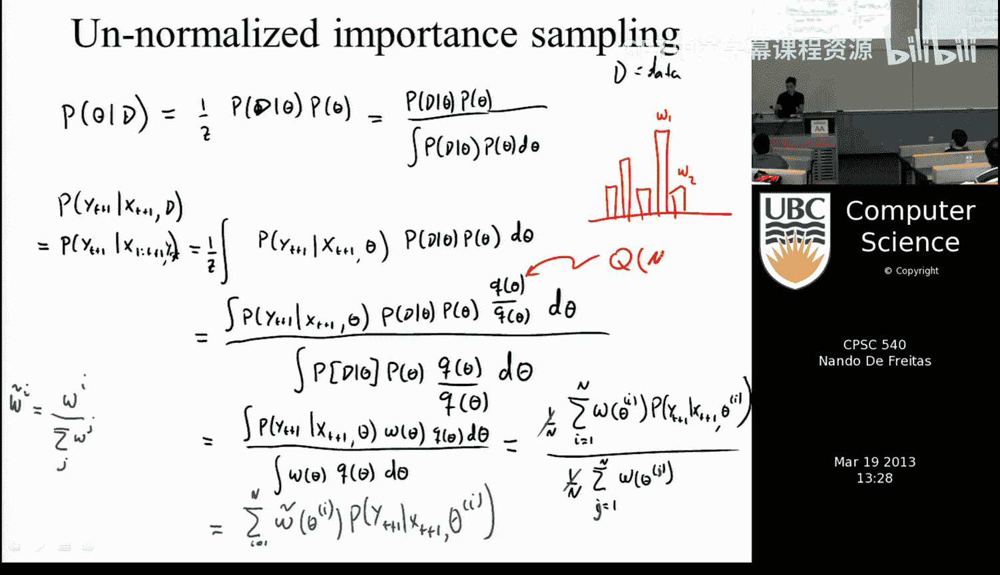

And then maybe sigma squared or a vector U。

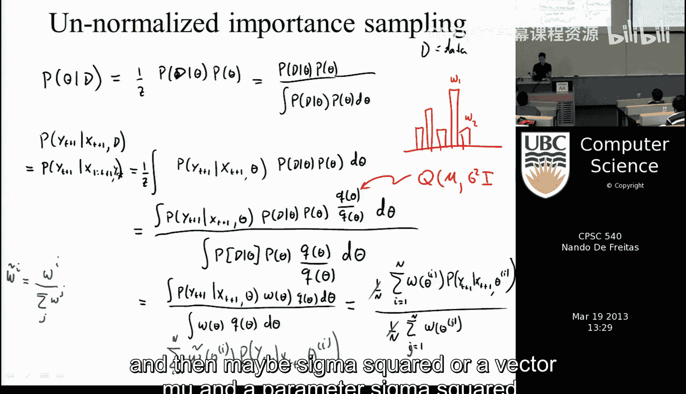

A parameter sigma squared。Let's assume that you're doing this in 10 dimensions。

What would be a way of optimizing those parameters？Mio and sigma。差多先。Ba in optimization。

 now someone else， what could be an objective function？

What would you be trying to minimize in order to estimate mu and sigma。This is a harder question。

Is it the difference between the posterior。You。So that's a good reasonable strategy。

 you would want to sort of make your cu be very close to the posterior。

 the closer the Q is to the posterior， the better chance you have of approximating the posterior。

 the catch there is you don't know the posterior。That's the quantity we're trying to estimate in the first place。

But you could try to estimate select the do maximum likelihood to figure out what the peak of。

 you know just optimization to figure out what the peak of the posterior is。

 and then you could try to fit the Gaussian there and then you would use that queue。

 some folks do that。

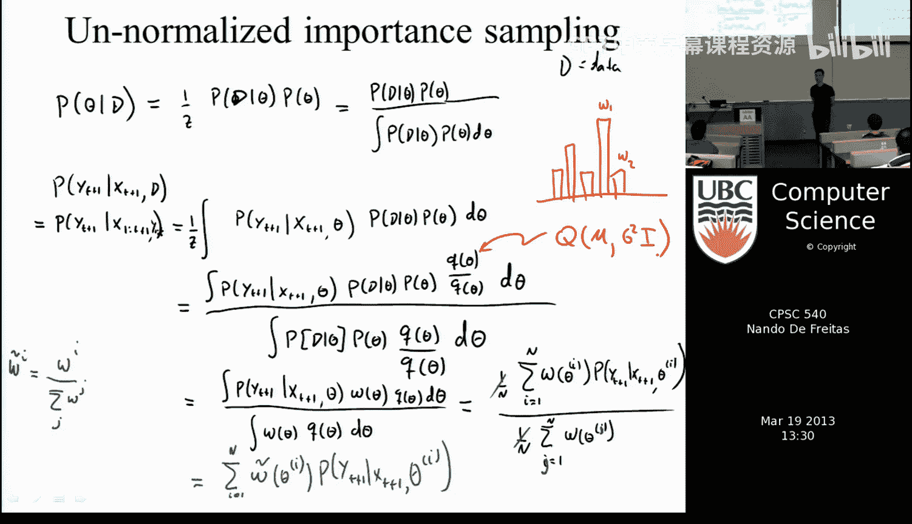

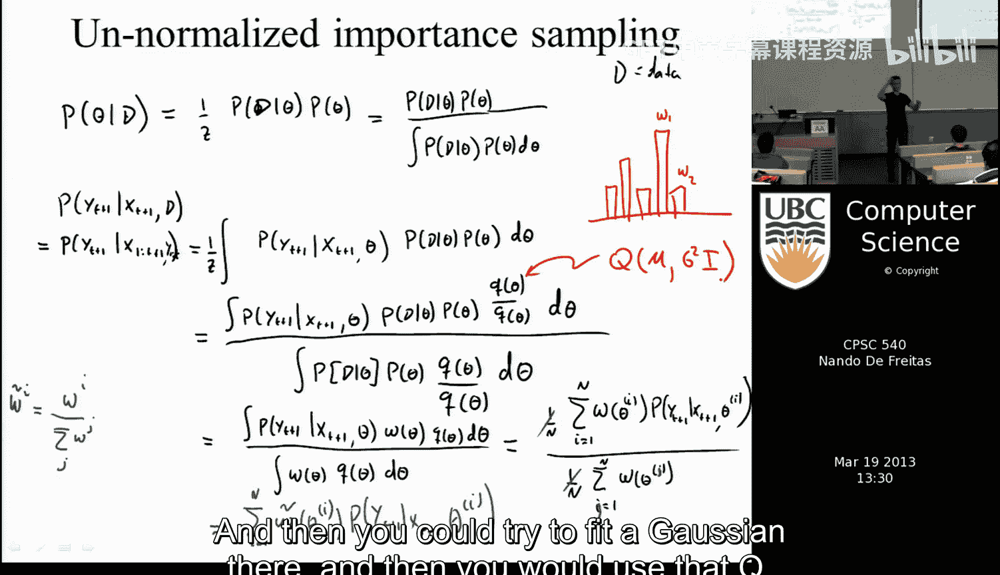

It seemss a good choice for a cute mean it's good to see。If your prime is good， if your p is good。

How do we test someone else？ How do we test if we have the right model。

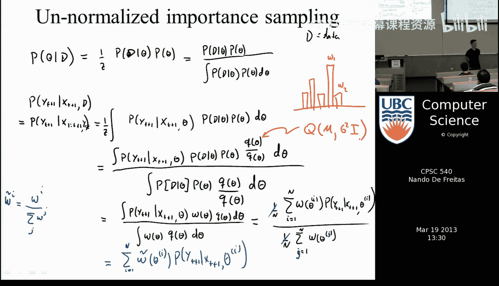

When you're doing retro regression， how do do we know that we have the right model。

 the right complexity， lambda？

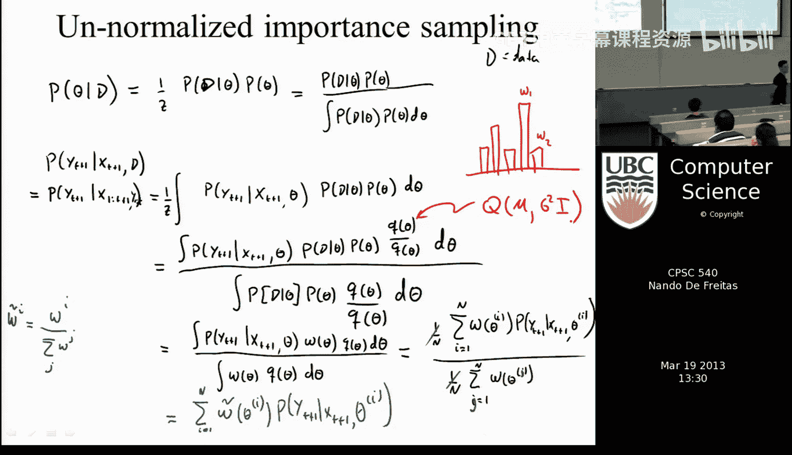

The right regular rise。Frost validation。Right。So if we have test data。

 we're still doing logistic regression here。 don't forget we're doing logistic regression。

P of D given theta is just a product of a bunch of Bnooleles， P of theta a Gas。

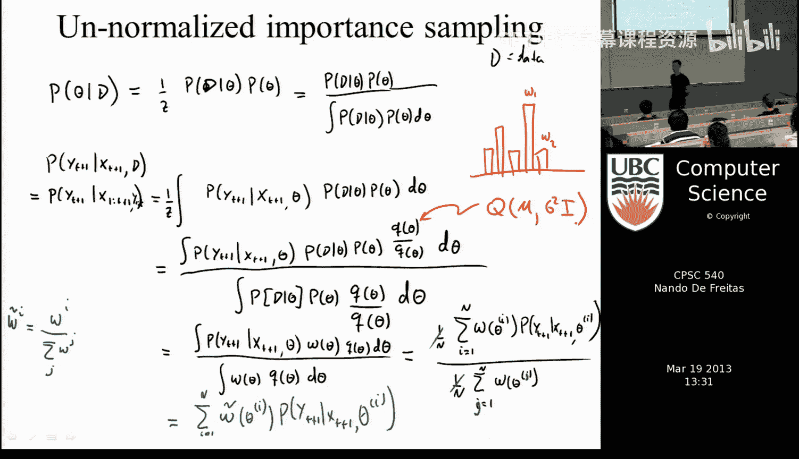

And you have a training data， and what you're trying to do is make good predictions。Now。

 if you have an extra data set and maybe here you want one for testing and when you want one for validation。

 you keep this extra data set that you use to just tune mu and Sigma square。

 so you adjust mu and Sigma square so that your predictive distribution works well on this extra data set。

So to cross holiday， that's one reasonable way to do this when you have a model that's。

Where you're trying to get prediction。That's sort of a simple thing to do。

 and most often in machine learning， what we care is about predicting。

 so never forget about cross validation， your biggest friend。In the world of prediction。

 because that's how you when you don't know what something should be。

 you create a test data set and you make sure that you can predict on。That they just said。So。

 that should。like given a picture。Comput time， find the best new in sigma because I feel like for having new sigma。

 you could pick an a and that was。Large enough that itt work。Oh yeah yeah。

 if you have infinite computation and so on and even some sigma that's not as good would work。

 there's another thing you can do and that I haven't covered here。

 for those of you who want a bit more sort of material I wrote a tutorial a few years ago called an introduction to MCMC for machine learninging。

嗯。I recommend you have a look at that for more details on import sampling。

But one of the things we can also do。只需要。fun dining。

So one of the things we can do is we can actually。Computer expression for the variouss of the Monteco。

 thus I describe that in my tutorial。And since what we tried to do is minimize barriers。

You can actually adjust using patient optimization or gradients you can adjust mu and sigma to minimize the variance of the Montecarway。

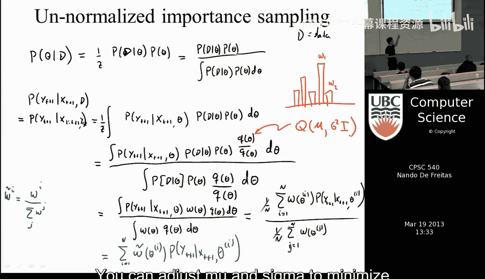

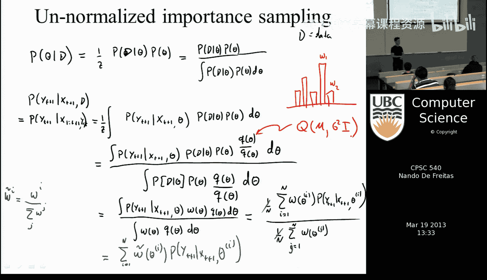

Okay， so there's lots of cool things you can do in order to get a better queue。Use your data。

 use cross validation， or use some。Something you know about the problem。

 if you know it has high failures， then your objective is to minimize varies。

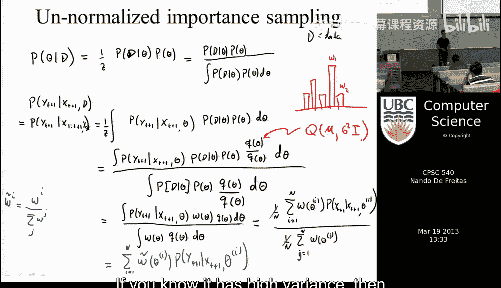

And typically what people do for Qes is they just pick one that's heavy tail to make sure that whatever P is positive that Q is。

So a T distribution， for example， works well。

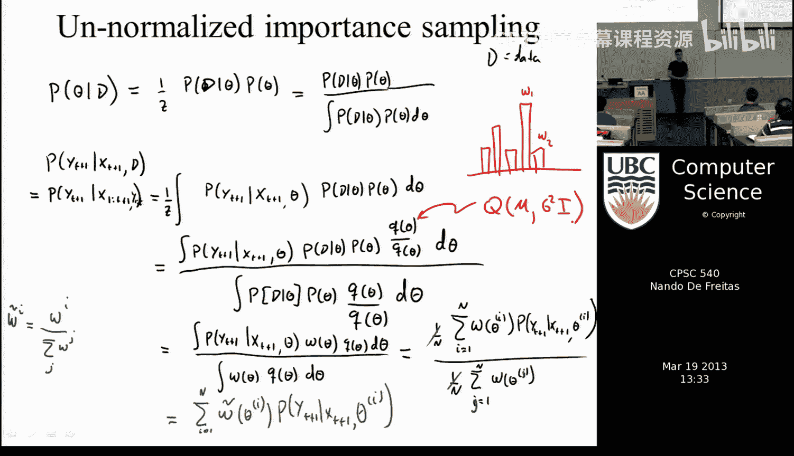

But like an important sampling is one of those techniques that only works。电脑大咩。

So if you're know up to six dimensions， this can work quite well if you're interested in doing tracking like image tracking or if you want to work for radar。

Defense or trying to estimate the volatility of a market。If you're working in finance。

 then important sampling is sort of one of the key techniques that is used there。

And often it's done implemented in a sequential setting。

 and when you implement important something a sequential setting。

 the algorithm was known as a particle filter or a sequential importance some。

So this is sort of very useful。What near did that site？

I could go in that direction now and basically teach you how to estimate volatilities in markets and so on。

 but instead I'm going to stick with more machine learning type topics and we're going to move on to study a technique that will work better will allow us to attack data show。

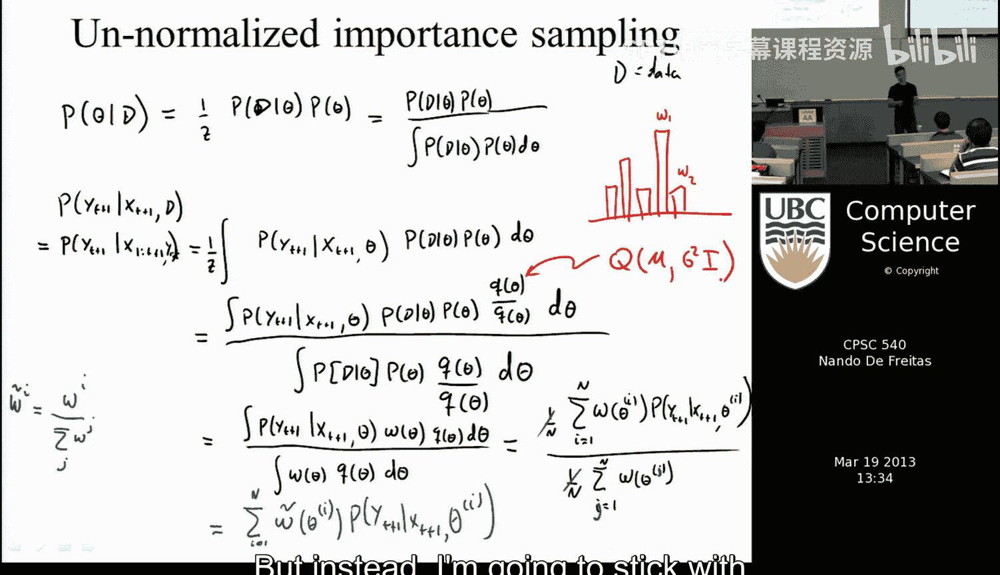

Something well in high dimensions。And intuitively， the reason why important sampling fails is because important to Q has to have enough support everywhere with the posterior。

ItHa this high。When the procedure has a high value， you want the Q to have a high value there。

But beforehand， before you know what the posterior is。If you are in a thousand dimensions。

 basically your challenges， you want to make everywhere in 1 thousand dimensions have high probability。

And1 thousand emissions is a vast space。Huge， and so you don't have enough probability mass and you give to。

Be able to provide enough support for the posterior everywhere before you know where the important parts of the posterior are。

 and so the technique fails。啊。The alternative we're going to learn about now and in the next lecture is Mark of Chaman De Carlo。

 and it will be a much smarter way of actually navigating that high dimensional space so that you can actually estimate a parameter。

And that will allow us to attack neural networks， so if you have a neural network with thousands of parameters。

 we will be able to use Monte Carlo to compute a posterior distribution to such an end。

The consequence of that is that the estimates， the ensemble estimates。

 will tend to be a lot more accurate than the maximum likelihood estimates。And in addition。

 well know the full posterior， so we will know the confidence we will know。

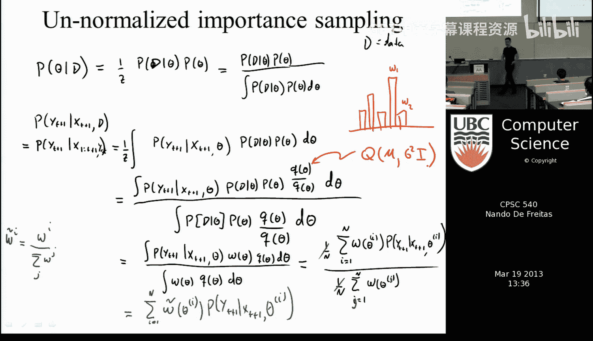

A lot of things about it。What does themalized refer to， what's unized？

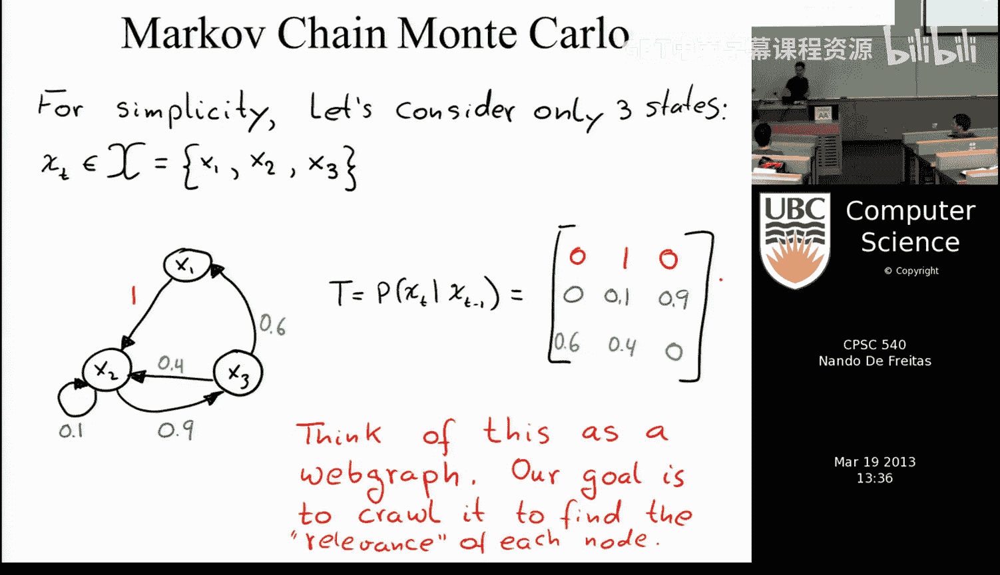

Oh， the are normalized refers to this guy。The posteriors are normalized in the sense that we don't know that。

If we knew how to compute that， if we knew how to compute that integral。诶 by hand。

Then this wouldn't be so challenging。

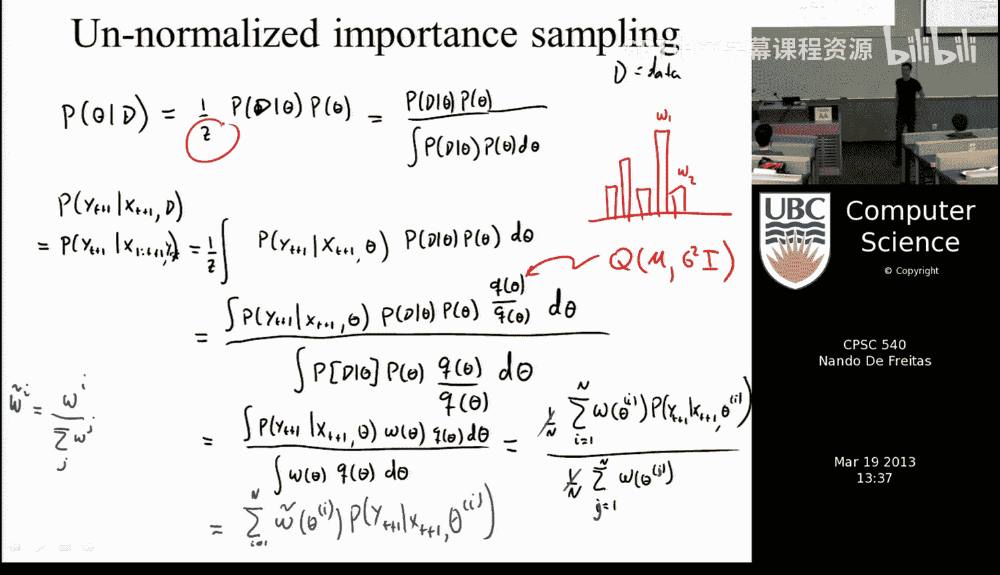

There are cases when you know the normalization concept then you still want it to import something the way we did before in these slides。

 and that's sort of important say in engineering communications。

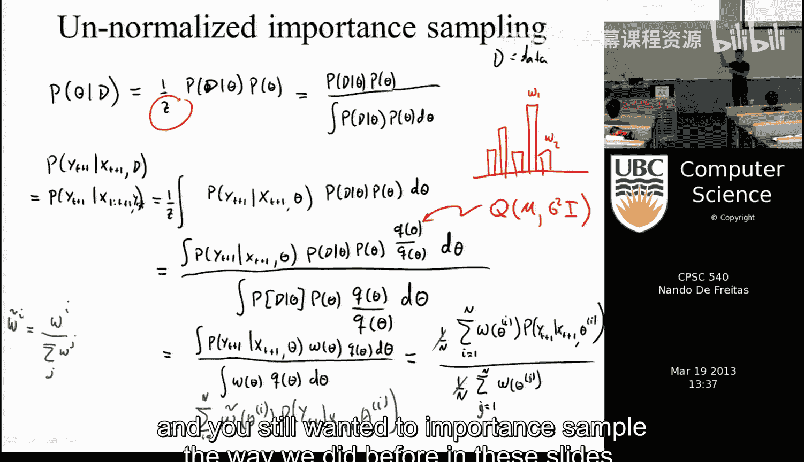

い例夫ですあの。You know， like estimating the error rate and channels and so on。

 there's a few problems out there。You also computer graphics if you want to simulate light in a room where you do important sampling and where you know that I was。

But in learning and statistics typically。The real challenge is we don't have the normalization cost。

We can write the likelihood， we can write a prior， but we can't write。

They aim integral up the likelihood times the f。But this trick gets around will allow us to solve this problem。

MCMC will be just another trick to get rid of Z。That will allow us to compute。

Also a sample average approximation。

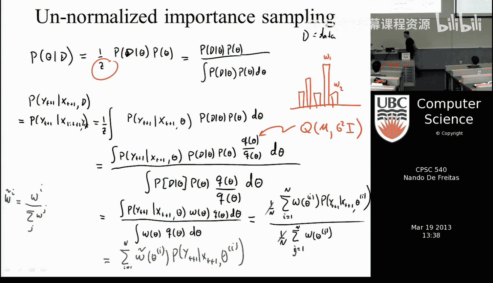

Now， MCMC is based on a conceptC。The first MC C。This like a TJ I think now the first MC is Markov chainin。

 the second MC is Monte Car， Monte Carlo basically means approximate an integral by As SA by an empirical。

Now the markov chain will be the mechanism by which we're going to generate the samples。

Instead of using this proposal distribution queue and reweighting。

What we're going to do is we're simply going to start navigating the space。

And we're going to navigate the space using a Markov chain。Now， what's the mark of change？

The best way to introduce micro chainins is to use one example that we all familiar with， which is。

The外。But let's now think of a web that has three pages。

Page1， page two， page three。And let's just say that page one points to page two， so has a link。

And in this case。Buton to be quite the web。Even though what I'm about to describe is the algorithm that Google uses to write web pages。

啊。X 3 points to x1。point six of the time。And so。Now I've constructed， I've normalized。

These so that when you add。All the entries for one。B of this matrix， you get one。

So the way you think of this is think of this as x1， x2， x。X one。It's still x3。

What we're saying is that x1。Goes to x2。With probability one， and it never goes to itself。

 so x1 to x1 that never happens。And AC1 to x3 doesn't pop with the matrix。

We're describing how we transition from the previous。法6。Of the previous state。

 there is the previous page to the next page。And we're going to assume that the way we transition from one page to another page is probabilistic。

On the web， what you do is you go to a website。You look at all the outs of that website and then you flip a coin。

If there were two outs。To my web page and one out link to his web page。

 you flip a coin and with probability two third， you come to my page， well go to 13。

And that's pretty much what Google's patronron algorithm。A mark of chain is such that。

The comment page where you are。The probability that you are at the specific page。

Only depends on which page you were before。So if I know that I'm on page two。

The probability that I'm going to be at page。3 max is 0。9。I don't need to know what the past was。

 I can just read it off that graph。So Markov essentially doesnt have a Markov process doesn't have memory beyond just immediate past。

To know the value at Xt， I just need to know the value at Xt minus1。

Now there is a property that I teach in 340 and this I think is lecture 11 in my 340 class and you can actually go over the proof there。

 it's a very simple application of linear algebra， which shows that if the graph has some properties。

 which I will soon make clear。Then if you take any vector， who entry some to one。

And you multiply by that matrix transition matrix。

即。

So T is as a transition matrix， ultimately you transition from one state to the next。

If you take that matrix to some power。And if that power goes infinity， in other words， equivalently。

 you start， you have an initial distribution。That's the vector mu。

 you keep multiplying out by the matrix D。Forever， and then you will converse to a single fact。

And regardless of what that new is， it doesn't matter what it is， whether it's 01。

10 or whatever vector you have， provided with sum sum to1。

 it will always conversege to the same vector pi。On the web， that vector is the page rack。

 it's the importance of each page。The 340 people are asked to implement this algorithm。

 but that's essentially what it is， it's just matrix spec。

啊。The properties that it needs to have is that。The graph has to be connected。

 so each node has to be connected to each other node。

 so in other words it means that the graph has to be irreducible to subgraphs。

And we call that property irreducibility。The reason。Being that if you have two separate graphs。

 then if you're randomizing traveling in one graph， you will never be able to visit the other graph。

And randomizing， by the way， flipping。我俾嘅。Going to the summer， you go next， going there and。Thankけ。

such a trajectory， it's the same as doing matrix vector multiplication but。Randdom wisely。

The other property you don't want the graph to have is cycles。

So cycles are bad because as this picture illustrates here for this particular transition matrix。

If because it's。It's got this cyclical behavior if right x2， you go to x1 if you go X1， you go to x2。

 then when you multiply any factor， let's say pi for 1 third2 third times to that T。

 all it does it swaps the positionss of the third to2 third。So that vector never converges。

That's what it's oscillate。How can we get rid of ourellash， What's an easy trick。なな。

Add is fall constant to all the。V newss in both transition。Right， so you could add a small constant。

嗯。So you could make this。In other words， Epsilon， maybe make this one minus epson。

 this epon this one minus epsilon， and that's equivalent to just essentially adding a self link。

So provided that you added。Provided that you simply add one self link so that the node either stays or goes next。

 when you go to x2， you have to flip a coin， the moment you're flipping a coin you're breaking a cycle。

Because it's going to be random now， you no longer get trapped in a cycle， that solves the problem。

So the Google guys， essentially what they do is they first they construct a matrix and it's extremely sparse matrix。

 mostly zeros with ones indicating the link where you're going to go。

 and then they are just a small epsilon to every entry。To ensure that。

One that the graph is fully connected， so it's irreducible and two to ensure that it's a periodic。

And once they have that matrix， the race is just matrix vector multiplication。

 except you do it in a smart way。And that's how。Google writes results for you。

There's a few other characteristics that go into Linuxux。

 but thats the key important thing is indeed to this day pagerackck。

There's a very nice package for building a search engine you know Apache has free software。

 so you can download the scene and solar， this is software that's available to all of you and you can easily build a search engine using that software。

あたです。You know， k index。age sorry。Except there's little reason to build the search engine these days as big you can tell。

All right， so let's assume that。So the consequence that you take an effect you multiply by t and eventually will convert to a pi is that once you're in the limit。

 if you have a distribution pi and you multiply by this matrix T， you'll still get pi。

Another way to say this is that。You have an einfactory question。

Well you essentially saying that one is the eigenvalue of the。I get back to regression。

 Ax equal lambda x， except that here ASD and axis is five。

So why is the probability factor indicating the probability of each？

P andT is just to matrix telling how you position from one to the other。

And this is also saying that the page rank the value for page according to Google is essentially the aen factor of the web。

Mattriance vector multiplplication component wise， if you have three pages。

So if you had a vector that was like this， by one by two。3。

And you0 transition matrix it was 3 by three， just like in our example。We three nodes in a graph。

Then we can eitherw write things in vector notation where you have the vector pi transpose being。

By one， by two。3。Such that the sum of the is equal to one。嗰铁板。And in the container。50。

That matrix spectrum multiplication。So your vector pi。

Instead of just being over a few discrete values， becomes think of it over bins。

 over an infinite number of bins。So your vector becomes a function。Just like housing processes。

 we're now considering a factor with many many entries and eventually becomes a function。

And your transition kernel。Which is just the probability of。

One value given the previous value is just a conditional probability P or Y given A。So。

This property of Google Patarch that you take back to your multi byte transition matrix in you eventually convert to vector。

It's the same。As this property， which is a essentially marginalization。So in other words。

 if you marginalize。We start with that initial distribution。

 we marginalized with respect to some translationization matrix P of Y given x。

You'll eventually converge to a distribution PY。Now。

Where we do with Markov Che Montete Carlos we use all these facts that apply to Markov chains。

But we're going to flip the problem completely the opposite way。😔。

What we're going to do is we're going to assume that we have pi。

And we will try to construct a T that will give us samples from the pi。So in other words。

 we can imagine we know the page rank of each web page， we know the page rank。

And if you knew the page rank of the probability of each page。

 how would you draw samples from the graph？How you do throw the random walk？

And that's essentially the idea of controltro。

The way of product sounds very convoluted。有啲 little。

The algorithm actually is only going to be about six lines。嗯。And an algorithm will present on Friday。

 but to conclude the property that algorithm will have to satisfy。

Is is this matrix factor to multiplication？And in order to ensure this。

 all I'm going to do is I'm going to introduce this condition。Call detailed balance。

That if I at an Xt and I move to Xt plus1。The process is reversible as the same as I was at X plus1。

 and I moved to Xt。And the reason why this condition is enough is because if I integrate both sides with respect to Xt。

This guy will disappear。And so I will at what I need。

I will get this the condition of the micro chain。

The algorithm itself。Will be extremely simple and then basically what I will be doing is the following。

 I'm going to have an answer for you， I'm going to have an answer to the problem。

And then I'm going to ask you， can someone give me an answer to my problem？

You will give me an answer if it's a really good answer。

I will take your answer and I will drop the one that I have。As a sample back into the back。

If you give me an answer that I don't like。Then I just not as I'm staying with what I have and I reject your answer。

And if you give me something and I'm doubtful as to whether your answer is better than mine。

 I will flip a coin in the site whether I take yours or whether I stick with mine。That's it。

 That's the algorithm。Now this algorithm， an algorithm is something a approach that takes you from Xt to Xt plus 1。

 we will be able to interpret this as the probability of xt plus  one given Xt and in fact this is that algorithm is a transition。

Tnel for a markov chain in an infinite dimensional space in functional space。啊。

Without going into the theory， the actual algorithm is quite simple。

 it's just a few six lines of code。it will work a lot better than before sum。

Right。