# UBC《机器学习（研究生）｜CPSC 540 Machine learning 2013》中英字幕 p21 -21-Machine learning - Markov chain Monte Carlo (MCMC) II.zh_en -BV19g2FBBEEq_p21-

Of today。

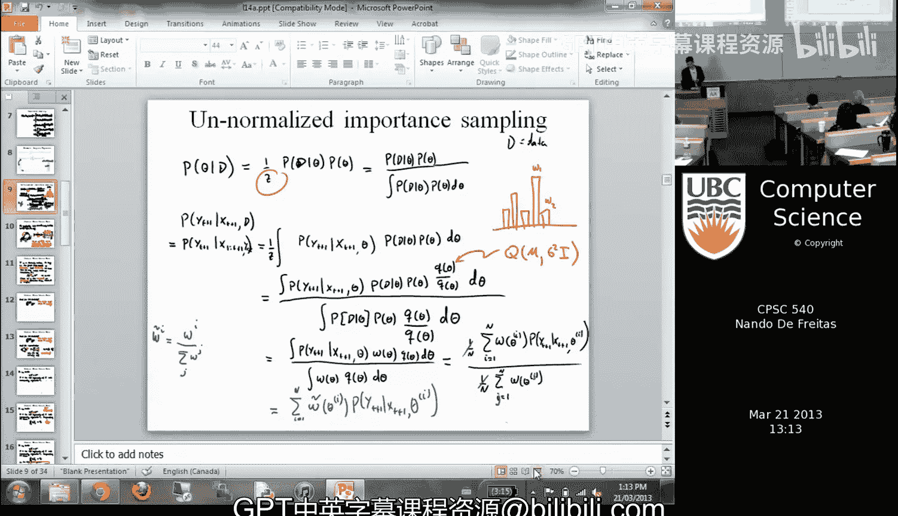

Okay， so the idea today is I'm going to go over Markov Chaman the Carro algorithms。

In the last class I went over important sampling and I mentioned important sampling is good when you have small models。

 so sort of small in terms of dimension， if you have 10 parameters or so at most important sampling can work fine。

 six parameters it works great， three to six parameters。

 that's where discretized know discrete grids don't work well。

 but important sampling still works fine and also important sampling is the key component to build a particle filter。

 in fact the particle filter which is often used for tracking。Things and radar and et cetera。

 it's just an application of important sampling sequentially in time。嗯。

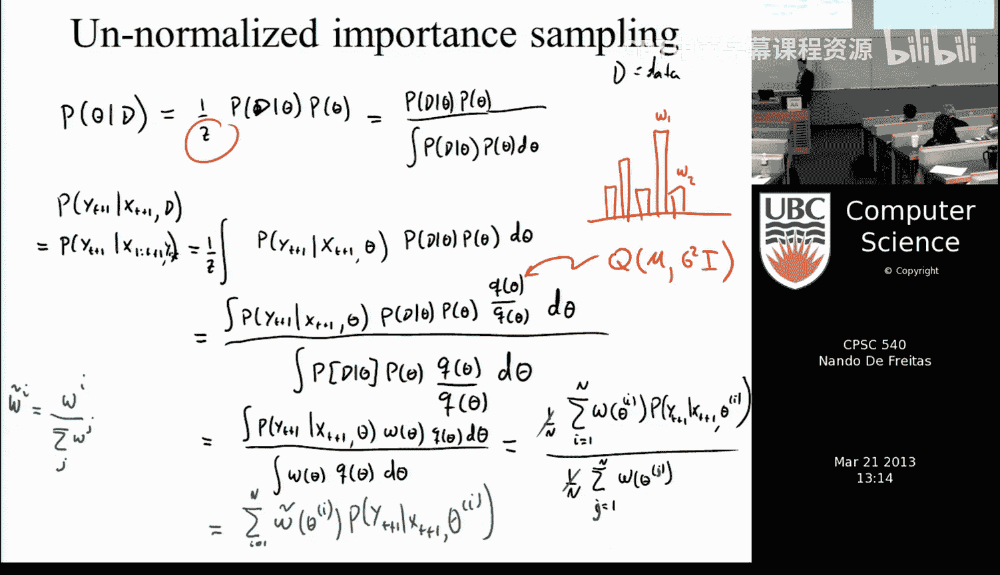

And that was pretty much what important something was about。

Switch gears to talk about Markov Chemon Taar。So I started by arguing that if we have a Markov chain。

 that is if we have a process that where you only need to specify an initial distribution and a conditional distribution。

How do you go from xt minus1 to xt？嗯。Then if I repeat that process。

I by thinking in terms of I have an initial vector。

 I keep multiplying times the same conditional matrix。

That process following some theorems of linear algebra converges and always converge to the same。

V or the same。Function。Regardless of what the initial vector is。

so there's this sort of invariant distribution， once certain purchases stay there。嗯。

So if our transition matrix is essentially a function that takes xt minus1 as input and produces Xt as an output。

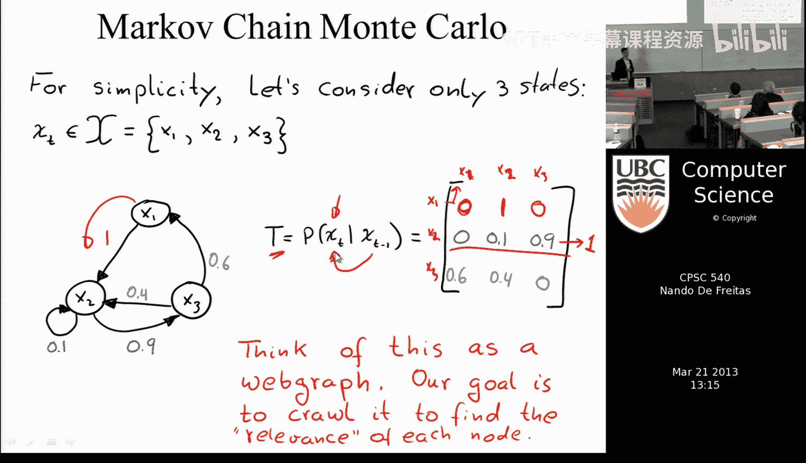

Its called T， then we essentially have this result that for any initial factor。

 if you multiply it by T， a large number of times， that will always conversege to the same factor pi。

In Markov chains， what we will do is we will start with pi。

And then we will pick any initial condition。And then the trick will be， how do we construct a T？

And T is essentially an algorithm， it takes as input xt minus1， and it outputs xt。

How do I construct that sort of algorithm such that。The samples that I'm。

Producing by following this end up being an approximation of pi。 If I histogram the samples。

 I essentially have an approximation of pi。 That's the game that we're going to play。

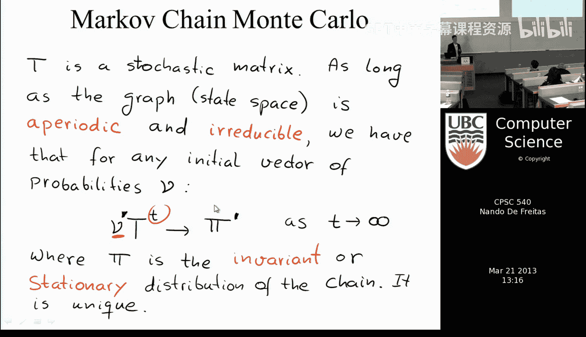

And one of the things that I said that is necessary for this to happen。Is this not necessary， sorry。

 I have to be precise here， a sufficient condition for this to happen is detailed balances。

You could still achieve this property without detailed balance。

 The idea of detail balance is to sort of think of this as traveling in time。

 The probability that you're at X T。If you're at Xt with some probability and the probability of ends you multiply that by the probability of going from Xt to Xt plus1。

 that's the same as if you wear with the same distribution in the future at Xt plus1 and you multiply that by the probability of going back。

 so this is sort of natural reversibility or balance between going to the future coming back to the present。

 if the distribution of the future and the distribution of the present pi is the same。Now。

 if I integrate both sides of this， a equation over。The same variable。

So I integrate both left and right over。嗯。Xt。Then this guy can come out out of the sum。

 phi of xt plus1 does not have any Xts， so it can come out of the sum。On the left hand side。

 nothing can come out of the sum because both terms have Xt。And then when I have。

 so this then becomes the integral over xt。Of pi of xt plus1。嗯听 up。

Pi of xt plus  one comes out of the integral， and then you're left with the integral of P of xt。

Give an xt plus one。Over xt。And not the integrals， of course，1。Okay。

Xt plus the distribution is over Xt。 if you sum a distribution over Xt， it sums to one。

And so we get this。 So what does it say is that。If you satisfy detailed balance。

 then you will also satisfy the fact that pi will be the eigenvector of P。With eigenvalue1。Or。

Put it in a different way。That if if you are at pi and you apply another transition。

 you will still be at pi。 So your distribution stops changing。And every time you apply to transition。

 the algorithm， p of xt plus 1 given xt to generate a new sample xt plus1。

 that will still be a sample of pi。So I've sort of sketched this without being formal。

I could spend a whole term and just give you all the precise conditions and be very formal and you would probably get a far better understanding of all these conditions for the Markov chain to happen。

 I'm going to move straight to the algorithm， but what I wanted to at least leave you with is sort of an intuition as to why that algorithm would work in practice。

It's essentially it's following a Markov chain and Markov chains have this property that after enough steps。

 they remain invariant。If you take a distribution multi applied by the mark of chain。

 you still get the same distribution。Okay， let's try to see how could we use this for the sort of things that we are doing？

So in logistic regression， just to recap。Our target distribution。

And I'm going to introduce the term target distribution。

 The target is the distribution from which we want to draw samples。

 and in Bay inference it typically is the posterior distribution。And so the posterior distribution。

 P of theta given。X1 to T and y1 to T。Was proportional。 let's actually introduce an equal。

Was equal to one of the Z where Z is this constant that I don't know， the normalization constant。

And then times the benoulli likelihood。Product from Michael1。To add to T observations， sorry。

Of essentially the success probability to Yi。Times 1 minus the success probability to the power Yi。

Okay。That's a T。And then we had a prior， and so one prior that I suggested we use。

Is something like a Gaussian， E to the minus one of a two delta squared。Theta transpose theta。

 So a rich。A rich regulargizer on the theis。To force some of the thetas to go to zero。

 So you have your Bnoulli likelihood。Each label is 01。 So you have a be likelihood。

 And then you have a theus。 This could also be a neural network。

 not just logistic regression because if my pi is just a full neural network like here。So。

Essential century， myF is just essentially pi。Then the same idea applies。 In fact。

 I could apply it to exactly to this model。Okay， because my likelihood is benoully with that success probability。

 and then I just need to put a prior on the theus。Oh， yes， it is， thanks。Thank you。Okay。

 so we have a Brnoli， because in p and we pretty much done。

 the moment you specify the p and the likelihood。Your sort of basic infrastructure job is done。

In practice， there's some of these like linear Gaussian for which we can do things analytically。

 But for most of the problems that you'll ever use in， say， neuroscience or in biology。

What's really important is you know how to write a good prior and how to write a likelihoodli。

Because once you do that。You're going to call the Mark of Shimon Carlo machinery。

Or the optimization machinery， depending on what you're trying to do。

And so once you have this distribution。What we want is to draw samples from samples from。

This distribution， So we want。Samples represented sub samples from P of theta。

Given y want T an X1 to T。And if you have representative samples。

 then you can approximate any integral by a sample average。

And so that's the idea when we compute a predictive distribution as we saw in the last class。Now。

 for simplicity。In the rest of this lecture， I'm not going to write this whole thing。I'm instead。

 going to just。Introducuce a short notation。Pi， to describe that guy。

So pi is the posterior distribution。The posterior over the parameters theta。

 but in the rest of the class， I'm just going to use a pi of x， so x is the。

So I'm going to sort of ex change me And then for the next slides。

 And the reason why I'll do this is just because I'm lazy。

 I don't want to write that whole expression， and I'm reusing。Some slides。

 and I don't want to change every x for a the。 But our goal will then。

 our goal then will be to draw samples。From a distribution。

 so this is the sort of more general setting。We're going to have a distribution pi in the case of logistic regression。

 that pi is the posterior distribution。But this applies to logistic regression。

 it applies to gass and pros， it applies to everything。So I'm gonna use the more abstract version of。

The algorithm， so we want to draw samples from a distribution。 That's the basic operation。

And typically， we know this distribution， but what we don't know is the normalization constant。So。

 typically。What we really know is this sort of aormalized pie， which is one of a z。Times pi of x。

Okay，If we know the normalization constant we know the distribution。

 But the problem is we don't know that。We don't know the quantity that makes this sum to what。

 so typically we don't know this integral。W is like for logistic regression。

 We don't know the integral over a theta of that expression at the top。And for the neural networks。

 you can imagine how nasty that integral would be， would be an integral in 100，000 dimensions。

And you would not have the right tools to solve that integral。All right， if this is the case。

 if this is pi of x， the formal algorithm will give you samples from pi of x。

The metropolis algorithm or metropolis Hatings， Hastings being Canadian， by the way。

Metropics came from Eastern Europe to work basically building nuclear bombs at the beginning of the arms race in the '50s。

嗯。And Metropolis is also one of the first programmers。

So a lot of the beginning of computer science sort of started。With metropolis and with his friends。

 Ulaman， Vanon Neiman and Fermi and so on。Now the algorithm goes as follows。

 you start with an initial value。X， again， in Bayesian inference， x is the parameters。So pi。

 but we're going to abstractstruct this， pi is the target distribution。

So we start with any initial parameter x。And then we're going to intererate as many times as we want。

 as many times we can afford to interact。Their more it is the better。

 but obviously with just time constraints。What we're going to do is first we sample a uniform variable from 01 in your computer。

 you just call RND or whatever it's called in your language。

And then we're going to introduce this auxiliary mechanism。Q。

Q is something that assuming that you previously were X I is going to propose a new candidate。

 for example。You could have x star be equal to X。Buse， some noise。So in other words。

 if your answer was X。Here will just perturb the answer。Okay， just add some noise to Xi。

 So if you were searching。For the better parameter， you add some noise to it。

 And then we're going to play the falling game。If the perturbed X is much better。Than the previous X。

We take it。If the perturb X is worse， we reject。If it's comparable。We flip a coin and decide。

And that uniform variable that we sampled there， that's for flipping that coin。

Because if you have a binary distribution。If we have a binary distribution。

 the way we sample from a binary distribution is we construct a cumulative distribution。Right。

And then we sample a uniform number between zero and one。Okay， this is 0。8。And this is 0。2。

We construct the cumulative， we sample a number， we project it。If it's。

 and then we just take it as a sample from there。Okay， and then if you're doing this。

 if you're sampling numbers uniformly here， you can sort of see that 80% of the time。

 those numbers will be this guy here。With， and。20% of the time， you will hit this。

 in which case you'll get a sample from。啊。The guy on the right。 Okay。

 so that's the way we sample from a distribution。 In other words， you sample a uniform number。

If that uniform number is less than 0。8。It's head。And if it's not， it tails。That's how we draw。

Binary variables in a computer is by using。This auxiliary distribution。

And that's precisely what we're going to do here。So here we're going to sample this just for that that will be for our coin toss。

And then what we're going to compute is this quantity called the acceptance probability。

It's essentially our measure of quality of the proposed candidate。

And what we're going to do is we're going to take the ratio。

Of the posterior of the new parameter to the posterior of the old parameter。

So this here would be say the posterior in logistic regression。And then in order to avoid。

 but unfortunately， the candidate was not proposed。By P。

 the candidate was proposed from a distribution Q and then to just balance things and I will soon say why it's balancing。

 essentially we have to renormalize by these cues to avoid bias and that renormalization by Qes I will show you soon is what is guaranteed to give us detailed balance and make sure that this is a valid algorithm。

Okay， but for now。Essentially， you can imagine that if X star is better than X I。

 then P of x star is going be much higher than X I。 And so we're going to take that sum。So， if。

Basically， if your acceptances say 0。8。If X star is much better than X side。

 then this will be greater than1， and you take the min。

 A will be the min between one and something greater than1 which is one。

 and that means you accept immediately。And so if this is say 0。8， then would probability 08？12。

You accept and with probability point two， you reject in which case you stick to the old VA。Okay。

 that's essentially the mechanism。 You flip a coin and then a。A is the success probability。

So there's a success。 This is fate。And then you choose。If you succeed。

 do you move to a new you take X star as the new value。 If you fail， you stick with Xi。

They seem to like month of change。 You can say that P is。

That kind of stationary distribution and Q is like transition。

 and this is the declared balance equation。No， actually， it's going to be the whole algorithm here。

Since you can think of this algorithm as a single iteration of this algorithm。

Starting from the second arrow。You can think of this。As a black box。This black box。It takes as input。

X at the previous iteration， so X I。And it produces us the output x at the next itration， X i plus1。

So that whole algorithm will be our distribution P of Xi plus one given Xi。

And I will soon give you the mathematical expression for it。

So you can configure an algorithm to text X。I and outputs the next x。

And if it does it in a probabilistic way， it's essentially a probability conditional probability distribution。

It's an algorithmic implementation of that。It like。So gradients will come in later。 At this stage。

 there's no gradients。 At this stage， all we're doing。

 let me bring some pictures to illustrate what we're doing now。

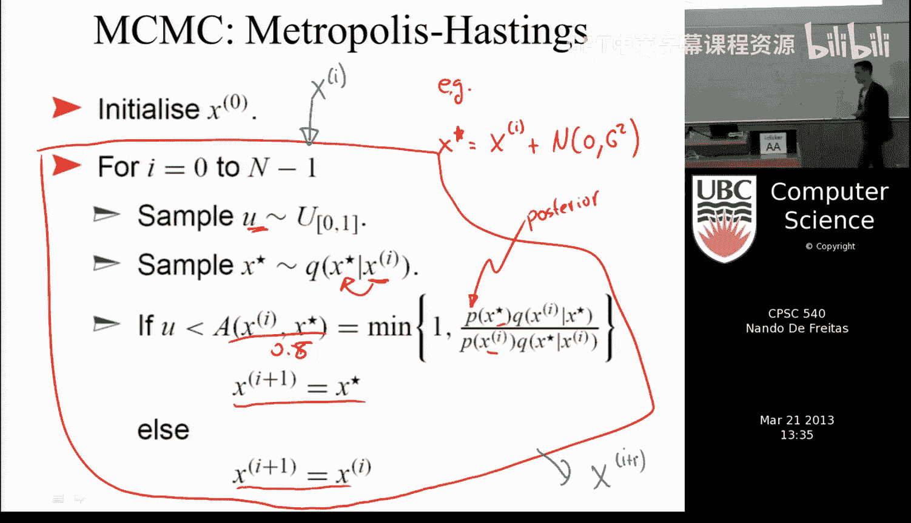

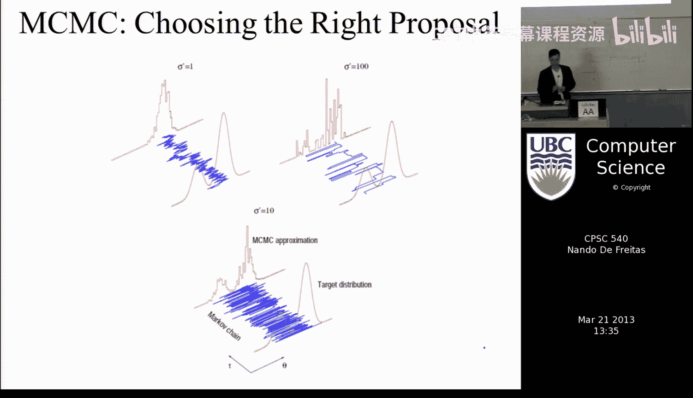

One of the things that I haven't told you is how to choose this sigma， either。 But essentially。

 depending on how you choose the sigma， this is what we we're actually doing。

 If this is your target distribution。

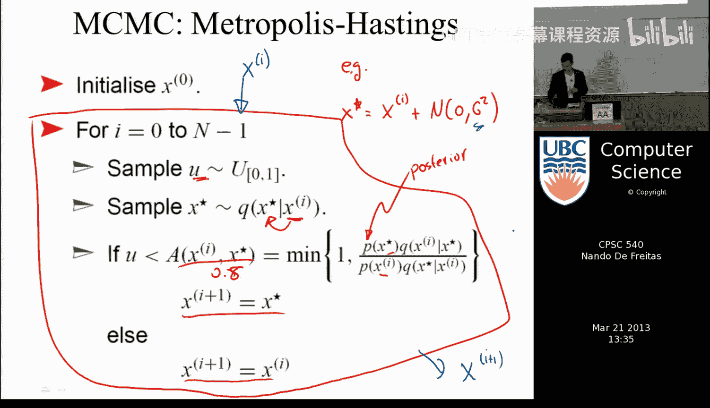

Okay this is let's look at first a nice case， this is the target。It's a bimodal distribution。

 and I don't know the normalization constant。

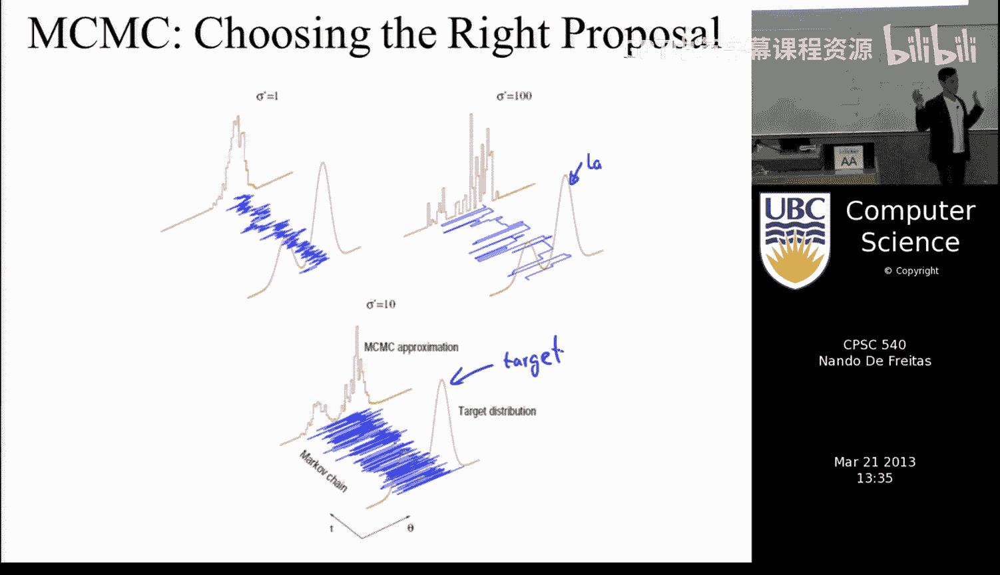

Okay， so that's important。 So going back here， I sort of know that I want to sample from pi of x。

 and in this case， I'm actually using pi of x to be equal P of x of a Z。I want a sample from Px。

 but I don't know Z。But the beauty of this is because I'm substituting。

Pi of x star divided by pi of X I。 I'm dividing by Z， multiplying by Z， and the zs actually canceled。

So for that I didn't make clear before。But， that's essential。

All you need to know is the distribution are normalized and you can evaluate it。

 You don't need to know the z because the zs will cancel。 So this way we get rid of the zs。

The trick is to always work with ratios。And then that's， that's the。

I'll come to the detailed balance。 Let me just first give an intuition of the algorithm and then I'll do the theory。

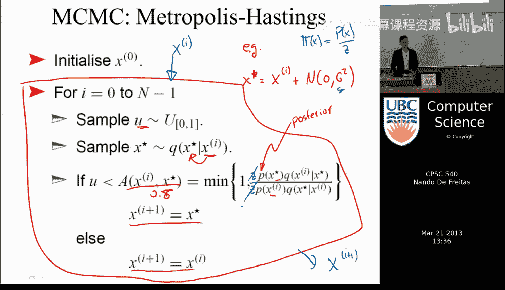

嗯。So this is the target distribution that we stumble from。

 and so essentially what we this is essentially， what's happening， we're visiting this distribution。

And then when I take a histogram of all the samples， so this is my mark of chain。

So these here are my samples。And this is sort of as the algorithm evolves over time as I。

And then I take a histogram of the samples。And the histogram of the samples， as you can see。

 if I have the right proposal distribution， gives me a very nice approximation of the posterior。Okay。

 so having the right proposal is important。If I don't have the right proposal distribution。

 if I choose a sigma that's too large， then what you see is that because sigma is too large。

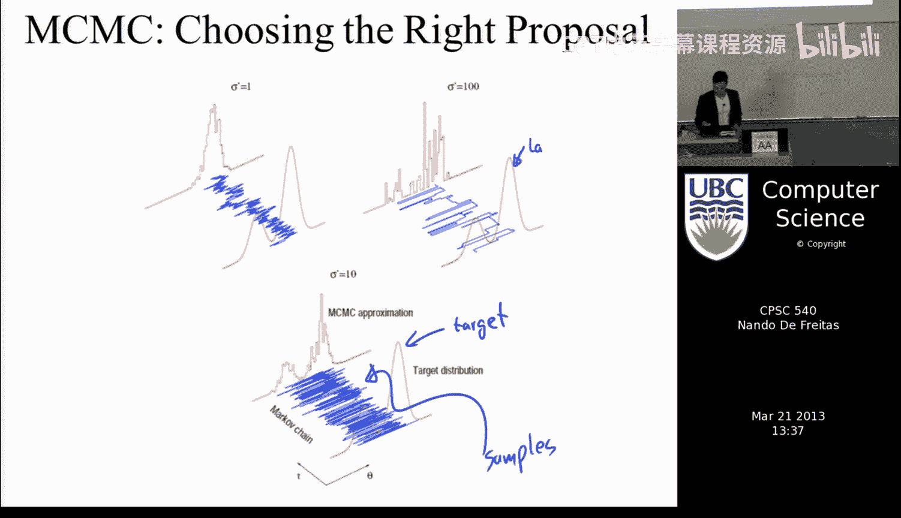

Let's analyze the algorithm。 What happens if Sigma is too large。

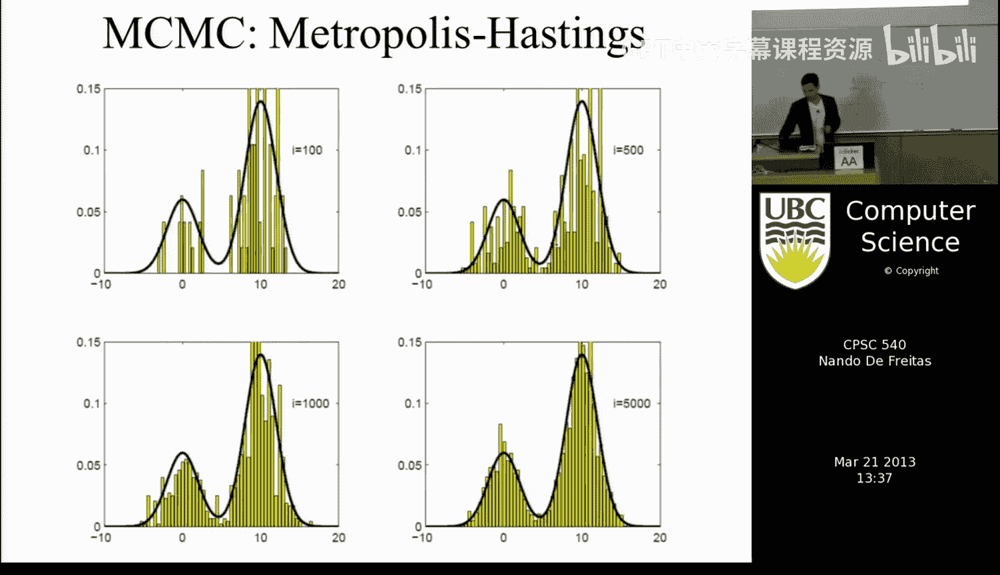

If sigma is too large， what's happening is I'm proposing a huge change to the parameter。

So I have a parameter vector， and you're proposing to me something that's wildly different。

When you propose to me things that are wildly different than the thing that I'm comfortable with。

 most of the time I will go like， I don't know， maybe not。 you know。

 I'll be like f and the Shi and reject。Going anywhere else。 That's sort of crazy。If you。

 on the other hand， just propose to me。 and so I tend to stick to my value。

 I tend to stick with my own thing。 and that's what we're observing here in the picture。

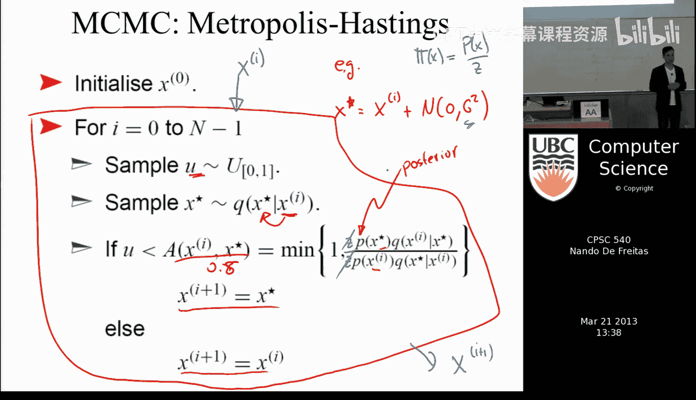

If you're proposing things that are very different。嗯。Same target as before， but as you can see here。

Especially if you look over here， the chain doesn't move。The chain is always stuck over time。

 it's the same value。 That's about 10000 samples that I'm plotting there。

 And the chain is just stuck， because I keep。Essentially， you keep giving me crazy choices。

 and I'm like， no， I'm just sticking with what I have。If on the other hand。

You play this game where you already know what I like and you just pertturb it slightly。

So you make sigma very tiny to just make a small modification。

Then the danger is that this could happen。You're just giving me tiny modifications of my parameter。

 theta， or x， or whatever I call it。Oops。And then if that happens， essentially， I visit this mode。

 but I'm never getting enough probability to move to this other mode。

 If you don't give me something that's wildly different。

 I end up not visiting this other part of the probability distribution。 So there's a trade off。

How can we choose Sigmed practice？啊哋。Yeah， most people don't know that。

I believe that that idea is yet to be published。But that's one way you could do it。

 you could do a cross validation， especially if you have a predictive model。

 but of course sometimes you doing you're running Markov chains to learn when there's no predictive task you want to learn something about a distribution。

 you can run a markov chain to understand something about physics to understand something about nature。

 in which case you might not have data to do predictive task。

 but people have a bunch of other ideas so for example。

 a good markov chain is one that convertverges to the right value and that has low variance。

 so if you do a lot of math， you can get an expression for the variance。And then， you can。

Choose to minimize the variance。 And that's another way of doing it。And then the。Poor。

The poor person's choice is I guess， to try a sigma， and if youre stuck。

 you basically decrease sigma a little bit。Oh kind of like it just from a learning rate。Yeah。

 exactly。 so you look at research your acceptance rate。And then he use that to change。

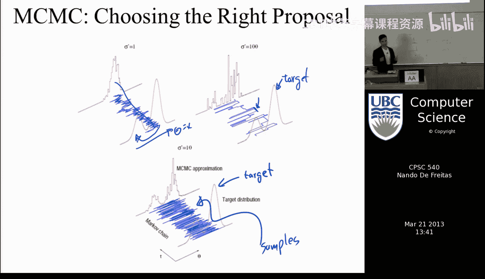

And this is just an illustration of the algorithm of the write sigma， after 100 iterations。

 this is my histogram running the algorithm， after 500 I start getting something better。

 1000 and then 5，000， I get a very nice approximation。Of that distribution。

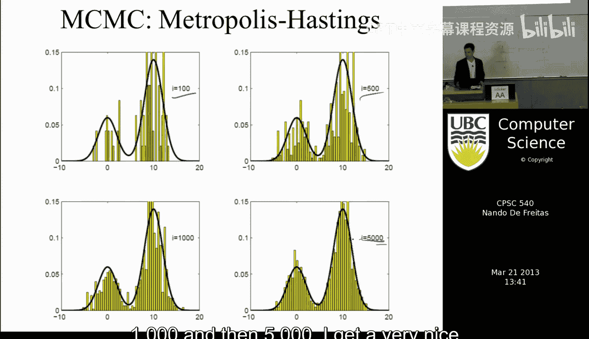

That's it， Metropolis Hastings， one of the top algorithms of the last century。

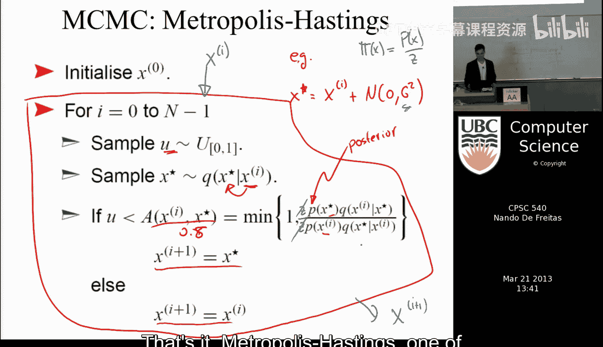

Okay， so you are asking me about detailed balance。The matrix。And instead of a matrix。

 we're going to use the word kernel because think of kernel is like a matrix。

 but it has infinite number of rows and an infinite number of columns。

 so it's a function that takes two arguments。And in this case。

 the takes you to the 01 because it's a probability。Overbe。So the kernel takes you from X。To be。Now。

 there's two things that can happen with this algorithm。

 This is essentially a mathematical expression that's equivalent to the algorithm。

And it's saying two things。If you were already， if you're not at B。Suppose you're not at B。

 so let's consider this case。You're not at me。If you're not at B， if you're X。

 and the reason why we're using B here is a small interval because we're talking about probability in continuous spaces。

 and so we said that we always assign probability to intervals。

 we don't assign probabilities to a point。Proability of a point in R is zero。

And so we assign probabilities of going for x， the probability of going from x to interval B。

Let's write that down。That's a probability。哦，各。From。X。wo。Interval。B。

The way metropolis does this is as follows。It first proposes a new candidate。

So you're at X and you propose a candidate in the interval B。And then you weight that by a。

 the acceptance probability。That's essentially how we。How we doing this business。

So we first proposed a candidate。And then we accept it with probability A， with probability A。

 we accept it with probability or minus a。But in this case， we went from x to B。

 that means we accepted it， so with probability A， we accepted it。

 so this is the probability of acceptance times the generating mechanism。

And so that's the probability of going from x to B if x originally was not in B。

Effex was already in B。So in a sense， we've rejected because we haven't left B， We've stayed in B。

 We've stayed in the interval B。但。That's essentially then the rejection probability， which is one。

Mineus the probability of moving elsewhere， and the probability of accepting a move to anywhere in the space is the probability that you will start at x and move to x prime according to the acceptance A x to x prime。

And you， you're moving to all。This here basically means all the space， all space。Big X。Mindness。

The little bit of space。 that's the interval B。So the probability that you will stay is1 minus the probability that you'll go anywhere else in the world。

That's the equation for。The algorithm， that's the equation that describes the algorithm。

Now it's the sort of two stagewide process。 You propose a candidate。

 and then you accept a candidate with probability A。The rest。

How to manipulate this to get a one line expression that I would let you do in the comfort of your own home。

I'm not going to go for those details。 This is something that you sit down。

 look at it and spend some time and then look at the algorithm again， and eventually you'll go like。

 oh， wow， it works。That's how the math relates to the algorithm。

The point of having this is that we now have our transition。

This is essentially our transition matrix， our transition kernel。And if we have this。

Then what theorists do is they plug in that expression。

You plug in here your expression for the distribution that you're using。

 the distribution of logistic regression， you plug in the metropolis algorithm K here。

And then you show that detail balance is satisfied。I'm not showing it here。

 but I'm just giving you the method of proof。You put in your distribution， you put in metropolis。

That expression that you had there using whatever Q you use and using whatever acceptance you use。

 the acceptance will always be the same， but the key will be different。 you plug those there。

 and then if you show that left hand side is equal to right-hand side。

 detail balance is satisfied and if the tell balance is satisfied and there is there other theorem just by doing integration on the left and the right that says that you have an invariant distribution and that invariant distribution is the posterior。

Of interest。So it works。Now， here are some variations of metropolis hastings。

 so the ratio that we looked at here。

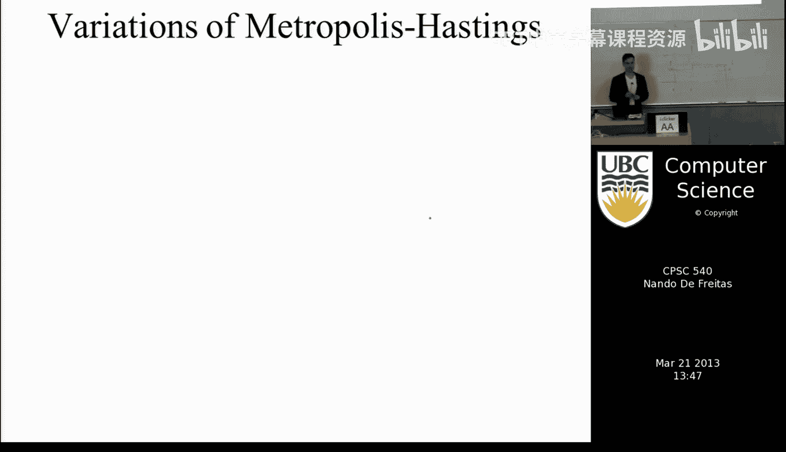

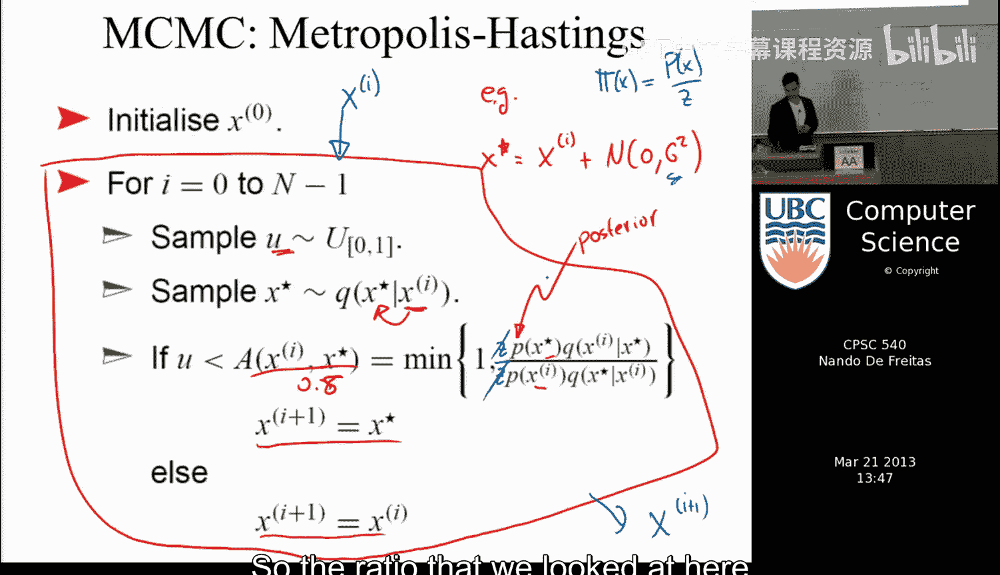

Was sort of P divided by these cus。So in general， the metropolis hastings。

Ratio is sort of min between one and then P of the new guy。Divided by P of the old guys。And then。

 it's reweighted by。Q of X， the proposal of going from X given X star。And the proposal of going from。

Xstar。Given that you are at Xr。Now， if we use a symmetric distribution， if I， for example。

 say that x star is just equal to X i plus n0 comm a sigma squared。Then basically。

 I'm saying that I have a Gaussian distribution。That over x star minus X。Squared。

 sort of divide bicycle square。 So essentially， my Gaussian distribution。

My cu is proportional to this。But I can also rewrite this。Very trivially as X I。Minus x star。

Squared of a sigma squared。Right， because it's a square， so it doesn't matter what order。

 So the first distribution is the probability of x star given X。

The second is the probability of Xi given X star。I can interpret it。 They're the same。

 They give you exactly the same value because if you take -1 squared or two or plus one squared。

 it's both cases as one。So， that means that。Q of Xi。Give an X star。And this guy。

 which is Q of x star， give an X I。Are really the same thing。Because of the symmetry。

And so what I can do。Because I can just cancel this。And so I just get men。Between1 and p of x star。

Divided by P of X。And that's sort of a beautiful result， because that basically says that。嗯。

You just look at the ratios of the probabilities， if the new guy is much more probable， you take it。

 if not， you're reject it。If you take this to a power like one of a tea。

And then you decrease Christ T。What will happen is that your samples will concentrate on the mode of the distribution。

 That is called simulated and nearly。So if we you。为。Tea。We get we concentrate on the mode。

On the pixels of。P of x。Okay， that's what's known as simulated anil。

 It's a version of metropolis where you focus on moving toward the modes。

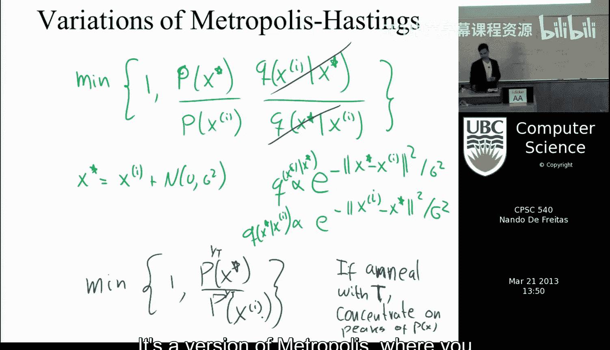

That's pretty much it。 So what I'm going to do。几个。Me is the dimension of。

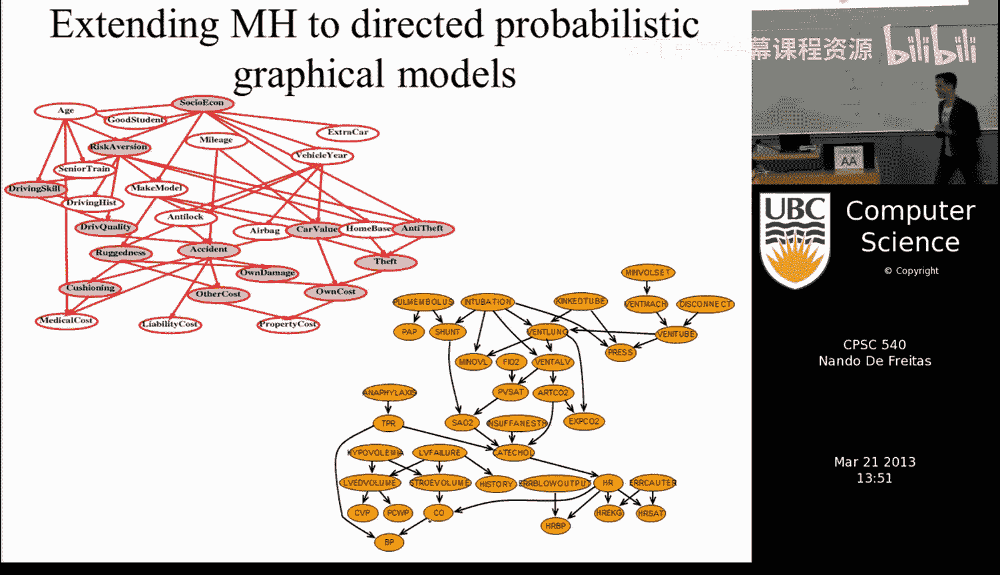

changess from the initial space to the。よです。still holds。Excellent question， so in this case。

 I'm making sure that the parameters are of the same size。However。

 there's a variation of this algorithm called reversible jumpmp in CC that allows you。

The number of parameters to change were time。So you can only estimate the parameters。

 but you can also estimate the number of parameters。So like for example。

 the neural network if you wanted to estimate the number of neurons。

 and this is essentially what I did for my PhD， if I wanted to estimate the number of neurons。

 I could construct the markov chiman the algorithm that will learn both the parameters and the number of parameters and so in that case。

 and that becomes a bit complicated because I'm comparing the ratio of two distributions。

And a distribution has associated with it two things， the density， the height。And then the area。Now。

 if you have a distribution over two parameters and a distribution over three parameters。

 one is defined in terms of areas， the other one is defined in terms of volumes， 3D volume。

So there's sort of a trick there in comparing that you have to rescale。Both to have common dimension。

 and we do this by a technique called the Jacobian that some of you probably saw it a multivariate calculus。

And then everything gets balanced。 So there's this technical reversible jump MCMC。

 which deals exactly。With this modification。Okay， I think I spent way too much time in the big。

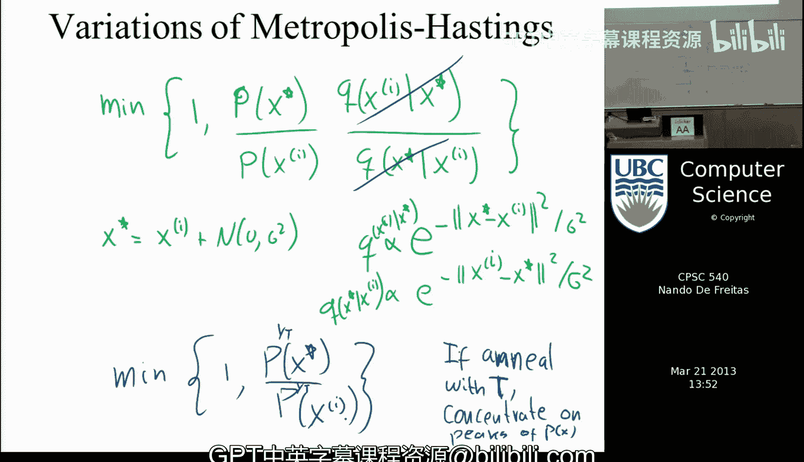