# 03：最大似然估计与线性回归 📈

在本节课中，我们将要学习概率论在机器学习中的核心应用，特别是如何通过最大似然估计（Maximum Likelihood Estimation, MLE）来理解和推导线性回归模型。我们将从高斯分布（正态分布）的基础知识开始，逐步构建起概率模型与优化目标之间的联系。

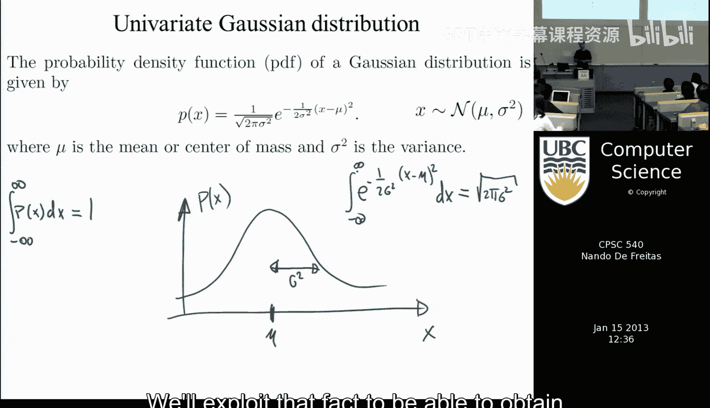

## 单变量高斯分布 🧮

上一节我们介绍了机器学习的基本框架，本节中我们来看看一个最基础且重要的概率分布：单变量高斯分布。高斯分布是描述连续型随机变量不确定性的一种方式，其定义域为整个实数轴。

其概率密度函数（PDF）由以下公式给出：

$$
p(x) = \frac{1}{\sqrt{2\pi\sigma^2}} \exp\left(-\frac{(x-\mu)^2}{2\sigma^2}\right)
$$

其中，参数 $\mu$ 是均值（期望值），决定了分布的中心位置。参数 $\sigma$ 是标准差，$\sigma^2$ 是方差，决定了分布的宽度（即数据的离散程度）。该曲线下的总面积（即概率）等于1。

计算机可以通过伪随机数生成器来模拟从高斯分布中“采样”的过程。其核心思想是利用均匀分布和累积分布函数（CDF）进行转换。具体方法是：首先生成一个在[0,1]区间内的均匀随机数，然后将其映射到高斯分布的累积分布函数的反函数上，从而得到一个服从该高斯分布的样本。

## 多变量高斯分布 🌐

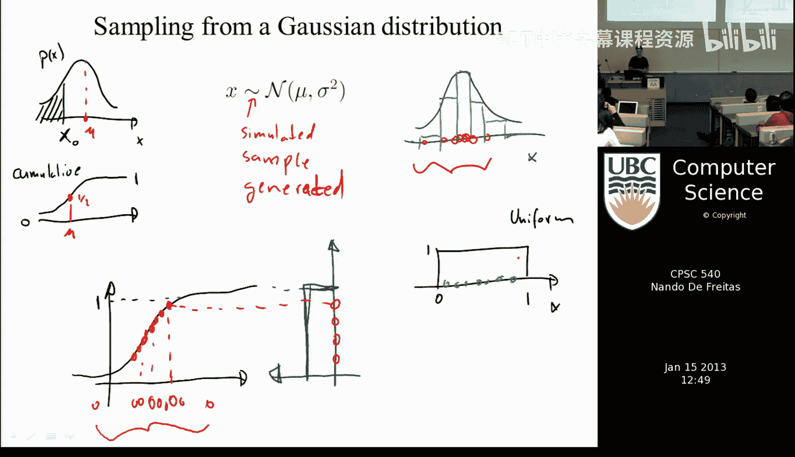

现实中的机器学习问题通常涉及多个变量，因此我们需要将高斯分布推广到多维情况，即多变量高斯分布。

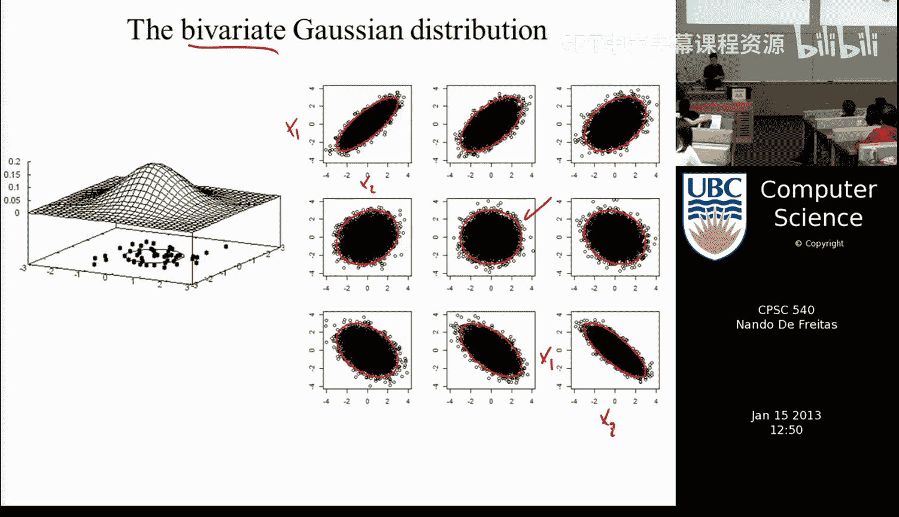

对于一个 $n$ 维随机向量 $\mathbf{y}$，其多变量高斯分布的概率密度函数为：

$$
p(\mathbf{y}) = \frac{1}{(2\pi)^{n/2} |\mathbf{\Sigma}|^{1/2}} \exp\left(-\frac{1}{2}(\mathbf{y} - \mathbf{\mu})^T \mathbf{\Sigma}^{-1} (\mathbf{y} - \mathbf{\mu})\right)
$$

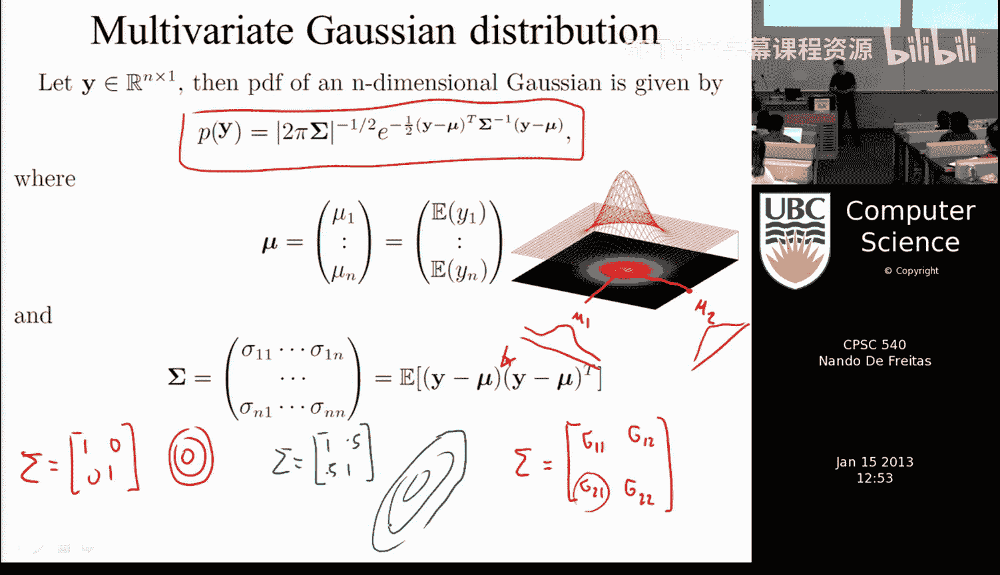

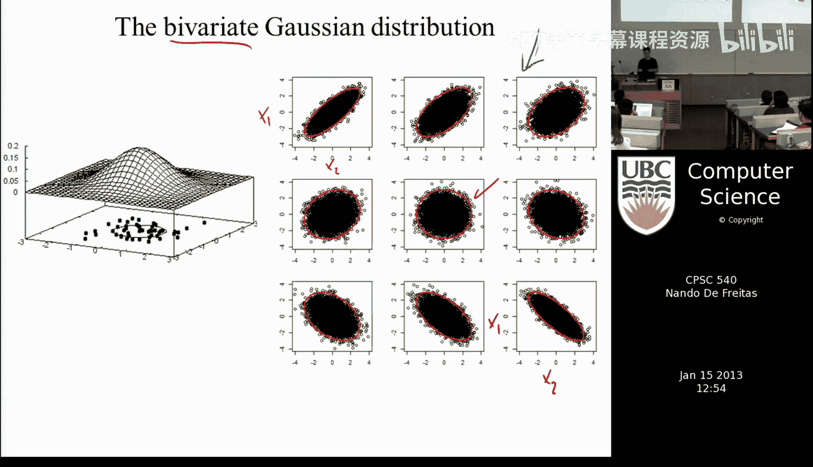

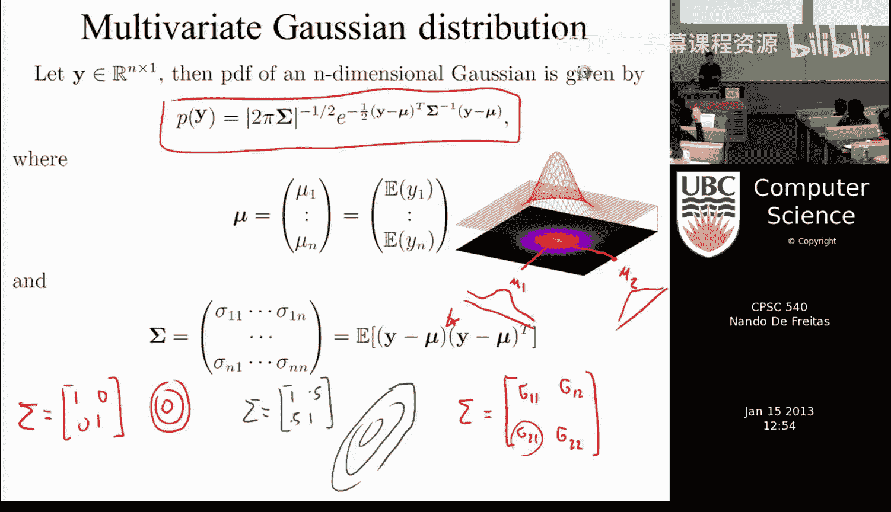

其中，参数 $\mathbf{\mu}$ 是一个 $n$ 维向量，表示分布的均值中心。参数 $\mathbf{\Sigma}$ 是一个 $n \times n$ 的协方差矩阵，它描述了分布的形态以及各维度之间的相关性。

以下是协方差矩阵 $\mathbf{\Sigma}$ 如何影响分布形状的几个关键点：
*   如果 $\mathbf{\Sigma}$ 是一个对角矩阵（非对角线元素为0），则表示各变量之间相互独立，等高线呈圆形或椭圆形（轴与坐标轴平行）。
*   非对角线元素不为零，则表示变量间存在相关性，等高线呈倾斜的椭圆形。
*   对角线元素的值决定了在各个维度上的伸展程度。

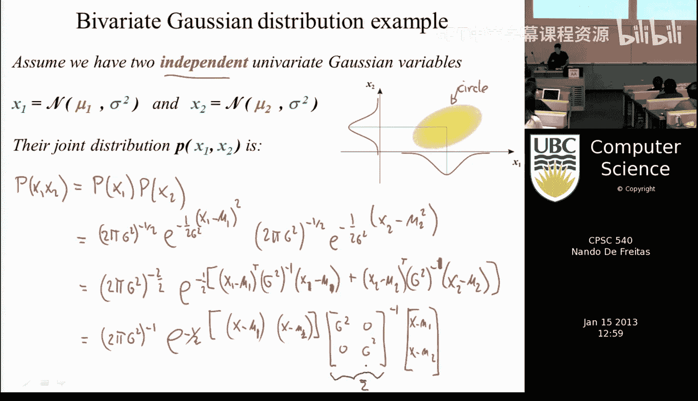

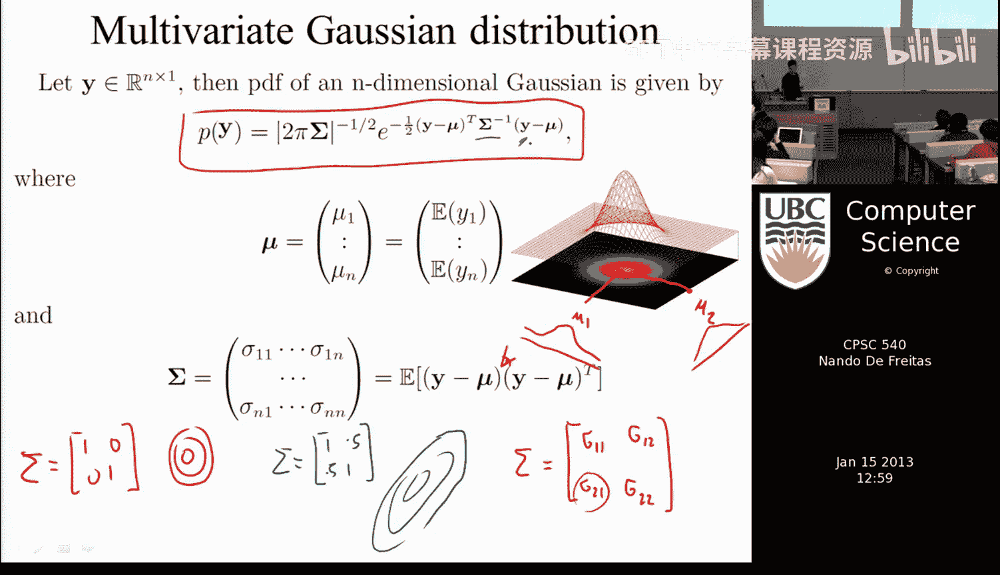

从单变量高斯分布采样扩展到多变量情况，需要用到矩阵的乔列斯基分解（Cholesky decomposition）。若 $\mathbf{\Sigma} = \mathbf{L} \mathbf{L}^T$，则可以通过以下方式生成样本：$\mathbf{y} = \mathbf{\mu} + \mathbf{L} \mathbf{z}$，其中 $\mathbf{z}$ 的每个元素独立采样自标准正态分布 $N(0,1)$。

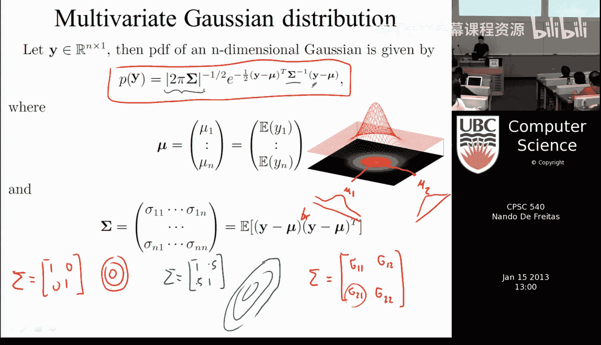

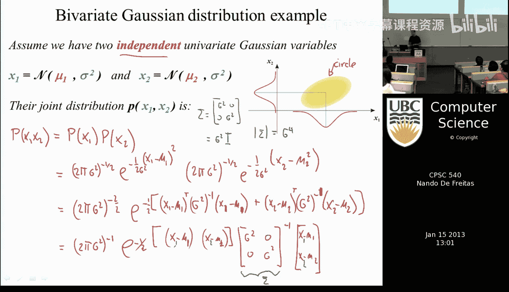

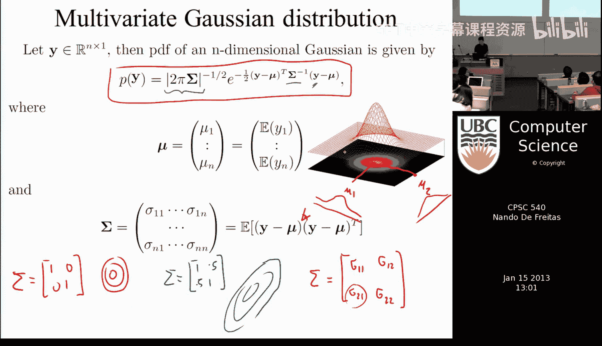

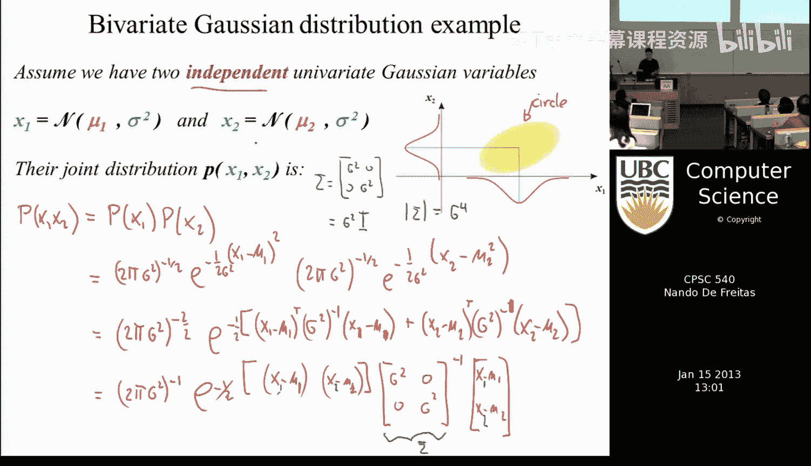

## 最大似然估计：思想与示例 💡

有了概率模型，我们如何从数据中学习模型的参数（如 $\mu$ 和 $\sigma$）呢？最常用的方法就是最大似然估计。

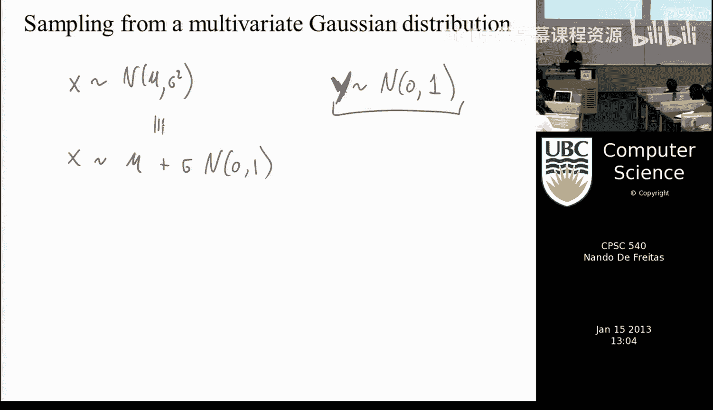

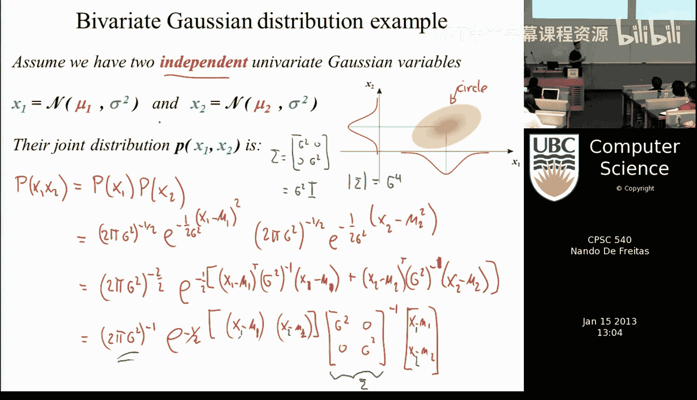

其核心思想是：在众多可能的参数取值中，选择那个能使“观测到的数据出现的概率”最大的参数值。换句话说，就是寻找最能解释当前数据的模型。

考虑一个简单例子：我们观测到三个数据点：1.0， 0.5， 1.5。我们假设它们来自一个方差 $\sigma^2=1$ 已知，但均值 $\mu$ 未知的高斯分布。
现在有两个候选的 $\mu$ 值：$\mu=1$ 和 $\mu=2.5$。对于每个数据点，我们可以计算在该 $\mu$ 值对应的高斯分布下的概率密度（即似然）。由于我们假设数据点独立，整体数据的似然是各点似然的乘积。

直观上，$\mu=1$ 对应的分布中心更靠近数据点，因此每个数据点处的“概率高度”乘积更大。所以，我们更倾向于选择 $\mu=1$ 作为估计值。这就是最大似然估计的直观体现。

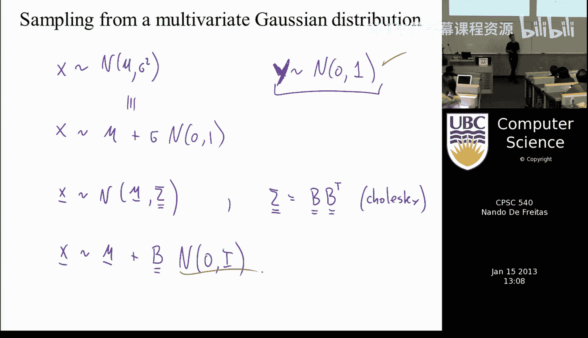

## 线性回归的概率视角 🔗

现在，我们将最大似然估计应用到线性回归问题中。在线性回归中，我们有输入 $\mathbf{x}$ 和输出 $y$，希望拟合一个线性模型 $y \approx \mathbf{x}^T \mathbf{\theta}$。

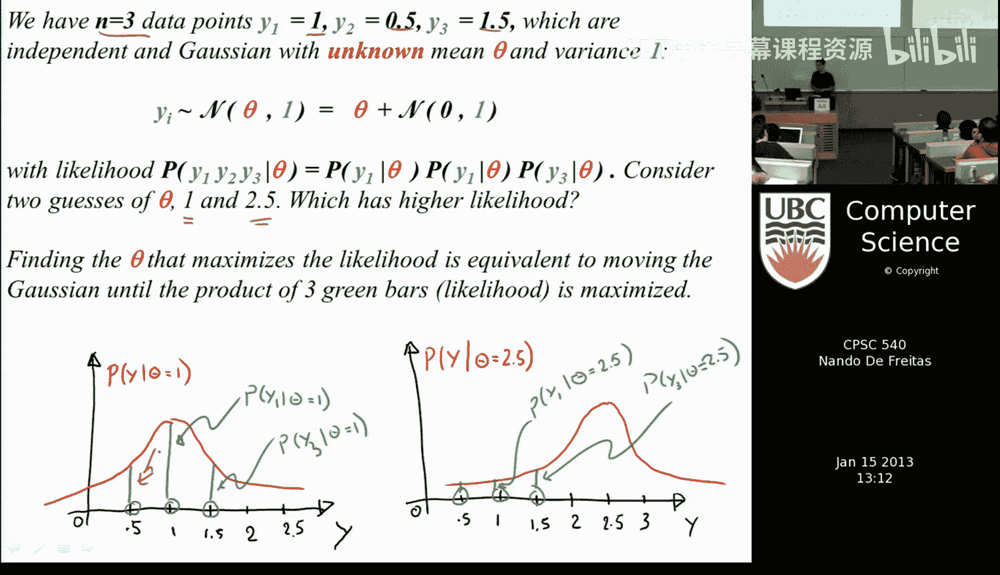

我们从概率视角重新定义问题：我们假设在给定输入 $\mathbf{x}$ 的条件下，输出 $y$ 不是一个确定值，而是服从一个高斯分布。该分布的均值正是线性模型的预测值 $\mathbf{x}^T \mathbf{\theta}$，方差为 $\sigma^2$。用公式表示为：

$$
p(y | \mathbf{x}, \mathbf{\theta}, \sigma^2) = \mathcal{N}(y; \mathbf{x}^T \mathbf{\theta}, \sigma^2)
$$

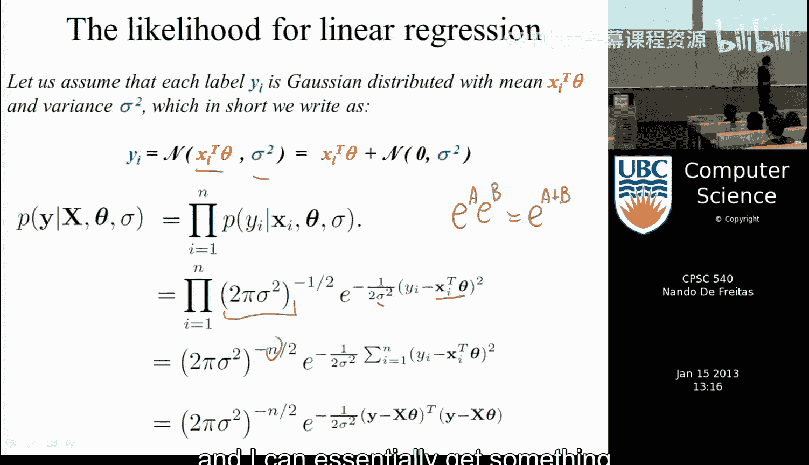

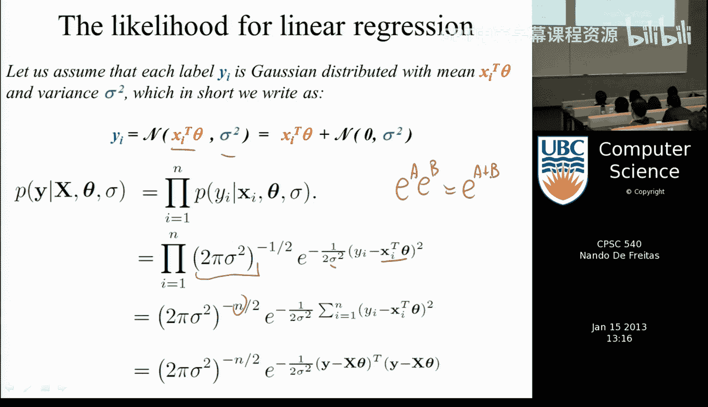

这意味着，我们的预测 $y$ 会围绕直线 $\mathbf{x}^T \mathbf{\theta}$ 上下波动，波动的幅度由 $\sigma^2$ 控制。

假设我们有 $N$ 个独立的数据点 $\{(\mathbf{x}_i, y_i)\}_{i=1}^N$，那么所有数据的联合似然（概率）为：

$$
p(\mathbf{y} | \mathbf{X}, \mathbf{\theta}, \sigma^2) = \prod_{i=1}^N \frac{1}{\sqrt{2\pi\sigma^2}} \exp\left(-\frac{(y_i - \mathbf{x}_i^T \mathbf{\theta})^2}{2\sigma^2}\right)
$$

## 最大似然估计推导 📝

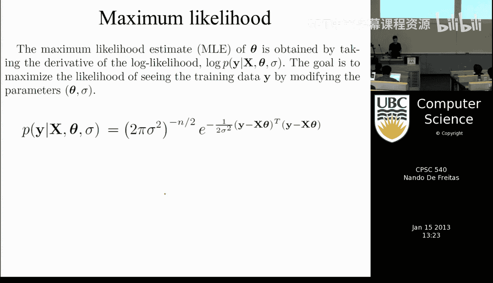

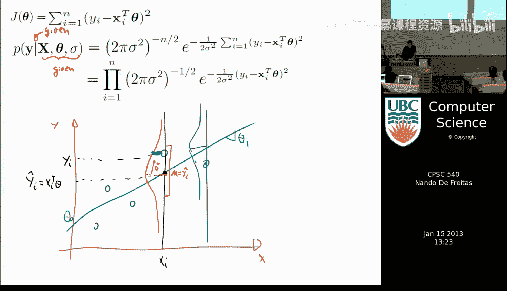

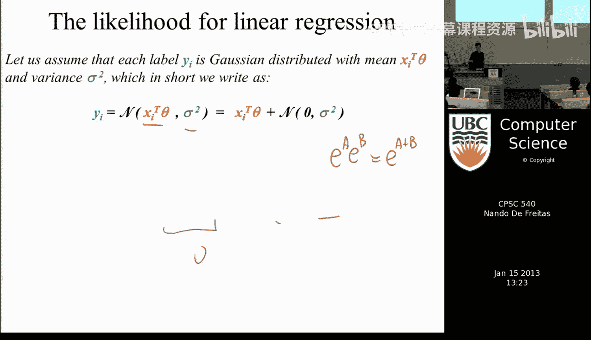

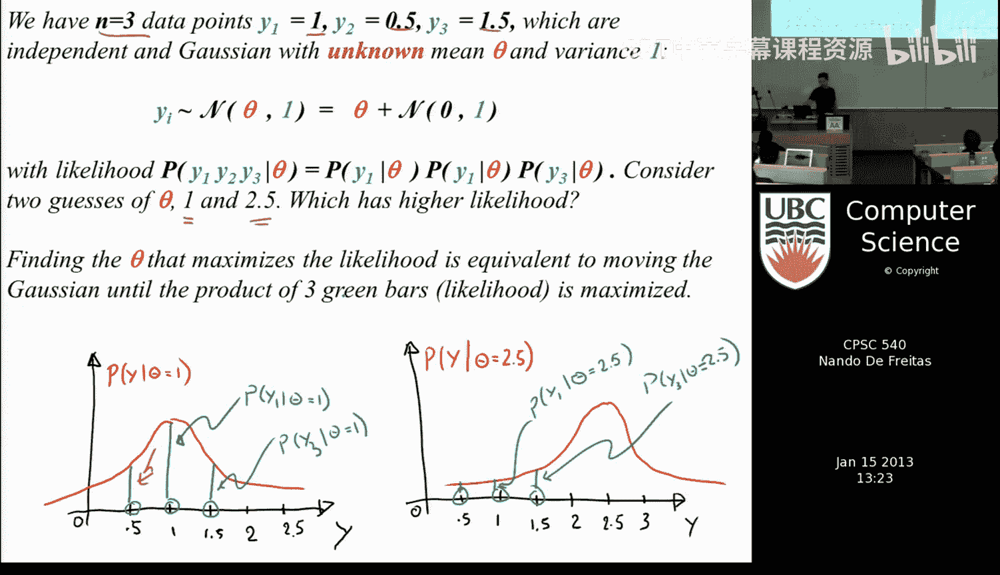

我们的目标是找到参数 $\mathbf{\theta}$ 和 $\sigma^2$，使得上述似然函数最大。通常，我们最大化其对数似然函数，因为乘积取对数后会转化为求和，更易于计算和求导。

对数似然函数为：

$$
\mathcal{L}(\mathbf{\theta}, \sigma^2) = -\frac{N}{2} \log(2\pi\sigma^2) - \frac{1}{2\sigma^2} \sum_{i=1}^N (y_i - \mathbf{x}_i^T \mathbf{\theta})^2
$$

为了求最大值，我们分别对 $\mathbf{\theta}$ 和 $\sigma^2$ 求偏导数并令其为零。

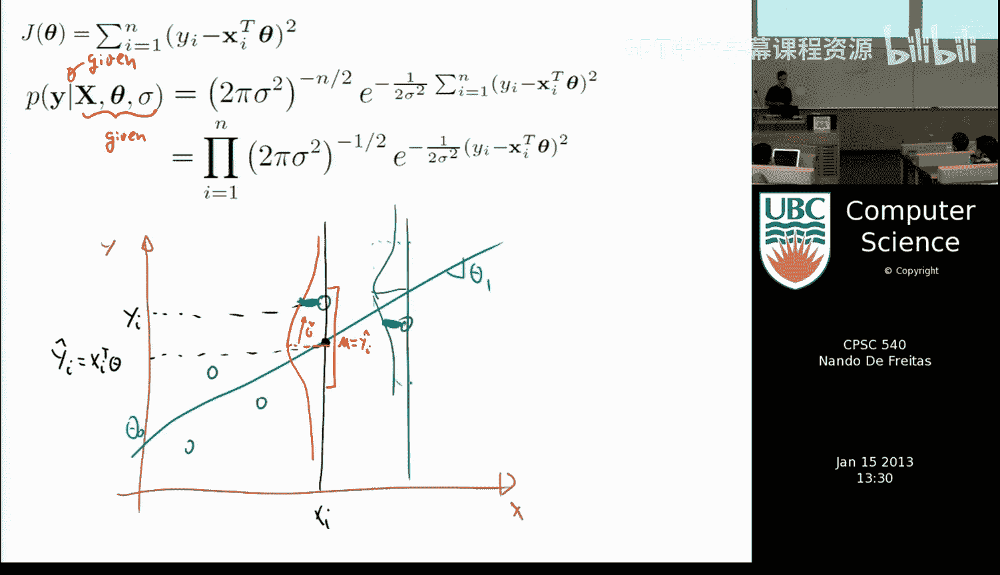

首先，对 $\mathbf{\theta}$ 求导：
$$
\frac{\partial \mathcal{L}}{\partial \mathbf{\theta}} = \frac{1}{\sigma^2} \left( \mathbf{X}^T \mathbf{y} - \mathbf{X}^T \mathbf{X} \mathbf{\theta} \right) = 0
$$
解得最大似然估计 $\hat{\mathbf{\theta}}_{ML}$：
$$
\hat{\mathbf{\theta}}_{ML} = (\mathbf{X}^T \mathbf{X})^{-1} \mathbf{X}^T \mathbf{y}
$$
这与我们之前通过最小化平方误差得到的最小二乘解完全相同。这揭示了最小二乘法的概率本质：它等价于在高斯噪声假设下的最大似然估计。

其次，对 $\sigma^2$ 求导：
$$
\frac{\partial \mathcal{L}}{\partial \sigma^2} = -\frac{N}{2\sigma^2} + \frac{1}{2(\sigma^2)^2} \sum_{i=1}^N (y_i - \mathbf{x}_i^T \hat{\mathbf{\theta}}_{ML})^2 = 0
$$
解得方差的最大似然估计 $\hat{\sigma}^2_{ML}$：
$$
\hat{\sigma}^2_{ML} = \frac{1}{N} \sum_{i=1}^N (y_i - \mathbf{x}_i^T \hat{\mathbf{\theta}}_{ML})^2
$$
这恰好是残差平方和的平均值。

## 伯努利分布与熵 🪙

为了更全面地理解最大似然，我们简要介绍另一个重要分布——伯努利分布。它用于描述二元（0/1，成功/失败）随机变量。

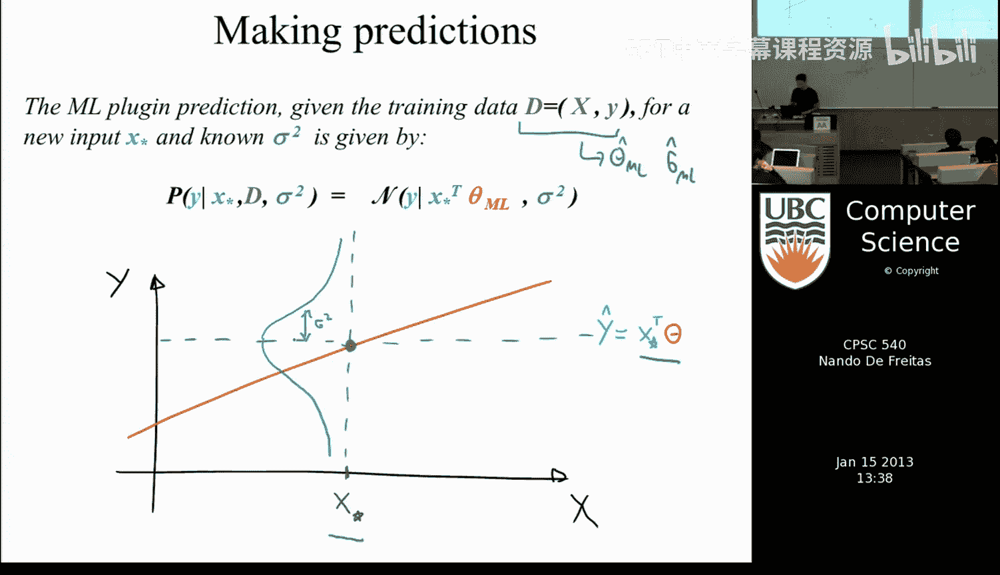

其概率质量函数为：
$$
p(x | \theta) = \theta^x (1-\theta)^{1-x}, \quad x \in \{0,1\}
$$
其中 $\theta$ 表示 $x=1$ 的概率。

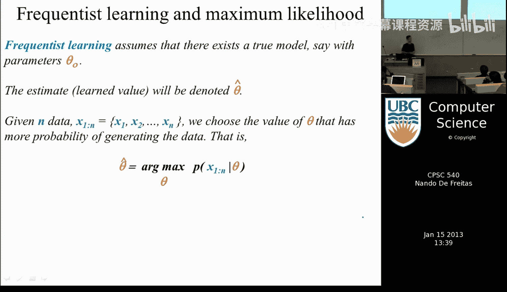

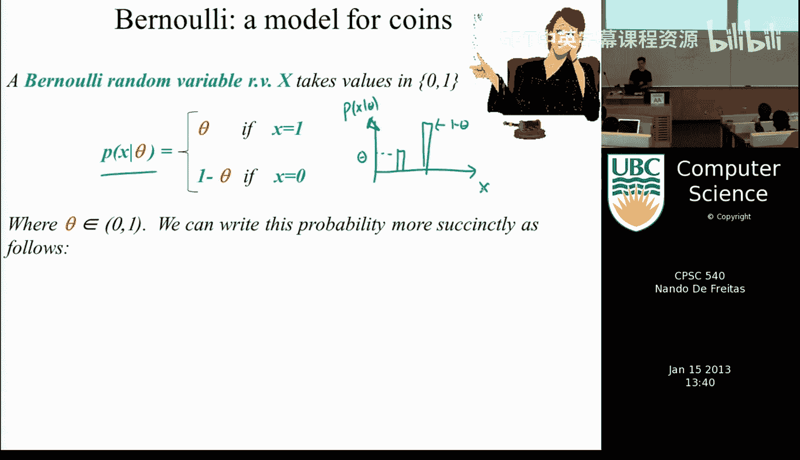

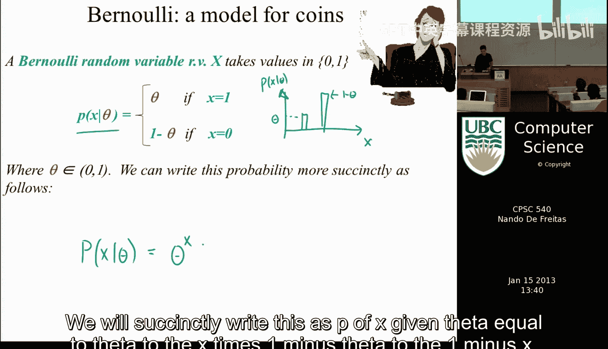

与不确定性相关的一个重要概念是“熵”，它由香农提出，是信息论的基础。对于一个伯努利分布，其熵 $H$ 定义为：
$$
H = -\theta \log(\theta) - (1-\theta) \log(1-\theta)
$$
熵衡量了分布的不确定性。当 $\theta=0.5$（公平硬币）时，熵最大，不确定性最高；当 $\theta$ 接近0或1时，熵减小，不确定性降低。最大似然估计的过程，可以理解为在给定数据后，最小化模型预测的不确定性（即条件熵），这与最大化似然是等价的。

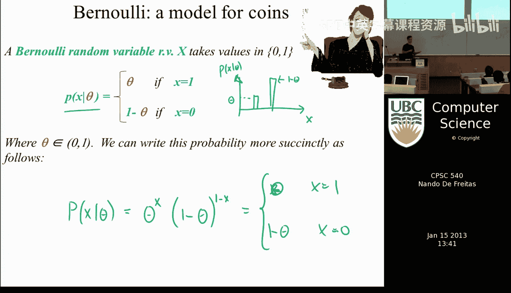

## 总结 🎯

本节课中我们一起学习了：
1.  **高斯分布**：作为连续数据的基础概率模型，包括单变量和多变量的形式及其参数含义。
2.  **最大似然估计（MLE）**：一种核心的参数估计方法，其思想是选择能使观测数据概率最大的模型参数。
3.  **线性回归的概率解释**：我们将线性回归重新表述为在高斯噪声假设下的概率模型。通过最大似然估计推导其参数，发现其解与最小二乘法一致，从而建立了优化视角与概率视角之间的桥梁。
4.  **重要概念**：了解了伯努利分布和熵的概念，认识到MLE在信息论视角下是减少不确定性的过程。

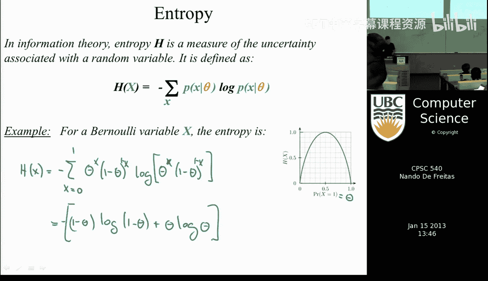

通过本讲，我们为机器学习模型奠定了坚实的概率论基础，并理解了最基础的线性回归模型背后的概率原理。在后续课程中，我们将以此为基础，探索更复杂的模型和学习方法。