# 04：正则化与回归

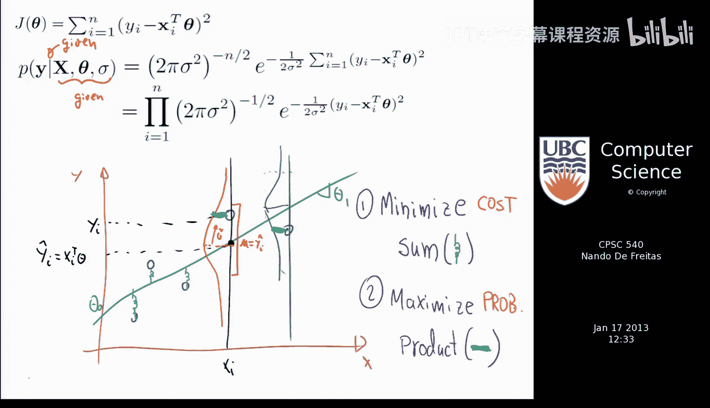

在本节课中，我们将要学习如何通过正则化技术来改进线性回归模型，并探索如何将线性模型扩展到非线性领域。我们将从回顾最大似然估计开始，然后引入正则化的概念，最后讨论如何通过基函数构建非线性模型。

## 回顾：拟合直线与最大似然估计

在之前的课程中，我们学习了如何将一条直线拟合到一组数据点上。我们通过两种方式来实现：一种是将其视为最小化一个成本函数（可以想象为弹簧系统的能量），另一种是将其视为最大化数据的概率（似然函数）。

本质上，这两种视角是相通的。最小化成本函数等同于最大化数据的概率（取其负对数）。对于线性回归，如果我们假设数据点的误差服从高斯分布，那么最大似然估计的结果就等同于最小二乘法。

**公式**：线性模型预测为 `ŷ = Xθ`，其中 `X` 是包含常数项（用于偏置）的特征矩阵，`θ` 是参数向量。

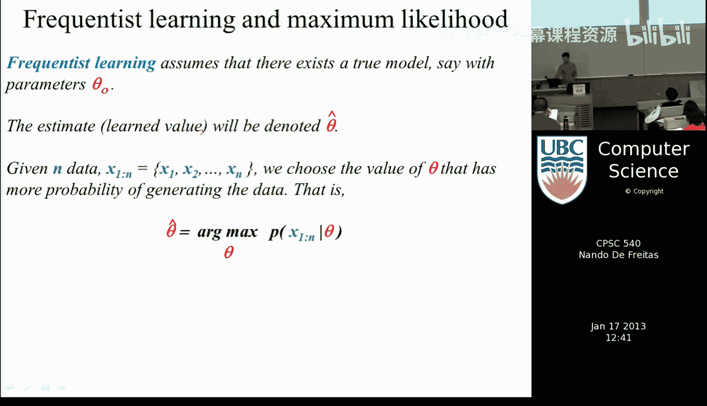

最大似然估计为我们提供了参数 `θ` 的点估计，并且我们还可以估计数据的不确定性（例如方差 `σ²`）。然而，最大似然估计在高维数据或数据点较少时可能会遇到问题。

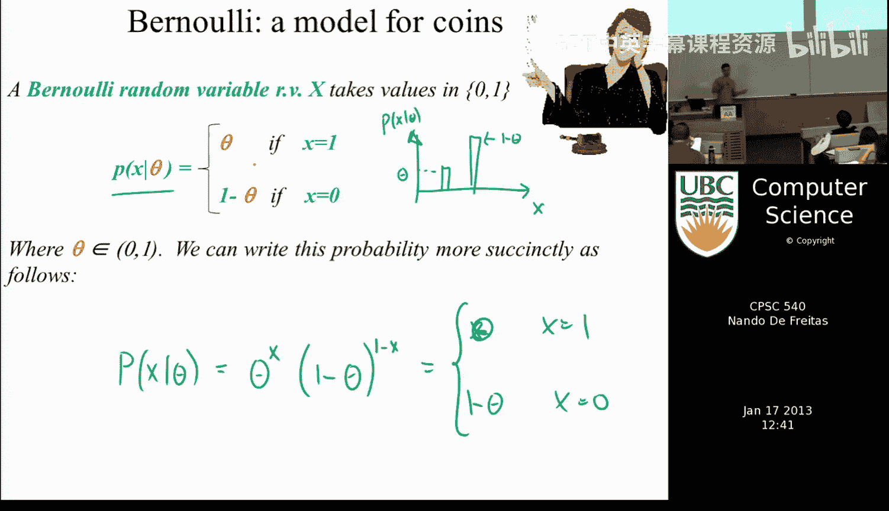

## 引入正则化：岭回归

上一节我们介绍了最大似然估计，本节中我们来看看如何通过正则化来改进它。最小二乘估计需要计算 `(XᵀX)⁻¹Xᵀy`。当特征维度 `d` 很高而数据点 `n` 很少时，矩阵 `XᵀX` 可能病态，导致数值不稳定。

为了解决这个问题，统计学家引入了一个简单的技巧：在 `XᵀX` 矩阵的对角线上添加一个小的常数。这被称为**岭回归**或**Tikhonov正则化**。

**公式**：岭回归的成本函数为：
`J(θ) = (y - Xθ)ᵀ(y - Xθ) + δ²θᵀθ`

其中，`δ²` 是正则化强度参数。新的参数解为：
`θ = (XᵀX + δ²I)⁻¹Xᵀy`

这个额外的项 `δ²θᵀθ` 被称为**正则化项**或**惩罚项**。它的作用是迫使参数 `θ` 的数值变小。现在，我们的目标是在“很好地拟合数据”和“保持参数值较小”之间取得平衡。

## 正则化的几何解释

为了理解正则化如何工作，我们可以从几何角度进行观察。假设参数 `θ` 只有两个分量 `θ₁` 和 `θ₂`。

*   **最大似然解**：最小化 `(y - Xθ)²` 会产生一个椭圆形的等高线，其中心点就是最大似然估计的解。
*   **正则化约束**：惩罚项 `θ₁² + θ₂²` 要求参数向量位于一个以原点为中心的圆形区域内。

以下是寻找正则化解的过程：

1.  当 `δ²` 非常大时，惩罚项占主导，最优解 `θ` 会趋近于零。
2.  当 `δ²` 为 0 时，我们退回到最大似然解。
3.  对于中间的 `δ²` 值，最优解是椭圆等高线与圆形约束区域**相切**的点。

随着 `δ²` 从 0 增加到无穷大，最优解会从最大似然点沿着一条曲线移向原点。这条路径上的一个重要特性是，某些参数分量会比其它分量更快地收缩到零。这个性质可以被用来进行**特征选择**：那些对应重要特征的参数会保持非零，而不重要特征的参数会迅速变为零。

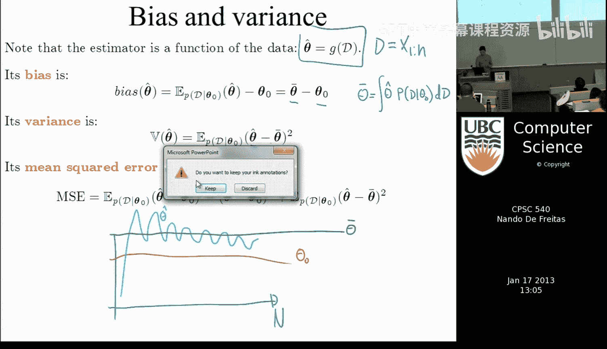

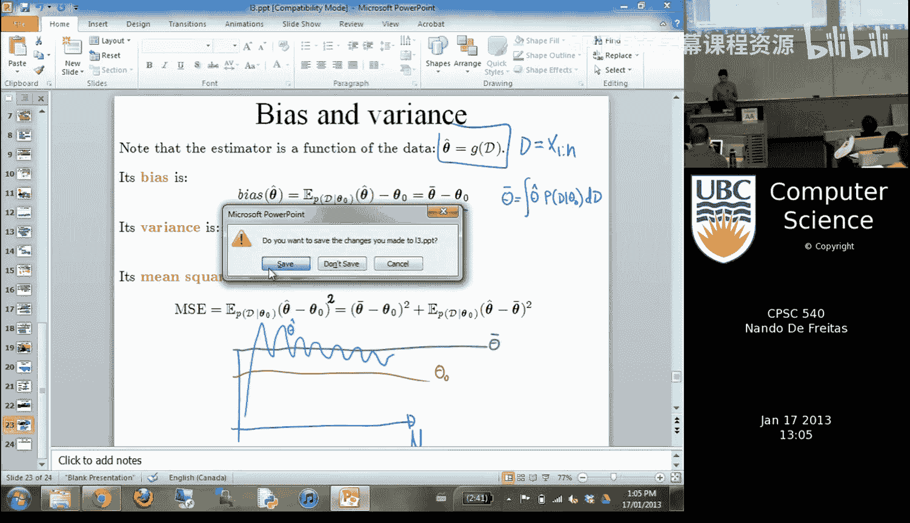

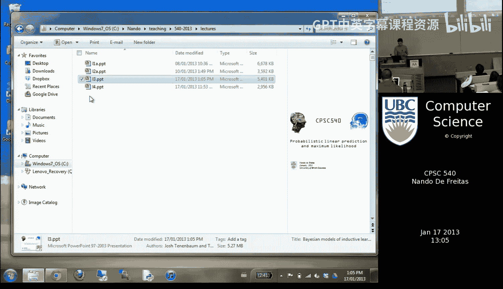

## 从线性模型到非线性模型

到目前为止，我们讨论的都是线性模型。但线性模型的数学框架可以很容易地扩展到非线性模型，这通过使用**基函数**来实现。

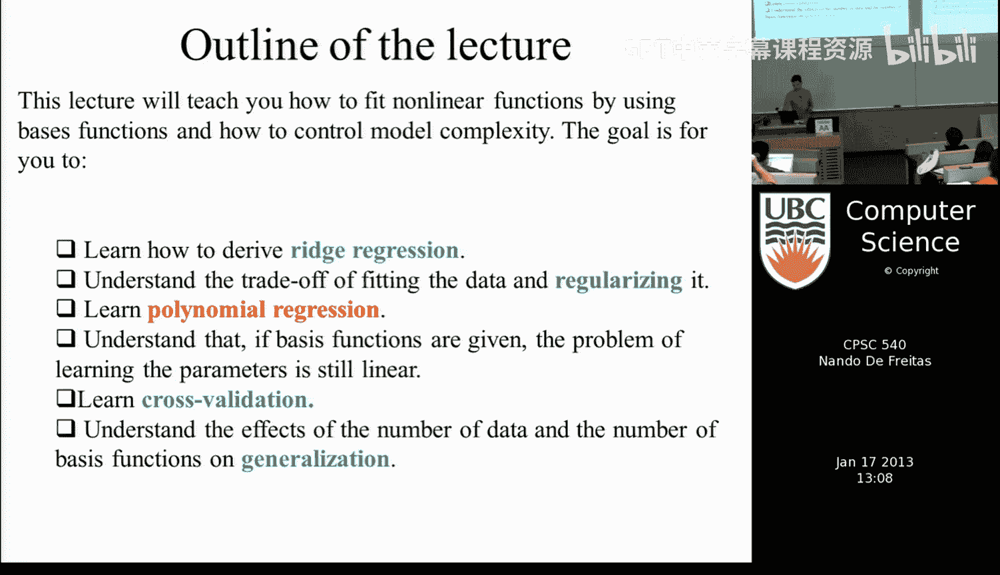

其核心思想是：我们不直接对原始特征 `x` 进行建模，而是先通过一个函数 `φ(x)` 将 `x` 转换到一个新的特征空间。然后，我们在这个新空间里进行线性回归。

**公式**：模型变为 `ŷ = φ(x)ᵀθ`。求解过程与线性回归完全相同，只需将矩阵 `X` 替换为 `Φ`，其中每一行是 `φ(xᵢ)ᵀ`。

以下是一些常见的基函数示例：

*   **多项式基函数**：例如 `φ(x) = [1, x, x², x³]ᵀ`。这允许我们拟合曲线，而不仅仅是直线。
*   **径向基函数**：例如使用高斯函数 `φⱼ(x) = exp(-||x - μⱼ||² / (2λ²))`。我们在不同中心点 `μⱼ` 放置多个这样的基函数，它们的线性组合可以拟合非常复杂的形状。

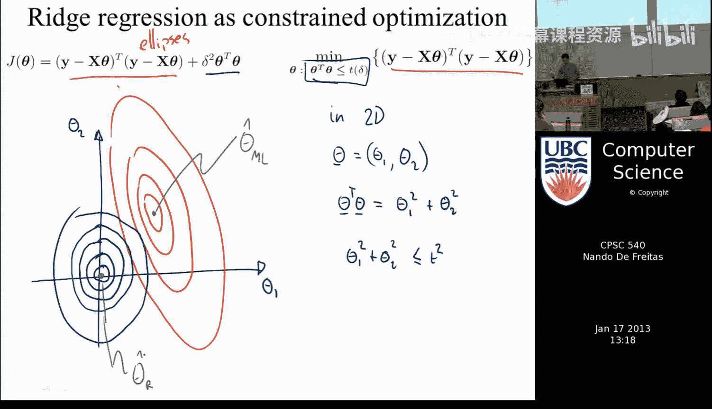

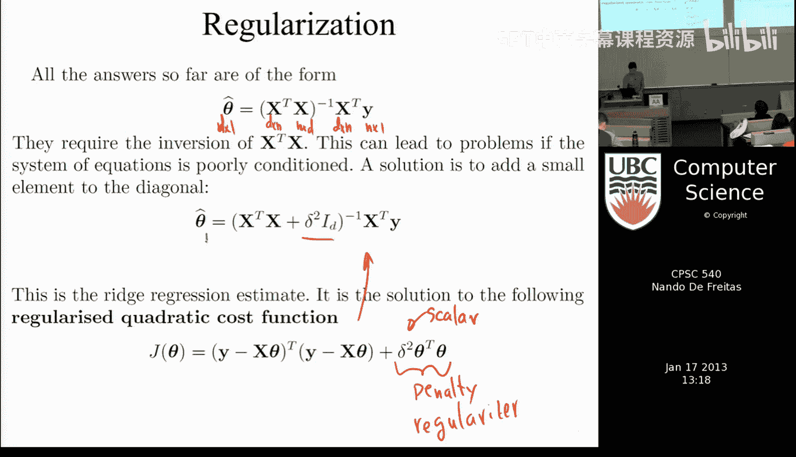

使用基函数后，我们同样可以应用岭回归来防止过拟合。通过控制正则化强度 `δ²`，我们可以自动调整模型的复杂度：较大的 `δ²` 会抑制大部分基函数的作用，得到一个简单模型；较小的 `δ²` 允许使用更多基函数，得到一个更灵活、可能更复杂的模型。

## 如何选择正则化参数 δ²？

无论是线性回归还是非线性回归，引入正则化后都面临一个关键问题：如何选择正则化参数 `δ²` 的值？`δ²` 控制着模型的偏差-方差权衡。

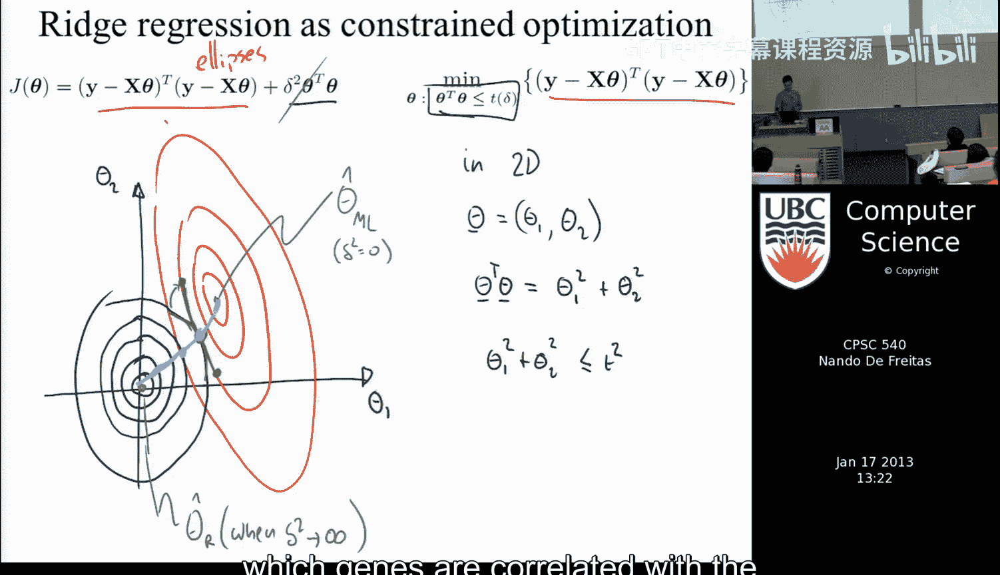

*   `δ²` 太大：模型过于简单（高偏差），可能无法捕捉数据中的模式（欠拟合）。
*   `δ²` 太小：模型过于复杂（高方差），会过度拟合训练数据中的噪声。

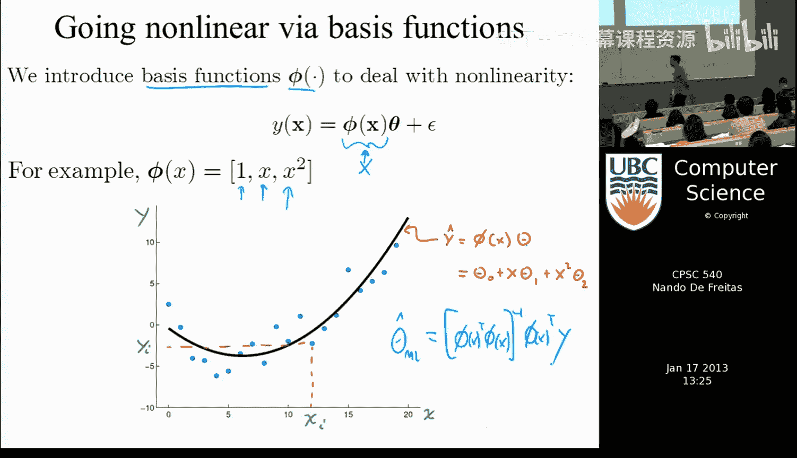

我们将在后续课程中介绍**交叉验证**等技术来实际地、数据驱动地选择最优的 `δ²`。其基本思想是将数据分为训练集和验证集，在训练集上用不同的 `δ²` 训练模型，然后在验证集上评估性能，选择在未知数据上表现最好的那个 `δ²`。

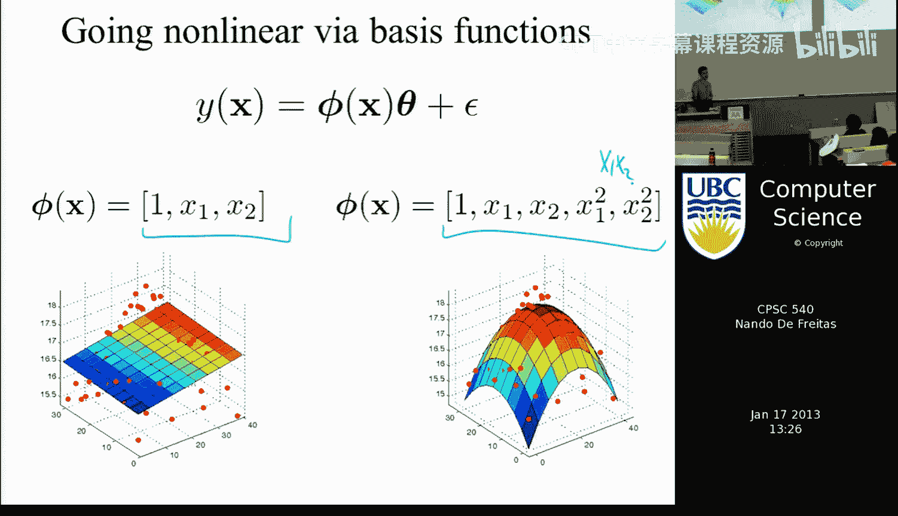

## 总结

本节课中我们一起学习了正则化的核心思想及其在线性和非线性回归中的应用。

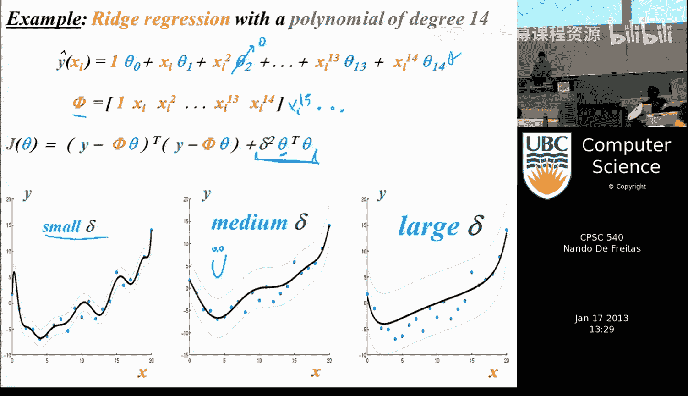

1.  **回顾了最大似然估计**，并指出了其在数据少、维度高时可能存在的问题。
2.  **引入了岭回归**，通过添加 `δ²θᵀθ` 惩罚项来稳定解并控制模型复杂度。我们从几何上理解了其工作原理，并看到了它具备特征选择的潜力。
3.  **扩展到了非线性模型**，通过引入基函数 `φ(x)`，使得线性回归的数学框架能够拟合复杂的非线性关系。多项式回归和径向基函数网络是两个典型例子。
4.  **指出了关键挑战**：正则化参数 `δ²` 的选择至关重要，它直接决定了模型的偏差-方差权衡，而交叉验证是解决这个问题的实用方法。

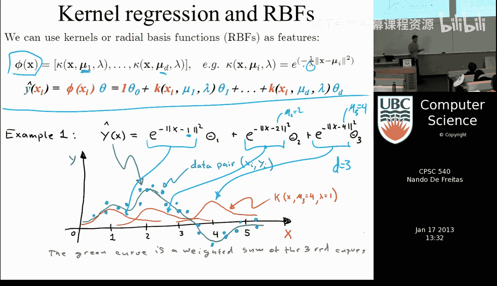

正则化是机器学习的核心概念之一，它不仅是处理高维数据的工具，更是控制模型复杂度、防止过拟合、从而提升模型**泛化能力**（在新数据上的表现）的关键技术。