# 07：贝叶斯学习（第二部分） 🧠

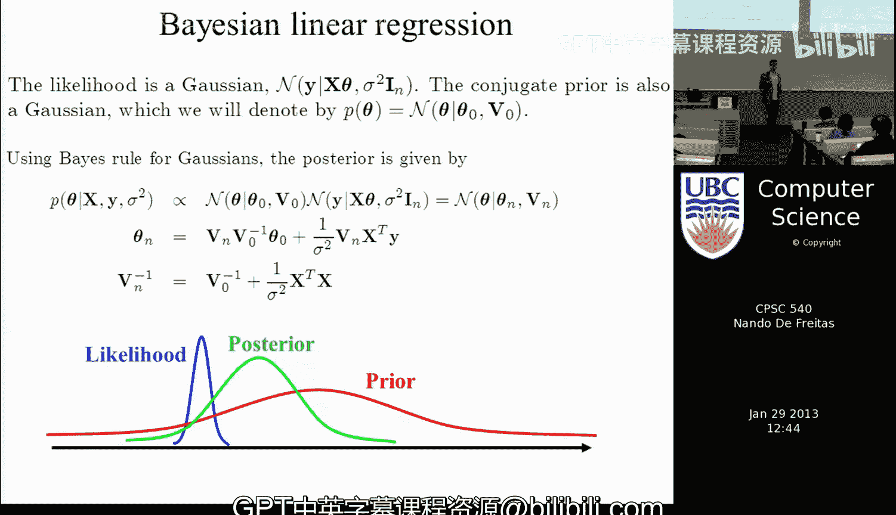

在本节课中，我们将继续学习贝叶斯学习。上一节我们介绍了贝叶斯定理的基本框架，并看到了如何将高斯先验与高斯似然结合，得到高斯后验。本节中，我们将深入探讨共轭先验的概念，并学习如何利用已知的积分形式来简化后验分布的计算。我们还将对比贝叶斯方法与频率主义方法在预测上的差异，特别是关于不确定性估计的部分。

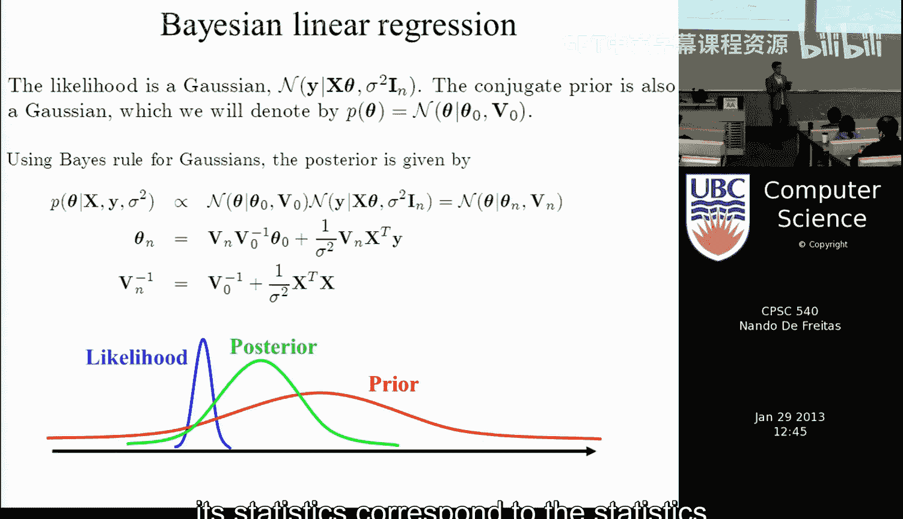

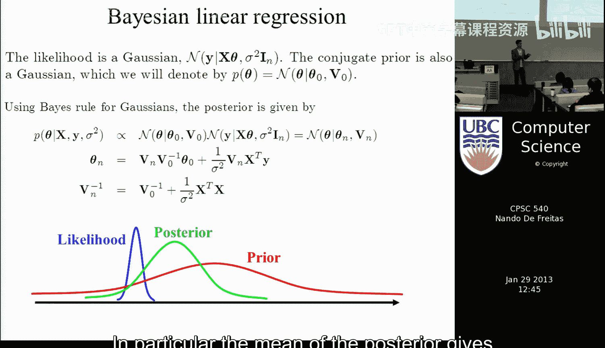

---

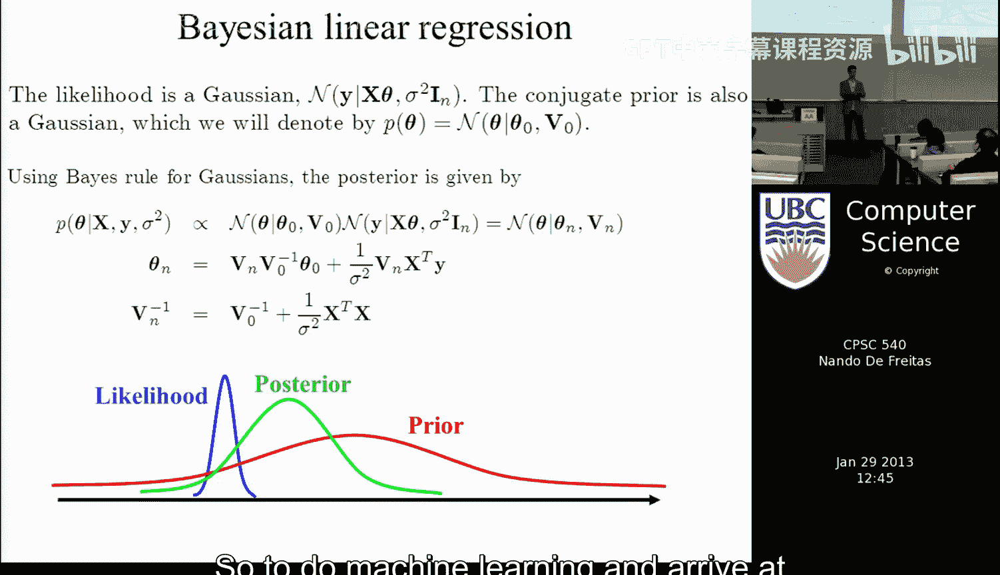

## 共轭先验与高斯分布

上一节我们介绍了，如果你有一个高斯先验，将其乘以一个高斯似然，并进行归一化，你会得到一个高斯后验。

**公式：**
`后验 ∝ 先验 × 似然`

更具体地说，这个高斯后验的统计量，特别是其后验均值，对应于我们之前学过的岭回归估计。当正则化系数 δ 为零时，它就退化为线性回归估计。

除了这种贝叶斯方法，另一种方式是优化方法，即写出对数似然或惩罚似然，然后求导并令其为零。在机器学习中，这两种方法可以得到相同的答案。

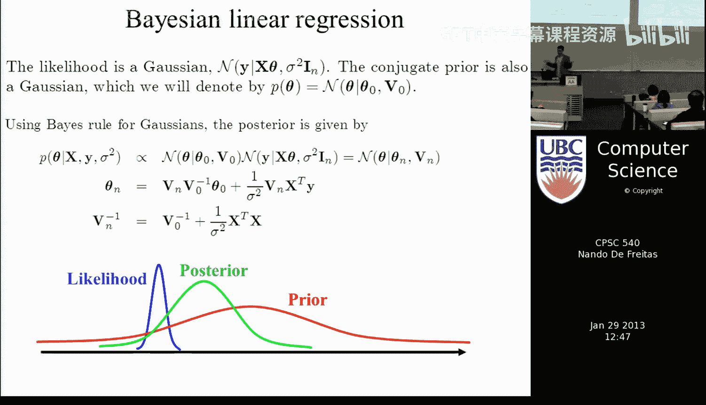

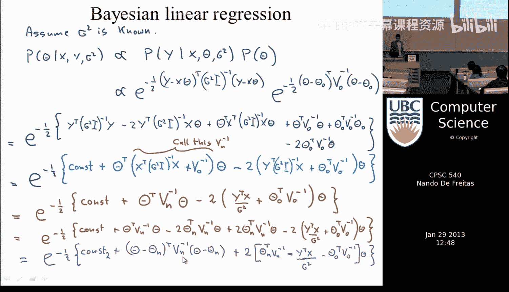

我们有两种途径：可以通过优化途径（涉及写对数似然、求导、令导数为零，或者如课程后面将看到的，沿着梯度下降），或者，我们可以利用我们知道某些积分形式的事实，直接将先验乘以高斯似然，然后重新整理项，使得后验仍然看起来像先验。这本质上是**共轭分析**的基础。

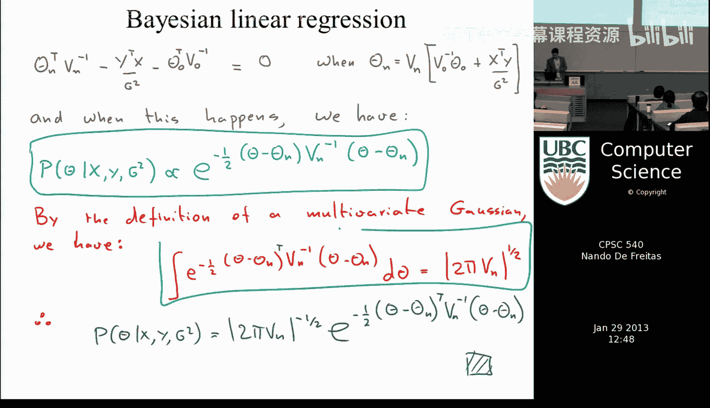

我们做了一个共轭分析的例子，这个例子在作业中要求完成。因为在实际操作中才能真正掌握它。下图概括了核心思想：如果你有一个高斯先验（蓝色曲线），乘以一个高斯似然（红色曲线），结果就是绿色的后验曲线。后验曲线既像先验，又像似然，处于两者之间。

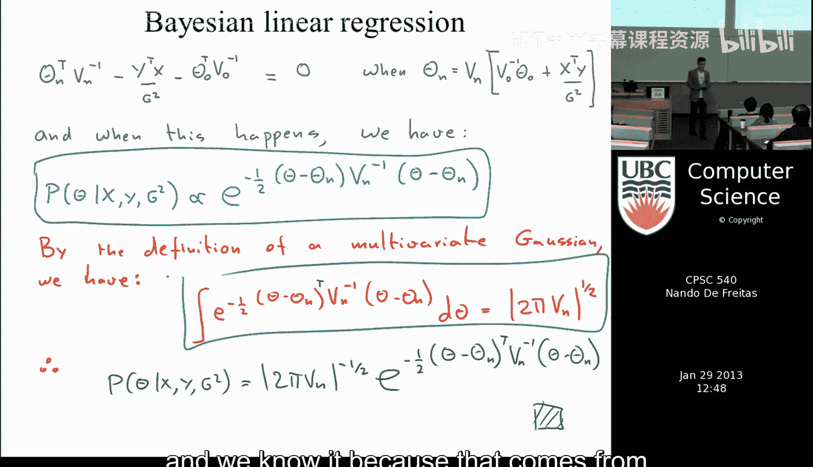

通常，你的先验知识非常模糊，所以先验高斯分布更“胖”（方差大）。似然则倾向于集中在数据所在的位置。每当你获得测量数据，得到这个似然，你的后验本质上会变得更加集中。你对数据的认知有了更高的信息量，这意味着不确定性降低，所以高斯分布的“尾巴”变细，分布变得更窄。

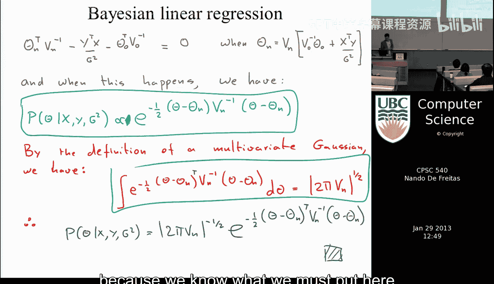

剩下的就是代数运算：取一个高斯分布，乘以另一个高斯分布。我们在一个冗长的练习中完成了这个操作：我们取线性回归的高斯似然，乘以一个高斯先验。这是一个非常繁琐的“配平方法”练习。

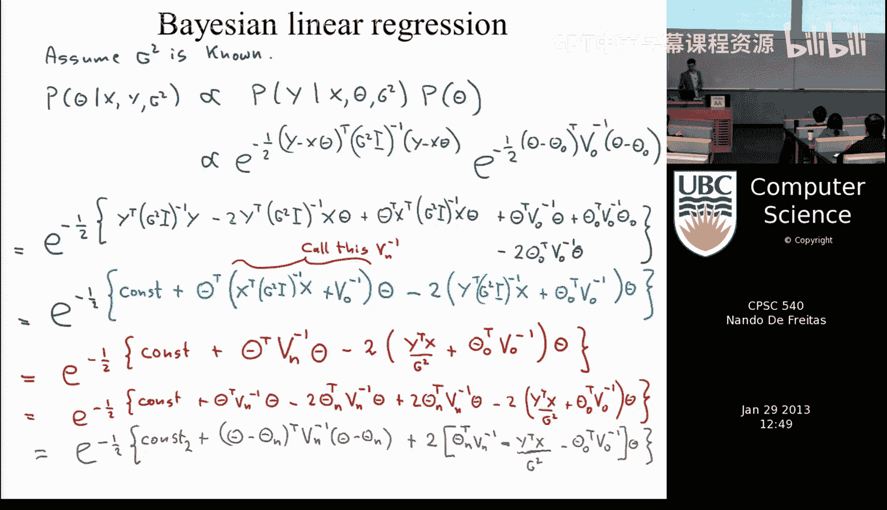

最终我们发现，后验分布具有以下表达式，它仍然是一个高斯分布。但重要的是，因为我们知道二次型指数的归一化常数（这来自于高斯分布的公式），所以我们知道积分如何计算。如果我们知道积分如何计算，就意味着我们知道后验是什么，因为我们知道必须在这里放什么才能使整个表达式求和为一。

所以，基本操作是：你取绿色曲线（似然），乘以蓝色曲线（先验）。如果你把一个函数想象成一个有许多条目的向量，你就是在将两个向量相乘，然后确保结果向量被归一化，使其总和为一。

---

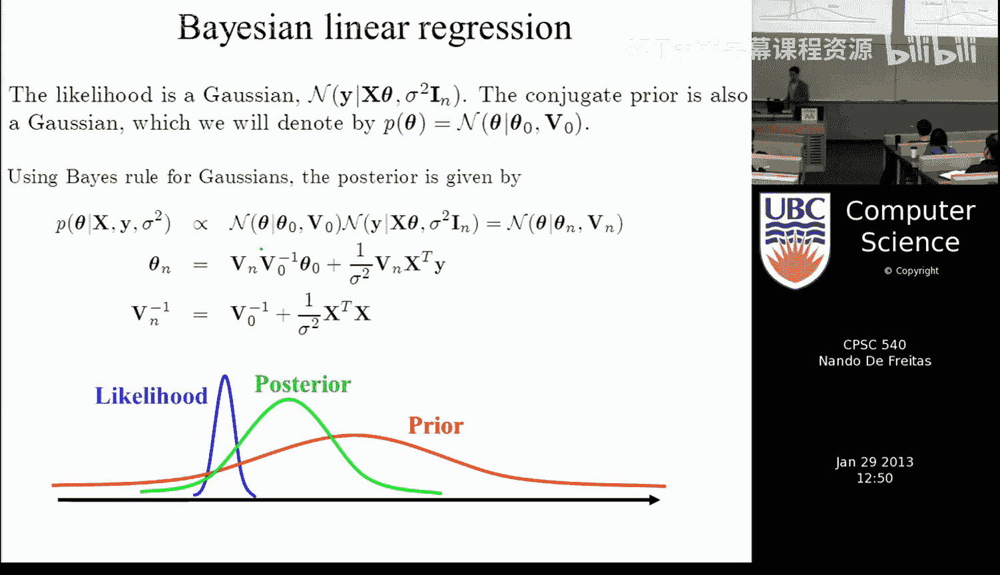

## 当先验与似然不共轭时

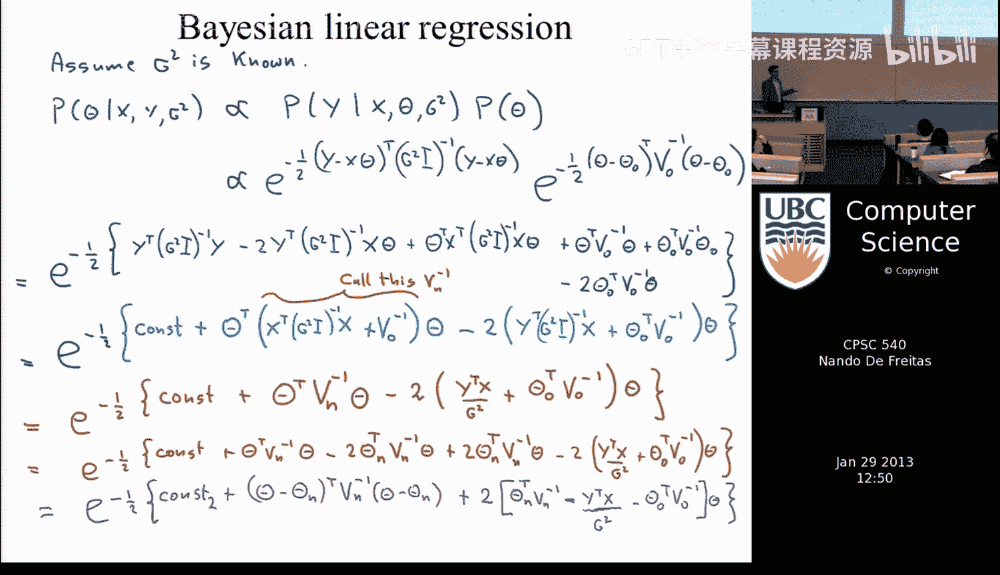

如果先验和似然的乘积不是已知的分布形式怎么办？在某些情况下，我们选择的先验与似然不共轭，因此我们不知道积分的结果。当我们不知道积分时，就必须引入数值技术来求解积分。课程后面我们会讲到，我将介绍蒙特卡洛方法来解决这个问题。

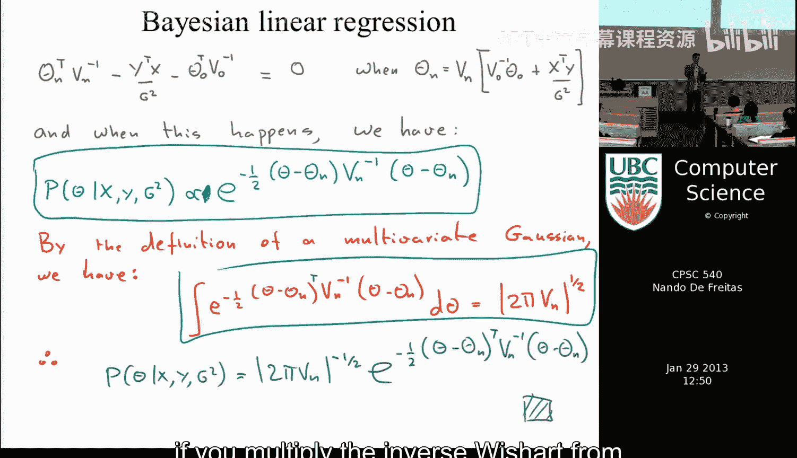

但有一类分布，比如高斯分布，我们非常喜欢。我们喜欢它们的原因是因为我们可以用手算出积分。这是少数我们可以手动求解的积分之一，非常宝贵。这也是为什么人们经常用高斯分布来建模数据的原因之一，因为它们易于操作，是最简单的模型。

对于真实数据，这本质上给了我们后验的表达式。然后在作业中，我要求你对方差做同样的事情来估计方差。我给了你方差的先验，即逆Wishart先验。同样，如果你将逆Wishart先验与高斯似然相乘，得到的表达式看起来也像一个逆Wishart分布。

因为你知道了归一化常数（对于所有这些标准分布，我们都知道归一化常数），那么推导大Σ（协方差矩阵）的后验分布又是一个非常简单的练习。

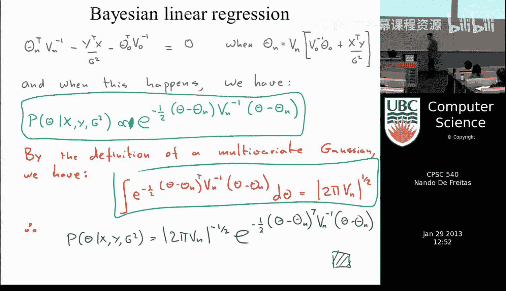

如果你有了协方差矩阵大Σ的后验，通过将先验参数设置为某些特定值，你可以得到最大似然估计，这也是我在作业中要求你做的另一件事。所以，你为大Σ做了，我在课堂上为Θ做了。事实上，对于任何模型，其机制总是相同的：你有一个先验，乘以一个似然。如果你知道积分，你可以做这种称为“共轭分析”的事情，然后你得到后验的表达式。当你改变那个先验的参数时，你就能恢复最大似然估计。

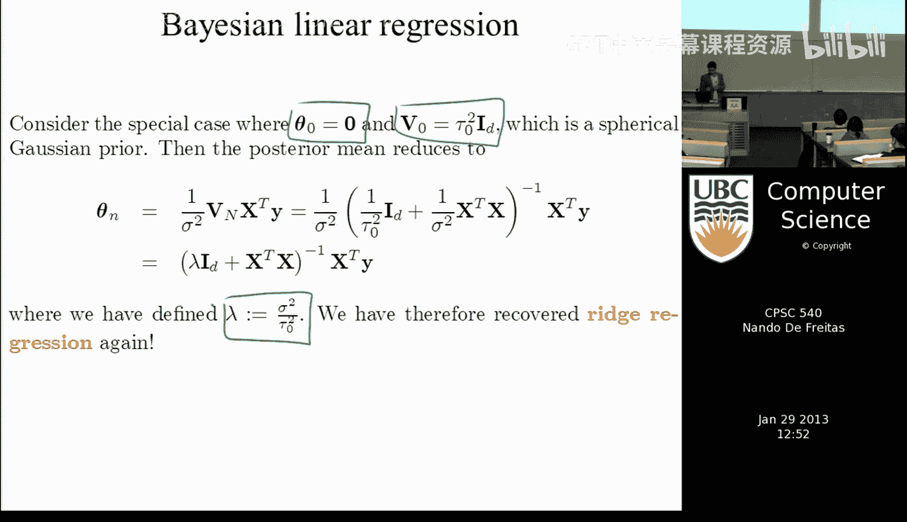

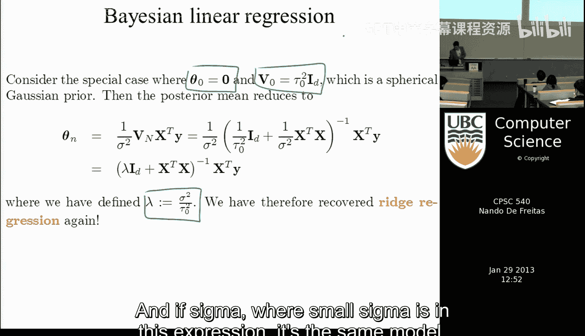

---

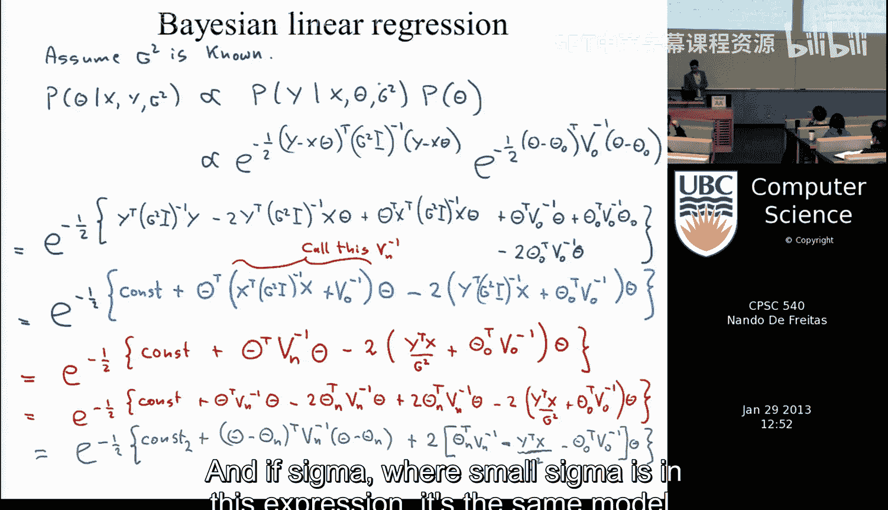

## 从贝叶斯后验到频率主义估计

特别地，如果我们考虑一个零均值的先验。对于方差，我们引入这个量 τ₀²，它只是一个正标量。那么可以证明，通过引入这个参数 λ（这只是 σ²/τ₀² 的一个重参数化，使其更简洁），后验均值的表达式就简化为岭回归估计。

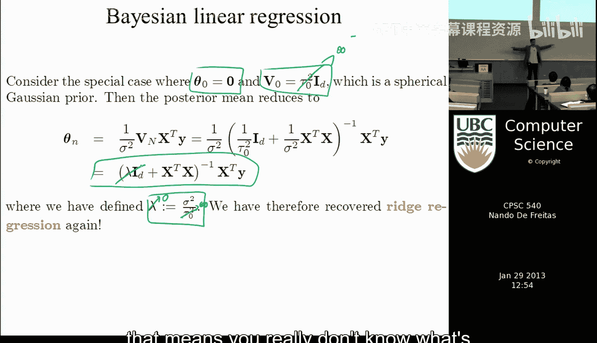

现在，如果我们让先验变得非常平坦。我们有一个似然，但如果我们取一个方差非常非常大的高斯先验（即 τ₀ 非常大，趋于无穷大），那么 λ 就趋于零。如果 λ 趋于零，我们就得到最大似然估计。这完全说得通：如果你的先验非常平坦，那意味着你真的不知道你的参数 θ 最可能的位置在哪里。你基本上是在说“我不知道”。通过使那个先验平坦（近乎均匀），如果你的先验没有信息，那么你应该得到由似然暗示的答案。贝叶斯框架的一个非常好的地方在于，它允许我们仅基于数据恢复通常的常识性估计量。

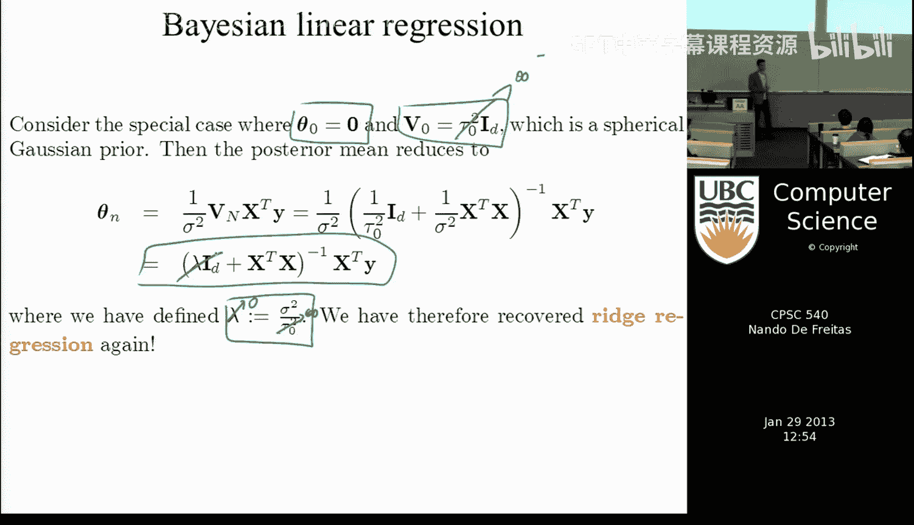

---

## 高斯分布的重要定理

现在，我将不加证明地给出一个非常有用的定理（实际上我们证明了一部分）。这个定理来自Kevin Murphy的教科书。定理说：如果你有一个高斯边际分布 P(x) 和一个高斯条件分布 P(y|x) 是这种形式，那么后验 P(x|y)（等于似然 P(y|x) 乘以先验 P(x)）总是允许这种特定的表达式。

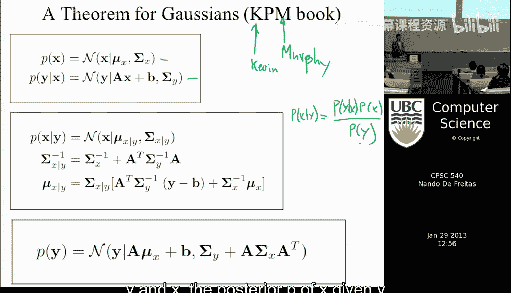

这是一个关于任意变量 x 和 y 的通用定理（不要与线性回归中的 x 和 y 混淆）。后验 P(x|y) 总是允许这种表达式。如果我给了你这条定理，你就不需要做任何配平方法了，因为当你做配平方法时，你证明的就是这条定理的一个特定变体。

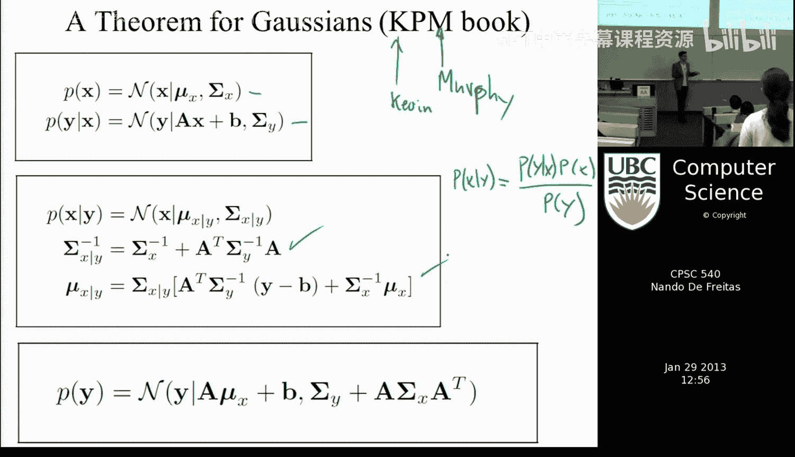

我们证明了这个（第一个方框）。我们没有证明的是第二个方框，这被称为**卷积**。之所以叫卷积，是因为为了得到 P(y)，我们要对虚拟变量 x‘ 积分：∫ P(y|x’) P(x‘) dx’。这类似于信号处理中见过的卷积操作。但我要说的是，如果你取两个高斯分布相乘，然后对变量 x 求和，P(y) 的表达式总是这种形式。

我可能会在以后的作业中布置这个练习。老实说，除了操作高斯分布，你做这个练习学不到太多东西。但如果你认真对待机器学习或数据挖掘，或者你想做涉及机器学习的博士研究，我强烈建议你完成这个推导。它在Kevin书的第四章，非常繁琐，所以我不想在课堂上做。但一旦你有了第一部分证明，并且有了第二部分，你基本上可以用高斯分布做所有事情。

实际上，如果你现在记住这个定理，当你需要计算高斯分布的后验时，你就不必再手动做配平方法了，基本上只需遵循这个“配方”。

---

## 预测分布

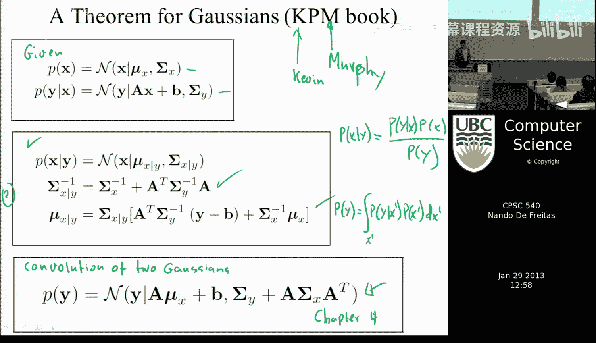

我谈论卷积的原因是因为它允许我们进行**预测**。我们知道我们已经推导出了后验均值和后验方差的表达式。但现在，如果我使用两个高斯相乘并积分掉变量（即卷积操作）的表达式，只需应用上一页的定理，我就能得到这个**预测分布**的表达式。

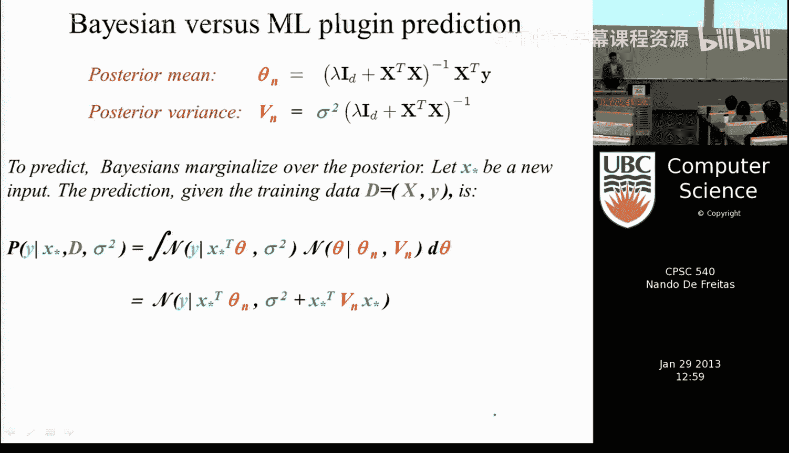

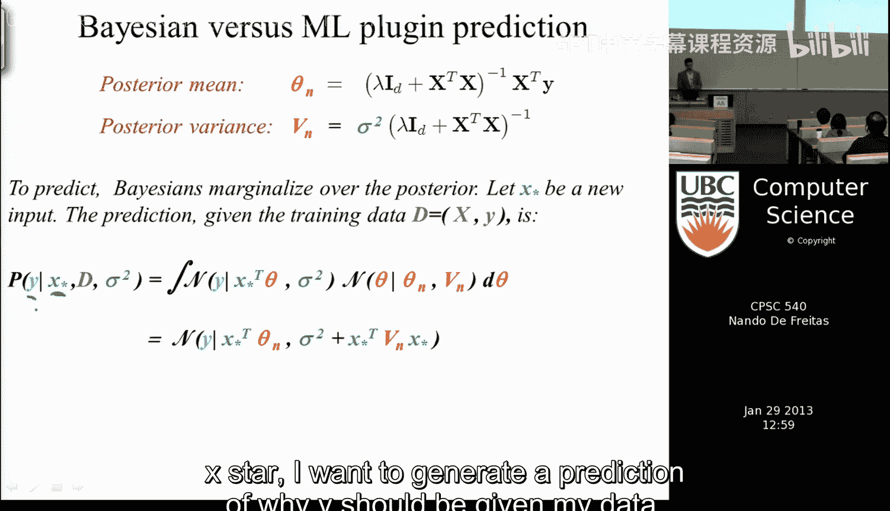

如果你想做一个预测，换句话说，给定一个新的输入 x*，我想预测 y 应该是什么，给定我的数据（包括所有训练数据 X, y）。那么对于贝叶斯主义者来说，进行预测的方法是：你本质上对参数进行**边缘化**。或者可以说，对于 θ 的每一个可能值，你的预测都由其后验概率加权。所以这是一个加权预测。如果有三个 θ 值，它就被三个值加权。实际上它被无限个 θ 值加权，因为积分覆盖了整个 θ 的定义域。

本质上，频率主义者进行预测时只使用似然。我告诉过你，如果你在做最小二乘法时想进行预测，你只需取新的 x 乘以 θ，就得到了你的预测，然后不确定性就是传感器噪声 σ²。但贝叶斯方法说，我们不要只用这个 θ，而是让每个 θ 的预测都按其后验概率加权。所以这是一个**集成预测器**。

如果我们应用上一页的定理，我们得到这里的表达式。

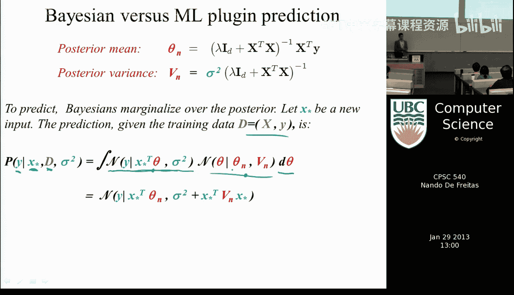

---

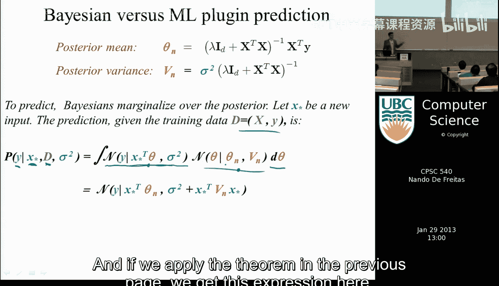

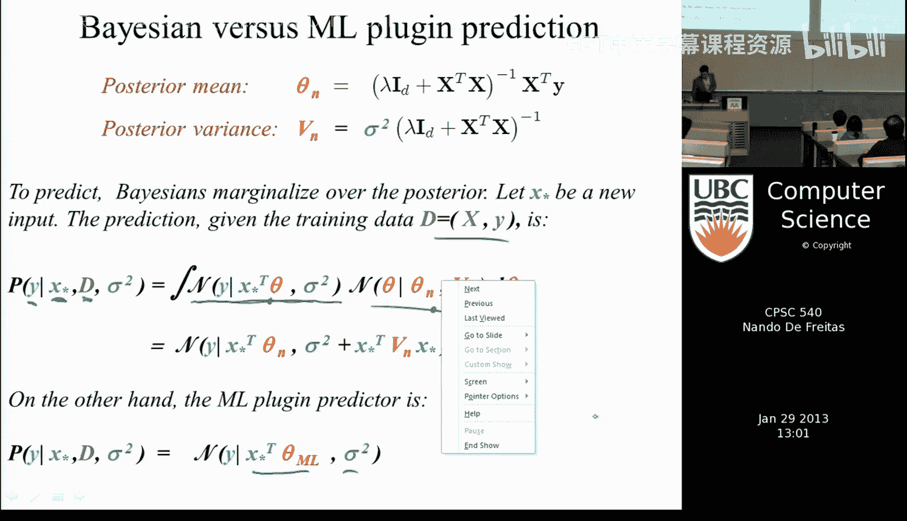

## 贝叶斯预测 vs. 最大似然预测

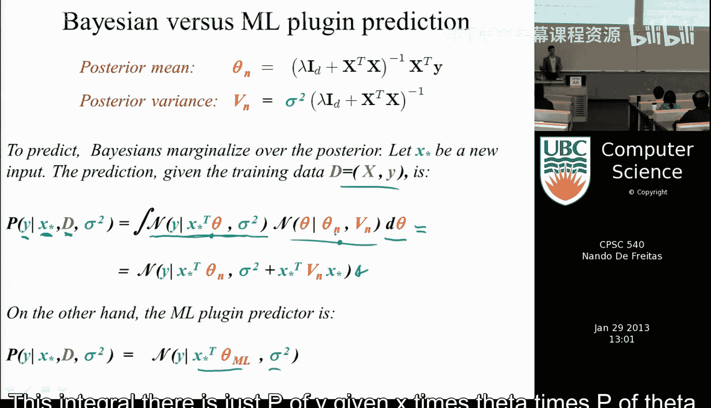

与最大似然预测相比，最大似然预测只是取 x 乘以 θ，并具有相同的方差。贝叶斯方式则不同。最大似然基本上假设只有一个单一的 θ。换句话说，频率主义者所做的是用狄拉克δ函数在 θ_ML 处来近似这个积分。

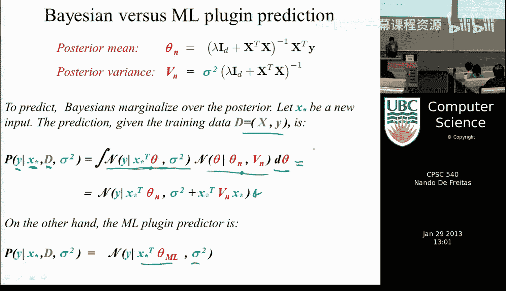

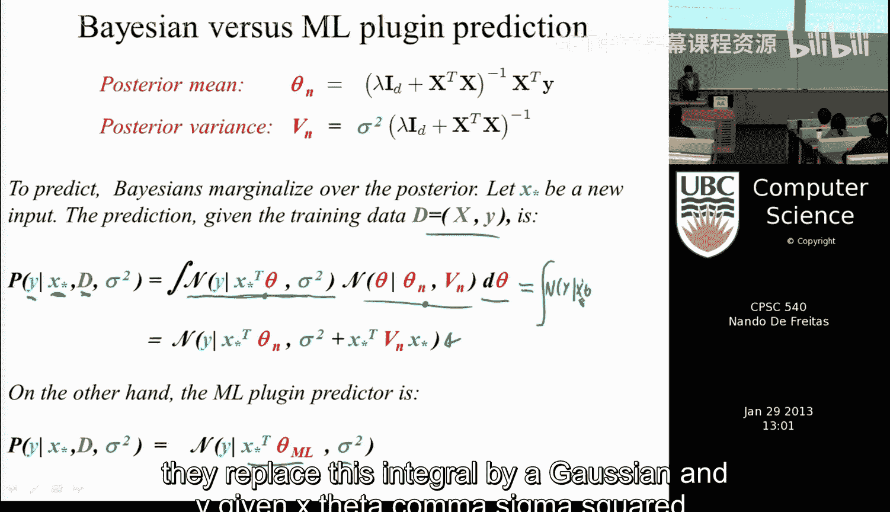

狄拉克δ函数也称为冲激函数。它的一个性质是，如果你对一个函数关于δ函数积分，你本质上只是选取了 θ_ML 处的值。换句话说，如果我用一个高斯乘以一个尖峰，那么除了尖峰所在点，其他地方都是零，而在那个点上，它就是高斯函数的值。这就是为什么底部的积分简化为这个表达式。

因为频率主义者假设只有一个真实的 θ。贝叶斯主义者总是假设有无限多个 θ，你应该用每个 θ 的值来加权每个预测。

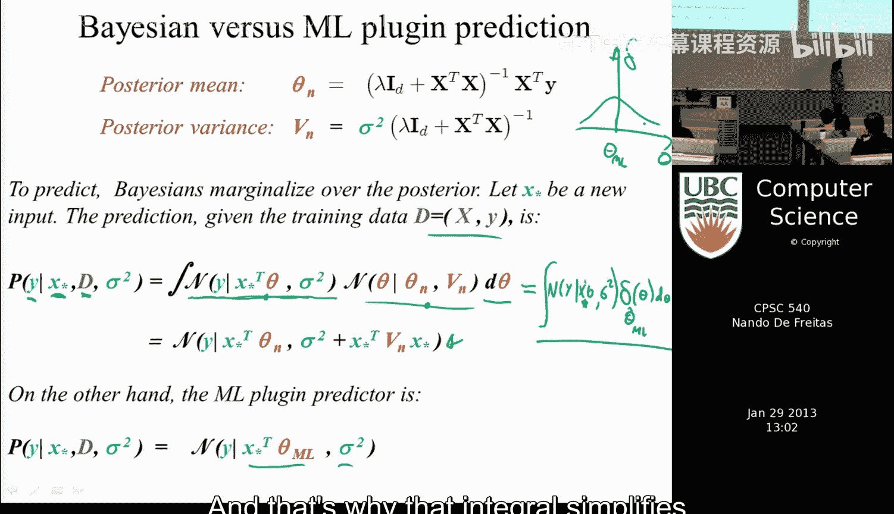

这意味着，后验均值 θ_N、最大似然估计 θ_ML 可能没有太大不同，在实践中，岭回归估计和最大似然估计通常非常相似（除了数值计算问题）。然而，一个重要的事情是这个额外的项。

注意，两个表达式都有相同的 σ²。但在贝叶斯方案中，出现了一个新项。这个项包含了新的输入数据 x* 和这个矩阵 V（它与训练数据 XᵀX 的逆有关）。

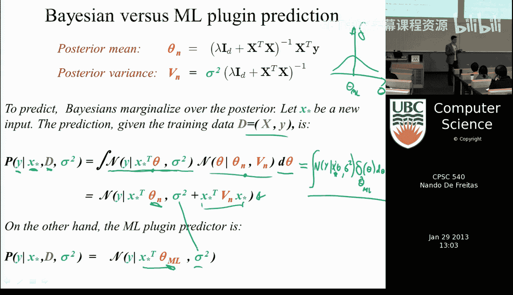

这个额外项的效果如下：你的频率主义估计总是有相同的权重，即 σ²。因为我们说过 σ² 是相同的，并且这个 σ² 适用于每一个点。所以每个点，如果我们边际地看，x 和 y 的每个点都根据一个高斯分布分布（仍然是线性回归）。

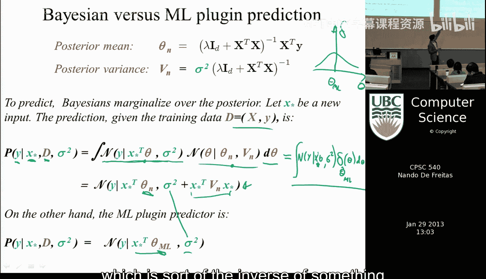

然而，贝叶斯给我们的这个额外项 x*ᵀ V x* 确保了：在我们有数据的地方（比如图中这些条形所在处），因为条形的高度现在依赖于数据，当我们有数据时，这些部分会很窄；当我们没有数据时，这些条形会很高。换句话说，如果我们知道空间的某一部分有数据，我们对估计有信心；但在我们没有数据的地方，我们不应该有信心。

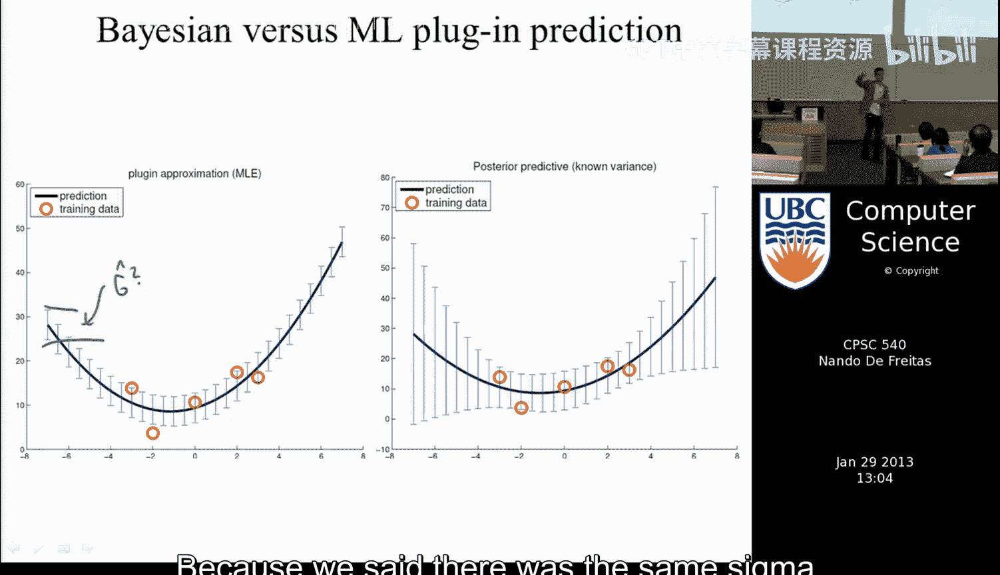

最大似然估计在这方面表现相当差，因为估计器在这里和在那里一样自信，这是没有道理的。所以这一点很重要。如果你关心置信区间，你会希望如此。

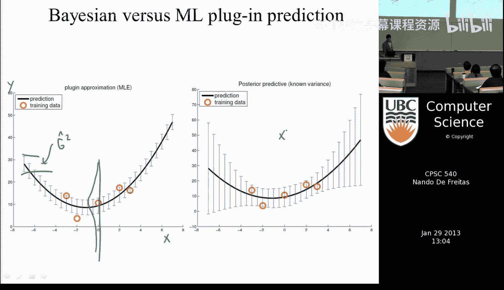

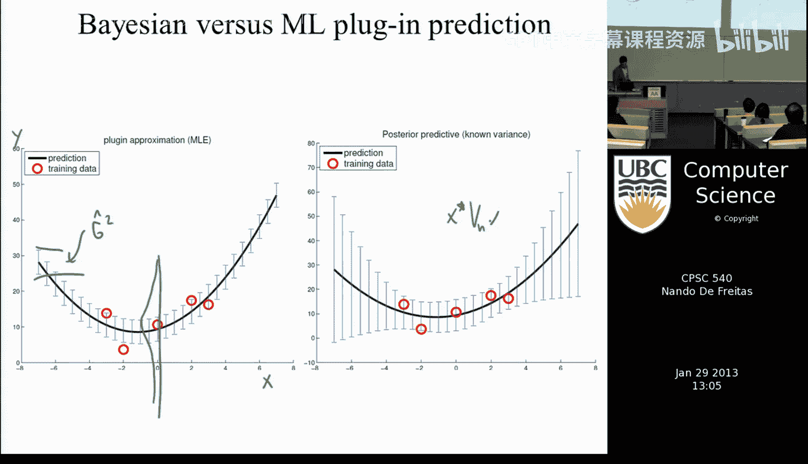

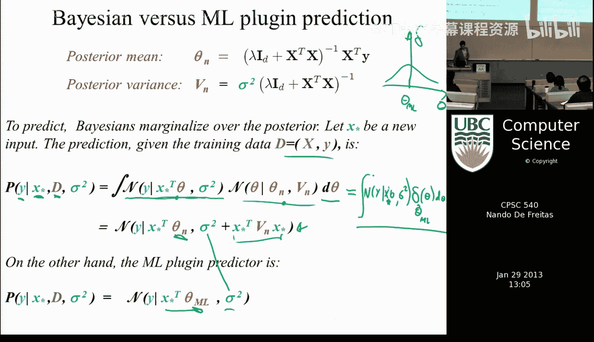

---

## 总结

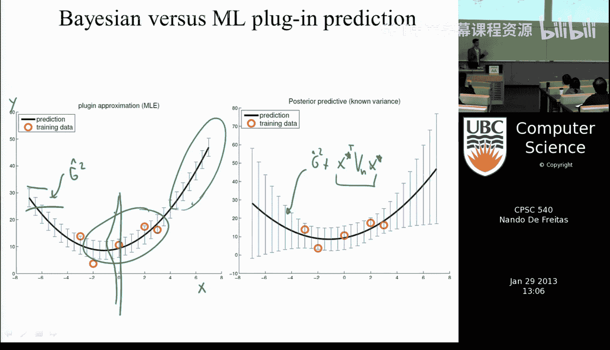

本节课中，我们一起深入学习了贝叶斯学习的第二部分。我们回顾了高斯先验与似然共轭时，后验分布的计算方法，并理解了共轭先验如何简化计算。我们学习了高斯分布的一个重要定理，它为我们提供了计算后验和预测分布的通用“配方”。最后，我们对比了贝叶斯预测与频率主义（最大似然）预测的关键区别：贝叶斯方法通过对参数积分，自然地给出了依赖于数据分布的预测不确定性估计，在没有数据的区域预测方差更大，这更符合直觉；而频率主义方法则对所有区域的预测都赋予相同的不确定性。这凸显了贝叶斯框架在量化预测信心方面的优势。