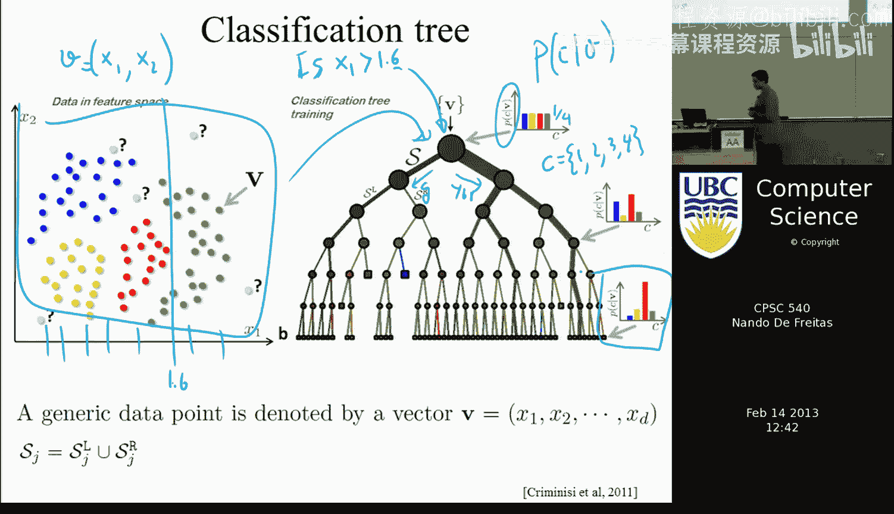
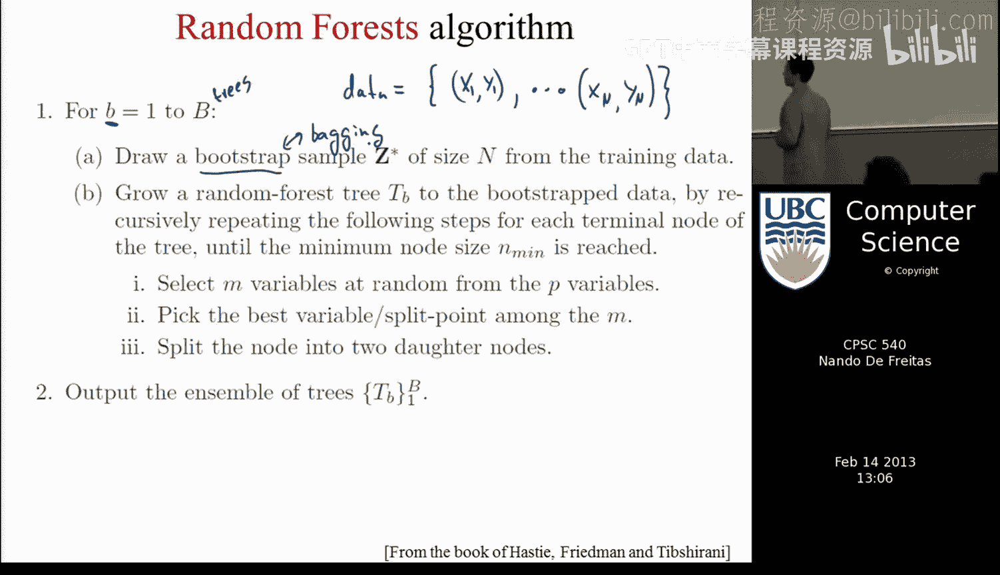
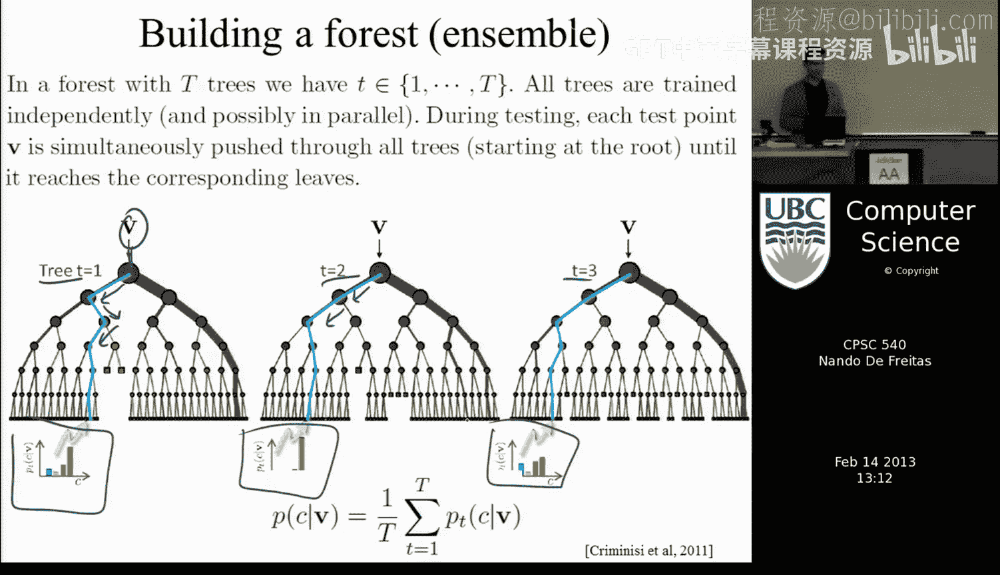
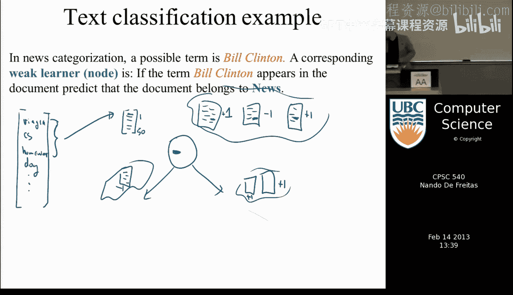
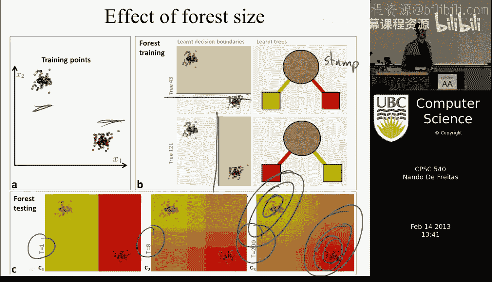
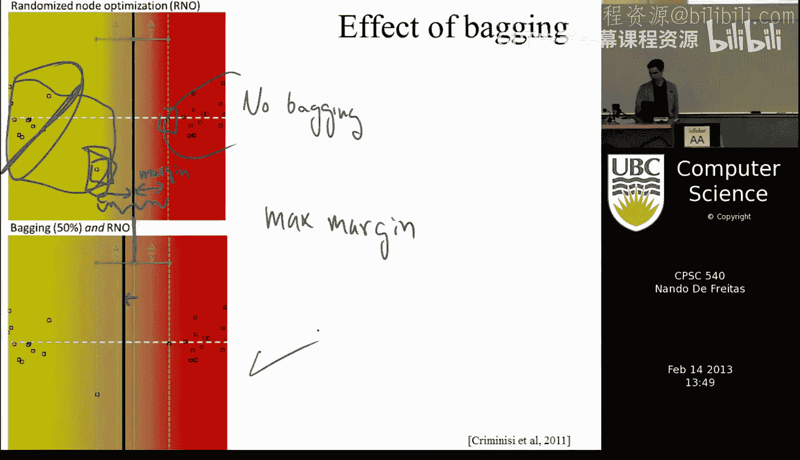
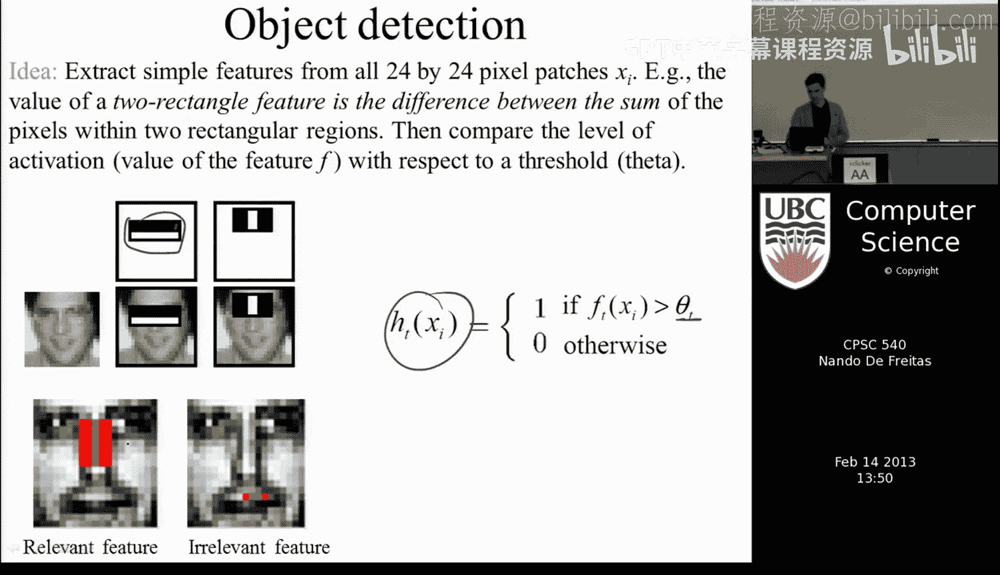
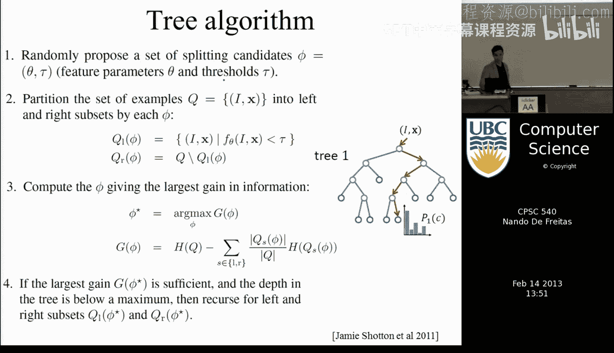
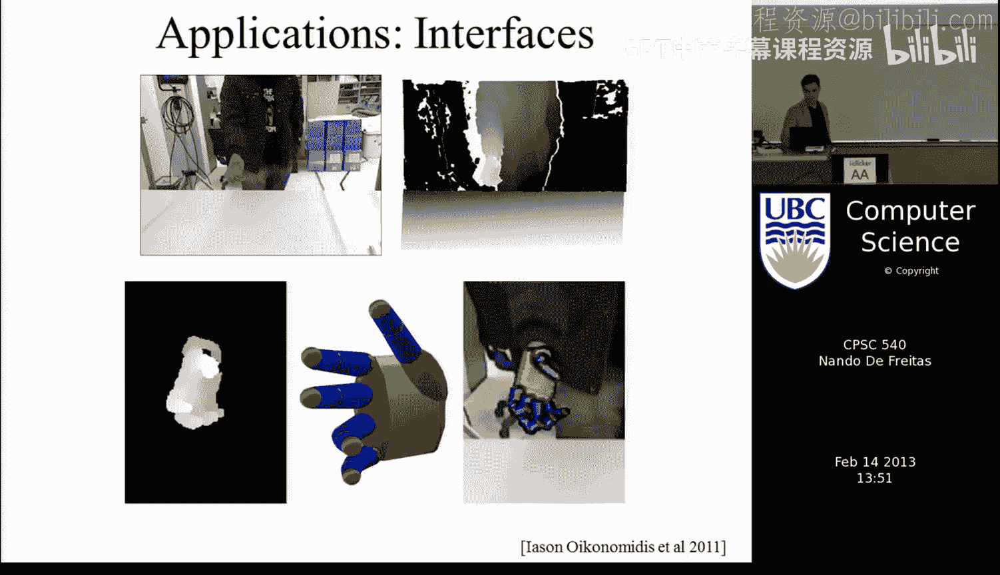
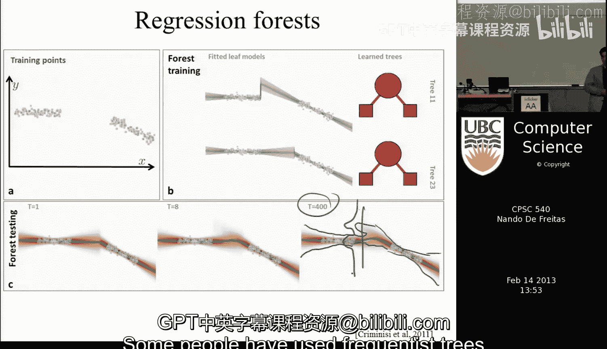

# 12：随机森林 🌲

在本节课中，我们将要学习随机森林。这是一种强大的集成学习方法，通过组合多个决策树来提高预测的准确性和鲁棒性。我们将探讨如何构建随机森林、其核心参数的选择，以及它在文本分类和人脸检测等实际应用中的威力。

## 构建单个决策树

上一节我们介绍了集成学习的概念，本节中我们来看看随机森林的基础——单个决策树是如何工作的。

假设我们有一些二维特征点需要分类，每个点有坐标 `(x1, x2)` 和对应的类别标签（例如红、绿、蓝、黄）。决策树的构建从根节点开始，根节点包含所有训练数据点。

当一个新的点 `V` 到来时，它从根节点开始，根据一系列规则（例如 `x1 > 1.6` 吗？）被引导至不同的子节点，最终到达一个叶节点。该叶节点中训练数据的类别分布，就是新点 `V` 属于各个类别的概率。

构建树的过程，本质上是选择最佳分割点（阈值）来划分数据空间。以下是构建单个决策树的关键步骤：

1.  **选择分割维度与阈值**：对于每个节点，我们从所有特征中随机选择一个子集。对于选中的每个特征，我们考虑所有数据点在该特征上的取值作为候选分割阈值。
2.  **计算信息增益**：对于每个候选阈值，我们计算用它分割当前节点数据后带来的信息增益。信息增益衡量了分割后类别纯度的提升，计算公式基于熵 `H`：
    `信息增益 = H(父节点) - [ (N_left/N_total)*H(左子节点) + (N_right/N_total)*H(右子节点) ]`
    其中 `H(S) = - Σ p(c) * log2(p(c))`，`p(c)` 是集合 `S` 中类别 `c` 的比例。
3.  **选择最佳分割**：我们选择能带来最大信息增益的那个特征和阈值作为当前节点的分割规则。
4.  **递归构建**：对分割后产生的左右子节点，重复步骤1-3，直到满足停止条件（如达到最大深度、节点内数据量过少或纯度足够高）。

这样，我们就得到了一棵决策树，它能将复杂的特征空间划分为一系列简单的矩形区域，每个叶节点对应一个区域和其类别概率分布。

## 引入随机性：从单棵树到随机森林

单个决策树容易过拟合，且对数据微小变化敏感（高方差）。为了解决这个问题，我们引入随机性来构建多棵树，然后组合它们，这就是随机森林。

随机森林的构建包含两层随机性，以下是具体步骤：

1.  **数据随机性（Bagging/自助采样）**：对于要构建的 `B` 棵树中的每一棵，我们从原始 `N` 个数据点中**有放回地**随机抽取 `N` 个样本（这意味着有些样本可能被重复抽取，有些则未被选中）。这称为自助采样，它让每棵树看到略有不同的数据子集。
2.  **特征随机性**：在构建每棵树的每个节点时，我们不是从所有 `D` 个特征中选择最佳分割，而是先随机选择一个特征子集（例如大小为 `M`，`M` 通常远小于 `D`），然后只在这个子集中寻找最佳分割特征和阈值。

通过这两种随机性，我们确保了森林中的每棵树都是多样且相对独立的。这种多样性至关重要。

## 组合预测：平均的力量

当需要对新样本 `V` 进行预测时，我们让 `V` 通过森林中的每一棵决策树。每棵树都会输出一个预测结果（对于分类，是类别概率分布；对于回归，是一个数值）。

随机森林的最终预测是所有这些树预测结果的**平均**。

*   **对于分类问题**：我们平均所有树输出的类别概率向量。最终，选择平均概率最高的类别作为预测结果。
    `P_forest(c|V) = (1/B) * Σ_{b=1}^{B} P_tree_b(c|V)`
*   **对于回归问题**：我们平均所有树输出的数值。
    `y_forest = (1/B) * Σ_{b=1}^{B} y_tree_b`

这种平均操作能有效降低方差。直觉上，如果每棵树都是围绕真实值波动但无偏的估计器（高方差、低偏差），且树与树之间的误差不相关，那么平均之后，波动会相互抵消，结果会更接近真实值。决策树由于其结构，正是这种高方差、低相关性的理想候选者。

## 核心参数与选择

构建随机森林时，有几个关键参数会影响其性能：

*   **树的数量 `B`**：通常，树越多，模型的方差降低效果越好，预测越稳定。但收益会递减，且计算成本增加。一般选择几十到几百棵树。
*   **每棵树的最大深度**：控制单棵树的复杂度。树太浅可能欠拟合（无法捕捉模式），太深可能过拟合（对噪声敏感）。需要通过交叉验证来选择。
*   **节点分割时随机选择的特征数 `M`**：这是控制树之间相关性的关键参数。常用的经验法则是 `M = sqrt(D)`（分类）或 `M = D/3`（回归）。
*   **叶节点最小样本数**：防止树生长得过细，有助于泛化。

这些参数的选择可以像处理其他机器学习模型一样，通过**交叉验证**或更高级的**贝叶斯优化**来自动化进行。

## 实际应用示例

随机森林因其高效和强大，被广泛应用于各个领域。

*   **文本分类（如垃圾邮件检测）**：将每封邮件表示为一个高维向量（例如，词典中每个词是否出现）。虽然特征维度可能高达数十万，但随机森林通过每次只随机选择少量特征（如50个词）进行节点分割，不仅能有效分类，还能在构建过程中自动评估特征重要性（通过统计一个特征在所有树中被用作分割点的频率），从而实现特征选择。
*   **计算机视觉（如人脸检测）**：使用简单的图像特征（如两个矩形区域像素灰度值的差）。随机森林可以组合成千上万个这样的“弱”决策，形成一个强大的分类器，用于在图像中定位人脸、行人等目标。微软的Kinect传感器就使用了类似的技术。

## 总结

本节课中我们一起学习了随机森林。我们从回顾单个决策树的构建开始，了解了其通过递归分割特征空间来进行预测的原理。为了克服单棵树的高方差问题，我们引入了随机森林，它通过**自助采样**制造数据随机性和**随机特征选择**制造特征随机性，来构建大量多样化的决策树。最终的预测通过**平均**所有树的输出得到，这能显著降低预测方差，提升模型的泛化能力和鲁棒性。我们还讨论了随机森林的核心参数及其选择方法，并看到了它在文本分类和计算机视觉等领域的强大应用。随机森林是一种直观、强大且易于并行的机器学习算法，是处理许多实际问题的有力工具。