# 13：随机森林应用

在本节课中，我们将学习随机森林算法在真实世界中的应用，特别是其在计算机视觉领域的两个经典案例：人脸检测和Kinect体感设备中的姿态识别。我们还将探讨如何将随机森林用于回归任务。

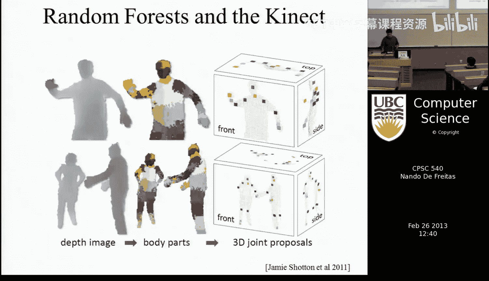

## 随机森林算法回顾

上一节我们介绍了随机森林的基本概念，本节中我们快速回顾其核心算法流程。

随机森林的核心思想是构建一个由多棵决策树组成的“森林”。这些树彼此独立生长，互不影响。因此，你只需要理解如何构建一棵树，然后重复这个过程多次即可。

以下是构建随机森林的基本步骤：

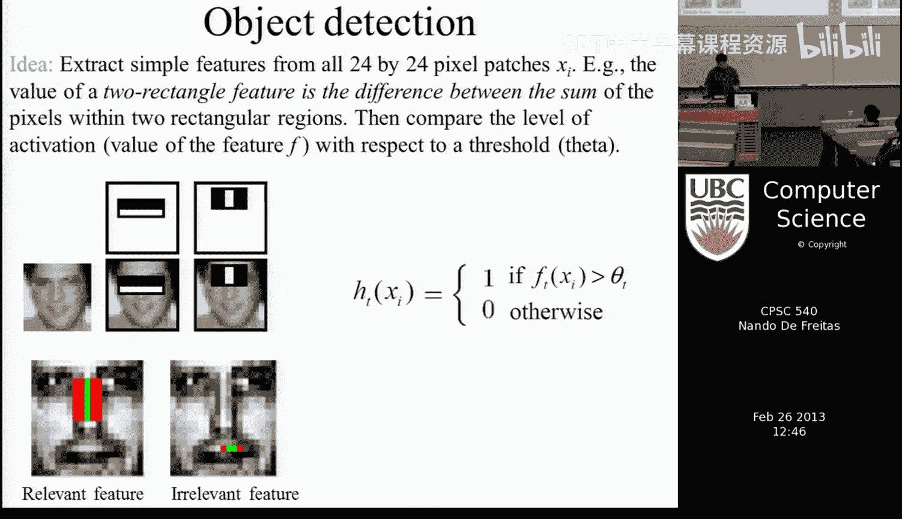

1.  **自助采样**：从原始数据集中有放回地随机抽取 `n` 个样本，形成一个“自助样本集”。这为每棵树的训练引入了额外的随机性。
2.  **递归构建单棵树**：从根节点开始，采用递归方式构建二叉树。每个节点会根据特定规则分裂成两个子节点。
3.  **节点分裂优化**：在每个待分裂的节点上，执行以下操作：
    *   从全部 `P` 个特征中，随机选取 `M` 个特征（通常 `M` 远小于 `P`）。
    *   对于这 `M` 个特征中的每一个，寻找最佳的分裂阈值。这通常通过评估每个可能阈值带来的“信息增益”来完成。
    *   选择能带来最大信息增益的那个“特征-阈值”组合作为该节点的分裂规则。
4.  **停止条件**：当满足以下条件之一时，停止树的生长：
    *   叶子节点中数据量过少。
    *   无法找到有效的分裂点。
    *   树达到预设的最大深度。
5.  **集成预测**：最终得到 `B` 棵决策树。对于新的数据点，让它通过每棵树得到一个预测，然后对所有树的预测结果进行**多数投票**（分类）或**取平均**（回归）。

**核心公式**：节点分裂时评估的信息增益可以表示为：
`信息增益 = H(S) - [ (|S_left|/|S|) * H(S_left) + (|S_right|/|S|) * H(S_right) ]`
其中，`H(S)` 是节点 `S` 的不纯度（如熵或基尼系数），`S_left` 和 `S_right` 是分裂后的左右子节点。

## 应用一：人脸检测（Viola-Jones 特征）

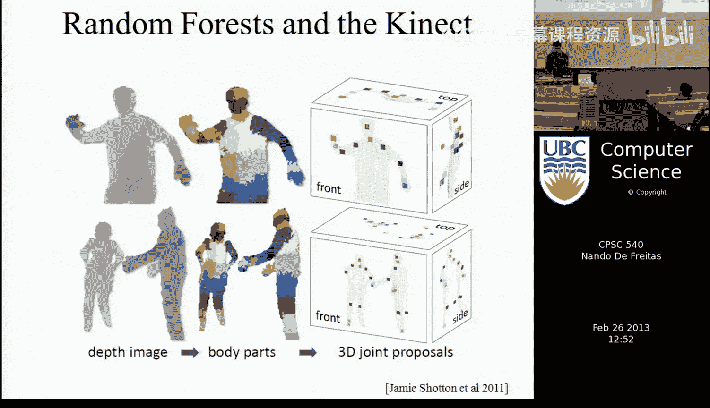

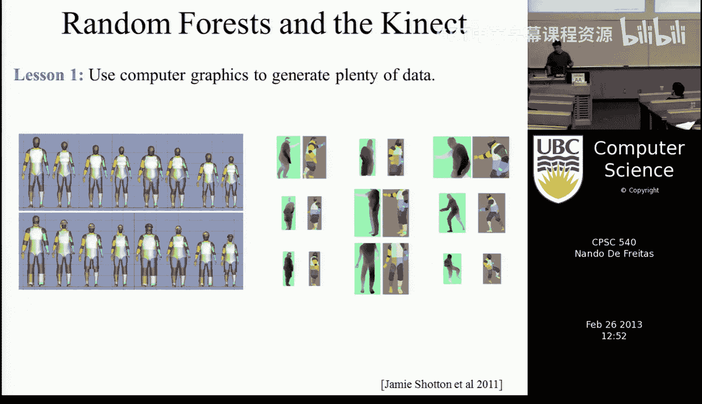

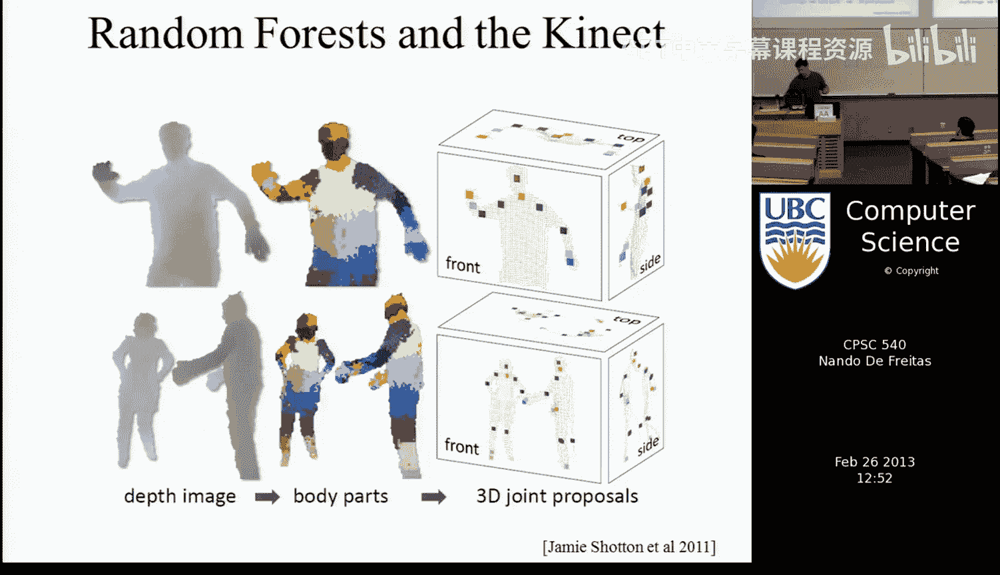

现在，我们来看看如何将随机森林应用于实际问题。首先介绍的是人脸检测，其灵感来源于Viola和Jones的经典工作（尽管原论文使用Boosting，但思想可用于随机森林）。

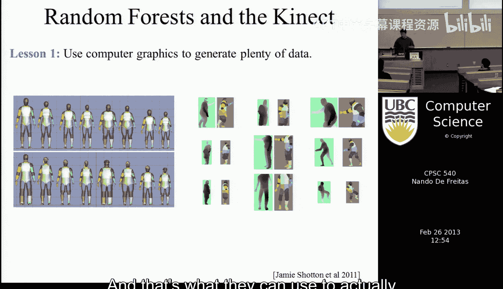

该应用的关键在于设计了高效的特征。任务是从一张大图中找出人脸位置，方法是将图像划分成许多小窗口，并分类每个窗口是否包含人脸。

以下是他们设计的特征：

*   **特征定义**：特征由两个矩形区域（一黑一白）定义。计算白色矩形区域内像素的平均灰度值，减去黑色矩形区域内的平均灰度值，得到一个数值作为一个特征。
*   **特征空间巨大**：矩形的位置、大小、长宽比可以任意变化，因此可以生成海量的此类特征。我们无法也不需计算所有特征。
*   **随机森林的作用**：在构建决策树的每个节点时，**随机**选取少量（如10或100个）此类特征进行评估和优化。这避免了计算整个巨大特征向量的开销。
*   **加速计算**：这类特征可以通过“积分图”技术极快地计算出来，这是其被广泛采用的重要原因之一。

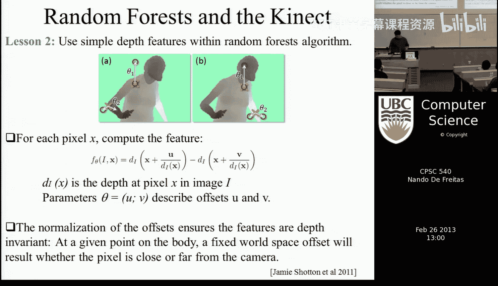

**核心思想**：通过随机采样特征，随机森林能够处理这种隐式定义的、维度极高的特征空间，而无需显式计算所有特征值。

## 应用二：Kinect 姿态识别

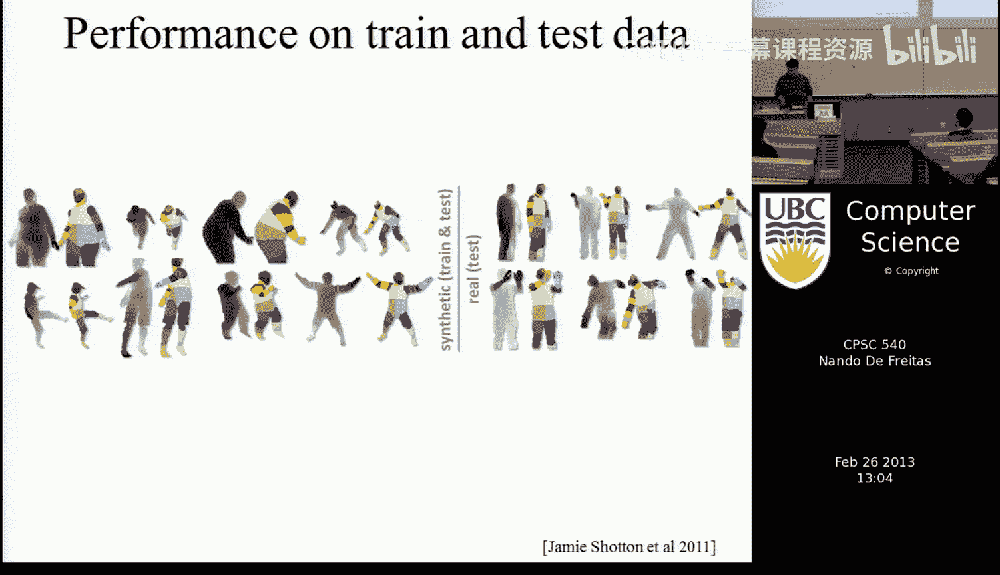

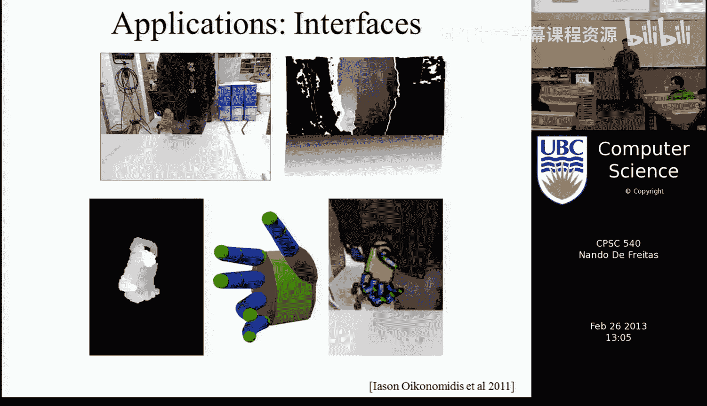

另一个高知名度的应用是微软Kinect的体感控制。Kinect通过深度传感器获取图像，其中每个像素值代表该点到传感器的距离。

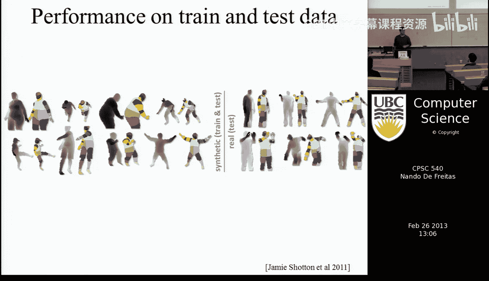

Kinect需要从深度图像中实时识别人体姿态，其流程包括：
1.  将深度图像分割成不同的身体部位（如头、左手、右大腿）。
2.  根据分割结果估计人体的骨骼关节位置。

随机森林在这里用于第一步：**从深度图像像素到身体部位标签的分类**。

**训练数据生成**：一个巧妙之处在于，他们通过参数化的人体3D模型生成了海量的**合成深度图像**用于训练。这解决了真实数据采集困难、姿势覆盖不全的问题。

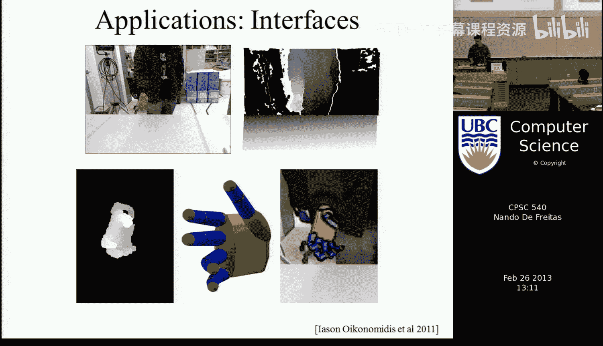

**特征设计**：用于分类的特征非常简单：
*   以当前待分类的像素 `x` 为中心，取一个窗口。
*   在窗口内随机选择两个偏移向量 `u` 和 `v`。
*   特征值计算为：`f(x; u, v) = D(x + u/D(x)) - D(x + v/D(x))`
*   其中 `D(x)` 是像素 `x` 的深度值。除以 `D(x)` 起到了归一化作用，使得特征度量的是世界坐标系中的相对距离，与人的远近无关。

**算法变体**：微软的实现与基础随机森林略有不同。他们在每个节点随机采样的是**完整的“特征-阈值”组合**，然后从这些组合中选择信息增益最大的一个，而不是先采样特征再优化阈值。

**模型选择**：在Kinect这类实时应用中，需要在计算速度和精度间权衡。他们发现使用**较少（如3棵）但很深**的树，比使用很多浅树（如树桩）效果更好。具体配置需要通过交叉验证确定。

## 随机森林用于回归

之前我们主要讨论分类，实际上随机森林也非常适合回归任务。其整体框架（自助采样、独立建树、节点随机优化）保持不变，主要改变在于：
1.  **节点分裂准则**：不再使用基于类别分布的信息增益，而是使用基于连续值的准则，如**最小化方差**。回归树的信息增益公式与分类类似，但熵的计算基于连续分布（如高斯分布）。
2.  **叶子节点模型**：分类时叶子节点通常存储类别的直方图（多数投票）。回归时则有多种选择：
    *   **常数**：存储落入该叶子节点所有样本目标值的平均值。这是最常用的方法，形成分段常数函数。
    *   **线性模型**：在叶子节点内拟合一个线性回归模型。
    *   **贝叶斯线性模型**：如本节所示，可以拟合一个能给出预测分布（高斯）的贝叶斯模型。

**贝叶斯随机森林的优势**：当在叶子节点使用贝叶斯模型时，整个森林的预测是多个高斯分布的混合。这可以在数据稀缺的区域产生**多模态的预测分布**，这与高斯过程回归给出的单峰分布不同。这种特性在诸如贝叶斯优化等需要探索未知区域的任务中可能非常有用。

## 总结

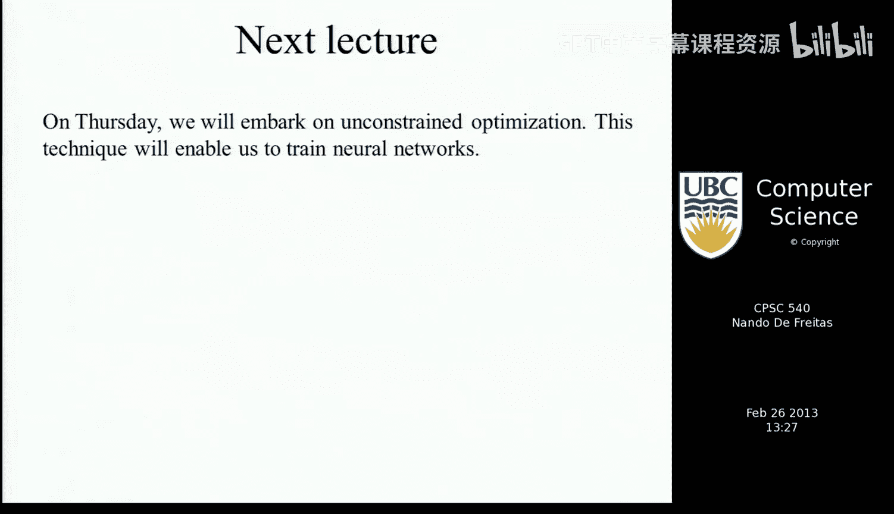

本节课我们一起学习了随机森林的实际应用。我们回顾了其基本算法，并深入探讨了它在两个经典计算机视觉任务——人脸检测和Kinect姿态识别——中的成功应用，关键在于针对问题设计高效、可快速计算的特征。最后，我们了解了随机森林如何扩展到回归任务，以及通过改变叶子节点模型（如使用贝叶斯线性模型）可以获得能提供不确定性估计的多模态预测。随机森林的灵活性使其成为处理高维特征空间和复杂预测问题的强大工具。