# 15：逻辑回归 📊

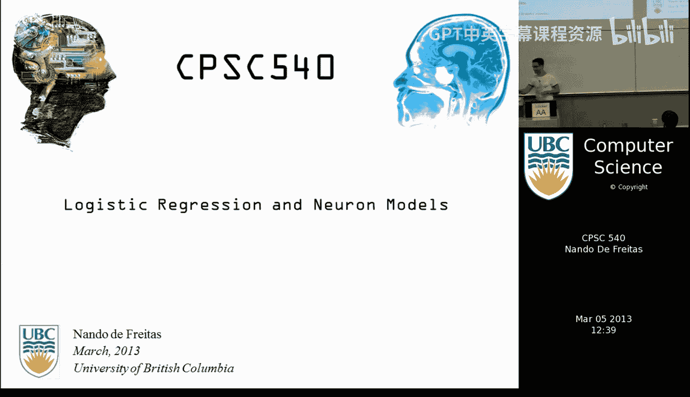

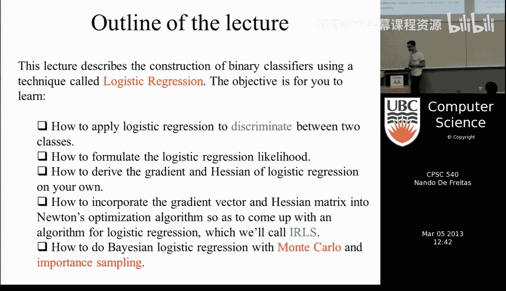

在本节课中，我们将学习逻辑回归。这是一种用于处理二元分类问题的强大技术。我们将理解其基本原理，推导其梯度和海森矩阵，并探讨如何通过优化算法（如梯度下降和牛顿法）来学习模型参数。此外，我们还将简要介绍贝叶斯方法，并学习如何使用蒙特卡洛技巧来近似处理复杂的积分问题。

---

## 从线性回归到分类问题 🔄

上一节我们介绍了线性回归，用于预测连续值。在本节中，我们来看看当输出变量是二元（例如0或1）时的情况。这通常被视为一个分类问题。

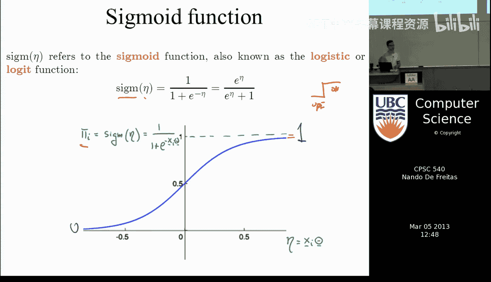

核心思想是：我们获得一些特征，然后尝试根据这些特征决定个体属于类别1还是类别2。

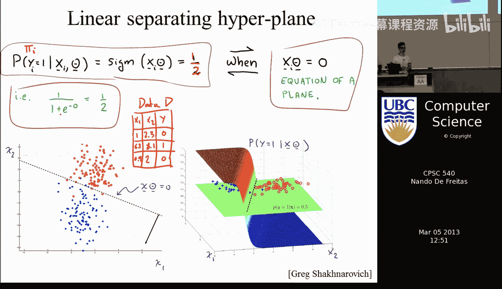

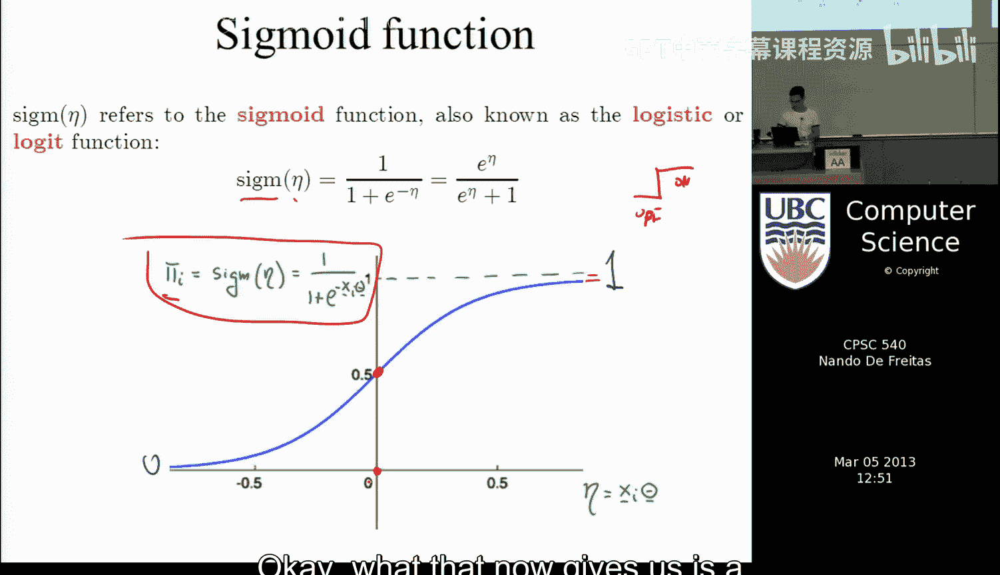

## 神经元模型与逻辑函数 🧠

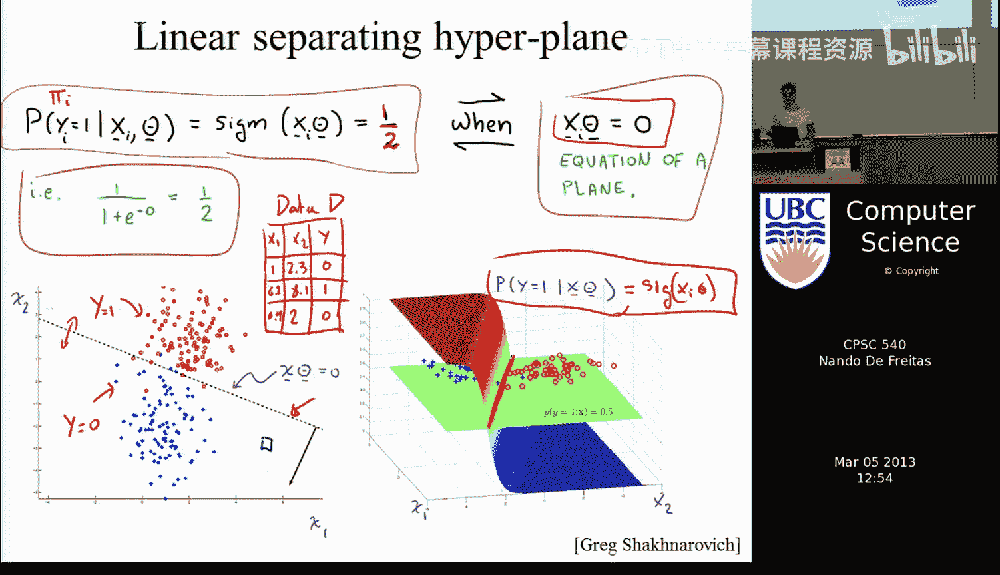

逻辑回归的灵感来源于一个简化的神经元模型（McCulloch-Pitts模型）。这个模型接收多个输入信号，每个信号乘以一个权重（称为突触权重），然后求和。这个加权和再通过一个非线性函数，决定神经元是否“激活”。

这个非线性函数就是**逻辑函数**，也称为**Sigmoid函数**。其公式如下：

**公式：** `σ(η) = 1 / (1 + e^(-η))`

其中，`η` 是输入（即特征的加权和 `x_i * θ`）。这个函数将任何实数映射到(0, 1)区间内，形状像一个平滑的“S”形曲线。我们使用平滑的S形函数而非阶跃函数，是因为我们需要计算梯度，而平滑函数是可微的。

## 逻辑回归模型 🎯

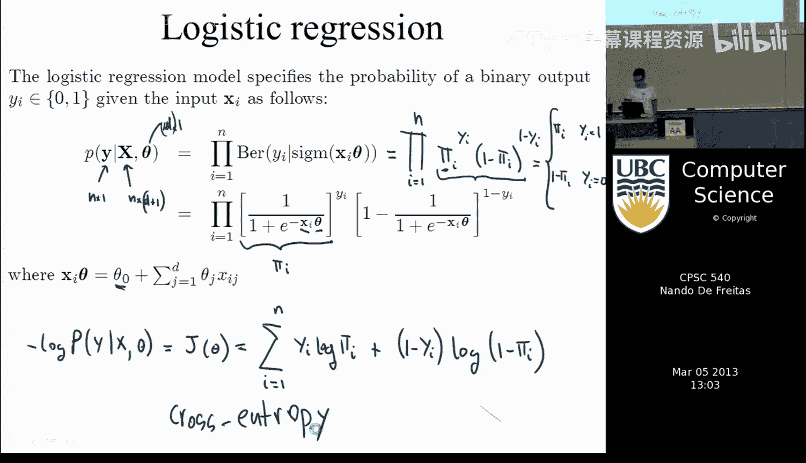

给定数据，其中 `x` 是特征，`y` 是二元标签（0或1）。我们的任务是学习参数 `θ`。

我们将 `π_i` 定义为给定特征 `x_i` 和参数 `θ` 时，`y_i = 1` 的概率：
**公式：** `π_i = P(y_i = 1 | x_i, θ) = σ(x_i * θ) = 1 / (1 + e^(-x_i * θ))`

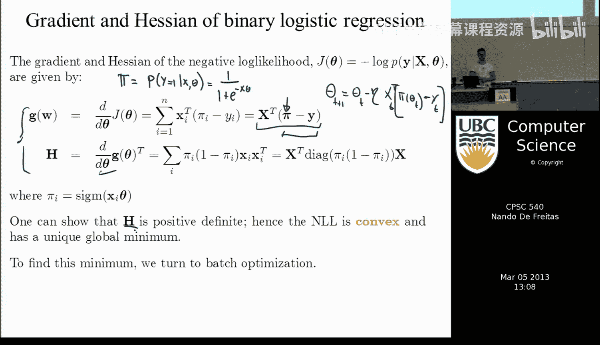

由于Sigmoid函数的输出在0和1之间，我们可以将其解释为概率。当加权和 `x_i * θ = 0` 时，概率为0.5。这定义了一个决策边界（一个超平面），用于分隔两个类别。

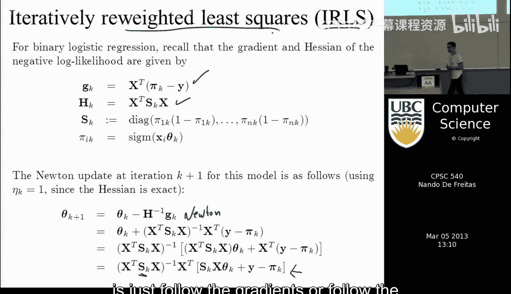

## 构建似然函数与成本函数 ⚖️

因为 `y` 是二元的，我们使用**伯努利分布**来建模每个数据点。对于N个独立的数据点，似然函数是每个伯努利概率的乘积。

为了得到用于优化的成本函数，我们取似然函数的**负对数**。这得到了**交叉熵**成本函数：
**公式：** `J(θ) = -Σ [y_i * log(π_i) + (1 - y_i) * log(1 - π_i)]`

最小化这个交叉熵函数等同于最小化预测的不确定性，这与学习的目标一致。

## 计算梯度与海森矩阵 📈

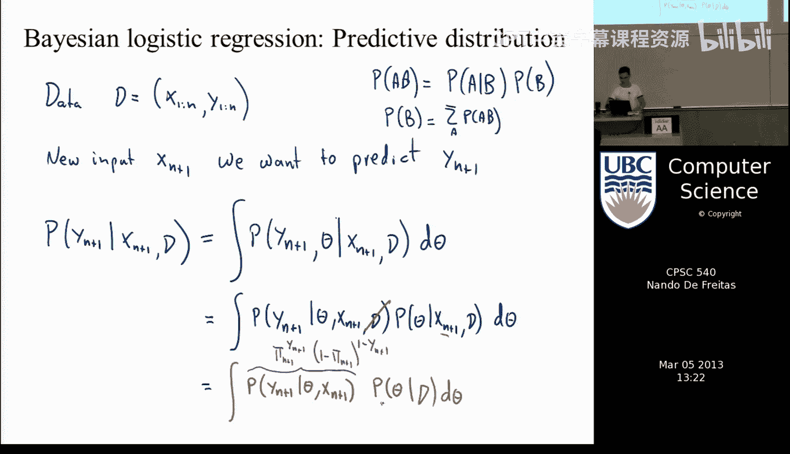

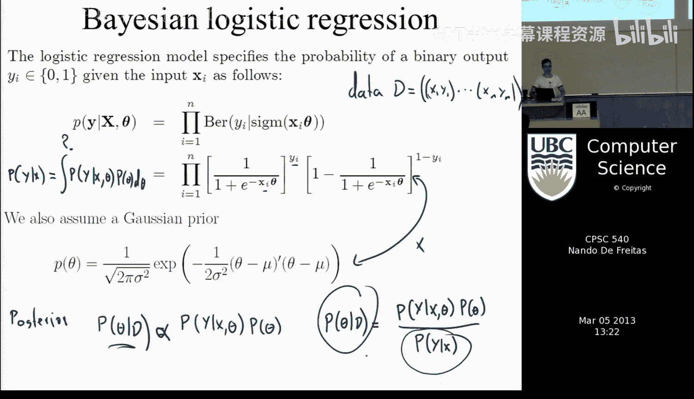

为了使用梯度下降等优化算法，我们需要成本函数 `J(θ)` 关于参数 `θ` 的梯度。

以下是梯度和海森矩阵的表达式（具体推导将在作业中完成）：
*   **梯度：** `∇J(θ) = X^T * (π - y)`
*   **海森矩阵：** `H(θ) = X^T * S * X`，其中 `S` 是一个对角矩阵，`S_ii = π_i * (1 - π_i)`

逻辑回归的成本函数是凸函数，其海森矩阵是正定的。这意味着存在唯一的最小值，优化算法可以保证找到全局最优解。

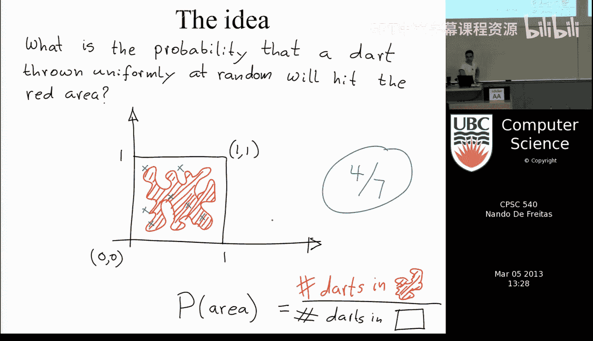

有了梯度和海森矩阵，我们可以实现多种优化技术：
*   **梯度下降：** `θ_{t+1} = θ_t - α * ∇J(θ_t)`
*   **牛顿法：** `θ_{t+1} = θ_t - H(θ_t)^{-1} * ∇J(θ_t)`

牛顿法在逻辑回归中有一个特殊的名称：**迭代重加权最小二乘法**。它在每一步都解决一个加权最小二乘问题。

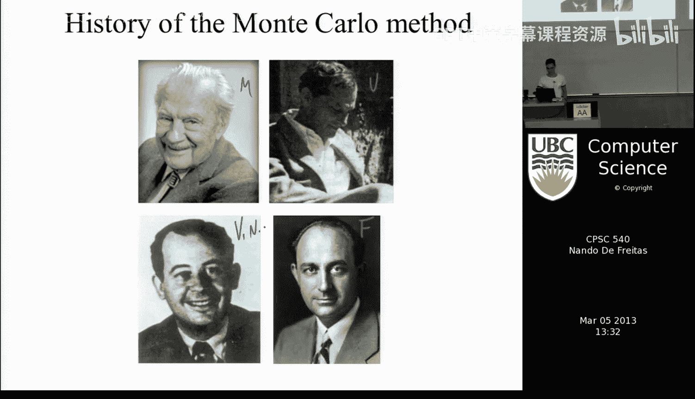

## 贝叶斯视角与蒙特卡洛方法 🎲

频率学派方法寻找单一的“最优”参数 `θ`。贝叶斯方法则不同，它将参数 `θ` 视为随机变量，并利用先验分布和似然函数来计算后验分布 `P(θ | D)`。

对于逻辑回归，后验分布没有解析解（无法写出闭合形式）。此外，在进行预测时，我们需要计算如下积分（预测分布）：
**公式：** `P(y_{new} | x_{new}, D) = ∫ P(y_{new} | θ, x_{new}) * P(θ | D) dθ`

这个积分同样难以直接计算。这时，**蒙特卡洛方法**就派上了用场。其核心思想是：通过从某个分布中抽取随机样本来近似复杂的积分。

具体到我们的问题，我们无法直接从后验分布 `P(θ | D)` 中采样。因此，我们引入一个易于采样的**提议分布** `Q(θ)`（例如高斯分布），并使用**重要性采样**技术。

基本步骤是：
1.  从提议分布 `Q(θ)` 中抽取样本 `{θ^(1), θ^(2), ..., θ^(S)}`。
2.  为每个样本计算重要性权重 `w^(s) ∝ P(θ^(s) | D) / Q(θ^(s)`。由于 `P(θ | D)` 的归一化常数未知，我们使用两个蒙特卡洛估计的比值来计算权重。
3.  用这些加权样本来近似后验分布或预测积分。

例如，预测分布可以近似为：
**公式：** `P(y_{new}=1 | x_{new}, D) ≈ (Σ_{s=1}^S w^(s) * σ(x_{new} * θ^(s))) / (Σ_{s=1}^S w^(s))`

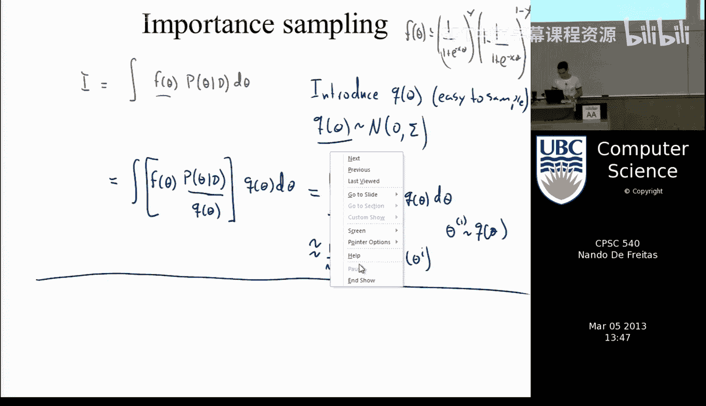

这相当于用多个参数假设（对应多个分类器）的加权平均来做预测，类似于集成学习的思想。

---

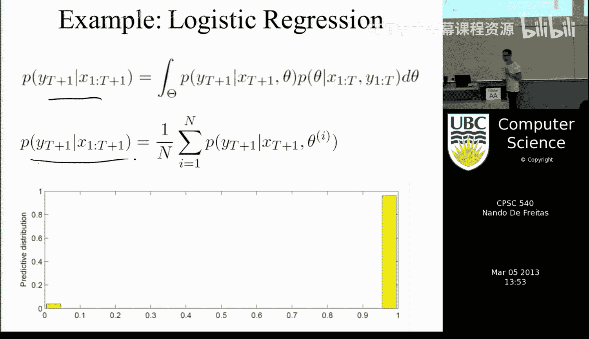

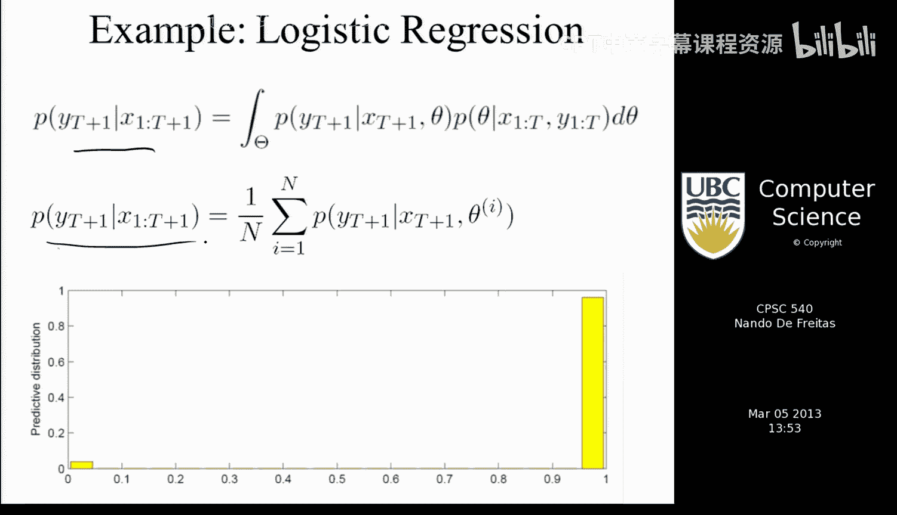

本节课中我们一起学习了逻辑回归。我们从神经元模型和Sigmoid函数出发，建立了逻辑回归的概率模型，并推导了其交叉熵成本函数、梯度以及海森矩阵。这使得我们可以使用梯度下降或牛顿法等优化算法进行参数学习。此外，我们还探讨了逻辑回归的贝叶斯处理方法，并介绍了使用蒙特卡洛重要性采样来近似复杂后验分布和预测积分的基本思路。逻辑回归因其简单、有效且可解释性强，在实践中被广泛应用。