# 16：逻辑回归 🧠

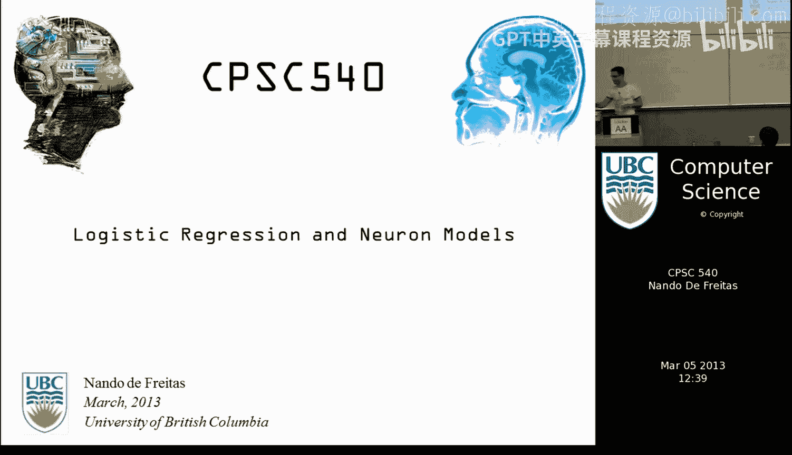

在本节课中，我们将学习逻辑回归。逻辑回归是一种用于处理二元分类问题的流行且强大的方法。我们将从理解其基本概念开始，将其与神经网络建立联系，并推导出其梯度和海森矩阵。掌握这些表达式后，我们就能实现学习算法，例如随机梯度下降或牛顿法。此外，我们还将探讨如何从频率主义方法转向贝叶斯方法，并介绍一种强大的近似计算技巧——蒙特卡洛方法。

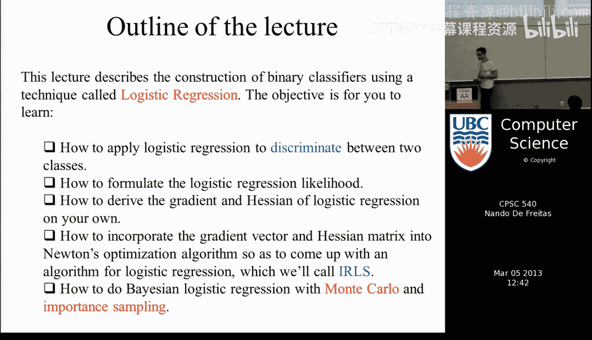

---

## 逻辑回归模型 📊

上一节我们介绍了线性回归，本节中我们来看看逻辑回归。逻辑回归用于对二元变量进行回归，但更准确地说，它是一个分类问题。其核心思想是：我们获得一些特征，然后根据这些特征判断个体应该属于类别1还是类别2。

从统计学角度看，我们被给定数据 `X` 和 `Y`。这是一个监督学习问题，其中 `Y` 是二元的（0或1）。给定 `X` 和 `Y`，我们的任务是计算参数 `θ`。这与线性回归非常相似，唯一的区别是现在的 `Y` 是二元类别，而非实数。

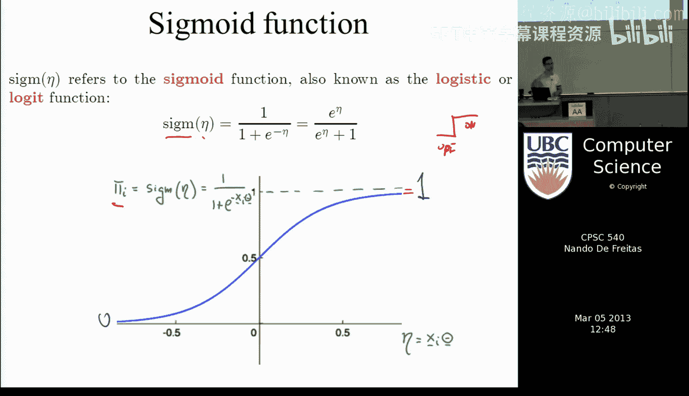

### 神经元模型与Sigmoid函数

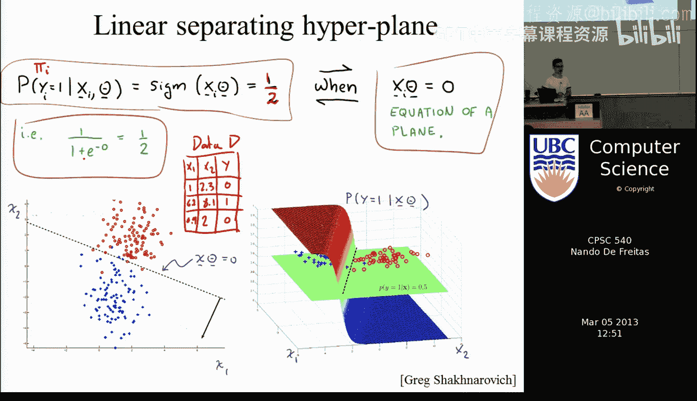


逻辑回归的灵感来源于一个简化的神经元模型（McCulloch-Pitts模型）。该模型有 `D` 个输入（特征），每个输入 `x_i` 乘以一个权重参数 `θ_i`（在神经网络中称为突触权重），然后求和得到标量 `x_i * θ`。这个求和结果通过一个非线性函数，即Sigmoid函数（或逻辑函数），产生输出。

Sigmoid函数的公式如下：
```
σ(η) = 1 / (1 + e^{-η})
```
其中 `η` 是输入参数（即 `x_i * θ`）。当 `η` 趋近于正无穷时，函数值趋近于1；当 `η` 趋近于负无穷时，函数值趋近于0。这个平滑的S形曲线保证了函数的可微性，这对于后续的梯度计算至关重要。

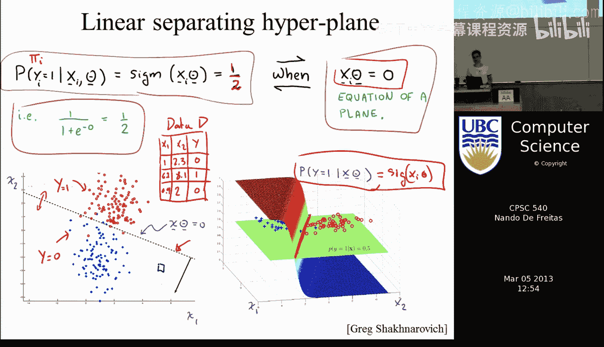

我们将 `π_i = σ(x_i * θ)` 解释为神经元激活的概率，即 `y_i = 1` 的概率。当 `x_i * θ = 0` 时，`π_i = 0.5`，这定义了一个决策边界（一个超平面），用于将数据点分为两类。

---

## 概率模型与损失函数 ⚖️

与线性回归类似，我们假设输入 `X` 是确定的，不确定性存在于标签 `Y` 中。对于二元数据，合适的概率模型是伯努利分布（即抛硬币模型）。每个数据点 `i` 的似然函数为：
```
P(y_i | x_i, θ) = π_i^{y_i} * (1 - π_i)^{1 - y_i}
```
其中 `π_i = σ(x_i * θ)`。

对于包含 `N` 个独立同分布数据点的数据集，其似然函数是所有个体似然的乘积。为了得到需要优化的损失函数（或成本函数），我们取负对数似然：
```
J(θ) = - Σ [y_i * log(π_i) + (1 - y_i) * log(1 - π_i)]
```
这个函数被称为**交叉熵**损失函数。最小化交叉熵等价于最小化预测分布与真实分布之间的不确定性，这与学习的目标是一致的。

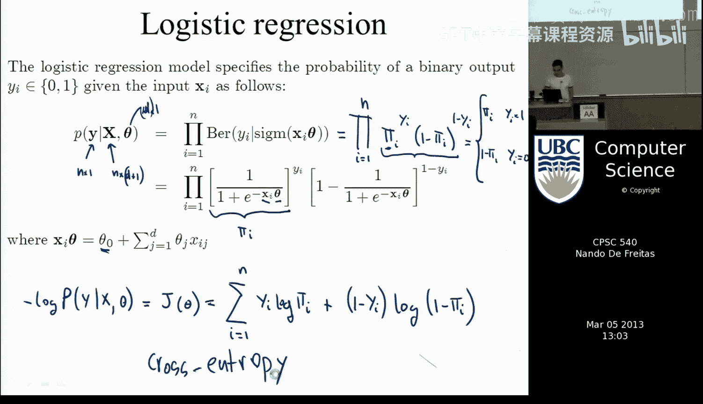

---

## 梯度与海森矩阵 📈

为了使用梯度下降等优化算法，我们需要计算损失函数 `J(θ)` 关于参数 `θ` 的梯度。通过求导，我们得到梯度表达式：
```
∇J(θ) = X^T * (π - y)
```
其中 `X` 是特征矩阵，`π` 是所有 `π_i` 组成的向量，`y` 是标签向量。

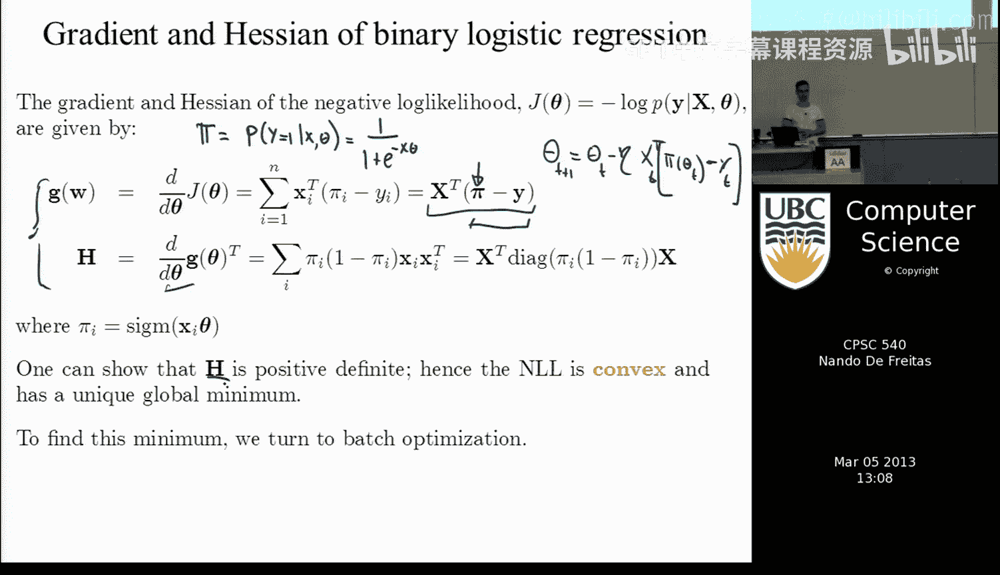

这个梯度的含义很直观：如果我们的预测 `π` 与真实标签 `y` 一致，梯度为零，参数停止更新；如果预测错误，梯度会推动参数向正确方向更新。

我们还可以计算损失函数的二阶导数，即海森矩阵：
```
H(θ) = X^T * S * X
```
其中 `S` 是一个对角矩阵，其对角线元素为 `π_i * (1 - π_i)`。

海森矩阵是正定的，这意味着损失函数 `J(θ)` 是凸函数，存在唯一的最小值，保证了优化算法能找到全局最优解。

---

## 优化算法：从梯度下降到牛顿法 🔄

有了梯度和海森矩阵的表达式，我们就可以实现各种优化算法。

*   **梯度下降**：参数更新规则为 `θ_{t+1} = θ_t - α * ∇J(θ_t)`，其中 `α` 是学习率。
*   **牛顿法**：利用了一阶和二阶信息，更新规则为 `θ_{t+1} = θ_t - H(θ_t)^{-1} * ∇J(θ_t)`。对于逻辑回归，牛顿法有一个特殊的名称——**迭代重加权最小二乘（IRLS）算法**。

牛顿法通常比梯度下降收敛更快，但每次迭代需要计算和求逆海森矩阵，计算量更大。对于逻辑回归这类问题，由于其海森矩阵具有特定结构，牛顿法非常高效。

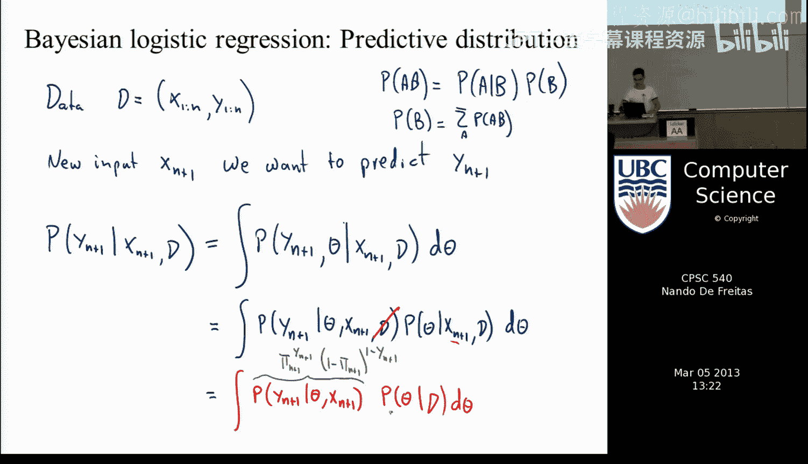

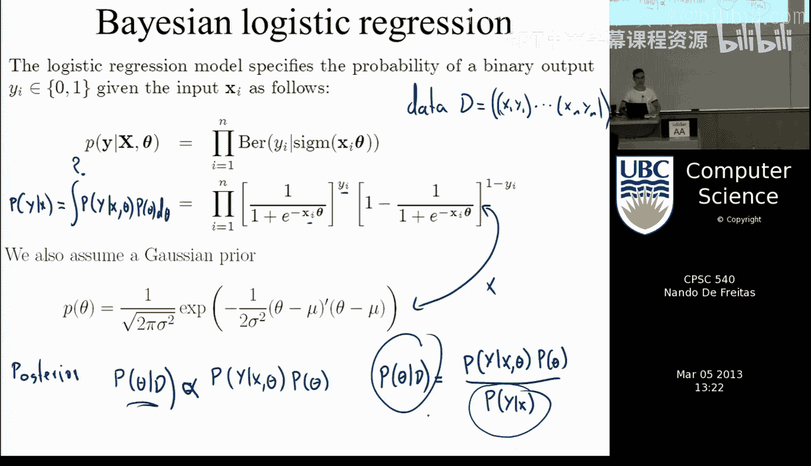

以下是实现逻辑回归的核心步骤概述：
1.  初始化参数 `θ`。
2.  计算预测概率 `π = σ(X * θ)`。
3.  计算梯度 `∇J(θ) = X^T * (π - y)`。
4.  计算海森矩阵 `H(θ) = X^T * S * X`。
5.  使用牛顿法更新参数：`θ = θ - H(θ)^{-1} * ∇J(θ)`。
6.  重复步骤2-5，直到收敛。

逻辑回归实现简单，且在许多实际应用（如搜索引擎的垃圾邮件检测、情感分析）中表现优异，因此被广泛使用。

---

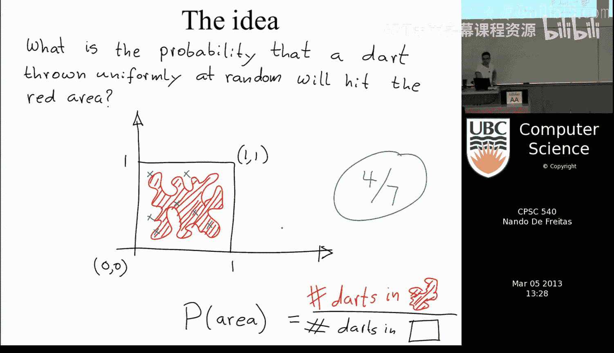

## 贝叶斯逻辑回归与蒙特卡洛方法 🎲

频率主义方法寻找单一的“最优”参数值 `θ`。贝叶斯方法则不同，它将参数 `θ` 视为随机变量，并引入先验分布 `P(θ)`。结合似然函数 `P(Y|X, θ)`，通过贝叶斯定理得到后验分布：
```
P(θ | D) ∝ P(Y | X, θ) * P(θ)
```
其中 `D` 代表训练数据 `{X, Y}`，`∝` 表示“正比于”。

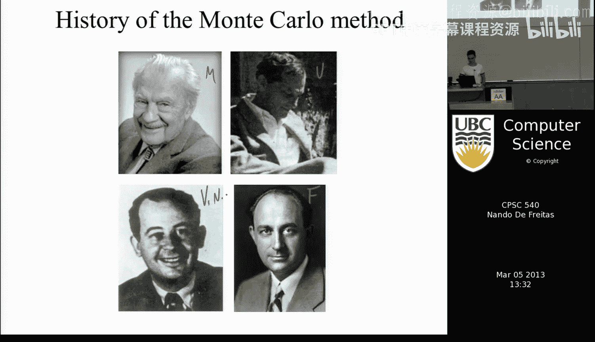

然而，对于逻辑回归，后验分布的归一化常数（证据 `P(Y|X)`）难以解析计算，这使得我们无法得到后验分布的精确形式。同样，在预测新数据点 `(x_{n+1}, y_{n+1})` 时，我们需要计算预测分布：
```
P(y_{n+1} | x_{n+1}, D) = ∫ P(y_{n+1} | x_{n+1}, θ) * P(θ | D) dθ
```
这也涉及到一个难以直接计算的积分。

### 蒙特卡洛近似

为了解决这些棘手的积分问题，我们引入**蒙特卡洛方法**。其核心思想是：通过从某个分布中抽取随机样本来近似计算积分。

假设我们需要计算期望 `E_{P(θ|D)}[f(θ)] = ∫ f(θ) P(θ|D) dθ`。如果我们能从后验分布 `P(θ|D)` 中抽取 `N` 个独立样本 `{θ^{(1)}, θ^{(2)}, ..., θ^{(N)}}`，那么该期望可以近似为：
```
E_{P(θ|D)}[f(θ)] ≈ (1/N) * Σ_{i=1}^{N} f(θ^{(i)})
```

问题在于，我们通常无法直接从复杂的后验分布 `P(θ|D)` 中采样。

### 重要性采样

**重要性采样**是一种技巧，它允许我们从一个简单的、易于采样的提议分布 `q(θ)`（例如高斯分布）中抽取样本，然后通过加权来近似目标分布下的期望。

我们将期望重写为：
```
E_{P(θ|D)}[f(θ)] = ∫ f(θ) * (P(θ|D)/q(θ)) * q(θ) dθ ≈ (1/N) * Σ_{i=1}^{N} f(θ^{(i)}) * w(θ^{(i)})
```
其中 `θ^{(i)}` 从 `q(θ)` 中采样，`w(θ^{(i)}) = P(θ^{(i)}|D) / q(θ^{(i)})` 称为重要性权重。

然而，我们仍然不知道后验 `P(θ|D)` 的确切值（因为缺少归一化常数 `Z`）。巧妙之处在于，对于像预测分布这样的比率计算，归一化常数会被约掉。具体来说，预测分布可以近似为：
```
P(y_{n+1}=1 | x_{n+1}, D) ≈ ( Σ_{i=1}^{N} P(y_{n+1}=1 | x_{n+1}, θ^{(i)}) * w*(θ^{(i)}) ) / ( Σ_{i=1}^{N} w*(θ^{(i)}) )
```
其中 `w*(θ^{(i)}) = P(Y|X, θ^{(i)}) * P(θ^{(i)}) / q(θ^{(i)})`，这里我们使用了未归一化的后验（分子），而分母中的求和起到了归一化的作用。

这样，我们就能够使用从简单分布 `q(θ)` 中抽取的样本来近似贝叶斯逻辑回归中的预测。这种方法非常通用，可以应用于神经网络等更复杂的模型。

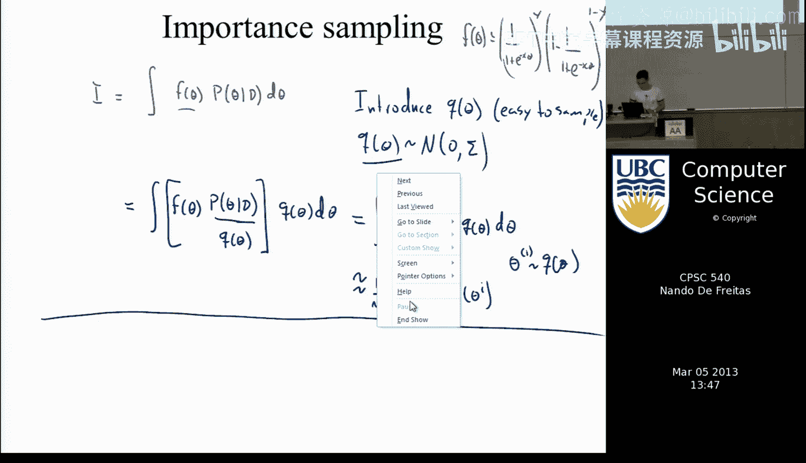


---

## 总结 📝

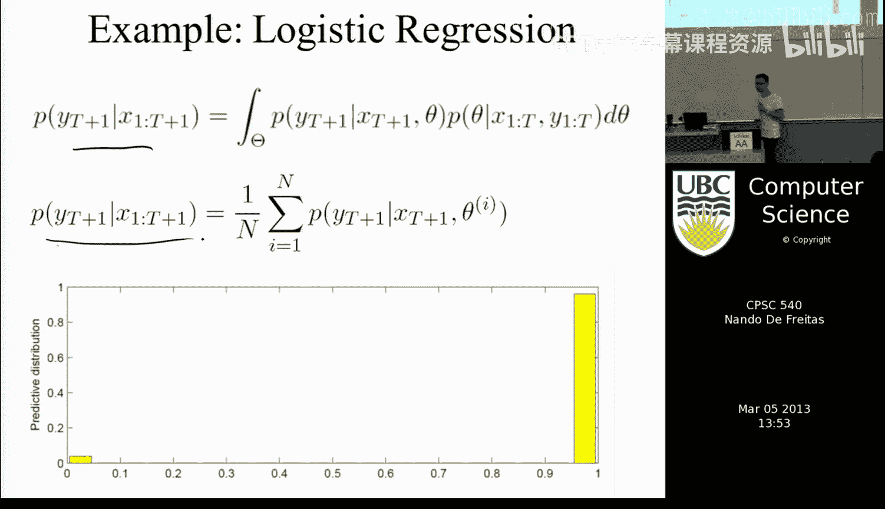

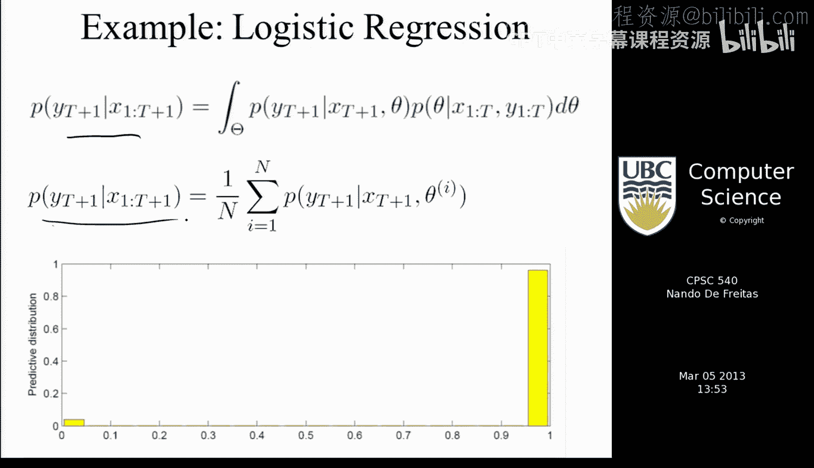

本节课中我们一起学习了逻辑回归。我们从其作为二元分类器的基本概念出发，建立了概率模型并推导出交叉熵损失函数。我们计算了损失函数的梯度与海森矩阵，这使我们能够实现高效的优化算法，如梯度下降和牛顿法（IRLS）。随后，我们探讨了贝叶斯视角下的逻辑回归，面对后验计算中的积分难题，我们引入了强大的蒙特卡洛方法，特别是重要性采样技术，来近似这些积分并进行预测。逻辑回归模型虽然简单，但因其有效性和可解释性，在工业界有着极其广泛的应用，而贝叶斯方法则为我们提供了量化不确定性并整合先验知识的强大框架。