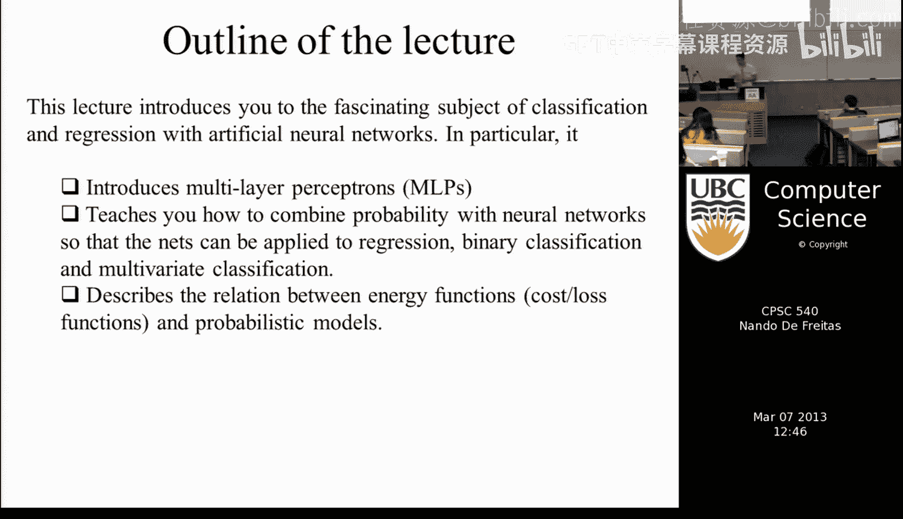
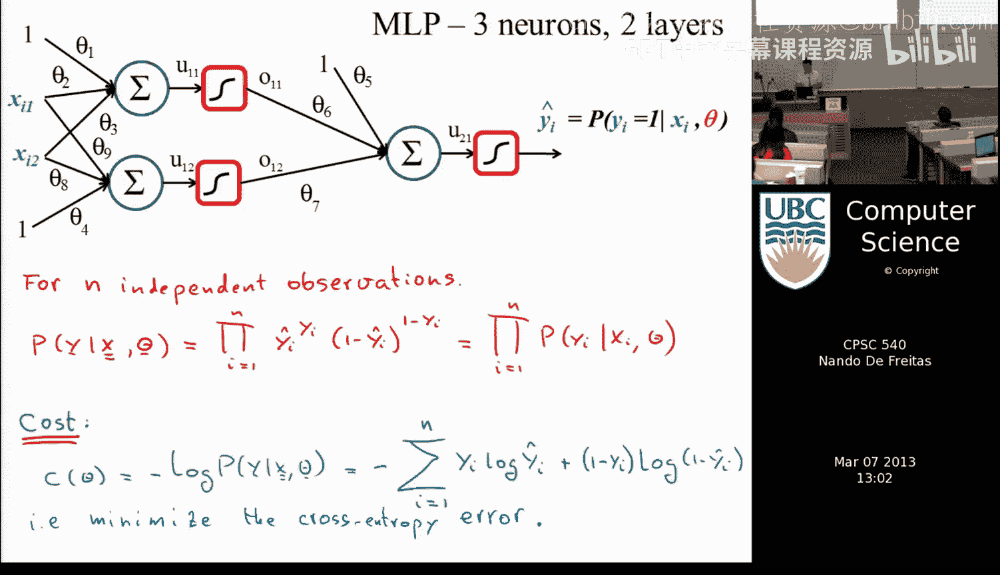
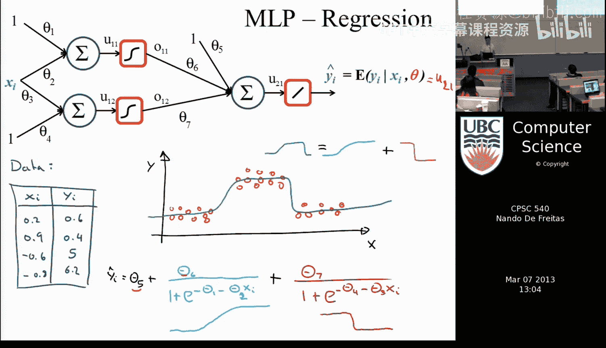
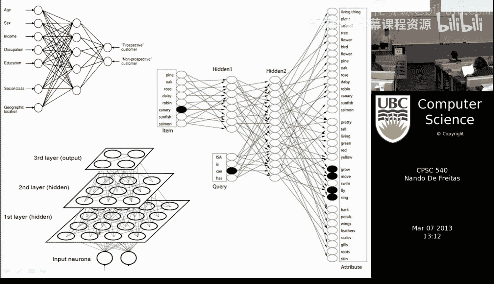
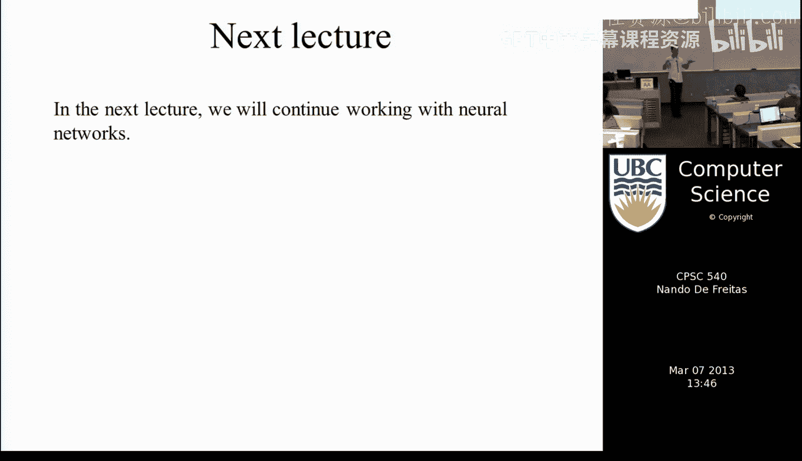
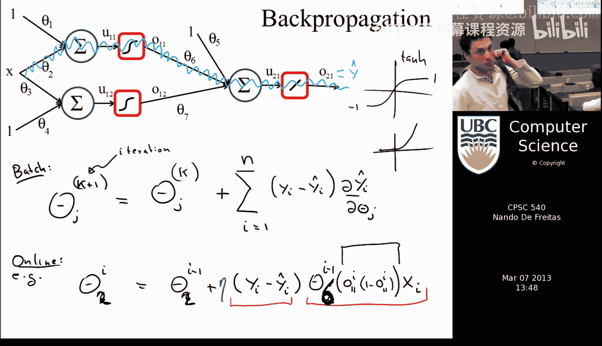

# 17：神经网络 🧠

在本节课中，我们将学习神经网络的基本概念。我们将看到，神经网络本质上是一种前馈架构，它接收输入并产生输出。我们将探讨如何通过最小化成本函数或最大化似然函数来学习神经网络的参数，以及如何将我们之前学到的线性模型知识（如逻辑回归）应用到更复杂的非线性模型中。

---

## 神经网络：基本概念与感知机

上一节我们介绍了机器学习的基本学习框架。本节中，我们来看看神经网络，它也被称为感知机。

神经网络是一种前馈架构。这意味着它接收输入并产生输出，信息流动是单向的。这与循环神经网络等架构不同，后者的输出会反馈给输入。我们将在课程后期讨论循环架构。

我们将看到，我们一直使用的学习思想——通过最小化成本函数或最大化（带有先验的）正则化似然函数来学习——在这里依然适用。我们需要选择参数，并通过交叉验证或自助法来选择这些参数。如果自由参数过多，我们可以在这些技术之上使用贝叶斯优化等技术。因此，我们所学的一切都适用于这个领域。

对于不同类型的数据，我们使用不同的概率分布来建模似然函数：
*   对于连续数据，我们使用高斯模型。
*   对于离散的二元数据，我们使用伯努利模型。
*   对于多类别数据，我们使用多项概率分布。

我们对每种数据取负对数似然，就得到了需要优化的成本函数。优化问题就变成了计算导数。一旦有了导数，就可以进行梯度下降。如果可以计算二阶导数且参数不多，可以使用海森方法。如果数据量很大，则适合在线学习，即每次只处理少量数据点。

本质上，我们将为神经网络做我们为逻辑回归等其他线性模型所做的一切。唯一的变化是模型会变得更复杂一些。

---

## 从逻辑回归到单神经元网络

上一节我们概述了神经网络的学习框架。本节中，我们回到逻辑回归，它本质上是一个单神经元网络。

这个基本单元采用了神经元的麦卡洛克-皮茨模型。在这个例子中，有两个输入 `x1` 和 `x2`（对应数据点 `i`），以及一个输出预测值 `y_hat`。如果进行二元分类，这个输出就是 `y=1` 的概率。因为 sigmoid 函数确保输出在 0 和 1 之间，所以它起到了“压缩”作用。

以下是设置步骤：
1.  我们被给定一些监督数据，数据由 `(X, Y)` 对组成。`Y` 是二元的，`X` 可以是连续的或分类的（因为我们不对 `X` 建模，所以 `X` 是确定性的）。
2.  如果绘制数据（`x1` vs `x2`），每个数据点是二维空间中的一个点，颜色（红或绿）表示 `y` 是 0 还是 1。
3.  学习任务是找到蓝色的分离曲面（在二维中是直线，在高维中是超平面），这个曲面通常被称为判别函数。

让我们回顾一下数学。单个神经元接收输入（包括偏置项和两个信号输入），用参数 `θ` 对它们进行加权，然后求和得到信号 `u`。

`u = θ1 * 1 + θ2 * xi1 + θ3 * xi2`

然后将这个 `u` 信号通过 sigmoid 函数 `σ(u) = 1 / (1 + e^{-u})`。压缩后的输出介于 0 和 1 之间，我们将其解释为 `y=1` 的概率。

因此，给定输入和参数时 `y` 的概率是伯努利分布：
`P(y_i | x_i, θ) = (y_hat_i)^{y_i} * (1 - y_hat_i)^{1-y_i}`

这个表达式概括了：当 `y_i=1` 时，概率为 `y_hat_i`；当 `y_i=0` 时，概率为 `1 - y_hat_i`。这是一个定义良好的概率模型。

对于 `n` 个独立的数据点，联合似然是各个似然的乘积，就像在线性回归中一样。单个神经元只能产生线性的分离曲面，其边界由 `u=0` 的方程给出。

---

## 单层网络的局限性与解决方案

上一节我们看到单神经元网络只能进行线性分类。本节中，我们探讨其局限性及解决方案。

这导致了 20 世纪 50 年代的争议。人们希望神经元能像半导体中的逻辑门（如 AND、OR、NOT）一样工作。但问题是，单个神经元无法实现异或门。

异或门的规则是：当两个输入不同时输出 1，相同时输出 0。在二维平面上，无法用一条直线将两个输出为 1 的点与两个输出为 0 的点完全分开。任何平面都无法做到这一点。

因此，人们担心如果连异或门这样简单的功能都无法实现，那么神经网络研究可能没有前途。这个论点导致该领域沉寂了一段时间。

解决方案是引入更复杂的神经网络，特别是引入所谓的“隐藏层”。在神经网络术语中，输入层是输入，隐藏层是中间处理层（类似于人脑的视觉处理过程），然后才产生输出。

通过使模型更复杂，我们可以构建非线性的门电路。非线性使得实现类似异或功能的复杂分离曲面成为可能，从而可以将两类点分开。

随之而来的问题是：
*   每层应该有多少个神经元？
*   应该有多少层？

这些问题需要通过交叉验证并结合计算考虑来解决，贝叶斯优化可以在这方面做得很好。

一旦有了隐藏层和非线性分离曲面，我们就会回到与 RBM 类似的问题：可能得到平滑的边界（蓝色曲线），也可能得到非常曲折的边界（紫色曲线）。通常平滑的边界更好，因为世界往往是平滑的。添加的神经元越多，模型就越灵活，但也可能更“摇摆不定”。因此，控制神经元的数量是控制模型复杂度的一种方式。

---

## 神经网络的工作原理：前向传播

上一节我们讨论了引入隐藏层的必要性。本节中，我们逐步分析神经网络的工作原理。

神经网络的好处是既可以用图来分析，也可以用方程来分析，非常易于可视化。

以下是工作步骤：
1.  两个输入 `x1` 和 `x2`。
2.  每个输入乘以一个权重（例如 `x1` 乘以 `θ2`，`x2` 乘以 `θ3`），加上偏置 `θ1 * 1`，求和后得到第一层神经元 1 的中间信号 `u11`。
    `u11 = θ1*1 + θ2*x1 + θ3*x2`
3.  `u11` 通过 sigmoid 函数，产生第一层神经元 1 的输出 `o11`。
    `o11 = σ(u11)`
4.  同样地，对于第一层神经元 2，我们有参数 `θ4, θ8, θ9`，得到 `u12` 和 `o12`。
    `u12 = θ4*1 + θ8*x1 + θ9*x2`
    `o12 = σ(u12)`
5.  第一层的输出 `o11` 和 `o12` 作为第二层（单个神经元）的输入。它们分别乘以权重 `θ6` 和 `θ7`，加上偏置 `θ5*1`，求和得到第二层的中间信号 `u21`。
    `u21 = θ5*1 + θ6*o11 + θ7*o12`
6.  `u21` 通过 sigmoid 函数，产生最终的预测输出 `y_hat`。
    `y_hat = σ(u21)`

在概率建模方面，与逻辑回归相比没有任何变化，仍然是伯努利模型。我们仍然采用相同的方式学习：取负对数似然（得到交叉熵），计算导数并优化。

关于 sigmoid 函数的作用：它是为了引入非线性。如果没有非线性激活函数，多层线性变换的堆叠仍然等价于一个线性变换，无法增强模型的表达能力。

---

## 神经网络的回归应用与函数逼近

上一节我们分析了分类网络的前向传播。本节中，我们看看神经网络在回归问题上的应用。

在回归中，输出 `y` 是连续值。如果输出层仍使用 sigmoid，其输出将被限制在 (0,1) 之间，无法预测例如 5 这样的值。因此，在回归任务中，输出层通常使用线性神经元（恒等函数），即输出等于输入 `u`。

此时，网络的输出 `y_hat` 可以解释为给定 `x` 和参数 `θ` 时 `y` 的条件期望 `E[y|x,θ]`。

对于具有一个隐藏层（两个神经元）和一个线性输出层的网络，其最终输出方程可以写为：
`y_hat = θ5 + θ6 * σ(θ1 + θ2*x) + θ7 * σ(θ4 + θ3*x)`

这个方程描述了一个图形，而图形是这个方程的图片。方程表明，输出是基函数的线性组合，类似于径向基函数网络。不同之处在于，神经网络中所有参数（包括基函数的宽度、位置等）都将从数据中通过梯度下降来估计。

每个参数的作用：
*   `θ5`：将整个函数上下移动。
*   `θ6`, `θ7`：控制对应 S 形基函数的高度和方向（正负号决定是否翻转）。
*   `θ1`, `θ4`：将 S 形基函数左右移动。
*   `θ2`, `θ3`：控制 S 形基函数的陡峭程度（尺度参数）。

通过控制这些参数，我们可以移动、缩放、翻转这些“砖块”一样的基函数，从而构建出复杂的函数。这就是神经网络的思想：使用神经元作为基本构建块，组合成任意复杂的函数。学习神经网络就是学习一个非线性函数，这个函数可以是回归中的数据拟合曲线，也可以是分类中的类别分离边界。

在回归中，我们假设每个数据点的 `y_i` 服从高斯分布，噪声方差假设已知。那么，给定 `x` 和 `θ` 时 `y` 的概率为：
`P(y_i | x_i, θ) = N(y_i | y_hat_i, σ^2)`

其中 `y_hat_i` 是神经网络的输出，也是高斯分布的均值。取负对数似然并忽略常数项后，成本函数就是平方误差和。这与最小二乘法相同，只是现在的预测函数 `y_hat` 是神经网络表示的非线性函数。

为了控制模型复杂度、防止过拟合，我们可以使用 L2 正则化（在神经网络中常称为“权重衰减”），或者通过控制神经元数量和层数来控制复杂度。当需要调整的超参数较多时，可以使用高斯过程结合贝叶斯优化。

---

## 多类别分类与 Softmax 函数

上一节我们讨论了神经网络的回归应用。本节中，我们将其扩展到多类别分类。

假设我们要将数据分为三类（例如红、绿、蓝）。数据输入 `x` 不变，但标签 `y` 现在可以是 1、2 或 3。我们使用一种称为“独热编码”的技术来重新表示标签。

对于每个数据点 `i`，我们创建一个三维向量 `[y_i1, y_i2, y_i3]`：
*   如果类别是 1，则编码为 `[1, 0, 0]`
*   如果类别是 2，则编码为 `[0, 1, 0]`
*   如果类别是 3，则编码为 `[0, 0, 1]`

然后，我们构建一个神经网络，其输出层有三个神经元，分别对应三个类别。每个输出神经元的值（在通过 softmax 之前）记为 `z1, z2, z3`。

我们使用 softmax 函数来定义每个类别的概率：
`P(class=k | x, θ) = e^{z_k} / (e^{z1} + e^{z2} + e^{z3})`，其中 `k=1,2,3`

softmax 函数确保每个输出都在 0 到 1 之间，且所有类别的概率之和为 1，因此可以解释为概率分布。它之所以叫“softmax”，是因为在极限情况下，它会选择值最大的那个输出（“max”），但本身是一个平滑的函数。

那么，对于标签 `y_i`（独热编码向量），其似然函数可以写为：
`P(y_i | x_i, θ) = (P1)^{I(y_i=1)} * (P2)^{I(y_i=2)} * (P3)^{I(y_i=3)}`

其中 `I(.)` 是指示函数。当 `y_i` 对应类别 1 时，只有 `P1` 项保留，其他项的指数为 0（值为 1），因此概率就是 `P1`。其他类别同理。这个表达式概括了三种情况。

取负对数似然，我们再次得到交叉熵成本函数。最小化交叉熵就能得到最具信息量的解。

对于非互斥的多标签分类（一个样本属于多个类别），可以使用不同的编码方式（如多个输出神经元独立使用 sigmoid），并确保概率归一化适当即可。

一个需要注意的问题是模型的可识别性问题。例如，如果交换隐藏层中两个神经元的顺序，同时交换它们连接到前后层的权重，网络的输入输出关系不会改变。这导致参数空间存在多个等价的解（对称性），使得似然函数有多个峰值（模），给优化带来困难。这也是神经网络在历史上一度难以训练的原因之一。随着大数据、GPU 以及更好的算法（如 ReLU、优化器改进）出现，深度学习才重新兴起。

---

## 反向传播算法：计算梯度

上一节我们介绍了多类别分类。本节中，我们学习如何训练神经网络，即通过反向传播算法计算梯度。

我们以回归问题（平方误差损失）为例进行说明。训练通常分为两步：前向传播和反向传播。

**前向传播**：输入 `x`，通过网络计算所有中间信号 `u`、`o` 和最终输出 `y_hat`。
对于我们的例子：
`u11 = θ1 + θ2*x`
`o11 = σ(u11)`
`u12 = θ4 + θ3*x`
`o12 = σ(u12)`
`y_hat = θ5 + θ6*o11 + θ7*o12`

**反向传播**：计算损失函数对每个参数的梯度，用于更新参数。对于单个数据点 `i` 的平方误差损失：
`L = (y_i - y_hat_i)^2`

其梯度为：
`∂L/∂θ = -2 * (y_i - y_hat_i) * (∂y_hat_i/∂θ)`

关键结论是：为了计算任何成本函数的梯度，我们只需要一个高效计算神经网络输出 `y_hat` 对参数 `θ` 的导数的机制。反向传播就是链式法则的一种高效实现，它利用了计算图。

如何计算导数？以 `∂y_hat/∂θ3` 为例：
`∂y_hat/∂θ3 = (∂y_hat/∂o12) * (∂o12/∂u12) * (∂u12/∂θ3)`
1.  `∂y_hat/∂o12 = θ7` （从 `y_hat` 的表达式可得）
2.  `∂o12/∂u12 = o12 * (1 - o12)` （sigmoid 函数的导数性质）
3.  `∂u12/∂θ3 = x` （从 `u12` 的表达式可得）

因此，`∂y_hat/∂θ3 = θ7 * [o12 * (1 - o12)] * x`。

在前向传播中，我们已经计算并存储了所有的 `o` 和 `u`，因此这些值都是已知的。类似地，我们可以计算对其他参数的梯度。

对于输出层的参数（如 `θ5, θ6, θ7`），梯度计算更简单：
`∂y_hat/∂θ5 = 1`
`∂y_hat/∂θ6 = o11`
`∂y_hat/∂θ7 = o12`

如果有 `n` 个数据点，批量处理的梯度是每个数据点梯度的和。在线学习（随机梯度下降）则每次用一个数据点的梯度更新参数。

更新公式（以 `θ3` 为例，学习率为 `α`）：
`θ3_new = θ3_old + α * [2 * (y_i - y_hat_i) * θ7 * o12 * (1 - o12) * x]`

所有这些计算都可以向量化和矩阵化，前向传播是矩阵乘法，反向传播也是矩阵乘法。

一个重要的实践练习是手动计算这个网络中每个参数的梯度。最后一个作业可能会要求用 Python 实现它。

---

## 挑战与总结

上一节我们详细介绍了反向传播算法。在本节最后，我们讨论一个重要的挑战并总结全课。

一个重要的挑战是“梯度消失”问题。当我们使用 sigmoid 激活函数时，其导数 `σ'(x) = σ(x)*(1-σ(x))` 最大值仅为 0.25。在深层网络中，梯度需要连续乘以这些小于 1 的数，导致反向传播到较低层时梯度变得极其微小，使得这些层的参数几乎无法更新，难以训练深度网络。

解决梯度消失问题的一些技巧包括：
1.  使用双曲正切函数，其值域为 (-1, 1)，导数最大值为 1。
2.  使用整流线性单元，其导数为 0 或 1，能更好地保持梯度。
3.  使用更复杂的网络结构（如残差连接）和优化器。

在下节课中，我们将讨论更多应对梯度消失问题的策略。

---

本节课中，我们一起学习了：
1.  **神经网络的基本概念**：作为前馈架构，其学习框架与之前模型一致。
2.  **从逻辑回归到单神经元网络**：逻辑回归是单神经元网络，使用 sigmoid 激活和伯努利似然。
3.  **单层网络的局限性**：无法解决非线性可分问题（如异或），需引入隐藏层。
4.  **神经网络的工作原理**：通过加权求和与非线性激活进行前向传播，构建复杂函数。
5.  **回归应用**：输出层使用线性神经元，用平方误差损失，可视为函数逼近器。
6.  **多类别分类**：使用独热编码和 softmax 函数，定义多项分布似然。
7.  **反向传播算法**：通过链式法则高效计算梯度，用于参数更新。
8.  **挑战**：模型不可识别性和梯度消失问题，以及一些初步的解决方案。

神经网络的核心思想是利用简单的神经元（非线性激活单元）作为基础构建块，通过分层组合来逼近任意复杂的函数，并根据任务类型（回归、分类）选择合适的输出层概率分布和损失函数。