# 21：马尔可夫链蒙特卡洛 (MCMC) II 🎲

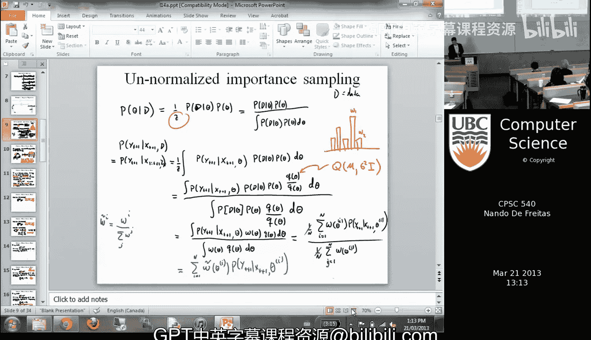

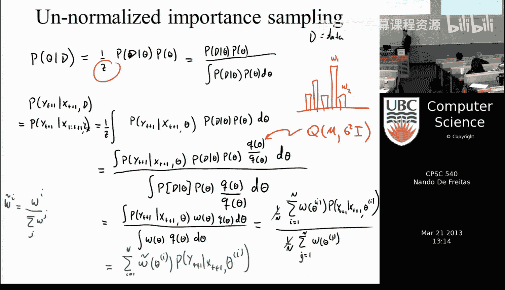

在本节课中，我们将学习马尔可夫链蒙特卡洛算法。上一节我们介绍了重要性采样，它适用于参数维度较小的模型（例如最多10个参数）。本节中，我们将探讨如何构建一个马尔可夫链，使其平稳分布收敛到我们想要采样的目标分布（如贝叶斯推断中的后验分布），从而实现对复杂高维分布的采样。

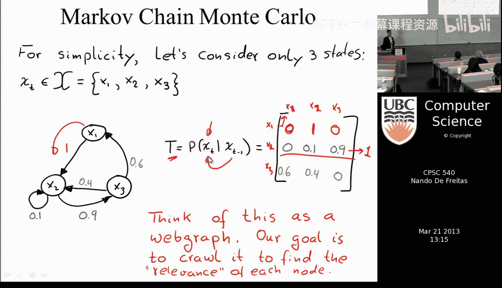

## 马尔可夫链与平稳分布

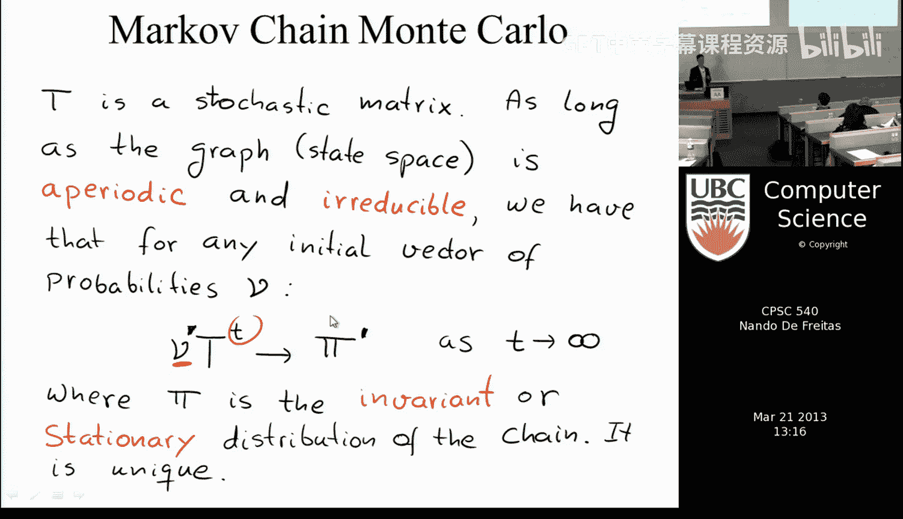

首先，我们来理解马尔可夫链的基本概念。一个马尔可夫链由初始分布和状态转移条件分布定义。如果我们有一个转移算子 **T**，它根据当前状态 **xt-1** 生成下一个状态 **xt**，那么反复应用这个算子，最终链的状态分布会收敛到一个唯一的平稳分布 **π**，而与初始状态无关。

我们的目标就是：**构造一个转移算子 T，使得从其生成的样本序列的分布近似于我们想要的目标分布 π**。如果我们对样本做直方图，它应该近似于 π。

实现这一目标的一个充分条件是满足**细致平衡**条件。该条件可以理解为一种时间上的可逆性：从当前状态 **xt** 转移到未来状态 **xt+1** 的概率，等于从未来状态 **xt+1** 转移回当前状态 **xt** 的概率，且两者都服从平稳分布 π。数学上表示为：

**π(xt) P(xt+1 | xt) = π(xt+1) P(xt | xt+1)**

如果满足细致平衡，那么 π 就是转移算子 P 的特征值为1的特征向量。这意味着，一旦分布达到 π，再应用转移算子，分布将保持不变。这为我们设计算法提供了理论基础。

## 从贝叶斯推断到MCMC

让我们以逻辑回归为例。在贝叶斯框架下，我们的**目标分布**是参数 **θ** 的后验分布 **P(θ | X, y)**。根据贝叶斯定理，它正比于似然函数与先验分布的乘积：

**P(θ | X, y) ∝ [ ∏i=1 to T Bernoulli(yi | σ(θTxi)) ] × N(θ | 0, δ2I)**

其中，σ 是sigmoid函数。这个模型可以轻松扩展为神经网络。我们的目标是**从后验分布 P(θ | X, y) 中抽取代表性样本**。有了这些样本，我们就可以通过样本平均来近似任何积分（例如预测分布）。

然而，后验分布通常非常复杂，并且包含一个未知的归一化常数 Z。MCMC方法的妙处在于，它只需要我们知道分布的**非归一化形式**即可进行采样。

## Metropolis-Hastings 算法 🧮

Metropolis-Hastings 是MCMC中最经典的算法之一。其核心思想是：通过一个**提议分布 Q** 来建议新的参数值，然后根据一个**接受概率 A** 来决定是否接受这个新值。

以下是算法的步骤：

1.  **初始化**：选择一个初始参数值 **x**。
2.  **循环迭代**（进行足够多次）：
    *   从均匀分布 U(0,1) 中抽取一个随机数 **u**。
    *   从提议分布 **Q(x\* | x)** 中抽取一个候选新值 **x\***（例如，在当前值上加高斯噪声：**x\* = x + ε, ε ~ N(0, σ2)**）。
    *   计算接受概率 **A**:
        **A = min( 1, [P(x\*) Q(x | x\*)] / [P(x) Q(x\* | x)] )**
        其中 **P(x)** 是目标分布的非归一化概率（如后验的分子部分）。
    *   如果 **u < A**，则**接受**新值，令 **x = x\***。
    *   否则，**拒绝**新值，保持 **x** 不变。

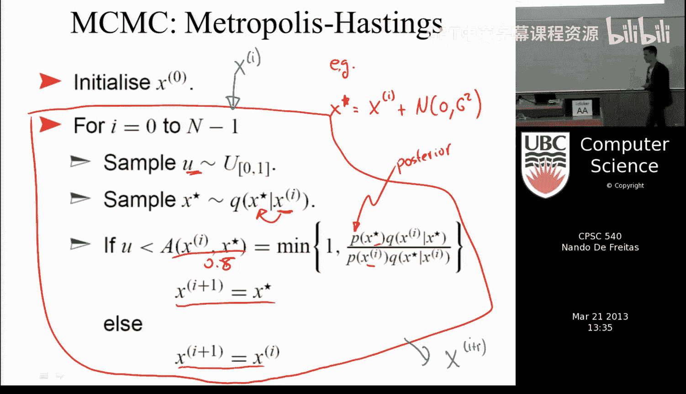

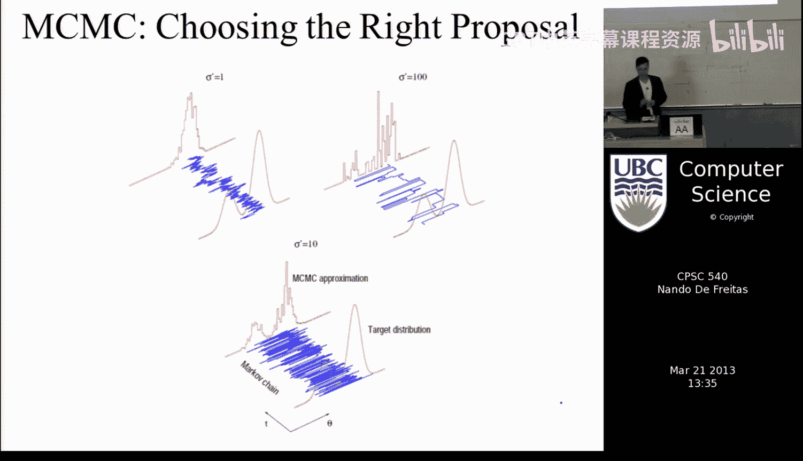

算法中，**P(x\*)/P(x)** 衡量了新值相对于旧值的“好坏”。**Q(x | x\*)/Q(x\* | x)** 是对非对称提议分布的修正，以确保细致平衡得以满足，从而使链的平稳分布是目标分布。最关键的是，归一化常数 Z 在比值运算中被消去，因此我们只需要计算非归一化的 **P(x)**。

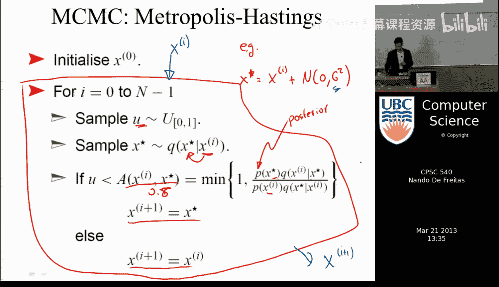

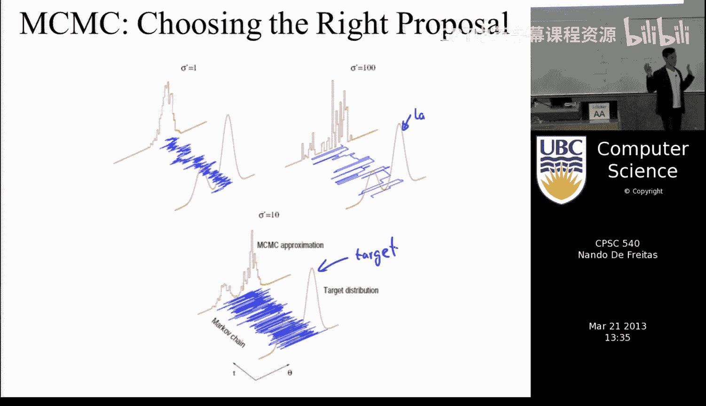

## 算法行为与提议分布的选择 ⚖️

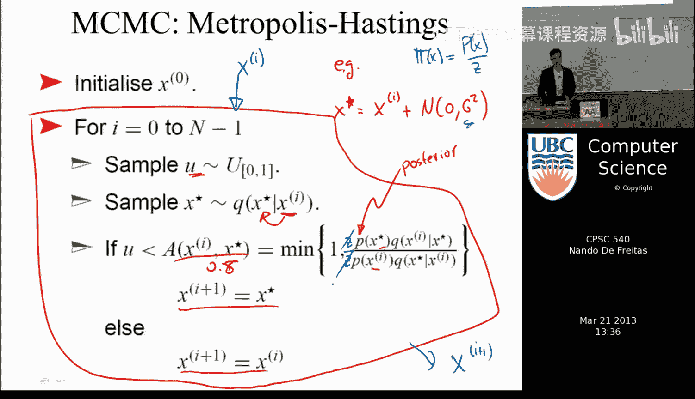

提议分布 **Q** 的选择（如高斯噪声的方差 **σ2**）对算法效率至关重要。

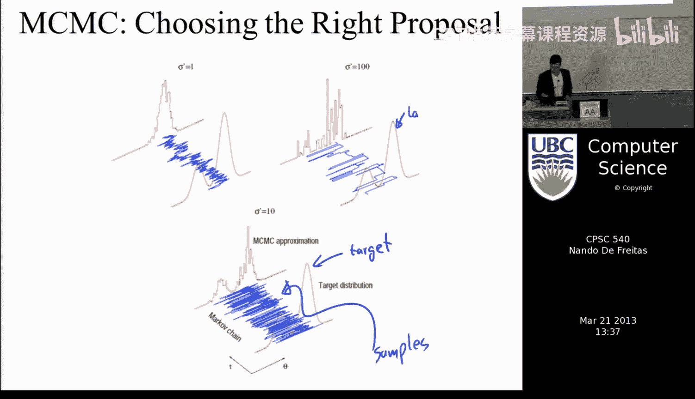

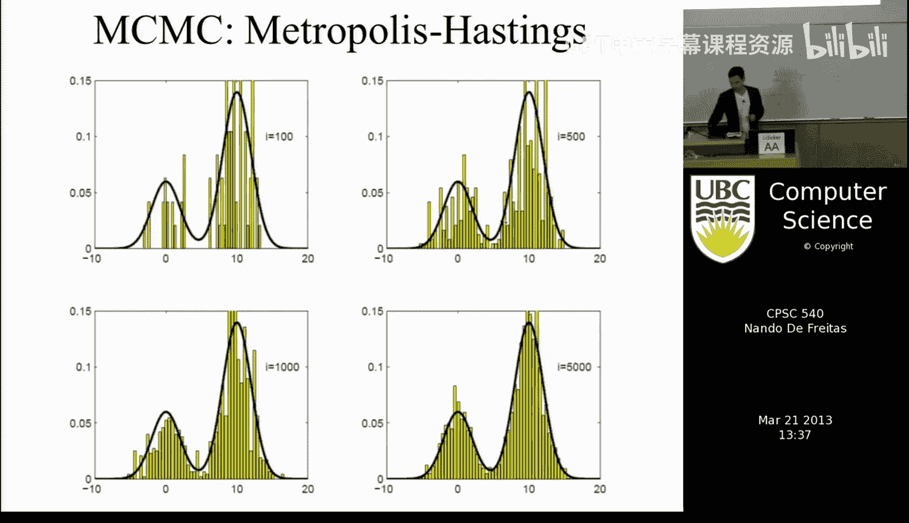

*   **σ 过小**：提议的变化很小，链容易在分布的一个局部区域（如一个峰值附近）缓慢探索，难以跳转到其他重要区域（如另一个峰值），导致采样不全面，混合速度慢。
*   **σ 过大**：提议的变化剧烈，新值很可能落在目标分布的低概率区域，导致接受率极低，链长时间停滞在当前位置，同样效率低下。

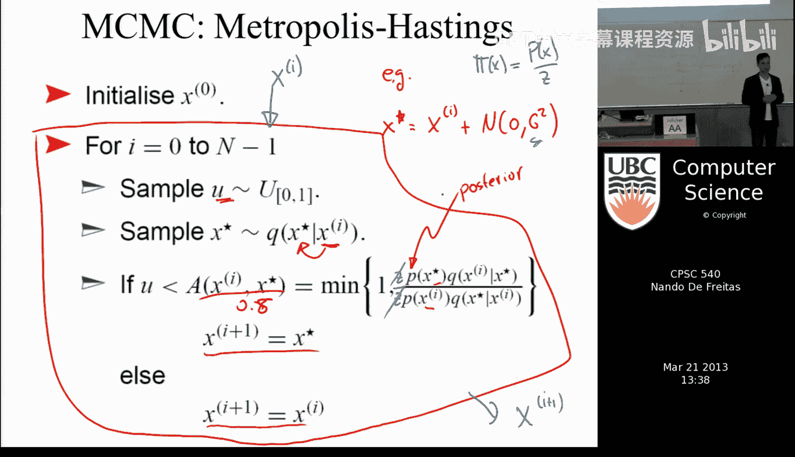

因此，需要选择一个适中的 **σ**，使得接受概率在一个合理的范围内（例如，理论上的最优值在连续状态空间中约为0.234）。在实践中，可以通过监控接受率并自适应调整 **σ** 来实现。

## 算法变体：Metropolis 与模拟退火 🔥

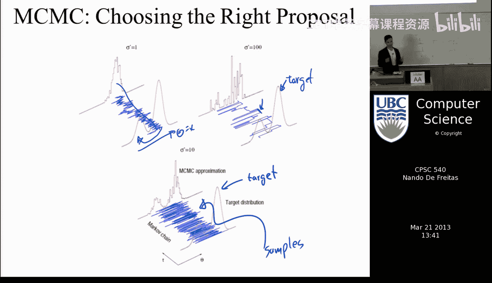

当提议分布 **Q** 是对称的（例如高斯分布），即 **Q(x\* | x) = Q(x | x\*)** 时，接受概率简化为：

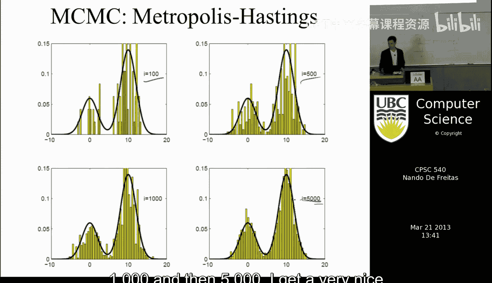

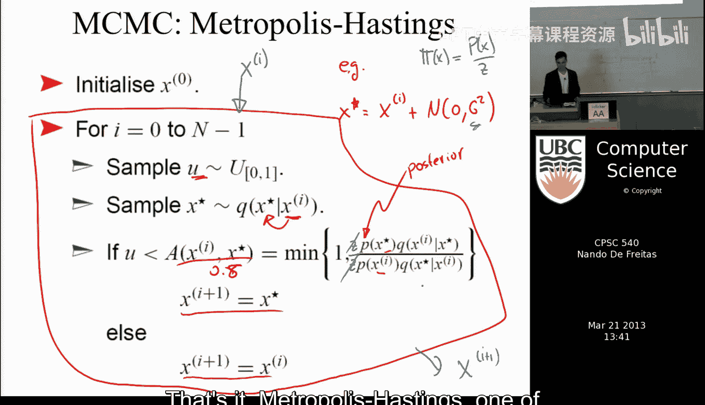

**A = min( 1, P(x\*) / P(x) )**

这就是经典的 **Metropolis 算法**。它更直观：如果新值概率更高，总是接受；如果概率更低，则以一定概率接受。

如果在比值中加入一个温度参数 **T**，即计算 **(P(x\*)/P(x))(1/T)**，并让 **T** 从高到低逐渐衰减，就得到了**模拟退火**算法。高温时，算法接受差解的概率高，广泛探索空间；随着温度降低，算法越来越倾向于接受更优解，最终聚焦在分布的最高峰（全局最大后验估计附近）。这常用于优化问题。

## 理论保证：细致平衡与转移核 📐

Metropolis-Hastings 算法可以写成一个完整的转移核 **K(x' | x)** 的形式。该核描述了从状态 **x** 转移到状态 **x'**（或一个区域）的概率。它由两部分组成：提议并接受转移到新区域的概率，以及拒绝提议而留在原区域的概率。

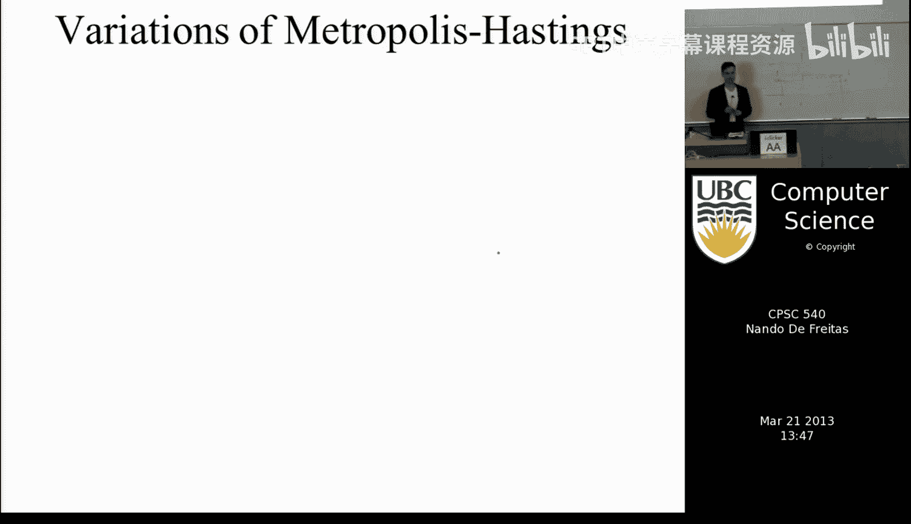

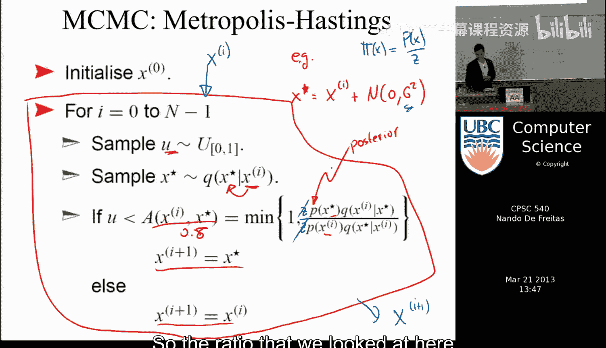

通过将算法具体的 **Q** 和 **A** 代入转移核 **K**，并证明其满足细致平衡条件 **π(x) K(x' | x) = π(x') K(x | x')**，即可从理论上保证该马尔可夫链的平稳分布就是我们期望的目标分布 **π**。虽然在此不展开详细证明，但这是所有MCMC方法可靠性的基石。

## 扩展：可逆跳转MCMC 🔄

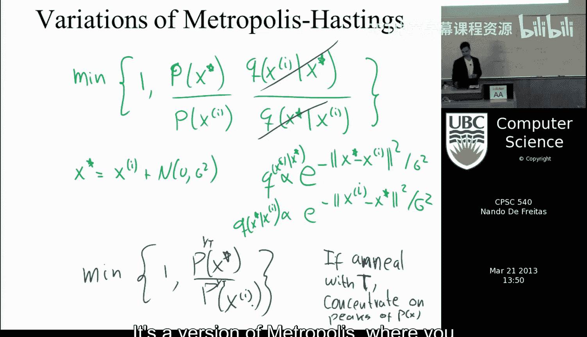

标准的MCMC假设参数空间维度固定。但有些模型（如神经元数量可变的神经网络）的维度本身也是未知的。**可逆跳转MCMC** 扩展了Metropolis-Hastings框架，允许链在不同维度的参数空间之间跳跃。其关键在于在比较不同维度模型的概率时，需要通过雅可比行列式进行测度转换，以确保不同维度空间下的概率比较是公平有效的。

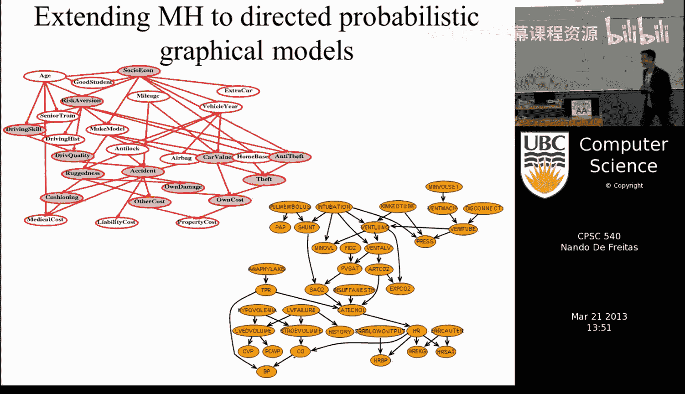

---

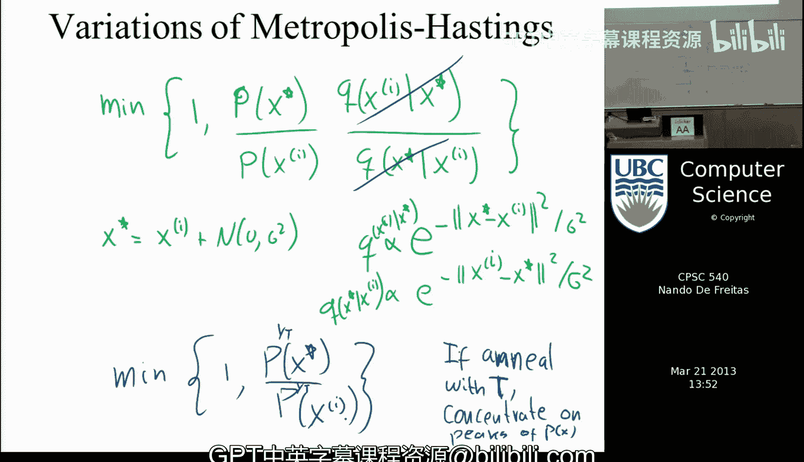

**本节课总结**：
本节课我们一起深入学习了马尔可夫链蒙特卡洛方法的核心——Metropolis-Hastings算法。
1.  我们理解了如何通过构建一个满足细致平衡条件的马尔可夫链，使其平稳分布收敛到复杂的目标分布（如贝叶斯后验）。
2.  我们掌握了Metropolis-Hastings算法的具体步骤：提议、计算接受概率、基于随机数决定接受或拒绝。
3.  我们探讨了提议分布的选择对算法效率的影响，以及对称提议下的Metropolis算法和用于寻优的模拟退火变体。
4.  我们简要了解了算法背后的理论保证（转移核与细致平衡）和更高级的扩展（可逆跳转MCMC）。
该算法使我们能够从仅知非归一化形式的高维复杂分布中抽取样本，是贝叶斯推断和许多科学计算中不可或缺的工具。