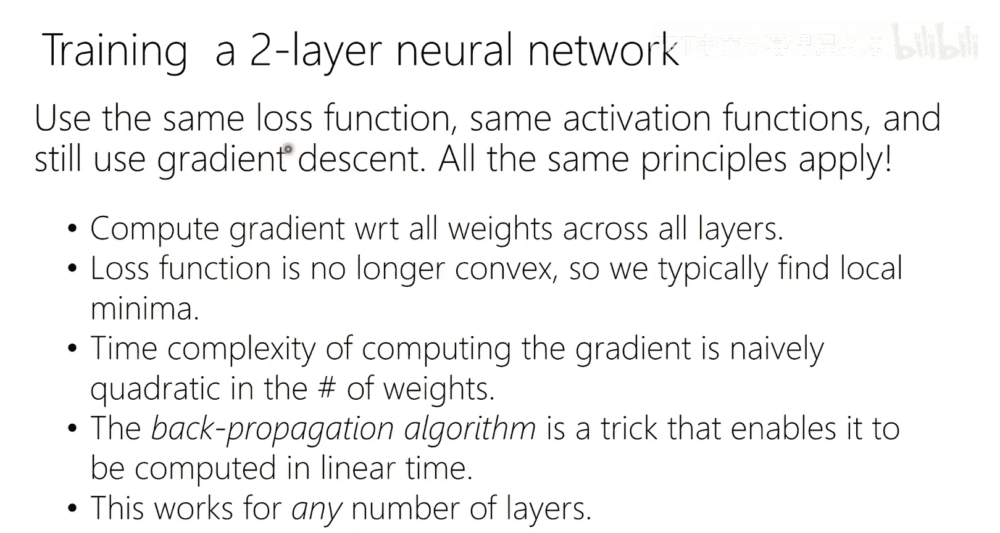

# UCB《机器学习导论｜CS 189⧸289A Introduction to Machine Learning Fall2024》claude-3.5 p01 L1- Introduction and Logistics.zh_en -BV1H4421S7bs_p1-

I have a personal question regarding enrollment。 So should they。I a little thoughts。 otherwise。

 you're each person。If it doesn' answer your question。Give your chance。接超个。我给你吃。あちん。

These ones don't have batteries they're charged。诶，ほ没 take up不通。

おぱし。And they charge in there。Testing， testing， okay。Thank you。这个。that violate you do。

I don't know what there's a room capacity and we're not allowed to exceed it。

 so anybody that's not in one of the regular seats has to actually。Yeah， yeah， yeah。

So as you may have you should have received an email saying that this course usually is in person only but we've just enlarged the enrollment because of demand。

 so we're above the physical class size and we'll get 100000 fine if they come and there's anybody not in a seat so I literally can't start the lecture if you're not in a seat And if you're not in a seat。

 This is recorded， it will be released anybody with a Berkeley Eduu can see it on the web page。

 youd not be need B courses for anything in this course except to see the solutions to the homeworks。

 which you cannot see if you're not enrolled and if you're enrolled， you'll be on B courses。

 So I'm going have to ask anybody who doesn't have a seat to leave are there does anybody have an empty seat next to them。

 put up a hand I don't see anything。So yeah， so if you're just standing by the wall， I'm sorry。

 but I'm gonna have to ask you to to go if you're on the floor。

 Also if and I should say priority should be given to the people who are enrolled if anyone sitting and isn't enrolled。

 let me just quickly say that you cannot come to me and ask about enrollment。

 It will have no influence on your enrollment。 if you're concurrent enrollment student。

 those spots are all filled up。 if you're not already enrolled。

 you won't be unless somebody drops and there's a few spots that could come off the wait list for people who who drop the course。

 but otherwise the the courses at max capacity。 So if you're not enrolled。

 could you actually exit and leave seats for people who are enrolled。The videos。

 the slides and everything will be on the course webp page。 all the information。

 including the videos and the lecture slides， are available through the course webpage。 Yeah。

 including for this one。😊，Yeah， if you can't find a seat， Yeah， it should go。 It should be up soon。

I don't think you's streaming。 It's not streaming。 It's just available afterwards。 Yeah， yeah， Yeah。

 okay， I'm sorry about that。 Yeah， yeah yeah。I mean。

 usually I restrict it to in person to avoid this， but there is some pressure to enlarge it。Yeah。

So again， if you don't have a seat， you're going to have to leave the lecture room and you can find the recording on the website later today。

😡，It's all on the website。 It's all on the website。

 You do not need B courses for anything other than solutions。😡，Yeah。So again， you cannot be standing。

 I will not start until everyone is seated or out of the hall。 and you cannot sit there。

 You must be in an actual seat， or it violates the fire code。So I think the seats are taken。You。

 you cannot stand in the back。 You cannot sit on the floor。 You。

 There will be a recording available on the website later today。啊 hello。😊。

This is look at the T shirt， this is Suiers our head GSI and he's dressed the part better than me Okay。

 so I'm just waiting till they because I don't want to get $100，000 fine。😊，Okay。

 I think we're in pretty good shape。 So did anyone see today's headline that said we can no longer teach AI。

So this is gonna be a statistics。 No， I'm joking。 Actually， we can still teach it。 But maybe one day。

 Okay， that's just a bad joke to make people laugh。And I thought， is this plugged in。

 this is not plugged in？Okay so welcome to 189289 undergrad grad course so I'm going to spend quite a bit of time going over the logistics just so you make to make sure you know how this works and then I'm going to do kind of a very broad overview to introduce you to some of the main ideas that will appear in the course and don't worry if you don't get the exact concept in technical detail it's just meant to kind of see do with some of the main ideas and how they play with each other and everything I'm going to tell you about in this introduction we're going to go into detail as the course progresses。

Right， so so for a few years， I've been doing this with Professor Malick。

 who's creating his own new course。 So I've managed to convince Professor Seremmi。

 who works actually at Genendtech and is a fantastic machine learning expert to come teach with me this year。

 He couldn't make it today。 but you will meet him soon enough。

 and we're gonna kind of teach in chunks。 So I'm probably gonna do about 4 or five lectures now and then I'll hand off to him and will kind of go back and forth like that。

 And And so soon you will meet him and you just got to meet Suier， who's in the back。

 helping me not get $100000 fine， which gets split by the class。😊，U。

Actually I don't actually know who pays it， but somebody pays it。 Okay so this is a bad idea。

 I keep thinking that's gonna be a slide advancer right and then we have a whole contingent of stuff and we've got the Ts here some fantastic Ts that are going to help run the discussion sections。

 help us get the discussion and homeworks to be coherent with with the lectures and every year we kind of update the lectures and it's always a bit of a moving game but we're gonna do our best So soon you'll get to meet these lovely folks as well Pierre。

 Grace， Ruuchier and James。😊，Okay， and so as I mentioned， this just happened a couple of days ago。

 Basically it's been a moving target every day this week。 I get new information and new questions。

 But so as we already know this is above capacity。 I think often people don't end up coming anyway。

 if the videos are available。 So I expect that people who want to come in person will be able to if that actually doesn't happen。

 I'd like to do a poll at some point because I think people who want to come in person should be able to。

 I can't change it this year， but I could be more careful another year。

 All the discussion sections will be in person。😊，And there's if you。

 some people were not able to enroll because there's a no conflict rule。

 so you cannot enroll in this class if you're enrolled in another class。

 And part of the reason for that is that it's just too complicated to provide alternate exams。

 So there are absolutely no alternate exams at all。

 the exam that's in the in the final schedule is going to be the day and time that you write the exam if you take the course and the exams must be taken in person。

And at some point， there will be anedpost with a detailed exam policy okay And so maybe I should even just tell you a bit about myself。

 but there's always like boring logistics and stuff。

 but so I've been here about eight years and before that and I'm in the computer science department。

 I'm in the AI group and my expertise is developing and leveraging AI for problems in molecular biology and I've moved around many problems at some point I was doing some stuff with CRISPR Cas9 now I'm very interested in protein engineering。

 And so and I did a big career change when I came here because what I did for 11 years after graduate school。

 I actually was in Microsoft's research division as a researcher where I kind of wrote papers and did research in the same way I do here except now I have this fantastic group of PhD students and get to teach you folks。

 So that's kind of my background and people sometimes there was a result of that。

 they want to talk to me to understand what industry experience is like but I was in an academic bubble。

In industry。 So actually have no idea。 So you can try asking me， but you won't get much answer。 Okay。

 back to boring logistics。 the midterm is already scheduled。

 It was originally gonna be just in dwinll， but because of the enlarged class size some other rooms are going be added。

 So will give you detailed information on that。 So enrollments usually where a million questions are I've already said some of them just to make sure we don't violate the fire codes So the class is full。

 there were never， and there will not be any instructor allocated enrollment codes。 No， as I said。

 no time conflicts allowed。 All the concurrent enrollment slots that were allocated for this course as of just minutes ago。

 I just saw this on my email， they've now all been allocated。

 So if you're a concurrent enrollment student and you haven't seen that you are enrolled I believe you will not be enrolled unless some of those students drop out。

 And then in terms of just regular people on the wait list。 that will be sort of done。😊。

Sor automatic procedure by the department as people drop the course so I often quite a few people drop the course so I can't tell you what your probability of getting in is。

 but there is a probability of getting in if you are not enrolled and you hoping to be enrolled。

 you have to do all the assignments and the work as though you were in the course because if you don't then you're going to get dinged accordingly to having not done that and if you have questions this is handled by the department neither myself nor the staff can say anything beyond what I just told you we don't really know anything more than that so you should reach out to CS enrollment and at least in the past they used to have some drop in office hours which I assume they still have。

Okay， any questions， important questions at the moment？All right。Okay， so， and， and as I've been。

 do we have the course website on these slides somewhere， do you know。嗯好。Realize。

 maybe I should put it in right now， of course。Website。Do you happen to know what it is， suu。E。189。

org all right。Oh no， okay， awesome， okay， there we go。And so as I said。

 we've had a lot of people saying， can I get on B courses if I like can I audit。

 I'm not yet enrolled， but like you don't need to be on B courses unless you're a student and you want to check the solutions to homeworks and exams because we put them kind of behind that firewalls so that they don't get passed around more than they already do。

So everything is on the website， some of those things like the videos do require you to have a Berkeley EDU。

Okay， right， and auditing usually I tell people like if you see a seat， you're welcome to audit。

 please don't make use of any class resources， Don't go to discussion and use the TA like just you can basically you have to be a passive observer because the staff resources are already extremely limited。

 in this case， if you want to audit， I would say please wait a few weeks before you try to come in person because I think it's not clear if even the enrolled people will all be able to have a seat or not and I don't want to have auditors taking the seats of people who are enrolled in the course。

Okay， so for contact， don't email anyone individual unless there's some like crazy once in a10 year emergency。

 maybe you might email me or say directly。 So generally， first of all。

 read the website because there's a ton of information there about policies and how things are going to work。

 And then in general， if you have questions probably other people have questions。

 so make it a publiced post some reason for privacy。

 then you can make a private post to the instructors And like needed if I don't if I'm not oned or something like this and it needs to get escalated。

 the staff will escalated to me。 So that should be the regular procedure。 So for office hours。

 this is a little tricky。 So the room that we like to do it right after lecture because then you have some coherence with the lecture。

 and the room they gave us is like I think it's like my walk here from my office is 25 minutes and it's like 20 minutes in a different direction or something。

 So what I'm gonna try to do。iss try to find。 and I've done this in the past It's just trying to find a courtyard or some sort of space in this general region where we can sit be it inside or outside and just do it there。

 So， so stay tuned for what that will be。 I have to kind of scope it out and play it by ear a little bit。

And if you're DSP， the point of contact is a departmental staff member， Crystal Simon。

 so feel free to reach out to Crystal for any DSP related issues and she'll coordinate with us and the staff as needed。

So prerequisites， so these course numbers are a good idea to have taken。

 but roughly speaking you should have a solid background in linear algebra。

 vector calculus probability and programming skills。

 sometimes people have said you need to have taken optimization you don't need to have taken optimization we're going to teach you some basics of optimization。

 optimization is like a key component of machine learning。

 there would be no machine learning without optimization。

 I didn't know that when I took my first optimization course and I thought it was really boring and so if you're trying to get a sense of like do you think I'm going to be able to do this course。

 do the first discussion and the first homework and this will at least give you some sense of some skills that we expect people to have。

So the breakdown for the grading is the same for the grad and the undergrad class。

 the only difference for the grad students is the exam。

 but like there's a university requirement that we make something different so we add usually a grad question to the exam which will be noted in a visible way。

 but otherwise it's the finals 45%， the midterm is 35% and the homeworks are 20% and the homeworks are really meant to get you to learn the material in a deep way so that you can do well on the exams。

Mm。homeworkworks will be some pen and paper and some coding in Python。

 There will be a total of seven homeworks。 So I think the schedules something like roughly every two weeks。

 And as you probably if you've taken， most of you have taken other C classes。

 we don't always grade all the problems because we don't have enough staff time。

 so there will be some sort of subset of problems that get graded and your grade will be reflected by that。

 And of course， we won't tell you which subset we're grading ahead of time。Okay， and you can again。

 the informations all on the and the due dates will be all on the website。

 And there's already a homework released there， which is due on September 11。And so。

There's no late homework under any exceptions， but to sort of mitigate that strictness。

 we allow you to drop your two lowest homework grades。

 but you shouldn't like you shouldn't just use them when you're feeling lazy。

 Like use those because you you thought you understood something you didn't or you have some like major emergency that causes you not to be able to do one of them on time。

 And and then on top of that like 80%。 if you get 80% of the homework correct。

 then you'll get 100% of the grade for that homework。o k。So in terms of collaboration。

 I think I'm just going over fairly standard CS policies here。

 but it's good to explicitly do that upfront in the beginning。

 so you're encouraged and you're certainly allowed to work with little study groups of around two to five people if you do that then you have to write the names of all those people when you submit your assignments and you should not be showing each other any of your final write ups it's just meant to be a discussion to help you understand what the question is asking and to make progress towards the solution。

 but under no condition should anybody be looking at anyone else's written up exams。

And you can use books and online resources。 But not if you。

 you shouldn't have a copy of previous solutions。 if you do。

 we often make tiny little changes to the homework so that we can catch people who are using that。

 And so please don't use those。 And but if you do use a book or like Wikipedia or whatever it is you're using。

 use it， just give credit where where you've written it up。

 which is kind of how you should go through life in general。 and never copy verbatim。All right。

Cheing， there's zero tolerance policy and so part of that is just also no online communication to discuss assignments or content other than through Ed。

 And I think I already said the rest， don't have to repeat it。Okay。

 so what materials are you responsible for。 So when we give lectures。

 you're responsible for all the material in the lectures unless somebody explicitly says， oh。

 I'm just telling you this for fun。 you're not responsible， which every now and then I do。

And the slides will be posted for each lecture。 So in fact， these slides are already， I try。

 usually I managed to post them well， yeah， before the lecture。

 so there's I think there's two folders in a Google drive that you can see from the main course website and I already put a dump of the PDFf into the pre lecture slides。

 And the reason there's a pre and a post is sometimes you or me catch bugs in the slides and I go fix them after and then upload a cleaner version and then you just have you know which is which。

And so we've never， there's never been a good textbook in machine learning。

 And that's been one of the real challenges for this course that we've literally never had a textbook。

 But Chris Bishop， who's a sort of longtime expert in deep learning wrote I think with his son。

 this book an updated one。 He had one of the very original classical machine learning books。

 and he has an updated one right now。 And we've never used it before。

 and we're not gonna to use it in the sense of we're gonna follow it very exactly。

 but it's gonna be an extra resource that I think will be very helpful for you to learn the material。

 So in many cases， if there are relevant chapters there， we're gonna to assign them as reading。

 which should just help to reinforce the lecture and give you kind of a slightly different viewpoint to what the professors have said in what's in the discussion and homework。

 but it should just help to reinforce everything。 So in fact。

 we've already posted one from this week。 It's a fairly light read。

 a course on to the intro to M that I'm gonna give you in just a moment。And so you can。

 there's a website for this， this book。 And from there， there's actually。

 I didn't look too carefully， but there's a free online version。

 I think it just means you can't probably annotate it or save it or anything。 And then， you know。

 there's all the other online ways to get textbooks。 You can buy it directly from Springer。

 It's on Amazon and so forth。And you can order a print copy as well if you want。

 I haven't ever seen one。 Okay， that is the end of the logistics。 Any questions on that。 And。

 and part of the reason Suture came is just because he knows so much about the inner workings of the class that I don't necessarily know that he said he would come and help me answer questions about details about all this stuff usually there's a lot。

 but it doesn't seems like people are already asleep。No， oh yeah， okay。Yeah。Yeah。What is it。

 It's a wht。 Do you know what he's talking about su chair。Oh， I see。系。

So you're saying they can use it， but they should make sure to cite the contact appropriately。

Is that visible to us？I see， okay。I see， okay， Got it。 Got it， okay。Any other。ち。啊。

It's a little experimental because I haven't done it So I did post one just like an hour ago。

 I don't expect you to have seen it。 My intent is that if I because I have to also kind read it as preparing the lectures。

 So if I'm prepared enough， I will post before but I think even if I post after I don't think it's a big deal because I think the lectures will probably be a better kind of overintroductory review。

 and then you can kind of more sit and chew on the material after and see how it links to what was in the lecture。

 but I think also honestly it's probably pretty obvious which chapters would be likely to be assigned。

 So I'll try my best to put it up before。 but I don't I don't expect anyone to have read it in order to follow the lectures。

 but I do expect everyone to have read like the reading I did now before next week's lecture just because I think it will help cement the and in general because it will help cement the material。

 And if there's any confusion about anything than we can get the confusion resolved sooner rather than later。

Okay。And你。Anything else？Alright， well， let's go into the intro And just to repeat what I said a bit earlier。

 like I'm gonna just give like a very broad overview。

 It's going to have like some details of how we do things。 If you don't quite get it。

 this is not the place where you meant to learn it in detail that's going to happen throughout the course。

 is just to really try to give you a sense of the big moving parts and how problems look like in machine learning and what they are。

 So what are examples of learning problems。 So they're all over the world now。

 I had actually got this list from someone else。 And he just had these like classic examples that were there during my PhD。

 So I've interspersed some more modern ones。 But like so one of the very first and we're go into detail with this today。

 But one of the very first。😊，problemsble that people tried a lot of time on。

 which will sound quite simple in the modern era， is just to take a picture an image that contains a digit of 0。

1，2，3，4，56，7，8，9 and just say what is there a zero in this image， yes or no。

 is there a7 in this image， yes or no。 And and nowadays we think of this as a very easy problem。

 But people spend a lot of time and there's a very very famous data set and actually this is in fact。

 of course， how the postal service gets a lot of zip codes and reads all the hand the envelopes and so forth。

 But a more modern example， and to be honest， I don't know if this is actually deployed anywhere It's something we've talked about for a long time。

 My guess is that it is deployed， but gets doublechecked by a doctor。

 but things like have some imaging modality in a hospital and say。

 like is there a tumor there yes or no， or is it this kind of tumor yes or no。

 or like where in the image is the tumor every day we get a bunch of important emails that get thrown to our spam or we get a bunch of spam that gets thrown into our inbox。

 that's because class。Email his f or not remains imperfect， but it's certainly very useful。

 you could also this is a classic example。 And again。

 I don't know exactly if it's deployed at the moment or not。

 you get a medical record as the doctor asks you things you get blood tests you have this whole textbased and numericbased medical record and you could query that and ask questions about is this person likely to have such and such a problem or it' be at high risk for this and this kind of thing and there's a lot of work on this。

 which is like medical AI things like if you could predict the price of the stock six months from now。

 people certainly all the hedge funds and so forth。

 they try to grab the machine learning PhDs because they do a lot a lot of modeling in there and then something very near and dear to my heart which actually is in Chris Bishop's book as well。

 He talks about this which is taking the sequence of a protein， which is specified in the alphabet。

Of amino acids， so not all 26， there's like 20 of them and you can write a string of letters from the 20 letter alphabet and that defines a protein。

 but it tells you just like the amino acids， you don't know how do the actual atoms like what's the configuration。

 3D space of the atoms。 that's the 3D structure prediction problem which you may have heard of from Alpha fold。

 which is a program that the company Deep Min developed and really blew a tremendous scientific open problem like through the roof in a hugely successful way。

 It's not the end of the story， but it was a really impressive success。

Some other ones predicting selling price for individual houses。 Actually， I。

 I don't know if I'm gonna do my causality lecture this year。

 but Zillow actually screwed themselves up doing this。 They like。

 they lost their pants because they had a bad model and like lost a ton of money。

 When I was in grad school。 There was the Netflix problem。 You who's heard of the Netflix problem。

 Probably really， how do you know about it。Yeah， yeah。 but how do you know it's like your dad。

 did he do it？So when I was in grad school， Netflix was a pretty new company and they said we'll give here's a competition。

 here's the data we have a private sort of set of data we're not going to give you and when you submit your algorithm。

 we're going to run it on our private set of data and see how well you do given the set of data we'd already let you play with and so there's this leader board and they said that after so many months the winners would get a million dollars and what's really funny is like at that time。

 Jeff Hinton， I was in Toronto which is sort of the epicenter of machine learning at the time he and other he's one of the touring Award winners for all of AI。

 he's like considered the great granddaddy of AI。😊，And he， like and other people， like him。

 like dropped all their academic research to try to like win this thing。 But meanwhile， you know。

 like a few years later， like people were begging them for like $6 billion to just like put their name on a company。

 But and in fact， the winning the winning team was actually a conjunction of teams that actually kind of joined the models together in what's called ensemble learning。

 which we'll talk about towards the end of the course。😊，嗯。Right。

 and actually so so I've always done my my AI motivated by problems in biology。

 even when AI didn't work and when nobody was doing it with biology。

 but actually this intersection of biology and AI and more broadly of science。

 and AI is actually really， really burgeoning now， both like in academia， also in startup land。

 even the big tech companies have allocated quite a few resources on this。 So be it biology。

 chemistry， material science， like they're all very actively using AI now。Okay。

 so like a long set of examples， just to kind of show you like there is everywhere。

 almost no matter what you care about， if there's data。

 odds are somebody is trying to use this to use machine learning。

 Who knows the difference between machine learning and AI。And how I choose which one do you use。Yeah。

 I think I think this is a very reasonable answer。 And I think there's no universal answer。

 depending who you ask， it will be different when I was in grad school。

 AI was a dirty word because it'd gone through like AI winter。

 And it was embarrassing to say you did AI because it was completely lunatic thing you did machine learning。

 which was like this technical interesting rigorous modeling。

 And then and then AI was basically AI was artificial intelligence。

 We're gonna solve problems the way humans do with that level of complexity and beyond whereas machine learning was more like I don't can I just recognize digits like maybe fancy statistics。

 But the reality is there's no clean definition of any of these。

 And I would say machine learning is the underpinning of AI。

 but maybe AI aspires to some human like intelligence and machine learning maybe doesn't so much it's more a tool that could be used for that purpose。

 But but don't quote me on that。Okay， so we've talked gave you all these sort of examples of possible learning problems。

 And so I'm gonna to occasionally put in some kind of italicize things to like denote keywords that are used a lot。

 And if you want to be conversant in machine learning。 And in this course， it'll be good to know。

 So there's one of the classical probably the most popular well studied problem in machine learning is classification。

 And when you say I'm doing classification means you have some sort of like input features like the pixels in an image And the output for classification is is is usually just like which class does it belong to。

 usually binary。 So like are you the digit 7 or are you not the digit 7。

 occasionally and some classification， you actually。😊，Typically it's not just01。

 you are a 7 or you're not， it's usually a probability that you're a 7 is like0 you know8 and probability that you're not a 7 is 0。

2 because we don't usually know things with perfect certainty。

 but the point is the classification is you're predicting like a discrete label like you are a7 or you're not a 7 in contrast for regression we're predicting a real value number so like if you're predicting blood pressure or like anything that lies on a continuum and you want to know the kind of exact number maybe with some error around it。

 that's regression and we're going to use those terms a lot and we're going to teach you how to do each of those was there a question somewhere。

Okay。And then don' we've never taught this， but just to get it in your head。

 like you might also want to do ranking。 So a classic example would be if you're running a web search engine。

 right like when you get your results back from Google， like there's no like regression value。

 there's no number。 It's just a ranking。 all you care about is that the top 10 things are on the first page and that they're in the right order。

 And so that's another type of learning problem you might have。

 which is a little bit related to regression， but you would do it differently。

 and we won't go into that。 And so this year I actually didn in previous years。

 I didn't even have this， but I was like wow， this is getting out of date。

 actually I didn't give this lecture before aten used to get this one。

 But so unsupervised problems are kind of none of the above and unsupervised you're not like taking an input and predicting an image and predicting like a label like it contains a cat or a label like blood pressure。

' actually just saying I'm gonna give you。Bun of images。 or I'm gonna give you text like for chat G。

 take all the text on the web， which they run out of。

 And just I want to model the distribution of that data， not as it corresponds to having any labels。

 just like what is the distribution of that kind of like a very fancy who's learned about Gaussian probability distributions I hope most people are putting up their hands。

 if you this might be a scary course， very scary course。

 So So a Gaussian distribution we're used to thinking of there's some points。

 there's a mean and there's a spread， which is the variance and you can write the functional form as we will do inry detail in a couple of lectures of what the probability density is for that。

 And you can like a really， really fancy Gaussian is like an unsupervised model in machine learning。

 I mean， so is the Gaussian as well。 that's kind of the ideas instead of Gaussians are for real value data。

 if you have the whole corpus of data on the web， these are text。 So there discrete tokens。

 And so you want something like a Gaussian that will give you the。Of chunks of tokens。

 And its going have， it's going to model the Web and behave the way we know it behaves。

 which is pretty intelligently， Despite its errors， It's going to be a very complex and large model。

And so unsupervised， I think at least in in the media now， if you were just scanning。

 you would think perhaps that a lot of machine learning is unsupervised and learning where you learn the world wide Web。

 and then you generate things。 and it's a generative model because they can generate text。

 And so generative AI has become a very， very popular flavor of AI now。

 But these classical problems of regression and classification。

 they're still being used all over the place for real problems in industry。Okay， so。

What are we learning in each of these cases， Like， what am I learning in classification。

I get some data。 I learned my classification model， like， what's a way to describe what I've learned。

It's a mapping that goes from some input space like pixels to an output space。

 which is like probability you belong to class 7。 So it's a mapping from an input to an output and in classification。

 the output is this discrete label and an regression。 It's real valued in ranking。

 I'm learning the mapping from the ranking has to be relative。

 So I have to give you a whole bunch of examples and then it have to rank all of them because if I just give you one example to rank like it doesn't make any sense but what about in this unsupervised。

 if I give you this whole I said like I'm learning whole I'm learning the whole distribution of like a web is basically what chat G has done。

's not learning a label for anything， although under the hood， it's kind of learning a label。

 It's making makeup labels， it's pretending that the next word in a sentence is a label this is sometimes called self-supervised learning。

 but it's really just unsupervised learning because there's no real label There's no here's an image It has a cat or here's like your genetics。

 There's your blood pressure。 It's just a big corpus。Of data。

With no that's sort of the point is these are all the first three are supervised problems。

 I should have said that and the last and in contrast， unsupervised。

 you don't have some corresponding label that you're trying to predict。 And therefore。

 when you're training the model， you also don't have such a label unless you kind of make one up in this pretend way。

Okay， so I mentioned this is like a super famous data set called M。 I don't know why。

 but we call it Mist instead of M N I S T。 And so this is like people spent a lot of time trying to make progress on this。

 And they kind of stop because it's now a solved problem。 But there's 60000 examples。 So each digit。

 like 0 gets 10000 examples。 One gets 10000 examples and so forth。 And each of those images。

 like they're all stacked together here。 But really， each one kind of look something like this。

 And it's a 28 by 28 pixel。 So 28 by 28 matrix。😊，And each value， you can do this in different ways。

 if it were colored， it would have three channels for green blue red， this is grayscale。

 So there's just a single channel of like how white are you that， for example， goes between 0 and1。

 you could discretize it， there's many different ways to do it。

 but you should think of this basically as a matrix which is 28 by 28 that has a real value number representing the gray scale。

And so right now， the best systems can predict these numbers from these images with a really。

 really low error rate。Okay， so。You're gonna I'm trying to introduce some words and also just some sort of ways that things flow in machine learning。

 So if you want to take an image and build a classifier。

 you're gonna to first have a phase of training time where you're going train the model on the training data。

 And the first thing you're going do is you're gonna compute what we would call feature vectors。

 So I said that each image is a 28 by 28 pixel matrix。 not always。

 like I'm going to simplify things because the beginning of the course。

 but usually in machine learning， you want to get like just a vector representation that you can then give to the model to manipulate its numbers to do its computations later on。

 we're going to learn about convolutional neural networks where you wouldn't where you would actually leave the image just as a matrix。

 But in general， you want things to be a vector。And you're going to have a vector for those positive and negative classes。

 examples of the class， so you are a seven or you're not a seven and you're going to have that for each kind of digit and then you're going to train a classifier give you a bit more insight into what that means and by the end of the class you'll have a lot more insight into that。

And then at test time is what lets us kind of evaluate it。

 So there's this phase where we take some data and we train a model。

 and now we have this model and it can do in this case， a classifier。

 it can do classification And then at test time， we take data we did not use to train the model。

 but that we know the answer for， so that we can assess how accurate that model is。

 either because we want to compare it to other versions of the model that we changed things in or just maybe we just are willing to just use that model if it's good enough and we want to know how well it's doing。

 And so we but to evaluate it， you need to have held out some of the examples and not use them for training because if you don't do that。

 you could have just sort of memorize the answer， which is something that can go wrong that we call overfitting。

Okay， so what what so we have a phase of train time。 We have a phase of test time。 What's。

 What's the third phase that we sometimes forget about when we teach machine learning。

It is the deployment。 oops what happened I the deployment phase。

 And so I realized one year when I taught this course。

 talked we spent a lot of time talking about like you know if someone gives you data。

 how do I partition the data to train part of the model and hold part of it out to evaluate and we' like talk about how to do this properly so that you get an unbiased estimate of the error and so forth。

 But then sometimes people come to me after the class they say what if I want to go use the model。

 shouldn't I just use all the data available， indeed you should but we sometimes forget to teach that So at deployment time。

 whatever you've learned by splitting and to train and test and so forth。

 you want to milk all your data and build a model and then deploy it And when you deploy it like in a hospital。

 you don't generally know the answer anymore so you can't evaluate it anymore。 although， for example。

 in a hospital they might do something like pay a smaller subset of doctors to laboriously and expensively get some labels so that they can monitor over time that the machine learning model hasn't kind of drifted。

because the machine became uncalibrated or the type of patients that started coming in started to shift or something like this。

Okay， so let's start going very slowly into an example。 and we're not going to get very deep today。

 no more than two layers。So okay， so as I said， one of these examples。

 these image patches in the case of these gray scale objects here representing numbers。

 oh I forgot there's a feel free to tell me you can see this。

 but there's a better way to see it and I always forget。Laser pointer， Oh yeah。

 feel free to tell me in lecture that I forgot to put the laser pointer on okay。So， right。

 so in this case， we've just got three grayscale levels，10 and。5。 you could have had 100 values。

 So there's different ways to do this。 but just to give you an idea。

 this is what this would look like。 And ultimately， if we're doing machine learning。

 like whatever it is， be it a molecule， you know， a protein an image。

 we need to get like numbers to do machine learning。 And so in this case。

 this is what the matrix of numbers would look like， except it's actually 28 by 28。And as I said。

 we're gonna， we're gonna we want to get a feature vector later。

 We'll show you that you maybe don't want to do that。 but usually you want to get just a vector。

 So every example in your data set is now just a vector of numbers。

 And then you can kind of turn the crank of a whole bunch of general machine learning with that kind of general representation of set of numbers of some length。

 And so in this case， I can just flatten the matrix into a vector。 I could do it different ways。

 As long as I do it systematically for all the examples in the same way。 it doesn't matter。

And so this is what we call a feature vector。嗯。Okay， so this feature vector。

 I get one of these for each example of those images， right。

 Every image now I've transformed into a vector， which is the flattened version of the matrix。

 And so I could like if there is only two pixels I could draw each example in a 2D space kind of like this。

 of course， in machine learning， things are very high dimensional。

 but when we're teaching and giving talks， we often kind of use these schematics in two dimensions to to just give you a sense of what's going on。

 So even though these are high dimensional vectors。

 let's kind of project them onto a plane and imagine what they might look like。

 So let's say that the red little scribble dots here are feature vectors that happen to have a label such that they are a 7。

 we know they are a 7。 and the blue dots are examples where we know they're not a 7。

 So maybe there are 0，1 two whatever。 And if I drew them， they might look something like this。

And so what do you notice， any patterns？嗯。Dead service。Yeah。

 there's more dots that are this section here is more enriched for red dots。

 There are a few blue dots， and this section down here is more enrich for blue dots。

 but there are a few red dots。 And so what you might start think like who has an example。

 who has some idea just from looking at it this way of how at a rough conceptual idea。

 we might go about classifying points into whether they are a7 or not。

It does look a lot like a linear regression problem。

 So what would you do if this was a linear like just geometrically。

 how would you think about this picture if it were linear regression。So I could in linear regression。

 there is a line。And what， in linear regression。The new regression is regression。

And this is classification。 but you can laugh， but actually， logistic regression is classification。

 So it gets very confusing。 but linear regression is regression。 And indeed。

 you have a regression line， but in linear regression。

 that regression line is meant to tell you where the data points lie。

 And so this would not actually be very close。 but it's a little bit off。 So in linear regression。

 a line gets defined。 and you want the line where most of the data sit closest to it by some criteria that you learned here what we want is we kind of want to find a line that separates the points。

 We don't want the points to sit on the line。 So we do want to find the equation of a line。

 such that most of the red points sit to the right。 and most of the blue points sit to the left。

 And we call this a decision boundary。 And so it's like it's very similar in concept。

 And so it's actually logistic regression which has a linear separating hyperplane in the original input feature space。

😊，Okay， so but I think I inverted some of my ideas here。

 So now we're gonna think of the red and the blue as training data that were given to us and we can use them however we want to train a model such as logistic regression。

 but what's an even simpler way that I might I say I get this test point here。

 I can see where it is like geometrically it sits here up in this cloud what kind of a rule could I use other than like suppose I didn't have this separating hyperplane between the red and the blue points。

 Is there some other rule you could imagine them might tend to work well for the data we see here。

The K so the answer was the K closest points and indeed and the simplest thing would even be just the closest point。

 so you could do and this is what we call nearest neighbors。

 So one nearest neighbor says you get the label of the point that's closest to you。And then you know。

 closest is like， okay， well by what metric and there's all kinds of nuances there。

 But that and actually it's funny because this is like one of the oldest simplest methods。

 K nearest neighbors and a lot my colleaguelyosha， who's a vision researcher。

 he's always saying to everybody all modern machine learning is just is just nearest neighbors。

 It's only that the neural networks are telling you the space in which to compute the distance。

 which I think is is true actually So right now we're thinking of these is the sort of space I've given you from the raw pixels。

 But what we're gonna to see later is modern- day machine learning like creates new spaces automatically in which things have nice geometric structure and separate nicely。

😊，But right， so if I did the nearest neighbor rule here， single nearest neighbor。

 the nearest point is red。 And so I don't know the answer。 but like given the pattern of stuff here。

 it's not unlikely it would be red。 And could if if you believed your test data looked like the training data。

 you could kind of say， well， in the red zone， three of the points were blue out of like 50。

 So maybe the probability is something like that。 And that actually corresponds to a different model again。

 there's all of these actually correspond to different technical assumptions and will go into many of these models。

Right， so this nearest neighbor rule is you just transfer the label from the nearest example。

And then the one I was talking about before that might be more robust might not be like often people there's sort of this theorem in machine learning called the no free lunch theorem。

 And basically， what it says is like you can essentially never know what the best model is。

 It's true there's a lot of theoretical machine learning that proves certain bounds and this and that。

 But if you have a data and you're at a startup。 And you want to know what models best。

 There is no theory that will ever tell you that。 It's an empiricixs game。 but having a deep。

 rigorous understanding of everything we're gonna teach you in this class will help you to play that empirics game。

 particularly well。 instead of just randomly pulling lottery tickets out and paying a bunch of CPU cycles or GPU cycles to try something。

But right， so coming back to this， there is this idea that we get of a regression line。

 So and it's not going to be a regression line。 It's going to be this decision boundary。

 which will be the equation of a line。And so the model in this case this。

 this would be a classification model。 And here it would be in。And well， yeah。In two dimensions。

 So X would be two dimensions and W would be two dimensions。 and B is a scalar。

 So this is the equation of the line。 And basically any。

 if you take a point and you compute the decision you put it through you take you have a test point。

 this test point， which is X， and after you've learned the model So you know the value of W and B。

 which specify this hyperplane， then you compute this。 And if it's greater than0。

 then you know you lie to the right of this hyperplane and you predict that you would be class red。

 if you compute this on your test point and it's less than0。

 you're to the left of the hyperplane and you predict that you're in the blue class。

 And now like right now I've described it as just like which side of the line are you on。

 but you can imagine that depending how far away are you might want that to influence the probability of the class and things like this。

 But but the main idea I just want to convey today is that could if you have the right space。

 the right feature space。You might be able to draw a linear line and separate your data and end up with a rule that looks a lot like this。

Okay， so this is。From it， there's another textbook that。

That we're not using from Hasty Tiipranni and Friedman who are fantastic statistical machine learning people。

 and so this is they have a bunch of simulations in their textbook I mean。

 you could go find it if you want， but there's no need to just take in some pictures from them。

 but right so this is an example where you have two classes the blue in the orange and this is a linear classifier through this base。

But so maybe a linear classifier is not good enough。 Can someone think of an example like why that。

 why might it not it be good enough。What about here， Do you think this is good enough。

 or do you think it'd be better if we could make that line curvy。あたこと。It might be what again。

Not probable for blue。Yeah， it's true。 the left side of were draw if I were to draw a vertical line like this。

 I would think that that side contains only these things。So， but how would that change my。

 the line I've drawn。Like can I is there some other line I should draw that would help me to do that？

So one thing you could do is you could have some weird model where you get more than one line Z have this line and then you split the space in another axis which is I wasn't going to talk about today。

 but since you brought this up， I'm just going to say that actually there are models where you get to split the space in different ways and it becomes highly nonlinear because you're like throwing down but you're throwing down all these orthogonal like all these axes in every dimension basically a line。

 We're not going to talk about that today。 but that will come in the future。

 So here's an example of a very non nonlinear boundary。 And this comes from the very。

 very simple method called one nearest neighbor。Who thinks this is a better model than this？

Who thinks it's better？Who thinks it's worse？Who thinks it's a trick question？It's not it's not。

 I actually not actually， I was just thinking alo。 I mean。

 the reality is part of what I want to emphasize is you can't really know。

 And all these figures are always in 2D and you're never working in 2D。

 So you never know anything until you will do a whole bunch of empirics and look at things 8000 different ways。

 But So the trick， one of the tricks in machine learning or the challenges rather。

 is that like when I look at this。I see that like this is the training data， right。 So what do I see。

 I I think I see that the decision boundary， which is， you can see piecemeal， right。

 It's not a contiguous line。 It's got different segments。

 But as far as I can tell all the blue points are cleanly within a blue area and all the orange points are cleanly within in their own area。

 So it looks to me from this。 like I would have zero training data， error on the training data。

 in the sense that if I train， these are the training data points。

 and I have learned this model one nearest neighbor。

 And now if I ask that model to classify every training point， it will get every one of them correct。

Now， in contrast， if I go here， that's not true， right， This is the best linear separator。

 And even though I used all of the data to estimate this line。

 it's not true that I get zero training error on the training data。

 So that's like a big difference between the two。 Who thinks we should have zero training error。

This is a trick question。So in fact， this is very complicated because for decades we could teach this in one way and then suddenly like deep learning happened and now we can't teach it the way we used to。

 So the conventional thinking was if you have zero training error。

 you've memorized the data and there's no way that it's going to work well on future unseen test points because you just there's no data where you could possibly do that and conventionally this was a true statement in the modern era of machine learning with really。

 really big data sets and really， really big models。

 the cost of fortune to train it turns out that the best models typically do have zero training error。

 but you need to be in these huge regimes like if you go over to the statistics department and talk to them。

 I don't know if they got there yet or not， but for them typically they would be I think appalled at zero training error and all the theory around this is very kind of all over the place but that is the current state of affairs。

 but mostly in this class we would because we're not going to work on huge。

uge data sets and honestly， mostly unless you go to one of the big tech companies and work on a larger language model。

 which Tri， I think at this point is going be a bit boring。

 if you're gonna work on like a real problem in some normal company。

 you're probably not going have that amount of data。

 and you're probably not going want to have zerotrain error。 And so in general。

 I would say you don't really want zero training error and certainly in a small example like this you've almost certainly memorized something here。

 like odds are that there's actually a cloud of stuff here。 that is just blue and orange。

 And I don't really know which is which。 And the fact that I managed to draw these carved out decision boundaries doesn't mean that that's the true model of the underlying causal process。

Okay， here's， but let's go back。 This one was linear， This is one nearest neighbor。

 And so when you do one nearest neighbor， you're getting information from just one neighbor。

 When you do nearest neighbor from 15 neighbors is somebody suggested when I first asked they said to get your information from a bunch of nearest neighbors。

 Now you're kind of taking a poll from the people around you。 So you're smoothing things out a bit。

 and you get a smoother decision boundary。 So the higher the number of neighbors and nearest neighbors。

 the smoother the decision boundary will look。 And now you could ask， well， which is better。

 is this one better， or is this one better。 and we don't really know。

 and you sometimes we make these examples where it looks really obvious， which is better。 But again。

 in general， it's very hard to know。 And in general in your life。

 you're never going be able to just look at a figure and be like that's the better model。

 you're going be computing like very specific quantitative metrics of different kinds and looking at them and then perturbing your model and doing all kinds of things to get a sense。

Okay， any questions about that so far？嗯。There's many ways you could do it。

 So you could just say who you could say I'm going to use an odd number of neighbors and majority wins。

 You could not use that。 You could just do weighted by distance。

 you could do just averaged and get a probability。 So like there's no heart there it's a choice you get to make。

 and in fact， in many machine learning approaches。 there are such choices you get to make。

Any other questions？Okay， so talked a bit about。A linear boundary。 And we just。

 I just showed you that using nearest neighbors， I can get a nonline boundary。

 And I showed you that the more neighbors I use， the more it smooths out that non nonlinear boundary。

 But but it will always in general， be nonlinear。 like just because it's smooth doesn't mean it's getting too close to linear。

 it just means it's getting smoother and smoother。 But the other way。 And to be honest。

New neighbors is like， a really good。Moel to know about and to understand。 But in practice。

 you're more likely to end up using a neural network。

 And that's another way to get a non linear decision boundary。 And as I kind of alluded to earlier。

Essentially， the way it does that is you start off with your feature vectors that are like in a sense。

 given to you like those pixel grayscale pixel values in the 28 by 28 image those are just those are it a feature vector it's given to you neural one way there's many ways to think about neural networks。

 But one way you can think about neural networks is automatically building better feature vectors from the initial feature vectors so that the new feature like I'm going map the initial feature vector through some complex machinery and function composition to get a different feature vector in a deterministic way。

 So now every image I had， it it started with this flattened 28 by 28。

 I'm going to put it through the neural network and it's going to have a completely different representation it might be shorter and might be longer。

 And once I have that， sometimes we call it the latent representation。

 then I can build a linear classifier on top of that。 And in a sense。

 that's essentially what its core。high neural network does takes the initial feature vector。

 does a whole bunch of processing。And then builds a linear layer at the end of all this function composition。

 So it's just， it really is like logistic regression on some very complicated space that the neural network learned。

嗯。So okay， let's think about this one。Suppose the positive examples lie inside a disk of the negative examples。

 So is there， there a linear line that will do a good good job， What's the best linear line。

 There's no good linear line here， right， Like clearly。

 this is an example of a linear line not working well。

 And this is exactly the kind of example where you would hope that if you use the rigorous methods of machine learning with a neural network that maybe it can transform this data into another feature space such that a linear classifier will work。

 Can anybody think about what that linear space might be geometrically。Yeah， third row， yeah yeah。嗯。

How how would you lower the I can't think of a way to lower the dimensions， usually。

 And I'll give you a tip， usually if you want to if you have a problem that's not linearly separable natively and you want it to be linearly separable。

 usually if anything， you increase the dimensions because typically collapsing just makes like for example。

 whatever direction I suppose I just project this onto any line in any direction。

 it's rotationally symmetric。 So they'll all look the same。

 but all that will happen is they'll be uniformly the reds and blues will be equally distributed along that line。

 And so that one dimensional that particular one dimensionmenal representation， which is kind of。

Almost the only one to think about will actually， in a sense， be even worse。 You would like have no。

 Well， actually wouldn't be worse。 It would have just as little content as throwing a line through here。

 But so think try to think about it this way。 So it's。

 I think it's obvious to anybody that we can draw a circle around these。 And the circle。

 this equation of the circle。 This is not it's not a line when written in terms of x1 and X 2。Yeah。

Yeah， okay， so that would be a transformation that preserves the dimensionality。

 You could do a polar transformation， you could change it to polar coordinates where you get the distance out and the angle。

 the angle would be irrelevant right because it doesn't matter what the angle is as to whether you' blue or red。

 but the distance on the radial axis out would tell you exactly。 So that's exactly right。

 you could switch the coordinate system。 And so that's something that like a neural network could figure out another way that is very important to think about in machine learning is that。

😊，Although this boundary is nonlinear in terms of the original feature space X1 and x2。

 it is linear in terms of these altered features， these augmented features， if you will。

 if I told you the features were x1 squared and x 2 squared。

 then I I can build a linear decision boundary between all the points。

 it just won't look linear on this plot because I would have to plot with respect to these other features。

 And so in this example， in particular， if I use this featureturization。 and you might say， well。

 why using all those features I you only need these two features。

 let me gloss over that for a second。 but suppose you instead of x1 and x2。

 So imagine you these two dimensional images just for the sake of of this example。

 if you took every x1 and x 2 in your training dataset set。 and for each one。

 you made a feature vector that was of length 1，2，3，4。

5 where you populated it with you would just copy x1， you would copy x2。

 but then you would keep going。 you say I'm gonna make a third。In my feature vector， it's x1 squared。

 I'm gonna make a fourth one。 and I'm gonna get it by computing x1 times x2。

 And then a last one where I square x squared。 And I can do that， right。

 That's just these are a deterministic function of the original inputs。

 Now you might like the question is like how would I know to do this right And this example。

 it's kind of obvious。 But if I were to do this。 and I use all of these features。

 then I would find a linear decision boundary where I would get a coefficient of one on the x1 squared feature。

 I would get a coefficient of one on the x2 squared feature。

 and I would get a zero on the other ones because they're not defining the circle。

 if if the circle was actually an ellipse or something。

 then I would start pulling in other coefficients that were non-zero here to create the line in this augmented space。

 but of course， this is now a fivedimensal space。 And so that's the sense in which if I were to use this kind of principle。

 And this is called like a basis expansion。 But the principle is I'm going to in some and you don't have to do it with a neural network here。

Actually some more classical algorithms that let you just kind of do this in fairly general ways。

In fact， this is essentially a polynomial basis expansion where up to order 2。

 where you you could go up to order 3 and start getting third order interactions between variables and things like this But and so the reason I have all five of these here。

 instead of just the two that are needed is this is sort of follows the principle of polynomial basis expansion up to order2。

 this is just how you would do it because you wouldn't actually know whether it's in a eipse or a circle or what it is at all。

 you would just hope that if I have enough expansion into more and more complicated features that in some high enough dimensional space that I have a linear separator。

Question。So because you don't a priori know， like in this example， I know it's a circle right。

 but in general， I don't know what it is。 So all I know is if I can expand my features in some way thats systematic in general。

 then I have some hope of being able to learn a linear separating hyperplane in that space。

 but I don't a priori know which of those features in that expansion I'm going to need kind of like if you were to fit a regression line。

 like you don't know if a line is good or you want a quadratic or a third order polynomial。

 like unless you have a simple data， you can look at， but in higher dimensions you just don't know。

 So you give it all of them and you say you tell me which ones I need。Does that make sense？So。

 and so and so it turns out that if I go， if I go to high enough order here on this kind of expansion。

 we'll talk about it more another day。 then if I go like if I have a two dimensional feature space。

 which I do here。And I go up to order2 expansion。 It turns out I can fit any line at all。

 And if I go up to the full kind of order of the data。

 I can always perfectly fit the training data with a linear separating hyperplane。

 but I might be overfitting。 So the more and more parameters I have for a fixed amount of not huge。

 big textized data。 The more and more chances I have of overfitting。Meaning that I've， yeah。

 it's true。 I got zero training error， but I've really just memorized weird nooks and crannies in the data to get that。

 And it's not actually meaningful。Okay， so， so let's just give you a a flavor of neural networks。

 There's gonna be quite a few lectures on these， although we're gonna actually start with the basics。

 we're gonna start with what it might be I apologize might be a little boring in the beginning。

 But we're gonna have to know the principle of maximum likelihood， which we briefly talk on today。

 which ties into cross entropy And we're gonna have to understand Gaussians really well。

 So there's gonna be some kind of very foundational building block lectures before we get to neural networks。

 But I want to give you a sense of neural networks。 And I like to say that neural networks really。

 all neural networks are are composing simple logistic regression functions over and over again。

 And they're like nothing more even though if you're the right company who did that with the right data。

 really， really rich right now and I'm gonna try to convince you of this。

 even in this lecture that this is what it's about。 In fact。

 that's kind of almost all I want to convince you about。😊，Okay。

 so here's the schematic for a single layer， single output neural network。 So with single layer。

 because I've gone from the input's only up to one final compute node。

 So the fact that there's only this one jump up with more jumps up。 We'll have more layers。

 So right now， this is a single layer And it's a single output because there's only one node here。

 it would be multi output。 if I had some other nodes here。

 and we'll do both of those in just a second。 So。The simplest。

 simplest neural network would take each input。 These would be like the pixels， the 28 pixels。

 except now 5 from the image， and each pixel would have its own weight。 W， these， these five ws。嗯。

I actually I realize I edited these and now they make slightly less sense。

 but just make more in a second。 These five scalar parameters。 Each of these x's is just a pixel。

 So it's a scalar。 And so something like just to build up where we're going。

 This is not what the neural network will be， but just to do it one step at a time。 This output node。

 we can compute is just saying take x1 times w to 21 plus x2 times this parameter plus x3 times its parameter basically an inner product between the input and the vector of parameters。

 These red things are the parameters we're gonna want to learn using some principle。嗯。So。

 but that's not so right now， this is actually linear regression。

 And and we do sometimes do regression。 and we may sometimes have a layer at the end that looks like this if we're doing regression。

 but more generally， the things we are gonna compose with each other。

 we're gonna put alineity in there。 And the reason we're gonna do that is as we compose these layers。

 if you compose linear layers with linear layers， you have just a linear function。

 and you've kind of shot yourself in the foot。 you need to composeline layers to get something meaningful out of a deep neural network。

 and might not make sense to you now， but it will make sense to you a bit later。

 But the point being that this is kind of the core component， if you will。

 of a neural network that gets kind of repeated and repeated in all kinds of ways。

 the more advanced you go， the more crazy the ways go and you'll learn enough crazy ways in this class。

 But so instead of just taking that inner product， This is the inner product。

 I pipe it through aline function。 In this case， this is a sigmoid and the sigmoid。Basically。

 depending on the value of Z， it asymptats at 0 and it asymptats at  one。

 So this is also the sigmoid that you would see in logistic regression。

 which is convenient because you can get essentially， because it's between 0 and 1， you can。

Force it to be interpreted as the probability of class 7。 So it's very useful for classification。

 for probabilistic classification。 but even aside from classification。

 we're going to start stacking these things together and even we're not doing classification。

 we're just going to want these non nonlinearities in there because they enrich the set of functions that the overall neural network can represent。

So right， now I've added a node。 This was V2 output。 Now I also have V1 output。 And so this could be。

 since this is a single layer and its two output， that could be this might be probably the digit was in class1 and this might be probably the digit was in class 7。

 if you want to do it for all 10 digits， you could have 10 nodes there and now you would have basically multiclass logistic regression。

 if this was the whole network。 Each of these would give you the class if you trained it the right way。

 haven't told you how you're gonna set the parameters。 But if you trained it the right way。

 you would here end up with logistic regression。And sometimes these are called activation functions。

 And right just today， I'm going to use the sigmoid。 but actually。

 there's other activation functions we're going talk about as well that that have some nice properties and turn out to be more widely used at this point in time。

 although this is usually used at the end for classification。At the last layer。Okay，Right。

 And so now that was two layers。 Here's a two layer neural network where the second。

 this is one layer。 and this is two layer。 And I would compute things in just the same way where each node has its own set of parameters。

 and I'm going do the inner product， push it through a nonlinearity。

 And then I get a value here for each of these。 So like just like this。

 as I showed you on the last slide， Each value V。 I'm going to get as a pushing the inner product through a non nonlinearity like a sigmoid。

 And I'll do that for V3 for V2 for V1。 And each of these depend on all of the inputs with their own parameters。

Later on， we're gonna explain why you might not want them to always have their own parameters and how to share parameters and why that's actually really important and kind of underpins all of modern day machine learning。

 But this is， this is how we start。 And we still， this is called a fully connected layer because every node is connected to every other node。

 And even though we often have other kinds of layers。

 every neural network nowadays still has fully connected layers in it。Okay。

 so now we've pushed the information from the pixels in X up to this layer and now I can push them up to a third layer and I can keep pushing them up to other layers。

 So how am I going to compute the value at this layer。

 This layer requires the values of this layer and that's why these are kind of called feed forwardward network because I'm going to feed the information from x to compute each layer in turn and each layer layer will depend on the values of the previous layer。

 So here the formula looks the same。 It's the inner product of the parameters from the second layer with the outputs of the first layer push through a non nonlinearity。

And so really， this is like the， the bread and butter， main concepts of neural networks。

 And then there's a question of like， what's your loss， Like， are you doing classification。

 Are you doing regression， Are you doing unsupervised learning， How do you fit those parameters。

 And how do you， how do you make sure you haven't done something bad， So okay，Oops。Right。

 and if I put it all together。What you see is that these， these top layer outputs，01 and02。

 All I did was combine these two things into one equation。

 And this is where you can see that this simple two layer network is， it's a composition， right。

 It's a weighted sum of this function here。 So I'm just feeding like one function into another function。

 and the deeper it is， the more function composition I'm going to have。Okay。

 so usually what we do is we have some training data。

 We posit like these different forms of a neural network。 We call these architectures。

 So you could have a two layer architecture or a one layer architecture or 100 layer architecture。

 And so you will pick some architecture。 And you have some data。

 And now the game is how do I set the value of those parameters in a way that's going to be helpful to me。

 And so what you're basically going to do intuitively。

 is you're gonna say I want to set the values of all these parameters to be such that the output here is as closely aligned to the true label for my training data。

 So if I take an example down here。 And I know it's a7， I push it through the network。

 then what I better get is that the node that says probability that this belongs to the class digit 1 should be0 or very low。

 And the probability that belongs to the class digit should be very high。 And if it's not。

 then I have a bad setting of the parameters。 And if I have。

the parameters where for every training example， I get exactly the right answer。

 this is the zero training phenomena which could or could not be good。

 but generally all the ways we're going to use to train models are always going to try to push towards zero training data。

 but we might stop earlier using different mechanisms。So right， so to do this。

 I've described that I want the prediction from these final outputs to be similar to the label。

 And so what is that similar in what way？ So there's a whole set of sort of formal loss functions。

 you can use most of which are actually equivalent to each other。

 So if you have come from statistics you've heard of you may have heard of maximum likelihood estimation And by the end of next sector。

 you will have heard more than you ever want to know about maximum likelihood estimation。

 which is actually equivalent to what we sometimes call minimizing or maximizing the cross entropy and we'll go into that。

 But you'll hear these different names of loss functions。 And in fact。

 it's been a bit loss now which one are equivalent。

 So I would advise you to know especially for this class， which ones are equivalent。

 But there's gonna to be a loss， which basically says for some value of the parameters。

 you tell me how well I've done at making predictions。

 And the worse I've done the higher my loss will be。

 So if all the predictions are really bad for my current parameters setting。

Then the loss is really high if the predictions are really close to the labels and the loss is very low or potentially zero。

 And so now I have this loss function and I don't know what value of w you I want。

 I just know that if I give you a W， the loss function will score it so how do I use the loss function to get the best value of W。

 that's where minim or optimization comes in。 and that's why it's like at the heart of whole of machine learning。

 even though most people who do it are not and myself included not optimization experts and you don't really need to be anymore because all the fancy optimization is not really used in machine learning。

 In fact， almost the only optimization we use in machine learning is something called gradient descent and we're gonna to teach you about that but is's actually written here and what gradient descent says is that if you can score the parameters for how well they are at predicting the labels of the training data。

 then I can take the gradient of the loss written here with respect to W。

That gradient is going to point in the direction of most increase。 So if I follow that。

 if I move W the parameters in the direction of this gradient， I'm going to get a worse loss。

 right In fact， it's going to be the steepest direction of the worst loss。

 So what I want is the opposite direction。 I want to make a loss as small as possible。

 So what I'm going to do is I'm going to take whatever value of W I have right now here referred to as W old。

 and I'm going to have what's called a hyperparameter。

 some scalar parameter that I don't learn that I have to set before I run the machine learning and some bit of a nightmare to set these things。

 but it's some little step size here。 And it says you follow the negative gradient by a small amount and adjust your parameter by that amount。

And now if I keep doing this with a small， if I make that the step size too big。

 I'm going to like overshoot unless it's a convex space。 It's a convex space， then I'm fine。

More or less。 but okay， let's not go there。 But basically the idea is you're going to define a loss function and you're going to compute the gradient and you're going to just iteratively follow the gradient in small steps。

 And that's the main like at its core without all the bells and whistles。

 This is what we do in modernday machine learning to set the parameters。

 Although next week we're going to do kind of versions of loss functions and models where you can solve it analytically on pen and paper without having to do this。

Right， okay so and this is so we would initialize the W somewhere。

 We don't know what a good setting is， but there's some conventions now of how to initialize the parameter setting before you start this process。

 and then you define this loss function and there's very standard loss functions。

 and then you just keep computing the gradient and moving in the direction of the negative gradient。

 which is called gradient descent。 So kind of putting it all together， we need the training data。

 we need to define a loss function， don't worry about the details here。

 this is written as as a cross entropy。 we need these and we're gonna to have these activation functions。

 we have to differentiate through and then we're going to find the parameter that minimizes the loss function by following the gradient iteratively。

 And in the case of as I already said in the case of a single well in a single layer。

 if I follow this procedure。 I will end up with parameters that are the same parameters you get in logistic regression。

 It's the same thing。 now if I go to more layers。 oops。Then I can like two layers and in fact。

 for any number of layers， I'm going still just use the same kind of loss function。

 it's not going to change。 I'm going to still have those activation functions in there。

 maybe in different layers I have different choices of them。

 but I'm going to have them and I'm still going to use gradient descent later we're going to hear about a variation called stochastic gradient descent。

 but we don't need to talk about that today but all the same。

