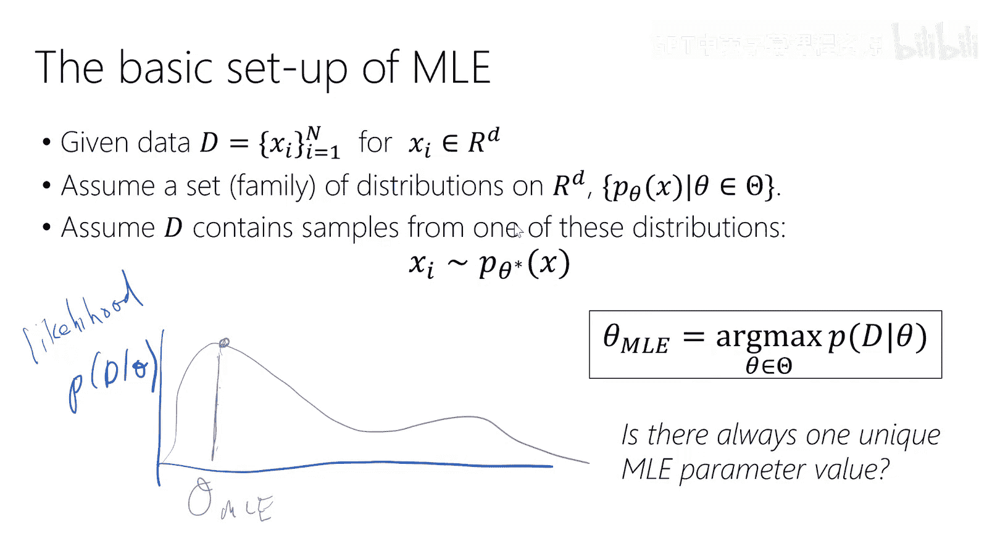
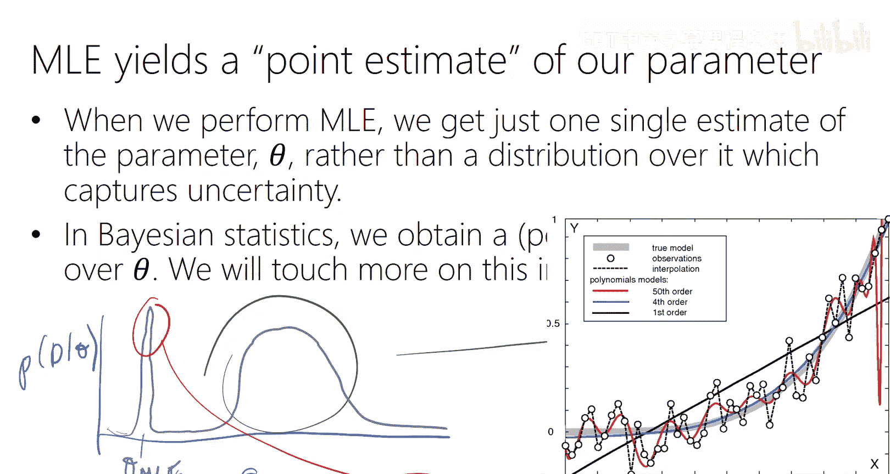

# UCB《机器学习导论｜CS 189⧸289A Introduction to Machine Learning Fall2024》claude-3.5 p02 L2- Maximum Likelihood Estimation.zh_en -BV1H4421S7bs_p2-

Okay， welcome back everyone， we're going to get started today， so I see there are still seats。

So it looks like everyone who wanted a seat got a seat which is fantastic。

 The video should have already appeared on the website and they'll continue to appear so I'm just going to finish the very tail end of last lecture which is going was a broad overview of some of the main moving parts and then we're gonna get into one of the first fundamental topics that will set the stage for us to get to modern day machine learning and that will be maximum likelihood estimation and just I want to comment again on the office hours。

 the room they assigned us is a really long walk in the wrong direction for me so I'm going to do what I did last time and what I've done previous years is which is there's a bunch of tables outside and I'm just going to find one so if you are here in person you can just follow me if you haven't attended you can come to the door at the end and follow me if you're doing neither of those then'm just wander around those tables on the off chance it's raining I see that if you go up one level around the corner。

This way there are some tables there， so hopefully there would be some room there and we can do it there and if that doesn't seem to work。

 then I'll figure out a different way to do it， but I think that should be fine。

So okay and so now I've got Suture to start adding the textbook readings to the website。

 so now you get the slides， the video and the reading so this was the reading that was assigned last time and this is the reading for this week and again don't worry you're not supposed to have done the reading before the lecture although because in fact I'm just figuring it out as I go I've never done the assigned reading before so if it's up ahead of time。

 of course you're welcome to read it and so this and I'm just again the course is not like aligned with the textbook we're running the course similarly to how it was run last year in terms of the choice of topics and the order of the topics and what we cover about them and that has a lot of overlap with the textbook but it's not like we're teaching from the textbook so I'm just going through and looking for the relevant topics that will help to augment your understanding and to solidify it so some of that material will be the same in material delivered in a different way and some of it will be a little bit。

To the material to complement and deepen your knowledge so and you can see it's a little bit scattered already because it's not completely aligned。

 so I've jumped from part of chapter2 to later in chapter2 and I'm just I've put this in order of what I found in the textbook according to the order of what's in my slides right now。

And of course you're welcome come to read more than the assigned reading if it looks interesting for you。

 okay， any important questions that need to be addressed before I finish off last lecture and then get to this week's topic？

😊，Okay so right so just to recall where we were at the end of last lecture。

 we I taught you give you a little bit of a flavor of what a single layer single neural network was and then a multinode multilayer neural network and the idea was that all of our models have parameters in this case these parameters are these ws that are going to go into a functional form we went over last time and the question is how am I going to set those ws and so what I said was we want to find the ws such that for each of our training data examples the output is close or exactly matching the desired output according to the label we saw in the training data because the training data comes as pairs of x's and outputs and so we were going to define some loss that told us for a given parameter setting how well am I matching or not and today's maximum likelihood estimation topic is going to be a very specific loss that's used both in machine learning and statistics that we're going to go into and Go。

Detail and and at some point in one of the discussions you'll also relate how that loss is equivalent to other losses for the purpose of machine learning and then in the general case。

 for example， an neural network， we're going to have an iterative optimization algorithm to minimize the loss with respect to W and so in this class and in the real world mostly this is done using an algorithm called gradient descent where you find the direction of deepest of strongest ascent of the loss where the loss increases most strongly which is the gradient and then you go in the opposite direction in an iterative manner to reduce that loss and you'll learn this in more detail I'm just giving you this as an overview of a sense of things and so right and so if you want to train。

 for example， a single neural network， you'll define a particular loss this here is the cross-enttropy loss and you can intuitively just see that if this was a binary classification problem that had two classes zero and。

That when the true label Y is equal to one， you get a one here and if the output is also a1。

 then log of1 is0， so you get a0 from this term so you're not taking any loss when you have the correct label for class1 and when y is again still the same case when y is equal to1。

 this is one minus1 so this cancels out so when y is equal to1 only this part of the loss kicks in and when y is equal to0。

 only this part of the loss kicks in and when y is equal to0。

 this is a 1 and one minus0 is1 and again you get log of1 which is0 so you can just see very straightforwardly here。

 you can go think about it at home and you're going become very familiar with this but if the two labels are0 and1 and y are the ground truth labels from your training data set then if o matches if the prediction o at the top of your neural network in a single node single layer for example。

 matches exactly then this loss will be equal to zero so you will not have any。

sBecause you have had perfect classification accuracy。

And we also talked about theselineities that were connecting when you had multiple layers and so one that we often use as a sigmoid so that's going to come into the loss as well and then we're going to use this thing that I've already referred to gradient descent where you're going to initialize the parameters and there's tricks of the trade of how to initialize the first set of parameters before you start the iterative optimization algorithm and then you'll continue to take a step size eda along the negative gradient to reduce the loss so the new value of the parameter will be whatever the old one was plus a small amount of the gradient which is a vector in the parameter space that points in the steepest direction of descent of the loss and then you'll repeat and you'll repeat until you hit a local optimum of the loss again this is just part of the overview so it's okay if you don't understand everything I said as just to kind of plant some of the seeds of what we're going。

To do。 And if you have a two layer neural network， basically any layer neural network。

 And for all the neural networks。More or less that exists， there's occasionally a few tricks。

 but that's basically what you do is you compute the gradient with respect that exist in all the layers of the neural network and we're going to get to more complicated architectures than the one I've just shown you where every layer is fully connected to the next layer but whatever it is we're going to always be able to compute the gradient of the loss and we're going to tend to use the same loss which is the likelihood which is equivalent to something called the crosscenttropy。

 but the difference is that when I have a single layer， then this procedure of gradient tocent。

 this optimization procedure can end up in different stationary points。

 different local minima of the loss because it's not a convex loss function in general and most of modern- day machine learning。

 the loss function on big neural on the kinds of models we use is not convex so we'll end up at some other optimum。

 the global optimum。And as I mentioned， I think last time that's fine because many of these optti are very useful and in fact。

 there's some theory we will not go into that suggests that if those optim are actually wide rather than shallow。

 they're actually more useful than a narrower minima in the loss landscape that has a lower loss but again we're not going to go into that but just if you're curious you could probably find that and so naively the time complexity of computing the gradient with respect to all those parameters is quadratic but one of the main main innovations many decades ago was something called the back propagation algorithm developed in part by Jeffrey Hinton who got the Turing Award a number of years ago is a trick that lets us do it in linear time and it's a dynamic programming trick and it's also been generalized in other ways。

 but it's one of the backbones of modern- day machine learning that let efficiently trained neural networks by efficiently computing the gradient so that we can do this。

Adiant descent to minimize the loss and， as I said。

 this works for any number of layers with different kinds of nonlinearities and different architectures that you'll learn about as we go through the class。

🤧嗯。Okay so you might be saying like what is the best classifier and maybe you think well the best classifier is the one that gets zero loss on the training data a little bit of a trick question because you could say what is the best I can do in practice given training data but what I actually mean in this question is like theoretically if I have a training data set what is the best classifier that could be achieved and that best classifier is the one that has the true probability of the label given the set of features that may not have zero training error actually and it's called the bay optimal classifier and we can't actually find it in practice to know it in practice。

 we would have to know the distribution of the data and be able to compute the probability of the label given the features and in sense that's the whole game of machine learning is to estimate that probability in as robust away as possible in the hope。

That we get somewhere near the bays optimal classifier。

 and so this theoretically drives work that we won't go into here。

 but as some notion of the best I could possibly do and given the theoretical conceptual notion of this。

 people have developed algorithms trying to get kind of closer and closer to it。

 although I would say modern day and machine learning doesn't really get motivated in this way。

 but I think it's a useful concept to know， so in particular。

 this is not from the textbook reasoning， but from。

A previous textbook here's another example of a decision boundary and in this case they simulated the data。

 they know the distribution of the blue and the orange class and so they know theoretically because they simulated what the distribution of the label given the features is and because they created this simulation world。

 they know what the boundary is to give you the probability that each label is maximized given the features。

 and as you can see here this is you would not get zero training error here。

 but this is the optimal classifier for that distribution of data。Okay， and so I'm。

 I'm going again just through different concepts here， so。One。

 I think this is the last concept from the introduction to the whole field is there's these notions of kinds of errors that we make and they will really drive how empirically and practically we go about in the real world choosing a classifier or regression model or whatever model it may be first of all how to choose from different model classes and how to kind of prove to ourselves what the accuracy is so you've heard me talk already about a training set and so there's a notion of a training set error and in general the loss is going to roughly speaking minimize the training set error so it could literally be like the01 error for a binary classification problem you might count how many times did I get it right or not but that's actually not the thing we're gonna minimize for various reasons we're going minimize the probability and part of the reason we want to minimize the probability of success rather than just was it a success or not is has to do with this bayes optimal the optimal classifier is one that's probabilistic and give sort of new。

Information。And now I think I've also referred to the test set error and the testet error is some data you didn't use to learn the parameters of your model and so at test time you can take this trained model and if you want to evaluate how well it does then you need another set of examples for which you also know the answer but that you didn't use to train the model because if you use them to train the model and you use them again to evaluate。

 you're kind of doing something circular and you'll get a tremendous underestimate of the error of that model so you have to one of the main thinking core thinking in machine learning is how to separate your data so as not to fool yourself that you're doing better than you actually are and so often talk about a train test split and where the test could let you evaluate how well your model is doing on another set of data and usually that data is the same drawn from the same distribution as the training。

Data in this class that's all we'll talk about in the real world you can imagine that you're training things as they come into you maybe a web service or a medical service and maybe the distribution of data changes and maybe you actually need to take that into account and retrain your model or refine the model in some way that's an advanced topic we won't go into but if you go have an internship or you go further into this field that definitely just keep that seed of an idea is that a static model on a particular training data is often not the way we implement things in the world。

And so's also there's train test and another word you're going to hear a lot of is validation and often crossval and so what we often do is we take our training data and we take all the data we have we push part of it aside for the test set that we don't touch for training and now with the remaining training data。

 may again hide part of it for part of the training so that we can pick certain parameters that need to be set in a way that can't be set the way I'm going to tell you about today but we'll learn more about that but you can basically use a validation set to help you pick think what are called hyper parametersa。

 these are parameters you can't learn by minimizing the loss and we'll get to why that is in a second so but just to give you a sense you're going to hear a lot about test error and when those errors start to diverge what that means about what your model is doing and so forth。

Okay。All right， so that is the end of last lecture。

 and now we're getting right into the the nitty gritty， but are there any questions before I go on。

Okay。right， so today is who's learned about maximum likelihood in a statistics class already？

Who learned about it in high school， Does anybody get taught that in high school， No， okay。

 I have so long ago for me， I don't know what they teach， also I did it in another country。

So okay so let's motivate this idea of Max and likelihood by reloading again part of last week's lecture。

 so I started to show you these digits and to talk about classification is this like is this image a seven。

 yes or no， and then we talked about how an image it could be is a matrix of values that I could flatten into a feature vector and that most of machine learning uses。

Feature vectors like this， and then we could build something like a linear classifier which defines a hyperplane or in this case a line which if you're to one side of it。

 you would predict your class red meaning you're a digit 7 and the other side blue and the question was how will I set these parameters How am I get pick these parameters And when I started talking about neural networks I started talking about gradient descent and on a loss And so like the real question is like well what is that loss and that again is one of the really fundamental concepts that permeates all of machine learning is there is a model it has parameters you want to fit and you have to define a loss on every single machine learning model you'll ever hear about。

 including chat UptT including the simplest model like linear regression has a loss function that you minimize to get an estimate of what you hope are useful parameters and depending on what loss you use it may be optimal in different ways according to a set of theoretical principles is。

A particularly theoretically oriented class so we won't go into much of that。

 but what we will do is go into the details of the primary one which is used both by statisticians and machine learning alike called maximum likelihood estimation and so as we'll see in just a few moments the likelihood function is going to be our loss function and I'm going to define what the likelihood function is once I have that loss function I'll use an optimization procedure to minimize it with respect to W my set of parameters where sometimes I'll call them theta。

 but to the set of parameters and the value that minimizes the likelihood function will be the value that I should use for my model according to the principle of maximum likelihood。

Okay， please feel free to put up your hand if you have a question and I may finish my thought and hold you off for a few minutes。

 but I'm certainly happy to take questions during the lecture。Okay。Okay so again。

 like I'm trying to slowly just reinforce some of these main ideas so I'm going to now have a bit of notation。

 we're gonna to have a training data set， I'm going to call capital D and in a supervised example。

 I will have a set of input features Xi which will be a vector for example the flattened pixel values of an image and so I think that was forget 28 by 28 so this would have 28 times 28 values in this vector and then if it's a classification problem。

 the label is for example in minus1 or 1， sometimes it's in 10。

 we may set it up in different ways but and in general。

 whether it's1 or 0 or 01 you should get the same result。

 we just usually pick one because it's more convenient to think about or to derive certain elements of the loss and things like this but so this should be without loss of generality like if I choose to use one and0 and I have some procedure I'm following to estimate the parameters。

Then it shouldn't matter to my model。So right and then I'm going to have n data samples in total and again we call that classification when there's a discrete set。

 there can be multiclass classification where I would have to set it up a little bit differently and we'll talk about that in a little while and then as I mentioned last class also there's regression where this label is a specific value and we're going to go into examples of both these。

 but like it could be， I want to predict your blood pressure from a set of your genetics would be a regression problem or I want to predict whether you're going to pass this class or not。

 that would be a classification problem。And the x' is in。Try to think I think right。

 today is very general， the x's， well they can be discrete variables or they can be continuous variables and whether they're discrete or continuous has no bearing on whether we call it regression or classification。

 the only thing that changes whether we call it classification or regression is the kind of variable that the target variable。

 the supervised variable or this label Y， that's the thing that dictates whether it's classification or regression。

 but some models are better able to handle discrete x's versus real valued x's and we'll get there in time。

Okay so and then I also mentioned this last time， so in this example each， for example。

 image comes with a label and this is what we call a supervised problem because I'm given data that has these pairs and my goal is to learn a mapping that goes from the feature space to be able to predict the label correctly and sometimes like in the world of chat EptT this is an unsupervised model where all I get is like for example a corpus of text and I want to learn a model that represents the distribution of that text and from that model I might be able to make things that kind of feel like super supervised predictions like maybe I give you a bit of text and I ask you to complete it and that feels like a prediction problem but it was trained on just a big corpus of data where there is no particular label that we distinguished。

Okay。So I've talked about the idea of a training data set。

 which is in this case I've just left the supervised version in and then there's this idea of a model class or we may call it a family of models or a hypothesis class and it's a functional form that has free parameters that interact with the data and in a supervised model they interact with the input features。

 and the idea is that they will enable us to predict， for example。

 the probability of the output feature which is the label and so this is an infinite set of models because I didn't tell you the value of W and B。

 Once I give you one value of w and one value of B。

 then I I have a specific model an instance of this model in this family in this hypothesis class and in machine learning。

 we always have to hypothesize a model class that has free parameters and then're going use we're going to define a loss function to pick the parameters that will pick out usually a single。

Model， but we'll talk about variations on that as well。

 Sometimes we're going to actually estimate a distribution of models instead of the best model with one parameter setting。

Okay。So right and this optimization goal is to find these good values of these parameters and right so what does good mean in a technical sense。

 So you might think like the way I talked about it last time is I want the label to like match the prediction and then that's going to give me a loss that I'm going to minimize through an optimization problem。

 But what I really want for this loss function is this squared loss is kind of in general ad hoc。

 it turns out the squared loss is equivalent to doing a maximum likelihood estimation for Gaussians。

 which we will see but this is not a principled way to go about anything and we don't have good guarantees if we use this loss more generally speaking。

 but if we use this loss， which is the likelihood function。

 then we do get some statistical guarantees and this is why it's so widely used and so pervasive。

So right， this principle is going to give us a function that will be the loss function that will minimize to get the parameters。

 and it will be used for linear regression， it will be used for logistic regression。

 which is classification it will be used for neural networks。

 it can be used for almost anything in more in more advanced topics which。As far as I recall。

 we don't go into this class， sometimes you can't exactly compute the likelihood and you need to compute approximations of it because it's not computationally tractable。

 but right now for this class， don't worry about that in this class。

 we're going with 99% probability， always have tractable likelihood functions and that you can just write them down and you know what they are in their functional form。

So and so right， this can only be used for statistical models。

 which is why the statisticians are big fans and most。

 but not all models and machine learning can be cast as statistical models and what do I mean a statistical model。

 I mean we're going to treat the thing we're trying to estimate as a random variable where we want to know the probability distribution of that random variable。

 So in a supervised problem， we want to know the probability distribution of the random variable which is the label Y。

 given the input features X， which we don't treat as random variables in a supervised problem。

 we treat only the label as a random variable and that's going to give us a probability estimate of that particular value of that label for any label for a particular set of input。

Okay， so。Let's just go through some simple things to jog your memory about background material you should already know。

 so a random variable sometimes I'll abbreviate that RV is a function that goes from X to an output space so for example output space might be a a coin toss。

 which is what's the probability that your heads versus tails and for a fair coin。

 the probability will be 0。5 and so a discrete read random variable could be this random variable that represents whether it was a head or a tail and then if you have a continuous random variable。

 for example， the height then。You get then you get a probability well okay let me write it all so with a continuous random variable。

 you have a probability density function versus with a discrete random variable。

 you have a probability mass function and so just the reminder is that in the discrete space the probability that x takes on some value like like probability was ahead or not。

 you can just take the probability of that value， but in the case of continuous you have this probability distribution function to get the probability of an event you have to integrate between two parts of it like what's the probability。

 someone's height is between5 foot3 and 5 foot4， you cannot just say what's the probability exactly of 5 foot3 because this is an infinite testable in the discrete case。

 the probability that you fall into any one of the output the output space。

Options has to total  one because you have to， right if I flip a coin。

 you have to be either heads or tails。 So the probability of heads plus the probability of tails has to equal1。

 And the analogous constraint for a probability distribution function is that the integral over the domain equals one。

 And so those are just inherent probability。Inherent properties of probability distributions。

Okay so you should have heard of a Bernoulli random variable and the classic example is the coin toss。

 and so a Bernoulli random variable has this parameter P associated with its distribution which is the bias of the coin。

 so if it's 0。5 you have a fair coin， if it's not 0。

5 you have an unfair coin according to whatever P may be。

And then if you wanted to model Ncoin tosses， you would use a binomial random variable where this would be the probability that the number of heads was equal to k for any K。

 and it takes on this form。And another example is the Poissonal random variable where one example might be like what's the number of mutations occurring in a particular cell population and it has a mean lambda over a fixed time interval so these are just examples that you should already be familiar with and so these are all discrete because it's a probability over a discrete outcome space each of these events is like there were k mutations not like 3。

1 mutations it can only be three mutations or four mutations and the cointass is it can only be an integer number of heads or tails so that's why these are all discrete random variables and then then the continuous random variable we have this probability density function and if you evaluate that probability density function at any one point it does not necessarily lie between 0 and 1 as a probability mass function would it could be arbitrarily high it could be 8 million and the point is that to get a probability。

between0 and 1， you have to integrate that probability density function P of x over some finite distance between x1 and x2。

 and then you will get the probability that the height lies within that range。

 which of course could be very small。So an example of a continuous probability distribution would be uniform on an interval。

 so between some real value A and some real value B。

 the probability is always going to be equal to one over the length of the interval and if I integrate therefore over that integral it will integrate to one so that's a very simple example and another one that you will become intimately familiar with partly today and after next lecture youll probably know more about Gaussians than you never wanted to know but then later on and you might be like in a little bit of hair pulling agony about it。

 but then later in the course when we go over something called PCA it will mesh back very nicely with the lecture next week on multivariate Gaussians in a beautiful way so there will be some satisfaction to be had from it but hopefully this is not new to anybody the form of this is a multivariate Gaussian which is all we're going to talk about today that has a mean parameter and。

variance parameter that shows up here and shows up here and sometimes this is called the normal distribution and if we were fitting data to it。

 the parameters we would learn would be the mean and the variance。

Okay and so those were all univariate distributions because there was just like one number we were getting sort of the probability of just like k heads or here。

 the probability of like your height but in a multivariate distribution。

 the space of outcomes is a vector instead of a scalar So imagine that you have a big bowl。

 for example， that has red， blue and green， then the probability distribution wouldn't be just what's the probability of a red bull。

 it would be giving you jointly， the probability of a red。

 a green and a purple all at once would be this joint multivariate distribution。

 and so that's the multivariate Gaussian distribution is one example of that。Right here。 Okay。

 And so in the multivariate Gaussian， which who's seen a multivariate Gaussian somewhere。 Okay。

 where did you see it。What's that。Data 140， okay so in that case， instead of the scalar for the mean。

 you get a vector and instead of a scalar for the variance。

 you get a giant matrix which is called the covariance matrix。

 which we're going to go into a lot of detail about。Okay， so that's again。

 just a reminder about discrete and continuous random variables and the sort of nature of their distributions。

And so now， as I said， we're going to when we do maximum likelihood estimation and so in today's lecture。

 I'm actually going to talk about it in the simplest form， which is without even having a label。

 I'm just going to say you have some x's and we're going to posit a set or a family of distributions defined by some parameters theta so if it was a Gaussian the theta would be the mean in the covariance and I'm going to often use this notation as a shorthand for this notation here so just instead of saying the probability of this random variable given the parameter theta I'm just going to denote it with a theta as a subscript I may use these interchangeably in general。

呃。And so we're going to make this assumption。 and right， as I said， the theta could be， for example。

 the mean and the variance of the Gaussian。in the Uniivariate case。

 because otherwise this would be a covariance matrix。

And then what we're going to do is and the kind of key assumption in all of machine learning again is that the data set we've been given contains samples that belong to one of the distributions in this family。

 one distribution， meaning one value of the setting of the parameters。 So， for example。

 for the Gaussian， there's some mean and some variance that my data were generated from。

 And that's the fundamental assumption of maximum likelihood estimation and of all of machine learning and statistics。

 and so。That assumption assumes that each element in the data is identically and independently distributed from that same distribution right so identically I mean that each part of the training data is sampled from the same distribution and also that it's sampled independently。

 I can sample one and then another and then another and then another。

 which is not always a reasonable assumption， but it will be here。

And we call this identically and independentlydepend distributed。 again。

 that's a technical term that you will hear in machine learning and statistics。

 and it's abbreviated IID。 and people often just say IID because it's a mouthful to say identically and independently distributed。

And we'll see in just a minute how that assumption immediately comes into play with what we're going to learn today and so the goal of maximum likelihood estimation is to quote what in machine learning we say learn and statistics they say estimate the value of the parameter that kind of pins down the specific distribution within the family of distributions defined by all the parameter settings from which the data came from and notationally we're going to estimate this thing we're going to denote theta MLE and that will be our maximum likelihood estimate for the parameter theta for example。

 the mean and the covariance this would be a two vector with respect to the data and the family of distributions。

 and so in particular， this theta MLE， this maximum likelihood estimate is going to be the maximum value of the probability of the data given theta when looking over all valid parameter values theta。

And this is literally in a nutshell， the principle of maximum likelihood that drives all of machine learning is how you have to be able to write down this thing here。

 this is the likelihood function， the likelihood function is the probability of the data given the parameters。

 it's not the probability of the parameters， it's the probability of the data。Given the parameters。

 there are other flavors of machine learning where we want to do it the other way around。

 and we'll dive briefly into that in a couple of lectures。And so but remember， always。

 this is a distribution over the random variable D。

 which is all of the data you have in hand to train your model and it's a function of theta。

 it's not a distribution over theta。Any questions right now？嗯。Can you speak up a little。No， no， no。

 So that's like one of the big things is you're not given the distribution because what happens right you're at a company that collects some data from the web。

 from marketing， from whatever。 and they're like， yo machine learning person do something useful。

 they don't say and I happen to know this distribution was this and this right so we don't know that it's true that in theoretical parts of academic machine learning we may make assumptions of certain distributions and some of the principles that drive us may make assumptions。

 And in general， we will have to make an assumption in the sense that to write down our loss function。

 we need to define a family of probability distributions up here for example， Gaussian。

 we will have to actually literally instantiate that so we will make an assumption and the the beauties of modern day machine learning is that large neural networks can actually formally theoretically。

 a neural network can capture any function。 it is a universal function appximator。

If you make it big enough， wide enough and deep enough， however， we don't usually。

Know how deep and wide to go and we encounter problems if we go too wide and deep and we don't have enough data。

 so there's always a game of like I want as rich a model class as possible that could in principle capture almost any function。

 but I only have a limited amount of data to learn from and how do I therefore pick the right model class。

Okay， so just as an example， this is data that is assumed to come from a Gaussian。

And it's sepel width， which is。I think it's the green leaves that form around the bud of a flower and every now and then you get these kind of like why is this example there and it's because like two decades ago some machine learning people wrote a textbook or made a data set and put these things there and now they permeate everywhere and so the normal here so in this case we would be given some data。

 for example， these sepel widths 20。1 33。8， 34。6， 36。

2 and we would have n of these data point and if we want to apply the principle of maximum likelihood we might say well。

 I have reason to believe it's a Gaussian distribution and I guess the other thing to remember is that similar to statistics that in many cases we can appeal to the central limit theorem to justify our choice of things being Gaussian so almost inevitably when there's a real valued random variable we're trying to get the distribution of we almost always make a gausian。

Because this just works well in practice because so many things are Gaussian or close to Gaussian with the central limit theorem。

And so what and so right， the principle maxim likelihoodli it is going to say basically find the mean and the variance。

 And you can see here so this is the histogram is meant to represent the actual data you have。

 And so if you were to get data like this you would plot it and you would look at it and say， yeah。

 actually okay， that seems Gaussian， maybe you could。Do some more refined things to justify that。

 but let's say that and then you can see as I change the mean mu and the variance sigma。

 I get different Gaussian curves and with the principal maximum likelihood。

 I want to pick the setting of the parameters and that here visually kind of look most like the histogram because those will technically be the ones like what does looked like most like the histogram means that they actually the maximum likelihood ones will look most like the histogram if the data were truly drawn from a Gaussian。

And so。So again， this is the likelihood function。 It's the probability of the data given the parameters and so I've just rewritten it down here and I already said the data is just this these n examples like in the list here concretely I'd have a list of real valued numbers and I want the probability of those n real valued numbers。

 given theta and I want to find the theta the mean and the variance that makes this probability maximal and the first thing we're going to do almost all machine learning except in some advanced topics is we're going to use the assumption that they're independently and identically distributed and if they're independently and identically distributed then I can factorize the probability of the data into a product of the probability of each data point given the theta。

 the one theta and they share the theta because they're identically distributed and I get to refactor them with the product rule because。

are independent and so this is this assumption of IID。

 lets us break down the likelihood function into a summation over each data point and without that things are very。

 very difficult so usually that's as you're deriving something that is the first thing that you're going to want to do。

 but not we'll see in one example here we do it we first do some other manipulations and then we do it because it's easier that way。

Okay， so。So right， so the way to think about that basically is that someone's clicking their pen it's like driving nuts if you could manage to not do that。

 I would be a lot calmer， thank you。So right you can think of the likelihood as this probability of the data and in this case just visually I have one parameter。

 maybe it's like the mean of the Gaussian and as I move the mean of the Gaussian。

 my likelihood will be lower or higher， the higher the value of the likelihood。

 the more that the Gaussian matches my data and the more likely that that Gaussian is to have generated the data I observed and I see theres a question。

No， we're going to go through some examples。 We're going to go through an example where x is discrete and where it's continuous。

 So you will see， yeah。So and you may be wondering or not， but you should be wondering。

 or I will tell you you should wonder， is there a unique value of the parameter that satisfies the maximum likelihood and there may be。

 but there is not always such a value？I just realized。 Let me just switch one thing。

I'm trying to see my own notes at the same time， and I forget how to do that。

Does anyone remember how to do the oops？啊。Presenter up， show presenter view。

And I can remember。

What I wanted to tell you at the same time。 But now it's s。嗯。There is a way to switch this。嗯。

Hm。Sorry， give me one second slidehow。嗯。なばく？拿了的。嗯。

Let's see if that does anything different。

Ah， that works， okay， wonderful。A。So let's go to where we were。Quick review， everyone。

 You just saw it all again in one minute。 Now you know it really well。Right。

 so depending how we parameterize the model， doing maximum likelihood might there may be actually many infinitely many solutions that give you the maximum likelihood。

 And in that case， you could just pick one， but we're also going to learn about techniques to。

 in a sense， if there are infinitely many equivalently good values。

 So's something like a little bit off about your model， you have too many degrees of freedoms。

 you have too many parameters。 And so we're gonna to learn away in a few lectures to kind of reduce the number of degrees of freedom。

 So we don't have that problem。 but in general， it might appear。And。Okay。

So what are some of the properties of maximum likelihood that in particular the statisticians really like a lot and we don't talk about them too much in machine learning but secretly we like them too so one is something called consistency so consistency says that if the data suppose my data were truly generated from a Gaussian then as I get more and more data if I do maximum likelihood estimation under the assumption that the correct family of hypotheses is a Gaussian then in the limit of infinite data I'm guaranteed that the maximizing the likelihood gives me the true parameter setting and we call this property consistency and that's a pretty nice property like if indeed the data were generated from a Gaussian I would hope that as I accumulate more and more evidence in the form of more and more data that hopefully this estimation procedure gives me the true kind of causal parameters so that's like a basic sanity check。

Although。Yeah。The other thing about it that we won't go into detail about is that different principles of how to estimate parameters make better use of a limited amount of data。

 And so maximum likelihood， for example， you give it some fixed amount of data it knows how to squeeze the information out of that data well and this is what we technically call statistically efficient it's efficient in its use of the data and getting the information it needs out。

 So an alternative method that we won't go over in this class is something called score matching and score matching is another way to estimate parameters。

 it has different principles， and there are different reasons people use it。

 but it is not nearly a statistically efficient。 So if you want to pin down the right parameter in your hypothesis class。

 you'll need way more data than you would with maximum likelihood and that's why we usually stick to maximum likelihood。

And the other thing is that the value of the likelihood that you get when you do maximum likelihood is invariant to reparameterization。

 And you're like， what does that mean What does that mean Okay， it's actually quite simple。

 So imagine I give you those data and I say they're drawn from a distribution and the distribution is a distribution in x over those like sepal lengths and it has a mean and it has a sigma And today we're going to actually go into detail about how I set。

How I do max likelihood estimation for such a Gaussian and we're going to see what the answer is。

 and it should probably if you took any statistics class， it should be pretty familiar。

 It's going to end up that the value of mu is literally the empirical mean of the data and the value of the variance is going to literally be the empirical variance of the data。

 but we're going to work through it step by step and there's a few questions I'll take them in just a second but what if I said that it wasn't drawn from this Gaussian distribution but it was drawn from this related Gaussian distribution where I just reparameterized it So instead of mu。

 I'm just going to declare that it's two plus mu。And now if I do maximum likelihood。

 suppose I did it up here and the value of mu that I estimate from my sepal lengths in that list was equal to 10。

6， who knows what mu will be if I do maximum likelihood with this Gaussian instead。

 what will the value of mu be if this one was 10。6？8。6。 It will be 8。6。

 So the parameter I get will be different， but the likelihood will be the same because the overall mean will be the same。

 I've just parametermetized it differently And so that's something that's really nice about maximum likelihood is that if I reparametize it。

 but it still represents the same family of distributions。

 which it does because this is just a simple reparameterization。

 then the value of the likelihoodlis invariant to that。 And that's a very nice property。 Okay。

 let me take the two questions that were're floating around。一。

How do you define a convergent distribution？Yeah。Yeah。

I see so let me rephrase it back to you to make sure so everyone can hear and to make sure I understood。

 I think what you're saying is if Iit I have these data。

 these sple lengths and I have 100 data points and I use maximum likelihood estimation as we'll get soon and I get the parameter estimate and then I keep multiplying by now I get 10 more data I get 000 data points and I get 10000 data I get a million and I think what you're saying is as I get more and more if the parameter estimate starts to steady out in that the parameter estimate converges to some stable solution as I get more and more data does that tell me that indeed the data are drawn from a Gaussian。

No， it doesn't。 It does not do that。 So there are we won't go into it。

 but there are sort of goodness tests of goodness of fit。

 that's a more statistical hypothesis test you would do in statistics to check if it was the right one in machine learning。

 we kind of in a sense， usually we do two things。We throw up our hands and say don't unlike the statisticians like I don't really care what exact distribution it was from。

 I just want it to work well in practice and two to do that。

 I'm going to use these crazy neural networks， for example。

 not only but often that just kind of can capture so many different distributions with their crazy number of parameters。

And and so， in fact， right and related to that is the maximum likelihood estimation in general。

 when we use it， I keep saying that this principle has these properties of like consistency。

 If the data were truly generated from that distribution， that family of distributions。

 but we don't usually know that we can sometimes appeal to the central limit theorem but actually usually we can't exactly do that。

 we can kind of roughly do that。 And so there's like a pro and a con here。

 a few a few few think goodness and a caveat em like beware， which is that。

You can posit any hypothesis class at all and you can turn the crank of this maximum likelihood estimation procedure I'm going to go into and it will give you a parameter estimate and this is great because we're almost never going to have exactly the right distribution and so if we couldn't do that things would be hopeless and the flip side is that it will do that no matter how bad your hypothesis class is so you could in doing that you may get a terribly wrong estimate question。

嗯嗯。Pretty big does that。嗯。嗯。Off the top of my head， I can't think of one。

 so I would say the ones I know well have that property， but frankly。

 I guess this is all I ever do in a previous life。 I did some score matching and I don't remember much about it。

 but in all of modern- day machine learning where people like to call across entropy。

 but as we'll see that's equivalent to maximum likelihood。 So this is what we always do。

 and it's a good question I can't think of one， but they must exist because the statisticians make a big deal of this and certainly it's a nice property。

I'm trying to think。I think like， well， I think if you just did。I have to think about it more。

 but I think if instead of maximum likelihood you just counted the number of times your model was right or wrong。

 then I think it probably is an invariant to that， but I have to think about that more。Okay。

 so let's now go， I'm going go into two details， one on a real valued random variable。

 which will be Uniivariate Gaussian distributed， and so always I love this picture I used to do statistical genetics。

 I've done a lot of different things and in statistical genetics。

 you're trying to learn the property of a human being， for example。

 their height here or how curly their hair is who's done 203 in me， anybody。

She was like wow' who's scared of 23 in me because it's like creepy privacy okay I've done it。

 I think it's cool but I get the privacy issues and it gets everything right about me except like it thinks that have straighter wavy hair and so as I said that in many cases and in genetics in particular in genetics we assume that there's all these nucleotide positions on the genome and for many traits for example。

 for height， there are many， many locations in the genome that affect how tall you are and because there are many。

 many of of these。Random variables that together get added together to determine your height。

 The central limit theorem actually does kick in very well here。

 And that's why height is normally distributed。 And this is actually like they got people to line up on the white or the women。

 the black or the men。 and they had to go behind the post。That had their height。 So that says like 5。

6 or 5 f，6，5 f，7。 And so it's kind of Gaussian all together。 Although it's interesting。

 I would have thought it would be。Oh， I see if you separate them out， my guess is is also Gaussian。

 I never thought about it that way， but this is kind of Gaussian。So right。

 and so let's work through that example similar to the sepel example。

 which is if I give you a set of height measurements， like for everybody in this room。

 everybody in this picture， how would I derive using the principle of maximum likelihood the estimate for the mean and the variance and this is like a nice example to go through because it's going to match your intuition and in fact。

 a lot of these things do match your intuition but as you go multivariate and so forth。

 you'll lose the intuition as well， so you need to know the actual machinery of how to work through these things。

😊，So multi in a univevaria Gaussian doing maximum likelihood estimation， again。

 our goal is to find the one value of the mean and the variance。

 which maximizes the likelihood of the data given the parameters and we're going to be given a set of data for example。

 the height of everybody in this classroom and we are going to assume the data were generated IID identically and independently distributed from a Gaussian that has a single mean and a single variance which are here scalrs。

 and again you should already know the form of the univaria Gaussian。

 this is called the normalization constant， it's what makes sure the integral from minus infinity to infinity integrates to1 and then this is kind of like the data term in the sense that this is the term where the data come in x right the data don't come into the normalizing constant so this is the term that's all about the data X。

And so the first thing so we have the data we need to define the likelihood and as I just said。

 we've made this assumption， so were the family of distributions is a Gaussian with mean mu and sigma squared。

 so here theta is equal to mu and sigma squared and our goal is to find the maximum likelihood estimate of mean and Sigma squared。

 the maximize the probability of the data given those parameters。

So the first step is going to be to like actually instantiate this abstract likelihood function。

 so the abstract likelihood function just looks like this probably the D given theta and now I have actually n data points so let me just say it's the probability of all of those end data points jointly given the parameters mu the mean and sigma squared the variance and because of the assumption of IID I can factor them as this product here and so this is now this is for the Uniivariate Gaussian for n data points。

 this is my likelihood function this whole thing here， the product over all the points。

 this is also the likelihood function， this is also the likelihood function just getting more and more instantiated。

And the product can be a little unwieldy to work with。

 so we're usually almost always going to work with the log likelihood。

 which is to take the log in front of the product so that we get the sum of the logs。

 and it's a lot easier in general for us to do the machinery。

 the derivations we need when we have the sum instead of the product。So instead of the likelihood。

 we're going to use the log likelihood and when I take the log。

 the log is a monotonic function and so it's true that the log likelihood does not have the same value as the likelihood for a given parameter value。

 however， when I maximize when I find the value of theta that maximizes the likelihood。

 it is the same value of theta， thes the log likelihood because log is monotonic the log is not changing the order of anything is just kind of changing the scale of things and so without loss of generality instead of doing maximize likelihood I can do maximum log likelihood。

And if you go look in papers and code， actually usually people choose to minimize the negative log likelihood。

 and so hopefully I don't accidentally flip back and forth。

 but if you get confused and you hear people trying to minimize the loss。

 they're either using a different version and equivalent version of the loss or they're minimizing the negative of the likelihood。

 for example， so don't get overly concerned if things switch from Min X。

 it's just whether you negate the loss function or not。All good。Okay。

So now I have a concrete optimization problem because I have a concrete loss function。

 my concrete optimization problem says to get the arg max of this sum of log of the probability of individual data points and altogether this is the log likelihood of the whole data inside here。

 this is the log likelihood of one data point， and find me the parameter settings mu and sigma that make this as high as possible。

So how are we going solve this。Any ideas。So we're going to take partial derivatives and with respect to each parameter in turn。

 partial derivatives with respect to mu， partial derivatives with respect to Sigma。

 and we're going to set them to zero， if we set them to zero。

 we know we have a stationary point of the loss function and we'll have to check that that stationary point is indeed a maximum of the loss function。

 although I would say in practical machine learning。

 people don't usually do that they just get the gradient to zero and do a little dance because that took like a million dollars of CPU and then they hope it worked。

 but in this class since you're learning the fundamentals that lead to dancing in a circle and screaming。

 you should know this。Okay， so。And once you get that stationary point。

 then you'll check if it is a maximum， which means that the second derivative should be negative so you going get it the value of the parameter such that the first derivative is equal to zero。

 all the first derivatives and in the univevariate case like today we can well there's two parameters right so this is not avariate parameters setting I have one the mean is a scalar and sigma is a scalar but together my parameters are a two vector and so I can't just check the second derivative like what is a second derivative I need to check the hessian I need to check that the hessian of those two parameters is negative definite and then I know I have a maximum of the likelihood。

And so in a 1D Gaussian， it turns out and you can check this as an exercise at home if it doesn't appear in your homework。

 the Hessian is diagonal， and because whenever the hessian is diagonal。

 I can just check that each of the partial derivatives is negative。

 and that's equivalent to checking that a diagonal hessian is negative definite， which should。

 if you can't figure that out， that is an exercise for home。Okay。

So right okay so this is where we're at， we concretely wrote down this lost function。

 which is the log likelihood and so let's start actually applying this principle and get out what you already I think no to be the answer so I'm going to first do it with the mean and afterwards I'm going to do it with the variance and I can do that because in this problem the decouple in a nice way we can't necessarily always do that so this is I've just written in my own slightly messy handwriting it's just this term up here and I'm going to take the derivative with respect to the mean and I'm now'm going to move the derivative through the sum。

 which I can do under very basic assumptions of continuity and I'm going to now instantiate the likelihood here because I know it's Gaussian。

 I'm going to actually write out the whole gory details of the Gaussian with the normalizing constant which is a function of variance and the data or the squared term which contains the mean the variance and the data。

And now。I'm going to keep working through this so I'm going from over here。

 I'm going to take the first term is the log normalizing constant and so that's just instead of the one over I'm going to pull up the negative so it becomes minus log of what was in the denominator over here that's all I've done。

 and then here the log of the exponent cancels each other out so you don't see either the log or the exponent all you get is what was inside the exponent and that is this term here which is exactly copied from here。

And I'm going to keep going， so the derivative of this term which arises from the normalizing constant has no mean in it。

 it has only the variance， so I get a0 here because there's no dependency on mu。

 when I go learn the variance I will have to keep this term around right now I get a0 and when I take the derivative of this with respect to mu I pull down the two from the exponent that cancels and I take out the negative here which cancels this negative here so I get plus1 over sigma squared Xi minus mu so this is the only term that comes out which is the derivative。

嗯。And now I'm going to set that whole thing。 This is this whole thing in blue here。

 This is the partial derivative of the log likelihood with respect to mu。

 the mean and I'm going to set it to0 when I do that I basically I set this thing to0 sum over x and when I do that I can just immediately write it like this I just pull one part to one side and the minus comes to the other side。

 So what this tells me is that the principle of maximum likelihood says the sum of the x size should equal a sum over I of mu but mu of course doesn't depend on I so I can pull it out of the sum and so if you have a sum over something that doesn't depend on the index。

 you pull it out and sorry this should say I equal1 to n because there're n data points and so the sum is just from one to n so I get an n there that's this little sum here turns into n times mu and I keep the sum here on this side and I keep going and I get the very familiar result。

Wch is I isolate the mean and it's literally the empirical estimate of the mean of the data。

 right I add the data together and divide by n。 This is the average of the data。

 so that's very satisfying。 And so here it's maybe so obvious you're like why did I need this。

 but you would have no other way to drive this and as you'll see on homeworks on exams like you're going to cases where you don't know the answer and you're going to have to actually go through step by step like this and use this machinery to figure out what the answer is。

 so as I said that in practice， we don't always check if so we know that when we set mu equal to this value that the partial derivative of the log likelihood is equal to zero and what we don't know is whether that corresponds to a minimum or a maximum or something。

Yeah， and so what we need to do is we need to now take the second derivative of the log likelihood and check its sign。

 So if I want to take the second derivative， I basically。

I can start from the first derivative here down here。

 This is the last we had of the first derivative and I can just take the derivative again with respect to mu and when I do that。

 the X term falls out because this has no mu in it。

 and this just becomes a minus1 over sigma squared and this again by the same rule I just described as the sum doesn't depend on the index I so I just get n times whatever was in here。

 And so I get minus n over sigma squared n is the number of data points， it's always positive。

 Sigma squared is a squared value。 It's the variance it's always positive。

 So the second derivative here is always negative。 and so I know that this is a valid procedure such that the stationary point is indeed I'm giving me the maximum of the log likelihood。

Okay。So any questions all good？Okay， so now that was mean。 and actually just to。Go back。

I just wanted to make one point here， which is the connection I don't I don't think I have this somewhere else。

 which is surprising， but so you often hear about using just the mean squared error like in the first lecture I said I just want the labels to match the outputs and so let me just minimize the mean squared error and basically that comes from the exponential term in the Gaussian so under the assumption of Gaussianity if you want to find the mean of the Gaussian then actually it is the same as mean squared error。

 but the principle of mean squared error won't tell you the value of the variance which we're gonna go through right now so let's do it again but for the variance just to remind you I put up in the corner here just what the Gaussian looks like and what our maximum likelihood problem looks like so now we want the derivative of the log likelihoodL with respect to the variance and this can be a little confusing just think of sigma squared as a variable like V don't worry about the square。

And we're just going to treat it as a variable and just get the value of sigma squared directly。

 we're not going to get the value of sigma and then square it because it's just easier to just treat Sigma squared as the variable itself。

 so we're going to take the derivative this is again just the likelihood we saw before with respect to Sigma squared and unlike what the mean the sigma is appearing in in the normalization so we do need to keep that one around and we need to keep both those terms around and in particular if you take the derivative of this guy。

 I can pull out the n over two and then just say I'm going to take the derivative of what remains I'm just going step by step here and then here I am just pushing the derivative all the way over here to get rid of these parentheses and then I haven't done anything I'm just copying this down to here immediately。

And now I'll go one step further， I have the n over two again。

 and now the derivative of what's in the log is one over that log right。

 so I get one over two pi squared and then times the derivative of what was in here， that's two pi。

 So this here is this derivative here。And then for this guy， I still haven't expanded it out。

 I'm going to do that on the next line。I'm going to do two things on the next line first。

 I'm going to take this whole thing together， this two pi cancels out with this two pi。

 and this two cancels out with this two leaving one of them。

 so I end up this whole thing here becomes n over two sigma squared。

And then now I'm finally going to do something with this。

 which is I'm going to push well I'm going to do a bunch of things。

 so basically I'm going to take the derivative one over of this thing here。

 I pull out the minus1 half， and then I get the one over sigma squared。Right。

 but this is to the power minus1 essentially so now it's to the -2 and I have to pull out a 1 because it was down below so that this part here gives me this thing here and then I'm inside I pulled the summoned out so now I just repeat this down below here I'm allowed to push everything into the summon if I'd like to。

Okay and now again this is the same as this and this whole thing here simplifies to basically this is sigma2 to the minus2。

 so that becomes a one over sigma to the four， the two from here becomes the two here。

 this minus and this minus cancel out so the whole thing's positive and then this term I just copy down below。

And so if we keep going， so this is sort of the most simplified version I'm going to use before I say I'm going to set it to zero because I want the partial derivative to be equal to zero。

 so now I can set this to zero。Oh， I see。 yeah。 by studying it to0， I。Z。Oh。

 I've just factored over Ive factored out one over two sigma squared here。

 so this term becomes just minus n and this term here you get just a one over sigma squared here because I factored this guy out and this is what you're left with and now I can just multiply both sides by two sigma squared to get rid of that so now I get rid of this term I have just this term here。

And now I can I can basically。啊。哦。I have to multiply， what have I done here？啊。Oh I see。

 I move the n to the other side， so now I get n equals this whole thing and then I multiply both sides by sigma squared and divide both sides by n So I did a few steps here。

 but if you can follow now or follow at home， this is the result you get and this is you just the formula for variance right it says that take the squared difference from each of the variables and the mean and this gives you the variance and so this then is this is。

 first of all， the value of the variance that sets the partial derivative of the log likelihood equal to0 and so we know we have a stationary point。

And you can leave as an exercise at home to check that this is actually truly a maximum and once you establish that。

 then you know that this value of Sigma squared is the maximum likelihood estimate of the Gaussian。

Yeah， okay， so I debated there's a chapter in the textbook that talks about this bias and that's right。

 So if if you were taught from the statisticians， the estimate here would be。

 I think iss1 over n1 instead of one over n。 Does anybody have an intuitive explanation of what actually。

 we don't have time。 I'll tell you the intuition is that here's the key insight。 So the question was。

 is this a biased estimate。 So this is a bias estimate And again。

 the statisticians care a lot about these things and machine learning， we don't usually And in part。

 that's just because when we have as much data as we have these things just don't matter。

 They just wash out， basically。And so it's usually one over n minus-1。

 And the reason for that is this estimate of sigma squared， what is it depend on， It depends on mu。

Now if I knew muu， if God gave me muu， this would be the correct estimate。

 but I used the data to estimate muu， so I've already used the data to determine one degree of freedom and so because of that like I won't go through the derivation but conceptually because I already computed mu using the data and now I'm using mu again to estimate the variance。

 it's sort of like double dipping and I have to change this one to n minus one to kind of account for that degree of freedom that I've already used up in the data。

 but we're not gonna worry about that in this class if you want to know more there is a chapter in the textbook or a part of a chapter close adjacent to one of the ones I signed where you can read about it。

 but I would say you're not responsible for that you're responsible for this basic machinery of MLE which may be bias but is totally fine。

Okay。So MLE yields a point estimate of our parameter right， is my watch wrong。

 I think I have like three minutes right， yeah okay， I have three minutes。

So it could be that we don't always want to do MLLE。

 although we often do MLLE and so why might that be。

 But so imagine the likelihood function looks like this。

 and the highest value of the likelihood function is for this parameter setting。

 but there's another whole set of parameters over here that all give a pretty high value。

 but a little bit less high。 So it turns out we might sometimes prefer those parameters。

 It also turns out that that might just be the local maximum we hit upon。 but so。

So why might we want to do that？That's what。Right， so basically here's the intuition is that imagine there's this one very specific parameter setting of like the mean andvariance。

 and this is more likely to be true in high dimensions。

 but since we're talking about a unitvariate Gaussian I'm going to instantiate this argument this way but if you have one value of the parameters it gives a very high likelihood but you perturb it a tiny amount and the likelihood just plummets the way it is here。

 what that means is that estimate is not very robust。

 like if your data change just a little bit then your likelihood function would probably change in a way where that parameter setting that looks really good here would actually be really bad and it's not a robust estimate because it's so specific to that exact parameter value and sort of intuitively a good parameter setting should be one where you change it a little bit and it doesn't fall off of the cliff and so these parameter values here。

 you can wiggle them around quite a bit and maybe。They get a little bit lower but they don't kind of completely fall off a cliff and so intuitively that feels a lot nicer like is that I can perturb it a little and it's still like pretty good it's just a little bit worse and that's a principle that is good to think about when you're modeling data but and so this you could say is like a freakish spike but in fact maximum likelihood can and end up giving us a freakish spike and so one sometimes wants to be a little careful and the way we're careful has to do with some topics we'll get to a little bit later。

So okay I still have one minute and so just as an example。

 here's some data points that are shown as observations and the true model is in gray and if you fit a fourth order polynomial it looks a lot like the true model if you fit a first order polynomial it's just a line that obviously is no good。

 but if you fit a 50th order polynomial you get。

