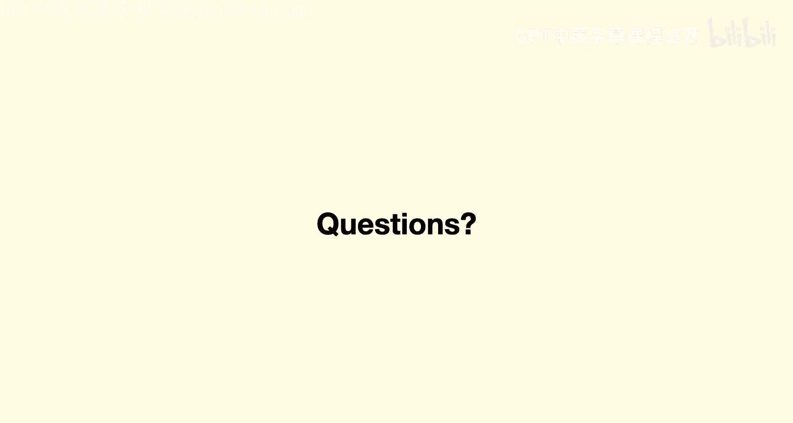
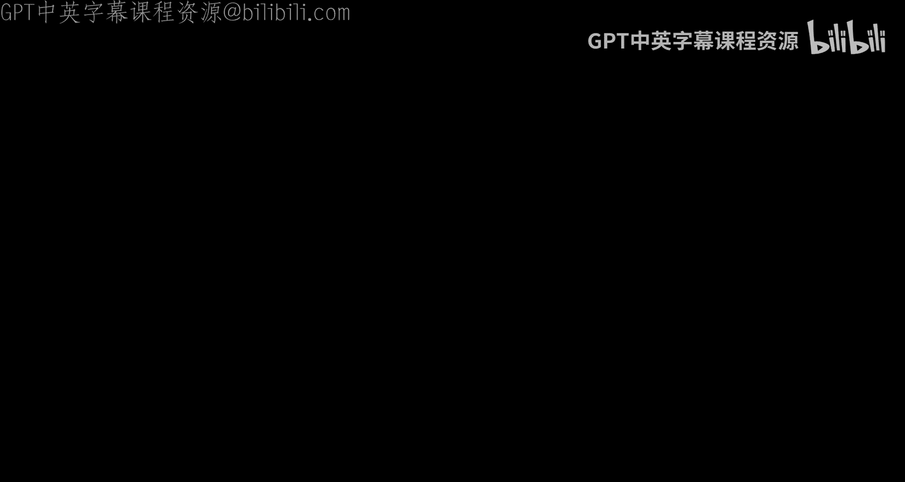
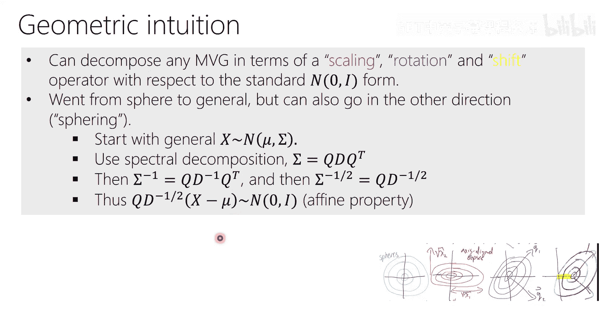

# UCB《机器学习导论｜CS 189⧸289A Introduction to Machine Learning Fall2024》claude-3.5 p03 L3- Multivariate Gaussians.zh_en -BV1H4421S7bs_p3-

Okay let's get started， I've going a little too slowly so at some point I've got to get the full lecture in hopefully today or at least by the time I hand off to Saed so I'm just going to finish the last example I was going to have two examples。

 one we did Gaussian maximum likelihood for a univariate Gaussian and today we're going to do it for a discrete random variable and then we're going to go into a lot of detail and intuition about how to think about multivariate multivariate Gaussians from a geometric perspective and also how the geometry corresponds to the math in that density function so just to reload you where we were at last class we were talking about the principle of maximum likelihood that we would use that would define the loss function that we would optimize we would maximize the likelihood or the log likelihood to get the parameters we wanted and so we had a likelihood function which is the problem。

Of the data， given the parameters and the goal is to find the argm over the parameters。

And we have this assumption that the data are drawnI identically and independently distributed so that's like the first thing that helps us sometimes to kind of unroll the math when we instantiate it for a particular density like the Gaussian and then this is where we left off and I didn't quite finish this slide so what this slide was saying that when we use maximum likelihood estimate of the parameter it gives us a single parameter estimate and then we would go forward and use that parameter estimate and there's a different technique that we touch on briefly called Bayesian statistics or Bayesian machine learning where instead of getting just one value of the parameter we get a distribution over the parameter and we can therefore make use of the whole distribution and one of the reasons to just what these figures here are supposed to tell you is that how you might end up with a failure by doing maximum likelihood estimation if you have too complicated of a model and so that's what's。

So these two kind of go together so here the true curve is this nice smooth curve which is fit nicely by a fourth order polynomial。

 but if you give it a 50th order polynomial with all those extra parameters then it's just going to wiggle like crazy when you do maximum likelihood because it's going to try to basically make it look like the data however。

 if you were to kind of think about schematically what the likelihood surface would look like in that case。

 it's very likely that for the 50th order polynomial。

 there's just one little spike thats super high or maybe a bunch of spikes well no sorry it would just be one spike that's really high which is the sort of really weird 50th order polynomial that would get very close to the data points。

 but if you were to change the parameters just a little bit the likelihood would surely plummet because it would be wigly in some different way that didn't fit the points well in contrast over here this probably corresponds to。

that look more like a fourth order polynomial and if you pertuurrb them a little bit。

 the likelihood's not going to just fall off of a cliff because it's not got all these crazy kind of ups and downs。

 and so there's this kind of correspondence between spikes in the likelihood that if you find them and your model's got too many parameters。

 you're going overfit the data， meaning you're just going to memorize the data points and not really get at the true trend that they represent。

 you're going to be picking up on the noise in those observations。Okay。

So now I'll go into the second example of doing maximum likelihood for the multinoial distribution and you'll undoubtedly have to do some examples in discussion or homework almost certainly there will be one of these on the exam for some distribution we haven't gone over so just make sure you understand the general principles so that when we give you a different distribution and say please show how to drive the maximum likelihood you know how to do that and so consider now a six sided diet and what we want to we're going to get some observations from rolling this diet and it will turn up one of the six。

Sides and we're gonna for each side there's going to be a probability like so the probability that turns a one。

 a two a three a four or5 or a six and our goal is going to be to estimate these parameters using maximum likelihood so we're going to assume that we roll the die n times and so the random variable that gets instantiated is distributed with what's called a multinoial distribution which is just this distribution that tells you the probability of getting the side one。

 the side two， the side3 and so forth and so we're going to just denote this probability。

 the probability at the random variable took hit the case side of the die with k points given the parameter theta we're just going to sort of have a shorthand notation or sorry the parameter right that probability we're just going to write as theta K as a shorthand notation as we work through the math。

And now imagine we observe n of these observations。

 we're going to now write down the likelihood function at some point we'll use the idea that their IID and then we're going to set the gradient to0 as we did for the Gaussian so first of all。

 one thing we know is that when we roll a die， one of the sides has to show up right and so actually having six parameters is too many if we know the probability of one。

2，3，4，5， then we know the probability that it turns6 is just one minus all the others so there's kind of an extra parameter and so what we basically we know also just the sum of all six of those is equal to one because something has to turn up。

That just says the right， the probability that you' got a 1，2，3，4 or 5，6 is equal to one。

 And the second thing is that， oh， sorry， this is the。

RightThere's a few little kind of weird notational things here so here we're going to denote the probability that one of those roles has the value x as theta sub x making use of that notation here。

 so here that was the K thigh and here x is sort of the k side and here we're just saying it had the case side so we can pick off that particular parameter just as a sort of shorthand notation。

So now let's write the likelihood。And again， looks this is the most general form right now。

 just as probability of the data given the parameters where those parameters are the six parameters。

 and that's a set of n observations of the discrete random variable X given those parameters and because they're identically and independently distributed。

 I can take the product as I showed you last week。And now it's going look， it's going to look。

 we're gonna do some kind of notational bookkeeping， if you will。 that's going to help us。

 So what this is for each of the end times I roll the dice。 There's a probability。 and so。

What this is is an indicator function， indicator that the X the if rule turned up the k side of the dice just one second。

 And so for the if data point， I can get this probability by multiplying together the probability for each of the six sides where I pick off only the one that actually turned up using the indicator function。

 So if X is actually equal to k， I'll pick off the k parameter probability of rolling k dots。

 And for when X is not equal to K， that's just going to be equal。Indated。Oh right， sorry。

 then the exponent is zero。 and the whole thing is one for a second。

 I thought I was multiplying by0 right So basically this is just a weird notational thing that's going to be helpful。

 Like all of this is just picking off the correct parameter out of the six parameters using what looks like a cumbersome notation that will be helpful。

 But there was a question just a second ago yeah。😊，That's a great question。 So it no。

 in that's one of the beauties of being independently and identically distributed。 It doesn't。

 the order doesn't matter because it's the product and the product。

 you can always change any the products the same， no matter how you order the terms， right， so。Right。

This product here， whatever order you use， it's the same value。Multiply by what？嗯。Well。

 this is the multinomial distribution。 So it's not the Bernoulli。

 but so this is just saying whats we want to estimate。I mean。

 this is the probability that you observe this particular vector。

 oh I see you're asking about in that sense， the order here。

What this is saying is if I give you x1 at like a very specific vector。

 then that's the probability of this vector， but it will turn out by symmetry that if I reorder things。

 it has the same probability。O。So now I'm going to make use of this kind of bookke trick to say instead of doing a product over each of the end data points。

 now I can just do a product over actually each of the K sides of the die and all I need to do is for each parameter k which represents one side of the die。

 I just count how many times the indicator was one， meaning if the third side flipped up six times。

 then the sum for theta sub3 will be6， because I should multiply theta 3 by itself six times。

It may take like a second to click for you， but this is just actually a trivial bookkeeping notation here。

giveive you a second to make sure you're okay with that。There was a question， yeah。That's right。

 This is just the probability of your data， exactly。

hich is the likelihood this is the likelihood function。

 so we're going to try to maximize it with respect to theta。

 and that will give us the maximum likelihood estimates of the parameters for each six sides of the die。

 which is the parameters of a multinoial distribution。So right， and so this N K is just the number。

 as I just said，' I'm writing it again， the number of times in the observations that for that K side of the dye。

 you observe that particular side。So now our maximum likelihood problem is this is the very generic form and now we can instantiate it with this particular instance of the multinomial but it's a little bit different than the Gaussian because of this constraint up here because I kind of have this extra parameter and they all have to add up to one so now my maximum likelihood problem is。

Take the maximum of the likelihood given which probably do the data given the parameters and find the parameters that maximize it subject to the constraint that the sum of the parameters sums up to one so that it's a valid probability distribution。

 So if you have a multinoial probability distribution that has a parameter for every outcome。

 then those outcomes have to sum to one， just like they have to integrate to one with the Gaussian。

So that you're going to jog your memory now about constrained optimization。

 which you should have learned， I believe in first year calculus。

 so who can remember the kind of the term that's going to help us to do a very simple constrained optimization here。

Anyone。Starts with an L。Yeah。The Lagrangian， thank you。

 we are going to use the Lagrangian and luckily since we have a textbook for the first time you can even read about it in the textbook for this class。

 which we have never had so we're going to use the technique of Lagrange multipliers I'm not going to refresh your memory here。

 I'm just going to turn the crank of using it if you can't remember the rationale behind it which has a nice geometric intuition then just go back to the class you learned it in or take a look at the appendix of our current textbook but basically when you do constrained optimization with the Lagrange。

 what you do is you take the function you're trying to optimize in this case the likelihood and you add you create what's called the Lagrangian。

 which has this augmented term and an augmented parameter lambda which is the Lagrange multiplier and using geometric intuitions I won't go to here it explains this but now the point is that we look for stationary points with respect to theta and lambda。

Augmented variable and so we're going to do that here and but like one inch when you can just see is sorry what I've written here in this case is I've added the actual constraint the constraint is that the sum is equal to one and when you use theguangian you kind of push everything to one side so it's like zero equals that and that's what goes here。

So you can see that when the parameters satisfy the constraint， this term actually drops out。

 and so that should give you some little bit of intuition as well。Okay。

 so what we have is this Lagrangian which has the likelihood term in green。

 that has the extra term that comes from the constraint that has the lagrrange multiplier whose value we will need to compute by setting its gradient the partial derivative of that in the Lagrangian to zero and so instantiating that one more step I'm taking the likelihood which I just went through with that kind of bookkeeping notation。

 we ended up writing it like this， it was the sum so the log likelihood is the sum over all six sides of the log of the probability of that side raised the power the number of times I saw that particular side in the observations and then I have this extra term here so let's keep going so the first thing that I do in these kinds of problems is I take the derivative with respect to the laggangrange multiplier this extra kind of parameter which is not part of my model but helps me to make sure that my maximum likelihood has a solution that adheres to the constraints。

Of the probability distribution being normalized and。

When I take the partial derivative of this whole thing here， with respect to lambmbda， of course。

 since lambda is this kind of extra variable we added， it doesn't appear in the likelihood。

 so the derivative of this part goes to zero and it only appears here and it's just a simple derivative。

 all I get back is actually the constraint itself， I get one minus that and if I set it equal to zero。

 then the outcome but that one is that the constraint is satisfied。

So just to reiterate what we've done is if I take the partial derivative of this laggrangian with respect to the Laangian multiplier and set it equal to zero such that I have a stationary point。

 which is what I need， what I get back is an equation that shows me in the constraint has been satisfied。

Now the second step is more similar to what we did with the Gaussian。

 We take the derivative of the parameters we're actually trying to estimate。

 Those are those theta K parameters corresponding to the probability of each side of the dice and now those parameters appear in both of these terms they appear in the likelihood。

 which is this the log likelihood and they appear in this extra bit with the constraints because that's the whole point of the constraints is they're telling us a constraint about the parameters So the partial derivative is going to have to take into account both of these So if I take the partial I'm going to take the partial derivative of this and minus the partial derivative of this because。

Because this term comes out and the negative comes from the sum。

And the sum has gone away because this is just for one of the parameters right。

 so I'm picking out a particular theta K and this of course will be true for all six of those parameters and so this is just generically true for any of those six parameters。

And now if I take the derivative of this thing， I get to the green term here right so basically the derivative of the log of something just gives me one over that。

 and I drop the exponent down before I do that。 So I get and again。

 I'm picking out one of the things from the sum。 So the sum comes out because I'm just doing it for the k parameter。

 I drop the exponent down and then the derivatives1 over theta K。 So now I get this N over theta K。

 and then this of course is a very simple derivative。 I just get minus lambda。And again。

 I set this derivative to0 now， so when I set this to0 I get lambda equals Nk over theta k。

 and then I can just flip around the terms to get the final result。

 which is that theta K equals Nk over lambda， so we're halfway there。

Sometimes I drink just so you have time to look at the slide， otherwise I sometimes talk too fast。

Okay。You can advise me to drink at any point and it might work。 It's just water， though。

Okay so and now as you may recall from firsty Calics。

 what we do is we plug in this value of theta k which we obtained by setting the partial derivative of the largerange into zero told us that we know that theta k is equal to nk over this parameter and so now we have two equations in two unknowns this equation is we don't know theta k and we don't know lambda and in this equation we have theta k so putting them together we are going to get rid of the lambda basically so what we're going to do is we're going to take this equation here。

 one is equal to sum over k theta k it's rewritten here and I'm going to do is for the theta k in purple I'm going to plug in what I just computed this equation here so now this becomes the sum over k from here nk over lambda。

And this is equal to1。 And so because this is equal to1。

 I can just multiply the lambda to the over other side and I get lambda is equal to the sum of and the Nks and each Nk is the number of observations for each k side of the die。

 and so that's just when I sum them all up， that's the total number of observations。

 which we're calling capital n。 So now now we have some more information and we're getting closer。

 So all together we know that fate from here， we know that theta k。Is equal to N K over lambda。

 So theta k is equal to Nk and lambda。 We just determined from the line above。

 Lada is equal to the number of total observations。

 So we got a very intuitive answer here just like we got an intuitive answer with the Gaussian and the Gaussian。

 the maximum likelihood estimate of the mean was the mean of the data and the maximum likelihood estimate of the variance was the variance of the data。

 And here， what we get is that the probability the estimate for the parameter that I rule。

 let's say K equals 3。 the third side of the di is gonna be my best estimate is the number of time the proportion of times。

 I saw that in the observations， right， N number of times I saw the third part of the dice over all the observations。

And because this Nk， it cannot be greater than n， I cannot see it more than the total number of observations。

 so this parameter is bounded above by one as it should be， and the least it could be is0。

 so this is also a valid probability。Is that that good for everyone？Okay。So okay。

 so those are the two examples they were yeah。I would go look up a refresher on the liang because I don't have enough time to go into that here。

 but there's an intuition of the geometry and the gradients being parallel。

So okay so in both the case of the Gaussian and the multinomial and other examples that I didn't show you。

 this was a pen and paper exercise right I could in closed form on pen and paper tell you what the solution was but if for most models used in modern- day machine learning like for example。

 neural networks but not only neural networks， we can't get a closed form solution we don't know and I alluded to that in the first lecture。

 I mentioned this iterative gradient descent optimization algorithm。

 and so indeed what I've just shown you is a way to just get the very basic understanding of what maximum likelihood is and that in some examples you can do this optimization in closed form but in reality。

 what we're going to do as I mentioned and you'll learn more about this from Saed is you're going to actually just start the parameter estimate somewhere and then you're going with an iterative algorithm following the gradient of the likelihood。

 you're going to just keep moving the。And this is something you cannot do in pen and paper。

 The part you can do in pen and paper is to compute the gradient。

 but you cannot manipulate the math the way we did with the Gaussian and the multinomial to get the actual answer。

 Instead you're going to have to do this iterative procedure。Okay。

 so that's the end of maximum likelihood。 And now I will get into。Into the multivariate Gaussian。A。

There's。There was some reason I put these here and I don't remember them， but now they look cute。

 but this is not a multivariate Gaussian， just FYI。 so maybe that might be an exam question is like。

 is this a multivariate Gaussian and you have to answer for real， actually。

But probably not this one since it's on this slide， and I told you the answer。Yeah。

 okay so the assigned reading for this is and I actually say I haven't fully read these bits of the textbook because this is like new and I'm trying to get organized for the lecture and see what's there but so far from what I see is that everything that's done there is done a little bit differently from how I explain it And I think it's great because then you get two different perspectives。

 so hopefully and I'm definitely curious to hear feedback through the course about if the readings are helpful or distracting or confusing。

 but I'm very excited we have this book and there are these readings。 Okay so right。

 so we've looked last time at the Uniivariiate Gaussian。

 which has this really relatively simple form to look at。

 it has this what we call sometimes the squared term or the quadratic term is in the exponent and then it has the normalizing constant and we know that what it looks like in one dimension it's easy to visualize so the multivariate Gaussian。

 who's seen the multivariate Gaussian before。😊，Okay a few people。

 So it's very similar in a lot of ways， but the machinery to think about and manipulate it becomes more complex because the mean and the examples are in a vector space。

 That's why it's multivariate。 And because the observations X are in a d dimensional vector space。

 So here I've written D dimensional space， that means the mu the mean is going to be parameter is in a D dimensional space。

 And what used to be a scale or varianceance becomes kind of a beast， it becomes a matrix。

 A D by D matrix called the covariance matrix。 And by the end of this lecture。

 you're gonna to know more than you want to maybe about the covariance matrix and how to think about it。

 And so the form like I put them next to each other just so you can see that they're very。

 very similar。 In fact， could have rewritten this one to say x minus mu times1 over two sigma squared times x minus mu and they would have looked even more similar at face value looks a little bit different like that。

 but you can rewrite it。This is the same thing as the square root of the determinant of2 pi times the covariance matrix。

 and then it starts to look really similar so if you want a mnemonic。

 I tend to think of it like this rather than like this。And then right again， we have x minus mu。

 but these are now d dimensional vectors， and we have this covariance matrix that is sandwiched between them。

 the covariance matrix is sigma and the inverse covariance matrix， which is actually written here。

 sometimes as we call this the precision matrix。Okay， it's named after Gauss。

 who was born a long time ago and did all kinds of cool work。Okay。

 so and this like this is a somewhat abstract mathy statistical lecture and I think most people came here because they want to do cool stuff with machine learning。

 but there's actually it's good to either remember or learn some of these foundational links because they will come in to a lot of modern day machine learning and just as an example at some point a bit later in the lecture we're going to learn about generative versus discriminative classification and those depend entirely on multivariate or part of that depends entirely on understanding multivariate Gaussians。

 there's also something there's going to be a whole lecture I'll give on principle components analysis and briefly talk about autoencors both of which these are two techniques that are unsupervised learning that are used to reduce the dimensionality of your data without losing too much information they're kind of a compression statistical compression algorithm and they're very。

 very widely used in industry and academia and the sciences and all kinds of。

And so understanding the multivariate Gaussian is going to be really helpful to understand both of these。

 There's other topics that are beyond the scope of this class， which also make use of these。Okay。

 and then also， you know， I talked last time that we often make this assumption of Gaussianity because of the central limit theorem often kicks in。

 and I like this also this sort of famous quote， so famous who's heard of it。

Anybody famous in a niche crowd of nerds like myself。 sorry not referring to you。 Okay。

 so all models are wrong， but some are useful。 And so even if your data are not exactly Ga you just。

 often it's a very， very useful assumption that takes you very far。😊，And as I mentioned。

 they're ubiquit， ubiquitous and natural phenomena because of the central limit theorem。

 which has this tendency that when you add together different random variables， the random variable。

 which is the sum of those random variables is Gaussian distributed And so for example。

 if you have why do I have curly hair， if the influence of that is a whole bunch of different different genetic points in my genome that are all added together。

 which is how a lot of genetics works， it's not surprising that that is Gaussian distributed。嗯。Okay。

It also turns out that Gaussians are really convenient to work with because you can one understand intuitively a lot of what's going on and you can manipulate them in pretty tractable ways and that's kind of a large part of today's lecture but just to give you a teaser before we go into that material this is from a few lectures ahead on principal components analysis and so these multivari Gaussians are one way that one can derive this thing called principle components analysis and so I'm not going to tell you really what it is。

 but I'll just give you like this teaser， which is if you give me a database of face images and each of those images is like 1 thousand0 by100 pixels。

 what PC can do is it can give me a new basis by using kind of thinking we're thinking about today roughly speaking and new set of basis vectors that allow me to compress those faces So instead of needing100 by100 pixels。

 I can probably get away with like 10 by 10 of them and perceptually to you and me the faces will。

The same in that basis so that's just a bit of a teaser for a further lecture ahead but in today's lecture my goal is to give you an intuitive interpretation and the know of how to technically manipulate the different parts of the Gaussians like what is this covariance matrix how can I think about it in a geometric way and then also just teach you some of the properties of how to manipulate these and this will serve you well in your machine learning and probably your statistics life as well sometimes you see MVN for multivariate normal distributions the same distribution？

Okay， so let's start， we're going to start with simple one dimensionmensional Gaussians and kind of get an intuition of what does it look like to kind of think about combining two variables into a multivariate Gaussian。

 so consider two quantities， height and weight where each of those the height is distributed as a unitivevariate Gaussian height is a scalar。

 the weight is a scalar and it's associated it's distributed as a different Gaussian indexed by the parameters。

 W here and by the parameters H here and so in fact both of these are are。

Are roughly speaking Gaussian and for this lecture， they will be Gaussian。Okay。So。

Suppose that I know these are each of these are distributed like this as Univaria Gaussians。

 but suppose I want to get the joint distribution of those two random variables which I can write as the probability of the two random variables with a comma that's how I denote the joint probability and so now the outcome space is twodimensional instead of the one dimensional we had before and sometimes as we often do we often in machine learning is statistics is drop the capital letter equal this and we just write it in shorthand like this。

 and so the goal in the next few slides if not the rest of the lecture is to essentially understand this joint distribution and what it means if it's Gaussian and what this covariance matrix means and so forth。

Let's think about these data again， I know that in 1 D that I could plot them like this。

 but I'm now trying to learn a joint distribution over the height and the weight。

 so let's actually take a look at what the data points look in two dimensions and and they're going to look something like this so we know that the taller you are it's the more you weigh in general if that were exact this would be like a straight line。

 it's not an exact trend so there's kind of noise around this line and also the way it's been drawn here。

 if I were to project this down onto the weight axis， it should look like the weight histogram。

 if I were to project this onto the height axis， it should look like the height histogram and this is the twodimenional joint distribution of the height and the weight and so the kind of challenge we're going work through is I know that each of these are normal like the marginal distribution of the height is normal。

 the marginal distribution of the weight is normal what is the joint distribution。I a normal。

 and if it is， what does that normal look like， What does its mean look like。

 What does its variance look like， Is the question clear。Okay。

 so each of these blue points is a sample from a 2D probability density function that I'm writing like this。

And so what if we computed the mean of these points with the knowledge of the purple and the。

Brown distribution， Can anybody tell me what they think the value of the or this two vector would be the mean of the distribution？

Yeah。It would be the means of the two that's exactly right。

 basically I'm asking what is the center of mass of this distribution。

 and it turns out the center of this mass of this distribution is going to be the mean from each of the two distributions we'll describe the center of mass of those points。

So how do I describe the spread of the points， So before the spread of the points was this variance。

 a scalar variance， but obviously this cloud of points。

 I can't describe the spread with a scalar like it's a cloud of points So I need to somehow describe the spread in some other way in a few slides or soon we're going to well we'll get there so yeah。

 we're going to think of it as instead of a scalar one way to think about it is actually as sort of ellipses like what is the shape of this thing this thing is I want some idea that it's long in this direction and short in this direction and that's what's going to give me the idea of the spread of the points and the covariance matrix is going be this matrix that helps me to think about the spread in that way。

 And right now I know that doesn't make a lot of sense， but it will in just a little bit。

So just let's try to take this a little bit further。

 could I if I know that the height is distributed like this， the weight is distributed like this。

 can I say that the joint distribution has the value of the product of the two univariate distributions。

 is can I allowed to do that？Any ideas？If they're considered independent， exactly。

 the probability of， of two things， I can write it this way。 if the two variables are independent。

 Now， if I look at this plot， who think do you do we think they're independent。OhNo。

 they're not independent， so I can't do that。 So what kind of a plot， What could I do to this plot。

That would make them independent so that I could write it that way。What's it。So。

What kind of a linear transformation？No stretching， no stretching， but you're very close。

 Don't need to stretch it。 I mean， you could。 stretching could be okay。

 but you don't need to stretch。 So let's not stretch。 but it is it is a linear operation。

 So what part of the linear operation do we need， We need to rotate it。 We just need to rotate it。

If so right now， this is sort of the ellipses that kind of represent this probability density function and we'll understand that in a more detailed manner in a second。

 But if it actually looked like this， if I rotated it somehow so that those directions were axis aligned。

 now if you were to compute the correlation， the correlation would be0 and and these would actually be independent。

 So if the data looked like this。 then I could combine the Uniivaria densities by multiplying because I would have two independent random variables and by the laws of probability。

 I could multiply them together。 But when the data looks like this， I can't do that。

And so what the covariance matrix is essentially going to be is it's going to in a way tell us how we can think about rotating the data to get it access aligned。

 and that's just like we're going to get there that's like a big chunk of this lecture so we want to somehow figure out a coordinate system from the original coordinate system was Xxw。

 but if I could find this new coordinate system by rotating the data X1x2。

 then I would be able to just write down directly the density of this joint the joint density of these two variables would be jointly Gaussian in this very specific way。

Okay so how do we do a rotation， a rotation as you know from first yearear linear algebra is a particular kind of orthoormal matrix Q that has certain properties so it's determinant is one and the transpose is equal to the inverse and so such a matrix if I take that matrix。

 it is a rotation and if I hit the original coordinate system with that rotation matrix then for the right rotation matrix that we're going to figure out I would get this axis aligned coordinate system and in that coordinate system I could write things in this way。

嗯。Yeah。It is it is， but I haven't made it one， it is a precise one。

 and we're going to see that in just a moment。 Yeah。

 what it's going to correspond to is that the covariance matrix in in this case。

 two dimensional multivariate Gaussian that all the off diagonal elements are zero。Basically。

 well in the two by two case， you'll have just two variances in the diagonal and the others will0 and that will be the precise term。

 and so in fact， that's kind of the goal is to manipulate the covariance matrix to have zeros in the right places so we know that it's a aligned。

Okay so let's just look at what happens kind of in the flip side of what I described。

 let's now start with the assumption that I have two Uniivariate Gaussian distributed random variables and that they are independent so in this case I can multiply them together and then let's see what happens and actually the reason I'm doing this is because of the question you just asked what we're going to see is that those zeros pop out。

So if the one in x is written with these parameters。

1 and the one with y is written with the parameters 2， then I get these two。

 these are scalar Uniivevaria Gaussians and I literally multiply them by each other because I've declared them independent。

 so this is right now valid。If I do that， I can collect the terms from the normalizing constant become here。

 and the terms in the exponent instead of multiplying， because they're in the exponent。

 we add them together here。And I can keep going。 And what I get is I get the joint probability has this particular normalizing constant here。

 and then I can reorder the terms here in matrix form So I started by multiplying two scalar densities together。

 but the point is to use those to build up intuition about multivariate Gaussian。

 So I'm refactorizing this term here is exactly equal to this and you can see if you multiply it out。

 but what you'll see is this is x minus mu this a two vector。 and that's the first component。

 The second component is y minus mu2 where mu2 is the mean of this one and mu1 was the mean of that one and now this is going to be our inverse covariance matrix and it each of the variances from the univariate distributions on the diagonal。

 and it has zeros on the off diagonal and the zeros are there because they're independent if they hadn't been independent these wouldn't be zero and then I get。

Just by symmetry， the same thing over here， so you can check at home if you don't believe me。

 but this is equal to this in matrix form and so what I've done is I've shown you that if I have two univariary Gaussians and I multiply them together to get the joint distribution。

 then I can reshape it visually into what looks like a two dimensionmensional Gaussian with the familiar covariance matrix and the mean。

 which is a two vector， a question。Oh no， okay。Right， and。

And in the the inverse of a diagonal matrix， which will make a use of later is really nice。

 So in general， matrix inversion， as you no doubt know。

 from firststar algebra is is unpleasant and expensive。 But when you have a diagonal matrix。

 you can just take one over each of the diagonal elements。

 And that's gonna pop up a bit later in this lecture。😊，So right。

 and so this sigma is the covariance matrix， and we often call it's inverse， the precision matrix。

I don't know why that senior's there again。Just go buy it。 Okay。

 so now I'm going to go through just a review of some basic definitions that are going to be useful as we keep going with these multivariate Gaussians。

 So expectation is looks different for discrete random variables。 So expectation of。😊。

Of P of x with respect to sorry of x， with respect to P of x is the sum over。

 and when we have a continuous random variable， x， the sum is an integral。

 I'm just going to do this really quickly because this should be background material。

 just want to quickly reload you。And then some of the properties of expectations that are helpful is the linearity。

 so the expectation of a linear combination is the sum of the linear combination of the expectations。

 and that does not require independence， also if you have a bunch of independent random and independent random variables。

 then you can also interchange the product and the expectation。

 such that the expectation of the product of those random variables is the product of the expectation of those random variables。

And finally， if I have a constant in the expectation。

 I can just pull it out because it's not a random variable。And。Yeah， no I don't know。

 I have this pet peeve that people never write what the expectation is with respect to。

 It's often implicit。 I prefer to make it explicit， but but the way you figure it out is。Yeah， well。

 sorry， it's often implicit。 But if I didn't write it here。 Suppose this wasn't here。

 And these are both random variables， then it's unclear if the expectations over one。

 over the other or over both。 So sometimes you do have to write it in。 But if it's just implicit。

 then usually it should just be over all the things that appear that are random variables and it's unfortunate。

 I think that the world always makes it implicit。right， so the variance。

 if x is a random variable with mean mu， which is the expectation then as you've seen。

 I no doubt in many places， the variance is defined as the expectation of that variable minus its mean squared。

And some of the properties of the variances are that you can also estimate it this way。

 you could instead take the expectation of x squared and then subtract the mean squared also this property is going to come in useful because this is the scalar version of this property but there's a kind of analog when this is a matrix but if you have the variance of here the random variables always x so A and B are constants so the variances of a X plus B the B does not affect it because it's not multiplying by the variable and the a if we want to pull it out then we have to square it with the variance unlike the mean you wouldn't square it and these just fall out from the definition you can I'm sure there's proofs online or you could do it as an exercise and then finally if you have independent random variables and these alphas are constants so this is a linear combination of n independent variables then the variance of that linear combination of random variable。

Is the same as the linear combination of the， but with the coefficients are different。

 you have to square them as opposed to the mean times the variance。

 So these are just some simple properties， not going to belabor them or go into them。

 just trying to jog your memory a little bit。And now the covariance。

 this is going to be especially related to this lecture。

 so covariance is between two different usually different random variables。

 it could be the same random variable， but in general。

 it's a random variable x and a random variable Y and a lot like the covariance it looks like except there's two random variables。

 So the covariance， I take the expectation of x minus itss mean times y minus its's mean and I take the expectation of that whole thing。

😊，And that looks the same as， a similar， again， to the variance。

 I can just say that's the expectation of the first random variable minus its's mean and the second one minus its's mean and it turns out that's also equal to the expectation of multiplying them together and subtracting the expectation of each of them。

And if I take the covariance， but I use it on the same variable instead of two different variables。

 X and Y， I say what's the covariance between x and itself。 This is just the variance of x。

 It collapses to the same equation as the variance of x。

 and that's one way to see the very tight relationship between them。 And if two random variables。

 X and Y are independent， then it follows that their covariance is0。And finally， I think finally。

 correlation is kind of just like a normalized version of the covariance。

 So if you want to know what's the correlation between x and y。

 you actually can compute the covariance of x and y。

 and then you normalize it by the square root of the product of each of their variances。

 And when you do that， this normalization of the covariance ensures that the correlation row lies between minus1 and1。

 And if you've ever done sort of any just simple statistical analysis。

 you know there's an intuition to that like one is the max correlation。

 minus-1 is the minimum and0 is none。 So you just have kind of a more human interpretable understanding of it compared to the covariance which can be useful。

Okay， so right， and in that this baby case， this is I just threw it all here because this is what we just did a few slides ago。

 this was this sort of baby case of taking two independent Gaussians and multiplying them which is valid and then showing that you get these zeros on the diagonal when you write in in matrix form in the form of a twodimensional multivariate Gaussian and so indeed it turns out that these are actually the variance。

 this is the variance of x， this is the variance of y which I mean you can see and in fact because of the assumption that they were independent。

 the covariance between x and y is zero and that's exactly what's here and in the example where it's not a aligned。

 these would not be zero so if you see zeros here， you know the data has to look axis aligned。

And so just to like kind of write this out in go a detail。

 if we had a three dimensionional covariance matrix in a three dimensionmensional multivariate Gaussian。

 then the diagonal is always the covariance of each of the three dimensions。

 which is just the variance this is the variance of x1 the variance of x2， the variance of x3。

 and all the off off diagonal terms are the pairwise covariance between every two of the variables。

And so you could actually so although you can do maximum if you term the crank of maximum likelihood for the multivari Gaussian。

 you'll get an equation that shows you how to estimate the covariance matrix。

 but with this kind of knowledge， you could also actually do it。Using this kind of a formula。

And one thing that's important about the covariance matrix is it's symmetric because the covariance operator is symmetric。

 the definition of covariance doesn't matter if I switch the order， I get the same result。

 so all covariance matrices are symmetric， and that's a very useful property that we're going to make use of。

And it's also therefore a positive semi definite。Meaning that its eigenvalues are always positive or zero。

 but they're not negative。And right and so that was the covariance matrix we had。

 and these covariances were zero because of the assumption of independence。Okay。

This is a nice fact about。Random variables that are Gaussian distributed。

 And it's not generally true。 So This is very special to the multivariate Gaussian as compared to。

 I think all other distributions。I should be careful， I think it is compared to all。

 but what is special about the multivariate Gaussian is that if you have a D dimensional multivariate Gaussian。

And the covariance between- then you have an if and only if。

And the general case is not an if and only if， it's an if but the if and only if says that if you know the covariance matrix between any two of those components is0。

 then you know those two random variables are independent and also the other way around。

 if you know they're independent， then you know the covariance is equal to zero and so it goes both ways within if and onlyif。

 however in the general case you get only a one way statement， it only goes one way。

 it says that if X and Xj are two random variables that are independent。

 then I know their covariance is zero， but it's not true that if I know the covariance between two variables is0。

 I do not know they're independent。And the reason I don't know is that covariance is。

 as I just show it's like you can think of it like correlation。

 It's kind of like how well can I draw a line through the data， right。

 That's what correlation is that's also what covariance is。

 So I have non-zero covariance to the extent that my data look like I can put a line through them。

 So what that means is that correlation and covariance describe a linear relationship， However。

 dependence and independence encompass any kind of relationship， It's a much more general term。

 and that's why this only goes in one direction because independence is a much stronger。

 more general term of a relationship than covariance， which is just linear。

 But then with the Gaussian you because of the properties of the Gaussian。

 it does go both ways in that case。 and that's kind of just a magical fact about the Gaussian。😊，Okay。

 so。RightSo we worked through the simple case where we had two random variables that were independent and I got these zeros on the off diagonal。

 but my goal in the rest of the lecture is to say let's try to understand the general multivariate Gaussian where that's not the case where I have an arbitrary covariance matrix like how can I wrap my head about around that other than to just know there's some matrix with some numbers and like turn the crank of different linear algebra theorems like partly we will do that。

 but we're going to do that to get some understanding so。And in particular。

 this covariance matrix is really in some fundamental way。

 a descriptor of what the axes of the Gaussian blob look like， what direction they're pointing in。

 and how elongated the points are in each direction that's fundamentally what this is and I'm going to make that term more precise as we go on。

 we're going to basically end up decomposing the covariance matrix into rotation matrices and scaling matrices so we understand that exact relationship。

Okay， so I've mentioned this before， but we often talk about the multi。I just covering the mic， okay。

So wait， this is sort of like the data term in the sense that if we have collected data X and we're trying to estimate parameters mu sigma。

 the data only come into the actually no， it's even worse， right。嗯。

Only come into this quadratic term， and then we have the normalizing constant， and again。

 this is very similar to the 1D， and that's just to ensure that the probability distribution is in fact normalized。

But the quadratic term here。Is going to help give us some intuition。

 So the quadratic term helps us to understand what level sets of the probability density function look like。

So what do I mean by that， suppose I said I want you imagine we're going to stick with two dimensions so we can visualize it easily。

 so this imagines this is a two dimensionsal Gaussian。

 and I ask you to tell me what I want to know is for some particular value of the density。

 some arbitrary constant， I want to know what would all the x's look like in two dimensions that have the same density。

So how am I going to do that， I'm going to just set this whole density to a constant C。Basically。

 and when I do that， I want to know what it looks like as a function of x。

 so I can basically just get rid of the normalizing constant and absorb it into the constant。And。

And and what's going to happen is basically， this is going to look like an ellipse。

 And so depending on which constant I pick， I'll get a different density value and get a different ellipse。

 And so for each constant， I get a different ellipse where this is X1 and x 2。 And so。

What this is really telling you is that the parameters inside the covariance matrix are describing in ellipse and that ellipse is basically telling you about the orientation of the Gaussian how much if this ellipse is actually doesn't have cross termss then we know it's axis aligned for example。

 and so it tells us kind of a lot of the information that I've been mentioning is is it access aligned and how is it scaled in each direction。

嗯。So just to reiterate， the point of this slide is that level sets of the multivariate Gaussian density in xspace correspond to ellipses where the equation of the ellipses come from the quadratic term。

 and in particular they come from the elements of the covariance matrix。

Okay so we can see these in two dimensions here what it looks like。

 we know how to write that out in two dimensions， we have a good intuition。

 so it's easy to think about， but in general we're going to work with higher dimensional Gaussians and so Jeff who as I've mentioned before。

 he's one of the Turing Award winners， he's kind of the grand Eddy of Deep learningney he's also a very funny guy。

 extremely charismatic and very funny。And so I'm quoting from him now， so he says。

 to deal with a 14 dimensional space， what you should do if you want to get an intuition is you should visualize a 3D space and then what？

And then you should just say out loud to yourself very loudly over and over 14，14，14。

 So what he's saying is like you can visualize this。

 you cannot visualize in 14 dimensions as a human。 So kind that's a problem in machine learning in the sense that we have a lot of intuition about one in two dimensions and sometimes the intuition can go wrong in higher dimensions so just be careful about that but one thing we could do we could truly do this is we could just say。

 well what are the contour lines look like for every pair of those 14 variables and we get a 14 shoes two of these contour plots and you know that would give us some information it's kind of unwieldy and it's a little bit cumbersome。

😊，So but that would be one way to visualize it， but a kind of different approach that we're going to talk about relates to thinking about these kind of linear operations we talked about about how to make it axis aligned and actually you did mention someone whoever answered mentioned I think you said scaling is that we don't need scaling but we're going to talk about scaling now as well one thing is how to make it axis aligned and another is maybe we want the points to look like a sphere and in fact this is called sphereing your Gaussian so if you have data that come from an arbitrary multivaria Gaussian。

 which means it's not axis aligned and the axes have different sort of lengths then you can go through a process to transform your random variable such that the resulting transform variable is distributed as a standard normal which looks like a sphere because the standard normal as an identity covariance matrix。

 which means it's axis aligned， actually but you can't tell。

Because it's also spherical and all the off diagonal elements are zero。

And this idea of taking data and rotating it to derelate it and then rescaling it to make all the axes have the same like。

 this is called sphereing and we're going to kind of go through thinking about both directions of this process to gain some further intuition about what does this covariance matrix mean。

But we're going to have to bring in some linear algebra here。So。

RightSo the covariance matrix I already said is symmetric， and its inverse is symmetric。

 and it's positive semi definite。And I already explained it's symmetric because the covariance operation itself is symmetric and okay so recall that a symmetric matrix is positive semideinite。

 if all its eigenvalues are greater than or equal to zero。

 it would be strictly positive definite as opposed to positive semi definite if they were all greater than zero。

 so the difference between semi and not semi is whether there's a greater than or equal or greater than。

 and so it follows and all the eigenvalues are greater than or equal to zero。And so just again。

 this is like a really quick refresher because this is sort of background for the class。

 but if you have a matrix A and you have a vector X， if it so happens that when you hit a with x。

 you get back ascalealar multiplier of x then x is an eigenvector for a and lambda is the corresponding eigenvalue and there's a procedure again。

 I'm not going go into of how you can compute eigenvalues which you would have learned in one of your earlier classes and for big big anyway。

 we now do it on a computer but not on the midterm so now you probably probably this is background。

 this is not background。 So who's heard of the spectral theorem just to check oh it is Oh I forgot they teach this in some of the E in the like what did they teach this in。

127， but is any other classes， earlier classes， just 127？16 B， okay okay， got it。

 So the spectral theorem says if I have a matrix A， which is symmetric。

 then I can get this really lovely decomposition， which is going be very。

 very useful for us here and in many other places and the decomposition in particular has has this orthonormal matrix Q and this is Q transpose and it has a diagonal matrix and diagonal matrices are just always really they make us happy because it's super easy to take the inverse and it's super easy also to take the square root because you just take the operator like the square root or the inverse of just each of those elements on the diagonal。

 whereas if you want a square root or an inverse of a whole matrix， that's like really。

 really complicated and it turns out if I have a decomposition like this doing the inverse and the square root of the whole matrix turns out actually to be really simple。

 And so that's one of the things。😊，It's going to give us。I my computer just froze， ah， go back。

 where are we？right， so Q is an orthoormal matrix and it has each of these vectors form the matrix。

 any two of which are orthogonal and the magnitude of each one is one。

 that's what by definition is an orthoormal matrix and also as a consequence of that Q inverse is equal to Q transpose。

Am。So I can also write this as I could just replace the Q transpose with Q inverse if I wanted to。

And so this decomposition now is going to， as I just said。

 be really helpful to take the inverse of the matrix inverse of a and also the matrix square root of a and so let me just show you these are really really helpful so inverse is in square root so again if a is a symmetric matrix then I can apply the spectral decomposition where Q is an orthoormal matrix D is a diagonal matrix and this is Q transpose then it follows that a inverse and now I just use the rule of inversion right。

 I take the Qt over there and inverted， but because it's orthoormal  Q transpose becomes  Q I take the inverse of d D is a diagonal so that's a trivial operation I just take the inverse of each element on the diagonal and then I take the inverse of Q that because after reverse the order when I do the inverse of the multiplication。

And then I get the Q transpose。 and you can double I'm not gonna go through。

 but you can double check indeed that if if， if this is a， if I define， well。

 I've derived a inverse like this basically， but a times a inverse down here， you'll see is。

 in fact the identity。 So you can check for yourself that it is it is the inverse。

 And so that's really， really nice。 because actually。

 if you just go into your Python or whatever package you used to do matrix inverse is a very the time complexityities actually cubic。

 But here， if you already have the spectral decomposition。

 the time complexity is is just the complexity of actually the multiplications here。

 So it's a lot cheaper。😊，And on pen and paper you can manipulate things a lot easier as well we also get a square root kind of for free So that's the beauty one of the beauties of the spectral decomposition is you basically get for free the inverse and a matrix square root so define the square root R and there's different square roots so the square root of a symmetric matrix is not unique you may have heard of a choleski factor you can do it this way。

 you can do it other ways， but we can see with plain sight and a few simple manipulations of the equations that if a decomposes like this with the spectral decomposition and we define a matrix R like this where when I write square root of d just as when I write inverse of d because it's diagonal。

 I just apply that operator to every element of the diagonal then it follows that a is equal to r transpose times R which is equal to r times r transpose so this R acts as a square root matrix's the square root of a these are both square matrices of the same size as a and。

I multiply them together， I get A back， so it's a matrix square root。

 and again you can go check down here that that's actually true。And then as I said it's not unique。

 so when you go actually check for yourself， what you'll find is that if you actually dropped the second queue you still have a square root you don't actually need that one and so a little bit later I'm going to use the square root that doesn't use that one。

Okay， any。N。Clarifying questions。Okay， so。We're going to go back to a sort of going appeal to this idea that the multivaria Gaussian contour lines are ellipses。

 And let's just look at any ellipse now。 So this is like an ellipse。 It's not access aligned。

And let's ask how we could diagonalize the ellipse。

 how could we transform the variables x and y so that it was axis aligned。

 and this is going to help us give us an intuition of how to manipulate the covariance of a multivariate Gaussian such that its distribution becomes axis aligned because of the connection between the contour lines being ellipses in the probability density function。

 so if I can rewrite this equation here to be in matrix form。

 two dimensional vector to2 by 2 matrix 2 by 2， this is the same equation as the equation of this ellipse。

 and this is a positive definite matrix because the determinant is positive5 times 5，25 minus 16。

And because it's a positive definite matrix I can apply the spectral decomposition we just talked about。

 so I can now take a， A is this matrix here， which represents really the ellipse。

 it represents how the ellipse is aligned or not and what the scaling is on each axis。

 and I'm going to decompose it essentially into what's going to be a rotation and a scaling in D。

So let I' again not going to work through all the details here。

 but what I'm let's find out let's write down what are the eigenvalues and eigenvectors of a so if you go through the process you learned in previous courses。

 what you'll find is that if you hit the matrix a which is this matrix by the vectorctor 11 you get back 9 times 11 and what that means is 11 is an eigenvector and 9 is its corresponding eigvalue similarly I could hit the matrix a with1 minus1。

 and I get back 1 minus1 again， therefore one minus1 is another eigenvector with eigenvalue1。

Okay there's a reason we're doing this。 that's really cool， super cool。

 sometimes linear L Gler just blows me away okay so what if we wanted to make so we're going to basically again try to transform the coordinates so that it's not an ellipse but that it's actually or that it's axis aligned and it turns out that the eigen decomposition of a。

 which is essentially the spectral decomposition is going to give us that And so the matrixq what we want for the matrix Q is we're going to stack the eigenvectors together so we get one1 and one minus1 but we want them to be normalized because it has to be an orthoormal matrix so I need to have if I just stack them that's not orthoormal。

 the magnitudes will not be one when I take the inner product so I have to divide by the square root of two now this is an orthoormal matrix composed of the two sets of eigenvectors with the normalization。

And so I know that basically I can rewrite a as Q， this is Q。

 the orthoormal matrix times a diagonal matrix which contains the first eigenvalue and the other eigenvalue and its diagonal it's got zeros。

 and then I just have Q transpose again。Okay， now。What's cool is I can change the coordinate system with this rotation。

 so what I can do is I can say the original coordinate system is an XY。

 and I'm going to find a new coordinate system， x prime Y prime。

 and it just turns out the spectral decomposition tells me what rotation to use to make it axis aligned。

So I take my original coordinate system XY and I hit it with Q and Q is a rotation matrix and when I do that I get a new set of variables。

 x prime and y prime if I multiply this equation out I'll find that x prime is just equal to x plus y divided by square root of 2 so in my new coordinate system。

 x prime is a function of x and y and y prime a different function of x and y and now I have a new coordinate system and in this new coordinate system if I write this exact equation but I use the new coordinate system I derived from the spectral decomposition of its matrix I've now removed the cross terms and I have an axis aligned system there are no cross terms。

So that might have been quite a bit tooabs but so what lets let me try to kind of recap I have any ellipse which is and it has cross terms so it's a not axis aligned I'm going to rewrite the ellipse in this quadratic form which looks a lot like part of the twodimensional multivariate Gaussian and what I'm going to do is I'm going to take what feels a lot like a covariance matrix。

 I'm going to take the spectral decomposition of it。

 that spectral decomposition gives me back a rotation matrix such that when I apply the rotation matrix to the system X and y I get a new coordinate system in which I now have an axis aligned ellipse there are no cross terms。

So now we're going to port this kind of thinking over to the actual multi variant Gaussian。

 they teach you this in 127 or EE16 B。No， okay， good because otherwise。

 we wouldn't have to give this lecture。 So right， the axes， the， And so when you take。

This spectral decomposition， it tells you the eigenvectors tell you which direction the axes are pointing and those directions。

 when you put them as a rotation matrix and apply it， they make it axis a line。

 it also tells you that in that original space， what's the sort of spread the width if you will along each dimension。

 which is one over the square root of the eigenvalues。嗯。

So finding a coordinate system that makes the ellipse axis aligned is the same as diagonalizing the matrix A。

Where the matrix A is just a rewriting of the ellipse， and that's kind of the key thing here。Okay。

Any questions。嗯。Or which contour like so？The contour lines。

 all the contour lines of the multivariate Gaussian probability density function are always ellipses。

 Yes， always exactly ellipses。 and that's provable according to the previous slide and may show up on a homework or somewhere。

 which is you set the probability density to some constant and then you say what what values of x like。

Satisfy all have that exact value。 And then if you plot them。

 they will be exactly provably ellipses yeah。Okay， so now we're getting near。

 so now let's kind of connect this to the multivariate Gaussian。

 And I'm gonna do this in one direction。 What I'm going do is I'm going to use the intuition from the spectral decomposition yielding a rotation matrix to get a little bit of how to think about the multivariate Gaussian rather than just in theip。

So imagine that I start with a multi-variate Gaussian。

 let's just say two dimensions so we can visualize it that's a standard Gaussian meaning it has zero mean and identity covariance matrix。

 so it is a sphere all the directions are the same it's isotropic and what I'm going to show is just give you an intuition is is how could I take random variable x that looks like this and transform it through a series of linear operations as it turns out。

 to look like an arbitrary Gaussian with an arbitrary covariance matrix which is not a sphere which is like different widths in different directions and is not axis aligned。

So right we're going to start off with a random variable X that is distributed as a standard Gaussian。

 and now we're going to apply the spectral decomposition such that we get the rotation matrix Q and what will be a scaling matrix。

 diagonal matrix D， and this is a factorization of the covariance matrix into the eigenvectors which are in the columns of Q and the eigenvalues which are in the diagonal of D。

And we could also rewrite it like this where I've just taken the square root of D and put it out to each side。

 And when I do that， this is also kind of a yeah， this is I think it's the same square root I wrote before。

 So I get A A transpose。 So each A here is A is the square root of the covariance matrix。

 That's all this is same。 and that comes also from a few slides ago。So if I now right。

 so there's a very important property that's going to help us to understand all this geometric intuition of multivariga it's called the aine property and the aine property basically has two kind of directions here。

 so the first direction says that if I have n independent variables each drawn from a standard normal。

Then I can also， first of all， I can just rewrite that in vector form where it is the standard multivariate normal with the identity covariance matrix that's just stacking all these unitivariate standard normals into a vector and having an identity covariance。

 then it follows that if I take that random variable x， and I hit it with a matrix A。

 and I add a vector mu what I get is a new random variable y that is distributed as a normal that has mean mu and covariance matrix Aa transpose。

This is like a really important result that helps us do all kinds of manipulations in this lecture and beyond。

 And so what it's really saying， right， is if I have a standard multivariate Gaussian。

 then if I can kind of get to an arbitrary one by hitting that variable with a matrix。

 which will determine the covariance matrix and adding a mu， which will determine the mean。

 and I can also go the other way around， I can say that。If I have a random variable Y。

 which is distributed as an arbitrary multivariate Gaussian with mean mu and sigma。

 then what I can do is I can take that random variable。

 I can subtract out the mean of itself and I can hit it with the inverse a where a is the square root of the covariance。

 so this is a square root of the inverse covariance。

 if I do that I take off the mean and I square root the covariance matrix。

 what I get back is a multivariate Gaussian in standard form and the way to think about that is what I'm doing is I'm taking y and I'm basically shifting it and then I'm rotating it。

And so I'm going to go through that in visuals in just a second。 But so these two， these are super。

 super important properties you should absolutely memorize， and they will。

 they will delight you all through your life。😊，So right， so if we let y equal ax plus mu sorry。

 so that was the aine property。 And now what I'm going to just do is kind of show you visually what one direction looks like I'm going to use so I'm going to go through this direction visually and then just summarize this one again。

 but so if I want to go from a standard normal to an arbitrary multivariate Gaussian。

 the first thing and where the arbitrary Gaussian is going have this covariance matrix。

 then first I have to get the square root of that matrix so that。

And what I'm going to do is I'm going take the original random variable。 And oh， sorry。

 the Q is is the square， sorry， this A is the square root Q， which is composed of both。

A rotation matrix and a scaling matrix and I want to do this step by step to give you this intuition。

 So if I take the variable X and all I do is I scale it by the eigenvalues。

 then what happens is it's still axis aligned line because I haven't rotated it I only this is a diagonal matrix so I have not rotated it。

 but I've scaled each of the axes of the original random variable by the eigenvalues and so now instead of being spherical it's axis aligned。

 but this direction is， for example， bigger than this direction and the directions are proportional or the size of the directions is proportional to the square root of the eigenvalues。

And。Next， I could say， well， what I did is I took my original Gaussian X。

 I hit it with the scaling matrix from the spectral decomposition。 Let me do the whole thing。

 Let me actually hit it by the whole square root， which is Q times D1 half。 And when I do that。

 Q D1 half。 This is a square root of a times X。Sorry。

 the square root which has been denoted A that's ax。 Now what I get is I get a Gaussian。

 which is still zero mean， but has the covariance matrix sigma。

 So now I've first scaled it and after scaling it with the d1 half I rotate it So now I take it exactly as it is and I do a rigid rotation and the scaling remains the same and now I'm starting to get what looks like an arbitrary covariance matrix this is now this random variable。

 the standard x being hit with a scaling matrix and a rotation matrix gives me the random variable。

 which is distributed as a full covariance matrix and then finally if I also in addition to hitting x with a I can also add a mean and then I also shift the distribution over and so really the main point of this is just to give you the sense that we can decompose a multivariate Gaussian into a scaling which we get from the diagonal from the。

pectral decomposition of its covariance matrix and a rotation which we also get and the two things together。

 the scaling and the rotation actually give you a square root and then you can also have a shift in there and so that gives gives you some intuition of how to think of the covariance matrix and just now with those diagrams going from left to right I went from a standard Gaussian into a full multivariate and this just tells you you can also go the other way around and it just follows from the aine property so you can。

😊。

