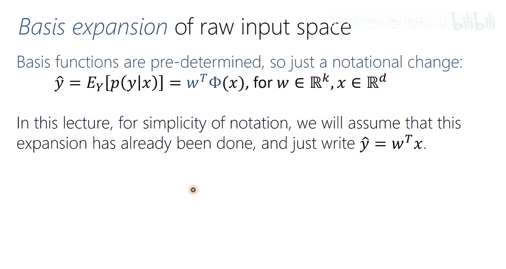
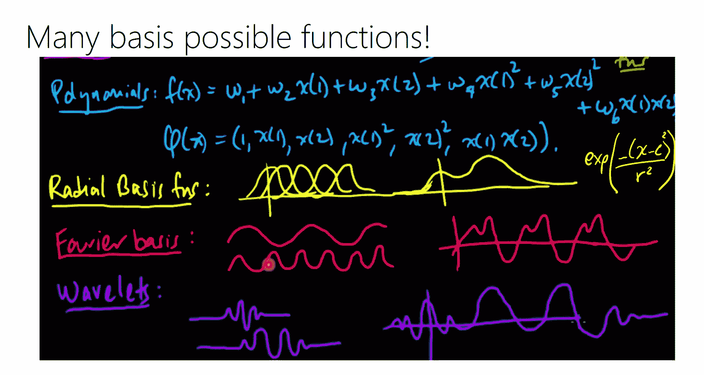
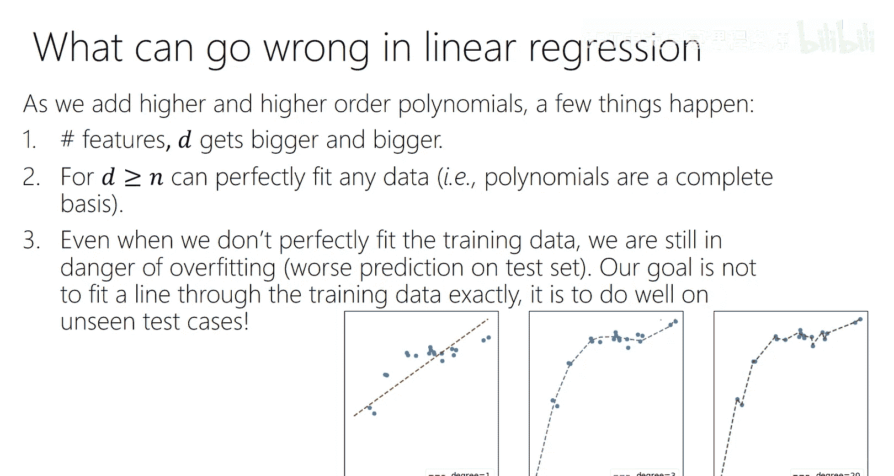

# UCB《机器学习导论｜CS 189⧸289A Introduction to Machine Learning Fall2024》claude-3.5 p04 L4- Linear Regression 1.zh_en -BV1H4421S7bs_p4-

Okay let's get started today so I was told that the last lecture the video got posted only on Monday so yesterday which is a big gap from Thursday and it's not supposed to happen that way so I don't know if that if anyone didn't watch it for that reason but they should be coming out much more promptly so we've been iterating with the School of Business to make sure that runs smoothly so today we're going to make use of things we've learned in the last two lectures so one is maximum likelihood estimation and the other is as our knowledge of Gaussians who learned more about Gaussians than they ever wanted to know last class。

Nobody who learned less than they wanted to know。Okay， also nobody okay。

Reggression is a form of supervised learning and we're going to have these pairs of data as I've mentioned before。

 X will be a vector of input features and Y I will be an output， it could be a real valued scalar。

 it could also be not a scalar， it could be a vector output today。

 we're just going to consider it as a scalar output and and having a vector is not that much more complicated。

 the features could be discrete， it could be continuous， there's no assumption on the features here。

right， as I said in regression， as opposed to classification， the label is real valued。

 and so formally what we want to be able to estimate when we say we want to learn a regression model。

 a statistical regression model， is we want to estimate the probability of the target label Y。

 given the input features X。So this is a conditional probability density function。

 so it's a probability density function over the random variable Y conditioned on some setting of the values x。

 and for each setting of the value of x， which is a vector， you'll get a different density。

 so there's a conditional density function。And in regression。

We usually think about getting a point prediction for the label。

 so we think about after I've trained the model， I'm going to give you some features and given those features。

 tell me your best estimate， your best prediction of why so if the input features are genetics and the output is blood pressure then we often think of regression as tell me your best estimate for the blood pressure。

 but as I said regression statistical regression is really about estimating a conditional probability。

 so if you have estimated that and you want the single point prediction the way you get it is you take the expectation with respect to that target variable y and that would be kind of your best guess of the correct value of the target label。

So we're going to think about this quantity for a while and then later we're going to back out of that to the actual probability distribution。

 so we'll touch on both of those concepts today。So right and so everybodys seen linear regression usually you see like a schematic in two dimensions where the input feature is x。

 the output feature is y， you see these observations here drawn as x' is and you know the linear regression is like a line drawn through those it's like the best fit line which you may have been taught in a statistical probabilistic sensor you may not have when you do think of it as a statistical model what you actually think of as I just said is that for every value of x you have your own distribution over y so for this value of x。

 this is the distribution over y， it's like a Gaussian flipped on its side and similarly for this value here and when we talk about the prediction error in regression we talk about how far away an observation is from the mean of that Gaussian which is also the expectation for a Gaussian x if P is a Gaussian probability distribution。

 then the expectation is the mean and in this。The conditional mean for that value of x。

 So each value of x has its own mean value of y。 This value of y is different than this value of y。

Okay， so I mentioned some examples in the very first lecture just to again instantiate like kind of the range of problems that you can apply this to COVID infection rates from zip code and vaccination rate。

 could be how much like the binding efficiency of a protein to a particular target。

 which is an active area of interest of mine。Person's blood pressure from their genetics。

 it could be tracking so I give you a video and for each video you need to tell me the coordinate in the video。

 the 2D coordinate of where a particular object is and how that moves over time I mentioned housing prices。

 crime rates， stock prices from any number of input features but the earliest regression was Legere and Gause in the very early 19th century and they were both for estimating orbits of bodies around the sun。

So that's sort of the very， very first example a very long time ago。

Before computers and who's sort of the term regression to the mean？

And so okay so there's a lot of ways the word regression gets used and there's at least three that I know of that all mean different things and only one of them is the one we mean in this class。

 So regression to the mean has a relationship to the word regression we use but in this class which is the one like statisticians typically use and machine learning people but it's different from this one and I'll explain what this one is just to highlight the difference and then there's things that are like misnomers like we haven't yet gotten to logistic regression but logistical regression is just a misnomer because it's not regression at all in the viewpoint of machine learning person but what is this regression to the mean so Sir Francis Galton also back a long time ago。

 he was looking I don't know if he first did this with animals or children but if you like take everybody in this class and I imagine I know the height of both your parents and I know your height you might think。

That the best prediction of your height is the average of your parents but actually it's not true and that's what he discovered。

 why is it not true Imagine that you have like two basketball all-star parents who are not even point guards。

 they're like something else so they're like your dad's like7 feet and your mom's like 6 foot3 so it turns out that taking the average of those two heights is not the best estimate and this is because of the phenomenon known as regression to the mean what it means is the population at large regresses to the mean of the population at large so if you have parents that are way outliers on the distribution of height you'll actually be less tall on average than the average of them because theyre outliers in the Gaussian distribution of height and and most people are not outliers so it kind of brings you to be a little bit shorter than you might be expected。

 similarly if you have very， very short parents then。

You are more likely to be taller than the average of your parents because again it's pulling it to the mean of the population and so like black so this is the expected height if you were to average your parents is the actual child's height and if you were just the average of your parents in expectation that the black line would be the best fit regression line now I mean regression line and the sense of this class。

 but when Sir Francis Galton fit the line， he actually got something that's less steep because of this phenomenon regression to the mean so in fact this red line is a regression line and the sense of machine learning。

 the phenomenon of this red line not being aligned with the black line is because of the phenomenon regression to the mean and so these are different concepts。

And that's kind just kind of a fun fact of nature right so just make sure you don't confuse these two concepts and so the rest of this class is not about this interesting phenomenon that's not really about machine learning。

 it's about machine learning regression and so in regression， as I said。

 the goal is to estimate the probability density of the random variable Y our target given the input features X and there's different ways that we might do this anybody have any suggestions。

嗯。😊，MSS Sem。So okay， yeah， I asked a very vague question。 And so this is a very reasonable answer。

 So let me refine my question well。Let me let me just tell you because actually I can't think of a way to ask the question that makes it fun。

 So our data are drawn。 they're both you could view both x and y as random variables drawn from a joint distribution over x and Y okay so imagine that that's true which it is true that basically I'm trying to the question I'm trying to ask is like what probabilities there's different strategies I could use in terms of statistical modeling to get at this conditional probability density So one is I might estimate this directly and I'm going to get to that should of flip the order of these but there's something else I can do that you might not have thought of and that's what the question was kind of trying to get at so what I could do is I could say I'm going to posit a class of density functions like perhaps a multivariate Gaussian that represents the joint density of x and Y。

Wwhich is not the object I care about， I care about the conditional density。

 but having estimated this from the data using say maximum likelihood estimation。

 I can then take this fitted model with parameters data and use the rules of probability to compute the desired conditional from it from the joint So right so oops so right so this can imagine a schematic where this is these are the features and this is the y and I'm making an assumption that jointly their multivariate Gaussian and I can fit the mean and the covariance as we described last class what oops screwed up screwed it up what happened there we go and how would we do that given that we estimated this quantity here。

 which is the joint and what I really want is a conditional well I just use the rules of probability。

 I take the joint and I divide by the marginal over x but I don't know this the only thing I estimated was this how do I get this Well I integrate the joint over y which gives me the marginal of x。

So now I can get the desired conditional in terms of the quantity I did estimate。

 which is a joint density over x and y。Does that make sense？

Who thinks that's like a really confusing， weird way to do this？Who thinks it's totally natural？

Why do you think it's totally natural？Why if you want to estimate the conditional。

 why would you go about estimating the joint and then going through this whole procedure to get the desired conditional。

Okay， okay， anyone else？对二。I'm not sure what you mean by normalized。Let's go。

 let's just write down the second one， and then we can talk a little bit about why you might do one or the other。

 So right the second thing you might do is say， I don't care about the joint density。

I'm just going to directly take my pair of X and Y and learn the conditional density。

 and I can do this by assuming the conditional density that each one of these is a Gaussian and I can fit the parameter of each of these Gaussians。

 which is theal the conditional mean， so for every value of x I get a different mean。

 and I also get a variance in most of the new regression， the variance is the same at every point。

And so that and we're in fact going to go into detail about exactly how to do that today。

 but this is the two ways I presented here and Professor Serremi is going to go into some more detail I think in his first lecture which is on Tuesday a week from today but these are two kind of fundamental words in machine learning。

 although one of them has come to mean something a bit different in the modern era。

 but these are two strategies or two tactics， if you will。

 to get the desired conditional density which is the thing we want to do regression and in one case I'm treating both x and y's random variables and I'm getting the joint density of both those random variables after I get that I do some post-processing using the rules of probability to get the desired conditional in the other way I say I'm only going to treat y as a random variable。

 I'm just going to condition on different values of X and when I do this directly。

Have to make any assumptions on the distribution of x because I'm not really treating it as a random variable。

 I'm just conditioning on it。 I'm never getting a distribution over it。

 So one really big difference between these is that up here。

 I'm going to have to make some distributional assumptions about X。 For example。

 that it's jointly Gaussian with Y。 It could be a different assumption。

 but I have to make some distributional assumptions about x。

 because I'm modeling the joint density of x and Y down here。

 I never have to bake in any assumption about the distribution of x， as we'll see。

 The only thing I need to bake in is what distribution the random variable Y takes on given X。

 So that's a really big difference in assumptions。And it's an advanced topic that's very theoretical and backed by empiricalpirics about why you might do one or the other。

 But you might imagine that if I have no idea what the distribution of x is。

 then this is probably a bad idea because I need to make an assumption about it and I'm probably not going to get it right。

 So if I don't know much about x， then I probably want to go for this approach here because it doesn't assume anything about the distribution over x。

 However， suppose I know that x and y are jointly Gaussian or I know how to write this。

 I know what assumptions it adheres to， then typically almost universally。

 if you know something about the distribution or the model and you bake it in when you're doing your modeling。

 typically you need less data to get the same accuracy of the estimate of the parameters because you've told the model something。

 So intuitively， if you know something about this distribution that you can bake in， for example。

Joinly Gaussian， then you've given the model some information and because you've given it some information。

 it can be more efficient with the training data you gave it。 And so in general。

 the more training data you have， the more accurately you can pin down the parameters of the model and this is referred to by statisticians as statistical efficiency and we're not generally going to go into that here。

 buts those are just kind of the main two ways。 and the reason this one's called generative is that because you're learning a density over X and Y。

 you could， in principle take samples from that density。

Meaning that if you want to you can make a call in Python to sample from a Gaussian and you could take a whole class on how to sample from functions you can draw x's and Y's that come from that distribution So you could generate a data that looks like the dataset set you had and that's why we call it generative in the case of the discriminative model I would have no way to generate x's because I didn't model them as a random variable I could only generate ys and so the lingo that has been picked up is generative versus discriminative just one second but in the modern know we hear now in the New York Times like every day about generative models for this and that and it is the same sense which is a generative model even in the modern era refers to any machine learning model that you can kind of easily generate samples from some models are easy to do it like actually chat GT and some of them are hard and I won't give you an example right now so the common term。

Is related to now， but historically generative versus discriminative referred just to regression and classification- question。

啊，Yeah， whenever not in this class， as far as I can remember from everything。

 we're always making the assumption of identically and independently distributed。Yeah。

 another question。To be what？Well， what would it mean like if I said I'm going to be discriminative in x and y。

 what probability density function would I be estimating。

 like I can't think of one I would be like estimating x given y and Y given x。

 and those would just be two different entities and they would be two different models。

You could build both those models， but they would be different things。

 And like one of them would be regression Y given X。

 But I guess you could think of the other one as regression。

 just if y is a scale or an x is a long vector， and I flip it around to get probability of x given Y。

 which I can do。 This would actually be like a modern day conditional generative model。

 But it wouldn't most people wouldn't think of that as regression。

 Usually you think of regression as the size of the input features as much larger than the size of the output。

 the length of the output features， but it's just kind of a weird rule of thumb。Okay。But somewhere。

 there will probably be an exam question that's getting at the concept of what's the difference between these two and just kind of the main punchline is in this one。

 I'm treating both x and y as random variables and this one I'm only treating y as random variables and make correspondingly fewer assumptions。

Okay so linear regression， which is the rest of this lecture， takes this discriminative approach。

 and I believe Professor Surammi will get into a different way with the discriminative I mean with the generative approach。

 but today we're going to focus on the discriminative so the predictions are going to be a linear function of the parameters。

 those point predictions of y the expectation of the predictive distribution is going to be a linear function of the parameters and that's what the linear in linear regression means。

 So any model in which the parameters are a linear come in as a linear function is a linear regression model。

So for example， if I have some probability distribution where the expectation gives me my point prediction has the form W transpose where w is a parameter。

 x are my vector of input features， and then I have just like what we call a bias and intercept or an offset term。

 then this is linear regression because it's linear in the parameters。

And so right I mentioned this is called the offset， the bias， the intercept。

 I mean if you're thinking of the equation of a line， it's obvious why we call it these things。

 but usually just for simplicity when we're writing math out and driving things。

 we do this bookkeeping trip trick where we don't want to have to carry around this kind of weird one-off term so we can instead of writing it this way。

 we can equivalently just say whatever our original vector of features was。

 just always append a one to the end， and now I don't need to have this offset term because it's basically baked in to the coefficient for this added auxiliary feature scalar。

So that makes sense it's just a bookkeeping trick， so this model is the exact same model as this。

 where W0 is the last element of this W transpose， which now has a size a dimensionality one larger than up here。

Okay， so I said that a linear regression model is one in which the model parameters W come in only as a linear function。

 So which who thinks this one。I could be explained by that the line could be a linear regression curve。

All right， okay， I know who's awake， who thinks this one can be。Okay。

 who looked at the slides already？Who thinks this one can be？😊，Okay。

 who wants to explain who put up their hand for these two。

 Why can these two be viewed as linear regression。You can have I'll just repeat so everyone can hear so the answer which is correct was you could have basically augment your feature space from the original you'll notice it was clever or tricky is that didn't label the axes here I trying to get you to think that the axis was x but actually for this one the axis is X but for the other ones the axis here was actually two-dimensional because I added a second feature derived from my original quote raw inputs if I augment my feature space through a deterministic function of the original features then I can start to get all kinds of crazy stuff and so in particular I'm adding polynomial features here here are quadratic ones here cubic ones and so when I do that now technically this should have two axes for the input x and x squared and it's sort of projected down into one but if I augment like that then I can start getting different shapes and so what this should tell you or what it should make you think is that。

If I go up to as high an order polynomial as I want。

 I can basically get any arbitrary function because there's an infinite number of polynomials and this is true。

 this is like a complete basis。So here I sort of idealized， I just said let's square。

 I said here we'll add a square and a cubic， but in fact， if strictly speaking。

 this is an expansion in the polynomial basis so for the quadratic one you actually need to add the cross termss。

 x1， x2 and similarly here you need to kind of get all the cross termss in there if you want the full capacity and richness of that polynomial basis as your input features。

So what we call this idea of taking the original input space or the raw input space and expanding it out according to some predetermined functions is we usually call this a basis expansion。

 usually because we're actually using a formal basis in the sense that if you use all the elements of the basis。

 it's a complete basis， and so this one indeed is a polynomial。

 it's a basis expansion for polynomial order two which we might also call a quadratic expansion。

And so when I do that， I go from two original features to one， two， three， four， five。

 six sort of features in total。And so when you do these expansions。

 you typically end up with more features than you started with。

And so often you'll see in the textbook and papers and the sort of canonical notation for this basis expansion is this phi here。

 so you take in your original features and the original dimensionality D， and then you for example。

 these， and then what it returns is a vector in a potentially different dimension k， which here is6。

So if I have just one dimension， then the quadratic expansion gives me all three of these terms。

 if I have just one dimension， the cubic expansion gives me all of these terms here。嗯。

And you could have just the identity basis expansion， which is basically no basis expansion。

 you stick with your original features。Right so and sort of the beauty of this and I'll reiterate this on the last slide is that these are predetermined functions。

 So once I do that basis expansion， I have a fixed set of features and so if I know how to do something with a fixed set of features be it the original features or these sort of transform features then I know how to do both and so we're going to go through the machinery today of like forget about these basis functions just take the raw input。

 but everything I say applies to if you had just done a basis expansion there's no difference at all because you would just precompute these new features and then you would turn the crank of everything that I'm about to teach you so it's a very powerful way to get arbitrarily rich models with the simplicity of linear regression。

But as a peek ahead， one of the very powerful aspects of neural networks is that in one view of neural networks is instead of predefining the basis functions。

 we're going to learn them on the fly in a way that it makes efficient use of the data so right now if I do a polynomial expansion I have to decide what order maybe I decide order5 and suddenly I've blown up my feature space and when I blow up my feature space。

 I blow up the number of parameters because every feature is going to have an associated parameter in linear regression and the more parameter I have in most scenarios kind of I need that much more data to estimate them so if I can somehow figure out what basis functions to use。

 then maybe I can get away with only the ones that are relevant but this is a little handwavy and that part of machine learning is still a little bit handwavy but it's one way to think about it but we're not going to go into neural networks today so that's just sort of a teaser look ahead。

う。And in a sense， everything I'm going to tell you today is also applicable to your understanding of neural networks because for the same reason。

 which is neural networks， you can think of as many layers of essentially computing the basis expansion。

 and then at the very last layer is linear regression in the basis expansion space。

 which is going to be the exact same linear regression I tell you about today just the machinery complicated because you're also learning the basis functions。

 but that's just a sort of teaser look ahead if it didn't make sense to you for this lecture that's totally fine。

 So in today's lecture we are just going assume that some input features X。

 the raw input features or they've been put through basis expansion and we're going to think about linear regression which is a linear model in W。

So， but right just to give you a sense of other basis functions that get used。

 so I mentioned the polynomial expansion where you end up adding quadratic cubic in the corresponding cross terms。

 there's something called radial basis functions where now instead of like each of these polynomials。

 you basically have a set of points in the space and your feature is sort of like how far are you X。

 how far are you from each of the centers C， with some sort of width on this thing called the kernel so we probably won't do too much with these。

 you have probably learned who's learned in another class about the Fourier basis。

 checking on prereqs here。Actually I don't know if that's in the prereq。

 so you could also do a Fourier expansion in which case you would be taking something like an image which has raw pixel inputs and you'd be transforming it like into frequency spectrum and then you'd be performing your linear regression on how much of each part of the frequency spectrum is displayed in the image rather than on the raw image and then a more advanced topic which probably most of you haven't know if it's something called wavelets and wavelelets is some kind of combination of the ideas in the rad basis function which are a locationbased expansion and the Fourier basis which are a frequencybased expansion。

 but we're not going to go into details about these is just to give you an idea that there is a whole portfolio of basis expansions that one could use and classically we would decide what to use ahead of time but and sometimes we still do but as I said in a lot of machine learning we don't have to make those kinds of decisions anymore。

Right， so so far I said that the goal of regression is to get this probability。

 conditional probability， density function， but usually the way we often think about it is just to get a model that gives me a point single prediction of like the blood pressure。

 which would be the expectation with respect to Y of that estimated distribution and that the expectation is going to be linear in W。

 and I've absorbed the intercept into here so I'm not going to talk about it anymore。So。

 but what what can we use like， what should we use for the actual distribution？

 So I think I've already hinted or said this explicitly is for linear regression。

 usually linear regression usually refers to Gaussian linear regression。

 which means the assumption is that this is a Gaussian conditional probability distribution。

 That is that y。 each value for each x。 There is a Gaussian distribution over y。 And in particular。

 they all share the same variance。 There are variations where the variance can change as well。

 but we're not gonna talk about that today。 maybe not at all。😊。

So standard linear regression instantiates this distribution with the Gaussian。

 and so how do you get the conditional mean， I said each x gives you a distribution of y that has its own mean。

 the way we're going to get it is whatever the value of x is。

 we're going to hit it with the parameter vector。And so the parameter vector inner product with the X will be a scale。

 all today， Y is going to be a scalar。 And so this is a scalar。 had， if we had D dimensions。

 then the parameter vector is of length D。 I take their inner product。 I have a scalar。

 That scalar is the conditional mean for that value of x for the target variable Y。Any questions。

And so you can write this in different ways， so another way to write that would be to say that the random variable y is equal to the deterministic function of the parameter times the input vector plus a random variable epsilon where the epsilon random variable is zero mean with variance sigma squared。

 so that's this just a different way to write it。I can also I can just pull the Wx to the other side of this equation and now I can say that y minus w transpose x that's equal to epsilon is also distributed with this Gaussian and so what that tells you we often call these the residuals Why do we call these the residuals because WTx is the single point prediction estimate of y。

 it's my best guess of y and the residual of the prediction from the truth is the difference between them and so in linear regression。

 we assume that the residuals are Gaussian distributed。

 and what that really means is that these sort of errors have a Gaussian distribution。

Do you have a question？On which line？On this line， right？Yeah。

 the hot here is meant to denote that it's the expectation of the distribution， yeah。

Should you be with？Should I be multiplying by y？What's it。Okay， okay。

So right that's Gaussian linear regression there are other versions where you might want to use a distribution that's different from a Gaussian because you don't expect the errors to be a Gaussian and in particular a Gaussian has a certain amount of mass on the tails that's relatively small what that means is that so right here is a typical Gaussian or normal distribution and theres distributions called heavy tail distributions。

 heavy tail distributions are distributions where out towards these directions。

 the distribution is the density values are higher than the Gaussian and these are called heavy tails because the tails have more probability mass in them and so who can think of an example like a sort of under what kind of practical circumstance might I prefer to do a koshy linear regression Kohi' is actually an instantiation of the student T distribution with one setting。

You can think of this as a student T distribution， Why might I want to use regression that makes an assumption that the errors are student T distributed instead of Gaussian distributed？

Based on the fact that it's heavier tailed。So imagine I have some kind of experimental setup in the physical lab。

 the chemistry lab， and for some reason， the instrument I use to make measurements sometimes it's just like wacky and it's totally off。

 it makes really big errors that if it tends to make really big errors on occasion。

 it could be that something that allows for things in the extreme tales of the distribution will be a better model of the errors。

 because if you have really big errors and you assume Gaussianity。

 because of that strict assumption that there's very little mass out here。

 if you actually see something there， it could kind of screw up your estimates very badly。

Butre today， we're just going to talk about Gaussian linear regression。

 But just to give you this idea that you could generalize it to other distributions， yeah。Yeah。

 it's a good question， would that require knowledge of what distribution it is？Yeah。

 so that's sort of the tension of machine learning is like we have this whole theoretical way of thinking of things like such as this distribution is heavier tailed than that。

 But if I go take data from the chemistry lab and I want to go do regression。

 Like should Which one should I use。 So it could be someone else has collected other people have collected data and determined that this is a better fit for these kind of data。

 So sometimes it's known in a field and a certain instrument that one distribution is better than another。

 if that's not already kind of established， then you would do goodness of fit test。

 So you could try one and you could try the other。 These are things you were not。😊，Well。

 I guess it would fall into the realm of model comparison in machine learning so machine learning people。

 they would do it in one way and statisticians would use formal goodness of test fits and some machine learning people may also do that。

 but all that is to say is you would do some empirical validation of which one seems to be a better fit。

Right， so just to emphasize that more of the mass lies further from the center in a heavy tail distribution。

 and for that reason it's better if the data has a lot of outliers in it。

Okay so let's go back though to Gaussian linear regression and just to like highlight and detailed and like drill this into you like this intuition because I don't think it's an intuition that's usually taught we usually think of and at the end we'll go over very quickly the geometric nonprobabilistic interpretation of linear regression but it's very useful to be able to think of it in a statistical probabilistic sense in part because then you can plug and play with different distributions。

 you can generalize in different ways if you just like interpret this in terms of geometry。

 you're kind of stuck with that interpretation and you don't know how to generalize the models so when you get the perhababilistic statistical viewpoint it better enables you to kind of generalize to more interesting classes of models right but so again for every value of x x is a particular set of input features it's a particular feature vector like maybe my exact DNA sequence in order to predict。

my blood pressure， then if I give you my exact DNA sequence。

 then linear regression gives me a whole Gaussian distribution over my blood pressure and for everyone else who has the exact same genetics as me。

 which is nobody， we will each get our own private conditional Gaussian distribution。

 unless do we have any identical twins。One of my students has an identical twin and sometimes he sends them in to confuse me。

Okay， so this is the real picture of linear regression rather than a bunch of points and a line。

 The real picture has these little Gaussian bumps。Okay， so how are we going to fit the parameters。

 the parameters are W， which in combination when I take the inner product with x will give me the conditional mean and the variances who can take a wild guess of what principle we're going to use to fit these parameters we're going to use of course maximum likelihood estimation so the two parameters that we write generically as theta are actually the weights or。

And the variance and we're just going to do what we went through and gori detail two lectures ago。

 two lectures ago， I wasn't doing it for supervised models I did， what did I do。

 I did a Uniivevariate Gaussian， which was unsupervised just to fit the mean andvari。

 and then I did a。The the balls， the different color balls and multinoial。 And we learn that。

 And so now this is like going to look very similar。 But the difference is now。

I need to get a W vector where when W multiplies with x。

 I get the right conditional mean for every data point。 So it's sort of a more complex version。

 but we are going turn the crank， and it's going be just as easy。So we assume again。

 we have n data points。And we as somebody was asking earlier， we again。

 make this assumption that the data， the end data points are identically and independently distributed from a conditional Gaussian。

They identically is like a little。Clever here because they're all drawn from this Gaussian。

 but that Gaussian has a different mean for every x， but nevertheless， it is one distribution。

And so we make that assumption again， then we're going to take the log because it decouples into a sum。

 so this is just the same thing we saw before， except in here I have the conditional distribution because this is a supervised regression problem。

So now I'm simply instantiating the generic P with the specific Gaussian because it's Gaussian linear regression。

 I'm rewriting or I'm putting in for the mean， the parameter times x and the variance sigma。

And now I'm going to just write down what is the Gaussian， which we have seen a lot now。

 we have the log normalizing constant， and then we have this sort of quadratic term over here。

Now what you're going to see immediately is why when we do linear regression。

 we can just estimate the parameter with mean squared error。

 and that comes from the maximum likelihood estimate。It's the Arnthho。Oh， I pulled an， I see。

 I pulled。 I took the sum away and pulled the N out。 So there's just n of these。 And then this。

Is the same okay， I just made some little change there。So。As it turns out in linear regression。

 the estimate for W， just like when we estimated the mean of the Gaussian doesn't depend on sigma。

 Sigma does depend on the mean， but the mean doesn't depend on sigma。

 So I can just sort of it turns out I mean， you don't know this a priori。

 but if I just ignore sigma squared and say let me try to estimate w and C does it end up depending on sigma。

 it doesn't。 What does it look like， So I get this log normalizing constant doesn't matter because it's not a function of W and I'm ignoring sigma if I'm trying to just maximize。

 I don't care about this constant upfront because the maximum of this with respect to W is the same as the maximum of this with respect to W。

 So basically if I do maximum likelihood estimation trying just to get W。

 it's the same thing as taking theres a minus here that I'm going flip the minus and the max to be no minus and a min。

So it's exactly the same as minimizing the mean squared error。Which is just this， right。

 it's this term here。And this WX is just the point prediction I get from regression，s the mean。

 the expectation。 So again， just write it like this。

 this hat denotes that it's the expectation of the predictive distribution。

And that is the least squares loss function that you're often taught。

 So the least squares loss function is like a direct can be viewed as a direct application of using maximum likelihood estimation using an assumption of Gaussianity。

But what we're going to see under the geometric interpretation of linear regression。

 you can also get the same， we're going to actually derive， we haven't gone through。

 but now we're going to go through and turn the crank of optimization to get the value of W using the principle maximum likelihood。

 and it turns out by some totally different argument。

 you can get the same estimate of w that does not assume anything about Gaussianity。

 but we'll get there。Right， so the point here， one point here is that least squares arises naturally from Gaussian maximum likelihood estimation on the conditional Gaussian。

Okay so right， so in statistics， we would talk about estimating W in machine learning。

 we would talk about training or learning W these kind of all mean the same thing and did I actually is that on the last slide well right so I'm going now write this in vector form because it's going to turn out to be more convenient to get the actual solution to have it all in vector form。

 So basically what I'm going to do is there's n there's one to terms that look like this。

 So I'm going to take each of these n terms and put them into a vector which is why I don't so later on the sum will come out through an inner product but right now just taking each of these n terms and I'm going to say。

And then I'm going to separate them。 So now I'm going to take the vector Y and put it by itself。

 And then I'm going to subtract the vector W X。And so that's the same thing。

 Now I'm just going to call the whole vector of scalar y values。 that's just the vector y。

 And then I'm going to strip out。 I'm going to rewrite this XW Xw， X W。

 XW from one to N as the inner product between just the input feature vector。

 This is just the raw features now， or if they'd been transferred oops， whoa。What happened？ We back。

Oh my gosh，And times W。So all I've done is I've taken all the n terms here that have been summed together。

 and I'm rewriting them in vector form y minus x transpose W。

 and so each x is actually a vector right， So this whole thing this is actually a matrix。

 the matrix has n rows， and if each data input is a dimension D， then it has D columns。

 So a is this matrix called the design matrix and it has dimension n by D。

So now I rewrite this I can rewrite this loss term here。

 the sum over all of these n terms in vector matrix form as the vector y。

 so this is a vector of length n because there are n data points。

 minus a matrix of dimension n times d and the parameter vector has the number of dimensions of x in it。

 so w is d by one， so together this is n by d times d by one， this is n by one and this is n by one。

 so this whole thing is actually all the individual errors in n errors。

 the vector of the n prediction errors。So。Right，And so to actually get the squared error。

 So this is not yet equivalent to this。 What I have written here are just each of these terms in an n vector。

 But what I want is the sum of their're squared。 So what I'm going to do is I'm going to take this expression。

 and I'm going to inner product it with itself。So this is by this is one by n because I transposed and this is n by one。

 so this whole thing now is a scalar and it's the exact same scalar as I have up here。

 it's just written in a form that doesn't have a sum because it's using the design matrix and doing in products and this kind of thing so this is just like a simple rewriting that's going to help us to derive things in a way that's a more generally useful way to derive things。

 any issues with that。Okay， so and then what you can just write this as actually like the two norm of this vector。

Okay， so let's start turning the crank， let's start getting derivatives and setting them to zero。

 so we want to minimize this loss function， which is just the same way to write the one I had that was in a sum that was at least initially more intuitive。

 I'm can actually back out to this because this is easier to take gradientance of and to minimize oh and I'm going to do one more thing here。

I'm putting the transpose inside here。And that's all。

 And then I'm going to actually multiply out and get all four terms。

 So I get the y transpose times Y goes here。 I get。

An inner term from here is which one I think this one goes。Here。

They I may have permuted things with transposes， but there should be four terms corresponding to 1，2。

3， and 4。 So I guess why transpose AW is this one。 I see。 So these are the two kind of cross terms。

 This is the first。And this is the last one。So， right， because。Because each of these is a scalar。A。

I can just transpose any term and it has the same value because the transpose of a scalar。

 so I could have written， yeah I could instead of this term。

 I could equivalently write why transpose AW and it would be the same thing so if you're having trouble matching it up exactly it's because the transpose of a scalar is the same thing。

 and now for that same reason， I can， I can actually collect the two terms in the middle。

This term is this term， the two are the two that belong together。 So this one。And this term。

 so these are actually the same term by the Google I just told you about。

 and I've collected them here， and then this term here is the same as this term here。Okay。

 and so right， we're just turning the crank。 what we learned is going we've defined the loss function。

 we've manipulated it into a way that's going to be easier to deal with。

dependepending on how your brain works， and then we're going to take the derivative with respect to W。

W now is a vector， so it's actually going to be like the gradient。Yeah。

 with respect to that vector and we're going to set it equal to zero。So basically。

 I'm going to need to take the derivative of this thing here with respect to W， which is a vector。

 and then set it to equal to zero， and then isolate the vector W to get its value。

 its maximum likelihood value。So to do that， some of the rules of vector calculus will be useful。

 which I think maybe appeared in your first homework I forget。

 so but let's just go over a few of these that will be useful。 so if I have two vectors A and B。

 and they both have dimension D。Such that if I take their inner product， I get back a scalar。

 then the derivative of the inner product which is a scalar with respect to one element of a。

 the J element， I take the derivative of I'm just expanding this out。

 the inner product into its raw glory and the derivative with respect to the J element is I just pick off the J element is just going to be bj right so that's pretty simple when you turn through the crank and so as a consequence of that。

 the derivative of the inner product with respect to the whole vector a is just to do this for J equals 1 J equals 2 J equals 3 all the way to n and collect them together in a vector and so when I use this rule and do it n times I get that the derivative of this inner product with respect to the vector A is the vector B。

And so that's， you， reminiscent of just scalar calculus is like I multiply， you know， I get back。

 it looks a lot like scalar calculus， and a lot of these rules do。

 but every now and then you get messed up and you have to remember that they're not the same。

RightAnd then also similarly， you can do this the other way around。 I could do B transpose A。

 This is also an inner product。 This is also a scalar。

 And if I take the derivative of this with respect to the vector A， I will also get back B。

 but be careful right So if I had A times B transpose， that is not an inner product。

 that's an outer product， it's not a scalar， It's a matrix。 and that's a different story altogether。

 And that's how you can get tripped up。 if you're not thinking very clearly。

 So my one advice to you in all of these things is to think of like the dimensions of everything。

 and what you should get out based on those dimensions。

This is another one that looks a lot like the scalar rule， but only when this matrix is symmetric。

 when it's not symmetric， then it looks different。If you have a vector x and a square matrix sigma。

 and you want the derivative of x with respect to this quadratic， then it is this。Beast here。

 But when sigma is symmetric， then these two things together is the same as two times that thing because those are equivalents。

 So when it's symmetric， then。Then the rule is this。

 and this is the rule that looks a lot like scalar calculus， right， but again。

 this rule is only valid when Sigma is symmetric。Okay。RightAnd just by analogy。

 that's sort of the kind of similar scalar version。Okay。

 so let's another though we've refreshed our memory on some of these rules of vector calculus。

 let's go back to where we were， where we had written the loss function for Gaussian linear regression in this vector form and this was the loss function and we want to take its derivative with respect to W so this derivative is really derivative with respect to W1 with respect to W2 all the way to the D element。

 there are D elements because we assume that x is of length D that it has D input features and therefore we have a parameter vector of length D。

And so if we look up here， this is the thing we're going to take the derivative root of W with fact2。

 So there's no W in here。 So this goes away。 This has a W in it。 And if we use the whoops。

We used the rules we just went over。Then the derivative of this with respect to W is this guy here。

 basically like a lot like the scalar version。 I just pull out the W because it appeared kind of just in。

It not as a quadratic or anything， and then here this one's a little different。

 so W appears twice here， and so I have to use that other rule， which is。

You can view this as that sigma in the last slide， this is a square symmetric matrix by definition because it's a transpose a。

 a by itself， I don't know anything about， but if I take a transpose times a。

 it's square and it's symmetric because it's square and symmetric。

 I can use that rule where I can just collapse the sigma and the sigma transpose to get the two here。

 so the derivative of this guy with respect to w gives me this term here。

So the derivative of this loss function with respect to the vector of length D， which is W。

 this is D terms， is exactly this by those rules。And I can factor the two out of it。

 if I pull the two out， then it's equal to this。And what I want to do is set that thing equal to zero。

 so first of all I get rid of the two when I set it to zero and I just take this and set it to zero。

 and then I can move this to the other side so this is the solution， but I need to isolate W。

So how am I going to isolate W？Who can tell me what I need to do？Take the， I need to like。

Sudo inverse。So I can't start thinking about inverses of just a because a in general is not square。

 it's not symmetric， so I can't take like a standard matrix inverse。

 however a transpose a is square and symmetric and I can take its inverse so the operation I need to do is I need to premply to the left of here the inverse of a transpose a and when I do that I'll get rid of this term and it will come over here so I pre multiply both sides by a transpose a inverse。

 this goes away and what I'm left with is that this is the answer for W。

Who's seen that equation before？Who hasn't seen it？All right。

So that is the maximum likelihood estimate。For W。For a Gaussian linear regression model。And right。

 and just a nu right。 So the other thing， just be careful on your homeworks and on your exams that if you have a matrix and it's not square and symmetric。

 you can't just go。Tickets inverse。🤧K。🤧K。And so in fact。This， this quantity。Here。

 this whole beast here is actually， you should have learned in some other course is the left pseudo inverse of a。

 It's the left pseudo inverse of a because if I take this whole left pseudo inverse of a。

 and I multiply it by a， I get back the identity。 So that's the sense in which it's an inverse and it's only applicable from the left and it's not a real inverse。

 So it's a left pseudo inverse。More generally， you can construct these inverses with something called the。

Mroe， what's it called the more Penrose， more Penrose pseudo inverse， which is。

Very related to last lecture， which is kind of fascinating。 So do I have a slide on this， right。

You can this in， you can get the more penrose inverse， even when a is not full rank。 so it can have。

It doesn't have to be positive definite。 It has to only be positive semi definite。

 And that's very handy in linear regression， as we're going to talk a little bit about so。

Because if you have all these feature vectors， imagine that this room is the data set and each of you has a feature vector。

 which is your genetics， then if if all your features。

 if all the feature vectors for everybody in the room are linearly independent。

 then the design matrix A is full rank， but if I can construct someone's genetics with a linear combination of someone else's genetics。

 then the design matrix is not full rank， it's at least ranked defient by one。

 and if it's ranked deficient by one， I cannot do the conventional。Left pseudo inverse。

 because the left pseudo inverse requires that a transpose is invertible。

 A transpose is only invertible when that's full rank。

So there's a little nuance and I'll say it a few times， I think over a few slides。

 but a contains the feature vectors for all the training data。

And if those feature vectors have any linear dependence， then the design matrix A is not full rank。

 And when it's not full rank， this inner product is positive semi definite。

 but not positive definite。 And I can't take an inverse。

 but I can always take this more penrose inverse， which is very handy。 However。

 it's not going to be a problem。 It's not going to be a solution in general for machine learning。

 It's only a solution for this very specific model。 and so。In particular。

 when you have this degeneracy in your training data。

 it turns out that there's infinitely many values of W that all yield the same maximum likelihood solution。

 Infinitely many。 so I can take many， many Ws will all satisfy the principle of maximum likelihood。嗯。

And what the more penrose inverse will do， it will happen to take it will happen to give you the parameter vector w that has the smallest norm。

 basically it just has this property which actually comes through the spectral decomposition I'm not going to flesh this out there's sort of a series of theoretical steps here but last class I told you about this convenient thing that helps us to understand Gaussians as shifting and rotating and scaling and it was all that intuition arose from this very special fantastic decomposition called the spectral decomposition and one thing that was nice about the spectral decomposition is that if I had the spectral decomposition。

 it was super cheap for me to get the matrix inverse because all I had to do was take one over each of the diagonal elements instead of doing this whole complicated matrix inverse machinery so it turns out that to get the more penrose inverse you do exactly this except what's going to go wrong。

I'm not going to move on till someone answers。If a is not full rank。What will go wrong here？Yeah。

 some of these will be 0。 so I cannot take one over 0。 So what you do in the more penrose inverse。

 the procedure I'm not going provide is if there was a0 here， you just don't invert it。

 you just leave it。 So basically you do what I taught you last lecture。

 But if you have something blowing up because a0， you just leave it alone， which is really nice。

 too bad we can't do that in general。So then so that is something that we can do okay。

So where are we we going through Gaussian linear regression。

 how to do maximum likely estimate through vector calculus and at the very end we had to isolate W for which we used a left pseudo inverse。

 the left pseudo inverse you can only do if a transpose a is full rank， when it's not full rank。

 you can use a generalization of it called the more Penrose inverse， which you。Can compute。

And using a slight variation of what I taught you last class。W。

Okay so I know I don't systematically do this， but periodically I'll say let's make sure it's not just a random critical point。

 but it's actually a minimum of the loss function， so we know that the solution W。

 the solution here sets the desired gradient to zero so we know it's a critical point。

 we don't know that it's minimum of the squared loss。

or a maximum of the likelihood so we're going to go and check the second order derivative。

 so the gradient we computed before on the previous slide down here， it's just this。

 so I'm going to start with that and then I'm going to compute the Hessian。

 which means I'm going to take the derivative of the gradient with respect to W。

And so thats this is the Hessian object when I do that， there's no w in here， so this term goes away。

 there is a W here and by the rules we just refresh ourselves with what I get back is two。

He transpose a。So。I've already answered this， but let me just reiterate。What the。

 what the rule is that when the Hessian。Is。Positive， definite。Then I have a minimum。

So when is this positive definite， its positive I mean。

 there's many ways to explain this like algebraically， it's positive definite when it's full rank。

 when none of its eigenvalues are zero， they're all positive。

 but practically speaking as I've said a few times。

 it means in the terms of linear regression means that the feature vectors I have for each row in my data are linearly independent。

If they're linearly independent， then I have a unique minimum of the loss of the squared loss。

 a unique maximum。Of the likelihood loss。 And so again， when。

 when I need to use the more penrose inverse is when this is not true。When this is not true。

 there's not a unique maximizer of the likelihood， there's infinitely many maximizes of the likelihood。

 and it turns out that the more Penrose inverse chooses the one that has the minimum norm of all the infinitely possible ones。

 So that's just sort of some ad hoc principle if you will。

 although there's actually theory we won't go into。

 which tells you actually we'll touch on it next lecture， in fact， forgot。

 there's reasons why if you have imagine you have an infinite number of W vectors。

 all of which give you the same likelihood， there's an intuition and theory about choosing why choosing the one with the smallest norm is most likely to be the best one to generalize to new data points and so the more Penrose actually adheres to that kind of thinking in machine learning through some magical accident。

Okay。So。Right， just like to read， Yeah， so I think any questions on that。嗯。Just sort， to be clear。

 it's not when a is positive definite。 It's when a transpose A is positive definite， yeah。嗯嗯。No。

 this has nothing to do with the variance， whether a transpose a is positive it's either positive definite or positive semi definite。

 it's not going to be anything else。 so we can always at worst use this more a penrose inverse。

But it has nothing， first of all， It has nothing to do with why。

 And it has nothing to do with the variance。 It is literally take， you know。

 one day when you go get a job， you data scientist， because that's what everybody is going to do。

 and you're going to get an Excel or a Google sheet and it has all these has everybody in this class and your genetics massive invasion of privacy。

 So that data set。 And it has just the genetics。 It doesn't have the regressiongress and variable Y。

 So it has nothing about anything else。 That sheet itself determines whether a transpose a is positive definite or positive semi definite。

 It's just how。How kind of how independent is each feature vector。

 just the feature vectors by themselves， nothing to do with the variance， nothing to do with y。

It hass nothing to do with assuming Gaussianity， that's right。

 it's a purely linear algebra concept based on the matrix A。Right。

 and so we have this unique solution when it's positive definite。

 which is true when these feature vectors are linearly independent。

 which is the same thing as a having full rank also the same as a transpose a having full rank and so redta haven't so far talked about how do we compute sigma squared the variance for Gaussian linear regression using MLE and I'm not going to go through it' you can do this exercise at home。

 it's like very similar to what you saw for maximum likelihood for the Gaussian。

 it's really just going to end up being the empirical estimate of the mean squared error or not the squared of the squared error。

 which is essentially the variance and there's a similar thing to what the Gaussian when the statisticians teach it to。

 this would be a one over n minus1 in the case of one dimensional data because you have already used a degree of freedom to compute w here W has more than one degree of freedom so there's sort of a corresponding correction。

that nobody in machine learning ever looks at and we're not going to talk about。

 but if you learned it， now you can just ignore it for this class。

 it just doesn't matter like unless you have three points， then it matters。

 but you know you have at least 30， 40 points， which frankly nobody works with 30 40 points in machine learning and it's like hundreds。

 thousands millions of points， then these little n minus ones just have no importance whatsoever。

Okay， so this is how we used to do regression。😊，Actually。

 what I could have shown you is what I did when I was an undergrad and you would still be equally horrified。

 we had to go into a computer lab because we didn't have computers so we all to sit and work together。

 it would have been interesting in COVID but right and so this could take like 24 hours to do like a tiny little Excel sheet regression problem is just amazing how things keep moving。

😊，Okay， so what I just gave you is the whole probabilistic， statistical。

 maximum likelihood view of linear regression with a Gaussian conditional probability function。

But you can also think of this from a geometric viewpoint in which we don't assume Gaussianity。

 and I think they teach us in 16 A，B，C， D， where did you guys learn this somewhere？

I know it doesn't go to D。 That was a joke。 I don't know of those classes very well。

 but I know it's only it's A B and C I'm pretty sure okay so if we now just to get a totally separate viewpoint。

 forget everything almost everything I told you forget about Gaussians forget about probability distributions。

 just think like I'm a computer scientist who doesn't want to know a statistics but wants to build a model what am how am I going to think about this way I'm going think about it is I want some linear function of my input features with a parameter of vector w that's going to give me these point predictions I'm not gonna have a probability distribution there's no expectations just give me a prediction I give you an X。

 you hit it with a parameter of vector w and I'll tell you why and what do I want。

So I want the predictions to be as close to the true value in the training data as possible。

 So what that means in a perfect world， I want a parameter vector W such that when I hit the design matrix with W's the same this is the design matrix A of dimension n by D times the parameter vector W D by1 and I would like this to be exactly equal to labels in my training data if I could do that。

 then I would have a fantastic w where I predict all my training data perfectly。Of course。

 this is not generally possible because as you usually see in these pictures that have noise like there's always noise in the observations。

 so even if you have the true kind of causal model and you have all the features you need。

 but there's sensor noise so this is basically never going to be true so and visually this is how we think about it is we're never going to find in general a line that goes through all those points I mean if we went to some super highigh order polynomial but we don't want to do that because we get weird overfitting so if we know that they don't go through like what sort of geometric principles could we use to try to choose a value of W。

So。Basically， each point。W。Maps through A to a set of predictions Y。So sort of pictorially。

 you can think of this as like a hyperplane， which is the column space of a。

 And the column space of a lets us map a W。To a set of predictions Y。 But for a fixed A。

I cannot find a W that will give me any set of predictions。

 which is why I cannot always perfectly fit the data。

 so I can only find the set of predictions that lie in the column space of a。

 and if my observations through W' they may not adhere to that in which case I'm going to have this deviation。

 which is the same thing as saying I cannot fit a line or a hyperplane to my points exactly。

 but the intuition I can use is that each point on this plane is one solution of W that corresponds to one set of predictions。

 and I want this set of predictions that are like。嗯。So I can think of these error terms here。

 This is like the overall error vector。 There's n points in it。

 And what I want is I want the smallest error vector possible。

And so the smallest error vector possible would be the one that minimizes the magnitude of that vector。

 which is the error， and this error is basically the deviation that is incurred because my solution doesn't lie in the column space of a。

So the magnitude of this error vector is minimized when this vector is perpendicular to the plane of the column space of a。

 and when it is perpendicular， it's true that E transpose a。

Or a transpose z is equal to zero when they're perpendicular I take this sort of inner product thing and it's zero if they're perpendicular and using that principle and I'm using that principle because that's the error vector that will be smallest in this geometric sense in this Euclidean sense so what I'm going to do is I'm going to I know that the error vector is equal to the target value in the training data minus the prediction。

 so I'm going to plug this in for the error， so A error becomes AT this is the error。

And I know that it should be equal to0。So I'm using a geometric principle of the column space of a。

To say that the smallest error will be given by an error that's perpendicular to the column space of a。

 which means that this is equal to 0。 Again， I'm just going to now plug in what I know to be the error or the residuals from the model。

 the predictions and the real value。 And then I'm going to just say this has to equal to 0。

 That looks really familiar， right， So now I can。I can just move this to the other side。

 and this is literally the exact same equation I had before where I had to use the left pseudo inverse to get rid of this stuff to isolate W。

So， and so I can do the same thing。 And I get the exact same solutions。 So This is kind of， in a way。

 mind blowing， right， There's， I've made no assumptions of Gausianity。

 There's no probability distributions。 but I get exactly the same answer。 However。

 if I had started with this viewpoint and only taught you this viewpoint。 And then I told you。

 I had a lot of outliers in my observations。 And I want to do do a student T distribution。

How are you going to take this and do student Like， you would have just no idea what to do， right？

 And that's sort of the beauty of crafting everything in a probabilistic way is you can plug and play with different kinds of distributions。

 different ideas。 It really gives you a lot of way to formally and correctly mix and match Lego blocks to suit your problem。

So right and just to revisit the beginning of the lecture where I said that you can get a vastly more powerful linear model if you use basis expansions and I said these basis expansions are just fixed predefined functions so we can kind of forget about them and indeed if Im give you some raw feature vectors X like your genetics and I want to use a basis expansion。

 some polynomial basis expansion， I literally just put it through I get the new feature vector and then I turn the crank of everything I just told you like nothing changes。

 it's just that you now have more features than you had before。

 therefore you have more parameters than you had before and your design matrix in one dimension is much wider because you have more features。

So we still out a few minutes okay so what can go wrong so we've already talked about some of these things so if we do a basis expansion of any kind as we add more and more features we had more and more parameters but we're not actually getting more data right when I start going to quadratic or cubic I have the same data set I have the same amount of information so I'm somehow like kind of artificially making it look like I have more information and I don't really I'm just kind of augmenting my feature space to provide more nuanced information about what's in it and so。

What can happen is that as the number of features D gets bigger and bigger and I don't have kind of as much data because I'm not increasing the amount of data。

 my ability to pin down the correct parameter setting becomes correspondingly weaker and weaker。

And like。And in particular， if I have the same number if of features as I have people and let's say people in the data set。

 then I can actually always draw a line that goes through all the points perfectly and that should scare you because if you can fit all the points perfectly。

 you're probably fitting the noise in the data by accident with the caveat that somewhere downstream in the lecture we're going to tell you the opposite of that。

 but for now this is the story。And for a lot of real problems， this is actually true。

 the only problems for which what I said is not true is when you go to really， really big data sets。

 so big that the compute costs millions。

