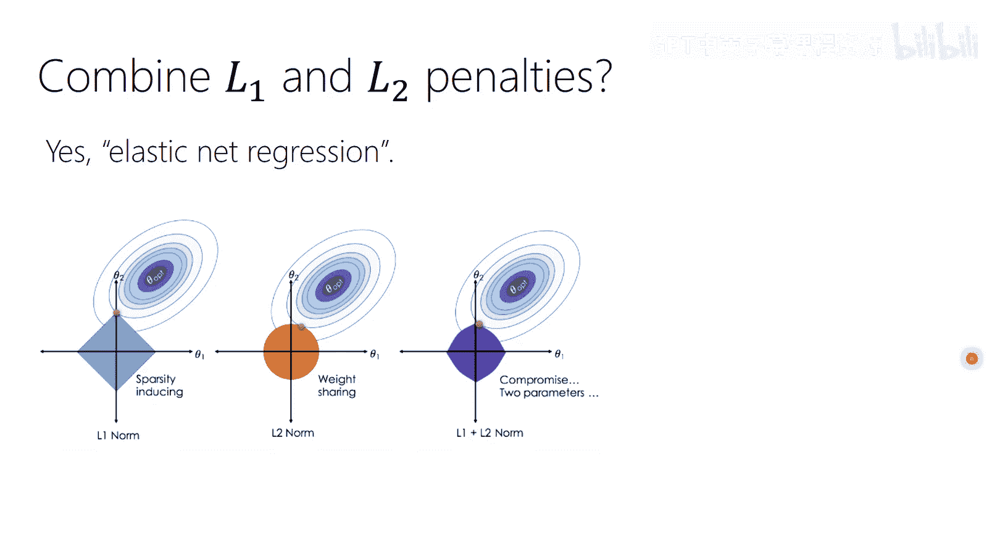
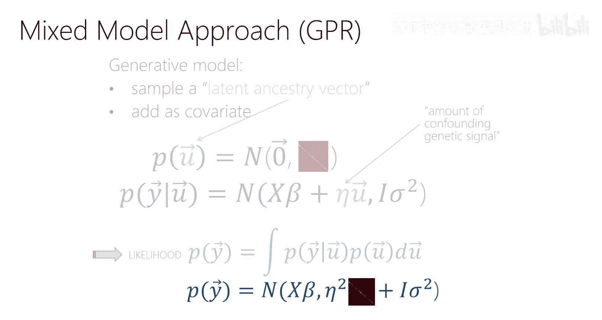

# UCB《机器学习导论｜CS 189⧸289A Introduction to Machine Learning Fall2024》claude-3.5 p05 L5- Linear Regression 2.zh_en -BV1H4421S7bs_p5-

嗯。他在。哦。Okay， let's get started， so today we're going to keep going with linear regression。

And it's going to be。Hello。Okay， so just to reload where we were last time we talked about Gausstian linear regression where the goal was given training data that was pairs of x。

 which was a feature vector of some length and a scalar real value variable Y we wanted to estimate the conditional probability density and to do that directly as compared to a generative approach for regression。

And we made the assumption that the residuals were Gaussian distributed。

 and so one picture to think about linear regression in addition to the usual kind of line in your data points is that actually at each x。

 you have your own Gaussian distribution where the mean is determined by the value of the x feature vector inner product with your weight vector。

And when we started going through the linear algebra to do maximum likelihood estimation。

 we took all the training data feature vectors， all n of them。

 each of length D and we stacked them into this matrix A which is called the design matrix and then we said let's turn the crank of this thing we learned earlier in the class of maximum likelihood estimation which was to write down the likelihood function。

 we put it into vector matrix form， set the derivative to0 using the rules of matrix calculus。

 and then we wanted to we got down to here by setting the gradient to0 and to isolate W in order to get the maximum likelihood estimate of W。

 we had to use this left pseudo inverse， which is only valid when a transpose a is invertible。

 I told you when it's not。Invertible， but it's still positive semi definite。

 you could use the more penrose inverse。But this is kind of。On the one hand。

 it just some algebraic thing to be wary of and to be careful of。 On the other hand。

 it's sort of a gateway into what's all the interesting aspects of linear regression and the ways in which we tweak it beyond what I've told you。

 And so the tweaks are today。 tweak is maybe two casual。

 these are actually very important techniques， they apply not only to linear regression。

 they apply to all models you will ever use in machine learning。

 a lot of the principles I'm going to tell you about apply generally like a lot of the specifics。

 But the concepts definitely apply more generally， and this is the concept of regularization that you will come to understand by the end of the lecture。

 And so， in fact， regularization is going to help us with this problem。

 once you see how we regularize a model will get an intuition of how it fixes this problem。

 if your data have linear dependence between them， such that the design matrix A is not full rank。

 such that this is not invertible。Then what could I do other than to rely on the more penrose inverse。

 which I can't generally rely on for other machine learning models。

 I can only do that for linear regression。And so this， in fact。

 anytime I have more features than I have examples。

 so D is a number of features and is a number of examples。

 this matrix will never be positive definite and I will have this issue and even though I can use the more penrs。

 the more penrs is picking out one maximum likelihood solution for the weight vector among infinitely many and it's picking out the minimum norm vector and so we're going to think a little bit today about why that might sense might make sense and then we're going to generalize that idea in a way that has nothing directly to do with the more penrose inverse。

So but like just to hammer at home， when this is not invertible。

 you have infinitely many equally good solutions for W， equally good。

 meaning that any one of those infinite doubleUs that you plug into the likelihood for the fixed set of training data will give you the same value for the likelihood and that likelihood will be a maximal value of the likelihood。

And so sometimes you'll hear this called an underdetermined system because you don't have enough data to uniquely pin the parameters down an overdetermined system is when you have more data points than you have parameters and there's noise and or you don't have the right model and so the line doesn't go exactly through the points and you try to find the line that best goes through the points according to the likelihood。

 that's an overdetermined system and like I guess and then in between is when you have exactly the same number of parameters as data points and then you can still have the model fit through every point but you need every one of those parameters to do it。

Okay so there's two kind of main ways you might think of fixing this。 The one is very intuitive。

 And the second one， hopefully by the end of today's lecture is very intuitive。

 but you probably wouldn't have thought about it if you hadn't learned it。

 So the first thing is if I have if the feature vectors in my data are linearly dependent。

 if I start removing features at some point， they probably are not linearly dependent anymore。

 It would be very unlikely。 So one thing you could do is you could just start removing features with various heuristics until you end up with a well behavehaved system that is not underdetermined。

 And in fact， in older， I mean， it's still relevant today。

 we don't teach it I don't actually know if there's a chapter in the textbook。

 but there's like a whole area of machine learning called feature selection。

 people used to spend their careers on this。 I don't think anyone does that now。

 but it' it's literally like how should I decide which features to include and which features not to include。

When I'm doing my modeling， if I'm not using a model that automatically decides that for me。

But we're not going to go into that what we're gonna to go into is this notion of regularization and intuitively the way you can think of it is that I have kind of too many parameters that's why my system is underdetermined and that's why I have infinitely many good solutions and so what I want to essentially intuitively do is I want to add some constraints to the system so that I don't have so many degrees of freedom but I want to do it in a way that's not so sort of blunt as just to remove some parameters so regularization is kind of about keeping the same number of parameters which is kind of too many in the sense that I've infinitely many solutions but adding some constraints to those parameters such that I don't actually have as many degrees of freedom as I have parameters and that's fundamentally what regularization is about and you could do that infinitely many ways and we're gonna to learn some of the main common and powerful ways that people do that across all of machine learning there's some sort of special ones that。

gedWith neural networks that you'll learn a little bit about as well。 But， in fact。

 the ones I tell you about today are also applied to neural networks。Okay。

 but let me first just hammer home the intuition for a very small example of why when you have linearly dependent feature vectors。

 you have infinitely many solutions and I'm going to do that with the simplest example possible I'm going to suppose I have just two features and they're linearly dependent in my data set in my training data sets。

 So since they're linear these are each scals x1 is feature 1 x2 is feature 2 and because they're linearly dependent I get one by multiplying by a scalar to get the other。

 That's a simple definition。 Now suppose I found one maximum likelihood solution W for It write the model down but if we're going have this model here where the mean the mean of the prediction。

 the point prediction is just the two feature the feature vectors X1 x2 hit with the two parameter vector W is going give me my point prediction and what I'm going to show you is I'm going to construct a set of infinitely。

Ws that are defined in terms of this W that all give me the same predictions。

 And since they all give me the same predictions， they'll actually all give me the same variance and the same likelihood。

 So this is just meant to like really give you a concrete intuition for why this happens in a small example。

 So if I ask if I just expand this out， this is a two vector and a two vector in product。

 I'm just writing it here。And then I'm going to expand it out。 X1， W1， W2 x2 is the inner product。

 And then what I'm going to do is I'm going to use the assumption that I had this linear dependence between the features。

 So I'm going to replace x2 with the equation up here， which is alpha x1。

And then I'm going to rearrange the terms。 I'm going to get W1 plus W2 alpha times x1。

Now what I'm gonna do is I'm gonna do you've seen this in other classes where you add a constant and remove a constant because then you can do something fun with it。

 So I'm adding 0 here because I just added in subtracted beta。

 And so this is clearly still true for any beta。 But of course， I'm doing that for a reason。

 which is now I'm gonna I'm gonna now pull W1 with the plus beta。

 And I'm going to pull W2 alpha with the minus beta。 And these are both times x1。

 And this is still true for any beta。😊，And then on the next line， I'm going to leave this one alone。

 Well， sorry。 I'm going to take w1 plus beta times x1。 And for this one here。

 I'm going convert the x1 back to x2 by using this relationship again in the other direction。

 So this is x1 is equal to x2 over alpha。 So I'm just plugging in this for that。

And so what do I get from that I get。My original parameter vector w1 plus beta X1。

 and I get W2 alpha minus beta。 Let me move that。Time1 over alpha。Times x2。And if I keep going。

 I can just ref。 Now I'm gonna， I'm kind of going backwards。 I expanded it all out。

 and I'm going slowly put it back in the form that I had。

 So this is now the same as the inner product of X1 times x 2 times a different parameter vector。

But note that there's equality all along， so this Y hat prediction which is equal to this is equal to this this this this is is this this this this and it's actually I get the same prediction when I use any feature vector defined by this。

 so for any value of beta， I will get the same prediction on my training data set for all my training data points and because I get the same so and I can choose any real value of beta there and that's why there's an infinitely many even in this very tiny system。

And it's just，t heaven right。 So that's the point is that this inner product。

 which is the point prediction， is the same for any beta I choose。

 and each beta gives me a different parameter of vector。 So I have infinitely many。That makes sense。

So， I mentioned that。The the one that the more penrose inverse picks off is the one that has the minimum norm。

 so you take that of all the infinitely many of these。

 if you could enumerate all of them and compute the norm。

 the more Penrose inverse would give you the one that has the smallest norm。嗯。SoAnd so you might say。

 well， okay that's nice， I can compute this inverse。

 is there any reason that might actually be useful in terms of how well this model performs。

 And it turns out this is actually a very core driving intuition and principle of a lot of tricks in machine learning to kind of tighten up the model when I say tighten up the model。

 I mean to effectively reduce the number of degrees of freedom that the parameters would naively have if you didn't add something else。

 some sort of constraint。So so why might choosing the one with the least norm be a good idea？

 And so there's sort of theory around this。 and I'm just going give you some intuition here。

 but really one way to think about it is W vectors like we're picking right now among all W vectors。

 they give the same predictions， but if on the training data。 However。

 they will not necessarily give the same predictions on the test data because I don't know when I add test data to my design matrix if everything is still linear well。

But sorry， I'm not all I know is there is this linear dependence in the training data and I kind of have no guarantee that whichever of those infinitely many parameters I select。

 they may all behave differently in general on the test set and so the goal is to find one that's going to work well on many test sets or test sets that we care about and so one way to think about this is that a parameter vector that has a smaller norm than another parameter vector is more likely to have small values in each of its entries and if it has small values in of each of these WI entries then what you can think about is how robust is my model to perturbations like how much does my prediction jump around when I make a small change to X so imagine adding like a little amount to X then because the norm is small each of the weights in W tend to be smaller and when I perturb it I will tend to perturb the prediction less than I would if there had been a bigger。

V and so that's one intuition is that when the weight is small that you get a more smooth change in Y for us change in X。

 and so this is sort of a graceful behavior that is intuitively pleasing and in some formal and intuitive sense。

 a lot of machine learning is assuming smoothness in functions and without any assumptions of smoothness we couldn't really do anything。

So for example， a linear model， the smoothness is a very strong constraint of a line， right。

 but you can have different kinds of smoothness， and that's a very extreme one。So right， okay。

 so I just basically said this， if you had a model where the predictions were w times x for ws that tended to be smaller。

 if I perturb x， the perturbation in y will tend to be smaller than if W was bigger。

And so in some sense， these models that again， right now we're talking about Ws that all give the same likelihood。

 but the ones that are smaller will tend to be a bit more robust to noise in the data in terms of how well they will predict on data we didn't train the parameters on。

So but suppose now that I actually didn't have the problem that my design matrix was not full rank。

 imagine my design matrix is full rank， I can take the left pseudo inverse。

 I don't need the more penrs， everything is good to go， I can do linear regression。

 I there any reason I might want to actually put a constraint on the norm of W。

 imagine that the maximum likelihood estimate of W has a certain norm。

 and now imagine I add some constraint and I make the norm smaller so I have a different parameter vector。

 What will happen。A bunch of stuff will happen yeah。Yeah， that's the right intuition。

 So two things will happen。 One is what you said is it will be less able to overfit because I will have。

 in a sense， reduced the degrees of freedom of the system。

 It's almost like I removed some amount of the parameters。

 but I don't know depending on how much I control the norm of that vector will in effect。

 translate to how many degrees of freedom I've removed from the system。

 but when I removed degrees of freedom from the system。

 It has less ability to overfit because it effectively has fewer parameters。

 but what's the other thing that will happen if I take a system that had a single solution in linear regression and a was full rank what would the likelihood be with that parameter where I forced the norm to be a bit smaller than the MLE。

 what will happen to the training likelihood。It should go down。 It will be worse。

 That's right because I， I sort of violated the principle of maximum likelihood。

 which doesn't include that constraint。 And so in general。

 we're going to do things that kind of perturb the maximum likelihood solution。

 which will no longer make them maximum likelihood solutions。

 but will bias this advantage that I've just described。And so for many， many models and problems。

 this idea of having a small norm of the parameter vector is used。

 and there's even a dual version of this we used to teach in something called support vector machines which are still kind of used。

 but they've been supplanted by more modern topics so we've removed they're very elegant to teach they're really really elegant。

 but we're not teaching them anymore， but there's a duality between。Actually。

 it's too complicated for what we know already， so I'm going to stop there。So right。

 this is so if I add this constraint of allowing making the norm be constrained to a certain size。

 this is what I one version of regularization and I'm reducing effectively the number of free parameter。

 even though when I look I still have the exact same length parameter vector is just going to have a different setting。

And this is related to all kinds of topics， depending which hat you put on at that moment in time。

 So I mentioned earlier in the class at some point that one problem with maximum likelihood estimation is you could end up in a system that has kind of too many parameters you might end up picking off the highest maximum likelihood which is just some weird artifact in the likelihood space and for which if I move a little bit in either direction。

 I don't gracefully change the likelihood I plum it。

 I fall off a cliff and that's probably an indication that that's not going to be a good model a good model is one that looks more like this in the likelihood space where I would pick off here。

 which is not the maximum likelihood and when I move a little to the left or right in the parameter space。

 which is of course a big hyperplane here that I still get kind of the same likelihood。

 it just goes down a little bit so that's much more intuitively pleasing that I don't just fall off a cliff if I have a hundred lengthth parameter vector and I add epsilon to everything or。

A small number and my likelihood just shoots down。 Then clearly there's something a bit funny there。

 right I'm probably I haven't learned some general principle of the data that will generalize to the test set。

And so， in fact， and so what we're going to talk today in the rest of the lecture about is。

Is very briefly a little bit about the Bayesian version of how to think about modeling。

 which could is like a whole advanced graduate course。 So we're not going to go very far with it。

 But， and one and the Bayesian。In the Bayesian paradigm。

 what you would do is you would get a distribution over parameters。 you wouldn't pick off this one。

 nor would you pick off this one， you would actually use every parameter setting proportional to what its likelihood was So you would use this one here。

 but in the integral where you're integrating over all possible values of the parameter。

 This one would get a very high weight， but nothing around it would get a high weight when I'm averaging over them。

 whereas here this gets a lower weight， but there's a whole bunch of them so altogether those very similar parameters will end up having a larger effect and we'll just see this in an equation in just a second。

 but that's the intuition。So this brings us to the topic of L2 regularized linear regression。

 which may be the single most well， the two we're going to teach today are maybe the two most widely used models in the world。

 L2 regularized and L1， which are each referring to the norm of the constraints I add to the likelihood loss。

So another term that you'll hear in statistics and machine learning is shrink。

 so shrink refers to making the norm of a vector smaller than it would have been if I had just used maximum likelihood estimation。

 so when you hear someone saying oh I'm doing this to shrink my parameters。

 they're trying to add constraints to the system to regularize it。

And so we're going to shrink W to have a smaller norm than the maximum likelihood estimate value。

 And we're going to do this， even if we have a well behaveved system， even if a is full rank。

 we're still going to do this。 and it's in general， still going to be very useful。So right。

 so the loss that we wrote out for Gaussian linear regression and its full glory。

 the squared part of the term in order to do MLE on the parameters was this quadratic part from the Gaussian probability density function。

 And when people do L2， they basically add this extra penalty to the squared loss。

 That's usually how people think about it， we're gonna to see a full probabilitybabilistic interpretation in just a second。

 because it's always nice to know about that。 But this is probably one of the most common ways you'll see it。

 And now what you do is you do you do again， you do argument with respect to W of your loss。

So if there's one little problem， what's the problem？Yeah。You can take the derivative of this norm。

 You cannot take the derivative of all norms， but this is fully differentiable。 So this one is fine。

 but the next one， an L1 norm is not differentiable。 It's differentiable everywhere except0。

 we'll get to that in a second。 the L0 norm is not differentiable at all。

 And so we would like to use an L0 norm and machine learning， but because it's not differentiable。

 It's a total mess and it's ten amount to doing combinatorial optimization to do to do to solve for your parameter so we don't do that but the problem I mean。

 guess depends。 but how do I know what value of lambda a pick So you can imagine I can turn the crank in the same way I did for max I likely to set this loss to a minimum by setting the derivative to0。

 I can check if that critical point is a minimum depending if likelihood we want max negative likelihood we want min and squared error。

We want men and I get confused so this is you'll hear this called Rige regression you'll hear it called L2 regression。

 L2 linear regression， L2 regularized linear regression。

 and this is related to this idea of Bayesian modeling that I told you about so not everyone knows that you could take a class you could learn this and you may not have any notion of that relationship but I think it's pedagogically very useful to understand the connection between these things and so we're going to do that。

So。So as I mentioned， Bayesians seek not to get a single parameter estimate for theta one value。

 instead they want a distribution over theta。 so they have to treat theta as a random variable。

 and because they want to treat it as a random variable。

 They have to put a prior distribution that in some sense represents your prior beliefs over theta And so you could essentially say I don't know which theta is best。

 this is going to be uniform。 but usually that's not very helpful and that's not usually how we do it。

 then given that we have put this and this is like a prior belief。

 you do not look at the data when you set this。 So it could be something like I think this parameter should be positive。

 like all my regression weight should be positive。 that would be an example of a prior over the distributions。

 My belief is they shouldn't be negative。 and we're going to go over and so another question is like well。

 I don't know what my parameter should be。 how can I put a prior there。

 And so you could there are special cases that。In applications where you may have quite specific knowledge of how to impose a prior over the parameters。

 but the prior we're going through today， there's two of them are very， very general。

 and it's this prior that is a probabilistic version of saying I want the norm of my parameters to be small。

And that's a very general principle that turns out to be useful almost no matter what you're modeling。

 And so once I have defined that， then I have the same object I had before the likelihood which is the probability oh sorry that's not the likelihood that's the posterior distribution what this is is we're going to use Bayes rule we're going to d in Bayesian statistics is really it's just the data sometimes they call it the evidence and the idea is you're going to combine your data or the evidence with your prior belief over the parameters to get the posterior distribution。

 so intuitively this is what you believe about the parameters before you see the data。

 once you've seen the data you go through the formal computations using Bayes rule to get a posterior distribution。

 and this in a sense is the object that's analogous to what instead of getting the point estimate the maximum likelihood estimate of the parameters。

 what I get in my hand is I get a distribution over the parameters instead and then I can use。

IThe whole distribution。 So that's going to slowly unroll that a little bit。 So how might I use this。

 Imagine， And we're going to go through the computations a little bit here， but so。

How once I've obtained the posterior distribution through Bayes rule。

 which is going to be a combination of maximum likelihood with a penalty actually like a regularization term。

 that's why I haven't totally switched topics here， but imagine I have computed this。

 then to make a prediction of y given x， instead of just piping in w transpose times x what I'm going to do is I'm going to take every value of theta and I'm going to integrate out the prediction。

 I'm going to take the average prediction of y given x。

 given according to how likely theta is in the posterior so I'm basically making a prediction for every possible parameter value and the higher the parameter was in the posterior the more it gets to vote on what the prediction was and then I average all those votes。

So it's really the expectation over the parameter distribution of the prediction。

 which depends on one value of theta。 And now you could make right now。

 this is a distribution of your target given a particular input feature。

 you could now get a point prediction by doing the expectation of this with respect to why in the same way we did before。

So right， so procedurally， pretty soon this is going to hopefully click with the beginning of a lecture。

I know it seems random， but so how are we going to do this？Base rule。

 which if you haven't heard of is just this equation when you could put any variables in here。

 It's just if I have the probability of one random variable given another。

 then I can write that in terms of those flipped around by multiply and dividing by the marginals。

 So it's just in general， if you want to flip around a conditional distribution to go from one way to the other。

 meaning this is D given theta， and this is theta given D。

 you're going to usually end up using Bayes rule， which you can also derive very simply using the rules as a probability。

 but it's a very powerful equation that comes into a lot of machine learning。

 And so what is this object here。 This is the familiar likelihood。

 So when we're doing maximum likelihood， I'm getting the one value of theta that maximizes this。

When I'm being Bayesian， I get a posterior of theta。

 which depends directly on how good it is for the likelihood。

 modulated by how good it is by my prior belief about that parameter。

 and then this is just so that it all normalizes。And so this down here is。

 is what we call the normalizing constant。 Sometimes they'll see it written Z。

 especially if you're a physicist。 And really， I just have to integrate the joint density over all parameter values。

 which is the integral of the likelihood times the prior。 And in general， this is。We have yeah。

 so in general， this is actually extremely difficult to compute。And because in general。

 this is extremely difficult to compute very people do Bayesian modeling because it's sort of a very niche industry where you need a lot of technical prowess to figure out how to get past that。

 And so in this class， we won't do that。 but if you're interested， I'll just make two comments。

 which is for certain classes of distributions。 these two things mix and match nicely。

 So this is Gaussian and this is Gaussian。 it turns out it's trivial to compute the normalizing constant。

 And we these you don't need to know this。 these are called conjugate priors。

 And because there's something they somehow are well suited to the likelihood。

 So it's when the functional form of the likelihood nicely matches the functional form of the prior。

 then this is not difficult。 but that's a very limited set of models that we can use but are not super useful and beyond that。

 you have to go into topics that are not covered in this class。

 which include Markov Mon Carlo sampling and something called variational inference。

 which you would have to take a grad class for。Okay。

 so what I what we're gonna do and what most of the world does and what I call I call a lazy Bayesian。

 So there's a halfway point between doing maximum likelihood estimation and being what I call like a full on Bayesian。

 a full on Bayesian wants this distribution， and they're going spend three years computing the normalizing constant if they have to。

 We're gonna be lazy Bayesians and we're gonna do something a little lazy where we don't need to compute that。

 who can take a guess。 what we're gonna do。What。Remove it。 Okay， and then what？ So if I remove this。

 I don't have a normalized density。 So what could I do if I don't have a normalized density。

I can put back on my ML L he hat and say， I don't need a distribution。

 I'm going get a point estimate。 So actually， that's what the lazy Bayesian does。

 They actually do arg max over theta of the posterior。😊，And they don't do the integral。

 And when you do arg max， because theta doesn't appear in here， you get rid of that term。

But you're kind of shooting yourself in the foot a bit because one of the great powers of being a Bayesian is the ability to do this integral。

 which is like called parameter averaging， you make a prediction with all parameters and as soon as I go back to a point estimate of the parameter。

 I can no longer do that so you do definitely lose something here。Right。

 so but and this is called you'll hear called map map stands for maximum a posterior estimation in contrast to MLE and so I call it the lazy Bayesian。

 So you get a theta lazy and you do arg max over theta of the posterior which is arg max of the and if I take the log here。

 we'll do it in a second。 but what is this going be if I take put the login like I do with log likelihood。

 then I'm going to get the log likelihood plus log P theta and this term is gone。

 So it's going to look like a log likelihood plus something like a regularization term and that's actually the deep connection between these。

So， right， So we are when we， when we're oh， yep。法人。We're gonna do it。 We're， we're gonna do it。

 That's on the agenda today， yeah。This is just the same likelihood object we've always seen。

 So if you。Because it's treated as a random variable from the generating process assumed by the likelihood。

 so you're basically making the same assumption like I have this linear regression model and basically what the probability to data is is what's the probability of the data in the likelihood averaged over all thetas in a sense。

Okay so right so despite that we're lazy， we are Bayesian enough that we're still going to keep the parameter prior but we're going to find the point estimate that maximizes the posterior。

 which is this theta map argm of the posterior and so just be careful because if this was the other way around it would be the likelihood and we'd be doing MLE and so if you're on an exam make sure you look which way this goes and so again that's the likelihood times the prior divided by the normalization constant which does not depend on theta because I've integrated it out so I can remove that and now I have argm over theta of the likelihood times the prior。

And so one way to think about there's always many useful ways to think about these things。

So this is the plot I had before。 Imagine that if you were doing maximum likelihood。

 the gray line is the likelihood function as I move theta， the likelihood goes up or down。

 and one way to think about doing map is to say I'm going to multi at every point I didn't draw there should be a green curve at every point I have a prior density over theta。

 and I'm going to point multiply them at every point to get the black curve。

 So the black curve is the likelihood curve modulated by my prior at each parameter value。

 I'm just multiplying them。 So if in the prior it was relatively higher than another value then it will shift things up。

 And if in the prior it was relatively lower， it will shift things down。

 And now I have this sort of modulated likelihood likelihood curve， it's modulated by the prior。

 and when I do theta map， I look for the max in that thing。

And so that's one way to think about what we're doing when we do map。So， right， so。

What is the prior that corresponds to L2 regression。

 It turns out to be I put a prior over the weight vector， which is an IID standard Gaussian。

 so it has zero center and the variance is the same for every element of W in particular。

 it's lambda and we're going to turn the crank of this and we're going to see that if we are lazy Bayesians with this prior we end up with L2 regularized regression。

So I'm using Bay's rule here instantiated with W for the parameter D is the data。

 so this is the likelihood， the probability of the data given W in we're doing linear regression again。

 this is the prior on the weights and this is the normalizing constant and in fact in this case where when we do linear regression。

 this is a Gaussian and this prior is a Gaussian and so this actually is one of these nice conjugate systems where it would be actually easy computationally to compute the normalizing constant。

 so this is one of the cases we can easily be full Bayessian but we're not going to do it in this class。

So。So where were we sorry right so this is what we want the Arg max of Pw given D and we don't care about the probability of D。

 So the map estimate for the parameter is the argm over the parameters and we're going to do the same trick the log here which we can do because the log is concave and now it's of the likelihood。

 the sorry there should be a。There should be the log is of the whole thing here。

 So it should be the log of， of bracket bracket of the likelihood times the prior。

 And so because there should be that bracket， we get the log likelihood and the log of the prior density。

 which is a Gaussian over W。And here， I've just instantiated the likelihood with the likelihood we saw at the beginning of last lecture。

 which was the simple simple form of the。Of the likelihoods before we vectorized it。

 so it's summing over npoint and it's Gaussian with mean w transpose x and variance sigma。

 and now I have this new term here， which is as we keep going is going to turn into the L2 penalty。

 but right now it's the prior over W， which is the Gaussian and W with zero mean and unit variance for everything。

I'm going to just for convenience， I'm going to take the negative and then switch it to a min。

Just for convenience， so normally when I take the log of the Gaussian。

 the quadratic term has a negative in it from the exponent。

 but because I flip the sign it becomes positive and I have a min and when I take the log of this。

 now I get a minus here。So this is the same vectorized form we saw last class of the quadratic part because I'm just doing with respect to W。

 and then I have this extra term here， which is just the now fleshed out version of the normal that we've seen quite a bit in this class by now。

Okay， so now I'm just copying。 I haven't changed this term here。 It's the same thing。 But this one。

 basically， I've grayed this out because there's no W in here。

 So if I want to take the min of this whole thing with respect to W， this term has no relevance。

 only this term， which has the W has a relevance。And in fact， now Ive just got rid of it。

 and it's down here。 This is the same term， again。And I can just rewrite this。

 This is really just the two norm of the vector W。 So it's starting to look very familiar。

 and I can multiply both sides by two sigma squared。Yeah， I mean。

 I guess this is it doesn't really matter how you do this， but you can do it this way。

 multiply it by two sigma squared to get rid of this。

 And then here I end up with a sigma squared times that。 And so in the very last line。

 if I define a variable lambda prime equal to sigma squared over lambda。

 then I get back exactly the same term that I had for linear regression。

E maximumaxum likelihood estimation augmented with an L to regularized loss。And so。

We're going to have to figure out how to set this parameter。

 but really what's happening here is this prior that I assumed which is zerocentered Gaussian。

 What it's saying is the ws are happier when they're smaller because what value of w scores highly in this density the value is of W that are near the mean and the mean is 0 So W's that are closer to0 are the ones that have small norm and are the ones that score highly under our prior beliefs about the parameters that's like a very generic belief where I don't really need to know almost anything about my problem for that to be useful I would say it's unlikely that there's。

This is a pretty bold claim。 It's although in some way， it's provable。

 but that you you will almost always help yourself by adding this term instead of doing maximum likelihood estimation and the kind of like。

Like hidden under the rug reason for that is， well when I figure out how to set this。

 the algorithm I use to set this could actually set it to zero。

 in which case I would end up with MLE， but I would make the claim that very unlikely you will end up setting this to zero。

 so you will almost always be better off using nontrivily。

 the L2 regularized version of linear regression instead of the MLE that we learned。😊。

So I think that was like a fair bit to take in we started with linear regression when it's not fully determined。

 it's underdetermined that we could use the more penrose。

 that the more penrose finds the smallest norm and then I posited that maybe using a small norm even smaller than MLE might generally be useful and that took us to this idea of adding norm loss to the likelihood loss。

 and then just now what I showed you is through a whole set of reasoning about how to think about being a Bayesian and then a lazy Bayesian。

 that there's this direct equivalence between a particular flavor of Bayesian modeling。

 Bayesian linear regression in particular the one that has this prior on the parameters and being a lazy Bayesian gives you back L2 regularized linear regression。

Any questions？Okay， so let's see what the solution looks like。 Let's turn our crank。

 turns out we can also do this one analytically。 We don't have to use iterative optimization。

 So this is the same squared loss。 This is the new augmented loss coming from being lazy Bayesian or just adding an L2 norm。

 I'm going to rewrite it as an inner product here so that I can think more easily about how to take the derivative。

 going take the partial derivative with respect to W。 And I'm I'm assuming lambda is fixed for now。

 We're gonna talk about how to pick lambda。 But assuming you've chosen lambda wisely。

This is how you get the， the value for W。 So this is， I'm not gonna go through everything last class。

 But if you go back to last class， you will find that this was the gradient of the。

Likelihood loss with respect to W。 So you should already know that。

 and this is just the gradient of this guy with respect to W。

 It's two times the scalar lambda identity matrix because it'll be handy in a second times the parameter vector W is just the derivative of this with respect to W。

Now I'm going set it to zero， the whole thing， which now has three terms instead of two terms。

 I'm going to pull the negative term over to this side， collect these two terms and factor out W。

 So this is starting this is the same equation we saw last class。

 except it has an extra term in here。 That's the only difference。

And now I can isolate W by just taking a left inverse of this whole thing。

 so if I take this whole thing inverse on the left， then I have to hit this side by it to isolate W。

 so I end up with this equation。So this looks exactly the same as last class。

 except I have one extra term， which is before I do the inverse of the a transpose， I add a diagonal。

 a constant diagonal to it。So who can tell me， when is this thing invertible。

 this whole thing here that I have to invert。Yeah。If lambda is greater than0， yep， why is that。Yeah。

 okay， exactly right。 So we know that a transpose is either positive definite or positive positive semideinite。

 If it's positive definite and we add something to the diagonal， it's still a positive definite。

 if it's positive semi definite， then it has some zero eigenvalues。

 And when we add a diagonal matrix basically we're of any amount that's positive。

 as long as lambda is positive， we're adding some positive amount to the zero eigenvalues and we make it now positive definite。

 So as long as lambda is greater than0， this is always invertible。

 And so this is like kind of now an alternative to more penrose right like this is not the same operation is more penrs。

 you will get a different answer。😊，Unless lambda is equal to 0 and a transpose is invertible。

 But that's sort of not the point。 So this is a different way to ensure you have invertability and it's very。

 very general。And so， right， so the， the L2 ridge regression or the map value of W is。

 is equal to the sky。And so， right， when lambda is greater than 0， we can always invert this。

And if you want， you can kind of work through that at home to see why that is by also making use of the spectral decomposition。

 but you don't need to。Okay， so why is this called bridge？I'm going to let you。

Look at these and then see if someone can。Nrrrate the slide for me。OrI can narrate it。

In the case where。I do have a degenerate system where a is not full rank。

 I would get this would all these value。 I mean， you can look at this different ways。

 But I think this is the easiest way to think about it is that all these there's basically a straight。

Line here。Which is all the infinite values of W that have the same likelihood。

And so when I try to do maximum likelihood， all infinitely many of these are equally good。

 like at the bottom here。 this is the negative log likelihood。 So we want to be small。

 And so essentially one way to think of Rige is what it does is that takes that line that has all parameter values that have the exact same likelihood values and it curves it up。

 It curves the ridge so that there's a single minimum and now you have a convex problem again and you don't have you don't have to choose this L2 penalty is making the choice for you。

嗯。And so generally this is much more stable because even suppose you we talk about is a full rank or not because that's a binary thing。

 but once you go in the python or into the computer， it's a bit more subtle right。

 like what if the eigenvalues are1 e to the minus5， what if the matrix has a bad condition number。

 like just bad stuff happens， even when it's technically full rank。

 so you want to kind of just get away from all that numerical instability which you do by adding a large enough diagonal to a transpose。

Okay， so let's imagine now that we're going to work our way towards how are we gonna to pick a good value of lambmbda。

 So let's think about actually just what would happen as I pick I set log Lada to this is from a textbook。

 I forget I lost。 Oh it's down here。 but this is the value of log Lambda and I'm increasing it。

 And so when log lambda is very， very small。 like in the limit that it's equal to0 I have the MLE value of W。

 And so there's one，2，3， there's four features。 So the W vector here is4。

 the features are swimmers temperature stock price and watch JWs。

I don't remember what they're predicting so and this is the value of the scalar parameter associated with each feature and what you see is that as I crank up lambda the norm is getting smaller and smaller right。

 every one of those scals is actually getting smaller and the norm of the vector is getting correspondingly smaller。

😊，But now there's this question of how are we going to set Lambda？Can we treat it as a parameter。

 Can I use the principle of maximum likelihood to set this parameter？Who can explain why not？嗯哼。😊。

Exactly if I think about it like my parameter W and I want to find the setting of lambda that minimizes the augmented squared loss。

 I'm just going to set it to zero and it's going to have no effect。 so that's not going to work。

 and so parameters that have this kind of quality to them we call them hyperpara in machine learning hyperparameter are parameters that you have to fit by looking at data that you've hidden from yourself a validation set of data。

 you cannot use a principle like maximum likelihood。

 you have to empirically set it in a way that I'll describe momentarily So we cannot use MLE。

 We're going to need this independent data set， which well call a validation set and this plays a very。

 very， very important role in all of machine learning。

 you if you go get a job and you don't have a validation set in everything you're doing。

 you're gonna to get fired in a day so typically what you're given when you like say you're in industry and you have a problem。

And so someone gives you all the data they have that's relevant to the problem the first thing you do is you split your data。

 maybe 80% 20%， there's different rules of thumb， there's no absolutely correct answer into test data and training data and the point is you're going to use the training data to figure out a good model to use maybe you're going to use a neural network you're going to use a linear regression you're going to use different things and using the validation sets you're going to figure out which model is best and then having figured out which of the different models you're contemplating using as best you want to see how well it does then you use the test set and you use it just once if you use the test set more than once then you're going to end up with like a winner's curse estimate of your error because you'll have cherry picked something so there's a difference between。

呃。Well， yeah， I'll just say that。 So and this is relevant to hyperparameter。

 So one way you can think about Rige regression is it's a set of different models where each model is defined by a different value of lambda and I'm going to use a principle like this to help me pick the value of lambda So what I'm going to do is I'm going for the training data I'm going to do linear regression with a value of lambda training only on folds 2。

3，4，5 these are just equal split just think of this as a partition into five in machine learning we call this five folds of the data and they're the same size unless you have aneven numbers and it doesn't work out and so what you're going to do is you're going train linear regression with one value of lambda here and then you're gonna to make predictions on the heldout validation set and see how well it does and you're going to try another value of lambda。

 another value of lambda， you're going to draw all the values of lambda you want and you should do it in a slightly clever way and whichever value of lambda gives the best error on the validation set that's the one you're going to use and mean decided to use that value of lambda。

Then you're going to use all of the training data because you may as well make use of it to fit your model with that one value of Lambda。

 and then you can evaluate how well that one model you chose with that one value of Lada works on the test set。

Does that make sense？Okay， so there's one tweak， which is when we do these folds。

 this would be called fivefold cross validationid。 And when I first described it。

 I kind of arbitrarily said， let's pick fold one of the validation set But you know what。

 I can do that for each fold in turn。 Let me train on 1，3，4，5 and validate on2 train on fold1，24。

5 and validate on 3。 I may as well use all permutations I can to make most use of the data in order to get the best estimate of the validation error so that I get the best value of lambda that's most likely to work well on the test set。

 And so I can just average I can do this for each of these quote splits。

 And then I could just average the validation error for each value of lambda。So yeah。

 this is generally， we call this kfold cross validation。

 This particular instance is called fivefold cross validation。

 Sometimes in modern day machine learning， it's too expensive to do this。 training a model is super。

 super expensive and time consuming。 So you might just actually do one random train and validation split and not do anything else。

 So there's different kind of。Ways to do it， depending on what regime you're in。

 how much compute you have， how much time you have。

And the way we're going to evaluate is we're going to use the likelihood。Right。

 so I'm gonna train my linear regression， for example， on， on these folds。

 And then I'm going evaluate the held out data with the likelihood。 Similarlyly。

 once I've picked a model， I will evaluate with the likelihood。 So what if I use L2 regression。

 Should I evaluate with the likelihood or should I evaluate with the regularized loss。

I should I should evaluate with just the likelihood。

 The regularized loss is like the thing I'm kind of scanning over is like how strong should that be and as I change Lambda。

 I'm changing that thing， so I definitely don't want it in there so when I'm thinking of my modeling as maximum likelihood。

 which in general I will be， doesn't matter if I add a regularization term。

 I should always check the validation or the test error using just the raw likelihood。

 I don't add that other part in there。Okay， so。This is related to your question when I said what's the problem and there's this question of like is the L2 norm differentiable and it turns out it is differentiable。

 but what I mentioned is like well you know what we probably really want。

 I think our prior belief is not so much that who would wake up in the morning with no machine learning training and be like I think the norm should be small I you're more likely to say some features are not relevant to my problem I should probably just have the parameters set to zero so that by virtue of noise they don't get picked up and make my model worse so I think experientially in machine learning we would like a prior that is not that the norm is small。

 The prior is that many coefficients are exactly zero and that actually I want to just minimize I want a penalty that counts the number of non-ze weights that would be that L0 norm would just count how many weights are not L are equal to。

0， the penalty would be， sorry， the number that are not equal to 0。

 So the more that are not equal to0， the higher this penalty。 but this is not differentiable。

 And so if I use this instead of L2， I would have basically a hardcore combinatorial optimization problem。

 And that's why we don't do it。 It's It's just super nasty。

Okay but the L1 norm is actually taking us closer to this idea than the L2 norm， the L2 norm。

 as you saw in the plot， as I crank up the lambda importance of the L2 penalty I kind of smoothly making the parameters shrink you can see this like shrinkage right but actually none of those parameters will in general go to0 no matter how almost no matter how high I crank up the L2 penalty。

 the parameters will get smaller and smaller but they will never go to0 and the L1 norm is something that actually often makes parameters go exactly to0。

 yet is mostly differentiable unlike the L0 norm and so this is a very。

 very commonly used penalty is the L1 norm and so it's differentiable everywhere except at W equal to0 because if you plot that penalty itll if I have one here but it's like a V。

It's like it's just a line and a line and it's differentiable all along here。

 it's differentiable all along here， but at that point there it's not differentiable。

 So most places when you you're going to do。When you're optimizing。

 there is a gradient and then the one point where there's not a strict gradient and we're not going to go into it here。

 I don't know if it appears in the homework or not。

 there's something called a sub gradientdient you may learn in another class。

 the sub gradientdient is basically any vector that lies kind of below that point so it could not be steeper than this。

 it could be any of these kind of vectors like this and turns out you can use subgradients to do optimization but it's sort of a more advanced topic so I'd say for the purposes of this class unless it gets put into a homework。

 what you need to know is that it's mostly differentiable everywhere and it's quite readily usable as a norm to penalize the likelihood。

And this we call either L1 penalized regression or Lasso， so you'll often hear Lasso and Rige。

 so that's L1 and L2， and this is what the Lasso is。Oops so again。

 the way we would use it is very similar to what we just did。

 we would start with the linear regression squared loss term and we would add the W1 and so you might say。

 well why when I just show you this it's not I don't think it's at all intuitive。

 why would that drive my parameters to0 more than the L2 at least it wasn't to me I need to look at it this way there's some other ways to look at it as well。

 but who's been asking this question like why does the L1 tend to push parameters exactly to0 well the L2 is not？

Okay， you should ask that question。 And so this is a geometric interpretation。 So one thing to note。

 and this is in some of the assigned reading。Is that when I write the loss this way。

One way to interpret this is that it's equivalent to maximum likelihood through a Lagrangian。

 like you could think of this as the Lagrian of the likelihood where this part of the Lagragian is come from a constraint on the norm。

 turns out there's an exact equivalentence， both for L2 and L1。

 where you can view depending on the value of lambda you pick。

 it turns out it's exactly equivalent to doing constrained maximum likelihood equation where the constraint is a norm constraint。

 L1 for Lasso L2 for Rige that is below some constant that is a monotonic function of lambda。

And so because you can think of it that way， we can get a geometric picture that helps to understand why Lasso is just very a bit handwaving and intuitive。

 but I think quite useful why Lasso tends to give sparse W vectors。

 meaning with a lot of exact zeros in it， whereas ridge regression doesn't。

 It just shrinks things down。 So the way to think about it is imagine I have it's in terms of beta because this is from a statistics book and they like beta。

 So the w vector is the beta vector in this。 and it's two dimensionmenal。

 So there's a w1 beta1 W2 beta2。 And this is these are the contour lines of the density of the Gaussian likelihood that we learned about So every red line here is a contour line。

 meaning that all the values of beta on this line have the same value of the likelihood。

 And the one that is highest is in the middle， which is the maximum likelihood。

 And so if we had this likelihood function。 and we did maximum likelihood， or estimate。😊。

Beta would be this point here。But when we add in a lasso term here， an L1 penalty， this is。

 as I said， tantamount to putting a constraint on the L1 of the parameters。

 so that's the absolute value of the first W1 plus the absolute value of the second parameter。

 each of these being scalrs has to be less than some constant we're not going to derive exactly what the constant is but I think you can see there there's going to be a relationship。

 And so separately， this on the one hand is the likelihood。 this is the maximum likelihood。

 what this triangle is is a constraint that says the L1 norm of w has to be less than T。

Less than or equal to T。 And with this particular norm。

 it draws this is the allowed space that satisfies the constraint。So what the blue box is。

 it is all values of beta1 beta 2 or W1， W2 that are such that the norm is less than a particular threshold T and that ts and so basically when you do constrained optimization。

 what you're going to get is this is the intuition of when look even I first year calculus is how they probably teach the Larange constrained optimization is you basically get wherever the constraint zone like kisses one of the contour lines so if threshold is big enough。

 this triangle this diamond would be so big that it would encompass the MLE in which case the constraint would have no effect。

 it would not be a so-called active constraint if this T was big enough。

 I'd have a huge diamond and the MLE estimate would be in the allowed region and by doing this I would just get the MLE but that's not what's going to happen。

 I'm going to pick a lambda using micro crossval。Procedure that's very unlikely to make the constraint space that big。

 So instead， what will happen is I'm going to pick the far edge of the constraint space that takes me as close to the MLE as possible by some measure that we won't go into。

 And so so this will actually be。 does it have it annotated。 Oh no。

 but so this will actually be the map solution for a given value of lambda that corresponds to a particular norm constraint。

And。So that's 01。 And the second point is that。No fun intended， this is pointy。This is pointy。

 because it's pointy。It's going to happen with quite a lot of frequency that it touches a contour line on an axis because the points are on the axis and it's almost like a balloon is going to often hit the corners of a like sharp object kind of idea and because of that。

 you're going to tend to get solutions that sit on the axes， be it here， be it here。

 be it here and points on the axes correspond to some of the parameters being equal to zero。

AndThat's why Lasso tends to set some parameters exactly to zero。

 that's like quite a long geometric story， and it's not a proof。

 but I think it's a very good intuition as to what's happening。😊，Right and。That's just what I said。

 but in contrast， let's think about what L2 is。L2 has a similar equience by virtue of Laangian constrained optimization。

 where it says there's a norm， not on the L1。 L1 is pointy because I have absolute values here。

 But when I do L2 the L2 norm just gives them me a ball right because like all the parameters here have the same magnitude whereas that's not the case here because of the absolute value。

 So the constraint， the allowable constraint region from the L2 constraint is a ball now。

 And now there's no， there's no asymmetry of my constraint with respect to any of the axes right it's isotropic there's no reason that I'm more likely to make contact at the edge of the constrained region with a contour on on an axis versus not。

 And that's why L2 doesn't have any kind of。Enrichment for making parameters equal to zero。Andi。😔。

And， and to be clear， whether so this is L1 regression， this is L2 regression。

 they have exactly the same likelihood。 So these are exactly the same contour lines。

 exactly the same beta hat。 But what you see is that when I add the lassso， I get this solution。

 When I add the ridge， I get this solution。 and this one has sparsity and this one doesn't。

 even though they're very close to each other。😊，Any questions？Okay。

 now let's do a head to head comparison of this kind of a plot where this was。

 imagine I fit the model over and over with different values of lambda and I look at what the magnitude of each scalar parameters is for the four parameters。

 So temperature stock price and what's annotated up here is the number of non-zero parameters。

 And what you see is that as I crank lambda up for L2 regression。 I didn't annotate。 This is L2。

 and this is L1。 I always have four non-zero parameters。 So I'm shrinking the parameters。

 and they have smaller norms， smaller values。 but I never get any zeros。 and this is a real example。

 by the way。However， when I do L1， what happens is you get very different behavior。

 What you see is like one of these， these go exactly to 0。 Basically what happened。

 The first one that goes to 0。 Well， looks like a stock price is always。Oh， no。

 it's not because you can see there's four here。 Okay， so none of them are 0，3。

So which one I guess we've lost one of them， So it must be that by now the stock price hit exactly zero and down here。

 only still the stock price hit exactly zero。 but by here， the temperature is clearly also hit zero。

 so I'm down down to only two non-zero parameters and then by here I've also lost the swimmers have now gone to zero and as I crank it up eventually well。

 I guess everything in the limit of both will go to zero。 but this one not in the limit。

 everything will go to zero And so that's why as you crank it up。

 you literally get sparsity in the solution。 and so。

That may be and so you may be saying well should I use one or should I use the other and like all of machine learning and I'll keep repeating。

 we have all these beautiful rigorous statistics and probabilistic and mathematical principles。

 but also at the end of the day it's kind of an empirics game where you try to use everything you understand through these foundational way of thinking to help decide what experiments to run。

But so one thing you might do is you might use this cross validation scheme to pick the best Lambda for L2。

 you might do it again， pick the best Lambda for L1。

 and then you might actually see which of those did best on the validation set and pick that model。

 for example。Okay， so I mentioned this and we derived an exact equivalence between this starting with this idea of。

 let's just add a penalty for the norm， and then I showed you that using Bayesian reasoning with a Gaussian prior on the parameters that could actually and being a lazy Bayesian actually derive L2 regularized linear regression so you may be asking。

 well， is there a similar interpretation for L1 and there is。It's maybe so right。

 else your regressiongression arose from this assumption that the parameters were from a standard IID normal。

 and the one for L1 is called a Laplace prior， who knows about the Laplace distribution。

Where do you know it from？all right， so this is what the Laplace prior looks like。😊，Oh， okay。

 alright。 Well， this is the right one。 I don't know。 Maybe there's， you know。

 some of these people developed so many things。 The name is like everywhere and they're completely different concepts。

 But okay， so what you'll see immediately is that the Gaussian also has actually， is this normalized。

 This may be it could be this is supposed to be， I think。

 proportional to because that doesn't seem to be normalized。😊，Actually， let me make a note。

 It looks like a typo。um。YeahIf you don't see lectures in the postlect bin。

 that's because I didn't change anything and when I find a bug and I change it。

 then I also add an updated to the postlect slides but the lapplaceian is similar to the Gaussian if this were a Gaussian you would have a squared error term here which is tantamount to the L2 norm as we saw and that's how we got the correspondence and here it's the W1 norm and so you can kind of turn the machinery in the same way and show that if you put this prior on and you turn the same crank we turned a few slides ago you will end up if you were a lazy Bayesian with a lapplace prior。

 you will end up with L1 regularized regression and just to get a sense also of a different way to think about why this gives zero so one way I give you was this whole Lagrian geometry and level sets and kissing and balloons so the other way is to think of it like a Bayesian so the Laplace distribution has a lot more mass。

ro zero and so it favors parameter vectors that are closer to zero， however you might think well。

 if I sample from a laplace， I'm not going to get things that are exactly equal to zero because that has like zero probability。

 however， once I combine it in a Bayesian way and I think about the posterior。

 then I'm definitely more likely to get exactly zeros and when I'm a lazy Bayesian then I can get the interpretation through the geometric stuff that I just showed you。

So。So there's pros and cons to each of Lasso and Rige Rige。嗯。

I kind of implied that it maybe wasn't great because it wasn't pushing things exactly to zero and we have this intuition that some features。

 maybe we should just turn off completely and Ridge isn't going to help us to do that but LaSsso will help us to do that and in fact that is why we use Lasso that is the intuition however。

 there are some issues with LaSso， which is that if you have two very correlated features in the training data set it will pick one of them to use in the model and it will turn the other one off completely and it could be that on your test set having both of them might be actually useful so this could hurt you in some cases and so sometimes people say that's one of the undesirable properties of LaSsso。

So it turns out you can combine L1 and L2。 I don't think people do it that often。

 And this is called elastic net regression。 And basically。

 you just add the L1 penalty and you add the L2 penalty。 Each one has its own hyperparameter。

 And so now when you do this cross validation， It's a bit of a mess because you're not scanning through one lambda。

 you're scanning through a grid of lambdas And so your hyperparameter search becomes more complicated。

 more unwieldy。 And so right， you can think of the L1 as this pointy， the L2 is round。

 and depending how you mix and match them， you will still get some pointiness and you'll still get some roundness。

 And so maybe you get the best of both worlds。 you can do it。😊，Yeah。

Okay。啊。I had some extra material that I was thinking that I would just tell you a little bit about if we had extra time。

 too。

啊。You know what。Who's interested to hear something about genetics？

Okay， okay wow I wasn't expecting that。 So this is some work that I became well known for quite a few years ago。

 my research has been quite varied。 many researchers focused on one area I've always focused on developing methods in machine learning to advance problems in molecular biology and for about five years I was what people would call a statistical geneticist I knew know genetics before。

 and then five years later， I walked away from that field because that's how I do my research but one of the really big problems that people still work on people spend their whole career on these models is to understand what are the genetic underpinnings of disease。

 I'm going to connect this to Gaussians， by the way， that's why it's here。

 it's about multivariate Gaussians and turned out to be really cool。😊。

I think and so you could imagine each person in this room has like an associated set of DNA from something like 23 in me。

 even though I know you're all creeped out by 23 in me， I did it。 and this is。

 in fact what we do for big research studies is we go collect big cohorts of people that have some trait we're interested in understanding the genetic determinants of like Crohn's disease or you know some psychological illness or a particular cancer and the goal is that if we look at everybody's genetics and we know some people had Crohn's disease and some people didn't that in some sense by comparing and contrasting we could hope to figure out which parts of our genetics are responsible for that disease and if we knew that then we would have some good hypotheses to target with drugs to help fix the disease So this is sort of kind of the field part of the field is statistical genetics and so what you get is and what you might think of is I'm going to do linear regression So what I'm going to do is I'm going to take everybody here is like a row of DNA I'm going do some encoding of。

of GCTA into one hot encoding so every letter becomes a fourbid vector and now I have my feature vectors and I'm going to do linear regression where every variant every genetic marker gets its own parameters and then some people I need a large cohort of people especially the more rare the disease and then I perform linear regression essentially and I ask which parameters turned out to be non-zero。

 which parameters are having the biggest effect on my prediction of whether someone has Crohn's disease and then I do some statistical testing to make it rigorous and basically through such a modeling strategy I can essentially use linear regression to pick out which genetic markers are predictive or most predictive of somebody having a disease and so for some disease which are called like monogenic diseases it's just like one gene potentially driving it so if you have a few markers in a gene you may pick up three or four things。

 things like height and are very multifactorial you。

Its spread over the whole genome like with really small amounts， there's not like a height gene。

 it's just like really， you're going to see parameters that are non zero through the whole genome。

So right， so that's the idea of these studies。But it turns out that this assumption I told you about。

 Remember in everything we've done， I said， you need the data to be I I D。

 identicalally and independently distributed。 turns out in these cohorts of people and no doubt in this classroom。

 that assumption is violated。 So why is it violated。 It's violated because of。

racacial and geographic diversity so it turns out that there's different trends in certain parts of the genome depending which part of the world you came from。

 which is fantastic， Of course its not very big at all。

 but it's big enough that it can screw up these studies and what it essentially means is that that you folks especially in America and in California or Canada where I'm from like we have very heterogeneous populations if this was Finland they're probably kind of our ID so they can do some really easy statistical genetics in Finland。

 in fact they had the postal service go door to door to try to get genetic samples which is a bit of a scandal but anyway and so what you actually need to do is is in some sense you're going have you want to do linear regression but you don't have this IIiness and what the way to think about that is we're going to learn something called PCA and this is going to be one of the coolest plots of the class and in PCA we're going to figure out how to reduce the dimensionality of your genome plot to recapitulate a map of the world。

Tk about that another lecture but basically there's this sort of hidden what do we call a confounding variable which is like where in the world did your genetics arise from and if I knew that then I could kind of convert to you guys to be an ID sample and then do linear regression and so I'm this is like years of work I'm just trying to give you a flavor of that actually multivarian Gaussians can get you a very famous paper and so it turns out that。

That basically， if you were just to do linear regression。

 this y vector would be know the status of everybody here。 Did you have a Crohn's disease or not？

 This X would be like let's say we often scan one marker through the genome at a time which might sound stupid and is kind of stupid。

 but that's actually largely what people do So this would actually just be one dimension for a particular marker and then we would do it for every marker and we'd say does that marker have a non-zero parameter。

 yes or no， And if I was just using linear regression， I would have this II variance here。

 And what's cool is that the way we correct for the nonidness is with a big covariance matrix that describes the way in which the II is violated。

 I don't have time to go into this， So I guess is is just a little bit of a teaser and to show you there's like really real problems that make use of everything I'm telling you in somewhat obscure ways。

 And so what you can actually think of is when you do a big linear regression and you write it in multivariate form one way to get around the problem of lack of Iness is with a big。

fulu rank covariance matrix that is essentially accounting for the non IIiness。

 And it turned out that we have huge cohorts of people in these studies like a million。

 And if I want to do maximum。

