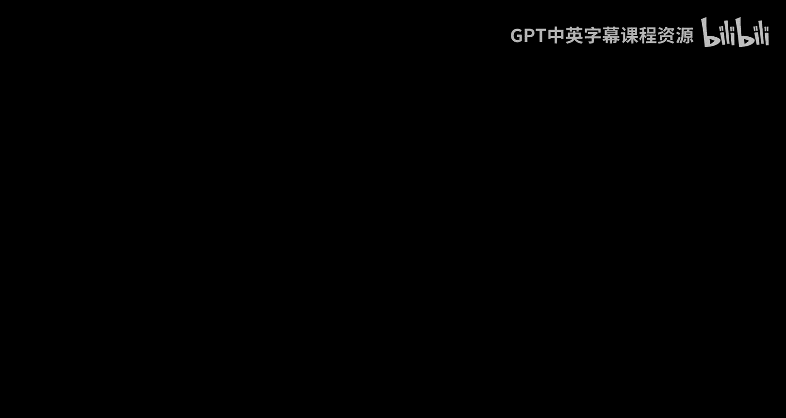
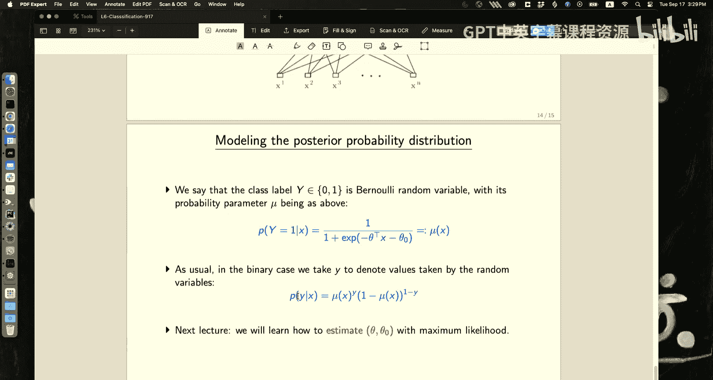

# UCB《机器学习导论｜CS 189⧸289A Introduction to Machine Learning Fall2024》claude-3.5 p06 L6- Classification - Generative & Discriminative.zh_en -BV1H4421S7bs_p6-

And like if you。But this means I can move。 yeah， yeah。在 tell it。Actually。

 if you just put it back in here， then。26。

You like。Right we state。Okay， yeah， probably。Okay。Yeah， I think you your number。

 tell me the case of emergency。YeahThank you very much。Okay。

 so I think we can officially start Berkeley time。So this is Saed Soemmi and I'm the second instructor for this class。

 so I'll be giving the first next four lectures。And then Jennifer will take over again。

 and then I'll take over after that so we。Divided it in chunks。诶。And。Yeah， it's good to be here。

 My have one foot in acadeia of one food in industry。 I'm officially employed by Genantech。

 but they okay with me coming here， giving lectures， so。😊，呃。

So this is the assigned reading for this lecture， lectures on classification。

 generative and discriminative approaches。I added section 5。1 for your soul。 so。

 but it won't be covered in this lecture much。呃。Yeah， the main one is 5。3。

 You should have a very good understanding of 5。3，5。2。1，5。2。25。2。4 is。Very， very easy read。

 It's more like， you know， discussions and。嗯。But I will also go through those discussions in this lecture。

Okay。Yeah， I want to experiment with writing things on my notad。

But we'll see how this experiment goes， because I have a feeling this。

 You cannot see anything in the back， right， right here。

do people see what's written here in the back。You see it。Okay， okay， so maybe I do make some match。诶。

Yeah， so what's the problem of classification。 Pro of classification is you are given some input。

 These inputs are in some space， space X， the space of can be Eucliide and space can be a space of graphs can be whatever you can think of。

 but their outputs are taking discrete values。 So this discrete values typically have a semantic。

 right？ for example。An example is you go， take an exam to check your cholesterol and。

 and the doctor wants to classify you as， do you have heart disease or not have heart disease， right？

 So in this case，0 is the negative case。Healthy。And one is。Part this this。Or at Gene。

 one of the most important problems is protein binding。And this is very。

 very important problem for drug discovery。 You have some proteins。 This can be your target。

 and you want to。Find a new protein that binds to the target。 So now it's exactly the same problem。

 We have a space of。Proteins and proteins。And then，0 is。Not blind。And one is point。诶。Of course。

 the space of classification is unlimited to。binary problems and there are many， many。

 many examples where you want to classify things into a finite set。

 a classic example that Jennifer list card Per list carton went over with you is the M classification is ourwritten handwritten 10 digit database and in this case 0 to 9 is 0 to9。

 you want to be your handwritten10 digit is either0 or9。So， so these are just examples where in the。

 in the， in the very abstract way， you have a data set。 This is the problem we are interested in。

 We have a data set of pairs， X， I， Y， I。 Again， X I is in sum space。

 and Y I is as I defined it set from 0 to K minus1。 So there are K classes。

And we are interested in learning。That keyword here is learning this mapping from X to。

To this finite set。So this is the topic of this lecture and next lecture。

See how long it takes for this load。Yeah， so here I like to start with an example here we go with the example of the。

Colate level。 So here， x is。Cholesterol。Level。And label， as I described， is0 is。呃。Actually。

It's good to check。 So this is a distribution。 and 0 is either healthy or heart disease。 One is。

The other， right。 And here we are seeing not the distribution of P of label given x。

 but we have seen the distribution of cholesterol level given a label。

So can your guys tell me which one is healthy， Which one is。

Based on your understanding of cholesterol level。Which one is healthy。

 W care is healthy W care with heart disease。Read this。Read is unhealthy by。Because yeah， so the the。

You know， this distribution has。The mean of this distribution has higher cholesterol。

 right That's how that's how you guess because you're on the right side， right。And you。

 you can also guess how this was， as how this was gathered， right， This was gathered by， you know。

 seeing the population of healthy people and population of people with heart disease and just measuring their cholesterol。

 right？ And there is a overlap。 You see， clearly there is overlap。 So it's not， it's not。

Cry are clear。 These curves are not separated， right， There's overlap， but clearly。

 people with heart disease have higher cholesterol， right， And I cheat it here。

 This is not a medical data。 So I cheated here。 and I put the these two curves are Gaussian。 and。

 and they have the same variance。 right， So we see this plays a role in， in our discussion。

Can somebody say why the cholesterol level cannot be a Gaussian， Why， Why this。In reality。

 can never be a Gaussian。Any。That's a good answer， but there is a better answer。

 The cholesterol level cannot be negative， right， And the Gaussian is， you know。

 there is a probability for having negative cholesterol， right， I cut this off at 0。 But， you know。

 it， you know， it's， it can be， you know， a lot of， in that life you in life， you some。

 a lot of times we approximate。 and it's possible that actually。

 when you look at the cholesterol level measurements。 It's very much you can fit the Gaussian to it。

 But okay。😊，So now that we have this。Out of the way。Now。

 we are interested in probability of label given X， right， You learn the base rule。

In one of the first lectures from Professor Lizgarten or from your earlier classes。

 B rule is a fundamental rule in in probability and and it it allows us to。

 to flip conditional probability。 That's what base rule is。

 So we are interested in probability of label given x。 and。And we can be composite as the。

 this class conditional probabilities。嗯。Interesting。Though they had a different colours here。嗯。So。

So these are our class conditional。Probabilities。And you multiply that by your prior。

And then divided by P， X， and P， P X is the marginalization。

 P X is what lets you to have a proper probability。 right， P of 0， given one。

 I'm just reviewing what you have learned before， but。It's good to review these things。

 P of0 given x plus P of one given x。Should one should add to one。And this is how P X is obtained。

 P accident in the denominator is what。You get it from that identity。啊。So basic， let's elic it。呃。

And what about the prior probabilities， Any guess how we estimate the prior probabilities as the simplest thing。

 right？ So the simplest thing is you just look at the whole population。Hopefully。

 two third have are healthy， one third， only one third are unhealthy， right。

 So that's how you get these prior probabilities。 The hard， the hard problem here is this one。

 The class condition probability is said harder problem， right。

 You have to think maybe Gaussian is not good。 Maybe it's good。 this， you have to gather data and。

 and do that。 But the prior probability in this case is simple。And。Given these two， you get。

 we gonna use the base rule to get the posterior probability。 Again， it's good to think without。

 without without seeing without， I shouldn't have put those labels there。 What， what care is healthy。

 What care is unhealthy。Right， we expect for the low low， very local and strong。

Healthy people is very， very definitely yourre healthy。

 So this key of label given x saturates to one。 And then there is this middle region， right。

 There is this。Amerercury region in the middle。嗯。This is where the tricky region is。

 because the doctor has to decide whether。Do you have to do more tests than cholesterol or not。

 And there is a very clear region。 If you have very， very high cholesterol。

 you're definitely not healthy right。So， then the question is。

What should be going back to the problem that I defined earlier。嗯。Yeah， this is。Sness of this。

 I don't like。The problem that we find earlier is the mapping， right。

 You want to given a measurement。 You want to decide， Are you healthy or not or are you。

 do you have a heart disease， right， So this part， so far， you have dealt with probabilities。

 But this part is a decision problem， right， doctor has to make a decision， right， You cannot say。

 oh， you know， you have a probability of being having heart disease。 That's not gonna cut it。

 You know， you have to make a decision。 The doctor has to make a decision Do you need to do more tests and or not。

So。So this becomes a goes to the story of the decision theory。

 which we we will cover at length later， but it's good to have some understanding of it now。

 So this is， these are the sections，5。2 I assign some some reading for you is in the textbook。

 So any idea what's， what's a good decision bomb。 What's， what's a natural thing in this case。

 You know， let's assume it's not a hard disease problem in general， you're classifying two object。

 and you want to make a decision。Where， where should I put the decision boundary。Yeah。

 so why do you say cross points， Why， why， it's intuitive， What why。Yeah， can you formalize it more。

Yeah， it it's， that's essentially the answer。 It's like it's the first intuitive in intuitive answer that comes to your mind。

 iss this one。Right。So， let's call it X star。So， if you are x。Less than X star。

 You are in this class。It labelbel is one。 Label is 0。 You're healthy， and X is bigger than。

Ex the star。And your legal this one。Obviously， x equal to x star is very unlikely， but。

You're going to be on the safe side， you say unhealthy to do more tests。So this， I we。

 it's good to have some in some more form formalizing view why， where is this coming from。

 So essentially， the idea is if。Suppose you are healthy， right？

 Suppose you are 100% sure you are healthy。 Then if you assign on unhealthy with this probability given by red。

 the area the under this is your probability of error。Obviously， you have to do。

 you have to do marginalization by P X。So。Let me go to the equations。So the first rule of thumb。

The first rule of thumb is we pick a k such that P of k given x is maximumim， right？ we look at。

 we look at the two conditional probabilities or many conditional probabilities in the in the K classification task。

 and we just picked the one that has the maximum posterior probability， right。

 So the formalization of this is we want to just reduce the probability of error want to reduce the probability of error and probability of error。

 you can you can decompose it as probability of error given x times P of x。

 and probability of error given x。s that's what I was talking about earlier。

 if you are if you are healthy then probability of error given x is given by this by this red curve because that's the probability with that probability。

 you're gonna pick unhealthy。 You were healthy。 And with red probability。

 you decide to be saved plate safe。And you be the probability given by the red cave， you。

 you pick the healthy one。 And then the reverse is also true for the unhealthy case， right。But。

Can you say or can you think of a reason that this is a bad idea in this example。

 You don' really clearly you don't have to reduce form of error， right？

 These two errors are not symmetric。肯定。Exactly， yeah， so this is。There are many。

 many examples that false negative is can be disast is， right？ I mean， heart disease is the case。

 Cancer is is even more critical， right， So it comes with a cost， right， the cost is more test。

 insurance company has to take care of it。 but there's a burden on the insurance company。 And so。

 but this decision somebody will come up with a decision， boundary， But clearly。

 the probability of error is a very bad bad criteria in this case， right， the other extreme is。

You say this is like a very important problem。 Let's just assign everybody to be unhealthy。

 So to do more tests。 But clearly， that's also bad because that would be a huge burden on， on the。

On your next premium， right， so。So this is the this yellow region is like a topic of we can read a whole book on that。

But so far we are going to leave it at that。For now。So with this background， So we went over this。

We went over this。Example that we had two conditional class conditional probabilities for two class problem。

 right？ And from there， we be literally， I showed you to you。

 We got we're gonna go through the math shortly， but we just built a classifier， right。

 We got the probability of each class given X。 and and from there。You know， if。

 if your criteria is to reduce the probability of error， the cry point is the decision point。嗯。So。

 but this is only one， one way to to approach the problem classification。 So this。

 this whole thing that we went through is called the generative approach。

 Why is it called generative。Any， any thoughts。What is it called generative。

What's generative about this？贵。Yeah， so basically the。

 the core the building block in the generative approach is class conditional probabilities， right。

 And if you know class conditional probabilities， you can sample from it。

 You can generate new samples。 That's what it's called generative And but its's your you。

 you wanted to solve a classification problem， which seems intuitively much simpler than a generative problem。

 right。So essentially， it's like a very weird way to go about solving classification problem。

 The original problem was classifying an object。 and you decide to learn a whole distribution。Right。

 of the of of that object given a fixed class， right， So just just naively。

 just when you look at this is it seems like you traded。

 you traded a simpler problem to a harder problem。 And in general， that's not a good。

 good thing to do in life。 But after， after I go through this we can discuss a bit why actually can be。

 can be also be good to do that。 So the other approach is。By the end of this class。

 we get a sense that you can attack this problem directly， right。

 You can just go directly after the P of k given x。 And so this， this is called very naturally。

 it's called a discriminative approach， right， you just model P of K given x directly。 So in。

 in this approach， you really don't care about P of x given K。 You don't care about P of x。Right。

 and so this will be the second approach。 And then the last approach is。

Taking this lesson lesson a bit too far， saying that， okay， we didn't even。 when。

 when you the original problem， the original problem was finding this mapping。

 mapping from x5 from space X to。To the set from 0 to k-1， right。

Nobody talkeds about probabilities there。 Why， why don't we go after that problem directly to， right。

 We don't we just even bypass learning this probability of posterior probability of K given X。

But can you also think of a reason why the last one is also a bad idea。Not bad， bad， but， you know。

 there are problems with that， too。Do you， do you think youll get any sense Go ahead。Exactly。

 the answer is uncertainty。 and essentially， another way of phrasing our answer is you want to have a sense of how close you are to a decision boundary。

 right， and you want to formalize it。 So this uncertainty is very important and which we get for not free。

 but， you know， that's the way we build our second or or discriminative approach is to go after this this uncertainty。

And extending this answer， you can also see a merit for the first solution， right。

 for the first approach， you do get a sense。 You do get a measure of uncertainty for your data event。

 right， So let's assume you do。 you have， you have this。This machine， let's say。

 you have this machine to do to approach the normal classification classification from the geneative perspective。

 Then by the end of the day， you have P of X。And if you have P of X。

 if new data comes in and they ask you to classify。

 maybe this data is really have very low probability。Right。

 and you know it because you have a model of， you have a model of x， so。In those cases。

Maybe you want to refrain from classifying so this is called the problem of adult distribution detection。

 it's very important right and you can imagine for some critical application。

 you do want to have a model of uncertainty built in not just for a classifier but for X itself right So these are the merits of each approach and if you read the textbook。

 they did a very good job actually at this discussion too。嗯。Okay， so let's dive in。

 I think so far you have learned linear function， right， You have learned Gaussians。

 And this is the third holy function in this course。 So。

 and we' gonna pay a one hour tribute to this function is， is in some sense， the workhor。

 It's very important function， is the history of neural networks。 as I mentioned it towards the end。

 But it's really， if you think about classification。 And if you are using deep learning。

 you think about this function so。😊，So。The tricky thing is this， this， the。

 the method we are going to talk about is called logistic regression。

 even though it's not a regression problem， right， it's a classification problem。I don't know。

 We don't know who to blame for this naming， but is here with us。And。Yeah。

 so what we will see in this lecture。 So far， you know， you have learned in the first few lectures。

 you learned very well what a linear classifier is， right。

 And you also learn a linear classifier just pops up when you have。嗯。

When you visualurize your space and especially when you cooperate with the list of squares。

 you know you have the closed form solution for the linear classification problem so we're going to go through that the same program but now for classification problem not for regression and classification is a different beast as we saw。

So。So， this。You know， essentially， the first part of my lecture is on how this function。

 Where does it come about， right， We are looking at this function。 Its a， it's a。

 it's a nice function， right， It has goes from -1 goes from 0 to 1 and。

 and it clearly can capture probability， but we want to derive it。

 We want to see where it's coming from。So in this section， we're not gonna talk about K classes。

 but these are can be easily extended。呃。Yeah， I think here it would be good to。租的。

I made a little demo for you。Let's see if it works。K of fun to look at this。 Maybe I can do it。

 actually， after this。That afterwards。嗯。This it is no longer active。嗯。Okay。Yeah。

 I think it's let's talk talk a little bit about this function。

 And before proving this result that this logistic function just pops up when you have。

 when you have Gaussian class conditional models。I will go over the little demonstration。So， so。

 okay， so this is a statement that you have， you have two class conditional distribution that are Gaussian。

 and the variances are exactly the same， right？ Then when you find the posterior distributions。

 the posterior distribution will have will be of this form。Right。

 is one divided  one plus e to the minus z， where z is a linear function of your inputs， right。

So for now for the beginning， we're gonna restrict ourselves to the real case。 So this， these。

 and then later we， we will deal with multivariate case。嗯。

So it's good to get a sense of what this function is。 So to get a sense of it。

 there are certain things that you you would observe， right？

 So this is also called a squashing function in the literature。

 So squashing because you map the whole real numbers， right， between0 and1。

 right So to get a sense of why this function is between 0 and1。

 there are two things you have to prove。 One is what the asympts of this function is that minus infinity and infinity。

 And the other is that this function is monotonically increasing。

So for mono monotonically increasingly bond。We can just do the math。

What do I need to do for to prove that is monotonically increasing。I'm sorry。Its。Is positive。

Derivative is always positive。 Yeah， so let's just do that。SoDDZ。So this is minus derivative。

Of E to the minus C， which is minus E to the minus C。And one plus。To the minus c square。

That's the derivative， right？ And this is actually strictly 0。 It's not even strictly greater than 0。

 So it doesn't even become 0。诶。Again， here， I'm assuming I'm between minus infinitefinity。

So that's one11 step。 And the other step is at minus infinity has a very nice。 very。

 very easy to see what this function does is one over infinity， which is 0。

 at plus infinity is equal minus infinity is 0。 So it's1 over1 is  one。 So， and at 0 is one half。😊。

So it has this， this shape， right， and the other very important identity for this。

 this function is that when you。Take the1 minus of it。1 minus。A logistic function。Toud the math。

 So this is  one plus E to the minus C。Sos the minus C。Divided about one plus e to the minus C。

And we multiply both numerator and denominator by E to the Z。So you get1 plus e to the z。

So this really， you can think of it as a logistic。With minus C， right。So。Essentially。

 what I'm saying， if you take one minus。 and why， why do we care of1 minus， Because we are。

 we are really going to think about this as probabilities and1 minus probability as a very clear semantics。

 right， It's the probability of the other class。 This is probability of one class。

1 minus this probably of the other other class。 And what this identity tells us we just have to flip the signs。

 right。嗯。And。So， the next。诶。The very important。Think for this lecture is the。

 the proof that the posterior。Is the logistic function。

 This this one what we are going to go through。 But let me before getting the。

Want to show you this little demonstration。嗯。So， this is。呃。I did this in mathmatica。

 I don't know if you have used that before。 It's very simple。Essentially， have a define function。

 which is a。Normal distribution with me minmu。And standard deviation Sigma， and I have two。

 two of them。 One is mu 0 for class  zero。 Again， this is I took the cholesterol example。

 cholesterol is smaller for healthy and larger for unhealthy。

And I said they standard the division to be the same。So。

 and the first one is just plotting these functions。 It's very simple。

 It's just a normal distribution， right。And then the second is the the posterior， right。

 and the posterior is。We need to have some， some prior， again。Actually， this is wrong。

The unhealthy one， hopefully is。啊。They're more healthy people。

But this doesn't matter and this expression for the posterior， right。

 So I have the class conditional times prior， and this is the marginalization， it's the base rule。

And then I'm plotting the posterior。 And this is what we saw on my plots。

And the cool thing you can do now is， let's change this。To be a different sigma， right？

Like let assume the spread for， for the people with heart disease is a larger spread。 I mean。

 you can have it for the other way the other way around， but。Let's just do that。

 What do you think will happen here now？Any guesses？

What do you think will happen to the and the posterior distribution。It's gonna become complicated。

So still the sum of P of label given X is。They add to one， right， But it has this very， very。

 very complicated shape。Obviously， we can make it even more complicated by playing with sigmas。

 So this is going to be gonna have some understanding。

 mathematical understanding of why do mean these sigmas to be the same and what does sigma not the same。

 What does it do， right， So let's， let's do that now。See how much time do we have。

I'm going go through two over the first proof。嗯。Oh， miss see。Okay。So we're gonna set up the proof。

 So， you know， we start with our assumption that P of。The P of。X given K。Is one over。

To by sigma be to the minus。X minus nu K。The squared divided by two sigma squared。And。And we have。

Some hyperparmeter here， something we don't have control of should P of。1 and of 0。

And here I've been lazy with my notation。 So here P of x1 k means P of x given y equal to k， right。

And this is P of。K equal to1。嗯。But this is just to be complex。And then we're gonna set up the P of。

K given an x， right。And lets assume， because this is a binary 1。 I'm gonna start just P of 0 given x。

啊。So that's P of x given 0。比较すぎ了。Yeah， so when you stare at this， it's very obvious what to do next。

 right？ there are these common factors， right？ So I'm going to write this as one。1 plus。Okay。

So what should you do next？We should just do this division， right。We have given the expression。

 right， We have this expression。 The nice thing is in this division and the fact that the variances are the same。

 First of all， we don't have to qua worry about the normalizing constant。 It's just cancels， right？

 So we end up with one。1 plus。E to the minus。X minus mu1 square。And there is minus， minus， right。

 This is in the denominator。And each to the minuses in the denominator。 So becomes plus。

X minus mu 0 squared。By by two sigma square。And I have。Pier of 1， divided by pi of 0。

Please tell me if you don't see the screen。 So I would switch over writing on the notad。Just shouts。

Let's continue。So what do you think， What do you see is happening here。

Just x of squares cancel each other， right。That's that's the key thing that we want。 So equal。

1 plus E to the。Mwen。Minus。New 0。Times x， sigma squared。There is a two。-2 x mu。

And there is minus here， becomes。2 x new tools cancel。So I'm grouping the X first。And then， there is。

Y to the。Ms 0 squared。inus mina squared。Dviided by。Divided by two sigma squared。

And there is P1 divided by P 0。 What should I do with P1 divided by P 0。And it gets help。

I want to write this in the form。Give them by。Yeah， that's my goal。啊。Let's getting this。

It's not active。We go back to。PD F format actually， is easier。Yeah。

 we want to write this in this form， right？We are halfway there， almost there。Right， you have。

 So actually， I think I want to write it as minus。M- means 0。in- nu1。Yeah。

So we just want to take the， the constant out。 What should they do with this pi 1 P of1。

 divided by P 0。更 be shy。I'm sorry。Yeah， so I write it as E to D。Log。P of 1， right by P of 0。系。

And actually， because I want this to be in negative form。So negative of a log is reverse of that。

Plus minus log， you have 0， given you have 1。And this is minus， minus plus。So you。

 you get the picture。 So here now， this whole thing。I。Minus。1 exponent， exponent。 I absorb this。

 So this is my constant， theta 0。Right， and this。It's my T1。So， now， we can celebrate。

So we essentially this result that we started with the。Class conditional Gaussians。

 And we assume that variances are the same。And。Because the。

 because of that assumption is very nice because the X square terms cancelled each other。

 And we ended up with a linear。Regression， not not a linear regression。 It's linear。

Reggression over logistic function。 So it's logistic regression。

So I guess I just came up with the name。So that's the origin of the name。 So that's what happened。

 So what do you think happens when， when the variances are not the same。What， what。

 what other complexity did we get， It's not that complicated。 We just get this。 if this was sigma K。

Dan。We cannot write this。 So this will be sigma 1 square Sigma， Sigma is0 square。 And clearly。

 there is extra square terms hopping around。 You know， there is no way to get around it。诶。

So essentially， it wouldn't be linear function if it would be just quadratic function。

 That's what would happen in the Gaussian case。And。So this is also fun to experiment。呃。And。Yeah。

 it's good for you to when， when you think of these new functions that you see， it's good too。

Always visualize things before in your mind， before checking on Python or mathematical in this case。

 So I want to just ask you some questions。 Suppose you have this。1， plus。E to the minus。Let's say。嗯。

A X squared， B， X plus E。So let's assume A is positive。What do you think this function looks like。

Yeah underscore this。Yeah， mi of x。S notation， but for now。What is。

 what does this mean of x look like。And A is positive。When it's positive， you just， again。

 look at the behavior at the infinity， right， at the infinity， whats。

 what does this function look like at the infinity is dominated by a， right， This。

 this cannot help it。 And then you're going to infinity。 It's going to be。Exactly。

 it's going to be 0。 So it's going to be instead of， instead of having nice， nice behavior。

The ended up with a different behavior， right。At least we know how it looks like here in the middle is probably complicated。

What does C does， Do you know what， Can you tell me what C does here。Irrespective of being aing。For。

 for， for now， we can assume is 0。What does she do。

I mean we just saw earlier that this function is always。

Assuming B is positive is always more autoically increasing， right， And C， really。You have to see。

 essentially， dictates the location of 0。 You know， one point of this function is when it's0。5。

 right， And this is 0。And when you change the， that location changes， right？ So essentially， this。

This， and this is very important。 This is essentially in your regression problems。 This is the bias。

 This really I just where this transition happens， right。

And so if you forget to add bias in your regression problem， you're gonna miss。Play a big penalty。

So that's what it controls。And， and we can see that here。啊。So， let's assume I said。A to be 0。And。

This is classic regression that we saw。 And then we can see。啊。What this does。So essentially。

 when I change the C， it just shifts this function， right。You can go to setting it to be zero。

And then， we can play with。Sine the B。 What does this do， This is very simple。When it's large。

 it create， it generates this slope， right， This slope will be very， very high， right， And， and also。

 the sign matters。 So if the sign is positive， it has this shape， then the sign is negative。

 it flips。Bes 1 minus。 We already saw the proof earlier， right。And you can see it here， too。

So when it becomes large， it becomes very， very sharp。And then flips， right。

So this is the negative P negative， and then becomes positive。It goes to larger value。呃。So。

 and now let's fix one of them。 We can have the our favorite shape， like here。Ys。So it to be one。

Plus one。And now let's play with the X squared。So again， here。Has this very erratic behavior。Right。

 so when A is， when this coefficient is negative。Then a is negative at both infinity。

 minus infinity and plus infinity is dominated way to the minus negative。 So it becomes one， right。

 It's like this。 And then it flips because an A is a becomes positive。 It just comes like that。

 right。Yeah， so。呃。Now， imagine in your neural net by the。Next few lectures at some point。

 you train a model。That this function could be。As a gazillion order。It's para by a neural net。

 So even the X squares you see is complicated， so。So。

But it's good to gain some intuition What this function does。 So I'm gonna stop this now。嗯。

Go back to the。Make sure。So， this is the。Proof that we just saw。

 And here I just want to make quick remarks， just。You， hopefully you have a good grasp of the， the。

 the results is that the critical in the proof that is that the variances are the same。We。

 we prove this for P of 0 given x， but we don't have to prove it for P of1 given x because P of 1。

 the given x is 1 minus P of 0 given x。 And with one is logistic， the other is logistic。

 You just have to flip the the parameters。That' the that's the result。呃。

And well already also show you the mathematical demonstrations。嗯。So， here in the。

The spirit of Giandra Malik， how he did it last year。 I'm gonna give you like a few minute break。

 and then we can。We comevene in 2，3 minutes。 Yeah iPhone found a stretch。

So I have people seen logistic function in other classes， I'm just curious。

Have you seen it in other classes or it's just the first time？First time for everyone。Okay。

So so far we have seen that for in the case of features that are just a scalar right。

 x is a real number， we found that if the class conditional Gaussian with the same variances。

Then the posterior distribution， class condition on the class。I'm sorry。

 The posteror additional classes condition on the features。Is a logistic function that is linear。

 So they show of linear for me。 This is a linear function。

 But if you want to distinguish a linear function， if it crosses 0 or not。

 you can that only to be linear function。 then this becomes people refer to it as a a function。

 This good to no this terminology。And， but the key is probability is never a vector。 right。

 It's a number。 And， and we will see now that this immediately generalizes also two vectors。

But you have to make Z in a different way， right， before what's theta 1 x plus theta 0。

 Now for a vector， you， you have D D dimensions， and it's very easy to make a real number。Now。

 you have a feature that's also a vector。 you have a parameter that's also a vector。

 and you just do dot products。So this is the result that we will see now that this。

 this generalizes to multivariate Gaussians。 And I。

 I believe Pro Carton covered the multivari Gaussians at length。So essentially。

 this is the problem now we are interested in。The condition on K。

 this is the class conditional probability。This distribution is Gaussian， again。

 with the same covariance matrix。And different mean Vexter， right。

And we want to prove that the posterior is a logistic function。 The proof is already， thankfully。

 is on the board。So the only thing that we need to change。Is。The other one half here。And we have。

Inverse of transpose。ex minus UK。The key is this part doesn't change at all， right。Up to here。

 it doesn't change。And here the same math goes through。

 So now we have two things that are subtracted。 And the key to observe is that the x square are common。

 One comes with a negative sign。 The other comes with a positive sign。 So you just stare at it。

 right have this is a polynommal function that's as quadratic， And the quadratic part is common。

 and one is when you divide it， it's just cancel each other out。 So clearly。

 we end up with a linear function。 But if you want to extract exactly what the linearity is。

 you have to do some math。And this is what is done did is for you here。啊啊。And again。

 this is something after the calculation went through， you should be able to do it in your head。

 So the key here is， you know， inspecting the previous proof。

 really what really was important was the log of P of x given one divided what P of x given 0 that that made the big。

 big That was the the heart of the calculation。 So that's what they did for in this case。

 So log of P of 0 given x divided a log of P of1 given x。 you have these two terms， right。

 because the normalization constant cancel each other。And。And。Yeah， the math is a straightforward。

 but it's good to do a sanity check。 So this should reduce the results we have。

If should be clearly is an instance of this result。Right。

 because if you take your matrix to be of size size 1 and 1， right？

 And if you take the covariance to be one over sigma square， you should derive that。

 and you can see that's the case。 So theta that's driven here。

We drove there is the vector mu 0 minus mu 1。 that clearly becomes the scalar。

And this is what we have。 And the covariance matrix is sigma square inverse sub is one over sigma squared。

And this is what we have。And the theta 0， the same story。 You can't check it at home that these two。

Equations， of course， the previous result just gets reduced from what we have here for the D dimension。

诶。And here I'm gradually switching to a some simpler notation。

 This will come again probably in the next lecture， that。You know。

 we can put the 0 either at the beginning or the end， depending on your taste。

 So I put it at the beginning。 And if you do that。You also put one， right， at the。

At attach1 to your vector。 So vector previous was in D dimension I d plus one dimension。

 this x tilde in my notation。 So then this， you can make a compact notation。

 So they' right in theta 1 x plus theta 0， you write theta 1 x plus theta 01 and this is really theta to tilde times dot product with x tilde。

 right。诶。So here it's。We are gradually gearing towards having some deeper understanding for logistic function and really what really the heart of the matter is that the linearity There is this correspondence。

 right， log of P of0 given x divided P of 1 minus P of 0 given x is a linear function。

 This is really what we drove right and and there is this， this object is a very interesting object。

 It's like。😊，I'm， you know， in， in the， in statistics， they call it log odds。 You know。

 like let's assume P of0 given given x is one third。 then it's one third divided by two third。

 iss one to two odds。 You know， that's what they say。 You know， so this ratio is is called odds and。

And if you have dealt enough with probability， So in probability。

Maybe what they should teach in poverty classes on the first day is a log probability。

So log probability is probably more important than probability。 So when you take a log of it。

 that's what we drove。 It's called log outs。 and there is another time for for it It's called logicit。

Log of P。 So logicit of P。呃。Logt P。This is lock。P device为。And clearly， P here。It between0 and。嗯。

So this will lead to。A different argument。 Let's assume we don't want to do math before doing math。

 We want to have a feeling of what we are after。So this is essentially， I want to give you some。

 some heuristic argument why you would expect the logistic function to just pop up， right。

 So the heuristic argument is as follows。 Let's assume you live in a world where you really。

 really like linear function， right。You know， you cannot live without linear function， right。

 You only have linear functions。 And let's assume you want to model probabilities。What do they do。

You know。Nively say， okay， let's just write my probability。Lets racist this。And this is what you did。

 essentially regression， right？ You really liked linear function， right， And you said， okay。

 what if my linear my， my。My response is just just a linear function， right？And。安吉。

You went with your with this hypothesistheses， right。

 So the equivalent of it is somebody would come and just write this on the board。Pev。K given x。

Is of this。Right， we can write equality， but let's assume。For now。Yeah， just write it as this。

 because any normalization can come into theta 1 and theta 0。I mean， this is a crime， right。

 What I committed right now is a crime。Can you say why？喂。No， no， no， this is a scalar， right？Yeah。

 yeah。 This is a dot product。 This is scalar。 This is a scalar。 So it's， it's cot。Com看。I'm sorry。Yes。

 so this is a class conditional probability。Right， I'm sorry。

 It's a posterior probability and its on for a discrete object。 And it between 0 and1， right？

 So clearly， this， this cannot be that， right。So then you think that what I how can I extend this P。

 right？ So it's very easy， right， P is between 0 and 1。And when you have P divided by 1 minus P。

 you immediately expanded it from 0 to 1 to what。就。诶。Between zero as in and infinity。

 Did I make a mistake in my。No， it's good。Yeah， so you clearly immediately expand this。

From 0 to infinity。So you're halfway there。What's the last thing to do。You go you。

 you have a object that's between 0 and infinity。 You wanna make it minus infinity and infinity。

You just take the lock， right， So essentially， log。P1 minus P。Has this lay nice property。

That can be modeled by linear function。Right， so essentially， this is like a。

I like to style a proof because， we didn't do any calculation。

You just hand waved our way through the， to the proof。 And this is what you ex what you， you。

 is's not obviously as' always a case， but， you know。

 you can hope if you really like linear function。This object is minus an infinity。

And so it can be modeled by a linear function。You know， it doesn't have any。

Doesn't violate any laws of probability。So。Yeah， this is a。I think to me。

 this is a very important slide。 Hopefully， you absorb it。 It's very simple， but， you know。

You can take it to other more complex problems it's good to have sometimes back of the envelope calculations like that。

呃。So finally， I'm gonna finish the lecture with more in praise of logistic function。

 So logistic function， so far， we motivated it purely from the probabilistic angle。 right。

 We talked about probabilities。 We wanted to have a。😊。

Linear model for the posterior probability of classes。 And this really forced us to really。

 This is the， the proof， the hand baby proof that really force forced us to， to logistic function。

 but logistic function actually has a very deep history in neural network literature。So as you know。

 neural networks are constructed as a， as a series of feet forward。

 feet forward neural networks constructed as such， you have some linear combinations of。

These features， and then you have a linearity here。

 and then the output of this gets combined again and you have another nonlinearity， right？

And so this logistic function was also motivated just when people were thinking about neural networks as what is the whole point of a neural networks is the neural parts。

 right， and neural you know， responses comes。 And typically， you know， in your brain。

 you get a spike。Or not as spike。 And this rate people were thinking of it as， you know。

 maybe we can simulate it with， with the artificial network， right？

 So sigmoid has sigmoid function in general， in particular， logistic function has that nice property。

And then。嗯。The key result in this。诶。Around 1989。After there are this series of papers on universality of neural networks。

 And this was proven。 You know， the math is very， is' not an easy math。

 but what what was used in the math was a logistic function。 So the statement is。

 any a smooth object。 Any a smooth function。 So。Any a smooth function can be approximated。

 So that's the， the any makes it universal， right， Any a smooth object can be approximated by a neural network where the non nonlinear narrative is the sigmoid function。

呃，loggistic方式。呃。And。So this is really， even if you don't know anything about。

Classification of story today， anything about the probabilities。

 This by itself should convince you it's a very， very important function。Mgistic。

 does that mean that's the activation function versus the regular like exactly the activation function。

 So these proofs are tricky。 You know， I think the for Relu。

And the proof the for this is just came out maybe， don't know，5，6 years ago。I think so yeah。

 so there are you can search the web for that paper， I think it's a pretty recent paper。

 but this one goes back pages ago， essentially people were thinking about it。

 the resurgence of a neural network， really there are two important part to it。

 three maybe one is a success for the classification task。

 but really at the algorithmic level was one was back back propagation。

But this is an important result because if， if， you can。

 if you cannot approximate a function in the neural net。

 I don't want to use any algorithm to do that， right。

 So here it says that any smooth object can be approximated by neural net。

 It's a very powerful result， so。And。Yeah， logistic function play the key role there。So finally。

 looking ahead for the next lecture now that we we fully understand that these posterior probabilities can be approximated by。

 by。Logistic function with a linear form。We're gonna delve into。

What essentially what you did for the linear regression， but now for the logistic regression， so。诶。

Essentially solving the classification problem。 And it's actually pretty simple to set up。

Just give you a preview。 the way you set it up is you already saw that that's our hypothesis。

 So our P of y equal to1 in this case， given x is a logistic function of linear form。

So we have to estimate， right。 Our goal is to estimate this parameter Teta and theta 0， right。

 We want to estimate that。 We want to learn it from data。And what we do。

 we do what what you did for linear regression。We set up this probability。 In this case。

 the binary case is very nice。 because it's had this very close form， right， If Y is one is。

Is already at that form。 If y is 0， the this term is  one。Right， y is 0 this term is 1。

 and this is1 minus mu。Clearly， right， because probabilitybilities should add to1。

 And you already know1 minus mu is very nice because it has exactly the same logistic form where tas are flippeds。

 right， So essentially， you just need these model that is parameterized by just tita and theta 0。

 right。And and what you do， you do the same thing that you did。 You set up this for IID data。

 So it becomes the multiplication of these， right？ And then you take log of it and you set up your loss and you do maximum likelihood。

 And that's what we will do。诶。And so we will learn how to estimate Tita and theta 0 with。

 with this method。So I'm going to give like five minutes or so for questions。

 if you have any questions。Go ahead。Very good， very good。 That thats a great question。

 So essentially， we took the ladder of Gaussian class conditional， right。

 That was our ladder to get arrived at this function。

 But we're gonna throw the ladder after we arrived at it， right？

 So this function has this very nice property that's between 0 and 1， right。

 And we just saw this is actually really the more important proof。😊，Right， this was really the heart。

 You have this object。 that's between this is the error here， between minus infinity and infinity。

 So you can put any function there。 right， That's the idea。 Obviously。

 we chose linear because linear is nice。 But here we really。

 that's theyre gonna change that with the neural net。Right， and the rest will be the same。

 So let's do the math very quickly。To answer your question。Yeah， so essentially， the question is。

 in general， probabil are we going to be for complicated problem。

 It's not going to be linear clearly。 So， but we're gonna go with this idea that we want to。

 we have this object。That can be anything between minus infinity and and infinity。

 And' just gonna to parameterize this。 So this is P of Tta。It's going to be paraized by in neurons。

Right。That's， that's what we're gonna do at some point。 Baby don neck。 And this。

 we can just do the math very quickly。So P Tta or minus P Tta。Again。

 this is parameterization of my probability is E to D F theta。Right。And I'm going to flip。

So it's going to be one。-1 is e to the minus if Tta。Right。

 so we're gonna add move the one to the other side。Right， and then we got out。Flip it again。

And that's our friend， Lo function。But now， can answer your question。Now， this is not linear。

 It's in neural net。 So， and this part。You can just turn the cr。 Nothing will change， really。

Except that we cannot do things in close form， this part would they stay the same。Identical。

 except that here， instead of linear function is a neural net。Right， but the this equation here。Yeah。

 this equation here would stay put the same equation。What great question。Any more questions。喂。

And I'm here for one hour。 I think that's the tradition of going somewhere I've heard。 So we can。

 we can just， if you have questions about previous lectures。

But we have been instructed to not answer questions about homeworks。

 I think this hour is precious to because you have T A hours。

 So please just ask pointed questions about lectures。 Thank you。

