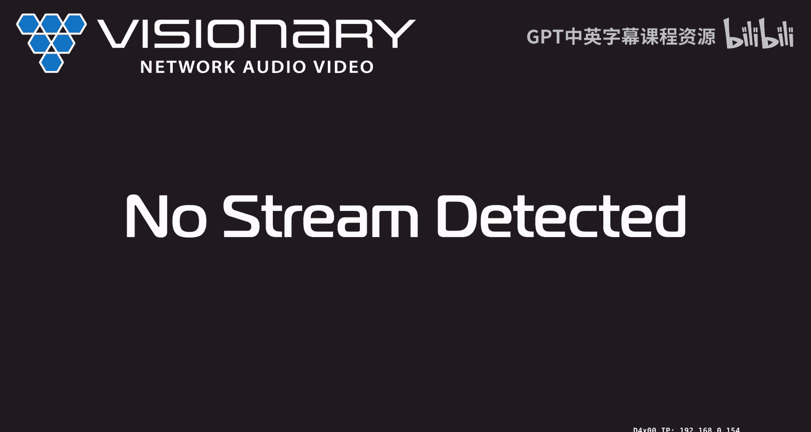
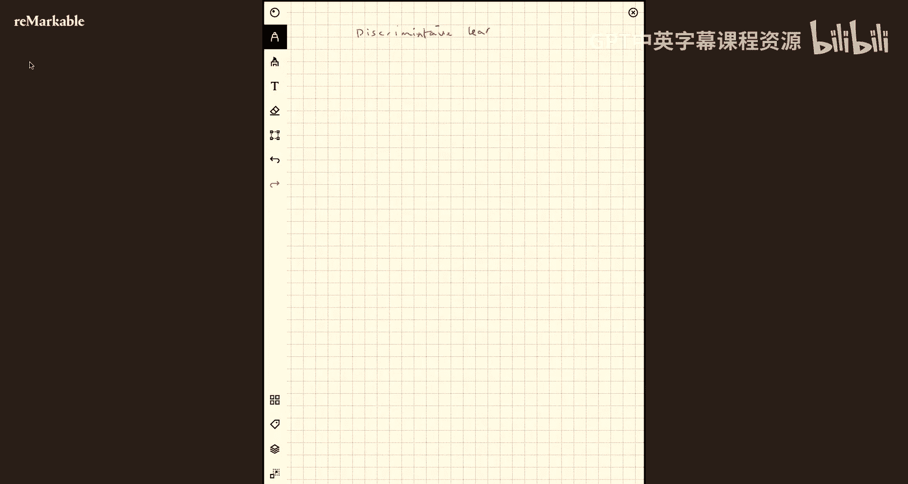
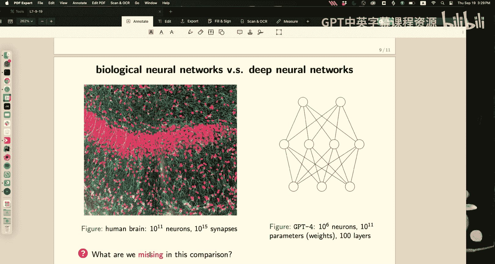
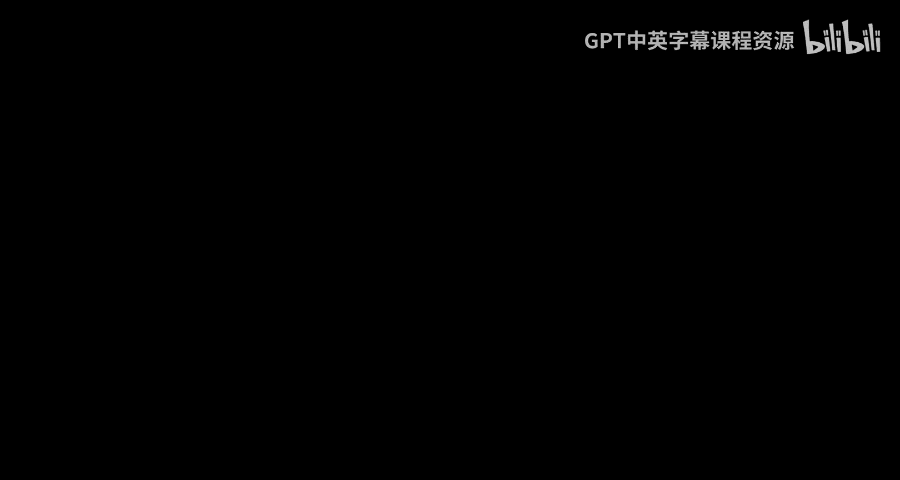

# UCB《机器学习导论｜CS 189⧸289A Introduction to Machine Learning Fall2024》claude-3.5 p07 L7- Logistic Regression & Neural Networks.zh_en -BV1H4421S7bs_p7-

Okay， let's begin。So。So today's lecture， we're going to continue on the problem of logistic regression。

 We left it up last time at。嗯。The discriminative approaches。

 So we set up the problem with a generative approach。

 we found out that if class conditional densities are Gaussian with the same covariance。

Logistic function just pops up， right， And then we just it on a different angle。

So now we're going to see how can we do learning， but just starting from the logistic form。

So forgetting the bridge we built with the generative approach。

So the assigned reading for this lecture is listed here。And。So 5。

4 is focused on on the discriminative approach to classification。

And hopefully we'll have some time left at the end to talk about the neural networks。

And this lecture is a bit math heavy。 And I decided to just。Do it on the tablets for fun。

So hopefully follow every single step of the math。啊。Okay。It's very slow。Okay。

So a summary of the previous lecture， basically the core issue was problem of classification。

 where we want to find a mapping from some， some feature space。

 This is a very arbitrary space to finite set of。Classes， and we divided it into inferences there。

And decision a step。 So inference step is essentially learning these posteriors， right。

 probability of a label given features。And。So this one， again。

 we approached it from generative approach。 but today we're going to talk about the discriminative approach。

So。This is the outline of today's lecture so there was a very nice question after the last lecture about the geometry of what's the meaning of this data that we learned。

 I'm going to spend some time giving you some intuition on the geometry of data and the logistic progression。

And then we're going to go to multi class extension of logistic function again。

To be follow the same path， we're going to start with setting it up from the generative approach。

But on the last part of the calculation， we end up we're going to set up the cross entropy laws for all of these classes from all of these approaches。

 from the perspective of discrimininated models okay。And then hopefully。

 we'll have time to finish up with neural networks。Okay。So， let's start。I'm going to go here。是。So。

 basically。P this up。So we're going to talk about the geometry。Of的。In logistic。Rereion。So basically。

 the key thing to observe is that this is what we obtained， right， Last time we had probability of。

 let's say class0 given x。Is one。So if you wanna have some geometrical intuition of what this theta is theta is。

 what should we do。First of all， does anybody have a answer just very quickly。What whats data here。

So let's assume we are in a very high dimensional space。 We have class 0， class 1。And we learned。

 let's assume this is the ground truth we have learned already。 We have learned Tato。So this is。

 let's say this is。This is Heda here。 But this' is Theda star。 meaning that we just。

This is the ground truth。What have we learned at the end。Any answer。No answer。

How should I think about it？Good。Perfectly， yeah， that's a good answer。

 But what is this or dimensional space is's given to you， right， It's data。😊，So basically， exactly。

 as you said， we can decompose x into x parallel。An x perpendicular where in my notation。睇得。

Expen nicoola is 0。So what does it mean， It means that if we move in the direction of expertpen nuclearicular。

Nothing changes， right， This probability doesn't change at all， right。So the answer is right here。

So basically， Theda。It's perpendicular。So the decision boundaries。So if you have found the data。

 you know the orientational decision library， and that's the proof。So what about the direction。

 So Tato， now， let's assume I know this class is， I have to decide again。

 I just want to check your intuition here。Obviously， if you have done the classification problems。

You have given some examples of zeros。And once。Sopefully， I've already solved the problem correctly。

 But， you know， it's good to check your intuition at the end of that you have found the solution。

 So is this is my tailout points in the right direction。Does my data point in the right direction。

Any规定。How can， how can I think about it？ I mean， we solved it， You know。

 the answer is in front of you， right， We solve， we solved the experiment particular one。

 So now we should focus on X parallel， right。So now by axis。

 there is a perpendicular part that is along this lies on this surface side dimensional surface。

 and there's a parallel part that's parallel to the， right？So。So， if。You go in this direction， right。

 theta x just increases， right。And according to this， this probability goes to。

It to the minus infinity。Right， so this probability is roughly one。So this is the right direction。

Right。Please ask a question， if it's not clear。So basically， what I'm trying to say is。Somebody。

Ask you a question， I've solved the classification problem。There were a lot of ones here。

There are a lot of zeros here。And this is the data that I found。 And this is the。

 this is the posterior distribution。 You look at it and say， you're wrong。Right。

 it's clearly wrong because you're moving in that direction and poverty of one goes to 0， right。So。诶。

So basically， this is essentially the geometrical interpretation of this theta。

 Theta 0 is the easy part。 That's what we talked about Yes in the last lecture。

 Theta 0 just shifts the boundary， right， The position of this boundary is dictated by theta 0。So。

Anyway， this is left over from the previous lecture。And。Any questions here。Good。That's Ta。

 which in this case， let me double check again。So if x goes to infinity in that direction。

 E to the minus theta becomes very small。 and this probability of 0 becomes one。 So， yes。

 this is the wrong one， right。So， this is the。The previous one is the correct。 have this。

 the correct version， because I'm gonna upload this in the。好实犀利的。Yep。So what is correct here is。

Zeros are here。王泽天。嗯。Okay。Any other question。What do you mean if we don't have logistic。

But we discussed this last lecture。 that's just we cannot have a probability that's the transport。

 right？Exactly， also the to make it between the round1 logistic just is a natural candidate。

 And let's assume these are if especially if this is like the class condition of the Gaussian。

 there is no other choice。 You just derive it， right， It ends up in this form。嗯。

But in the first part of the this chapter on classification。

 there is a little section that I assigned as as reading。

Which we are not gonna cover it because we never gonna approach classification from that angle。

 You can have classifiers where you don't build， you don't have a prouristic model。

 And they' the same shoe shows up against。 You know， you。

 you think about this decision boundary in terms of the perpendicular direction and parallel direction。

 So， but this is， to me， is just a more。intuitivetuitive approach， because algebra is geometry。

 It is very clear what we have done。 Go ahead。Yeah。Right， each to the minus infinity is 0， right。

E to the minus theta X。If you're in the direction of tail。And if go to infinity， I mean。

 as' I deep into decision boundaries is even more zeros， right。

 I the close to decision boundaries is。 But if youre really。

 really deep inside the decision boundary， you're very confident。Exactly。

 so this probability of 0 becomes  one。Quative of 0， given x is one。Yeah。

 let's make sure everybody is quickly。 Al right， if we go， if we go the opposite direction in right。

Iffi。In this direction。Ifs one probability of 0。Give then x， if you are go to infinity。Is 1。

1 plus e to the infinity， right， because it's minus。 Theres a minus left。

Does anybody else have the same question。So this is zero。Right， say sanity shake， right yeah。

So I'm glad I discussed this。 I asked。 I took it for granted。

 And thanks for the question that was at the end of the previous lecture， because， you know。😊。

The whole point of this at the end is we want to have understanding of what this data is。

So essentially， the way， we set it up。 it's like， obviously， we could have set it up。 This data is。

 you know， you can decide a convention。 I， I change， I define P theta you have 0 given Xs。

1 plus1 over one plus e to the minus theta。 I could have had it plus。

 Then everything would have been reversed， right。But when you set it up like that， again。

 for these things， it's always good to look at the infinity。 And it gives you a lot of clarity。😊。

And my lines are should be cleaner， I guess。Yeah。Okay。Hm。Okay， let's go to the next topic。嗯。

Next topic， I want to talk about the multi K bigger than two extension of this approach。That we took。

So， let's。Set it up。So we are talking， we're gonna talk about the multi。Class。By my multi class。

 I mean K V get than 2。Clasification。So here I like to use the notation that。呃。

And I'm going to do that Always。 Hopefully， it's not too confusing for you。

 So when we are doing multiclass， we start from  one to K。 It's just。

It's just simpler for and you see the math， I mean， I can't talk about it later。

 It's just more natural Then you have two classes。0，1 is natural。 and you have multi class。 you know。

 you go from one to 1，2 k。呃。So again， were gonna make make the assumption。So， as before。

You start with the generative approach。And how do I set up the N approach。

Should I start with the what。With class conditional denities， right？ That's how I set it up。

 So x condition on label K。Its distributed as the Gaussian。With mean okay。

 And as before we're gonna start， we set it up with the same standard deviation。 And here。

 because we did this before or every di in RD， right。This is。啊啲 by啲。This is RD。And this is。

 as I explained， is one to。So。So what we gonna do， what are we going to do next。

 like before we gonna set it up， we are interested in the posterior distribution。

 We're gonna set up the base rule， right， the base rule。So Bay rule tells us that this is P。

Ex give K。 So we are interested in this object， right， This is what we are interested in。

So this immediately suggest a re parameterametricization。 So basically， we're gonna write this up as。

E to the A K。 here I'm going to follow the book notation。

A lot of places I'm not following the book notation。And。Yeah， this is a nice nice notation， right。

 Immedia， you see the normalization。If you sum over your classes， right。You got the and numerator。

 the denominator is fixed。 And if you sum over the numerator。

 you end up being the same as denominator。 So it's clearly normalized。 And so basically。

 in this in this year。I have defined。Well。A。Sg。P， X， given K。Right， it's a very general expression。

 I essentially haven't done anything。It's just a rewriting of the same expression。

But now we're going to do something。So， you know， you see this。

 you have the same thing we did before。 We're gonna divide the numerator denominator by this common factor。

So both of these。呃。All of these class conditional densities have a common factor。

 and the common factor is。So， P of x given K is。E to the minus。X transpose。

Gamma inverse x plus sound junk。 So this is a common factor。And this common factor。

 were gonna cancel it。From numer1 denominator。And。I'm gonna ask you to do the math in your head。

 or maybe I write it up so we can see it。So。Going to be more precise here。Okay。

 so the common factor you see， right this。呃。X， x transpose covariance matrix ins x cancels out。

 and we're gonna end up。With。This expression。Where， this is E to D。Theyre my A K now。嗯。This is。

 I did this calculation yesterday， but we can go over it together， if you like。

So this log is the same as before。 you know， PK is just a constant。

 and we like to express it in terms of an exponential。 So we write P of K。

 the prior probability of the K class as log PK E to the log PK。 So it's coming from that。

And so essentially， we achieved what we did exactly as before。So， this。We can write it as。A case。

 really。Theta x plus theta 0。But this is Tta 0。And this is T。Goodit。I'm sorry。 Yes。

 So sigma is not index by K because we like to cancel it from numerator and denominator。

 So I just want to arrive at the generalized form of linear logistic regression for multi classeses。

 So if the sigma is not the same， you cannot cancel it， right， from the numerator and denominator。No。

 you can。 Yeah。 So that's， that's the topic of after this， we're gonna build on on that。

 So I just wanted to have the first one thing at a time。 have we in the last picture。

 we had the linear。2 class logistic regression。 And this is linear multi class logistic regression。

 right， And we arrived at the expression。So， essentially。诶。呃。Everything there is no quadratic term。

 It's just everything in terms of is a linear function of x。So in the literature。

 this is called this mapping。This is bread and butter。 When you get into training neural net。呃。

This mapping。It's called a soft Mac function， softm function。And so I already emphasized the very oh。

right okay， so are you already see that this sums to one， right。And you also see it。

 the very nice property of this function is smooth， right You can differentiate through it。

But on top of that。If。I'm gonna write the most important property of this function。 If there is a K。

There is bigger than all other。AJ there is a aK， There is an index K such that AK is much bigger than all other AJs。

 so for J。Not equal to K。诶。This mapping。Becomes。What's。Can somebody say what this mapping is？

There is an index case such that aK is much bigger than AJ。对。I cannot hear you。I'm sorry。Which basis。

Exactly， yeah。 so this becomes the in the one hot encoding basis。 This becomes the basis。

 So this essentially becomes almost approximately。IThink this should be approximate。

 but assuming this is very， yeah。So it's almost all0。And there is 1 K。So it picks out the index。

 That is。That is。呃。It's AK is much bigger than AJ。 And these are， you know。

 be is's going to be interpreted as literally the probability of being in a class， right。

This policy sounds to one。 So the moment that neural net decide， there is a winner。You know。

 if picks out the index A K， then that class becomes a winner。Essentially。

 exponential is very unforgiving， right。So that's a nice。 This function is nice in that way。Yeah。

At the same time， differentiable， what。What gives the， gives us the inner class in an elegant way。

Okay， so。So this is essentially the generalization of。

What we did in the last lecture to more than two classes。 Go ahead。你ay。Of course， oh， very good。

 Thank you for catching that。 So this is clearly my mistake here。So you see， I define this。

 So this is theta K because this depends on mu K。哎。So， this was my error。And this is also here。

 So this is taketa0 K。Yeah。Very good。 Thank you。to0。Any other question。Great。It like。

It's not one over k。 I'm sorry。 This is， I meant1，1 K， as in like the cave index。 So this is one。

It was like I didn't mean to write one of a k。So this is the index is k。Is that clear， Yeah， yeah。

 thank you。 S overki Go ahead。I'm sorry。P of PK。What is the question。How do you know it again？

Is it prior？P K， we have to learn， right。 So this is going to the topic of the whole course。

 And we're gonna cover it this， this lecture now。 Yeah， this is the next step。But yeah。

 so essentially。There are two ways to go about it。 One way is， if we start with this assumption。

You know， let's assume assume we have somebody。 we。

 we have very strong knowledge that the class conditional distribution is this Gaussian with a fixed covariance。

 right？ Then what do we do。You're gonna go estimate it right。

 We have done there I'm hope I'm hoping professor thiscard and cover this。 So given some data。

 you want to fit the Gaussian， you do maximum likelihood。 So you find Mu。

 you find standard deviation， right， and then you are good to go。

 You have derived all the expression。Right。So if you know Mu， if you know。

 standard the covariance matrix。Then。You know。This。Yeah， I mean， it's very clear， right， you know。

 the theta K。And you know， theta 0。 and， and you know， P， K。Right。Oh， P， K， that's the easy part。

 You just look at your， you know， unlabeled， you know， you don't look at the features。

Just see what percentage of the data is in class K， What percentage is not。 Again， this one。

 you can also do maximum likelihood。 All of these are parameters。 you can。

 And then when you do maximum likelihood， you just pops up。 So in your book。

 does anybody has a textbook here， Andy。Yeah， so in the in section。呃。Yeah。

 so this I'm not gonna cover because this is essentially maximum likelihoodt for Gaussian。

 which is covered under the proof list card like T gonna take our time for classification。

 but essentially section。5。3。2 does that， you know。It drives all the expressions， yeah。

Any other question。Okay。Were giving me time， good。What's the next topic。

Next topic is the most important one， learning。A。And before going there， I can make a quick comment。

So。You know。Let's assume we want to do estimation in the first approach that we have some knowledge that these class conditional distributions are Gaussian distributed。

 How many parameters do we have to estimate。This we are D dimension， and D is very large。

Any quick answer。I don't want exact number。 What's the order here。D。No。Yeah square。 Yes， why。It。

The data。Tayer in front of X。Customestimating。Which theta are you mentioning。

 Theta is the dimensionsal， right。For a particular a。Particular a sub K theta is d dimensional。

 So it's order D。Yeah， so what's the reasoning for D squared。Anybody De square。

 what's the reasoning Go ahead。I'm sorry。But that's what D， right。呃。There is not D of them。

 There is K of them， right。Right， so there is there a。This K index runs from one to capital K。

So the order， you're right for I mean。You are not。 Yeah。 So this， this what you were。

 what you mentioned is K times D。And K is typically a small。 You know。

 K never goes to thousands of classes。 What dimension can really go to a million dimension。 You know。

 if you have 1000 by000 pixel it's a million dimensional objects。Ri。Good。Yes。

 covariance matrix has to be estimated， right。And covariance metrics is D by D。

And that's going to be a pain when you're in very large dimensions。So even if you have， you know。

 I mean， this is a bit of a。This even if， but it's good to have some。

Feeling of what this estimation problem is。 So even if you。Have some knowledge that， you know。

 your distribution is Gaussian。 If you're in a billion dimension。

 maybe you don't want to estimate covariance matrix。

 Maybe you want to estimate it with the second approach that we're gonna talk about。 Okay。

 so this is yet another motivation。Okay。So， the next topic。And I'm going to start easy on you。 First。

 let's do。This。Let's。Do this guy question twice。But they have different flavor。 First。

 we're going start with the two classes。 Okay， so we're gonna。Set up the problem that。诶。Okay。

 why should I title this？Okay。So we're going to do discriminative learning。

I'm gonna connect this later。呃。That' really good。So we're gonna do discriminative learning for。

 they lost it。

Sorry， guys。Yeah， I need to find a solution for this。Up sharing。大善します。

Somehow the screen is not getting updated。 I see it on my own I。Of this， maybe。Yeah。

 there was a comment in the channel about people prefer that me。

 I don't use the board but they're right here， but definitely I need to figure this out。

It's not working。I may just switch to the board at this point。 I'm gonna give it one more try。okay。

 very good。Okay。So basically， we want to do， we are given this ground truth， not ground truth。

 but this hypothesis that P of。嗯。0， given x。Is one。Yeah。I'm going switch over to the port。

 It's the only way。F this out for the next lecture。So again， the topic is。

So we're gonna do learning in this discriminative classification。

 and disc cognitiveative classification。 we're gonna start with the two class keys。

Where you have 0 given x has this。This is parameterized by Theta as dysfunctional for。

1 plus E to the。And。So it says t到的0。嗯。So we saw in the。

 in the previous class that the likelihood this， you know， we're gonna to do maximum likelihood。

 We have some data with the big pairs X， Y， Y， I。And this is why eyes are。呃。My eyes are。I there 0，11。

Right。And as we have seen in the maximum likelihood learning。

 we assume IID setup right in the IID setup， the probability of your data set is multiplication of individual ones。

 right it's IID independence。And we're going do log likelihood learning。 So when it takes a log。

 these probabilities of individual points become the sum。 becomes sum log， right。

 log of product is the sum of logs。So to have a less cleaner notation， I'm not going to use I。

 We gonna we gonna do maximum like for a single sample。 But， you know， keep in your mind。

 you're gonna always add this some， okay。We can， we can just add it at the end。And so， so in the。

 the。Los that we're gonna serve is this is the loss。Lost is something you want to minimize。

Likecklihood is something you want to maximize。 So it's a negative block likelihood， right。

AndSo you're gonna write negative。Log。What？ so for a single sample， we have P of 0。Even an X。嗯。

If y is 0， this is switches to this， right？ And we have 1 minus。1 minus y。

And this is what I like the 0，1 notation for two class， because we get this very nice for。

So when y is 0。This term， I'm sorry。 I think I made a mistake here。嗯。いやっ、鈴ずです。Meanwhile why is 1。

 I'm gonna just。Switch the notation。So when y is one。This time is one， right。

 And this is P T to1 given x to power 1。 right， That's what we want。And if when y is 0。

 this term is  one。And this time is1 minus P T does0 given x。Which is P of1。呃。I think。

Looks like I am。Making a mistake here。呃。Yeah， I think it should be P。Okay。

 I'm gonna get help from the previous picture because we had this in the previous lecture。哦。

Plogologies。This is the expression we had at the end。Super one。嗯。Oh， yes。 So that was my mistake。Now。

 we are good to go。So this is the expression we had in the previous lecture。Right， mu of x。

 I defined it to be P of 1 given x。And I have the same expression as before。

And is P T to 1 given x to power 1。Of y of 1 minus P T2 1 given x。Yeah。So I caught my buck。

 So now let's do the sanity check， right， Let's do put the 1 and 0 here。 When you put one。

This term doesn't appear， right， And this term becomes。So when y is one。This is P T to 1， given x。

And then y is 0。This term doesn't appear， and this term becomes 1 minus P T to。1 given x。

And what is this。Yeah， P Tta of 0 given x。Yeah， so this is the。The reason we have this expression。

Very good。So when we take the log of that or loss， again， there is a negative log here。Right。Thela。

Is minus y。Log P1。 I'm going to use that very light notation here。 So from now on this P in index 1。

 there is a ta absorb there。呃。Plus， minus1 minus y。Log or minus。People。And。So。

 let's take derivative now。So is clear what what I'm after here。Actually。

 I think like makes it a clear rotation。 and I use P T to here。

So we essentially set up a loss for a single sample。

 and the total loss is just some of these because we are doing IID samples。And。And this loss。

 we're going to minimize。Right， so。Pretty much it's very easy problem， right。

 P Tta has a very clear form。Right， has this form。And。And we just want to take a。

 we want to mini this function。 And for minimizing a function。

 you' have already learned from many classes， including from professor Ligar that you do gradients。

 right， Take the gradient。And you do gradient descent。 You follow the negative of the gradient。

 So let's see what this gradient of this guy looks like。

So I'm going to take gradient with respect to Teta。And what should I do。So P Tta， the the thing。

 the first thing you observe with what P Tta is， is's written in terms of this object。

That's why we liked it。 So let's call this Z。Right。So I'm going to use chain rule。 So chain rule is。

Be gonna see it。This lecture， next lecture， then after that。

 So it always comes up in and when we are when we are using gradient in these type of models。

So we write， we're gonna write this as。Graadient， with respect to Z。And Z is a scalar， right。

 Theta is a vector。T that is in RD。And Z is a scalr。Right， so I'm going to write this as。Now。

 I'm thinking of this P as P of Z， right， That's what I'm thinking about it。

What should I do after that for change rule。I'm missing something there。Any help。Great。Exactly。

 and the the rule of thumbmb， you know， this could drive it in your， in your。In your。Math class。

 but essentially， this is really the rule of thumb。's one of ti you write it as。I'm using。

 I'm using the physicist's way of thinking about this from dimensional perspective， one over the。

Z theta， right， The dimensions match。 And that's what we did。

 There is we did that derivative say to Z。 and we have to take a gradient of Z with respect。

Originally， we did gradient and respect to tea。So。So it's very nice。 Now。

 this P has a very simple form。So let's write this up。I think。I can。What should I do here。

 Maybe I can continue here。Does anybody see in the back。Yeah， okay。 so let's write it up。So。嗯。inus y。

 And I'm gonna use a very nice identity。啊。This is what I did in the last lecture。

 but let's do it again。 So gradient of。What is this。Z and2 can be confusing。And this。

 I'm going to keep one of it。And this one， I'm gonna write as1 minus the other。So， this is really。

And this is really。More minus。Right， this is what we did last time。 So longer story short。

Graian Z of P Z。It's very nice。 It's P。Or minus P。Okay。S对。Identity， we're going to use。

So this becomes minus y。Gadient of the log gradient of P divided by PG。我样做PCP。放 minus p c。-1，- y。

Gradient of this guy。 And this is minus gradient of P Z， right。And， and that gives us a plus here。

 again， P。1， minus PZ。So let's do a lot of cancellation。 That's the most fun part。So听 me。Cances here。

1 minus PC cancels here。And there is a term。My Y PCZ， and there is a term minus Y PCZ。Right。

These terms cancel。 I'm gonna do a different cancellation， this term。And。This term。So， again。

 the whole thing。Ifs there is a gradient data that you sitting outside。And this is beautiful。

 So at the end， we're gonna end up with this very simple expression。Pzi。Minus y。Rraadient T does Z。

 That's the gradient。So now we can celebrate。呃，受。You know， essentially without doing any math。

We kind of expected to see this。Can somebody。Tell me a story why you expected to see this。You know。

 what what are we doing， We are， we want to do classification。 We set up a loss。

 and we clearly want to maximize the probability of a class being in that class。Right。

 that's what you want to do。 And this is essentially the error。

PZ is the probability of class being in class 1。And if boys won。It really has to push up。You know。

 this gradient is only when its 0。 You have arrived at the promised land， right。

That's the goal of optimization to have this gradient to be zero at the end。

 and essentially the only way to make it0， if the class is one， you want PZ to be close to one。

 and if the class is0， you want PZ comes close to zero。So。啊。Yeah， so this is essentially。

And this is a very。You know， essentially， you see this also the linear problem is very easy。 We。

 we're gonna go over it for any nonlinear， actually。

 But this is a very fundamental thing because we did this for the logistic function。

 And really what if you really look at it， what really happened was we decompose it into two problems。

 One is gradient with respect to Z。 right， The other。

 the other was gradient of Z with respect to Tita。 right gradient Z with respect Tita is just outside。

Right， I don't really care about this。 It's just outside。 And this V can be any function。 Now。

 you're coming close to the deeper learning ring。 This Z doesn't have to be linear， right。

 It can be any function。And the math is exactly the same。 You don't do any changes。Right。

 the only complexity is this for a linear function is X。 It's very nice， and it's very interpretable。

Essentially， you want to。Push your parameters。This is the first geometric picture I gave you。

 You want to push parameters。 If the theta is one， push it in that direction。

 If the theta is zero in the opposite direction， if the label is 0。 But obviously， for a deep net。

You know， you don't have this nice properties。 Its just more complicated incision boundary。

But putting that aside， the algebra is identical。 So I really want you。To reflect on this， for， like。

2 minutes。And ask questions， because this is really。诶。

Very beautiful result you' are looking at right now。 right It's very， very general。Any questions， G。

The pushing thing。哦，原民的。The interpretation， Oh， yes， okay。Yeah， so the interpretation is。

Can US is now。Obviously， this interpretation is only for。For linear models。呃。So。So let's set it up。

 Basically what we have done。 here saying Theda。It this update。Should be what。

 So this is the gradient of tita。 And I want to go in the negative the gradient because I want to minimize this loss。

 right？ So I have to flip the signs， right？ So it's going to be minus。Some hyperparmeter。

 this is my learning rate。PZ。in-1， y。And gradient heat of the oops。 I era my。I think for x， right。

 Let's forget about the。嗯。Forget about bias for now。So this is the update， right。

 And let's do two cases。This I see why。 this Y is a true label here。Right， let's assume y 0。So。

 this teacher。You're gonna update it as。When。While 0 P is always bigger than 0， right。

So it's going to be some new epsilon。Right， which is positive。Times x。And if y is one。

The opposite happens。Because P of Z is less than one。This is one。 This is less than one。

 This is negative。So you're going to flip the sign。Right。

And this is essentially what we had in terms of our interpretation。So， the circle is closing。啊。

See if I can get this here。Yeah I need to clean up this note。啊。I think that's the issue。 Oh， I see。

 yeah。诶。So this is essentially the interpretation we had earlier， right， You are pushing Teta。

 So if the class isn in0。If the class is0， you're pushing your parameters。呃。In the。

 in the negative direction of x。Right。I think the reason you're confused is because I flip the sign in my notation。

 P T top 1， given x is that。Right。So just flip the signs that way。Should I write it？呃。So essentially。

 let's do in， in the in the way I set it up here of1， given x。Is one plus e to the minus theta x。

Right， I'm gonna just forget the price for now。That's the way I set it up。

 This is the opposite setup。 right， So essentially， is the opposite gonna happen。So this is 0。

 This is one。And the t are going to be in that direction。Right， so if a new data comes in。

And the class label is one。 You're gonna go in that direction。And if the class is 0。

 you're gonna go to opposite direction。So the data points， each data point。

Push the tata in that direction， right。I hope this is bright and clear for everyone。

Cause this is like， essentially， the story of。Deep learning at a very。

 very simple level at this point。Okay， since we started kind of。With a bit of a bump。

 I think I'm going to skip the， the same calculation。 Maybe I'll do it next time。

 So refresh your memories。 but I also encourage you to do it at home。 So basically， we set up the。

 if we go here。😊，A。We did set up this for the multiclass classification， right。

And for multi class more than k equal to2， you do exactly the same instead of a。

Maxum log likelihood becomes a multiplication。 You get the。Some of it becomes a sum of logs。

 You take the gradient， and I want you at home。 It would be good for your。

 for yourself to reder this。 So there， the only difference is。I can give you the final answer。

Did my notation。Yeah， essentially， there is no difference。There there are。K classes。And。For in here。

 this define this， we， we define this for， for class 1， class 1， then becomes P J。

For class J and this Y J。 That's what this shows up。But。

I think I can drive this in the next lecture because this is like， essentially the setup。

To do back propagation， essentially back propagation。

 we're going to see exactly the same happening again and again。Okay， so let's。

We can switch to fun topic now， talking about。Noural nets。啊。You see。Sorry。😔，Any other question。

For a search topic， go ahead。They're the same。Yeah， it's like a。Yeah。Yeah。

 and like only the increasing thing only happen in R， but there's a reward。

 people want to increase reward， but mathematically， you can have negative reward。

 just reduce negative rewards。Yeah， it's just identical， right？嗯。Yeah， I think。Yeah。

 it maybe machine learning folks are a bit pessimistic。 theyll also reduce things。

I don't know the reason actually， historically why things are set up like that。嗯。Any other question。

So let's talk about neural networks。 and I have only 15 minutes left。 So I don't know。 I decided to。

 I could have set it up from the perspective of history of development of neural net。

 but I think maybe I've heard about in other classes。 So I set it up from different perspective。

 history of neuroscience。 because neural networks came from。Came from。That that history。

 in some sense。So。So there's a book called the Portraits of the Mind。 I really like that book。

 I have it at home。 and I took some pictures from the。From there， put it here。So this the the， oh。

Yeah， so this is the what you see on the left is the oldest known drawing of a nervous system。

From 11th century。This is wrong， actually， this is published in。1008。

 so I don't nobody have it wrong here。呃。It's from the 11th century， not 19 Oh4。And so you see。

 this was based on teaching of a Roman。doctor， and it became illegal at some point to by to dissect the brain。

 But there was a period where old times where it was okay。And。

 but there is no drawing from back then。 This is the first known drawing。 And you see a nose。

 you see eye， you see optic nerve。You know，'s just you see flow of information from， from that。

 And you go to the modern time。This is by Gji， where he developed this method of dying the。

He found this dye。 I don't know the details of to essentially look at neurons。

In the brain and he was good at drawing。 So this is his drawing。呃。Well it's very。

 very interesting fascinating history because essentially。

 there were two neuroscientists that essentially have very different schools of thoughts。

 So Kahal used the method developed by Gji。And。And he was better at drawing。Is this beautiful。

 beautiful drawing of neurons。 So the gazillion of them。 So， for example， the left one is a。

 is a pyramidal neuron。 So pyramidal neuron。😊，Is excitedatory in around。

 and it has this a lot of dendrites。So。Does anybody know what neurons have you learned in biology class。

Anybody doesn't know Iran。So essentially， you know。

 there is a cell body at there are some abstractable。

The cell in the brain is very different than your other cells。 It's like。

 it's almost like you see a circuit there。 There is a。There is a。Center of the cell。

 and there are these dendrites。 and even you zoom in in his drawing。

 you see these little branches there。 we're going to talk about it。And then。

 so these are the receivers like antenna。 And there is a send there。And this send is here。

 So this parameterid known all known for have one of one very long。Dandrite， you know。

 is one of their properties。 So these are excitatory。 These neurons， when they send a signal。

 they want to activate the other neurons。Right， and there are also inhibitory neurons in the brain。

 So they think of this as positive bes。In our notation。And they are also inhibitor in the ro。

 The most famous one is perkinji cell。And said， this crazy。branchesranches of dendrites。

And there is only one xon going out。But these are the receivers。And。So， these two。呃。

Gji and Kao won Nobel Prize， one of the early Nobel Prize in medicine for their recognition of their work on the structure of the nervous system。

 But they're essentially opposing a school of thought。

 Goldji was proposing this brain as a continuum。 and Kahalal was proposing brain as fundamental unit is neuronsn。

 you know， and it shows that in his drawing。 It just like to draw neurons。And， and then obviously。

 these neurons are connected。So that's the network of neurons。Var of neuro types。And so neurons。

 when they send a signal。Is an electrical signal。But at the connection。

 this electrical signal get communicated。 and there are these vesicles。 So when you zoom in。

 this is the modern image。Otained with transmission electron microscoies。

 essentially you shoot electron and the electrons that don't pass make a dark region。So。

So synapses are essentially where this communication happens。And synapses are on the den rights。

 of course。And。And the most important thing for us is like。Not for us， for history of neuroci。

 history of neural networks when we people were abstracting the brain。

 They wanted to mimic the brain is that there is electricity in the brain。So， this。

When go this communication between neurons happens by these action potentials。And essentially。

 action potential is this spike， you know。And。So when I talk to my neuroscientist friends。

 there is like， there is this consensus that the reason action potential happens because neurons have to communicate long distances。

 and it's really hard。 if you don't have action potential， the， the， the potential degrades。

 So it turns out。I don't know that literature， but it turns out is better。

 That's what that's the reason brain does it like that to communicate over along these sensors， this。

 these spikes。 you know，'s like can almost think of it as binary signal。And。I。

 I really like this picture。 So this is the recording each row for from a single neuron in， in。

 in a live monkey brain。😊，And each row is 4 seconds。And what do you see when you look at this。

 There is clearly。In the middle， after middle line， there's more。More spikes， right。

What do you think happened？So the experimentist just gave reward to monkeys 2 seconds on this trial。

So the just， you see just the two second line。 And this。

 the nuranda recording is just like that reward， you know， just。诶。Yo。So。呃。So we want to mimic this。

 mimic this in the le with， with this introduction with the my Puman's introduction on this topic of neuroscience。

 Les want to mimic this。啊。Mimic this。Brain circuitry。On the na， the naive way， you know。

 clearly input comes from somewhere for your visual systems to retina。 So there has to be some input。

 input neurons， right。And this I， this is my input neurons。And。嗯。The economics with my wiring。

And then， you have。These neurons goes to your brain。 You saw it in drawing from the 11th century。

 right， This， you know， there is communication happens。Right， and neurons we saw earlier。

 neurons con are connected to other neurons。Right。And at some point， you have to make a decision。

 At some point， you say I'm seeing a picture， a cat or a dog。 I make a decision。 So clearly。

 there has to be a point some output runs。So let's label this。 So let's call this X1。X 2， x 3。

It's called this Hi， Hi neurons， Zbon。Z 2， Z 3， Z4。And。And this is my output， neuronsons。嗯。

So we saw earlier there are some sometimes neurons are excitatory sometimes are inhibitory。

And and so there there is， there is some weight when the signal being sent here。

 So I'm going to use the notation。 I use if this is I， if this is J。 if this is I， this is J。

I'm going to use data。J I for this weight。And。The most important thing is the brain doesn't go crazy。

 You know， theres a number of spikes you can have。Unless I assume the maximum number spikes is 200 per second。

 And that's roughly the right order there。 And， and we like to， we don't like to deal with 200。

 We like to deal with something normalized， right， I divide every action potential per second by 200。

 So the maximum is 1。 The minimum is 0。 right？ So， and then the most important thing is there is a negative here。

Right，The negatives are encoded through weeks。 The signals themselves is either the neuron is silent or not silent。

Or firing， There is a negative there。And so we arrive at the， at the neural net。 So basically。

 there is a theta J I。X， I， that gets summed over。Right。And this goes through。

 and this sum could be very large， right？ But there is a maximum number we can have。

 which is one minimum is 0。AndA natural candidate for now is a sigmoid。

So this is my sigmoid function。So this becomes my Z J。And the same thing happens in the next layer。

 right。The next layer， we have。Sma， this is the first layer。In the next layer。You have T the。J I2。

Now， Z 2， Z， J， Z， I。And this becomes my output。And。And you cook， you put this together。

 The most important thing here is compositional。And， and you put this together。

 You arrive at at the neural network， right， And this is really。Basically， you can motivate it。

 You know， this， this can be motivated by just looking at the， at the。

 at the neuroscience story and just making it abstract。 I just want to end the talk left two minutes。

By this question， let's think about it。 We can talk about it next time。

 I wanted to discuss this for five minutes， but we don't have time。

 So this is essentially the scale we are talking about。

 It's a very nice image obtained by fluorescent proteins。 So essentially。

 the red bonds are the cell body。The blue ones， unfortunately， you cannot see well here。

 The blue lines are the axons， and the green one is the dendrites。And so human brain。

 that we have an understanding of the scale。 There are 10 to the 11 neurons。

 And each neuro roughly makes about 10000 synapses。 So it's about 100，10 to the 15 synapses。GP T 4。

 actually asked this from GP T 4 yesterday。 So there are about， you know。

 the connection is known about 10 to the 11 parameters。

 The weights are the number of neurons people usually don't report when you write a paper。 you know。

 its what you care about what gets stored。 then the your model checkpoint。

 The size of it is the number of weights。 But roughly there are 10 to 6 neurons for G T4。😊。

And about 100 layers， right。诶。And I want you to think about as home。

 What would be other comparisons we can make。Right， there are other comparisons I'm missing here。

This would be fun for you to think about it。And then next lecture， we're gonna start off。

Continuing on the neural networks and then going to back propag。Thank you。

I saw a glass I saw。やっているデフションが。Yeah， yeah。 So could you tell me what did the。

Oh， that。