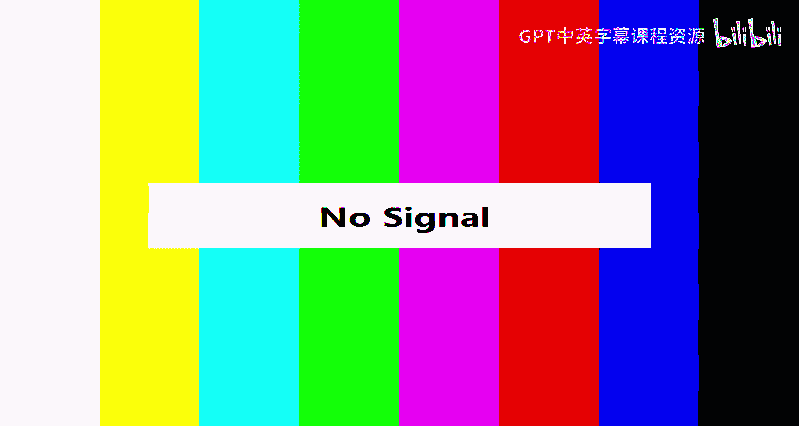
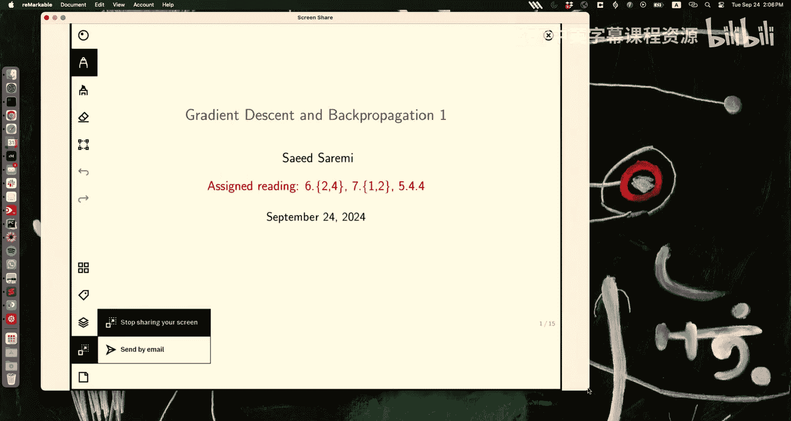
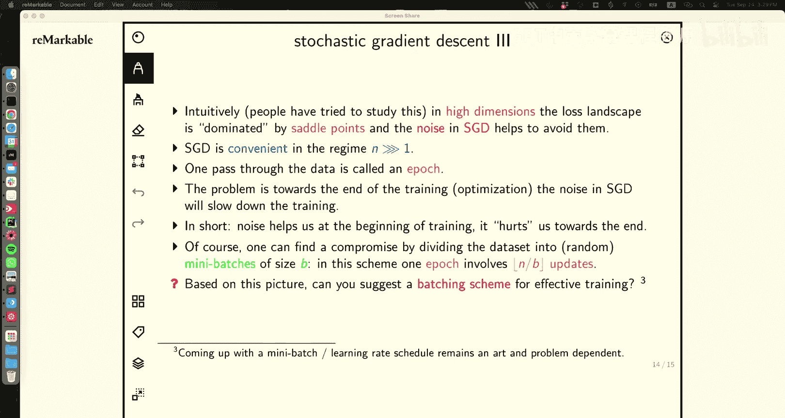

# UCB《机器学习导论｜CS 189⧸289A Introduction to Machine Learning Fall2024》claude-3.5 p08 L8- Backpropagation and Gradient Descent 1.zh_en -BV1H4421S7bs_p8-

Thats I'm coming from mopar Ven Surra County。You're really in historic accounting？

to be from Detroit Detroit no worries， actually this survey there， we collaborated。

My community college in UCLA Michiganta Research Studies Center and we were like doing surveys I like Licast and art。

Community itself about how to improve like health equity。かべくさ。Definitely impacted。Lack motivation。

So I really appreciate it when you mentioned the surveys。And trackinging all that data。

 So you're going to like， thank you， but you're going to like。David Gonzalezs lecture。

 I think it's the next one。Can you make it Yeah， yeah no for sure for sure， No， yeah。

 I've been making them the only reason why I allowed Jay because I only missed one thing。

You just missed one， Yeah， it is my first one I missed， but I'm planning not to。

What am I leaving here for you。你哦家叫我。Yeah， there's usually 40 or 50 water bottles that of class。

Have a good class， You too， Thank you。放そな前です。I'm auditing the course currently and trying to finish in completete from last semester。

 I've been talking to the head team。 I was just wondering if he's going to be here for two。

I just wanted to talk him。そ空集し要。Sit here other。W my will come to that。

Would you toOf course don't know。Yeah。

出资认证啥子不。saw the slide just been a lot of。summarize。唉，さ在て。See the lecture notes I added on。

O呃。Okay， I think we can begin the lecture。So， today's lecture is on。Gradian dena back prop。

 but that's the topic of this lecture and next lecture。So back propagation。

 I'm going to be going to build up to it， and so probably it won't be covered in this lecture completely。

But as you will see， we have already kind of approached it from the last lectures calculation。

And we're going to redo that calculation in a different setting。So by next lecture。

 you have a very good understanding of。The math that goes to this very important。

 historical algorithm。呃。As usual， I'm going to start with a summary of the previous lecture。

So you started the previous lecture talking about the geometry of theta in logistic equation。

And what bent into that。呃。Calculation or insight was very simple。

 and the idea was to decompose x as x perpendicular across x parallel。And so， X particular is。

The part of X that's perpennicular to tao。 And so tao。Dot products of data on expertpendicular is0。

 and because of this form here。啊。嗯。电视买。Because of this form here。

 if part of x is perpendicular to theta， it doesn't affect the probability of a class。Therefore。

It's in front of us， Theta is perpendicular to the decision boundary。

And we also learned that theta the way's paramedized here， the way I've written it here。

Points towards class 1， Because if you go to infinity。

If you go infinity in the direction of theta e to the minus infinity is 0 and p of1 given x becomes approaches more and more to 1。

 so they're going more and more deeper into decision boundary。So another recap of what we had。

 So if class1 here is here， class 0 is here， theta points。所以这是什么？

Then we continued with the generalization of this expression for the multiclass K bigger than 2 classification problem。

 so we approached it with the same way we approached the logistic regression from the generative approach and we saw this assumption。

That class conditional density。It's a Gaussian with a fixed covariance。 So this guy。

 the covariance metric doesn't depend on k。And we arrived at an expression， I'm going to recap。

 we're going to come back to that expression again， hopefully in this lecture。And。

Then we stepped back， and we realized that。You know。

 you can look at the final expression that we arrived at this this we arrived at from the generative approach with this type of assumption。

 flat condition density has a fixed covariance。But we can formulate it from maximum likelihood perspective。

And that's what we did。We set up a loss， and we realize that this is the negative of the log likelihood。

And we computed this gradient。 So there was a question， both in the。

In on the website and also after the class， I kind of want to talk again about the interpretation of this。

 So essentially the interpretation is very simple。 It's actually kind of right in front of us。

 So there are two cases we can consider。 one is y is0 right the actual label is0。

 The other is the label is one。Then this we can interpret as error。What do I mean by error。

 by what do I mean by error is if P of Z， if y is1 and P of Z is defined。

 P Z here is defined to be a P of one given x， right， if P of one given x is1 and label is1。

 There is nothing to do。Right。So the learning is over。 We have already learned， right？ clearly。

 but if if there is a mismatch， there is a gradient。 therefore， theta will be adjusted。

 So let's look at what this what what does this adjustment look like。

 And we are doing gradient descent。 right， We are minimizing the loss。

 We are going the negative gradient of the the direction of negative gradients。

 So theta the base adjusted， if we take theta， and if y is 0。

 P of z is what P of z is always positive。So there is a positive term， and this guy is x。

Right see in pros Z is at a the dot per of theta and x。 So when you take the gradient of it。

 this is x。 So this becomes minus some positive number。Timeines x。

And the opposite happens right if y is 1， this P of these is obviously less than1。

 so this is negative one， something less than 1 minus1 is negative。

 and take a negative of it right so becomes something positive。And now you are stare at this。

 and you look at the what I have， what they have in here in this section。highlightigh it。

Right and this is what makes a lot of sense right essentially what's saying that if the label is1 you are moving you're pushing theta where x is if x is in class 1。

 theta should point to that class eventually we know that's the answer so each data point is pushing theta in that direction if y is 1 and we also learn that the0 is in the other class。

 so the negative happens when。Label is zero。I think this is。

Good to have a deep understanding of this。 That's very intuitive in this case。

 But the same story happens in backlog。So I going to pause here and see if there are any questions left。

嗯。Don't hesitate to。Start a discussion。Okay， looks like it's right and clear。

And so towards the end of the previous lecture we discussed。

 we motivated these artificial neural networks。All technologyin simplified models of biological neural networks。

And。And I'm going to make more comparisons after we have some deeper hair diveing into neural networks。

So this outline of this lecture， we're going to talk about neural networks as a certain type of nonlinear functions。

Right， it's not all of them。 but you know， we， we， we see the structure of neural nets It's just。

has a very， very clear form。And we're going to revisit a linear and logistic regression as a single layer neuralness work。

诶。And。And we're gonna finish the comparison with biological neural networks。 I hope you had some。

Thinking about the question I asked in the previous lecture。呃。And。

Then we're going to talk about training of neural networks。

 so for this we need to talk about the workforcehor behind all the learning algorithms currently used in the neural literature。

 which is a stochastic gradient。This is extremely simple。

 but it's good to have a deep understanding of where it's coming from。So for that。

 we're going to talk about gradient of a function。 We're going to talk about the chain rule。And。

The order should be reversed， probably。 I'm going to talk about the geometric interpretation of the gradient。

啊。And we're going to talk about convex and non convex functions， and this motivates further why。

 why we like SGD， the GD is short for Su gas gradient descent。And then。

We are going to hopefully finish the lecture with a prelude backdrop where we're going to look at。

AC did it for two class classification， where we set up the loss， we took its gradient。

You're going to extend it to multiclass classification。Okay， let's begin。

 So to set up the also lecture， this lecture for the next lecture， I'm going to use a kind of like a。

Heavy kind of notation， but bear with me is kind of a nice notation。 So a neural net has some inputs。

 and typically we represent the input by x0 os。To push this here。哦。So this is represented by x0。

And x 0 has。X 0，1。All debate to。X，0 D。And in all of our neural network architectures， we have this。

Invisible units， so I can elect you to imagine it， but I'm going to draw it for now。

There is this unit that we never write。It should always fix to be1， right？

So this is included in my x0， but I'm going to write it sometimes， but not always you going see。Okay。

 so there are weights in this neural net， right？And so these weights are denoted by tas by used parameters。

And so， for the unit， I。This goes to Uni J。And this way is ented by theta J。

And you're talking about in this case， a single layer neural net， so L is1。And this is the。对。

Super strict on top den the layer。 is's boring。 It's just it's only single layer， but let's write it。

And then each layer dennoted by its index。Again， as a superscript。

 So in this case this is x1 right So in general， this is L X L。 if you have many layers。

 and in this case， as we as I written here， L is one。In general， the first。

 there's a technology it's good to。Let mean very clear this layer is called this。Cb inputs。

These neurons in the first layer， zero layer is called input。

 and the very last layer is called output。Right。And， and we already have。诶。

You already have the expression for the neural nets。Computation from the。We have seen it many times。

 but it's right done in our， our notation。嗯。So essentially， here， x1。Is what。

Ifs there is a some happens。Right， there's a summation that's happening here。Take the。

JI in the first layer。 and this multiplies by my neurons。In the previous layer。

 so this is the next layer。Right， and that one is the previous layer， and。

It's very fundamental computation。 right， We do the dot product。 It's applying transformations。

 a linear transformation。And then what， what do we do， We， we take an non nonlinear， right。

Which I did not hear by G。And。So you can tell a story from the previous lecture that this linearity。

啊呃。You know， historically， the reality that was used and is kind of related to logistic regression is。

The non nonlinearity， that is classical No nonlinearity。

 I'm going to give some examples of nonlinearities now， is the。1。5。Is the logistic function。

 So it the here is 1 plus e to the minus C， right？And the nonlinearity you saw。In linear regression。

 I'll come back to it again is the boring one， the nonlinearity is actually linear。

 that's an example of nonlinearity， right？So。Zi here is Z。

So this is where one of the places where connections with the brain stops because your imagination is your limit here。

 you can imagine whatever nonlinear nonlinearity you like and on the very。

 very successful nonlinearity is called Relu。あそ。I'm sorry。J。So this is called max max of v and0。

 right？essentially， if is bigger than0 is just z， and z less than0 is 0。

So this called rectified linear units。Ttified on the left side， and a linear air。哦。

Can you say one reason why this can be a very good non nonlinearity from computation perspective。各位。

The gradient is simple， but that may be a bad thing may be a good thing。

But other reason from the computation perspective， it's a very good answer。It's really efficiency。

 right this has to be coded up by your computer and taking exponential of a function。

Take some time and so people like this linear nonlinearity， at least if you go back 10 years ago。

 we cared about these things now that。Speeds are。The hardware speeds are so high。

 maybe we don't worry about it as much。It's a very， very nice sun linearity in that way。

 the computation is more is faster， essentially your culture runs faster。嗯。

And one of my favorite non and daily research， I use it is called。It essentially。

 you take two of your favorite non nonlinearity， sigmoid and。And linearar， just multiply it。So。

 it has this form。Subsially。The Gv is。The one plus E to the minus c。RightAs it goes to infinity。

This becomes the denominator is one， right， It becomes linear。As z goes to minus infinity becomes 0。

But it's differentiable。 So it's like a smoothed re it has this shape linear here。And have a dip。

Cls like that。Scocott。And the literature share now they call it Silu。系。And in your book。

 there are gazillion examples。Different type of nu nonlinearities used in the literature。诶。But。Yeah。

 so this is like the the。Even for a single layer neural net， you have these choices， right。嗯。

And then we go to make things more interesting。 We add one more layer。

 This is a two layer neural net。 So let's come up with a nice notation。 again。 here I have I。JK。

 right？And I'm going to also only label these。So， this is T the J I。Let take the KJ。

And what am I missing here。On the previous slide。Let me in the layer label right。

 we like to use superscript as the layer label， so this is my first layer。

 so this is two layer right L is2 right and this is x0。X1。X1， and this is x2， right？

And this is layer  one。This is layer 2。They a different color here。呃。So let's write。

 let's write the computation now。 So we are interested in。The output of this network。

The Kate activation unit， I'm interested in this activation， right？As。So we already saw， right。

 There is a。This comes from this term， so the theator。K J 2。And here， what are we interested in。

 we are interested in the activation of the J unit， right， and we already know X J1。Is G。T the J I。

Liiru。X0， I， right。And this is what is going to go there。I go to this parentheesis， this term。

To go here。So this是 g。There are a lot of parentheses。Right。So let's close these parenthesesis。

 so this is my activation on the first layer， right？And this is computed again。

 the weights are added， and this is another activation。Another non nonlinearity for the output there。

 This is how the computation of these two layer neural net is。诶。So。

Any objections on how I've written。Mynuural net， go ahead。那个啥。Oh， thank you。

 That's a very good objection。So this J goes from。And here it's good to have a。I mean。

 I don't want to make a heavy notation， but essentially we can consider it the dimension of this layer as d0。

Dlayer， S D1。This layer， in this case of matter D2。 So this I goes from1 to D0。Js goes from one to。

Liiwan。Thank you。Any other objections？Good。Very good objection。 Yeah。

 so G doesn't have to be the same， of course， right G， in fact， doesn't have to be the same。

Even for us， for every around， it can be different。 right You have this freedom， but。

Then the moment you're going to add different Gs， you have to track it in your code and that's the pain。

So typically people stick with one G， but it's a very good observation。

It's possible I can imagine for some application it's good to change Gs。

 but you know you never I've never seen that in the literature particularly you stick with a G obviously for logistic regression there's a special G right we already saw the logistic function that G is critical just that's what we have for the last year。

But even for logistic regression， the previous layers can be different。

 can be re in your first n layer and the very last layer。You're going to use the logistic function。

And and I also missed something here， but I already。Warn you that I'm going to miss it throughout。

 So there is a。呃， unit here，这是 unit here。That's fixed to be1。

Right so and there is connection to all of this unit。 I we're only going to draw to unit J。

So this is what's called the bias。I also only draw it for Uni K here。Yeah。

 so this is what sets the bias。 So when I set the dimension one， really。

 I'm also counting that dimension， yeah。啊啊。Any other points might be。Reflecting on this。Good。Yeah。Oh。

 that's。Yeah， thanks for catching that。Yeah， I guess depending on your notation。

 you have to just be consistent。So this is like a it used to be like。Years ago people are objecting。

 this is the three layer neural net or two layer neural net。

 but now we have converted this with a discussion of this in the book have everybody has converted this called a two layer neural net really layer here is layer of weights you can think of it like that so this is the first layer of weights so index by one that's the next layer of weight index by two but in terms of layers of neurons there are three layers of course but when we this is。

Obviously， you just have to stick with with your convention。Thiss called the two layer neural。Any。

Are there points？Any other question go ahead？あミ啊。😊，Yes， let's fix that one too。One。Okay。

And last thing to mention here is there is a classical result from 1989。That the the， the。

 there is a proof that for any function， can approximate any function from。Let's say， R。Dwan。To R D2。

This is a ground rules， and you want to approximate it。 And it turns out this very。

 very simple function that we have written is a universal approximator。

What does it mean a universal appromator， meaning that if you want to be epsilon clause to this function F？

You can pick a neural net。 you know， it it's possible， you have to pick a very large neural net。

 right， your hidden layer can be very， very a lot of neurons there。

 but there are exist neural net that can approximate this function， right。And so， essentially。

From that TheorM， it's a very powerful Theorem， says that this is enough。 this is all you need。

In principle， ahead。The function G you need because for the last year or in the middle layers you need。

In general。General， you need a function G because if it's only linear。

 the all computation will be linear， right， So let's assume assume say a very good question。

Let's assume I pick a G。To be a linear function。Borring case。If easy。Then let's do this math， right。

 then X， K to。It's really。T the K J2。Ty the J I 1。X0， right？And this combination。

 you can do the math。 right， This is another function。Right。

 so in the ended up you are not ended up learning anything。

 You can absorb this to into one non nonlinear function， right， So this will be this， this。

This neural net， I don't want to make it too crazy busy。 So essentially， this neural net with the。诶。

Its a linear activation， right。This is essentially mathematically equivalent of。

Mathematically equivalent to this enrollment。Its a different set of weights， right sos。

It's actually what question what you are asking is a research question， because in terms of weights。

 if you look at the weight， the weights are nonlinear， right？Or eventually， it's a linear function。

 But when you do optimization， it becomes a complex optimization problem。

 And there are people who actually are interested in that question。 Well。

 in terms of the representation， capacity of this net。You don't do anything if it's all linear。呃。

So non nonlinearity is key here。啊。Also to prove the universal function approximation in general is a difficult proof。

 you know， like the original proof was double for sigmoid。

So the choice of nonlinear reality matters too but。

But a composition of to short answer to your question。

 composition of linear function is a linear function。贵。D1 is a dimension。 I'm adding a bias。

 including bias， a dimension of the。They use a D1 notation。Goい， so this is the way。

I guess I'm stick to the。Sorry guys， for this notation mix up。 So this is D0， and this is D1。Right。

 if 0 is the dimension of the x 0， and D1 is the dimension of x1。Good。Yeah。Yes， yes。

 I think in this case， yes。 the answer is yes。 but so the G， the last year G。

 this is another comment I wrote in my nose。 I should。 we can talk about it now later。 So really。

The lastG。It's typically taken to be linear， actually。You know。

 I think there are many reasons we can motivate it like that。

 except the only exception is for classification， for classification。

 we have derived a specific form for G。That we're going to stick to。啊。But for regression problems。

 typically you take the very last year to be linear。呃。

But this is universal function appator as long as we have 1G in the middle。Good。The D0。

The zero first layer is given to us right if you have a thousand0 by thousand image right and if it's gray scale。

 this is a million dimensional object right and you have a biot。

 its come million plus one right the middle layers， you have a choice。

If you only represent a very complex functions， you clearly if you。

 you want to stick to two layer neural lead， you need to have many neurons。It's very intuitive。

And the last year is dictated to you by the problem。

 If you are doing regression where you're predicting a real value。

 it's just last one unit in the last year。If you are doing classification with two class classification。

 right we just saw the expression。 you just need one neuron in the last year to characterize probability of1 given your x right and the other probability is your small minus that。

 If you have multiclass classification， the number of units is k。So for three class classifications。

 there are three units。Yeah， so these dimensions are really。

 you don't have a choice for the first year and last year in the middle， we have a lot of choices。诶。

And clearly。嗯。You don't have to stick here。 You can imagine。

 you know I'm not going write the expression here right now。 let me next feature。

 you're gonna to have a general expression。 this can you can have many， many layers， right。

 and you have。And you're stacking up this function。 We don't。 don't have to stick to two。 You can。

 You can go to whatever you like。 right， There are limitation in terms of optimization that we touch upon。

 perhaps in the next lecture。 But putting that aside in terms of the function you can represent。

You don't have to stick with two layers， but what is clear is that the first layer and last layer is dictated about the problem to answer the question。

So I wanted to quickly comment， we'll come back to this I mean perhaps the next week when you're talking about more complex moral architecture。

 but essentially anything goes you know to say it plainly。

 you can write you can have any architecture you like and this is essentially a million dollar thing about anything goes。

 you know transformer architecture。revolutionize how we do language processing and in very specific neural architecture。

 Comnet without Comets， we cannot do English processing。 It's a very specific architecture， right。

Anything goes bots， there is a big bot here， loops are not allowed so this is an example of a left one is an example of anything goes。

Where。Where we are going to talk about it next Tuesday， I have this connection called S connections。

 so I'm skipping a layer and the traditional skip connection， let's say this is X。

II'm I'm going do the computation， whatever that is。 And I add the X to it。

 literally skipped and just add that to the。To the next layer。 And this can go on。 kind of skip more。

Obviously， this will add a complexity and。And there is a reason people thought of this S connections。

But。You can not do。This right what's wrong with doing that？So I'm sorry I'm missing the arrows here。

So， in my。Representations all this is input again， that' output is going up。W up。

And here I have arrow going down， what's wrong with that？Good。呃。Going forever is okay。

 but is it possible to even compute this function。The question is， if I write this function。

I have to also give you a recipe， which one computes first， right？

You know I have to say first go up then this one adjust this right and so in the book there is a different way this phrase that you know in this class of functions we are looking at we like deterministic functions and then there is ambiguity if you have it going backwards you know this function can it's not really a function anymore can have different values I personally don't like that explanation because we do have a stochastic neural net and there is a whole paper called back against into stochastic units so。

But to say it formally， let's say lets write it， actually。

Now that you are talking about this formally。And neural net。If mapped。To a deck。So what if stack。

 this is directed。Right。There's a direction of computation。 It's acyclic。ItDoesn't have cycles。

 and's a graph。呃。And so I'm going to leave this at this for now。诶。

And then this leads to finishing up the comparisons gap in the brain， right。So I want to。

Finish up this discussion now。呃。What are we missing here？So now we discussed one layer neural net。

 two layer neural neural net， and I ask your imagination to imagine many layer neural nets right。

 and here I had some comparisons right and in the brain there are about 10 to 11 neurons。

 there are a lot of connections and to the 15 synapses。

And lets take example of one of the latest marvels of neural net GPT4。

 this architecture has around 10 to the6 neurons and about 10 to the 11 parameters。

So we are almost getting to the zone of the brain and this model has about 100 layers。

 know we talked about three layers， the write two layers， so imagine 100 layers。And the brain。

 you know， depending who you talk to， has about 10 layers。 I missing this number here。呃。

But obviously we already talked about one thing that the neural net doesn't have is the feedback and brain is full of feedback connections there are connections。

 connections just don't go up right connections also go backwards so here we have feedback。

And here is a dag。What else am I missing， The most important thing I'm missing is when you go。

Bu a computer， whatever are you looking for。Why a chip， what number you're looking for。

I a process the speed。 right That's the most important thing when you。诶。When you buy a GPU。

 what's the processing and speed， And this is crazy difference。

 So the processing and speed we are dealing we have now these days。Is about 1 gigahhertz。

 a order of gigahhertz。So that means what。A billion cycles per second， right？

And what's the number for the brain， any ideas？You already ci in the previous election in terms of spikes。

Roughly 100 spikes per second。 So neuro brain operates as 100 herz。It's very。

 very low processing a speed， right？ So essentially， clearly， we still haven't。

 maybe we have achieved brain capacity， but with so much computation。

 So brain does it with much less computation。And the the other most important。

 perhaps most important， thing that we clearly don't fully understand is the software。

 you're talking about hardware now， the software in the in the neural， you know。

I'm going to talk about this， let's say， this back probe。And。

And also it's based on in parenthees based on rate coding。Right， if you go to the previous slide。

Your computing activities， right？ It's like an average。My analogies for the average voltage。

 the current voltage in your neuron。So it's really we are talking about rates， rate of the firing。

But in the brain。It's you can talk to folks is spike time。So it's good to have this in mind。😊。

I just wanted to finish this discussion for like  two minutes。嗯。Okay， any thoughts on this？

Any more comparisons you want to make。While I'm switching topic。

So this one I think I would skip because this is talked again and again I'm going to talk it again。

 terms of multiclass logistic multiclass regression problem。啊。やば。Due to time。

 I think I skippped this slide。Or maybe at least I can mention something。So， so， essentially。

Let's discuss this now， let's assume you take the linear regression right。

 you can set it up without thinking about the neuralNe。

 but you can also set it up thinking about the neuralNe and typically how did you set up a linear regression。

 you set it up in terms of a loss， right？And this loss is。For a single sample is1 minus。

That's how you set it up， right？And so where did this come from， this came from maximum likelihood。

 So I'm missing it。Animportant scale here， right and this essentially you think of it the negative of that。

 you exponentiate it， and that's the Gaussian distribution， right。That's how we set it up。

But obviously， with everything we learn。This is a very boring function， right This is essentially。

 this is the output of a single layer neural lens。Right， this we can replace with the， you know。

Be the general of neuro， right？呃。And this table now。Can have。Many parameters， right。

So if we you have a L layer neuro run net。we saw an example of it in the previous slide。

 right So now comes the question that we want to optimize this function， right。

 So clearly for this particular form， this is very simple。 the gradient of L。

We're going to again use the change rule。 I'm going to drop this for simplicity。

 This becomes 1 minus theta x times x， right。And this is exactly what we saw earlier。

 this is the error。How much you are off？And youre multiplied by that x。

 this society in the logistic regression， this is example in decades of linear regression。

But in general life is not as easy right in general life is complicated because we want to take the gradient of this neural negative specator so with this previewlude let's talk about problem of optimization。

And。In general。We have essentially set up a law， so。Let me go back here again。

 so there are tools iss very I want you to really absorb this。

 there is a separation of the loss versus the parameterization of what the function you learn right This loss wouldn't change at all。

 This loss is a quadratic loss。So。The quadratic nature of it。For the Gaussian problem doesn't change。

 You're taking y minus your prediction of y this is my prediction of y and a square it， right。

 But this， this prediction of y。You know， we use a very simple form here。

 So just a single layer neural net that can change to a multi layer neural net。And and eventually。

 you end up with a loss。 Now I want to talk about how you optimize this loss， right？

So here I'm going to very quickly go through this。These are steps I'm hoping。It essentially。

 think of it as a review， really。 So the general class of functions。

 and you want to minimize the function。 That's how you always look at the negative log likelihood。

And there are two classes of functions。1，1 is a convex function， right。

 and the other is is a non convex function。And a convex function is formally defined as this expression here。

 So this is you take essentially a theta on。With my。Fimiliation。So take take one。Can you take a T2。

Right， so for any theta 1 and theta 2， you are looking at the F of this is a linear function。Rights。

So， when t is 0。This is theta 2。 So this is。T 0 here。 I'm the T is 1。Lette the one。Right。

 and what does this expression say， This expression says that if you look at the F at any point in the middle。

Right this， this is the F trajectory of F at any point in the middle right。

 is less than if you take the。呃。Point on this line。 So essentially， what this says that if you。

Put a rope on your function。 The function lies below， right You can change this， whatever you like。

And the function always lies below。 So this clearly， this is not the case here。

 I'm taking these two here。 And if I draw a line here， there is a point in the middle。

That wireless my complexityvexity definition。And in general， really。

 the geometric picture you have for convex function is a function that has a。You know。

 single minimum， essentially and anytime you have a non convex function it more complicated。诶。

So we are interested in finding in a and we already saw in the。If you consider a neural network。

 a neural network will have a very， very complex loss landscape。 So this is my loss。And this is。

 in general， some abstraction of parameters of the neural net。So it's never like left side。

 it's always like the right picture。And。And so we are interested in minimizing this function right so we have to compete this gradient and we already saw in the way we have set up our neural network。

This function is compositional， right， Theres a is composition of functions， right， So clearly the。

 the golden thing that you have to really fully understand is the chain rule， right。

 I'm gonna compute the gradient of a function。 But this function。

It's written with respect to other functions， but I'm interested in its gradient with respect to some of these parameters。

Should I review the channel rule here。Anybody wants a quick review？Yeah， good。

Okay so let's quickly review the chain rule here， so I'm going to do it brute first way and I'm going to do it by chain rule way。

 so this an example right I have a u in terms of z1 and z2 is 310 as z1 plus z2 a squared divided by 2 but v1 itself is a function of x1 and x2 and z2 is a function of x1 and x2 so this overall composition of u is a function。

 you can think of it as a function of x1 and x2 right so let's write it down。So。

 let's do the brute way。So u as a function of Xon and x2。Is Zbon。hi is X fun。Sign next to。Plus Z 2。

 she signed。X2 squared。The square it divided by 2。So， this is one。X方 x。A square sine x to square。

Plus。X1。Sine x 2。Per three plus one half。Sine x2 power 4， right？

So this has this form as a function of xon and X2。And I can take this gradient， let evaluate。

 for example， gradient with respect to x2。And so great and respect to X2 is what？Is x1 f squared。

Sine x 2。Cosine next2。Plus，3 x1。Sine x 2。The square。Coin next to。Plus。wo。Sine 3 x2， cosine x2。

你 following me。I made the error， catch my error。Right。And what's the chain rule。

 So the computer is gradient， right？ We are happy we can go。 What's the chain rule。

 chainin rule is very simple。 And chainin rule says that。Graientent of view with respect to X 2。

This gradient of U we expect to U is originally what was written as a function of Z1 and Z2。

So it's great the answer of you with respect to Zbon。Dzibon。You respect to x2。And gradient of you。

 with respect， to。V 2， D V2， spec to X。So， I kind of。

Carefully picked my example to be of this very elegant form。So， do use the Z1。

And the U digit has this very， very simple form now。Right。

 do you with respect to the V1 is V1 plus E2。And do U， the DV2 is also Z1 plus E2。Right。

 so this is very simple。 It's really Zbon plus Z2。Times。DV v D X 2 plus。D Z2 D X2。And youre。

 you're done。Z1 plus D 2。 We just write it X1 sine x 2。Z 2 is sign。X to a square。U V 1， D X 2 is x 1。

 cosines 2。D Z 2 x 2 is 2 sine X 2。Ps extinc。So I hope it's not arguable， but you can always argue。

The second approach is much simpler， right？No it's just very much it's much harder to make a mistakes。

 I did it that way。But obviously， you can group the terms。 Hopefully， I didn't make a mistake。

 So should we do it now。The terms match。So we have a sine x to cosine x to x1 x squared。

 this is here。And we have3 x1， sine x2 x squared。呃。Yeah， maybe I should do that math。Yeah， that's it。

呃。So this is x1 x squared sine x2。Cos next to。Plus。2 x 1， sine x 2 x squared cosine x 2。

 So I'm doing here， multiplying。 And then there are。For more terms。X1， sine x 2 x squared。

 cosine X 2。Plus 2 sine x2。3 cosine next。RightThis term and this term。

 we can add it up becomes three。So this is this term。And the rest of the terms match， right。

So clearly， we haven't done anything there are two different ways to。

To arrive at the same expression。But the moment you make this very complicated and you're going to arrive at this complicated form in terms of。

Back provocation。This compositionality， if the your function is compositional。

 you clearly want to take advantage of it when you。Then you write your gradient， right？

You could do it a brute force way， but。But you can easily make mistakes the moment functions are complicated。

Any questions here？And we kind of discussed this last time， really。

If you don't want to forget this chain rule， can't think of it as dimension， you know。

 let's assume these all have different dimension， so I'm taking a gradient of u with respect back to x2 and I right take the gradient respect to Z。

 I really't have to cancel it。gradientient of B with respect to x。

 And I repeated over all the degrees of freedom that my function U has，呃。So。I really like this。

 I sneaked it in。 I don't think this was covered last year， but I want to now drive。

 have a very nice proof for a very nice theorem on the geometric meaning of the gradient。

 I'm going to ask you。Spend like 2，3 minutes to prove it with the chain rule。

 So what's the statement， The statement is。You have a very complicated function， right。

 this function。As complicated as it can be， but I'm going to look at this is level sets。

 right at any point I can track this function。Of the points in a space where this function of the same value。

 right。So。The se my function looks like this。I'm looking at from the top this。

RightThis is my letter sets。You know，' fairly complicated。And I take a random point， right？

Any arbitrary points。And it compute gradients。I compute this gradient。And the statement is that this。

This gradient is going to be herpendicular。To this level set。 So in general。

 this level set is not a line。 it's a surface， right？And for any point on the surface。

 you can't draw。 you can't have a。Parael surface surface that I'm sorry， is， is。Is。Tentent to that。

 to that complex service， right。This is my function。 function looks like this。It's very， you know。

 that's a level set。 And I'm having a surface that is。tangent to it。

 And the statement is the gradient is perpendicular to that surface， right。

And clear League gradient wants to point as the most basic form of basic thing about gradient。

 likes to point in the directions where where the value of the function increases。 So in this case。

 if this is， for example， if devil set F here is。Wan。And here is F is higher， F is2。

 the gradient points this way。And if it's the opposite gradient the other way， right。

 But the fact that is' perpendicular， I want you to prove its。And I've already given a hint。

On how to prove it。So the hint is， you imagine a particle that moving on this level surface right？

Whatever way it likes， right？And this movement， you parameterize it by time。

 I take time to go through this surface， right？ So there is a function that。Goes from T。

This is arbitrary T to my theta， right， and this theta to S。Right。So。

And I already know this a level set。 The value of the function doesn't change when you move through this surface。

 right， I already know F of theta of T。The constant。Right。Therefore， gradient of。F of tita of T。Is 0。

Right。And we already saw a form for chain rule， right， So we I， I want you to express this form and。

And see how what it looks like。And。Let have like two minutes。So how should I think about it？

So F is really originally was defined to be a function of Teta， right， Time was added by me。

 right F is really F is a function of Teta， right。And。So， for example， F can be。

Tta 1 square plus theta2 square divided by two in two dimensions， right。

And when I look at the level sets of this， what are the level sets。

Here are circles if this is a constant， this is a circle。

 so it starts from zero at the center and these are the level says。Forgive my circles。Right。

But I decided to have a particle moving on this circle， So added the arbitrary。Variable time， right？

 now I already know because the value of this function doesn't change。

 The gradient of this function with respect to time is 0。 But how do I write this gradient。

 I can use chain rule， right， I write it that D F。So， this function。D车。F， tita T。Its really。D， F， D。

 Tta 1。DT他1的D。Plusross all the way to D， F。The T to M， my not。6， R M。D T to M D T。

And this is really the gradient。Dot product by velocity。Right。And I already know， this is 0。

Therefore， this is 0。And what is the velocity， Veity of a on a function is really this as you take the circle。

 The velocity is always tangent to the。You know， I'm moving in this direction in this case。

So essentially， this we already proved in one line that the gradient always is perpendicular to this。

嗯。I think in this case， because pointing down。It should be negative。Any questions？

Its actually a very， very nice intuition。 You have when you think about optimization。

This intuition really， really comes in handy， Go ahead。有。我来。Tentent。Yeah。Exactly。

 so I need to teach some algebraic geometry here to talk about the tangent is too complicated。

 but I'm going with your intuition。 so essentially level set is a surface and I think of a tangent to that surface right and that's what velocity is when when you're moving on the surface you never go off the surface but by definition I constructed it to be on the surface right so that's how you constructed the tangents。

 Yes， good question， good comment。Okay， so。呃。That's one thing onetu。

 good intuition to have about gradients。Were doing need time。아 어 아。Yeah。

 I need to also talk about another important intuition。And for that。呃。I'm going to。

Consider a simple example。 Let's assume the function is as simple as it gets。

 So my F of tita is in one dimension。嗯。F of Tta is Teta squared divided by。to。Alpha。So。

 this function。Is of this form， right？And if I increase the alpha， it becomes flatter。Right。Here。

 alpha increases。And he becomes sharper。If alpha。Decreases。Okay。

So let's assume we take it for a given alpha。So。Here I'm going to fix alpha。

And I'm looking at this particular function。Apologies for my drawing。So let's write the gradient。

 So I'm going to minimize this function， right。It's a very simple function to minimize。

 But let's write， let's write the rule。 So theta T。I。Tta T plus 1。 The next iteration is theta T。

Minus sum。The smallerest steps， right， I'm going to follow the gradient。 gradient of this function。

 gradient of this function is。Tta divided by alpha。喂。So， it is stateta T。

So this is really one minus epsilon alpha。T的T。Right。

So can you give me the expression of what's this function。

 what's the update is at time T in with respect to initialization？

So I I'm going to start with some Tta 1。This is my Tita1。I'm going to run this update T times。

Anybody。Great。To the power， you're just going to get the same factor， right？To poverty。Right。

So what can go right and what can go wrong right if my epsilon。If。Less than alpha。Obviously。

 uppsilon is always bigger than zero， right， That's the given。What what's going to happen。

You have a function， the have something that's less than one， right， or minus epsilon alpha。

By the way， alpha is less than 1。And you're going to make it to the power T， right。

 This object is going to get smaller and smaller， right。And so， eventually。As t goes to infinity。

 and actually you have the rates， the rate is you already see it in front of you。

 but as t goes infinity， you arrived at the final solution， theta T。Become 0。

Like theta infinity is essentially0。呃。And。But it's also， there is a very better solution。

 if you set off。Epsilon give equal to alpha very large step， right， if the steps are very small。

 takes you very， very long time， right， If this 1 minus epsilon divided alpha is 0。9999999。

 It's gonna take you a long time to longer time to get to the。Regions close to their minimum。

Compared to if 1 minus absolutelyps by the alpha is 。9， right， But in the extreme cases。

 if epsilon is the after only a single step。So ta the 2 is already ta the min。Right。So the。

 the thing that is important is not these cases is the one that I really want you to have a good intuition。

 What would happen if Epsilon is bigger than。呃。To alpha。So， what's going to happen is。

You'll start from here， right？Then this function is symmetric。Right， this is minus theta 1。

 You're going to end up in here。And from here， you're going to end up in there。From there。

 you gonna end up in there。So quickly， this whole thing is going to diverge， right？Right。

So what is dictated， what dictates the divergence is the curvature， right。If if your alpha is very。

 very small。It means if alpha is very， very sharp， this function is very sharp。

 it means that you have to take very small alpha， very small epsilon， right？

After the function is flat， you can take a larger epsilon。So now， given this insight。

 imagine what would happen if you are in a higher dimension， right。

Imagine what would happen if you are in in high dimension。Where you have， you just have。

 you don't have one Tit。 You have many Tits， right， And imagine typically you're close to a。You know。

 you have you have done your optimization and you arrive close to a minimum close。

 but you are in this region。The this function is very， very long， right？

So when a function is elongated， you know， if you are lucky and you are on the on the on the very shallow part of this function。

 right， you can take a step larger step size， Buts say this function take the GP for is in a billion dimensional space you know。

 you you're not gonna get lucky So then you know。The problem is， essentially the。The alpha mean。

So the sharpest point of this function in this case is here。Right， in this direction。

Dictates your step size， you know， because if you have， if you have more step size larger than that。

 you could follow off the you can， you can have this divergence。 we saw， right。

 We proved it the previous in the just above this calculation。

And so this dictates alphaphaamine dictates。The step size。

But alpha max is really what you have to traverse， right？So， essentially。

What's going to happen is you are here， you have to take a smaller step in this direction。

 and then you have to take another step。Another step。 So if you really want to get to the minimum。

 it's really the shallow part is the time it takes for you to travel， right。

So this is a good geometrical picture to have when you think about optimization。And。诶。Yes。

 so this if you are still talking about gradient descent。嗯。We go back to the。Yeah。So。

Now I'm going to switch the topic in the last five minutes。

And talk about the stochastic gradient descent。 So this I've already discussed in the previous lecture。

If you have questions， I will cover it again in the next lecture。

 this is generically this is always the case that you have a loss， you have some data set right。

 this data set is， for example in the supervised setting is X IYI pairs and there are N of them and this data you always assume is IID draws from a distribution right？

So if there's I I D draw from a distribution， the probability， the likelihood function。

Is a product of these draws， right？ That's the definition of the I A D draw。

 When you take a log of it， becomes the。Some of these logs， right， take a negative of it。

 That's the loss。 So always the loss is。Reten as a sum of losses， right。

And that's really what you want to optimize， right。You know， that's how we defined it。

 We want to minimize this slot， so you really want to take gradient on top。L Tda。

 And this is really some gradient of these individual contributions， right。But this is horrible。

 right？ Look can imagine you have a data set of。50，000 samples。

But this suggests that you really want to， when you compute the loss。

 you have to really take this sum of 50000 samples， right， and take its gradient， right？

 So there are essentially。诶。It's one of the most important algorithms。

That was developed before the neural net development。It's called the stochastic gradient Decent。

 where you take a leap of faith。And you say， you say that I'm going to take the gradient for a single sample。

 the extreme version of a sacastic gradient youcent。 I take the gradient for a single sample。So。

 obviously。You can think of。The， for a single sample， the T the。I'm sorry。You take the gradient。

For just a single loss。I mean， I'm being here in quotation。

 This is really gradient of L plus some noise。 right， This is not the exact gradients。Right。

You just ignored a lot of terms， but let's assume that's the full gradient plus some noise。Right。

And this has a lot of benefits。Because we talked about it in the neural net。landscapescape is really。

呃。This is the landscape we are dealing with。 you know， it's very， very complex。

 and maybe you don't want to follow gradients， right。Because if you really follow the gradients。啊。

You know， you may get stock at at， at this bad local minimum。诶。

And so this is essentially the story of S GD。 the story the story of S GD is that in the extreme case。

 you know， you just compute the gradient for a single sample。

RightAnd you'd run through your your data sets。And when you run it through the data set。

 that's called an epoch， I will repeat。 Yeah， repeat until your performance improves。

Or you arrive at an acceptable performance。🎼Obviously， I already， you know。

 you already see this picture。 I already have it in front of you。 What is the value of this noise。

 Its problem dependent。 And if you want to reduce it， maybe you can do a middle ground。

 instead of calculate gradient for a single sample， Maybe you can calculate it for a two samples。

So this is the noise is less。That one sample， right。And so this is a notion of a mini batch。

So for a mini batch of size B。Right， the total number of updates will be n divided by B， right。

And so if n is if B is one， if b is n， right， that means you do just one update。

We get the whole data set。 That's one extreme。 The other extreme is B is one。

 So you have to do n updates to run through your samples， right， to your data。And。

I want you to think about based on this story。 You know， there are。

 there are several lines of stories here。 One is that the neural net landscape is very noncomvex。

Right and noise helps right， especially at the beginning of training， but eventually you know。

 you arrive at close to the solution you want and there clearly noise just kind of slows you down。

Right， so you want less noise towards the end of training。And based on this story。

 can you suggest a batching scheme。So this is a famous paper by。Many people。

 but one paper I know from Deep Mind where they came up with a batching the scheme。It's very。

 very simple， but you can think about it without booking the web。

