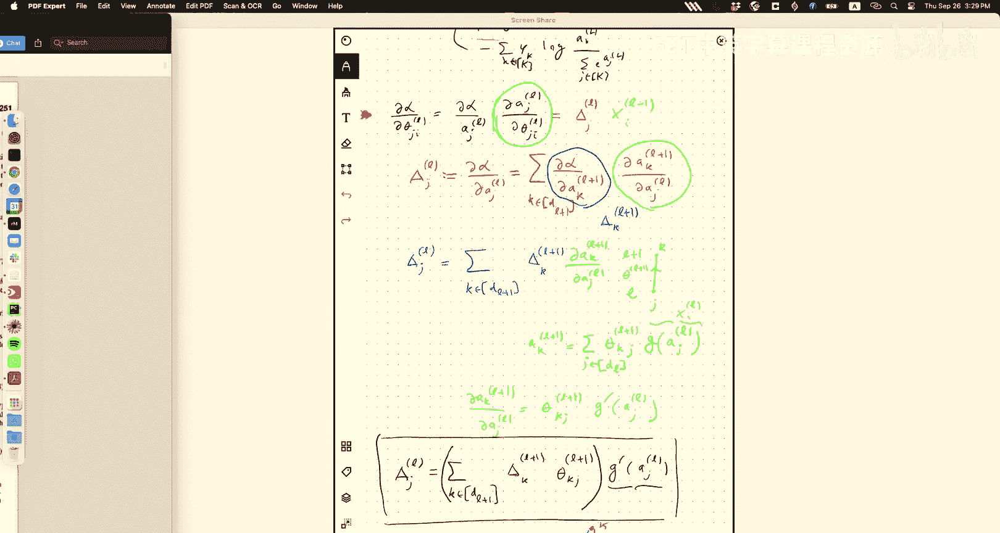

# UCB《机器学习导论｜CS 189⧸289A Introduction to Machine Learning Fall2024》claude-3.5 p09 L9- Backpropagation and Gradient Descent 2.zh_en -BV1H4421S7bs_p9-

还差一点。It's possible but that's not。I came thank you mess up。

Thank you so much for your speechs you covered so much， first of all， which is really impressive。

 but I was going to ask you about this graphic if you could interpret it for me because I know it kind of like like I love not pattern。

 but it's really interesting to me it's not not important or reference。エビはエビなち。す。

So if the index is higher， that means。And this is。Why axis here of polygons altogether。Over here。

What we're seeing is。For these green line neighborhoods。Percentage。That have eyesne。

And a lower percentage of it has monolo。It's a switch about。Raiers person is of0。Yeah。

 this is the same rating scheme that I。系。ABCO o。Thank you。 Yeah。尴。他觉这一。啊心。もしれないす。是太好的。that。这け。

AnyQu you are asking。I know you can arrive， but。あ。I hoping this is not connected now。

I know we can arrive but。Logistic regression。啊。From。Other priors other than Gaussian。

But this is not the answer to your question， especially small general from that time though。

Then you make some other。啊，你这个。好。でも我れ。あの水ジは。でさ。

这年。在可里可。All happened。No， it's just basically giving。I sure。計算んてはいて。哇。Okay， let's gradually begin。

So in today's lecture。We're going to finally arrive at one of the most beautiful algorithms in machine learning called bike propag。

嗯。Can we begin。And the assigned reading is we finally going to cover 5。4。

4 at the beginning of the lecture。And then chapter 8， which is on back propagation。

The later part of Cha8 I may or may not cover here。

 it's really recommended reading but it's highly recommended， it's on automatic differentiation。And。

I， may touch upon it in this lecture if we have some time left。So。嗯。So in today's lecture。

 I just wanted to start with a very deep overview of what we have done so far。 So you have a。

This is like a。诶。Big picture bears eye view of what we have done。

Please stop me if you have questions， even though it's a summary， but's part of the lecture。诶。Yeah。

 so basically， what did you do last time， Last time we arrived at this very。

A specific form for composing functions。And when you look at it， it's very simple。 Basically。

 you start from some index 1 and you go all the way to L。 right it's a iterative process。

 So when you start。You see all and very nice。 this one works actually。When you start from index 1。

 you go here。And。And so this， you have to start from something。 and here x0 represents the inputs。

 right？ You start from your inputs。 You have some parameters。 you pass it through these indices。

 you accumulate these signals。 right you arrive at a。

 I denoted by a A in the literature it' called preactivation for a neural network。

 but it's a very nice termology can also think of it as accumulated signal。

 And this accumulated signal。 this preactivation gets activated by this nonlinearity。

 And there was a question last time in general， this nonlinearity it's really even function of J。

 know it has a J index。 But if you want to make it less complex。Layer dependent。

 if you want to make it even less complex， which people usually do is just one on linearity for the whole network。

And so you just repeat this process right you're composing this function from the previous iterations and this function。

 as you can imagine， is highly nonlinear， I guess really really complicated right and that's essentially neural networks a fit forward neural network in this case。

And。Again， by convention。Were gonna have。This is almost universally the case that you typically take the last layer to be linear。

 the very last non nonlinearity， and the other， as I mentioned are fixed。

So the classic example of ge this is like the first example is historic for historical purposes。

 It was used for many early proofs is a logistic function。

 So this logistic here has nothing to do with the other logistic， It's just an nonlinearity here。

 and you can change it。 We can change it to grid function。

 which is a rectified linear unit or any function。You are in the mood for if you。

 if you want to experiment with other functions。 So this， this function， the left one。

 we motivated it from the neuroscience perspective， right， It just has this， this meaning of。

You know， typically a signal has to be positive is bounded in in the in the brain， you know。

 And so it's motivated from that angle。 But， you know， at this point。

 we are not thinking of it as an artificial neural network。

 We are thinking of this neural net as a as a nonlinear function。 So you， you。

 you can free yourself from the neuroscience at this point。

And we talked about briefly last time that the capacity of a neural length are two choices you can make。

 one increase L， capital L， the layers， the other within each layer you can increase this guy the dimension of the。

Your your intermediate layers right for the first layer and last year you don't have a choice right the problem is given to you。

 you want to have some you have some input， this is in D dimension and you have some output if it's a regression。

 simple regression it's just a one dimensional objects if it's two class classification。

It's going to be。Just one du run at the end， paraizes the probability of your class being in one by convention。

So then we talked about setting up a loss， right？ So this。

 if you reflect back everything you've learned so far， everything， you know， goes back at the end。

 there is something you want to optimize， right？ So so the classic problem of simple regression like a like a linear regression。

Really， this is the starting point， right， you， you， you， you set up this loss。 I mean。

 you can motivate it many different ways， but the most principled way is negative block likelihood。

 So anytime you see a loss in your mind， take a negative of it and exponentialonentiateiate it。

 right， When you do that this loss has a meaning is really a Gaussian， really。

 And it means that your likelihood， your conditional likelihood for the responses。

 you assume to be Gaussian， right。And for classification， this is a beernoulli variable， right。

 there is a probability of something being zero or1。😊，And。And so in this case。

 we know a probability of0 is probability of1 minus probability of1， so we just need one neuro round。

嗯。Let me just review this quickly。So， in this case。This is our input。And there is only one neuron。Ye。

That paraizes probability of this being one and this we did。

 we arrived at it there was the question before the lecture， we arrived at it from different angle。

 but logistic function is a very natural choice because it's a bounded function between 0 and 1 so this a can be any number and this can be a proper probabil。

 This is the proper。Prob。So you can have different notations， I like this notation of。

Loistic sigma it is a very special function。 I use sigma for that。 and any other not only L G。

 But you know， maybe your， your homeworks have a different notation， but。

It's just to stick in this talk。So the thing that you。

 I want you really to really contemplate on is that this loss is really。Retain， with respect to。

Activation at the very top layer。Right。So for a single layer neural net， it's very boring， right。

 single layer neural net， we have this one，2。To x1。To X D， right， And there is， obviously。

 there is also this。IThink that is one， which I。Right， typically。

 so the whole thing is really can think of it as x。And。So for a single layer neural net。

 what is this accumulation， It's just very simple。 It's just data。This is one， stateta1，1。X 1， right？

 And if you wanna be have a laborious notation because we're gonna generalize this。

 This is really theta 1。 So this is this。Plus， all the to Tita。1。嗯。嗯。Wn。In this case， the plus 1。

 I guess I can use this notation， which is simpler。The whole thing is the the dimensional objects。

So what is this。This is really the。Dot product of Tita。Transpose of this and x， right。

But you should really understand that this loss is written with respect to activation at the last layer。

This is a choice， you know， don't have to have this choice for a for a simple one single layer neural net。

 it happens to be that this will be a linear model， right。And， and。

So this happens to be only for the case for one layer neuro mat。She's a linear model。嗯。

And so let's stick with the one layer linear model for now and for one layer linear model we want to optimize right again here。

 for example， we arrived at this one linear model for logistic regression from the angle of generative modeling right if you know the this conditional distribution。

嗯。We arrived。 We drive this formula， right， I didn't just write it like this。

 We derived it from base rule。So for that problem， if you have。

 if you know your class conditional is Gaussian， given some data。

 you can fit the Gaussian and you are good to go， right， you fit the Gaussian， you have。

 you have already know the theta， right This you can go to previous lectures to find it。

 But we also talked about it。 that if dimension mentioned is very large。

 here you have to estimate a covariance matrix， which is over D square。

 And maybe you don't want to do that。This could be very computationally expensive。In this approach。

Theta is ofdi D roughly。 and you we have a loss。 We set up a maximum likelihood loss so we can go optimize it。

 right， So now comes this very interesting question that we had this function。

 which was written as a simple single layer neural net。 What is the gradient， right？

 What is this gradient that we that we need to go optimize this function。Optimize this loss。

 I'm sorry。 So， and we have to just stare， right， We have to stare at this loss。And what really is。

 as I mentioned earlier， this loss is really written with respect to the activation function at the last layer。

 right， So it just screams that please use chain rule。

 don't write the activation explicitly Use the chain rule。 And chain rule is very simple here。

 So I'm interested in this， this object。 And I write it as this one， that the loss is implic。 I mean。

 loss is depends on this， but。😊，Activation clearly also depends on your ttas， right。

 So that's the chain rule。This is。Chain rule in this very simple form。

And so this comes a very interesting。 we come at a very interesting conclusion here because this one。

 we already know， this is essentially X I， right， this is。😊，If you go to the previous formula。

 a is just a linear function。Of Tetas。And again， here。

 it does completely generalize us to deep neural networks， right A is always。

 you know we have the formula for neural nets。 A is always a linear function。

 right A's accumulation of signal is always linear。So again， just think about this is。

 this part is really， we did it for one layer net， but this。

This particular formula exactly works for a， for a。For a deep neural run net。

And then comes to another easy thing， which is more interesting than this one。

This one is the gradient of the loss with respect to the accumulation at the last layer， right。

So it's very easy like for a linear regression I don't want to go back and forth。

 but I guess we have to for a linear regression， this is the loss。

 so take the gradient under of it with respect to a It's nothing simpler right It just becomes。

Minus y plus。A， right。And。So we， what is this， you know。This is essentially why is the signal that's。

That is given to you。 That's the training signal。 And A is what the model thinks it should be， right？

 And if they don't match there is an error， right？ So then net forecast to adjust this weight to to compensate for this error。

 And that's what this is doing right， this error essentially， as long as it's not0。

 it drives the learning That's called error signal because of it。

 and logistic regression is much more interesting。 And we is a little calculation like two lectures ago。

 even I think repeated in the previous lecture。 So hopefully you fully understand this this calculation and here。

 again， same story。 it's more interesting because sigma shows up here。 And what is sigma here。

 we defined it in our convention。 This was really probability of one given x。

 that's how we parameterized it。 Its approximately this。So。And。1 given the x。And。So what is this。

 So if y is one。Naturally， you want the probability of one given x to be close to one， right。

And that's where the error becomes smaller。 And if y is 0， naturally。

 want probability of 0 given x be close to one is one。

 So naturally probability of one given x becomes close to 0， so。Right， so that's very intuitive。

 right？ So it， it just， it is also has the same semantic of error， right， and so。

This comes to the outline for the first part of lecture。

We're gonna stick with this one layer neural net， and we're gonna to do something more interesting where now we have K classes。

 right？ So in the previous calculation， we only have two classes。 If you have more than two classes。

 we have this model where。You know， we have。K classes here。And again。We had our x here。And。So。

 this is one。2， in my notation， D 0。So this is x to X D0 to my notation。The zeroth layer。And。

And we have the same formula for AK， so AKL right here L is clearly1， right？え？Tita， K， I。One。

 these are the first layer。And X I or I。Takes indices in these many indices。

 So in here I'm using a notation is conventional mathematics where when what I mean by。

This bracket is really a set。1，2， k。I've used this notation before， but just to make it clear。

R this make it less busy。But this is a big but， really。This is what happens under the hood。

 What really matters at the end for the log likelihood is we constructed the probability。

This we call P， K probability of。My data being in class K and really taking the negative of this exponentialonentiate this is really the what we have written here is。

Log， negative log。K1，2， k。PK， like， right， that's exactly。

If you take the log of the product becomes sums of log with it that y comes down and you arrive at that expression。

 so now we want to do the same。 So again， go here， nothing changes， this is very。

 very general for any loss that depends on activation in the last layer including this current laws that we have。

This part is exactly as before。 Nothing changes。 And we just need to drive the gradient of the law。

 the gradient of this loss which is6 to a。 So now we're gonna do that calculation。

 So I'm gonna switch over to do that that， that calculation。

 So this essentially completes the picture， right， So we know how to do。Regression。

 you can call it Gaussian regression， logistic regression and multi class logistic regression。

 when we know when we arrive at this formula。 So before going there， can you。

 can someone make a guess， we remove this。Can you guess what the answer is。

So there a good practice to guess before doingcal。ライツ？Essentially。

 these formulas was pretty much very， very similar。 We have Y。

 and we have the error what we want to get。 So I want you to guess that there is another line。

Multiclass。Regression。And we have now。You don't have only one unit at the end， we have K of them。

 right？Again， L， this is the last layer。 We have the loss。 What is the answer。礼拜啲。Don't be shy。

You can say a wrong answer。So let me help you。 So what is a K here， A K。

 So we had like K units on the top。 I don't care what what happened at the bottom。

 That's essentially the inside here。The bottom for now is a single layer soon it's going to be many layers。

 but what matters is there is a accumulation here a1。To ak。Right。

 it arrived at here this accumulation。 and we constructed a probability。 That was our model。

The P K is。E to the AK。Som， E A J， J。runs from Mon。RightThat was our model， right。

So if a class belongs to class K， right。We want this probability to be close to it。

 right We observe a signal。 And so let's assume here is。The class  one is a cat。

 and the last class is a dog。And we observe an image。 This image is a dog。 right？ So why。

 and we define why， what is how we define why， why was the1 hot，1 hot object。 So if， if it's a dog。

My y is going to be 0。记入。1ant， right？ Thats how that's what it is。And， and this。

 we already know this is that has semantic of an error。Right。So now you， should give me the answer。

So it's really going to be P， K。minus。Wake。Right。So if if this K is capital K。So these are。

 obviously you see all the small caves。So if this small K is 0。

It means the probability of that class。 you want it to be small。If it's actually a dog。

 you want the probability of the do。 we approach to approach one， right。

 This is what we expect to see。And let's do the math now。 My worry is。Okay， yeah。

We arrive at the same formula。So let's do the math and math is。

Slightly more interesting than one we did before。Any questions on this I think？I。

 I was hoping somebody would guess the right answer。But you really。

 I want you to be very clear what we have done。The multiclass logistical equation。Any questions。

Is it clear why I guess this answer。Yeah， so again for a multiclass regression there are the output neurons or K capital K neurons。

 the output class， and that's also my signal， my training set， right。

 my training set has capital K neurons。And neuro that has capital K neurons。

 And it's one hot encoded。That's how we set it up。So this is one hot。And this is the reason I wrote。

 I wrote this， right， It has the same， the same semantic as， as the Gaussian and logistic。

 But let's do the math。 I think it's more fun。Now that we guess the answer。I'm gonna switch over。

 and see how。Iasy this is。Okay， so let's do the calculation。So the calculation if。

 we are interested in。This guy。So， Delta K is。D L。Dei。AKL， right？And。嗯。I'm going to ask you to。

Forgive me for because I don't want to carry this L throughout the calculation。 So this is really。

Have it in back of your mind。 There is like L hanging around， but just it。

 we're going to just add it at the very end， okay。嗯。And so， this is。DDAK。

What is this a loss that we wrote。Is white k。Marock。And it's a very。Dangerous thing to do this。

 So we have to use a different naturally， we have to use a different label to things get confusing。

And what is Z， Z is this normalizing。 it is what gives you a probability。

 We want this E to the Asia divided by to Z to be a proper probability。 So Z is。So。

 lets see to the eye。One to， okay。Is it clear。So now we need certain things when we undertake the this gradient。

We need the DZ DEK going to appear everywhere。What is this。I need help。Yes， thank you。

 This is E to the AK。 I just want to check everybody at most of you is week or awake。嗯。Now。

 on this guy， we defined it to be PJ， right。Now comes the interesting math。 We want to do PD D，PJ。

 D AK， right， That's what we need。In this doing this derivative， and there are really two cases。

Right， its clearly there are two cases。 One is the case where J。Is equal to K。

 The other is J is not equal to k。And J is not equal to K。 That's easy， right， is E to the。AJ。

 and we already know derivative of1 over z。Right it' minus derivative of z。 we this speak to aK。

 which we have above here。So that's E to the AK。Divided by z square， right？That's the easy one。

J qualitative are two terms involved， right we have to take first take the derivative of this。

So that will be e to the Aj derivative e to the AJ which to AJ is the same exponent。Right by z minus。

Agains the square。It to the AJ， and we already did the calculation here to the AJ。

So let's write these in terms of PJ。This becomes PJ。Von Min S PJ。Right。And this one is become。

 this one becomes minus P J P K。And now comes the easy one。

 We want to combine this two expression into one。So this arrive at a very nice formula。And that is。

Pj。Eelta JK。Minus Pk。That that's clear？So if J is not equal to k， the delta J K is 0。

 you get minus Pj P K。 And if J equal to K， you get 1 minus Pj， right。So。We use now this machinery。

To do the calculation we are interested in。Go back to this calculation。So now， thatll okay。Is。So。J 1。

2 K。Yj。And。Gradient of the log is one over what goes in the log。Now， we need。

I'm missing a minus here。D pj。D Ak。Right。a career， this whole thing。Is the gradient of the log。And。

 and。Sos one over PJ， we did the math here， is PJ。Delta J K。😔，Oops。Minus P， K。We are not done yet。So。

 this。Cances， right， That's nice。 So let's group these terms。 You're summing。The first term。

 you're summing Y J Delta Jk， summing over all ks， right， all the way to capital K。

 So that's clearly minus yk。And the second one is plus， there is minus， there is minus here。S， plus。

And if sum of Y J。J1，2 K， PK。Can someone help me to。Make it simpler。 What is this， What is this guy。

 some over Yj。What is why？Why is how we represented our classes， right？

And we decided to pick up one hot encoding。So if an object in any class， this is， this Y is a vector。

But it's always， is's basically everywhere 0， except for one place。 That's one。

 That's how we defined it， right。 So what is the sum。Is one， right， so。This is going to be。Wn。

And hopefully， we arrived at the answer we expected。It's going to be P K。mininus。W。Right。

And this is what， really。Without doing any math， we expected it to arrive at this。So。

Any questions here， great。Delta， you mean the little deelta JK。

Do you know the chronicronical delta function。 That's what I'm using。 So Delta J K， I'm sorry。

 it's good。 I should have， we shouldn't have assumed that。 So Delta J K is really a function。

That if j is equal to k， this is 1。If j is not equal to， K is 0。Exactly， it's a coronary care delta。

 right？So， I just wanted to absorb。And you know， we drive this DPJ， the AK in two different forms。

 right？And。When you look at it， clearly， you can combine it using a chronicical delta， right。

That's what we did。 So essentially， yeah。Yeah， I mean， this is what what I've done here is， yeah。

 it's very simple。对。Why some of。W。Why is one hot encoded and summing over this vector。Right。

This is a vector and summing over all the elements。Yeah。So， this。By construction。

 we defined it to be one hot includedd object。 So sum one。Yes。这个。Yeah。Exactly。Yeah。

ItA Q trick that you're gonna see。Everywhere， yeah。Yeah。

 it's a very nice representation because why is it nice。

 Because immediately suggests I can also have probability of each class right and that's。呃。Yeah。

 so P K you know， becomes a probability of that class。 Obviously， if an object is really a dog。

Probably of being a cat is 0。 right， That's why it's motivated。 this one hot coding。

So but you' are asking kind of like a research question at this point。

 So there is a nice paper called labelbel smoothing。So maybe I write a four here， for example。

 especially we do M classification。Let's assume， let me write a little bad for。You know。

 it's a very bad for。And you know， maybe it's a nine， you know？So， you know， then。

 when the class is assigned to be a dog， maybe it could have been a cat。 you know。

 So there is this trick called label smoothing where you relax。 It's one hotingcoing。

But you keep it sum to one。 And that really， that's essentially loss of probability。

 But the simplest thing that goes。I the way2。So this label of smoothing is actually from maybe five。

 six years ago， remember now。But putting that aside。It's really， the idea is if an object。

 if it's in a training set and it's classified as an object。

We assume the probability of being other objects is 0。

 That's what that's really the original one health encodings。Any other question？Good。这是个。

This very good question。It has a little K index， right， This is a little K。

 So it probably is error for class K and that's really what drives the learning。 So essentially。

 let's assume this was actually a dog。😊，But the。But the networks of Y K for essentially Y K has this form。

I'm going to go with my previous example that it's。0， everywhere。Except for the very last one。

 This was the dog part， right， And let's assume we have trained this network and。Somehow。

 at the very beginning of the training， it thinks it's a cat， you know， at the very beginning。

 So there is clearly an error。 So P of that capital K， the last class is 0， roughly。 And Y K 1。

 So this really， there is an error signal here。And next， this is a very good question。

 leads to the next question。So we know how to do this for you know everything is done now for a single layer neural net。

 if you construct your a to be just a linear function。We know how to do learning， right？

Let me go back。We know how to do learning and that's we have this very master formula。 It's very。

 very general for any loss。The gradient respect to parameters this gradient of Albert respects last layer activation and gradient of activation respect to tita。

And we are good to go。 So we derive this in like three very general setting， you know。In your life。

 probably you do regression or classification to class classification or multiclass classification。

 And we have， we have the， we have to drive this， right。So this。

 this is the error and this error dictates how the is changed depending what x is， right。So now。

We going to do the same thing。But。For the general problem， right， we have a loss。

And now this lets me know we've written it in every case in respect to accumulation at the very。

 very last layer， right？But this accumulation at the very last year。

It was very simple for the linear functions， right。

 but it's going to be very complicated if say very deep in run net， right。

 It's very non sugar question。That。What is this？How whats what's the most efficient algorithm to compute all these。

 all these gradients。 So this is the object of interest， right。

And so the natural generalization of what we did， right， we drive。😊。

We motivated this definition for the very last layer， the very last layer has a very clear semantic。

 That's really the error， but let's define it for all layers right and let's also call it error right error is the error we respect to that that layer。

 This really a naming is you know。I don't have actually intuition why you would call this error in some sense。

 but the very last year it' very clear。But also， the definition should be very clear for you why this object is interesting。

 Because really， if you look at the neural network。You can abstract the way everything that happens。

As we go up as this accumulation of signals， right， really， we this accumulation。

 If we go to the very first equation we had。That we define the neural net。And here。

 I use the different colour to emphasize it。 Really， what goes up。The neural net is a， right really。

 a is everything。诶。Could have called it E。And so this is this accumulation that goes up。 and we。

 we really expect it's very natural to define this loss。 It's this gradient。

 We are interested with gradient， but we， we're gonna do the math。 we're gonna see this。

 but already without doing any math。 should have some intuition that's why this object is interesting。

😊，诶。So obviously， it's a very important historic。诶。Result and。I read this paper once。

 so I highly recommend you read it once in your life and now this is a good time。

 so it's the original paper on back propagation， learning representations by back propagating errors。

And。嗯。It's a very short paper in nature， hopefully I think you have access to it through Berkeley。

But already， you， you know， let's assume you don't want to do this。You are。Lazy， in some sense。

 you already have an already have another algorithm that can， that can take the gradient， right。

You know， we know how to， how to find the loss， right。And we just do finite differences， right？

 So this is essentially very simple。This。Its really。I'm doing a tailor expansion。

 This L is called this dots。佢唔 lazy。Dot plus epsilon。This is really L do。Plus。

 Epsilon gradient of L dot。Plus， epsilon and squared divided by2。The second order， right？

The third order。And we do the same thing for minus。Now， because minus。Again。

 minus the squared is plus。So you divide this by two epsilon。

 and you subtract this to these terms cancel。 This this gives you two epsilon。

 divided by two epsilon。 So this becomes roughly your gradient。Plus， some error over there。

Epsil on the square。So this is， I call it doubly bad。 Its bad because for each parameter。

You want to tweak each of your parameters of neural net， you have to do this computation。

And we know this computation is of order number of parameters。Right， so the order of computation。

 this order of this computation。Itself， this computation is of order M。

And you have to do this m times。 So this whole thing。

 if you want to obtain this for all of your parameters in this approach。

 this becomes of over there M squared。Unless's assume you are in a G forward。

 M is we talked about it。 It's like a billion。 right， So thiss essentially forget about it。 This。

 we cannot do this way。呃，第 other。It's not a big deal。

 What the other bad thing about this is theres a epsilon。

 You have to think about what is this epsilon。You know， maybe 10 to -6 is good。

 Maybe it gives you under flow for some of the parameters。 You don't know， so。We are we gonna。

In the next 30 minutes we we're going to arrive at an algorithm that's exact right of machine precision and of order M。

 so we're going to pass through the network once， the same thing that we computed L。

 it was of order M。We're going to do the same thing and get all the gradients we need。Okay。

 this is very exciting， let's do this。And is motivation very clear here？Any questions on the bottom。

 the footn calculation？Okay。Let's go to the next。Wn。😔，at my notes here。Yeah。

 I'm going to use the same notation as。I wonder if I should write it here。 Let me write it actually。

 So we're going stick with our。Notation I introduced in the very first slide。

 So what's the problem we are interested in。We have。 We want to。Compute。The loss。

 is depict on arbitrary parameter， this arbitrary parameter。Is。The way I defined it in my oh。

Go want to use glue everywhere。Is。S on eye。Luangz。This is take。Zaii。And this is layer。はい。

That's our notation。And we are interested。In。Finding this gradient for an arbitrary layer， right。So。

 obviously， I takes indices。And D L -1。J here takes indices in DL。And that's it。

 And you are interested in this gradient。So let's write what we wrote in the first slide。I'm gonna。

 I'm looking at my first slide。So。So what goes， what happens in this neuralette we are interested in know accumulation of signal at this neuron。

 the signal is going up， So we need this AJL and that's really very easy。 That's theta JI。L。哦。X I。

L -1。They use the same notation X。Yeah， and if I。Was D L-1。And we need another thing。 What is x。

 So we have written a in terms of x， but what is x， X is。Its written， very simple， point5 linearity。

Oh， A J， oh minus。Correct me when I'm making mistakes as I lie。And。

So let's quickly write the loss that we have。So again。

 review everything with respect to the very last layer， right？So， this is a。L， my notation。

And we had it for minus y log。Sigmoid， A L。-1-1 log。1 minus sigmoid L。Right， and its for。

 first for the two class classification and for the multi class， we just did it。Lock。AKl。

Divided by the sun to the A J L。Bot。So， now。We gonna。Just use the chain rule。

We are adjusting these Tis。 and we are interested how loss changes。

 But we know that in the neural net that。The signal gets only the only thing that is。

Depends on really explicitly this accumulation， right。

s you already know we can write it as a chain rule。 So let's write our chain rule here。So。

 this is D L。D tita。J I L。And so this signal is going up， right？ So I write it as D L。The A J。L。

 right。And第一。AJL。第汽车。Zha。Now we're gonna to use our rotation now。Because we。

 we know this is a very special object。 So I'm not gonna keep writing the L D A J L。 This is the。JL。

 so what is this， This is essentially the error。Of neuron J at layer L， right？That's what it is。

And this is the boring one， this the。It's very simple。Again。

 this is the beauty of neural net is composed out of this linear object。 It added non linearity。

 So this is the linear part。 That's very simple。That's really。

Let's see it's in front of us hopefully。 Yeah， so this is the AJ divided by the derivative of this。

 we， we respect to this。 So that's really。X I。L， -1。Essentially， we have only。

 we haven't done much yet so far。Now comes the interesting part。Now we're going to write。This one。

So let's， I want you to， I want to pause a little bit here。

 So this is essentially we defined it to be。BL。D AJL。I want to write this as another chain rule。

Can somebody suggest a chain rule here？I think this is most important part of the lecture。

 so let's pause and want you to think。I can help you a little bit。

So we are interested in derivative of。The final loss with respect to accumulation of signal at an arbitrary layer。

 right in the middle。What we already know。 Okay， I wna。啊。

Do you mind I kind of want to have experiment with， Do you wantan to write it。

Do you want to write it？It's fun。Beang。Sir。Yeah， so my rough idea。What that exact number？

We're applyinglying like G to A with activation。So I was wondering whether potentially。

It was something like。What is G here， G was the activation function。

 But maybe it's better if I'd said， use the。I mean， yeah， but we do， we have this notation， right。

 we， what is G， G of A L I L -1 or。I don't know what do you mean， by G。Oh， I see， maybe x is better。

Yeah， cannot see。嗯。Y， L would depend on X， I， L。Yeah， but then I think the， okay， this is very nice。

 We have written this is probably valid。 but have what have we gained here。

 We are interested in writing everything we speak to we， we define this object， right， error。 We。

 we are really want to express everything in terms of that error。

RightSo we really want the LDAJ to appear again。But yeah。

 it's very good that he wrote this because it's actually is this back and forth helps everybody。

 Yeah， so essentially the idea is if I can take over， the idea is thank you。😊。

So what was written here was。Not in terms of Delta。 So we want to write everything in terms of Delta。

 And we already know this。This， this error， right。啊。

We already know the final error only depends on the very last layer， right。So， let's go back to。Or。

Final expression。Final loss。哦。Yeah， so if I look at the expression for the loss。Actually聊有我这厉害的天使。

Go back here。So if you look at this expression。Right。If I look at these expressions。

 if three time with respect to the accumulation at the very last layer， right。

 So this accumulated signal goes up right， So a natural natural chain rule。

 I'm not questioning your chain rule， I think it's good to reflect on it。 But if I really。

 if I am interested on expressing this deltas with respect to other deltas。 That's my goal。

 then naturally， I want to have。Let me write it。Naturally， I want to have D L。Di。😔。

We need another thing。Successing okay。L plus 1， right。 So this is D L， D A K。L plus one。

The AK L plus1。D A JL。And obviously， I need to sum over K。And what is this sum now， this sum is over。

No round in the next layer。Right， so this signal is going goes up。 And I already know that the error。

You know， I can write it very different ways。 But already know final error depends on the very last layer。

 right， We might as well as this channel rule。 So I'm just pushing the error  one layer up， right？

 That's what I'm doing。And this is very nice because now we're gonna use our definition。

 So we already know that this。runningning out of。Colorors， so this。I what is this？Is Delta K。

E plus one。喂。So basically， what we have done。We went one layer up。So， we wrote this as some。Ki。😔。

D L plus 1。Eelta K。Oh， plus one。Right， and now comes this very simple objects。 called andqu simple。

 right， because。This is essentially the taking a derivative of one linear thing with respect to another linear thing。

 And as we can imagine， this is not that complicated。 So let's write it。So， this。

Apologies for all these colors。 but I think it helps。So， this。You are interested in this one， right？

Use a nicer notation here。Yeah， so let's just write what it is。 So what is A K， L plus one。

 So essentially this we have it here。'm going to just write it down below。So， this one is。

You're going from J。To K。From layer L to layer L plus one。Right， and let's write down what A K。

 L plus  one is。Number the way， we have this expression in front of us on top here， right。

 We're just going to change。K， J goes to K， I goes to J， and all the label is going to be added one。

Actually actually。Yeah， let's make that。 keep it。 so you can see。So， A K is tita。K J。L plus one。

 right， This is your are dealing with nowta L plus one now。And what is X I。

We're going to write everything in terms of a right X I L minus1 is really G。A J L。Right。

 this is essentially。X， I， L， right。And J goes from whats J is in D L。Any questions on this？

So what have we done。If want we are interested in taking this derivative。

 You already know it's going to be simple。 We are taking a derivative of a linear object with respect to another linear object。

But this linear object depends on， on the。I'm sorry。 this， this accumulation。

Is accumulation of signal that came from layer below and layer below was the non nonlinearity was at。

 So this is where G where we have G here。 So let's do the So here let me write this expression here。

 this is the AK。I plus one。D， A J， L。So this is now in front of us。 This is the math。

 So we taking the derivative of L plus1。D A JL。And here， if you want to be。

 I'm being a bit sloppy here， really， what I should do is J prime。

This is a very important rule when you do calculus， you don't want to。

 there's a dummy index here when you're this is not dummy， this is dummy。

 but this is very boring because we know gradient of A J prime L。The A J L is that deelta is roughly。

There is a delta here， chronicrona Delta。Clearly， the accumulation of a neuron in this same layer doesn't depend depending on accumulation of the next door neuron。

 right， This comes from layer below， right， So let me。In this case。

 be the sloppy because I already know the answer。Toれ this。Gona stick with our。Zhe。😔。

Whi time do we have。So， this is now。Okay。So， let's put everything。Back up。Oh， I'm sorry。

 I made a mistake here。 So essentially， when I'm。When I'm taking derivative to a particular J。

 that sum， only one term is one term is appearing， right， because of this chronicronal delta I had。

 So there is no sum here clearly。Okay， it's beautiful， right？

So we can now arrive at our final expression。So essentially， we wrote you arrived at this。Delta J。

Well， the error。OfOn the L layer of Nuranje。Is return with respect to the error of the neurons at the higher at the。

Higher level， right。Delta k。L plus one。And we have Tita， K J。Plus， one。And here。Okay。

 okay I can write it through straight away。Right， let's just a bit stare at this now that we are right at this。

 Let me make sure that that the。Correct expression。Oh， yes。 So here， clearly。The thumb is over K。

 right？So this we can take it out。Right， I guess it's nicer。 I like this to put it on the left side。

 but it's okay。 So there is a sum。And there is this gradient of your activation。

And the accumulation of signal at that neuro run， right？So this is kind of boring， right。

 it's important term， but essentially says the error。

We are computing the error of this particular neuron。

 We look at the accumulation of signal at that neuron。

And there is a nonlinearity take the gradient evaluates this， right？And thats is just a constant。

 But the most important thing is we have to sum over the。Errrors from the。the layer above。

And the beauty here is you just multiply it by Delta Kj。

And this is the same parameters of the neural lens。 right， So if we have one layer。We have errors。

 we want to compute this for a particular neuron， we go to the layer above and look at all the errors of the higher neurons and just multiplly it by Teta right so this is in the original paper it's called back propagating errors literally we have another it's not the neuraln net anymore。

 but we use the same network to back propagate the errors right。And。

So this becomes a recursive formula backwards， because we write the error at layer L in terms of errors at the higher level。

And when， when should， how should we start， Because it's backward， clearly。

 we have to start from the error at the top level， right， And we have already done that。

So you can write the most important paper at this point。

One of the most important papers in machine learning。 So is done right， So we have。

 we have expression for error。 I'm sorry， I'm gonna to quickly finish at at the top level。

 and we have the expression for all the errors get get accumulated。Going down。 And this coupled with。

 obviously， the most。You started with this expression。This one。

There are two expression that you need to know。 One is。Yes。

RightSo if we write a gradient with respect to a parameter。

 that's what we need to do gradient descent in terms of these errors and these errors are written in a recursive fashion and we already did the top top error so basically we have an algorithm and the nice thing what this algorithm is is just one pass right。

The catches， you need to store these， theseguise。Well， it's not a big deal。 You know， we already saw。

 let's say GP4 has a million parameters， but it only has a million neurons。 you know。

 that's you need a lot of， you need to have a big ra for your GPU。 but that's okay。

 So we're gonna store these things。 you need to have a storage of you need to store when you go up。

 you need these guys to calculate there or you want to have it around。

 But the rest is just back propagation of signal。 So essentially we are doing。

As we did as as we computed the forward， this is， you know， you can say modern software。

 you can just implement this， you know， you don't have to do the calculation， which very。

 very insightful。 you already can stare at this and see， oh。

 the tados get multiply right if I if I do this just in your head do the recursive fact。

 all the thedos now get multiplied。 There is no， you know。

 no nonlinearity specifically is Tida right， This already suggests， oh。

 there could be a problem down the line because if you multiply a lot of tis， And you have a very。

 very deep neural run ads。You may get an exploded gradient or you may get vanishing gradient。

 And that's the problem we're going to talk about maybe in the next lecture。

 but but putting that aside， now we have an algorithm and that can run in order M， right。

And we can calculate all the gradients we need to do learningric。Great。Did I make a mistake？啊。Oh。

 actually， this is the not a bo feature。So it's really。You know， in going forward。Y。So essentially。

 we are interested in how the errors from neuron。K back propagates to neuron J， right？

And these neurons were connected really by Teta Kj。And when we were going up。

 it has this clear semantic that you know。The activity gets also by Tita Kj。

 but there is only one tita around。So if we use the same tit in going back。

 There's actually a comment on it in your textbook that pay attention。 or there is like reverse。

But that's good observation。 But I think my calculation is correct。Yeah。

 I think its essentially you are going use the same Ti。Hingguing。I mean。I need a different。看点。Oh。

And going backwards。Right， empty。But if you read your textbook。

 your question is already commented on。You know， the order is kind of reverse， but。

I'm happy I achieved my goal of。Finishing this in， in time。

 I really wanted to go slow because it's like a really elegant algorithm。 And。

 and I think it's a good thing if you go home。Start from a blank sheet of paper， right？

And just derive it again。 So everything should be clear at a very high level。

We started from the fact that there is a loss that we can respect to activation at the very last layer。

 right， We already know in a neural net。What matters is this activations that goes up， right。

 And we already know errors with to the last layer。Right。

 so its already suggests what kind of change rule you should write。 So at the very high level。

 hopefully。You know， there's a lot of equations here but。But things should be very clear for you。

Lets me。If there are no questions， I can quickly comment。On the。

One question I asked in the previous lecture。嗯。Any， any questions。

I have like five minutes to comment on something， but doesn I can't comment on it like next lecture。

Any questions on back propagation？Yeah， so I guess maybe I can talk about this in the briefly in the next lecture。

 It's kind of tied to the fact that the architecture matters。

 So I just wanted to comment quickly bring out。Let see， I hope I have it here。啊。

So this is in your textbook there is this nice section on automatic differentiation。

 again it's just a recommended reading， but it's good to I give you very。

 very high overview of what's goes there。诶。So in a modern neural net a neural net is not a simple fit forward neural net。

 you know there are all sorts of skip connections that can be very complicated so you don't really implement backpro。

 you code up your neural net as a graph right it's a computation graph。

And you give the tell the software to take any gradient you like， right。

And so this is a subject of called algorithmic differentiation or automatic differentiation。

And so essentially， if you go to our calculation， I really use this layer layer layer。

 So if I have a skip connection， I have to redo this calculation， you know， strictly speaking so。😊。

Clearly， niceness86， they didn't have a skip connections。But in general。

 you escape connections can be taken care of。 So if you look at。What。They lose my owner。Yeah。

 if you look at。St at this。啊。Sorry。If you look at this。What we did here， really。

 it's this indices where at the abstract level， we had a graph。

The way we constructed the parent is the input as a graphical model and our children， right？

The next layer is the child。 And then the very， very top layer is the grand grand grandchild， right。

 And we can really think of this as I looked at the。I looked at my child， right？

The at the layer was the error of the node of the child。And really。

 this is what goes into automatic differentiation。And there are two ways to go about it。

 One is you construct it such that you look at the parents。

 So this got a forward more different automatic differentiation。 But what we really did。

 So what goes in here is you keep track of your gradient with respect to。Your inputs。

But what goes into the reverse mode differentiation。

 what we did was you take the gradient with respect respect to the activities， right。

And so this is the difference in one case， the parents showed up shows up。

 and one case the child shows up ands really this at a very high level， it's really。

 very abstraction of what we did。So I just， you know， you should really think of。

B propag algorithm is， as is a very elegant instant of a very particular graph。 right。

 for the general graph， it's you know。It's more complicated。Yeah。

 if you have questions on this section， if you read it。

 I'd be happy to talk to you about the next section。 Thank you。でつかゆょし。Which one， Yes， automatic。

Some of it's like you。最高。And I wanted to kind of show you what I was。Let me actually。

Because we can go out lets。

Do up process。