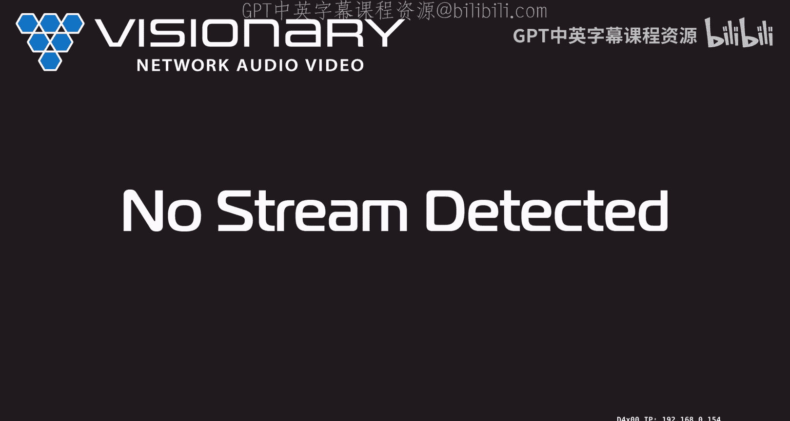
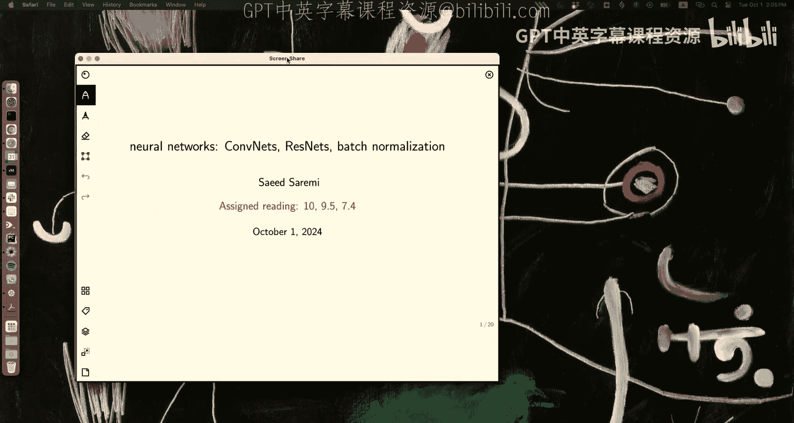
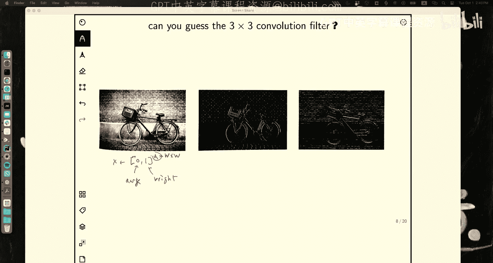
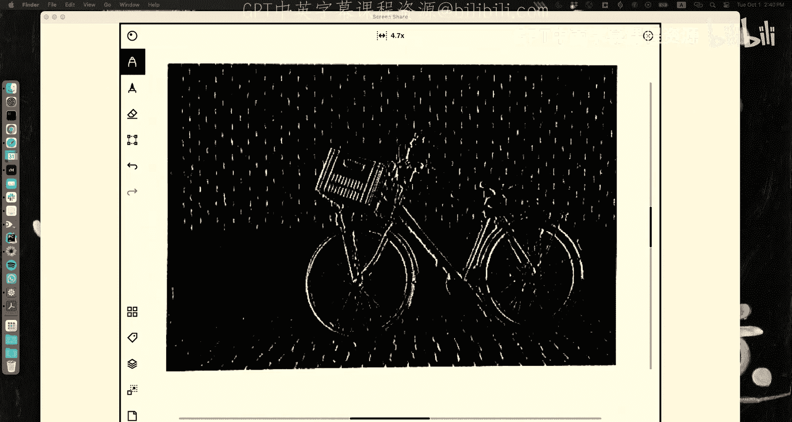
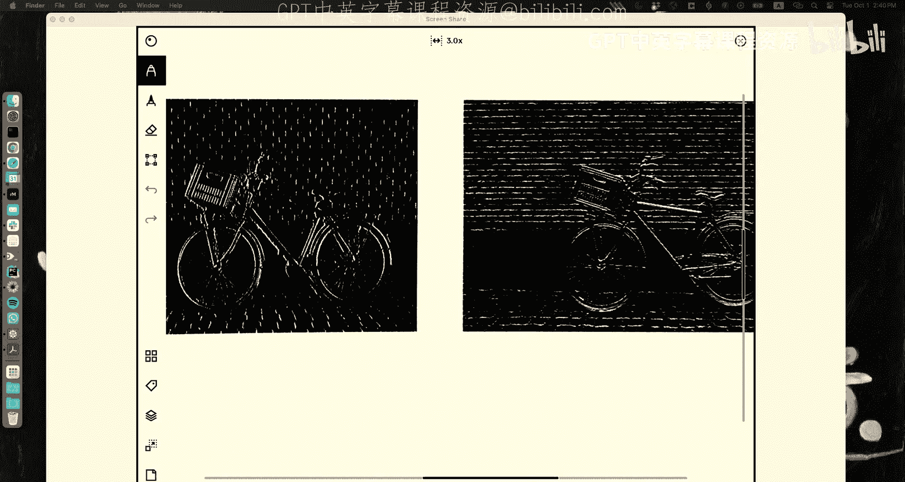
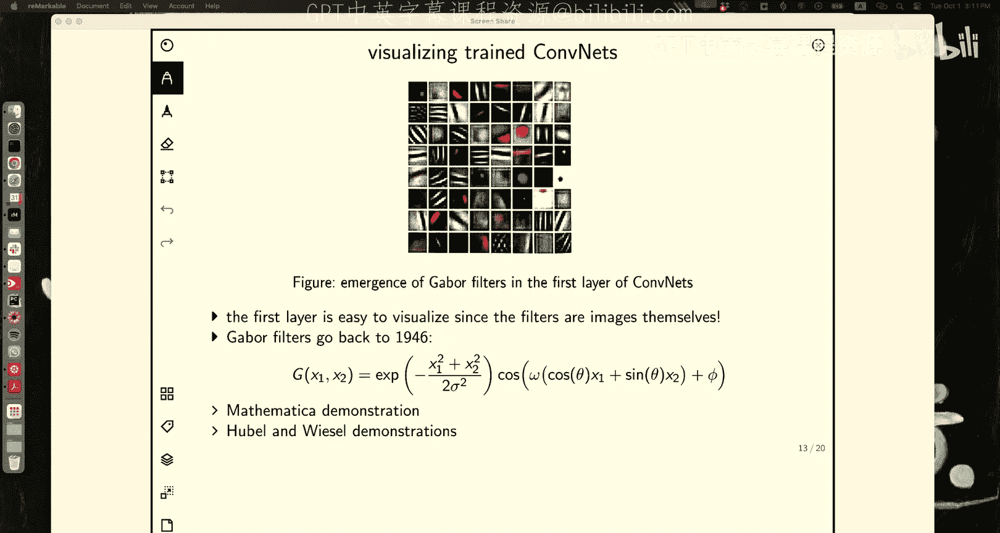
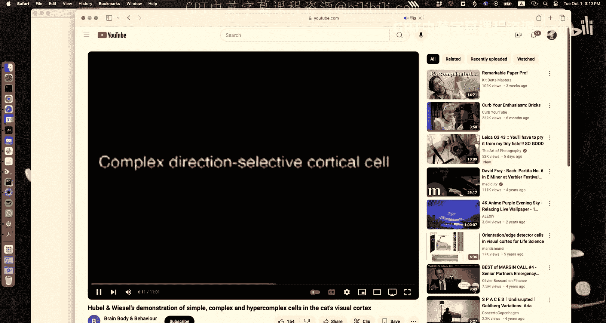
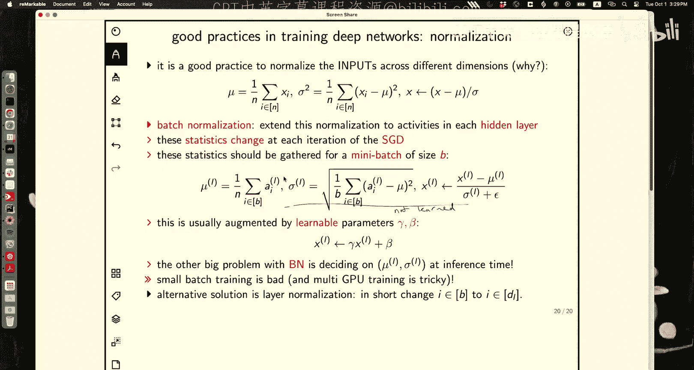

# UCB《机器学习导论｜CS 189⧸289A Introduction to Machine Learning Fall2024》claude-3.5 p10 L10- Neural Networks - CNNs, Batch Norm, & ResNets.zh_en -BV1H4421S7bs_p10-

Yesス。对是跟在。やそし。こ。这1413。

やしくさ。这。好。あそうだす。表局く。Yeah。なせです。厉害。And problem。時のわ議の。understand。是下。やほしい。回去搜一句。下ly不。

So let's begin so today's lecture is going to be about。

Mural architectures in particular are going to go deep into a class of architecture called convolutional neural。

And that will be the bulk of the presentation。Backboard in the book。So that's chapter 10。加三规定。

And then we're going to talk about residual networks。Then after that。

 hopefully well have time to talk about some normalorization techniques like that imortization。嗯。

So let's start the summary of the previous lecture。So， we have learned how to。How to呃。

Compposed functions in a very elegant way， as done in neural networks。

It's elegant because it's a combination of two simple operation One is。

The first line is doing some a transformation of the previous layer。

And then up' bring point slice on in the edge。And。If you make this wide enough and deep enough this function。

 it turns out that's very， very powerful。诶。And so as a some abstracttraction。

 we can call this function FT。Tfi absorb everything， all the parameters are。

Then we are network into this detail and so for now， but we have problems we have looked at。

A problems from the key and the space RD。アケ？S regression this capital page one。あ。

Simple logistic regression capitalK is one again for softm regression capital K can。呃。

And we have seen that in general， when you set up a maximum likelihood and then you have some IID data。

😊，The likelihood because you have AID likelihood is the product of this likelihoods of individual data。

 and then you take a log of it becomes some of them。So it has at some high level， the loss。

 the negative block likelihood would have at this form， right， so some of losses。

So basically we have now after three lectures， we have come at this very interesting formula。

So you have some y that you want to match。And you have some neural legs。

 so you paraized your responses by Ftita and you have a loss。

 And we saw several examples of this right， I'm not going to go through all of them again。

 but let say simple one you have。Its regressiongress。はい。And。

And for for for the soft softm regression， this takes a form of。Mus log。Y I。さり。Not why。YK。得 k。嗯。お様？

そ样。You're testinging your knowledge too。Lo comes here， right。The some of it。Again。

 in the back of your head， always。诶。都在都在闹。why not is that the power why？

And some ofs are multiplication， so you see where it's coming on。呃。Let see that。

And and more importantly， we have this very， very。Out of luck。

 we have this algorithm that works two ways for us。

 One is that it's really hard to calculate that loss。

 If you have a data set which has a million samples， right a small n here is a million。

 you really don't want to calculate this loss。嗯。This n can be much， much， much bigger than one。And。

On top of that， this lost landscape， especially at the beginning of the optimization， is very rugged。

And if you really， you may not follow， you may even if you know the gradient。

 you may not want to follow it， you you may want to add noise。

 and these two things happen to be hand in hand。I mean as sacastic gradient。

 there the thick gradient per sample that's in this pure form in the extreme case。

 or this can be you compute this over some mini batch。And you probably have。

Done some of these in your homework。So let's now think about what what what what we have done。

 So what are the orders of this， these numbers。 So， and we we talked about it， right。

 I mean the maximum。In your life probably， you didn't need a million， right。D let's say。呃。

Of order 100，000， if you had a larger scale image or this same media， but this is for now。

 I mean I personally appointed。当事人。And then what's capital capital A to say the most complex problem is the imagenet。

来。There have been many， many classes of dogs and mushrooms。

And imagine that how many classes does anybody know Imagine that competition has。

 it's the larger scale classification？I'm sorry。Yeah， exactly。 Order 1000。And now comes M。

M is the number of parallels on what's N。 we talked about G4。This was up。talk the budgets。

Ofough order。Is it a million， Is it a trillion， I a billion。If getting to trillion。发看的。

So this M really eats everything else。Gantic number so this led to be really。

 really it's an existential question that we really do we really need to have an algorithm that computes this gradient that you're interested in right this is thecious gradients。

 you really want to compute it the on order。😊，And we have this algorithm in the previous lecture。

And the algorithms turns out to be extremely intuitive。

And how it works is you compute these things called errors， you define this object。

 you is gradient of the loss with respect is pre activationivation quantity A。

 so a is a linear object， right？With respect treat there in general， it's a complicated object in。

I said the previous day had senior。And wecompose the gradient of L as we use the chainle， right。

 and this object。It is just x from the previous layer。And what was the key in this？

this back prop algorithm is use another chain where we wrote this error。

 so in terms of the error height from the layer above， and this was again very intuitive。

Because the loss that we set up。If we go back， it loss is really， it become respect to the very last。

That's what we care about， order let compute something and early last year you have to make a decision。

So it's very intuitive to if you want to set up your chainoo to write it from the layer from the top layer down to the bottom。

And this is test the idea。And what's key here is that this in your st it's almost like neural mass computation。

 you just compute the errors that on the top， you just back perfectly。So essentially。

 our dream is achieved。 So this computation is a order than。诶。Okay， so now comes。呃。

The lie that they have told you or they told us that neuralness is a universal appator。

This is a universal appator。I'm going to show you some examples that it's not that we can throw。

Kitchen sink added。 that will approximate your function。 right。

 You have to be smart about what how you how you come up with is it does， right。

So essentially here we do have this a very general machine right for any Tita。

 we know how to set up a loss and we know how to set up house how to take this gradients。

 but the problem is，😊，This laws can be extremely complicated for arbitrary Tis。

 right so now we' going to dig into。This beautiful architecture called convolutional neural networks。

And it's probably arguably the very first。Example of a new Orleans being deployed。

I this supposed be played by ATNT for。For tax recognition。 At that time， Young Nen was in the lab。

And so we're going to dig into where this is coming from。😊，So today was the heat wave， if you slow。

 not as much maps。す。Sibing。So the first thing that comes to your mind is that fully connected network。

 even if you could。Let's I see when we live in this land that you have this magical optimizer that can find the best solution。

 right？It's extremely para or hungry right so we're going to talk about that that's not the case is if it's actually not true。

 so choice of people matters your optimization landscape。

But even if you go back up the envelope calculation if you had a fully connected network and we go back to what we started right the input dimension is typically here you order a million and if you take a very moderately large run and the facility are in 1988。

With moderate large our length， probably has thousand rounds。In the hidden layer。

 And you are already。It's 1988， and you have to deal with 10 to the9。Forget about it。

 I doesn't even fit your。Your heart rate。And the other thing is。

The world of GPPT4 is really not a word that's typically you deal with。

 typically you deal with the world where you have a small number of samples。

 and for a small number of samples， if you really have that many parameterss。

 you have to ask a question how I'm going to fit。going来。诶。Do optimization there。

 and typically this leads to severe overfitting。Yeah way too many parameters。

Although as I said in the footnot take this to the grain of salt， so this slowly keep changing。

There's too many parameters in quotation， you know what there's too many means。But this is。

 in general， it happens actuallys。deal with a practical problem。

You cannot throw a fully connected method。呃。The most important one。

 that really this what motivated the convolutional。

Convolutional network architecture is the problem of quote unqu inductive bias。Holy cousin。

Expected my colour change。じや、それでああ。There is inductive bias， and what is inductive bias。

 inductive bias is there are certain types of solutions right， that we think algorithm should learn。

 right？For example， suppose I have the classification system。

And I know there is an object cat in this class that I want to classify correctly。

 and I know for sure I can move this object and class shouldn't change at all。So if you。

 if you go here。In our， our naive process， we have a。The whole tee。

 the whole fully connected layer like this。 So if you move the object this。

There is no translation of it here。 it is extremely complicated， so the network will respond erratly。

Right。Obviously， if you have a lot of data， if you give this network。

All the transitions of your cats。And say classify all of them as tasks。

Then as for gradually we learn， but really the key question is why don't we bake it in。

 why don't we bake in this inductive bias， this prior that we have on how the algorithm should be baked into our architecture。

呃。And international会そ thisす。You know it's everywhere now。

 so it's like really this revolution of the revolution， this golden age we live in。

 really the key has been coming up with novel architecture。

So let's say BPPT4 really relies on transport。You measure your c system。So far。

 up to now they have really relied on his composition。And。You will learn other networks。

 the graph neural networks is we are going to spend two whole lectures on it。

And those are other types of types of different types of neural networks。

But let's dive in on the arguably the simplest one of them。It doesn't get simpler nonconves。嗯。

So before that， I want to go where some basic。Definitions of what what do I mean by invariance and equivariance。

 So these are like one of the most basicductive biases that we。

Our system to behave already talked about one of them。

 So essentially imvariance and equivariance are defined。With respect to。Tformation， right。

We have talk about the transformation。Now for now， let's talk about transition。 talk about for now。

Again， you're going to see other types of transformation。In different neural architectures， but for。

 the key transformation is translation and so the general idea is you have some data right and this data you can transform it。

You see a draw。Let be that drawing but。So this is how this data is going to be translated。

And you have a function， right， You have our neural that we had right this function in this case is going to be just a classification。

 I want to see if there is a person in this image or not。 So it's a 01 classification， right？

 So there's a if Tta。Of。X， so this is x。This is。T of x， right， and there is Ft to x is F T2 x。

The way I defined it as enlar。For this being a person or not， right？

And we really want a Tita that that's our。啊。That's our inductive bias to be equal to FTT。

We really want。If tta of T of x。This is called invariance。

And there is another class of this is essentially an instant of what is called equivariance。

 So here this in this example， FTta is a real number， a real number。Amal equality right in general。

 this can be also in a space which is more interesting， like in RD， for example， like for example。

 you can have this。And。Me。Hologies， again， from my。Draing。This can be。

I just want to have a label for a pixel。 if in that particular pixel， if there is a person or not。

So now this is RD。This guy is also in RD now， right？And what can you do in RD。

 obviously you can keep your function the same， but that's not interesting。

 you can transform the same way right So essentially the equivalentvalence of what we had is F Tta。

Of transformation， of X。In transformation of if T。This is what we wants。So， this is called。也可以ば。

And it's again the intuitive concept， the idea is that Ive segmented my image into this boring case person or not。

 but it can be up many classes so I look at this image and I can segmented person chair background to say there are three classes and I translate this image I want my segmentation of translated image to be translation of the segmented image that's what it means and it's very intuitive again this is。

You know， that's what you expect and you want to bake it in。

 you want to bake it into the architecture。呃。Any questions on this？The finish。Yes。Yeah。

 F in this particular case is the logics， but the logics are indeed dimension。

So for every single pixel， I want to do classification。You should be able。Exactly， yeah so。Yeah。

 so the second one essentially want to transform your your prediction to。The first one。

 there is nothing to transform。It's probably I'm just being a person。

How would you transform the other scale， you just have to keep it constant。In the second case。

 you have a vector， you can keep it constant。 What that's not interesting。

 and it's not an inductive bias or inductive bias is this when I move this object。

 all the prediction for every single pixel I have to move right so I should apply the same transformation that object in general life is more complicated So this fta。

This guy is in a different space say saying this is a space X， this is space y， right。

 and in general， this is transformed by Tx。This is transformed by T Y。

I'm being very mathematical here and really what the bottom line。

 the underlying expression is the same， what I want is Tx。Of x， then I apply if tita。To become T Y。

As of FTta。Because F2 of x is in the Y space。Right，And I want to transform it according to。

The appropriateate transmission that。So if they're in the same space in the case of segmentation or transition。

 that's very easy right it will be both of them are transit。Any other questions？So let's do that now。

 let's do that with our neuro architecture。 so that's what I want。

 I want the responses of I want my activities of the first hidden layer in this particular case to if I translate my。

My image， those activities has to be translated。And this is quite easy to write。And essentially。

 it comes down to。Having making your tta is highly structured right so the way it's done in the convolution neural network I'm just going to lay it out there what is convolution so convolution is essentially you know previously let's assume I had a fully connected layer right imagine a fully connected layer so this fully connected layer going to make connection with everybody。

It's fully connected layer going to make connection with everything。啊。

And then it comes another neuron， this other neuron is going to make another set of fully connected connections with everybody so this is not what we want because then know if you translate this object these teethths are not tied together this function is going to transform like crazy。

So we can make a life easy。And that's how it's done here by， by having Tes。

 So I define my Tet So I have a topology。 has topology。 So now is is my。Titar。

 this is the whole thing is we can label the Ti1 Ti tomorrow。Titar， if this is F by F。

Since Tta if a square。Now Fs squared detailss。And this。

I we do exactly like before right so this is local so it means that the connections for this particular neuron right this is a neuron in my hidden layer。

 this neuron does not make any connection to other neurons right so this connection to here is zero its a localized connection as you make it。

So essentially we can think of this theta as an image right this the essentially overlays my it's a smaller image that overlays my image and then just do a dotboard。

So this golf products is done here。And then we're going to repeat it。

 right So we're going to move this window1， just one step， right We're going to repeat it and。

And that will be our neurons the next thing。So essentially we have made both the connections and the heat and layer are highly structured。

 right？Now our hidden layer has a semantic of an image， right？呃。

And so mathematically this is how it's defined here。 so for example， simplicity。

 if you said I want to be zero， and I to be zero， so you're looking at this activity。

That this is my 0，0。And this is 0。This is0。 And what it does is it looks at this window。 So this is。

这个呢这次个。They're taking S values capitalist for as teachers。啊，对这。This is called。

This is essentially a feature detector。My feature。And。And so these Tets now have a structure， right。

 Tit previously J1 and J2 be absorbed into one index now we are separated。

So my teato has now has this topology， has a topology of an image。

And I just run through it up to I exhaust all these teeth。So this is the definition of。

 so previously you know we just changed things a little bit。

 previously we had this general formula or a neural net。Right。Where TeA can't be anything。

But now we have the structure。 So now these Js and I are not J and I。

 They have a topology of an image。 right It's J 1， J 2， I1 I。But it is。カニスどからです。

So that's what we have done with how we rede our details and conventional networks。And。

Basically we are done right so the risk becomes like this is really the core you really have to understand it after this everything becomes easy。

呃。And so one thing that you will notice is that this dimension of。

See what they have in the next slide。Yesそ。Before getting there， let's。

Go to just make sure you understand this because I have a quiz。Quickquiz for the next。

Everything is clear here。Yeah， so essentially this is the idea that we're going to stack this up as before。

 right， but you should really understand the first the first operation， the first layer。

 what it really is that you really organize your your。Heden units。

To have the same topology of an image and Tets。I also have a topology of。Ps are really a small image。

 and this small image， really you just do a God product or this is a small image what is the other image。

 So some people call it cross correlation， it's also called Hadamoid products。

You it comes with different names。But the fact that you're going to repeat this over the whole image。

 that's the word convolution is coming from that。Okay， so let's do a quiz here。 So here is an image。

 It's a gray scale image。 So the pixel values， this is a vector in RD。Right， it's not RD， actually。

0バD。The谁。And zero means dark。1 means。Right。And。Yeah。And it has this。And this D。

 that's the key D is really。It's double by double。Send image。Sa top跑这位。I'm sorry， quick question。

 So I want to my question is。

I want to know， so in this case， you see is's picking up on oops。

We have this image。AndCl from the。嗯。Yeah， in the first example。What I've done。

 I have applied this filter。 I have convolved this image with a tiny in this case，3 by3，3 by3 image。

 I I moved this my 3，3 filter。 I gathered the response， and I applied really。

My activation function is radiolu。And this is what happens in this case。

 And in this case is what happens just the opposite thing， right。

And I want you to think。That I want to come up with my tita in this case。

It's really a three by three object。And I want to know this this。Values here。And as a hint。

I only want to have values -1。 I mean， it can be more complicated，-1，0 and1。So that my tita eyes are。

なんです。どめ question。So an image as a structure， right。Its topology is defined by translation。

 essentially， because there is a group that acts on this image。

And the tea cell has exactly the same structure。Yeah， so。By topology of an image。

 what they mean is structured beta。It's not， you know。If you scramble out。

 if you go home and apply a random operation， this is a vector， right。

 do a random operation on it and reshape it to be an image。 It won't be an image anymore。

 you don't recognize anything。So it has a very， very clear structure。

 So if the technology is confusing。 It's essentially a structured data。This data has a structure。

 and we are reflecting this structure the way we are organizing on No。

That that's what we have done here， right？We organize a neural for these Titas to be really applying on these images。

 this image patches， right？と？So this is essentially artta。It's really an image patch。

You can overlay on the other one。And essentially。With this explanation。

 anybody can guess what these Tis are。So in this case， we are detecting。Whatever you detecting。

This example， we are detecting vertical。It is。And in this one， again， the bright colors are one。

 Its more。Has bigger value， and the dark colors are0。 This here， we are detecting a horizontal。

It just。correct。Here you have one in the middle。Negative one on the other side。

What something negative。Yeah， this can work， but you know。Probably， this is better。

Because we are ignoring zero。There is making it it more more pronounced， but that one would work。

 Yeah if you're limited by two choices， you're right， if I only have to be -1 on1。

That's a good filter and it does that probably。If you'll do that。

 you can check it at home and the other one， you just said the answer right the other one。

 if I want to have let take your example， if I only have -11 option。That will be the filter。

And its fun。In this example。So， that's my teacherta。Again， know going back to your question earlier。

 this Tito now has a structure of an image， right， previously it was on a structure。

 now its an image。And you can， I want you to think about it now or at home that if you overlay this tita multiplied by this vector。

 it really likes to see this object， you know， this is maximized my x's。

If you want to maximize theta x， here you put what？You put one， minus1， minus1。-1。Yeah。

 these zeros are a bit redundant another they，1，1，1，1，1，1。

So it really want to make a contrast between the one minus。That's what it does。

 that's how it's maximized。And that's what it detect detects this vertical edges and horizontal。嗯。

So I'm going to quickly go over some。Jargon in the commonant literature。

So and essentially when you do convolution， you really need to know especially what padding comes always comes you have to do。

拍电。stride this convolution， depending on the problem。

 we're going to talk about the pooling is another important operation。So。

 and none of these operations are learned。I have a friend who spent。

One year you wanted to learn pooling， so you can formulate it as something you want to learn。

 but it turns out the best pooling， you know max pooling does better。So essentially in practice。

 this pooling operation is not learned。S that is not learned and Padding is not learned。

So why do we need padding， the idea is very simple。

 The idea is if you have a let's look at this example。

 I'm going to write it here and let's consider a 3 by3 convolution right I have this image here。

Right， this is my original image。 and I do three by three convolutions。 So this is one。Right。

 one convolution and the other one is this one。 I have to have to move it by one， right。And I'm done。

 So essentially，4 by4。After convolution becomes2 by2。Right。So I had a four by four。并没。

This is my image original image， and I comb involved it。

Let's use this convolution notation by a 3 by3 filter。Sorry for the shape change。

 so when you come it， I have to move this window， right？And I move it one， and I'm done。

 I cannot move it more， right。So。Essentially， I arrive at the two by two image。

 so in general you can guess what's going to happen if you have aYW WW image。

And you comevol it with the FY F filter。You end up at w minus F plus one。W minus F。Plus one， right？

Can do the visualization at home。And if you do padding。You know， we could。

 we could solve this problem by by adding。things ya around。I can solve this problem。But just。Adding。

Some zeros around here。And this case you immediately see why it solves the problem。

 right The first filter is here。This is my first filter。Then I move it one。And I move it again。

Then I move the game。And I'm back at four， right， and move these four times， right？

So now I'm back at four， and in general， the padding， what it does， it padding。Essentially。

 make it double plus 2 p if the padding sizes， in this case was one。Right， so if I convolved it by。

F by F。嗯。Then becomes w plus 2 p minus F。W plus two pieces。Yeah， sorry for the color。

Go back to black。My screen is better。So the solution is very simple， right in general， that's why。诶。

YouB wants 2 P。Minus f plus 1 to be0 if you don't want the sizes to change， right？And P becomes。

F minus1 divided by 2。So this is one reason people like odd odd convolutional kernels。

Because when odd convolutional cars。If you have an odd convolutional kernelel。P is a number。Right。

Sending to Jerry。So， for example， on math added right， if F is3。Then。P1， right。Essentially。

 for a three by three kernel， you just need to pad around your image， just one pixel。つ过ら。

Image where want pixel。Puling is the easy one。 Pooling is essentially。

Let's talkalk about pooling always here。 Yeah， Puing is after you applied your convolution。

 you arrived at these activities。Which is some of them we don't even see CM。My screen。

 but let's take this one， for example， about pooling does。Depending on your pooling flavor。

 in this case is a max pooling， this is max pullinging。So what you look。

 you look at the maximum activity of that window， the two by two pooling。

 you look at the maximum activity and you replace your。That block by that number。

 right so immediately go from an image of size 2 w by 2W。To an image of size， w by double， right。呃。

That's the max pooling operation and again， the paing is not learned clearly。

 the max pooling is not learned， it's just a transformation of your data。Yeah。Yeah。No。

 there was no pooling down there。But you can。So， here。You can take it two by two blocks。I mean。

 it's not a two by two， but you can take a four by four， five by6 by6。

 whatever you like five by five。And just do a max cooling for example。嗯。So。呃。Yeah， max pullinging is。

Use most of the time， but you can also do mean pool， you take the average of these pixel values。

 right？诶。So。Yeah。嗯。And asters。Yeah， I mean last year this wasn't， I just want to your textbook。

 I just want to mention a stride is essentially in so far completion we defined it you move your kernel。

 just one， one pixel， next stride， you move two pixels， three pixels， then you on your strides。呃。And。

And it's obvious， right， If you do by， if you move by two pixels， naturally。

 you bring the dimension down。Why half。So essentially this is very conservative。

 you really are really， especially if you do padding。

 in some sense you don't reduce the dimension at all， you change it very little little。

 and if you have a gigantic image， but if you have let's say 256 by 256 pixel image。

 it will take you forever to arrive at a small image。啊。So a strides comes in handy，Go that we've had。

Yeah， I mean， you're coming to the black part of deep learning， you know I mean。

 people do it zero padding， but you know， it has I don't know if everybody anybody has a studied this particular padding youre suggesting。

 but yeah， as always， you know when you have this simple。😊。

They are doing things always to play with things， good to play。So yeah。

 if you have a homework or you're using padding or such as trying your padding， yeah。Can be fun。

But typically these things is not make or break， you know a neural net has these parameters down the line that will take care of it at the end you want to do some tasks。

And then you do this non learnable operation in the middle。Typically。

 the neural network will adjust for it unless you do something crazy， but。So， it's。Yeah。嗯。Okay。

 I think we are getting towards the final stages of what's the other pieces that go into convolutional network so so far we have only talked about just making a hidden layer that has a shape of an image I a topology but maybe shape better thats a shape of an image right。

 this hidden neuron obviously you know you can you know we have these parameters right and you can have。

You can have have a bunch of them right so this this group of parameters really is really indexed by some C。

 like number of channels and this C really。Can be。Any integer right so if you have an image which has only one channel。

 let's say grayscale image， you can have a convolution layer between your first layer has 256 channels depending your computation budget right you can just you know and each one of these filters will detect something different right you can imagine here that if you train a neural net on this。

Maybe one filter likes to be the vertical edge， the other likes to be the horizontal edge。

 you probably have filters in other directions and if you give the neural net that capacity it will figure it out right you want to give it that capacity if you have the computation budget。

 you want to do that。And this sea out really is very important。

See in you don't have a choice if this is an input layer， if this is like an image。

 gray color image is RGB？Is there like。3 channels comes with three channels， and。So essentially。

 your TTA has another index。See， prime。There sea prime。我新。

RightSo that's the input number of input channels。 and you have another index that's the output channels。

呃。And now you put it all together。 you are right by one of the。呃。You know， the。

 the big revolution happened around at 2012。 There was a Nris conference where group in Toronto came up with the neural architecture。

 convolutional architecture， where they beat。The best vision models that we had on imal classification tests。

 the classification task being the thousands of classes is very complicated。嗯。And so after that。

 people。you know jumped at this so they started playing with this architecture。

 I'm not showing you Alex's architecture I'm showing you the VGG16 architecture there are 16 layers and you see everything we have done in this image essentially you have an image which has three channels rights 1 to3 it's a color image。

 the original image 224 by 224。And in your first layer。y。

This is like the way people are representing， here there are 64 channels， output channels。

So in my notation， C out。So C in S3。And see out now is 64。

And I have the same and the kernel it's not written here， is3 by three。

I think this paper was a paper that made the 3 by3 kernelel popular。 So previously in Alexnet。

 it was 11 by 11 in kernelel。 and people learned over time， you had budgets。

 you split it you have tiny， tiny kernels and you have deep hairs。So gradually。

 the teams become smaller， so you don't。It's just a small less parameter hungry in innerlay。Anyway。

 so the kernels are three by3 and you know now you know the image stayed the same size so clearly they did some padding right what a padding they did P1 right they just did that。

The the paddding of one。And here you go from 224 to 1 to2。 what happened here？

The dimension drop by half。What did they do。Puling here。 So I think they did max pulling here。

So this is pulling。And。Again， so the is stone pullinging to arrive。 I'm sorry to arrive at here。

 and they do another convolution。 So now they go from 64。 Now is the new scene。

So this becomes very confusing right let me just talk about this， so 64 was C out。

 but now I C in for the next channel for the next convolutions， right？You think of it as a new image？

So this becomes a C in for the next layer， and you have a new C， it's a new C。And again。

 this sea is the scene， you do another pooling， go from。112 to 56 dimension。And。So you repeat this。

Finally， you arrived at here。So here the image is so small seven by7 pixel。

 you really probably don't want to do completion on top of that， right？Its this level。

 it's very intuitive。 And at this point， just pay attention， right， The images are getting smaller。

 and we have more， more filters。Our filter bank is getting larger and larger， right？呃。So。

 so essentially we have。Intuitively， we add this large image and we have a summary of this image of this7 by7 pixel image。

 but we have many of them。We have 512 of them。 Or， it was just one。 Now we have 512。

And now comes this intuition that at this point， this is so abstract at that that level that really we can do anything else we need really needs fully connected。

 We really want to combine all the information we have gathered into a fully connected layer。

And this is what's done here。 So there is one fully connected。

 and there is another fully connected the same size。 It's not here。So essentially at this point。This。

 what it means is what I showed earlier。 You have a neuron， you have。4000。96 neurons。

 and each neuron make connection to every single。Pixel。In these box， right。

 that's what fully connected means。So each new run makes that connection。

 So how many connections do we have here。Can somebody say。7 by 7，2512。Times 4096。Like。

So we managed to reduce this dramatically。And。Justs do the math here。So， we have。7。W 7， why。512， by。

4096。Now alreadyread， you can guess this is of order a million。It's divided by a million。

So it's about 100 million connections just at the very， very last。

 we managed to compress the image so much。😊，But we have arrived at about 100 million connections or 100 million connections here。

Right， what。嗯。And to this8。So it turns out this network overall has about 143 million connections if you can all the connections。

 So essentially almost all connections， that little thing at the very end。😊。

And that we really can understand why calmness becomes so interesting， essentially。

It's extremely parameter efficient。Up to that layer， almost all connections now happen at the end。

 and we really couldn't afford to have it at the beginning。Right。

 if you wanted to have 4096 connection at the very beginning， you can do the math at home。

 You arrive at about a trillion connections。So it's just not feasible。

 So this is putting it all together。Go ahead。 What's a question。是不是。7even by7。や whatて。Good question。

 So now you are getting into the。If I was a reviewer of asked that question of this paper， yeah。

 so it's like let's talk about I'm going to answer you partly in the next few slides。😊。

Good question and you can update this question。You can upload it if you make 512 256。

 does your performance drop or not。If you make it hundred28， does it drop。

 Probably at some point will drop。 but probably if you make it。7 by 7 by 4096 is's possible。

 You're not game。So you can， you know， typically people， if you're careful。if you're。

Short on compute budget， you are careful about these numbers right so this is really an art。

 you know these people who work on computer vision really have the strong intuition over the years。

And what architecture you choose。It looks very intuitive when you look at it。

 but it's actually some thought person。But very good question， I think here。

And my short answer is you can update it。And then the longer answer， I'm going to talk about it next。

I'm going to skip this part。 if you have time talk about it next。

 I may get a chance I work on generative modeling and for image geneative modeling。

Off samplingling is the most important thing， So you have essentially at a very high level。

 you have some auto encoder， you have an image to image model， an image to image model。

 you cannot just go down。You have to go back up and there is this thing called op sampling。And。

YouWe haven't made the decision on the final lectures。

 but I may talk about generative modeling and we'll talk about this。

That will be the first slide problem。So let back let's go to your question， getting short of time。

So one thing is， let's assume you have this model that you trained， right？

And you did your sacastic gradient decent， you did your backdrop with this fancy architecture we saw in the previous slide and the next question is what have we learned right at the end you're going have very high score in your classification tasks you really want to understand where did it come from right So this next few slides I'm going to talk about that。

One thing we are I already talked to you about is the first convolution layer is very nice because the first convolution layer。

 the filters are images literally right after after learning in this example from Alexnet the Alexnet was not three by3 its was 11 by 11 so you can visualize it it's say 11 by 11 images is a tiny tiny image I can see what you learned right and there were how many channels are there。

😊，There are 4D。Oh yeah。 there are 64。 So it means the first channel they had their C out was 64 right。

 So there are 64 channels and each one， each one was the input was three channels， right。

 So essentially the the kernel now there。There are 64， and each one of them， there are three。

Because they have to multiply by RGB right， So each image， each kernel is a color image， right。

 And you， you just see it。 You just see what you've learned。 So it turns out。诶。There are some。

 some filters that are。Essentially， it's like this， these filters show up everywhere。

 We have different type of algorithms。 It doesn't have to be confident。 And typically。

 you learn this oriented。Filters， I'm going to talk about it briefly called Gor filters。

And so these are typically comes not in color。 And there are exceptions， like， for example， this one。

嗯。And there are obviously color filters， and this is learned by statistics of data， right？

If you have more channels， maybe they learn slightly more complicated things， but for example。

 it has detected there is a green red contrast。This is learn from data。

It's not hand engineered learn from data。And so。Essentially。

 one important thing that you observe when you look at is there are these orientation。

 this filter have orientation， it has a frequency， like some of them apply frequency like this one。

Let's say this one has a higher frequency than this one has a lower frequency。And so， there is a。

Worked by a King electrical engineer。Such mathematician Gaor that goes back in 1946。

 So this is some of you know， information theories is two years before Shannon's paper。嗯。

The paper is called theoryory of Communic， interestingly， so he comes up with these filters。

 he came of it with a voluntary version of it。😊，And so this filter is like I going to have a quick visualization for you。

Like I did last time。So essentially， it has sigma。 Sigma is very simple， right。

 Sigma shows how localized this filter Os。Sigma shows how localized the filter is， right。

 If you make it very small， if you highly localize， if you make it larger。Be extended， right？Oomega。

 what is omega。 Oomega is gets multiplied in my。嗯。Oh my God。

 I guess multiplied by your your oscillation， right。

 So essentially it shows you how fast you're oscillating。So if I change omega。

 if I make it increases it， what do I expect will be more ripples， right？Get more repuls。Les group。

And。Phi is just a very simple phase shift， right， as you expect， And Tita is very fun。

 Tita is what audience is filter。So。Y。啊。Yeah， so this is like the classic result from 1946。

 And essentially， it's kind of fun。😊，Maybe you expected it。

 but it's really nice in the neural network。 We didn't bake this in at all， right， There was no。

everything is learned from the data， but it has learned these filters that you can fit with the gober function。

And the other thing is， this is a very， very classic result。

In neuroscience。hopefully， spend two minutes。Here it。

So this is a anesthesized monkey and they look at this poor monkey's visual cortex。

 primary visual cortex， which is the back of the brain。They're recording from a neuroron。

 a single neuroron。嗯。This is what out there。So these crosses are the exact location of the neuroron fires。

我俾 a little bit down，你 doesn't fire。And it's oriented。 So they're going to orient this。返ります。

And this would be our -1，1。5。Maring的す。Thiss got S cells。And very。Like our inter that we learn。没没种。

After that， something more interesting happened。キンポしてみディは。One thing that is interesting is。

You also have this thing called complex cells， which essentially you can think of in simple cells after you pull the pull activity。

要的 activity。It' up fires here， fires here， you pull them it fires in both places。剩下的。

You see there is a range now， it's not just one location that fires。It's a range that。

We have arrived at complex cells。So this is a long time ago before Coms。

And so it's kind of a nice story that everything comes together essentially。嗯。We continue。

So this comes a question of what you asked called it Po neurons as with gradients。

 you know you want to see what these neurons are doing right and so far for learning what we did what we took the gradient of the law from theive tita。

 right？But after the learning is done， we can take the gradient in respect to X。

 right We can look at the activity an activity like a cat detector of my at the high level。

 there is a。😊，No run that does logic for cats， right， And I can see which， which x。

Optimizes for that cat detect。What X brings a lot lower air to get a cut。

 Poly visualization is horrible。Just please to look at the。This slide I'm gonna to put up。

So obviously， it's a very complicated problem because when you optimize for having more cats cat like thing for that higher。

 higher neurons， you have to constrain this optimization problem。 It may want to create very。

 very high contrast。 may want to have very， very high pixel values。 So it's a bit of a。

It's not very principled。嗯。Problem， but it's very insightful。 and people have looked at this。

The other crazy example， which is the。It's called adversarial example。

 they say exactly the same idea， so we optimize the loss right and we learned something Tita hats I call it right this is what we learned。

😊，And for any X and Y， there is loss as a value， right， And I can ask this question。嗯。

Instead of minimizing this loss， I can ask， can I maximize it？Or a window around X。

 What does it mean， I have an X that is my neuro nerve very， very is very confidence A panda。

At this 60% confidence a panda right and my problem is I want to go around this panda。

And I want to have a constrain optimization problem when I'm throwing a ball around this panda。

 and I want to maximize this loss。I don't want to minimize max。It's a very fun problem。

 and this is what this。First paper on this did。They came up with this very cool algorithm called past gradient sign。

 so in general， it's a very hard problem because of the constraint part。

 you want to be constrained within x。Around X， otherwise， not at the same to go very far away。And。

And what they did was they just take the gradient with respect to x， and what you see is a plus sign。

The key is not minus plus that you're maximizing the loss。

 and they just take the gradient and just take the sign of it， either plus or minus。

 and then they just multiply by this。So。So here if you know math， no， this whole thing， your N。

Epsilon of x is essentially the infinity ball。All of size， E。

Meaning that I'm only for each direction， I'm only allowed to go epsilon or minus epsilon。I。

It called an infinity ball， because it's just a。啊So。The L2 ball would be like this。B and behold。あ。

You do this。Optimization， and you find these examples where you you per pando by a tiny tiny。

You are right another example that's。That's the neural net C。问题。

And this is now known's like a very active researcher。So based on stories I've told you。

 can we think of a way to make a class robust fiber sale examples？😊。

And you have them one of the most important papers？Right。で youう？data so you basically。Yes。

 you have your。Maybe highly cited paper now you essentially the answer that theman is very nice。

 essentially what it does is you find out the certain examples and you add it to the train you that you the right class。

You say this is really tricky time。This is， you added to the。Do the training that。

So essentiallyial a examples。You expect it in high dimension， this surface is very， very complicated。

There are always holes that you can see。And。And。And the idea is to find those holes and just patch it。

Add to your Chinese that's what it is。嗯。Okay， so we have only 10 minutes left and but these the later part。

 it's very simple actually。 I'm going to walk you through。

One of the key problems in so the next topic is residual net scoress。

One of the key problems is the first paper from this influential paper。

Called deep Cual Learning for I Pro。The very first image and what they did is the study that people know but it's a very nice。

😊，呃。Example， where you trying to around there？さすで。And you go with your advertisements that make it deeper it will work better。

😊，And that's what they did， they make it deeper from 20 layer to 56 a year and hold on behold。

 whats traininging around a tester。So what is surprising， what is not surprising， you cant say， okay。

 over everything happens。Test error became higher， but what's surprising is training error。

So they couldn't even fit the timing set right that's the shock thing， that's a very nice example。

 meaning that when you make the network deeper， you essentially are shooting yourself in the foot right you cannot even fit the data。

呃。And this related to the volume of vanished ingredients and also related to the problem of lost landscape。

 so the problem becomes complicated。 and this is a nice visualization of it here in the visualization below row below you have。

We have just one neuron。Input one0 run output today。Please said。To。Too much of a to problem。

 but it's nice that you can visualize it and in one case you make the ascal very deep I think this is like 25 layer。

 this is like around 50 layer。And you look at the gradient of the response。

 you expect it like r to r function， you can take this gradient。

And you can visualize it as you change the value。And this NS S behave like crazy。

 and you know from the chain， this gradient， it's like to x you can translate in terms of gradient theta。

It just tells you this lost landscape is very very common。At least for this one round to one round。

So a residual network solution was the simplest you can imagine is that in so far in our convolution layer。

 we had one layer at a time right and the insight here is what if the。😊，X to my output。

 So I there' some high abstract levels。So before we had this， right， before。

This is what we had before。It's fine on。So this is what we asked before。

And this f is theon nonlinearity。And what they do is they have this thing called residual block。

 where they add X to the。There other the inputs to the output。But clearly。You can only do that。If。

These two guys have the same dimension。 So in general， you need to。

 if they are not in the same dimension， you have to stick in a double。But for simplicity。

 lets assume they have the same dimension。And what this does。

 essentially you can- this is the intuition I have when I think about these residual networks。

 what if you wanted to model identity function with a neural？Hard。And here it comes for free。

Essential， you just make your weights to be zero。 It's not hard hard。

 but here is' just essentially this。This test is the residual。

The remaining things that you have to learn， so you really don't want to learn identity。

But these are on the stories。So people， obviously， this is。And what talking results in this paper。

 they went crazy， they just increase their layers。So before the example， I。First example。

This performance dropped。On the training average， the performance becomes worse from 20 layers to 56 layer。

Now， both under training and obviously people care about the validation error。

 on the validation error， and they have cares for the training in the paper。

Just keeps simple obviously it's a diminish in return， then you make it very。

 very high layers from 100152 layers。But。But they crack this problem with this very simple。Simple。

Ige。And I there streetss。version of their architecture into my slide。

 But this is architecture on the right side。 So essentially， you see there are many。

 many residual collection。Any question on the。Andんです。外省分区。Yeah， it essentially。

 it's a very good question。And I can go to the very first slide。You know。

 I'm hoping you remember the backcro。 what was backcro， there was a teeto that was essentially bad。

item was going to apply to you。And these tea are get multiplied。

And you can already see that this multiplication of Teta are re important。

The all there either the gradient very large or very。It have many， many layers。And because of it。

 obviously if you have a very good optimizer， you should figure out， there are small gradient。

 there are small curvature places or there are very deep curvature places， they should figure it out。

😊，You know what do we do if that' a constant learning？In all directions。You have adapt opts there。

 but again， you have。Everything has ending。It's very。That small。 essentially。

 the problem is this range。 You have this small and large irradi present。啊。And。

And this shows up list to the。I mean， essentially youre asking very active research question。

And there has been a studies on this， so for example， you can visualize the lost landscape。

 the moment you add a skin connection。You might him complete medicine。你看做不太好。呃。And。

So this is discussing the textbook。や。But very briefly as I read here。Okay。

 we are down to the very last。Slide， I'm sorry。 I have only three minutes。呃。

I hopefully starting to cover this， but I're going to quickly watch this through is。

 It's very simple。 These ideas really goes back to the first。😊。

The first equation is I want to train new romance and really I don't want access the inputs in the different dimension to be on a different ramp。

Because you can think about exactly the formula we have for back。

 the gradient is this excess gets going to get multiplied by the errors gives the total gradient and if the gradients are in different range。

 it's not good and the solution is very simple， the solution is you take the subtract the mean of your data divided by the standard deviation and you have an object that has standard deviation 1。

And the center doesn't mean of zero so this was young La had this very early days they had this paper on recipes。

 essentially a cookbook of what you do when you trying on that and this was one of them right and ba organizationization what people did said what if you take this lesson to the next level and literally the next level literally is you apply the same thing for your hidden one？

I want my hidden neurons to have。Means 0， and。Standal deviation1 you arrived literally I wrote that equation and repeated it but now I from one to n is one to back size。

 I have a mini batch of size B， and I gather the statistics。😊，And clearly， this has problems because。

At inference time， your bike size is one right when you're infer something。

 Sos so this becomes there is like a lot of。呃啊。Little thing tweaks that you should do through the first equation on the top and so essentially the bottom line is you want to gather statistics of these mu。

Sigma and you want to it turns out you really want to also modify them by some these are not there。

 right？Not there。It's a statistics gathering， it's not learning。

 there is't no parameter that you take gradient respect over。

 it turns out you need to add this two parameter。

