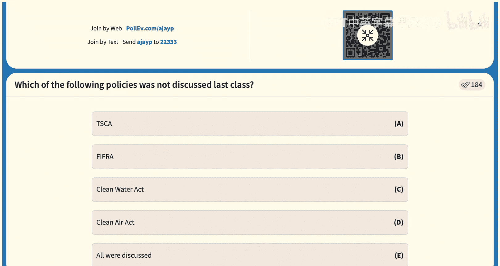
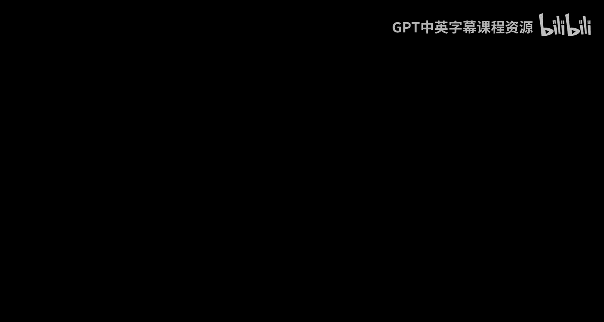
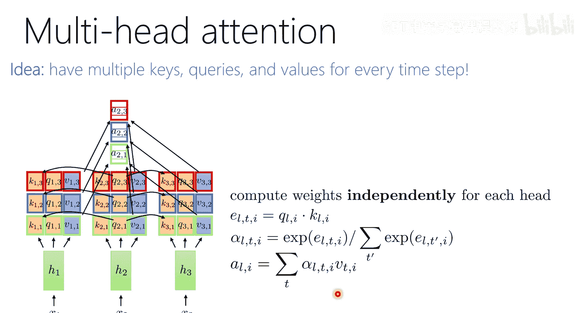

# UCB《机器学习导论｜CS 189⧸289A Introduction to Machine Learning Fall2024》claude-3.5 p11 L11- Neural Networks - Attention & Transformers.zh_en -BV1H4421S7bs_p11-

Psentation every class。Oh yeah， that's okay， so 102 like Tuesday and the 101。Thank you。

That doesn't really go anywhere， as obviously。可次。到时间。哎这。あげろです。还有没有？Yeah。Well there's。啊そ。

I heard that some comments。就是什么？这我。ち。So just I do what I would say。そぞだ。Because it's。

So that's wonderful。いや、おせも。

我要。し。哦，那来不及。It goes with。Okay。Wellcome back to me and I guess you guys have been coming every week。

 so where are we at in the class we have been building up maximum likelihood， linear regression。

 logistic regression， learned about neural networks。

 now you know about convolutional neural networks， do you know about ResNes and skip connections okay you should and so right Connets were a really big bread and butter advancement that allowed a lot of progress to be made？

And today're it's got two topics here， but the real topic is attention and transformers and the recurrent neural networks is to give a bit of a historical perspective of how we got there。

 so it's going to be a little less precise perhaps just to motivate attention and transformers and also some of the ideas that we use there and and transformers are kind of like one of the most commonly and most powerful architectures that are used today。

 so the T in chat GT is for transformer and almost all the really big models that have some production use have some transformer layers somewhere inside of them。

 convolutions are still also used， it depends a bit whether you're envision vision or in language or in some kind of science and sometimes both of them are used so the goal of today is to really teach you about attention and transformers and to bring you through recurrent neural networks to get there。

Its all basically covered in chapter 12 which I glanced at and I think the presentation is actually quite different than mine。

 so hopefully one of the two makes sense to you and maybe together makes lots of sense。

 and then I know that Saed mentioned Softmax which is used for classification but it's going to be it's an important part of attention。

 so I didn' I don't think he assigned this thing which was in the intro maybe he did but anyhow just make sure you know what Softmax is hopefully you already know what it is。

Okay so so kind of the motivation for recurrent neural networks。

 which then brings us to attention and transformers。

 this idea of what do we do if we have different length objects and it could be different length in this case。

 this is a real problem that people tackle that actually my group works a little bit on is you have different length sequences which are the amino acids of a protein to predict。

 for example， the thermot and proteins are of different length like an image I could always kind of crop to be the same size and always get it to be and give it to our neural networks so that it always has the same size but a protein like I can't crop it it's going to completely change the meaning of it so I need some way to handle variable length inputs。

Another example is maybe I have a variable length input which corresponds to an output of the same size。

 so in this case I'm taking a sequence of amino acids and I'm essentially going to like alpha fold if you've heard of it and I'll talk about towards the end of the class predicts the 3D structure and basically it gives like the coordinate of like a central atom for each amino acid and so there's one central atom per position in the input and so in this case I want to train on many proteins each which has a labeled structure but every protein is of a different length and it always produces an output that corresponds to that length and so that's also something that we would be interested in。

And then kind of one of the really most interesting of all is when the length of the output is decoupled from the length of the input so if I do language translation any Germans in the class。

 Germans are very， very wordy like Germans have many many actually usually they put a whole bunch of words together into one。

 don't they I don't know， but in any case different languages if you have a sentence in one language and you pick a different language it could be that other language generally ends up with much shorter sentences or much longer sentences and actually the subject a noun and so forth are all kind of moved around in addition to that。

 so we use language I use language translation all the time when I travel and and in other cases and all those models need to somehow take a sentence in in one language that's going to be of some length and then the neural network is going to have to figure out not only how to translate it。

 but what the length should be and when to stop。And another popular one you may have played with some of these tools is image captioning。

 so maybe I want to give the neural network an image， maybe it's a fixed- size image， let's say。

 and I want to caption it， so I wanted to use an English sentence that describes what's in the image and again in this case the neural network has to decide not the content of the sentence but the length of the sentence and whenever I train these these are all supervised problems where in this case I give it an image paired with like a user labeled caption。

 then I need the neural network to train on examples that have different length captions right。

And so with the kind of tools we have now， can we do any of this。

 Who thinks we can do this problem with what we've learned so far。Who thinks we can't？Yeah。

 we can't do this one。How about。Can we do this one。嗯。Yeah， back there。Yeah， so the proposal。

 this is one thing that people do， which is that in this problem。

 if I have different length proteins， something I could do is I could just start encoding the protein at the beginning。

 I could have a maximum length sequence， which is the max length I've seen in my training data and that I'm allowed to use at test time and I can just pad it with zeros and actually if the sequences are kind of roughly the same length。

 this can actually work quite well as it is called zero padding something else that sort people don't often think of but actually convolution can do this because when you apply a convolution。

 the size of the output depends on the input right if I take this convolution filter on the input。

 I kind of do this dot product here， I get an output and then I move it over and I get another output and I move it over So the output actually depends on the input but in a deterministic way。

 So if there's a sort deterministic number of outputs from the input。

 you could actually use convolution， although people often don't appreciate。That。咳。

And then in that case， you could get the thing where the outnumber of outputs does strictly depend in a deterministic way on the outputs。

 and if you wanted to predict stability， you could put it through a pooling layer。

 hopefully you guys learned about pooling， max pooling okay。So you could do something like that。 But。

 but， but the point of this class is to teach you how we could get to something the most general notion of all。

 which is I give you a sentence in one language。 And then I spit out a sentence in a different language。

 That's kind of the canonical example of the most complicated version of this。Or this one as well。

 but so in general， these kinds of things are often called sequence to sequence models because a lot of this came up with language even though I've been talking about images。

 but just roughly speaking you could imagine a network that takes one input and gives one output you could imagine one that you give it one input and predicts many outputs and so this for example could be an image and this might be a sentence of variable length that describes the image you could have many to one each of these could be an image in a video and you want to from the video determine what activity like was the person playing tennis or what was it like a classification from a variable length video。

This is sort of like language translation， where I give a sentence of some length。

 And then once I've read it in， I get the architecture to produce in this case。

 it looks the same length， but it could be a different length。And in this case。

 this would be where instead of taking in a series of frames and identifying an activity。

 I might say tell me what's going on in each frame it like is the person moving or not moving and so forth that every frame。

 so these are just some kind of generic ways that problems might arise in the real world and instantiated with a few examples。

So the first way that people tackled these was with these recurrent neural networks。

And so I didn't assign any reading on recurrent neural networks it actually comes。

 I think it came after transformers and anyway， I mean feel free to look at it。

 but I don't hold be responsible for that chapter it's not been assigned so let's first think we're going to like slowly build up through the lecture about how to think about these problems and then what is one of the limitations of recurrent neural networks and how that brought us to attention and to transformers so suppose I want to have variable length inputs so this first training example has length four the second one has length three and the third one has length5 so the most obvious thing you might think to do is to have one of the positions as input per layer so I take this first training example maybe to process it through the neural network in contrast to how we have normally thought about things we would put that all as input to the first layer process it and get a hidden layer and then process the hidden layer。

If I do that， I can't handle variable inputs， but here's a way that I could handle variable input length is I take the first input and I do some processing to get an activation or a hidden representation。

 and then once I've done that，I can kind of keep going forward in a way that looks very similar to what we've seen。

 except that each time I want to get a new hidden value at a deeper layer of the network。

 for example， this one here to get a3 which so imagine I want to get a3 down here first I'm going to build a feature vector from the layer before。

 and the feature vector will be the raw input x from so x2 when I want to predict a3 I'm going to use x2 and the activation A2 and that's going to be my feature vector。

And you'll notice this is recursive right， so A2 actually contains information from x1 through this recursion。

 and for that reason we often in these types of recurrent neural network models。

 we talk about this variable as being kind of a running memory because I kind of keep folding in the next position。

 the information at the next position and then I put it through these two equations down here are a lot like what we've seen in regular neural networks。

 I take this input， if these were scalars it would be two dimensionmenal， but they need not be scars。

And then I hit them with a learned parameter W。 And then I add a B vector。 And so this W would。Right。

 So this is sort of a standard neural network。 and then I pipe it through a- nonlinearity because if we keep everything linear。

 we lose the richness of the representation of the neural network。

 And so what you can see is that so right now it's written where I have a different parameter for each layer And so I could apply this idea to different length to each of these different examples here？

 So in this case， I can also apply this recursion， And I just pick off the W that's relevant for each layer？

 But you might ask like how do I start this recursion right， Like how do I get the first value。

Well basically they're different lengths and so I'm going to in a sense I have like missing layers。

 they're not all going to use all the W parameters because this one has four layers。

 this has three layers and this has five layers and they'll only use the W for the layers that exist and so this sort of very simple fix is we just preend a zero before and nothing before that matters and we just start the computation there。

And so now I have an architecture that in principle。

 I could train with sequences of different length， I would learn a parameter for each layer which represents the how far into the sequence I am now。

 So it's like， I don't know， on the one hand， it's like very simple。

 but it can be hard to get your mind around。Any clarifying questions on that？Okay。

So one problem with this is that imagine I have like this big corpus of language data of sentences and have a few really long sentences and the rest are kind of in some other range。

 the W matrix then most only the very long examples will use the W that the W parameter way out here so there will be very little data to learn the W that corresponds to the really long sequences and so I'm not going to be able to do a good job。

 I'll only be able to do a good job in the area where all the short sentences also live and so the fix to this is just to actually not to have a different W per layer but to make it be the same W I tie it together and that is what gives us a current neural network which actually nobody really uses anymore because they use attention and transformers which is the point of this lecture。

But that's the idea of a recurrent neural network and it's recurrent because I keep folding in the previous symbol in the example to the kind of running memory hidden state and then process it。

 and so each A contains information from everything before it。

 but it's sort of like in a way the memory has less direct access to things that come way before it because of this processing。

And so in this example， what you would do is if you were predicting like a scale like classification or regression is you would take the very last layer here activation。

 and then you would put it if it was a classifier， you could add some you could。呃。

You could at this point just make it predict what class it belongs to in the standard kind of way。

 but something so in this case it's predicting a scalar using the last hidden variable which contains information from the whole sequence through this recursive or recurrent processing So something else we could instead do suppose I wanted to again like label each part like if each of these was an image in a video and I wanted to label each part or this was a protein sequence and I wanted to know the 3D position of the central atom of that amino acid in the overall protein structure then what I could do is I could kind of add an extra learning function on top of each thing here So if I want to know at the second position。

 what's the prediction for that position instead of waiting for one prediction at the end。

 I now can learn a function here， which is going to decode this hidden representation for that position and then the processing is otherwise the same I keep accumulating the information So by the time I predict。

fourthourth label， it's now using information from all the other labels。

 but when I predict the second label， it's only using information from the first and second position。

 right？So this is a different way to have， in this case。

 have a very like the number of outputs always corresponds to the number of inputs。

 but I can learn this architecture using training data that has sequences of different length as long as the output is the same length。

Okay， something else， I mentioned image captioning。

 and so in this example I'm going to change around a few things。

 what I'm going to say now is this is going to be a recurrent neural network that produces the sentence that captions the image。

 and I want it to be a variable length。And so I'm going to use the same kind of trick I did before which is because it's variable length I'm always going to prepen a0 to start it off and then I'm going to start generating and you'll notice it's a bit different so if we go back to the slides I've been looking at this was an input X and that was an output Y and these were supervised pairs of data points that went together like the English version of the sentence with the German but what you'll see here is this is why and this is y this is what we call an autoregressive model this is like what chat EptT uses chat EptT you basically give it a few symbols to start with and then it uses those back here to compute this and then once then it guesses the next token in this case in A then it pushes that token down here to get used as input and so it's autoregressive because each output depends on taking the previous output which is a little bit different than what we've seen and the idea with an image conditional model or a captioning model。

I I want to have this sentence not be based on like the English to a German but on an image and so instead of conditioning on the zero。

 I'm going to actually not make it a zero， what I'm going to do is I'm going to take the dog。

 I'm going to apply I say a convolutional neural network to the dog image to create a vector that is not a zero and now instead of always starting with the zero vector I'm going to start with some encoding of the desired content and so now I have an imageconal like language generation model。

And we called this the this is a recurrent neural network like so the basics through all of this slide so far are these recurrent neural networks where one example gets processed positionedwise at each layer of the neural network and in this case in this autoregressive way so I would train this by giving it a dog and a caption and then I would have the loss in all of this is always going to be like a maximum likelihood loss or they may call it crossenttropy and then I would train it and this we call an encoder and so in general there's this idea of we want to produce some sentence or some object here conditioned on another object here I'm producing sequence of tokens conditioned on an image and here to encode the image because images are still processed very well by convolutional neural networks I would use a convolution neural network to encode it into the vector and now all the information I want to know about the dog as in this vector。

And now I start autoregressively generating one token at a time until there's usually a special token called like end of sentence。

 and once that gets produced， then I stop producing the sentence。So， right， so， and this。

 this auto regressive。Network is， again， it's this idea that we generate each new word in the sentence。

 one at a time， having fed in the previous ones。And in this case， this is a recurrent neural network。

 so when I produce this guy here， the word puppy， it's looking at A2 and A2 has knowledge of this and of this。

 so it always has knowledge of all the previous ones because a is like this running memory right here。

 there is no memory， there's just the encoding of the dog and then I start producing one word at a time。

Okay so that's image conditional if I want to do this translation task then what I want is here's a French sentence that happens to be the same length as the English sentence。

 but in general that won't be the case， so in this case I use an RNN to process that into the content vector that will specify to the decoder how to translate it into the other language so in contrast to when I condition on an image。

 I don't want to use a CNN here I want to process with a recurrent neural network to handle variable length sentences because it's sort of more suitable。

 and then from that I get one output from this recurrent neural network that encodes the French sentence now that I have that I can throw away the French sentence because this vector here contains all the desired content and。

Then again， I do this autoregressive recurrent neural network where I spit out one word at a time。

 once I've spit out A， I pass it into the next one and merge it with the previous hidden representation or activation A1 and generate the next word and so on and so forth。

And so you can see this general idea both from the image conditional and the sentence conditional like of an encoder and a decoder and when we use language it's typically been an RNN encoder and then an RNN decoder and these are separate RNNs so remember I in the RNN we share the weight parameter at every layer so whereas in a more conventional neural network or in a convolutional neural network。

 every layer has different parameter but in the RNN the parameter is shared and but the parameter won't be shared between the encoder and decoder。

And we train this there's this phrase end to end， which is a bit of a I don't know。

 I find it a funny phrase， all it means is all the parameters that are involved in all the slide here。

 which means there's the encoder parameters in the decoder parameters if someone says it's trained end to end means there's one loss function we minimize to get the best value of all the parameters in the model。

 and that would be in contrast to， for example， somehow learning the parameters of the encoder first fixing them and then somehow learning the decoder。

 so end to end just means I'm learning all the parameters at once， yeah， question。Deder。The same。Yes。

 yeah， each RNN shares the weights for each layer， and this has two RNNs and each one does it。

 that's right。So one of the， theres several motivations for why people gave up on this idea。

 but they were people really tried to use them for a long time。 and maybe the most crucial。

Element is that everything gets bottlenecked by this one activation。

 so it's true I said that this a13 a3 here in the encoder network it contains it's been influenced by all three of these symbols but if you have a really long sequence what happens is it tends to start forgetting the stuff early on because it keeps kind of doing this recurrence relationship and it kind of gets bled out and so one thing iss not good at actually long recurrences and in along similar lines the gradient doesn't behave well。

 you can't get gradient information to propagate very well I'm not going to go into the details but so this is the main motivation for the development of attention and transformers even though as we'll see towards the end of the lecture right now this has all been about encoders and decoders transformers can be used in a very simple way as well。

Just the same way you might use a convolutional neural network for classification or regression。

 you could instead use a transformer architecture to do it。

 but the way they were developed and the way I'm teaching it in this order is using an encoder decoder system。

And so basically the question that was posed was。What if I don't want information flow to all be bottlenecked from the last activation of the encoder。

 I want this decoding network to be able to look back as needed directly back into any of these activations here and that should one help us to be able to handle longer sequences better and correspondingly。

 end up with better gradient flow that doesn't trail off and kind of kill us。😡。

And so that's basically the answer to that is this architecture mechanism called attention and attention is kind of strange because like when you teach it or you read about it。

 to me it looks so complicated it's an extremely simple idea that's just hard to get your head around and then once you get it。

 you're just like， okay it's really simple， I can't believe companies made millions of dollars using these things but so okay so attention is the mechanism that's going to let us not have to have all the information bottleneck at the end。

 it's going to when we're decoding the third position to say puppy。

 instead of just looking at a2 which depended on A1 which depended on this。

 I'm going to be able to look back arbitrarily back in time。

With this attention mechanism so let me go through what attention is and so it's got all these like moving parts and all these names and the figure is already complicated but I promise you it's a simple idea and so hopefully it will make sense to you at the end of this lecture or even long before that because we're going do attention and then we're going to describe transformer is basically stacked attention layers but so what is attention so right now imagine I'm in the standard recurrent neural network and I'm trying to decode this position here。

😊，And I want to peek back what I'm going to do is it's going to be I think the most succinct abstract description of attention is it's like a probabilistic database lookup where you learn the queries and you learn the keys and if that doesn't make sense like I'm going I'll say it again and I'll just plant that seed so what's going to happen is when I want to do something at this position here in the decoing network。

 I'm going to have a query vector that's determined by the value of the hidden state S2 and that query vector is going to go back to the input sentence in the encoder and it's going to say do you match my query。

 do you match my query， do you match my query and now I said it's a probabilistic lookup so it's not going to actually be do you yes or no。

 we would like it to be do you yes or no， but that's like a hard thresholded function which is hard to deal。

within machine learning because the gradients and so forth are not well behaveved so it's probabilistic so instead the query vector is going to ask the key vector like how similar are you to me for example through a dot product and then it's going to say how similar are you to me and how similar are you to me and so the idea like an intuition to help understand this is maybe this is language translation and maybe the query vector here is something like please give me the subject of the input sentence so if this was French maybe this this guy somehow knows he needs to be the subject and he wants to go find the subject back here and of course but the query and the key is going to actually be learned so it may learn something like this but it may learn nothing like this but it makes it easier to think about it and so the idea would be like are you the subject are you the subject are you the subject and then again if it were binary it would return the subject to the correct one but instead this is all proable。

Ba so we're going to actually each one will get a score and we're going to return a linear combination of these depending on how well the key matched the query so that's all in English I'm going to go through the math here but the key idea is it's kind of like at each point this position will we say attend to the positions here one at a time through this sort of probabilistic database lookup and get an answer back and then use that answer to process what it needs to do。

Okay so。Right， so how are we going to get the key。 So suppose this is what I'm doing。

 I have a query here， but and I'm going to have to have a key for each of these guys here。

 This query is going to have to kind of go to every key and say do you match me。

 So let's first compute the keys。 So I'm going to take the hidden input here H T and I'm going to put it through some function。

And that function oops right and that's really just the activation from this recurrent neural network at time at this now it's time1 here it will be a time two。

 time3， I'll just pull whatever was down here up into here through the function K K could be as simple as the identity so if it's the identity。

 the key will just be equal to the hidden value it could also be a very simple learned function where I now have another set of parameters that maps from the activation through a linear transformation and the non- nonlinearity like a sigmoid to get the key。

So all I'm doing is I'm transforming each H to a key so that I can use it to do this attention mechanism。

 and it could be a simple function like this， could also be the identity。

So now I'm going to get the key for each thing and similarly the query is going to right now I'm talking about this position。

 but I'm going to do this for each decoding position is going to attend to each of the inputs。

 and right now I'm just showing how this S2， the one two that's the third position that has activation S2。

 how is it going to attend and get information directly from each of these inputs。

 it's going to get a query vector。Again， the query might be like tell me the subject。

 are you the subject yes or no， and then what it's going to do is this is a vector like representing。

 for example， some concept like are you the subject and that cu is a vector and I'm going to inter product it with the key to get a scalar。

And I'll do that for each of the inputs。And this is the。

Attention score so this is right this is the elf decoder step in this case is actually the one second or third depending how you count and so each of these keys gets in attention score for that one query which is the dot product of that key with the one query so I take this query dot product with that key again an attention score if it's high。

 it means like oh yeah you are the subject or you look a lot like a subject and then the next one might be lower which is like you don't look so much like the subject of a sentence and you'll get one of these for every one of these inputs。

So。Now， what I said we would like to do intuitively is we would like it to be a database lookup。

 so we would like just one of these to be like yes。

 I am the key that matches now send back the value that was attached to me to whoever queried me but because it's not a binary like exact lookup。

 it's a probabilistic lookup so if it were an exact lookup we would do like an AGmax it would say give me tell me which key was the winner which would be an AGmax but AGmax is hard to deal with。

 so it's not differentiable and so in general in machine learning when we want to do AGmax。

 we do softmax instead， which is also what we saw with logistic regression which and it's also the layer that gets put on top of a neural network to do classification and so all the softmax really does。

 is it takes each of those attention scores and normalizes them so that they sum up to one。

When you're doing classification that's handy because now you have a probability we don't need a probability here and so you know a lot of this is like kind of just heuristically derived it's not like we can formally prove this should be a softmax it turns out it's convenient and it works well in practice so what have I done let me again recap I have this query vector which is ultimately going to be learned but for now you could think of it as like I want to know which of these inputs was the subject and so I'm going to take my query I'm going to inter product it with each key and see which key was the subject except I'm just going to get a realvalued score which is the attention score and the higher the score。

 the more likely it is to be the subject and I'm going to renormalize those attention score using a softmax so that essentially I do get a probability distribution out which is what's the probability that each of these keys was the subject would be an interpretation but it wouldn't take it too literally。

嗯。Oh yeah sorry I meeting next not even seeing the slide change so right and so I I mentioned this idea of I want to take the kind of winning key and give back the corresponding information for that key encoded in H like if this was the winner this was the subject I want to send H2 back to the queries like a way of saying send it back but instead of sending back one because it's probabilistic。

 I'm going to send back all of H1 H2 H3 through a linear combination dictated by the soft max of the attention scores so you see if I mean it's like it looks really complicated and if it doesn't yet look simple like at some point it will click and you'll realize it's very simple。

But so right so let me I'm just going to keep repeating the same things hoping that it helps so this query is going to ask each of these keys how well do you match me。

 which gives me a real valued score going to normalize those scores to be a probability distribution so now each position instead of the score E has a probability alpha and then I'm going to take the linear combination of the input information encoded H1 H2H3 according to the probability that its's associated attention score had the probability alpha。

And so what's happening is that the information in the input sequence that most adheres to the query through the key is the stuff that gets pushed back more than the other stuff。

Question。That's the value。嗯。Yeah， let me see there's different answers it depends where I'm in my slides。

 what have I so far said the value is key query， oh， I didn't yet say value， okay good， let's see。

 somewhere I change things and I just can't remember where。Okay， yeah， good question。

Right so databases have not only keys and queries， but they have values and right now the value is going to be this guy here but we're going to generalize it in a moment。

 so yeah， that's exactly right， so again if it was a classic database lookup。

 one of these would return the value in the way I've written now the value would be either H1H2 or H3 but because it's probabilistic I' give you back a linear combination of the values。

😊，X。嗯。Yeah， that's exactly right。 I didn't actually。

Make these slides because they were so good and Sergey made them that I borrowed them for this lecture and I altered them and also this has。

 anyway， he has a lot more if you could go watch his lectures and he does way， way。

 way more than I'm telling you most of which I don't think we need to know and if you want to know what you should take that class。

But right the point was， what if the sentence was super long here， like right now it's three words。

 what if it was 20 words long， like what would happen in that case。

 this key would have to do not three lookups， but it would have to do 20 lookups and I would get 20 as tension scores and then I would get 20 alpha values。

 each of which represent a normal like the probability so to speak that that key of the 20 keys matched the query。

That's right。 And so in fact， what you can tell from that is the computational complexity will be for one of these attentions here。

 it has to look at all the ones there。 So if this imagine this is of length n and this is of length n but you can do it for M or let's say this is n and this is M。

 this one thing in the N has to look up M things and I have to do that for n of them So it's got this n M complexity for this part yeah。

嗯哼。😊，Okay， so let's actually kind of go through more carefully what this looks like just to really cement it。

 so suppose I'm now trying to run this network to create a prediction。

 either a test time or a for train time， what I'm going to do is I'm going to have the original sentence。

 a minial show and a French people。You can correct my accent。 I'm Canadian。

 then I'm the closest thing so you take each of these and and you process and get the key and that processing is going to be a function that depends on age that we learn and now I have a key for each of the inputs and now but this is still a recurrent neural network right so I'm going to still do the same actually do I have that on that slide Oh I forgot to mention sorry the thing I didn't mention here is that these are still recurrent neural network down here and kind of the point of that。

 if this is we're going to get rid of that eventually。

 but I haven't kind of got to where I could convince you of that。

 So at the moment this is still an encoding neural network。

 this is still a decoding neural network recurrent neural network and encoding recurrent neural network and I've added attention to it eventually we're going to remove the recurrence and that's going to be the beauty but right now it's still recurrent and so previously when I showed you recurrent neural network on the very first slide I said that when you want to compute like。

The activation for the third thing， you look at the previous input and the previous activation。

 and now not only do we look at the previous input and the previous activation。

 but we you actually also actually now this is bad sorry， this is bad because A now means。

Attention and up here it didn't mean that， but all that is to say when you're processing the recurrent neural network。

 you also fold in the attention score in addition to what you were folding in before。

 So before we were folding in to get S2 I was grabbing S1 and Y1 and using that to estimate S2 I'm also going to fold in the attention from that thing So I have more information still to mention that right so this is now but I'm not I'm going kind right now I'm trying to teach attention。

 So I'm going to mostly skip over this idea that we still have to do the recurrence。

 but you can see that it's still recurrent because when it's no longer recurrent。

 these arrows will be gone the arrows are still here so it's still a recurrent neural network and so how does this attention work get we get the key for each of the tokens in the input sentence and then we start here we want to generate the first token。

And we have a special start symbol to start generating。

 just like we have a special end of sentence token to stop。

 but we want to get the attention before we do anything。

 so we first get the query through a learn function。

And then we take the query and we compare it to each of those three keys。

 which we could do through this inner product。 So we take Q1 dotted with Q。

K1 to get the scalar E1 and on and so forth， those are those three scalar attention scores telling you how well Q1 matches each of the keys and then I put it through soft max。

 which gives me a probability distribution out and so now alpha1 plus alpha 2 plus alpha3 sums to1 and I can think of this as the probability that this key matched Q1 probability that this alpha2 probability the Q2 match Q1 and alpha3 the probability the K3 matched Q1 and then what I'm going to do is I'm going to now do my probabilistic database lookup where these are the values and instead of returning one value from the best key I take the linear combination of the values H1 H2H3 according to the result of the soft max here。

It's okay。And then， what's going on？So right， was。Oops， so that gave me， now that I have this cue。

 I've now done a attention lookup and I can use this attention with all the information below to make a prediction above it。

 it's sort of abstracted out here， but this gives me a value back and using the value and the information down here。

 I can now make a prediction。And then I'm going to do that again。

 I'm going to now just do another database lookup except with the query Q2。

 which is again a the same learned function， and I'm just going to do it all over again。

 it's going to go attend to all three inputs， it's going to get a probability distribution and then it's going to return linear combination of the values in order to produce with the other information the next output。

And all the recurrent stuff is the same as I told you before。

 I've just now added in the attention mechanism so that I can peek back as needed directly to some of the information instead of making it all go through here。

And then I do it again right， okay， so that's just sort of walking through how it would work is that at each position in the decoder I attend to everything in the input and take that information and combine it with the information I was already using to produce an output and that's enabling me to more directly look back at the kind of raw almost raw information in the input sequence question。

Yeah， it's abstracted， it's basically some function which takes as input S。

 it'll take S2 and probably y2 and the attention that was returned to it and we'll use all three of those so yeah it's kind of you could have different functional forms。

 this is just like an abstraction to say combine all the information we did before。

 but now also combine the attention。嗯哼。M。A great question and we're gonna to get to that。

 So let me repeat the question， see if it's right and so everybody can hear So the question was imagine I'm now over here decoding I've shown you a mechanism of attention that lets me peek back to all of these and so I bypass the bottleneck I told you about but what about what's happening here can I peek back to earlier things in this sentence I think that's what you're asking because right now when I decode this。

 it's true I get to look back at all these individual green guys。

 but I don't get to look back at all the blue guys。

 I only get to look at the previous one and so you're perfectly right。

 that is another bottleneck and we're going to address that in a second so and yeah we're getting there but great insight and great question。

😊，Okay， so just to。As I mentioned， these key and query are learn functions and you could use the identity function。

 so if you use the identity function， then the key you just literally copy to get this key。

 you just say you are the value H1 or if K2， you are the value H2 and you could do the same thing for the query。

 this is sometimes just，Like all this is just like user decisions and empirics basically there's no real theory to guide you here and if you do that。

 then the attention score is going to be just the inner product between the activation H1 and between activations in the encodeder and the decoder and then this is just the same thing sorry skipping over it because there's nothing new here in fact you could take this off the slide just to say you can use the identity or you could do it with you could say it's a multiplicative scheme where I don't directly take HT to get the key but I augment with a new parameter of W a matrix that gives me back the key。

And I may similarly do that for the query and it has its own parameter and that so in this case so when it's identity。

 I'm not learning them only in the sense that I'm learning the activations here。

 I'm augmenting with parameters that will do the mapping specifically for the key and value and so then on the decoder side when I want to get the attention score I'm going take I want the inner product of k with Q so that will be this it ends up looking like Htw because I'm taking the transpose and then this guy becomes this guy and so I basically just have two matrices together which I can collapse into one matrix and then just learn that one parameter instead minor detail there and then this yeah just learn that matrix and this is all exactly the same as it was。

Right， and so this also， okay， so now we're getting to the earlier question。

 you guys are really on it， I that because you read the chapter or because。

It's just like something's actually clear and making sense， okay， it's excellent。So right。

 previously I mentioned and there was a question was we were， if you go back here。

 this is the only equation I've shown you so far， which was this probabilistic database lookup that said send me back a linear combination of H1 H2 H3 from theorized attention scores。

 but in general， we may want to not just return a linear combination of those but we might want to first put each of those through a learn function as well。

 so you can kind of put a learn function anywhere or you could just leave it to be the identity and so again this could be like a simple linear through a sigmoid or whatever you want。

Okay， so yeah， that's the most general setting is that you don't just treat the H's as values。

 but you first put them through and then you return the linear combination based on the probabilistic attention scores of the hidden activation pushed through the value function and now it's like we use the letter of V。

And this up here， the value function was just the identity。Okay， so。All the decoder steps， okay。

 now we're getting into another question， so you guys have like prepared me for all my slides， yeah。

So like。Yeah。So this will have a token start and that start token will get processed in the same way as it did for the regular recurrent neural network。

 it will get an activation in the way we saw at the very beginning of the lecture and it will produce a key so it's just a different token like start is just you treat it like any other word it's just a special one that means I start the sentence。

But来。Yeah。C。Yeah， so like it las behind。Janu doesn。

Are you talking about whether when you say lag behind。

 you mean something here lagging behind something there。 I would avoid that thinking。 So in fact。

 I know why you're saying it because in this example。

 it's three words on the left and three on the right and you can think of it as a mapping and you could think of it as lag but in general。

 if you take an English sentence to a German sentence there's no lag。

 It's just like randomly permute， make it twice as long and change the language So there's no notion of lagging here actually between the output sentence and the input sentence。

 So all you need to know is that every time I have some symbol here。

 whether it's an abstract start symbol or a real word， I get a query。

 I tend to everything in the input， and I use it and bring it back to do my computations and each time I'm looking at all of them。

 So there's no notion of a lag or anything， I'm always looking at all of them。And right now。

 we're going to later on change that。 But right， well， yeah， no， okay， I got ahead of myself。 Sorry。

 yeah， question，t yeah。お wasな。視冊。The attention scores， it's yeah， almost correct， almost correct。

 and soon it will be correct because right now how are we getting order like how are we getting ordering。

 we're getting ordering because these arrows exist。So when I， like for example。In both senses。

 so the order here is encoded by the fact that it's getting processed in a recurrent manner。

 the recurrent neural network knows about order， which means that H1 H2 and H3 are order aware and similarly S0s1S2S3 are order aware and all the attention is using these H's and Ss and therefore it is order aware but the goal here is we want to actually break the recurrence and so assume that won't be true and then we're going to have to fix it。

😡，But not with recurrence。 Yeah， I've never had a lecture where people were like pointing to further in the lecture like almost at every slide。

 It's quite interesting。 I don't know if it means I should have everything in a different order。

 or I think you guys are just really on it。 So that's fantastic。 So okay， sorry。

 So all the decoder steps every time I decode something。

 I use a key and I attend to everything in the input。😊。

And so what that means is I'm no longer reliant on this bottleneck here， right。

 I could just in a sense， cut out this bottleneck here and just use attention and just sort of skip back to what I need and also if I do that it turns out like I'm not gonna go in a detail it's a bit nuanced but the gradients will be better behaved like for similar reasons what the Resnet does Resnet allows you to build deeper and deeper neural networks that we couldn't do before。

 and that's because you get these residual or skip connections and those skip connections basically make the gradient paths shorter every time you use one and the shorter the gradient path。

 the more stable the computation I don't know how you'd taught it but effectively that's what's happening and similarly here and maybe the really conceptual idea both there and here is anytime you can make the gradient path shorter。

 it's going to be more numerically stable And so when I force it to go through the bottleneck here。

I'm not able to have direct connection as direct connection as I am with attention。

 so attention allows for shorter gradient paths， which generally are more stable and just allow us to build more complicated networks yet。

So I can't quite hear you， could you speak up？Yeah。

 it is kind of like adding feed forward everywhere yeah。

 but it allows us to do it in a way where I can have multiple length inputs and multiple length outputs。

Yeah， but it is a way to think about it。U。And so there's this famous paper that in 2017 that first introduced attention。

 I don't think it's very readable， but it did change the world。

 and the title is is attentiontention All we need， because this was the development of what people had been doing and they started doing recurrent neural networks。

 then they added attention， and basically what this paper said was like forget the recurrence。

 we just need attention。And so that's kind of that and after that insight people stopped using recurrent neural networks and now we just use attention and transformers and so right the question they posed in this paper is attention all we need is if we have attention。

 do I need these recurrent these recurrent things between each of the layers or can we transform our RNN into a purely attention based model and as I've kind of alluded to a number of times the answer is yes。

 and this is what transformer is， but so there's a problem that somebody already brought up here is if I want to get rid of the recurrence。

 then？If I get rid of which would mean getting rid of all these arrows here。

 basically all the processing would only go through the attention。

 so the proposal is I get rid of all these arrows and all the recurrence and I process information only through attention。

And so right now if I do that and I'm processing S2。

 I'm okay because first of all I get to look at these through the attention mechanism。

 but as was pointed outtly by someone earlier， right now I get to look at S1 through the direct recurrence。

 I get to look at S0 only through its accumulation in S1 through thecurrence but if I break these arrows here and I'm dealing with processing S2 to get an output。

 suddenly I have no way to look at what happened before right now I can only look at what's going on here and so the solution is what we call self-attention and what that means is the language I've been using so far is that this particular position will attend to each position in the input and with self-attention。

 this position will attend to all the other positions in the same sentence。Potentially。

And that's what self attentionten is， it's like instead of looking back at a different sentence or a different sequence。

 it's attending to yourself so that we can get rid of the recurrence and still have access to that information。

So self-attention is you can think of as just it's almost like a self-attention layer is kind of analogous to a convolutional layer in that I'm just going to take one sentence and then I'm going to process it with attention without any relevance to another sentence I'm not looking at information in another sentence I'm just saying attend to the other things in my sentence so that when I make predictions I can make use of the information without recurrence so it's not recurrent and these arrows between here are now gone。

 but all of the outputs will be able to get information as appropriate from the other。

Inputs or outputs。Again， we can just do the same kind of a thing where each HT right now just gets processed from one input。

 so there's no recurrence， it's just take whatever the input is here times some parameter w that's shared。

 still shared across all the positions but it's not recurrent with like an offset and a sigmoid and now I get these HTs。

And now I have a function that produces a value， and I have a function， so some again。

 some could be identity， it could be the simple linear through a sigmoid。 Oh yeah。

 it's actually written here， so it could be the identity and it could be。

This linear function and I'm also going to have a key so before the values were in the other sentence now the values are in the same sentence because I'm going to look at the other each position here is going to attend to the other positions and extract values in this and basically the exact same mechanism and then again we're going to have keys just like we did before and so now the value the key and。

And where's the query， Okay Yeah so now we have the keys。

 the queries and the values are all for the same sentence。

 whereas before I had the query on the decoder and I had the key and the value on the encoder。

 but now I'm doing selfatten where I'm just processing one sentence and so I want the key。

 the query and the value for everything for each position。And so right then again。

 they can just see simple linear functions or identities and so forth。

And so okay so what's going to happen here， this query。

 if I want this position to attend to the other positions and to itself。

 so I'm going to pipe it through and get a query vector like assume well I've already computed these I'm going to just push through all the inputs and for each position I get a query。

 a key and a value and now I'm going to do the attention。

 So the first thing I'm going to do is I'm going to query the first node and see how well it matches this key how well it matches this key and how well it matches its own key。

嗯。And， and really， it's like almost identical to the attention I showed you。

 I'm now going to get based on the dot product between the key。

And the query I will get an attention score and like through this same inner product like you can see it's almost all the same except I'm operating just on this one sentence and then again I get a probability distribution through the soft max of the unnormalized attention scores and then that's the softm so I get these alphas again same as before and then again I take a linear combination of the values as I did before and so now this A1 is the attention kind of lookup by attending to every other position and to itself in the sequence。

😊，And just to remind you， the reason we're doing this is that when we're decoding。

 we want this position to be able to see that position and that position without using recurrence because recurrence just isn't well behaved and doesn't work very well。

There's nothing fixed length here， so this could be any， so what are the parameters。

 there's these W parameters and those don't depend on the length and this processing I described for any length sentence I can do exactly the processing I just showed you。

 there's nothing here that depends on the length。All it is again is like at each position。

 you have a query。And with that query you go ask how close you are to all the other keys。

 and maybe that's four keys， maybe it's 20 keys， maybe it's 100 keys。

 and then you do your probabilistic lookup of the value and give it back to yourself。Yeah。Yeah， yeah。

 yeah yeah。Various to yeah， so that comes back to the earlier question。

 So there was a question earlier of like attention doesn't seem to depend on the order and I said like you're mostly right。

 but I said you're not quite right right now because we still have the recurrence arrows I've now removed the recurrence arrows and so that's exactly right and we're going to have to fix that problem so the insight that was just made was that now that I've removed the recurrence。

 this architecture is what we would call permutation equivariant。

 what it means is if I permute the order of the inputs。

 it will just permute the order of the outputs and it doesn't care。

 it doesn't care about the order and I have a slide about this coming up and that's a bad thing because in language order matters right like if if you scramble all the words of this lecture。

 I don't think you're going understand attention so we're going to have to fix this problem and we're going to get there。

So but for now let's just focus on this self-atten。

 which is almost the same as the other attention that I mentioned。

 which we will eventually call crossat in contrast to self-attention。

 and what we usually do is like much as we may stack convolutional layers in general we may stack self-atten layers as well and so the way we would do that is we would process and this would be called a self-attention layer。

 we would get these keys values get these these activations out。

 and then we would just keep going and so you could kind of just as you go through a convolutional neural network and you process and process and process and get kind of more and more complicated holistic features similarly here。

 you can get different kinds of features as you go up the layers and just as you want to pick a good number of layers in any other neural network similarly you'll have to do the same here。

And then whatever you're doing next， you hand it off to that part of the network。Okay， so。

 and you guys have been looking ahead here or at least you had the insight to figure out what's coming is that self-attention。

 if we want to go from self-attention to transformers then which means we want to remove the recurrence and we do like this is the thing that actually does work really well which is used all over。

 then we need to fix a few of the problems one of which has been mentioned。

 so what something was that it's permutation invaris。

 we've lost the ordering because the arrows are gone and it was just those arrows from the recurrent neural network that had information about the ordering。

 so we're going to talk about something called the positional encoding that addresses the lack of the sequential information now that we've removed the recurrence。

We're also going to talk about multiheaded attention really the way to think about that is you know if I talk about a convolutional layer。

 if I have just one filter or kernel， whatever you'd like to call it like that's not very powerful like that one filter might be an edge detector in this orientation and that's all it does so I have a bank of convolutional filters analogously I'm going to have a bank of attention mechanisms and for some reason we call this like multiple-headed attention so each attention like what I described as one head and we're going to have multiple heads the way we would have multiple kernels so that we have a more powerful neural network。

And then also what I hadn't mentioned is that if I want to stack the attention right now。

 the way it's written is that it's all linear and if you stack linear layers。

 you're composing linear functions and you end up just with a linear function and a linear function is kind of not very useful。

 We may as well just use linear regression。 so we need to add some non nonlinearities in here as well。

And then there's also no one has has mentioned this， but maybe someone thought of it。

 there's also an issue of how we do the decoding because right now。

 when I remove the recurrence and I replace it with self-atten。

 the attention is going try to look up things in the future and that doesn't make sense。

 so we're going to have to do something about that and actually all of these are relatively simple things。

Maybe this is the most complicated of them and like I'm just going to go into it kind of very briefly and give some intuition I've actually not seen great write ups on the details。

 I don't think it really matters for this level of a course but feel free to go read more about it。

 but so what this point of the positional encoding is to address the problem that was just mentioned。

 which is now that I've removed those forward errors， arrows， I've removed the recurrence。

 this network has no idea like about the ordering of the sentence。

 like I could scramble the sentence and it wouldn't know about it。

So I'm going to have to basically tell it something。

 but right just to hit that point home is like if I had a sentence that he hit me with a pi。

 what it just sees is like all these words as a jumble in a sense。

 it doesn't know the ordering because there's no order dependence here and so if you print what permutation equivariant similarly to translation equivariance which the convolution operator has here this is permutation equivariant。

 which means that if I permute X1 x2 x3 with a given permutation。

 the output will correspondingly permute and therefore the model just doesn't really know about ordering。

So and most of these orderings don't make sense in general in proteins in language the ordering is important and so the simple idea is we're just going to kind of force feed it the positional information and the simplest way to think about it it's not what we're going to do but what could you do is when you're computing the very first activation here you could just say well let me tell you your position one with t equals one let me tell you your position two with t equals2 and let me tell you your position three with ts 3 now I'm forcing an ordering through the positional encoding but if I just give it one23。

 it turns out that's not very useful for a number of reasons so one reason is for very。

 very long sentences like much longer than most of the training data like the very high numbers like it won't be able to learn anything because it's seen very few things at that length so you don't necessarily want to do that what people actually do is。

Just giving it like a one， two， three， they give it what's called a positional encoding。

 which is actually a vector。 and when you first see this， it might seem kind of random。

But the idea is that you on the one hand， you do want every position to have a unique value。

 something like1，2，3 On the other hand， you kind of wanted to know also about relative positions like you just want to know that like this was near to this but not necessarily where they were in the sequence and so there's some like proofs of things I'm not going to go into but in the original paper this is what they proposed and this is very commonly used is that you take t instead of t equals like1。

2，3，4，567 8，9，10 and giving those individual integers as positional encoding instead you give a whole vector of positional encodings which are to take the value t so for example t equals2 here and you compute sign of2 over this whole crazy thing where d is however many whatever dimensionality want this positional encoding to be is D and that。

dicates the actual signs and cosines here， but really the way to think about this is it's giving you different frequency signss and cosines so that in a sense you get different periodicities which intuitively allows you to get relative information so smaller the periodicity kind of it gets relative information about things that are closer together the larger the periodicity kind of further away and if you have a very。

 very long stretched out cosine then over the range of the t's you use it' just going to be a monotonic function if it's big enough and that will give you a unique value to every T as well and so it's sort of a way to hedge your bets to get the best of both worlds it's a way to kind of get with a very a very low frequency or high periodicity you get a unique value if you go high enough for each position one of these things but you'll also get these sort of encodings that have understanding of period。

It's kind of like doing a mod almost which gives you some relative information。You're same。

You're on this。嗯嗯。I。I don't know if that's exactly the way you said it。

 but what you'll notice is that imagine T goes from here to here， like the actual that get used。

 then for this blue one， which is each of these corresponds to one of these。

 then the value T equals 20， gets exactly the same value as t equal like 60 roughly speaking。

 those both get exactly the same positional encoding for one of these things。

 and so that's kind of the intuition of how you get relative information。

 I looked at how it was written in the book。 and I read it very quickly。 and didn't。

 I didn't find it particularly helpful， but I left it in the reading in case it's helpful to you。

 yeah。Yeah。some point。えのし。哎，没有。I mean， it's kind of really a way to hedge your bets right because the highest periodicity 1 is tenta amount to just using t equals 1。

2，3，4 except it's piped it through a monotonic transformation and so it gets every T gets a unique value and so you kind of may want the absolute value。

 but if you only use the absolute value it might hurt you。

 you want like and so when you get to the shorter period ones and things start to cycle。

 then you get certain kinds of relative information and by changing the frequencies and putting them all there。

 you kind of get a more complete ability to get the relative information。Yeah， I need it。

Strictly speaking， you could if you didn't dictate ahead of time what you were using and you were trying to figure out empirically what you should use for D or if you should use a different andal coding。

 then。If you were figuring out D， it would be a hyperparameter because you'd have to try with D equals2 like 1000 D equals this d equals that。

 however， so the other thing you can do。Yeah， actually Sue。啊。Right yeah， so sorry。

 several comments I'm jumping all over the place。 Well， okay， so before that。

 the other thing that you can do is sometimes you just learn the positional coding in which case it's not a hyperpremed research。

 it's a learn function。But that has a bunch of it has problems that are similar to just using the raw index value。

 which is for large indices that only appear in a handful of training dataset sets。

 like it doesn't know how to learn that basically， so I don't think that's very commonly used in most domains。

 I think this is kind of the way most people will do it and also in general there's too many hyperparameter。

 so I my guess is people just use some standard like a lot of things there's rules of thumb I forget what the rule of thumb is here but my guess is people just probably just use that because they need to play around with this architecture in that architecture but in principle。

 it could also be a hyperparameter。And so right， I noticed in the textbook that here the way I'm folding in the positional embedding either as like I introduced it as a notion of an index T。

 but actually it's going be a whole vector and here I'm basically concatenating it and using that inside the learn function to get the activation in the textbook and I didn't actually know this。

 but apparently this is often done is you add them together in which case they have to be the same dimension and the textbook talks a little bit about this so you can read it there and they acknowledge the sounds kind of weird and try to give you some intuition as to why it works。

 I actually didn't know that so I had learned it this way。嗯。😊，For a what？So。

I would say images people typically use convolution on images right now like because actually convolutions were designed for images and that is really the most useful thing I mean if each of these were an image in a video it would be obvious if you wanted to use something like this on an image I'm not honestly not sure if people do that if you did do that I guess you would just have to have a twodimensional coordinate system right like so in principle you could just label it with one comma2 to comma1 and so forth and then I presume you could generalize these cosine things to two dimensions。

 I've never heard of it and it's not in the textbook but I don't think people do that I think they would just use a convolution。

Like attentions primarily used for these like one dimensional objects。

 I would say that's where the bread and butter is。Okay， right。

 so then so that addresses the lack of positional information that we lost it because we got rid of the recurrence。

 and that's our goal is to get rid of the recurrence。

 And the next thing I mentioned was this multiheaded attention。

 And so basically what I've shown you so far is there's going be a key query value that we're going process and then do our selfatten。

 And that would be one attention head。 But now I'm going to have several attention heads。

 That's a second attention head that it has its own keys in queries and values。

 just analogously to having a second convolutional filter at the same layer。 And then a third one。

 that's a third attention head。 and and each attention layer will give its own attention values back。

 So now instead of having just H to get one having attended to it's going to attend right through each head through each attention head。

 it will attend。 And therefore it's going now get three different values back corresponding kind of analogously to having。

By three different convolutions， because this will be a much richer network。

And so you could imagine one is like， please tell me if you are the subject of the sentence and the other might be tell me if you're the verb of the sentence and things like this。

And all of those， the parameter， the whole point here is those parameters are not tied together。

 they're completely independent mechanisms so that we can learn to kind of attend in different ways to different parts of the sentence。

And but otherwise it's exactly the same， it's going to be like all the sort of things I just showed you are identical。

 we at the inner product， we normalize it， and then we return back a linear combination of the values。

 it's just that we do it for each of the three attention heads， yeah， question。

So you said that they had to out。Ps of information。Why。I mean， you could ask， yeah。

 it's a good question you could ask the same question of like when I do a convolutional neural network and I say that this layer has 10 kernels and I initialize them at random like why is it learning different things and so I mean。

 the answer is really that if it wants to minimize the loss。

 it would be really dumb to just use the same same filter or kernel and here it would be dumb to use the same attention mechanism。

 I think if you somehow initialize it in some really bizarre way， it could end up there。

 but if you truly could find the global max and in practice just getting to a local max。

 it's not gonna to ever find the same mechanism because this is not helpful right。

 because you're just wasting your parameters。Yeah。嗯。😊，就这意思。So there。Yeah。

 there's a lot of moving parts in this lecture。Right now， just focused on the self attention。 No。

 and that's because the self attention corresponded。In some sense。

 to the decoder block of the encodeder decoder system。

 if you want to have a language translation system。

 what you'll do and we'll see in just a minute is youll instead of having an encoder recurrent neural network attached to a decoder recurrent neural network。

 you' you'll have the input sentence and you'll have the decoder attend everything in the input sentence and attend to itself。

And so。And it will get processed though， one symbol at a time， autoregressively to multiple lengths。

 and it will stop when it gets an end of token basically。

 so the same it'll get multiple lengths in the same way the current one does by using an end of token it will just keep because it's autoregressive。

So there's two different things happening here， One is in self-attention。

 I take a sentence and I process process process， the other thing is， and I guess yeah。

 we haven't finished the lecture which is okay， we'll get to the next lecture。

 but what we're going to see in a moment is we're going to use self-atten but to do autoregressive going forward arbitrary length and we're just not quite there yet。

U。