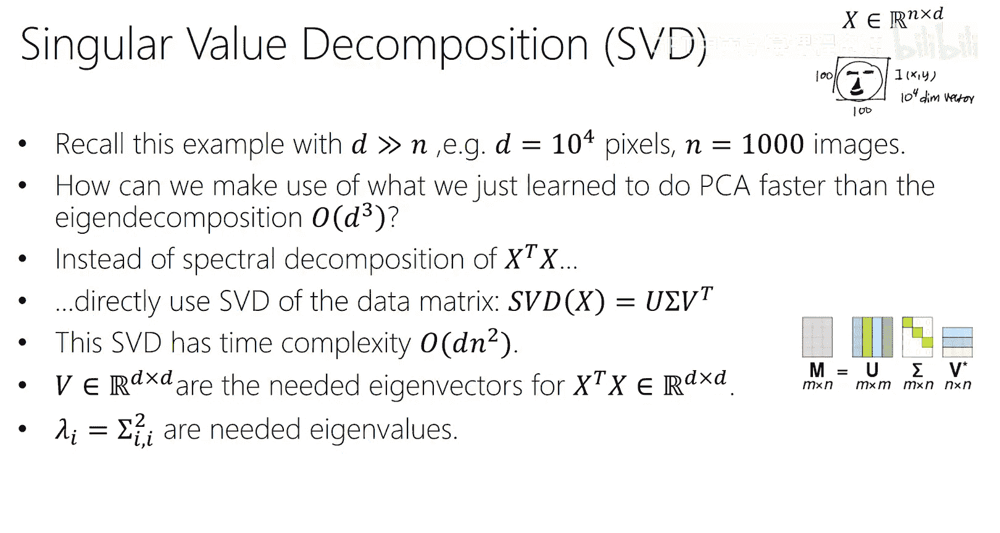

# UCB《机器学习导论｜CS 189⧸289A Introduction to Machine Learning Fall2024》claude-3.5 p12 L12- Dimensionality Reduction & PCA.zh_en -BV1H4421S7bs_p12-

Thank you everyone， we'll do the last one on Thursday， so get ready for that。Thanks， everyone。

Were you able to screenshot？Can you email the。来そ。投日。When you're like。不是不是。This homework is what like。

在高か。That's why。联か面。啊，还有一的一经。

O。Yeah。我し。Yeah。Okay let's get started so today I need to finish the transformer lecture and we were like really close to the end and then I'm going to just bring up the whole idea of unsupervised learning and then start going and maybe finish the details of a particular unsupervised technique that's really widely really really widely used also an old technique and still widely used and also sort of sets the foundation for more complicated versions of that type of model and so that model is principal components analysis so let's go back to transformers so I motivated the whole move towards using attention by talking about recurrent neural networks and in particular we talked about encoder recurrent neural networks to give a content vector on which to condition to autoregressively generate a sequence also using a recurrent neural network and then we basically talked about that there is a bottleneck here and we were。

circumvent that using attention so I'm not going to go over all the details but one of the things we talked about was that in the decoder we needed a notion of selfattention so that S2 could see S0 and S1 and I went over that last class and then we got to so I'm not going to go over but basically the idea is you can stack self-atten layers and that will just transform a sequence into a new sequence into a new sequence kind of the similarly like roughly as you might take convolutional neural networks and stack them and convert them in a new hidden layers a new hidden layers and and then I said。

 well how are we going to completely get away from this recurrence so that we can use just attention and there's this famous paper called is attention all you need which is the first one that introduced it without any recurrence and introduce the idea of a transformer architecture and so part of the things we needed to add in in order to get to a transformer which uses just attention and no recurrence。

Was positional encod， so I'm not going to go over that again。

 but that was to break the permutation equivariance of the architecture。

 which it otherwise has We talked about multiheaded attention。

 which is kind of in analogy to have many kernels in convolution so that you can get richer representations and have a more powerful neural network and so today I'm just going to finish with these two parts here。

 So right now if I talk about one self-atten layer all the operations are linear in terms of the previous layer。

 So by the time I get all these attention scores， these are linear combinations the of the value and I guess。

I guess it depends a bit what the value function is， but if you just have the identity in particular。

 but let's say in general， the more linear something is the less kind of rich representation it can introduce and so the kind of one thing we're going to add basically is as we start stacking these layers we're also going to put them through a non nonlinearity so that we can get richer representations out of them so if we had one self-atten layer that gave attention score one to and three for a single head of course this applies for multiple heads as well。

 then I'm just going instead of directly taking this to go to the next layer。

 I'm going to first transform each one with just some little simple neural network that would be。

 for example， it would be the same at each position and it would just transform in a non-linear way a to H and then you could keep stacking these and by adding that in you can kind of get a more a richer functional set of classes represented by this architecture。

So okay， so nothing too fancy there and then this one someone asked a question that motivated this and in fact it's true it oh no sir that was the other one that was someone asked a question to motivate selfat on the decoder network and we went through that this is something a little bit different this is called maskked decoding and so imagine you're in the decoder network where you're doing selfatten。

😊，Then this is the kind of cartoon we saw last time we are going to auto regressively in the decoder。

 we auto regressively generate， for example， a sentence。

 so we put in like a start symbol and we get the first letter out or sort of first token out like the first word。

 then we give that next word as the input and we go through and generate the next one and then so on。

 this is this idea of autoregressive generation in the decoder that would allow you to generate like if the encoder had encoded an English sentence and created a content vector then you might condition the content the this。

Deder self-attention network on that content vector to autoregressively generate a German sentence right and so you can only do that one token at a time and the problem here is that if I'm using attention then this key is going to go look up the queries for things ahead of it。

 and to get the key like so if I'm currently trying to use Q1 to inter product it with all the keys。

 it's fine if I query my own key because I have already observed the symbol but I can't really query this key because this key doesn't really exist because I haven't yet generated the second symbol so it's kind of looking into the future in a way that doesn't make sense。

Al right so each position looks at future values。 This wouldn't be true in the encoder network。

 It's true only in this autoregressive generative part of the network and there's also a cycle right so output one depends on output two through these keys and queries it's also and then also the other way around so there's sort of big cycles in there that don't really make much sense and so there's a very simple fix here is nothing highly technical if I'd let you chew on it for 10 minutes。

 you probably could have figured it out yourself。 it's called masked attention。

 sometimes you'll hear a phrase causal attention， I don't like that because causality is like a whole can of wormms that we'll have a lecture on that but there's absolutely nothing causal here but if you hear the term causal attention。

 it's referring to the same idea and all you really do is say I'm not allowed to look ahead。

And then so how do you implement that， you basically ensure you just want the attention。

 you basically enforce that this， what would we call these E's， I forget what we call these。

 that's the attention score， that's the attention， you force the attention score to go to minus infinity。

 if it's a key that comes ahead of you。And if it goes to minus infinity。

 once you put it through the softm， then the future values can't come in。

So it's just like a trivial fix， it basically says， if I'm at position one and I'm trying to compute。

 or let's say position2 just for more generality， trying to if I'm at position2 means I've observed y1 and y2。

 and I want to compute a2， then conceptually I'm only allowed to query my own key in the key before me and procedurally I'll just set this minus infinity here to enforce that in the code。

So that's the solution for the decoder when you have an auto regressive generation attention network。

So now we have kind of all the pieces for a transformer's question。

There's nothing special but variable length， like all the machinery is the same。

 the only difference is that when you're computing these attention equations， you literally。

 instead of computing EL with this equation， you compute it for equation only if the key is at this position or earlier。

But nothing else changes， so the ability to handle multiple length inputs is already there。

 you're just literally putting some minus infinities in the code。嗯。😊，I'm sorry。

If T is less than L so L in this case， so if I was computing a2。

 I believe L would be 2 and I want to only use T's that are less than or equal to2。

 so no I think that's correct。 Yeah， I take the second query vector Q2 and I want to query all the keys like I want to query。

K2 and K1。 So that's when T is less than or equal to 2。 It's correct。

Okay so now we have like and so transformer kind of has turned into two different things in the original paper the transformer actually refers to this actually I should have put the slides the other way so in the original paper and the way the field went historically it was from these like encoder decoder recurrences recurrent neural networks and removing the recurrences and replacing it just with attention and so then the kind of the transformer paper said let's have an encoder next network that has all this self-attention so it processes like the English sentence as much as it wants with layers of self-attention and then separately I have an autoregressive decoder network that has some self-atten but you'll notice this word here cross attention and that's basically so these two things can also talk to each other and you can I could pull up the actual architecture from this paper and spend like 20 minutes talking about it it's not really worth it like all the main ideas。

want to know about are actually not even so much all of this like the main ideas in here are there's self-atten to process a single sequence and you may do that as you would in an encoder or in a decoder where you're going to autoaggress autoregressively decocode but really when you hear transformer nowadays it's more just talking about using attention in having an attention architecture layer and stacking them and maybe having cross attention and things like this。

 but it's become just a very general use of these attention layers and you may use self-atten or you may use cross attention and if you're using the attention to autoregressively generate stuff then you will use this masked attention and those are kind of all the buzzword bingo words that mean something so yeah like if you just say。

 oh someone's using a transformer， you don't know what they're using。

 they could just be using like instead of convolution maybe they're just processing it all with attention。

Or it could be to have a very fancy encoder decoder to do some very complicated conditional generations。

 So transformer could mean any of these things at this point in time。

 but in the original paper it was this thing here， which maps to kind of the beginning of last lecture。

Okay。And so right so actually and here's what it really and right so what the keys are that there's this attention mechanism be in it cross attention or selfatten and there's position wise encoding and that if you're doing autoaggressive generation you use mass attention and that you connect it with these non nonlinearities that we just went over。

 those are kind of all the key pieces that will be there。

And so right so this theoretically is like an n squared computation because kind of every node looks at every other node。

 so this is kind of annoying， but it's also it's easier to parallelize this is very trivially parallelizable because you can just run all those attention computations in parallel because they don't depend on each other some people would argue that this positional encoding is kind of complicated and add some complexity at this point people just kind of use this weird signss and cosigns throw them in and kind of leave it at that but compared to the recurrent neural network。

 this is much better at not kind of forgetting information from much earlier in the sequence because when you had just a recurrent neural network。

 everything was bottlenecked through this like memory variable where you would kind of collect information at this step from the last step。

 merge them together and keep going and just have this memory variable and the longer you went。

more you would kind of bleed out the memory of the previous stuff and really as you may know this or not。

 but transformers like really transformed machine learning。

 they're used really pervasively in NLP and in many other areas as well。

 and so they've been an extremely important sequence modeling innovation and this is kind of one of the very commonly used default architectures for many。

 many problems。Okay， so I think， yeah， okay， that's how you're experts and transformers or you're oriented to the main ideas。

 any questions before I switch topics？Okay， so let's go into just a very brief mention of the idea of unsupervised learning。

 so I've mentioned it a little bit。 I don't know if Sae did。

 but so so far we definitely learned a lot about linear regression。

 we learned about logistic regression and we learned about generalization of those where we use neural networks。

 but these are all supervised problems where I have pairs of X and then some labeled variable。

 which is like a real value or。A category variable and so but in unsupervised learning you don't have a target variable。

 you just have these x's and you want to do something。

 and so what is it you want to do why would you want to do that so the topic of today's class when we get into PCA specifically is well in part it's dimensionality reduction So sometimes we just have really huge huge dimensional data set so each。

Each input， each data sample has many， many features in this sort of space it's given to you and you don't need that many features it turns out and we'll see why in a second So if you could reduce the number of features without losing too much information the whole thing would just be a lot easier there's something called clustering which we're going go into I think next lecture also where so this is also unsupervised you take your data imagine the people in this room and I don't know all your features are the single nucleotide your DNA so there's like 3 million letters I don't actually need all 3 million letters because for many of you it's all the same so if I were doing the dimensionality reduction I would kind of condense it into a new set of features which is maybe some linear combination of your DNA individual positions and go from 3 billion to 100 and we're gonna to see that later or I might cluster you I might say let me take your genetics and I will assign like who looks。

more similar to each other based on genetics or based on what classes you took or whatever it could be you're just trying to group samples that look similar to each other and that can be useful only called representation learning representation learning is really just to learn how to transform your raw feature space into a different feature space that's more helpful for some reason like I know I'm just giving you kind of a vague sense of this and it's maybe a bit hard to understand but I'm just trying to at least instantiate why what are these things you do in unsupervised learning and then something called density estimation。

I mean， if you take a set of all the heights in here and I learn a Gaussian and I estimate its mean in variance。

 that's density estimation。 and I have some idea of what that distribution looks like。

 and that can be useful for different problems that I could evaluate how likely is this new sample under that density。

And then there's in the modern day what's sort of dominated a lot of unsupervised learning is generative modeling。

 so of course something like Chat GBT is not supervised right。

 you just grab the whole internet and then you train a model on it with no particular label you kind of make up a label which is can I predict the next word in an autoregressive sense。

 but that's not like a real label right， you just kind of taking the next word。So right。

 so I used to be a statistical geneticist at some point in a lot of different things and this is a really cool this is a real example It was done independently by two groups around how many years ago was that 15 years ago。

 and what you could do is like if each person。😊，If I had the vector of all your DNA for each person in this room and I applied PCA。

 the technique we're going to learn today， what PCA does is it changes like reduces the3 billion DNA measurements I have for each of you to something like let's say in this case to two to two it just creates massive two linear accommodations on all3 billion of your DNA ACTs and then now I have essentially an incomplete basis that has two basis vectors which is the first and second principle component but what's really cool about this。

 this is not made up is if you do that for a big cohort of people。

 you reduce the dimensionality of their genetics to just two dimensions in the way we're going to learn about today and then you plot each person so each thing here is a person I'm not sure what the difference between the circles versus the ones without circles are but what you do is if you plot it in two dimensions and you know geographic origin of each person in color。

So I can't remember， I guess Ci is Switzerland， this must be Norway， Denmark， Netherlands。

 Great Britain， France， and so forth， you actually recapitulate the map of Europe like for real。😊。

So that's using the technique we're going to learn today。

You can go read about it in the paper if you're curious。

 also it's really used in modernday molecular biology。

 there's something called single cell sequencing where you might take an example。

 maybe take something from my liver and every single cell in my liver。

 you get a huge vector of gene expression measurements。

 one for each gene and then you do this on big populations of cells and you might want to understand how you want to also just visualize them so you want to reduce it to two dimensions so you can plot them and get some understanding of maybe where there are pathological cells or cells from different organs like any number of questions。

是是是。Okay so those are just some motivations now we're going to slowly dive into the technical details of principal components analysis so to start off I have this plot here with what is called a Swiss rule might be a little bit hard to parse here but who knows what a Swiss rule is like it's kind of like a cinnamon role that you would want to make me hungry and so like think of a cinnamon rule so a cinnamon rule lives in 3D right and so this is the role and so it has three coordinates X Y and Z and you say well how many dimensions does this live in it lives in three dimensions X Y z in each point is in three dimensions but the whole idea of dimensionality reduction is like does it really live in two dimensions like what do I mean by that does anyone have a sense of like what that question might mean？

Do you really live in three dimensions？And you can see that holds。毫无异议。Exactly。

 you could actually uniquely identify each point without losing any information just using two coordinates。

So if I for simplicity color code every point here， according to how it lies。

 I could actually draw all these points on a two dimensional manifold and I wouldn't have lost any real information in some sense and we'll quantify what that means in a moment。

 but just intuitively， I can unroll this three dimensional structure into 2D and still kind of identify each point。

And so there's this thing called the manifold hypothesis。

 which is applicable to almost all real worldor data。

 which is that high dimensional data tend to lie in the vicinity of a low dimensional manifold。

 okay what is exactly does that mean， so manifold is like a very technical term and you could take a math class to go more into this。

 but roughly speaking a space that locally feels like a Euclidean space？😊，And so for us。

 a manifold is going to be a lower dimensional part of the observation space。

 which we sometimes call the ambient space， like the space that everything's kind of given to us in。

 in which the data tend to lie。So I mean another example would be like you define data on a hyperplane。

 but they happen to actually all lie on a line right so imagine you have a three dimensional plane in which you define your coordinates。

 but all your observed data lie on an actual line then they don't lie in that two- dimensional plane they actually lie in a manifold of the two dimensional plane which is the line that is one dimensional。

 so that's like another example of question。嗯。Yeah， yeah。Yeah。我不。スペーションの。Yeah。

Or genetics influences people's spatial locality。 Let's be careful which way these things go。

 but yeah。It could go either way， I think in defense。Yeah。I was wondering。Yeah。

 I don't know any more arguments， I don't actually to be honest。

 I'm not even sure what's in Ferman in 2013， so I actually don't know what he or she says。

You should go look at it， never occurred to me， I don't know。

 but I mean my intuition is just like the world is like you get images。

 they're very high dimensional， but we can process them with like limited resources and so。

It just feels like things。 Yeah， I don't know。 I don't have a great answer。

 but like we operate in the world， and it can't be kind of as high dimensional as it seems to be or we wouldn't be able to。

 I don't think this's like a fantastic answer， but it's the best。 I can come up with。

 And so words you'll hear in machine learning and in today's class and beyond this idea of a manifold。

 And we're not going to use it in an extremely technical sense like the mathematicians。

 but like this and you'll also hear about an embedding and embedding in machine learning means I took my data and embedded it into a manifold。

 So like imagine I projected it from three dimensions down to the two dimensionional manifold then the two-disional representation is the embedding of the data。

 And we'll see in concretely what that means for PCA。So， okay， so。

This is kind of a classic example of PCA in the recent modern era。

 I don't know actually know what year this is from， but this is a database of each one is an image。

 this is a whole database of images and each image is a picture of a person。

And there's 5000 faces and each image has dimension 32 by 32 pixels。

 so the dimensionality if I were to flatten it into a vector is 1024。

 so every one of these 5000 faces is represented by 1024 features that's the ambient space like the space in which it's given to me Christo I had a higher resolution camera it would be higher but we're just going to go with this right now and so here's a question is like。

In a sense right now the basis that's being used is like each pixel and how much it's on that's like the kind of naive basis we're using and kind of the question you might one way to interpret my question here is how low a dimension lower than 1024 do you think we could go and still keep the image I keep the image could you can think of it in different ways。

 what I would say is like is there some basis that's not complete but that's much lower than 1024 that's just not each pixel and how much it's on but some more clever basis in which if I represented it in that basis with only 100 basis vectors and then plotted the basis like would they look perceptually the same to me or technically what we're going to talk about is a reconstruction error。

 we're going to approximate data points each face here using a truncated basis that's been cleverly created so that even though I use many fewer basis vectors than I need for a complete basis。

going to do a really good job and because of that and I'm using a truncated basis。

 I just have a coefficient for each coefficient for that basis and we'll get there if that doesn't make sense。

 but it turns out that for these faces instead of each one living in  a024 dimensional space I can actually go down to about 100 and the faces will look about the same I just need this clever basis and so this trick this PCA trick。

 which is one way to do this not the only way is we're going to create a special basis basis images and then expand each of the original images in terms of that basis that has only 100 basis vectors and so each image can now be defined by 10 coefficients which is how much of each of those hundred basis vectors it displays and because I'm clever about the basis when I do that。

 it's going to look a lot like that。And so today this is called principal components analysis and principal components is going to be an algorithm to derive those basis vectors。

 and it's actually going to be very related to the multivariate Gaussian lecture。

 does that make sense to anybody？😊，I would think it wouldn't， but hopefully it does by the end。

 do you have a question？Yeah we'll see and here's an example so actually these are the basis vectors from PCA for this data and you'll see they're kind of getting higher and higher Well I think they're getting higher and higher frequency。

 this is kind of just some blurredto background like this is some sort of rough version of a face and you could imagine they're all kind of facelike and you could see how by adding them subtracting these basis vectors that maybe with very few of them I could get things that start to look like a face versus a naive basis where like what would the pictures for the original basis would just be this whole thing black with this pixel on this whole thing black with the next pixel on that's the kind of naive basis and clearly I need every pixel and I need the whole basis if that's the basis I'm using and clearly because this is sort of designed for faces it's not designed for everything is just designed for faces if I try to build this basis on a much more general data I probably couldn't get away with 10 so this is somehow like a basis that's designed for faces。

So these are actually going to be called like eigenface basis images。

So and if I take these0- I don't think this is 10， but if I take the top 100 of these， and I expand。

 I basically project each original image onto just the100 basis vectors。

 which is not a complete basis， so I will lose information。

 almost almost probablyably it depends if depends on the exact structure and we'll get to that。

 but then I can in a sense， now expand the basis out into the original space and see that that basis。

 even though I have only 100 basis vectors is a very good job reconstructing those faces in the ambient original space。

So don't worry， we're going to go into all the details， this is just to sort of set this stage yeah。

Do you mean run this process as a pre processing step and then on top of it use a neural network？

Yeah， you can totally do that。 So in fact， that is one reason you might do dimensionality reduction is just to have a less unwieldy data set that's of a smaller size。

That would just be to make it faster。 you wouldn't get better representational capacity because it's just a linear operation。

 so you wouldn't get a better neural network， but it might be a better starting point to start doing hyperparameter search over different architectures and so forth。

 because it could be a lot faster。There's other reasons to do it as well。

 I think I have coming in a later slide， but something you could imagine is if you keep just the right number of basis factors that's gonna to be a hyperparameter。

 how many do I use， you can actually kind of clean up your data so it turns out in a lot of molecular biology。

 there's weird artifacts from who ran the thing in the lab to which lab it's in and it turns out that if you actually truncate and lose some information if you're kind of lucky or careful you lose the noise or the systematic artifacts actually and clean up the data so there's many different reasons you might do it。

 but in general I would say people are not typically doing this and then throwing a neural network at it。

 probably some people are but I don't think that's like a major use case。嗯。Yeah。

 we're going get let's get into the details yeah it will well technically not because technically what PCA is going to give us is a change of basis and then the hyperpar is how much of the basis to use。

 but for starters we're going to get a complete basis in which case it's just a change of basis and there's no approximation but most people wouldn't really call that PCA technically it is PCA would mean now I truncate the basis in some way。

We're gonna get there。 were gonna get there okay let's start getting into the details because that we willll head off some of the questions Oh I think this is yeah。

 so I was just saying that one reason you might want to do this is a lot of times you just want to be able to look at your data in two dimensions So if you can reduce the dimensionality to two and plot it like in the genetics example this is a different example I can just be helpful for data exploration and visualization as I mentioned it might dennoise the data you might want to compress the data I mean in reality there's specific algorithms for compression of audio data but in a more general way you may want to use these types of things and as I said you might want to speed up supervised learning or other analyses by just making your data set smaller。

Okay so let's start slowly working our way into the math of principal components and so think about right so the eigenfaces is the new basis that PCA created by running PCA on the database of images this was the first three of those basiss vectors but let's think about it in terms of just points in a 2D space and imagine I want to figure out the PCA basis in this two dimensionmenal space and for now the way we're going to think about it is I'm going to get the complete basis and once we understand how that works we'll understand how we can truncate the basis to reduce the dimensionality but imagine I instead of those faces like for simplicity so we can think of it more clearly imagine my data my original data line two dimensions and so we're going to create a new two basis vectors and so each basis vector is basically going to be one direction of the space and much like the sort of native basis vectors for the pixels was having one pixel on。

Now the native basis is this axis and this axis right right now。

 each point is described by how much it's on this axis and how much on this axis and what we're going to do is we're whoops。

 whoa go back。😊，the question we're going to ask in PC is we're going to recursively build the basis vectors。

 So first we're going to say what's the first basis vector and what criteria are we going to use and we're going to find it and having found that one we're going to at least conceptually we're going to recursively do it in the end it's not a recursive algorithm but the idea is we want the one direction that captures the most information and if we are converting this twodimenal data to one dimensional data it's going to be just one vector direction and we'll project all the data onto that and the new description will be where do you live on that line and you'll get one dimensional description with one coefficient instead of two if I pick off one vector as the first principle component and I find the second one now should if I do it correctly have a complete basis I make them orthogonal now I just have a different basis and I can describe the points in the new basis but what should be the first direction if I can only pick one basis vector。

HereFor these blue points as the data， which of all these possible vectors should I pick？

And it's very intuitive what PCA says and there's sort of a duality here you can describe what PCA does in two ways and I'll keep referring to them so the one you usually hear is the direction that so right I've just said it conceptually here is you want to keep as much information as possible and what does that mean well consider these two options is one this could be our first basis vector or this one could so who thinks this one retains more information than this one。

Who thinks this one retains more information than this one right Yeah this one retains more information and in particular what it actually does is it's the direction on which there's most variance of the data if you compute the variance along all the different green directions。

 this is the direction in which there's the most variance of the data it's very spread out along this line because it's very spread out along this line if I project the data onto that line。

 I will lose less information than if I were to project it onto a line like this because all these points are going to go into this very narrow region here here they're going to get spread out and so I'm sort of intuitively losing less information the other way so right so so one way to think about it is that you want the direction for the top PCA of maximal variance。

😊，And the other way， the dual way to think about it is it turns out that's exactly mathematically equivalent to the direction that minimizes this thing we're going to call the reconstruction error。

 which I gave you an idea about with the faces when I said here is a reconstruction of the faces using only 100 bases vectors I was taking them back into the full ambient space and showing you how close they were and sort of the distance in that space by like proennius norm is the reconstruction error。

 and so in this case the way to think about it is if I take every point and I project it onto the green line so that it now goes from twodimenal to one- dimensional。

 then the reconstruction error is essentially the distance。

 the vertical distance from that point to the line because that's how much I lose by having to project it just onto that one line。

And so this one has these huge reconstruction errors on average and this has much smaller reconstruction errors。

 and so the first principal component should always be the one that maximizes the variance in the data。

 which is equivalent to the one basis that also minimizes the reconstruction error but of course we want more than one right the argument I just gave you right now is how do you pick that first one which should be the one that's most helpful。

 then you want to pick the one that's second most helpful。

 third most helpful and then your hyperparameter like when do I stop？So right。

 so if I did PCA without truncheating the basis， I would get from the original two dimensional data。

 I would find these two new directions as the new basis vectors and would still be two dimensional if I wanted to reduce the dimensionality I'd get rid of the one that explains the least variance。

 which is the second one。And now and so what you do though， you want to find it。

 given that you found the first one， you want to find the second one which is orthogonal to that because you're trying to construct a complete basis here ultimately before you truncate it so you want to find the one that's orthogonal to that and explains the most variance and so because it's orthogonal。

 you won't find the same one again and then once you have found these two， then you just recur。

 you just keep going， you keep finding the next direction that's orthogonal to all the other directions that explains most variance in the data and correspondingly minimizes this reconstruction error。

嗯。So what's the maximum number of directions I can find？It's like again， like in principle。

 when I just do this all the way out it's a complete basis and so however many features there were in the original space。

 that's how many basis vectors I can create at most but again in general not usually we're going to kind of create all of them and then get rid of the ones that aren't informative because right now you can see the way I've described it。

 you can algorithmically mathematically do this recursive algorithm in practice you don't I'm going to show you what you do。

 something like a spectral decomposition actually but and then but you can see already that this recursive procedure is rank ordering them right I know the first one's the most important the second one's the second most important so if I'm going to truncate if I know I want just 10 of them I know exactly which 10 because I'm going in order of importance and it turns out the spectral decomposition is going to order them by the eigenvalues once we get into the math。

So right， but again， by analogy， these faces are sort of the directions of the basis vectors that pop out of SVD。

 they are the ones that maximize the variance in the very high dimensional 1024 dimensional space of the images。

 which is much harder to think about， which is why I backed off to the two dimensions to explain that。

And so this， for example， would be the hundredth basis image。

 and each basis image is in the size of the original ambient space， right。

 It still has to lie in that original 1024 dimensional space。

 I'm just going to have fewer of them than 1024。So but when you look at this picture。

 you might get PTSD or you might get great joy depending on how you enjoyed the multivariate Gaussian lecture。

 but like you know there is this whole thing here if I have a cloud and I want to understand you know what are the directions of the ellipses。

 the major axes and so forth so there's a lot of spiritual similarity to here and unsurprisingly there's gonna to be a lot of the same algebraic tools and so the intuition you learned in that lecture should serve you well here。

 however， technically you can apply PCd data that are not Gaussian just as you could take any data that are non Gaussian and pretend to learn know Gaussian distribution doesn't mean it's correct and it turns out for PC to be useful it needs to kind of be blob like sort of Gaussian like you could turn the crank no matter what it looks like but it won't be particularly useful precisely because of this intuition of picking off directions of maximal variant if you get like weird looking。

😊，Data sets that don't kind of look like a Gaussian its going to do unpredictable things that won't have much meaning。

So I'm not going to go over to this and this is not in the assigned reading。

 but for those of you who are interested， there's a probabilistic PCA that yields the same subspace as the conventional PC that everybody else in the world knows who's not a machine learning person and you can take the zero noise limit of doing maximum likelihood estimation there and you'll recover a matrix W which spans the same subspace as the truncated vectors so that's just like you don't really need to know that just if you're I think it's like a cool connection and in a more advanced class。

 it would be fun to go through it and you can read it for fun by the way who knows who got the Nobel Prize today。

Hinton， who remembers my quote from Hinton in one of the lectures？All right。

 well there is one I think I quoted only one person in this whole class than it was him I think it was it was might have been in the first lecture。

 I don't know it's all a blur， but it was how do I visualize things in 10 dimensions and this is Jeff and he said。

 just think of three think of three， think of three to something like this。

 I forget the exact quote but anyway Jeff's a fantastic person。

 it's so weird that they give a physics Nobel Prize for machine learning。

 but hey good for machine learning and fantastic for Jeff。😊，Okay so you may recall。

 so as I said we're going to use some of the machinery and I'm not going to prove things here I'm just trying to give you。

 in fact you don't need to know how to prove that spectral decomposition is the correct thing to do PCA you just need to understand all the moving parts and how they make sense。

 but so this is from lecture quite a few weeks ago about the spectral decomposition how you can take a symmetric matrix and decompose it into eigenvectors and eigenvalues and that that was useful to do inverses and to take determinants and it also gave us the intuition about multivariate Gaussians。

 and so it's going to turn out that we can do PCA with this。

 is in a sense no pun intended the basis of PCA algebraically although towards the end of the lecture we're going to learn a more general decomposition called an SVD which maybe some of you have learned in another class and usually we actually use the SVD but conceptually this is sufficient。

 but the SVD can be useful for。either time complexity or stability of the computation。

 but it would give exactly the same answer if you do it correctly so let me give you an overview of how PCA works and then we're going to go through it step by step so like algorithmically like recipe book what we're going to do is we're going to take our data we have a data matrix like number of examples and number of examples like rows a number of features columns this data matrix x and we're going to compute its covariance matrix and then we're going to from the covariance matrix pick off do the spectral decomposition and keep just the eigenvectors that correspond to the top K eigenvalues and because it's a covariance matrix all the eigenvalues will be greater than zero。

And the eigenvalues have to， actually， each eigenvalue describes how much variance of the data it accounts for。

 precisely because that eigenvalue in the multivariate Gaussian also describe the length of the axes of the ellipse。

 So's all kind of conceptually related， at least。So right given data matrix x where I have n data points。

 each one line in D dimensions and I construct a covariance matrix so technically I need to mean center right I need all the features to be0 before I can get a covariance if it's been mean centered then I just take the inner product that is the covariance matrix and so let's check the dimensionality of this thing this is transpoposed so this whole covariance matrix will be d by D right so it's showing me the correlations the covariances and variances among the D features in the data set。

Now we're going to take that covariance matrix and we're going to apply the spectral theorem。

And as you may recall， this gives us eigenvectors and eigenvalues and we're going to pick off the K eigenvectors that have the top K eigenvalues。

 usually when you call a routine and python or something， this actually comes ordered right。

 so this will put the topmost eigenvalue at the top of D and it will be decreasing all the way down。

And now what I can do is essentially when I do PCA。

 what I do is Im going into zero out some of the diagonal that's not zero。

 in effect what I'm doing is if this was the images。

 then D would have 1024 eigenvalues and in general， none of those eigenvalues would be0。

 maybe like one or two of them are0 and when I do PCA down to 100 representation。

 I'm basically just zeroing out all but the top 100 eigenvalues and then reconstructing this without using those basis vectorctors。

 so I'm losing them， but what I'm losing is I'm losing the least important ones because they have the lowest eigenvalues。

If those actually had zero eigenvalues and I truncated them， I would lose no information。

 So the amount of information I'm losing is sort of proportional to how big the eigenvalues are that I'm setting to zero。

 And that's why I should set the smallest ones to zero。

And so what I do in PCA is effectively it's a low rank approximation of the covariance matrix of my data。

 that's one way to think there's many ways to think about it， but that's what it is。

 and in fact it's the best low rank approximation according to E theorem。

 I'll mention a little bit more later， and we won't go into detail about， but provably。

 if you have this matrix and you want to find the best low rank approximation。

 meaning you want to decimate its rank to a lower rank。

 but have it by Frroenous norm be as close to this as possible。

 then provably you compute the spectral decomposition and truncate the lowest eigenvalues。

RightAnd so the eigenvectors in Q are precisely these directions that turn out to yield the lowest reconstruction loss and we'll see precisely what I mean by that。

 and the highest variance directions， both of these concepts that I've already talked about and so that's like kind of wild math is wild。

Okay so that's the overview， let's go through step by step and kind of understand what each of those steps looks like so right I'm given end data points of dimension D again in this and to perform PCA the first thing I'm going to do is I'm going to mean center of the data so that each feature is equal to zero so if I have this is just a schematic and two dimensions so I just put one and the last dimension D but I think hopefully you know what I mean。

 we're just going to shift it so that the center of the cloud is0 that's the first thing you have to do in PCA and who can understand why I have to do that first based on the intuition you've learned so far。

Yeah。Thats。Yeah， so imagine I didn't do this and I started like this and I asked what's the direction of most variants。

 what's going to happen is the direction of most variants。

 the direction starts here and goes like this and this will be the direction of most variants。

 so first PCA if I don the first principal component if I don't center it will look like this。

Because that's accounting。 that's the direction with the most variance。 But if I center it。

 then I'll get the correct one， which is this one。 So that's why it's gonna what will happen if you don't center it is the first component will basically give you back the mean of the data in the way you should have shifted it。

 So don'， don't do that。Okay， so now I've mean centered my features。

 so I compute the covariance matrix from the data matrix and the covariance matrix has this kind of idea it has you can think of these like level contours。

😊，And so oh yeah， just a detail I don't Yeah， I think this must still be true this was true during my PhD and I'm pretty sure it's still true。

 no matter what language you're using so as I said you can do this decomposition with the spectral decomposition which is usually you call an eigen decomposition in the code。

 but as I said， there's going to be a different algebraic routine that's a generalization of the spectral decomposition we're going to learn about which is a bit more stable and can have some speed advantages。

 so like when you actually implement this step in the computer。

 you'll probably do it with this SD thing but like for this lecture this part of the lecture。

 let's think about it as the spectral decomposition， it turns out they're equivalent in this case。😊。

And then we're going to keep the top k eigenvectors from that queue there and so that is I keep all rows and keep the first yeah so it's the first k columns are the k eigenvectors or the K basis vectors。

 those are the new basis and then I project so right so right now that would be this if I just pick one direction it's this guy here and then the next thing I do is I project all the points down onto that so now they lie I mean technically there's a bit of spread here just for visualization but they now lie in one dimension on that line which is that if it was just one vector of course this generalizes if it's more vectors but in this case here I project down a one all those points now just lie on that one basis they're described in terms of the one basis vector and the projection is just like a regular projection。

 I take the original data that's been。Mean centered and I just projected onto those base vectors and now I have a lower dimensional representation right the original data is n by D and so this is N by D。

 this is D this is sorry。This is N by D。I think I put this here today and this is a typo so this should be I think this should be D by k。

 this is n by D and this is D by K and this should be n by K so the new representation there's the same number of points N。

 but each point is just a k dimensions and I need to fix that let me just take a picture so remember to fix this never change slides right before lecture there's always a typo。

And these are some of these called the principal component scores。

 because this is the representation in the low dimensional space。

And now because it's in the lowdial space， each each of my original data points has just k values to it。

 if I were just to plot those k values in the cases of the faces。

 that would be how much of each eigenface describes my image。

 but I couldn't plot the image from these values to actually plot the image I'd have to transform it back into using I'd have to do a change of basis into the original basis having decimated some part of the signal so but we'll see that so but the final dimensionality reduced data after I do PCA where I get the basis vectors with a spectral decomposition。

 project the data onto the lower number of basis vectors k usually lower and principal k could be equal to n。

 but it's not really going to be and now I have these reduced dimensionality data that have just k dimensions。

嗯。RightAnd so but like if I want to see imagine it' these faces and I want to see well what information did I lose if I use just these0 basis vectors like can I visually see what I've lost and the way I want to do that is I want to expand the original image in terms of just those10 base vectors and so to reconstruct this is this idea of reconstructing the original points in an approximate way because I've truncated the basis。

 we're going to expand back from the PCA basis transform from the PCA basis to the original basis but because the PCA basis is truncated。

 I've lost information and when I flip it back to the original basis I will still have lost information and so this here is the equation from the previous slide。

 this is the reduced dimensionality thing which is n points of k dimensions and now if I take this which is this and then I basically。

呃。Oh sorry that's a this。 I'm getting myself confused。

 What I want to do is take the low dimensional representation and flip it back out by taking the transpose of those because I'm doing the change of basis in the other way。

 but remember this change of basis is this Q here is not square because I've truncated it so this here now is n by K and this thing here is k。

😊，By n。 and so when I multiply them together， I'm going to end up in the original。Space。

 so this is the reduced dimensionality data。 I flip it with the basis transposed to get it into the original space。

 And so this whole thing here is D by D and。And so I'm taking the， what is this here。D by k。嗯。Wa。啊。

Sudly I didn't suddenly blanking on what the point of this diagram was， what is it that's D by？系。去。

Oh， I think this is D by K and this is K by D。 And yeah， that's right。

 And so together they are D by D。嗯。And then， oops， sorry， I don't know what happened here。

 So rank K less than。嗯。Sorry， I don't know what happened there。

I think that should just be that it is rank K let me go double check story about that and now so what I've done is I've shown you two things I've shown you how to get the principal component scores。

 which is the lowdiional representation by taking the original data and projecting it onto the PCA basis and then I said if you have these lowdimenal representations I can do a change of basis in the other direction to go into the ambient space but without the information that I've truncated and that's like the reconstruction of those faces and so we call this the reconstruction in the original space and provably according to this E young theorem that we won't go into the Frrobeius norm between these two matrices。

 the reconstruction using PCA and the original one is provably minimal for rank K so if you're not willing to use more than rank K。

 this is the optimal in terms of minimal reconstruction error with the Frrobeius norm。嗯。

And the larger the reconstruction loss， the more information we have lost right and if if I in this whole process I use all for K。

 I use equal to n， then the reconstruction loss will actually be zero because I haven't truncated any information and the more of the basis vectors I depending on their eigenvalues。

 the more and more information I'm going to lose。And so these are these reconstructed faces by going into the PCA basis。

 truncating stuff， and then flipping back out to the original basis。Okay so there was a question。

 how do I pick k and so K is kind of like a hyperparameter。

 but it's even harder it's harder to pick than in a supervised example。

 So imagine I have a hyperparameter for some regression problem and the hyperparameter is it could be number of layers of my neural network architecture it could be the Lasso penalty。

 whatever it is I can basically hold out some data and then I can change that train my model with different values of the parameter and ask which model does best on that held out validation set and that will tell me itll give me a very good idea of what I should use but I can't really do that with PCA here like what I mean。

There are some nuanced ways you can do it that most people don't do this is actually what people do and I'm not even going to go those nuanced ways are not super robust and reliable and most people don't know about them。

 but really what people do is they plot the percent variance that's accounted for by each cumulatively by using more and more of the eigenvectors more and more basis vectorctors according to the order of importance so if I use just this eigenface then it turns out that it's eigenvalue so the way you know the percent variance。

As you have all the eigenvalues in D in order and what you do is you just normalize them so you take each d and divide by the sum over all the eigenvalues and now what I have is this is just the percentage of variance accounted for and it has to add to one because of the normalization so these percentages here are the proportion of variance defined as how big that eigenvalue is divided by the sum of all the eigenvalues and formally that is actually the percentage of variance accounted for and also by this definition if I use all the eigenvalues I will get 100 of the variance accounted for but when you do this what you can say is if I use just one eigenvector I account in this data set for 35% of the variance which is pretty amazing actually right like you have 1 thousand24 dimensions and if you use PCA you find the special vector that accounts for 35% of the variance。

 So this is kind of interesting because this vector here。Which is pretty fascinating if I use。

The first and the second one you'll notice these are going up monotonically because it's cumulative each one represents a certain amount and I'm showing you the cumulative so I have it here oh yeah this is the sum up to for example。

 this is the sum of all these Vs up to and including seven so if I use the first seven eigenvectors I account for 86% of the variance and what you'll notice and you'll see this on almost every plot like this on any data set on which you do PC is you get a huge improvement in the beginning by adding more if you have1 35 is high but if you have just one more you go to 48 you get this big jump and what you'll see is the jumps are getting smaller and smaller so you sort of like getting you're not getting as much bang for your buck the bang for the buck for each new eigenvector or basis vector you had is going down and down and so there's no hard rule here but usually what people do is they kind of look for like a kink in this plot where they say you know what the returns here are like so diminishing it's not worth it to me so。

just kind of make a guess about where to do things like literally visually。

 you could maybe have some algorithmic version of this。

 but it's typically you just plot it and look for like a kink in this plot and that's also just because PCA is sort of yeah。

It's used a little bit heurically， I suppose。嗯。So this is a cool animation my stole and so what is this animation showing it's showing you the relationship or it's trying to help cement the intuition of how I pick if my points lie in two dimensions and I'm trying to find one vector remember the very first time I said which of these many directions should I use as the top eigenvector the top principal component I said I want the one that accounts for the most variants or the lowest reconstruction error so the dashed lines here or the reconstruction error and what you can see is that as the line starts to go along the line of accounting for most variants at the same time you can visually see the reconstruction error is actually going down because these lines are getting small and on this side they're just plotloting at the same time the blue is the which is sorry the projection the variance is this line here so as。

😊，It gets rotated， let's see let it start again right so now the variance as I turn this accounted for for that is higher and higher because it's getting more and more aligned with the correct vector and at the exact same time the reconstruction error is correspondingly going down so just to really cement the duality between those。

So and let me I'm trying to give it this to you in all kinds of different ways to help cement the intuition here。

 so let's look at a really simple two dimensional example。

 these so my points lie in two dimensions and I have four of them。

 so each this is the first feature x1， the second feature x2 and they're plotted here and it turns out these points lie exactly on a line。

😊，So because they lie exactly on a line， what should happen when I do PCA here。平问。Yeah。Right。

 the first vector explains all of the variance， so in this case and this is not realistic right。

  normally our points don't lie exactly on a lower dimensional manifold。

 we're usually coercing it and we know we're coercicing it because we're setting eigenvalues equal to0 when they're not equal to0。

 that's how you know you're coercing it， but this one lies exactly on the one dimensionmensal manifold。

 so let's go through what PCA would do。We don't need to mean center it actually some years ago Jaendra made this example they're already mean centered so I do that and then I now take my mean centered data which it already was and I compute the covariance matrix by taking the inner product I'm not going to go through because we all know how to do matrix multiplication so what ends up happening is if I go through one times1 plus two times2 I get this covariance matrix and now to do PC。

 I do the spectral decomposition of this matrix and so I take that matrix I give it to Python and say please do the spectral decomposition of this matrix and as somebody correctly said one of the eigenvalues is going to be zero because all of the variance is accounted for by this one direction because they lie exactly on a line you can compute the equation of the line at home if you want so that tells you and so in this case if I reduce to one dimension I have lost zero information and the percent of variance accounted for will be 100。

Now let's imagine we pertuurrb those points a little bit。 Oh， sorry。

 The other thing is what is this sorry， those are the eigenvectors that would go with it。

 So if you call thislinege dot I， it's doing a spectral decomposition。

 which gives you back the eigenvectors， which we've been calling Q and it gives you back the eigenvalues。

 which we've been calling the diagonal of D。 So this is like these are the two eigenvectors。

 which are。Orhoormal vectors to each other and at the moment there's no intuition here。

 but what we're going do is we're going to perturb those points a little bit。

 So now so it was one224-1-2-2-4 I'm going change them by a tiny little amount。 So for example。

 the 1 and the two here are going to 1。07 and 2。1 and the two went to 2。05 the4 went to 4。

1 so I'm just perturbing them like a little bit。 so it's like I'm adding a bit of jitter to the blue points so that they don't lie exactly on the line so now they don't truly lie into one dimensional manifold so what's going to happen when I do PCA now。

Now I'm going to calllinalge and I'm going to get back almostlinal and I'm going to get back almost the same information because as I should。

 because I haven't made a dramatic change。 so hopefully I don't see a dramatic change。

 but indeed the this eigenvalue is no longer zero。 And when I do PCA down to one dimension I'm going to set it to zero and I'm going to lose a little bit of information but maybe this also gives you some intuition that how this could actually clean up your data。

 So in this case， maybe these data for some reason do lie on the line and you had some measurement error and you do PCA and it cleans it up like。

Things like that do actually kind of happen。 I have a variable paper on this topic myself。

 and there are many other such papers out there。 It's kind of hard to know if you're doing the right thing or not when you do that。

 but in some areas， it tends to work very well using certain rules of thumb。

 but hopefully that gives you a bit more intuition about what's happening with PCA on this kind of simple example。

So， right。So far， the linear algebra I told you as we're doing is the spectral decomposition of the covariance matrix formed from the original data X。

 and so that's the eigen decomposition of this matrix here and so this has time complexity d cubed So if I have1024 pixels in my images that's D then this whole thing's cubic in 1024 and it turns out that's very expensive and in fact so expensive that sometimes we can't even do it and I also have a paper on using this kind of idea I'm about to tell you about in genetics and I won't talk about it here it's also very old so what if D was like way bigger than n。

 so maybe I had images that were 100 by 100 pixels and I had 1000 images So now actually have more features than I have examples。

And so maybe I can do something a little bit smarter， and it turns out I can do something smarter。

 I can instead of doing the spectral decomposition， I can use a generalization of it。

 And this is this SVD just some people probably learned SVD in some other class。

 Has anyone saying what class you guys learned that in？

16 B okay okay so okay so well but most people haven't heard of it and I'm not assuming that you have heard of it so you're going to learn a bit about it today。

 so the spectral decomposition was for symmetric matrices。

And there's a generalization of this M square matrices。

 So if you want to call spectral decomposition you have to have a square symmetric matrix。

 otherwise it's going to yell at you and say you can't call this routine because it doesn't syntactically make any sense but it turns out there's a generalization of a spectral decomposition that you can call on a non square and therefore non-symmetric matrix and if the matrix is square andsymmetric then when you call the SvD。

 you'll get back exactly the same thing you would for the spectral decomposition but you can also call it on matrices you couldn't have for the spectral decomposition and in some sense we don't care because we do just want to do the spectral decomposition of a square symmetric matrix but it turns out that we can bypass even computing this matrix if we use the SvD and so we'll get into that so what is this SvD you'm just going kind of go over it a little bit so you end up with this so now I have a general matrix that I'm decomosing and you'll notice that it's not necessary。

least square M and N might be different here and I'm going to get back a set of basis vectorctors here and a set of basis vectorctors here and something that are kind of like eigenvalues here and I'll talk about actually precisely what are these eigenvectors of they're actually eigenvectors of I get confused is on the next slide that one of these are eigenvectors for m transpose M and I should probably be able to figure it out on spot and the other one are eigenvectors for Mm transpose but we'll see that in just a second but first you can just as the spectral decomposition had a intuition of what it was doing。

 it was doing like a rotation and a scaling similarly this has a similar intuition if M and N are different dimensions it's weird because you're actually changing the dimension so it can be a little bit harder to wrap your head around but roughly speaking。

 you can imagine that I start with some unitvectors E1 and E2 that are just in this space。

And then basic oops， whoa， I keep doing that， what just happened。Oh。

RightAnd so if I apply M to these unit vectors， I can think about it also in a similar way where first I apply V and V is sort of like it's like a rotation matrix and this n by n space and so I rotate the vectorctors and for now let's just think that m is equal than because it's easier to think about and then the sigma similarly is going to rescale the axes similar to the spectral decomposition and now I apply another rotation U and you don't really need to like this intuition is not sort of directly relevant to doing PC。

 but it's a good intuition to have about the svd more generally and so so you get these sort of generalize eigenvector equations like if it was a normal if it was a standard eigenvector equation。

 this would say that m times v1 equals some scalar times V1 but that's not what it says right so instead you get my。

Matrix times v1 is a scalar times u1， so you kind of get this like you can see it's similar to the SVD。

 which has eigenvectors and eigenvalues， but's a little bit different。And。

And the rank of this matrix is going to be the minimum of M and N。

 I think that's obvious not sure why that's there， but also these are orthoormal vectors。

 similarly to when I do the spectral decomposition。

 so if I take their inner product I get back an identity of size M and similarly the V our orthoormal vectors。

As well。And so， but the key thing， like with respect to the motivation I was talking about。

 there's many key things about the SVD。 But I was saying we could use it to make things cheaper。

 And in particular， what I said is that if I had very high dimensional images where the dimensionality was even higher than the number of data points。

 So， for example， each I had 1000 images， each of like a million pixels。

 then the spectral decomposition would be cubic in a million。

 but it turns out that the SVD is linear in the larger dimension and quadratic in the smaller dimension。

 instead of just cubic in D。 And so， for example， I can what it really lets me do is just lets me it's gonna always make the big dimension not have incur as much of a computational cost。

 So in this case， it's going to be。呃。This class， actually。Wait， actually， in this case。

You will get right the bigger one of these， so yeah you will never get the cubic complexity of 1000 cubed because you will have the number of samples is 1000。

 and so you'll have n is 1000 and M would be a million squared， for example。

 so you'll never get the cubic time complexity。啊。And so yeah。

 something I hadn't mentioned is the eigen decomposition， the spectral decomposition。

 it's unique as long as the eigenvalues are unique。

 which is a property of the data So if you have a data set where all the eigenvalues are unique then you get a unique decomposition but if you had like a tie like there were kind of two vectors which would be tantamount if you're doing PCA that would be like there's two directions they account for the same amount of variance then what happens is there's in principle there's like two vectors but actually you can kind of get if there's two how does it work it's not unique and I think you can get any two that span the same subspace so you lose the uniqueness and。

And here。In the SVD， which is more general， you have less uniqueness still because you can get some sine flips in there。

 not super important， just some minor points here， and as I said earlier that if M is square and you called this routine。

 then you'll get the same thing as a spectral decomposition of M。Okay， and so right。

 I mentioned this before， which is it turns out the columns in U。

Are the eigenvectors of MM transpose and can you see where this is going to do PCA。

 the first thing I had to do was construct a covariance matrix which is something like this。

 but what you can see right here is maybe I can even have to construct this thing and just use the SVD and we'll see that in a second but that's what's going to happen。

 but the columns in U are the eigenvectors of MM transpose and the columns in V are the eigenvectors of the other this is MM transpose is M transpose M。

And so basically， if I have 100 images， each of a dimension a million。

 then this matrix is going to be a million by a million， and this one will be 1，000 by 100。

And when I do the SVD。Of M， I get both decompositions for free。

 so I get both the spectral decomposition of M transpose M and MM transpose for free。😊。

And the eigenvalues， the eigenvalues here for MM transpose are just the square of the singular values。

 these are called the singular values， and if I square them。

 then I will get the corresponding eigenvalues in each of these systems。Okay。

 so let's go back to this example， it's not a million， it's 10 to the4 and 100。

 but there's more pixels than images， and so I was saying that naively it's going to be cubic in this feature space and that I could use the SVD to do something different and so instead of doing the spectral decomposition of x transpose X。

 I can use the SVD directly on the data matrix。And doing the SVD directly on the data matrix will have a lesser time complexity than doing the spectral decomposition on this D by D matrix。

And the reason I can just use this is because of what I said on the previous slide is that doing the SVD gives me the eigenvectors that I need to do PCA because those are the eigenvectors for M transpose M。

吃确是吃持。And so this now has time complexity that's only linear in the ND instead of cubic ND。

And what I do is I take the data matrix， and I don't have to do。Anything else。

 I think I still have to mean center， I think I still have to mean center it must be the case so mean center and then apply the SVD and then I just take V out and these based on the argument on the previous page so back here I said that V are the eigenvectors of m transpose M this is the covariance matrix we would normally construct to take the spectral decomposition of and so I just grab them from the SVD and now I have the eigenvectors I need。

 I also know the eigenvalues I need are just the square of each of the singular values in sigma so now what I've done is instead of having to compute the covariance matrix x transpose x into a D by d matrix and incur a d cubed computation I don't even compute the covariance matrix I directly take the Svd of X。

U。And those are the eigenvectors and those are the eigenvalues okay and so right so in a sense I'm done I need the eigenvectors and the eigenvalues and once I have those I can do everything I wanted to do in the first place so I could stop here but we can make it a little bit more interesting and I think they'll have to finish this next class and I'll just take a question though before I stop。

😊。

