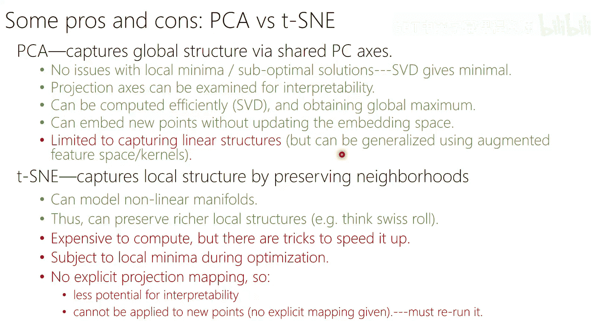

# UCB《机器学习导论｜CS 189⧸289A Introduction to Machine Learning Fall2024》claude-3.5 p13 L13- t-SNE.zh_en -BV1H4421S7bs_p13-

我。Are you。哎。还照了。认没。よや。Yeah， they problem。や。早て。ま以か正直が。不要你啊。所以2。没有搞方后。Or kids police。I直说。来る。我。い学や。还涉一张。

开了。我以。还没。没意ね。け。每一个地方。有我。That's nice use， yeah， yeah， of course。这这个分。好州。Is it a rest of word？い得。あ、それで。

おいても。不まし。我 now。No， it's like you know。What class you guys。でモでになりま。属于。那有。因为我。的颜色。今件事。して。对所以。I was。自ぬ対。

like。哦，我的边回了。对。等你还。家。不异。企有在这。有唔是。気持しいなか。頑張しね。接し。想找。Thank。Yes。可可以。电车。そ来。业务。对。Yeah。

Okay， let's get started， so we're going to finish PCA and slowly segue into a nonlinear dimensionality reduction by going through a series of thinking and we'll end up at a very very widely used dimensionality reduction which is primarily used for visualization of data in the sciences a lot in molecular biology and we'll kind of teach you some interesting thinking along the way so but last just to recap kind of where we were last class I introduced this actually。

This is recording well enough right now Last class introduced the notion of creating a special basis where if we expanded each image or each data point in a data with that special basis than we could retain a lot more of the information with fewer basis vectors than the native basis and so the kind of running example where these faces and you get you'd get the basis vectors from doing SVD sorry from doing a spectral decomposition which we had learned when we were talking about multivariate Gaussians and then I was saying that there's actually a faster way to do it because doing the spectral decomposition is cubic and so I said you need to understand the SVD and somebody actually caught a typo I myself saw on the slide and was puzzled but didn't think about it but so it's where the boxes so last class that said plus is actually the minimum of these so the intuition is that。

With SVD， so if your data matrix is this thing M， which we usually call X and it will be XN has。

I guess it could have M examples and n features， then it will be linear in the larger dimension and squared in the smaller dimension。

 and so that's always going to be better than well， in the scenario that I've been talking about。

 this one， that will bias something so we won't have to get the cubic complexity of the number of pixels。

And so I'm not going to go through the whole SVD again。

 but it was this sort of generalized eigenvector eigenvalue system and the idea was to say how and what I showed you was that the eigenvectors of x transpose x are in U and the eigenvectors of x transpose were in V that's in one of the slides from last class and so the idea was to say well we know from PCA from everything we've done。

 the way we do PCA was we meanize the features and then compute this inner product which is the covariance matrix and then intuitively what PCA is doing is giving us the best low rank approximation of that matrix by doing the spectral decomposition and truncating part of the eigen spectrum and in practice what we do to get the。

The new lowdial representation is we take our original data and project it in town to this truncated basis and now we have a low dimensional representation so if we're going to use the Svd of x instead of that。

 what we know is that the SVd of x yields the eigenvectors of x transpose as x in U so I don't even need to compute the covariance matrix I literally instead of doing the spectral decomposition of x transpose x I take the Svd of x directly and from there I know that the correct eigenvalues that are the same ones I would have used for the spectral decomposition R and V and so this is exactly equivalent to this and furthermore what's interesting is。

I can also just write it。it like I don't even need to right now the way procedurally I would have to do this is it is call the svd of x I would get V and then I have to compute x times V。

 but if you spend a little bit of time after the lecture looking and I'll just give you the intuition here。

 but from this equation it's clear that you can write x times the if vector yeah right I'm basically post multiplying both sides by v transpose。

 but v is ortho normalormal so that's how I get the xv here and then basically x v transpose is equal to xv is equal to mu sigma I'm just popping this over to the other side using the fact that it's orthoormal。

So using this relation sorry， in retropect， I could have written that on the slide， I apologize。

So but the key thing I'm trying to make is that instead of computing x times V from this relationship by moving V to the other side。

 I can actually just extract the low dimensionional representation directly from the SVD by just extracting the K appropriate eigenvectors and the K appropriate singular values and that will directly give me the lowdiional representation that I would have gotten through the procedure of taking the covariance matrix and then the spectral decomposition and then projecting the basis down。

 so it just kind of saves me a lot and I get this better time complexity。

So and I mentioned this theorem， we're not going to prove it。

 but you may hear it in your lifetime depending on your path。

 this echot young theorem and I just want to highlight how is it related to PCA so the theorem says that the SBD。

 the singular value decomposition， which is equivalent to the spectral decomposition when x is。Is。

Square symmetric。Then I get the best low rank representation in the sense of the Frroenius norm。

 so if I trucate the spectrum of trucate the basis and get this x reconstruction which lives in the ambient space like the reconstructed images and ask how far away each image is from the original one before I did that and ask for the error in terms of Frrobeius norm。

 then for a given rank， the rank here is how many principal components I used。

 if I use K principal components， I have a K rank approximation。

 then this is guaranteed to be the lowest rank reconstruction and so you could go through you can prove this in different ways。

 but through the Ehart young theorem would be one way to do that and it generalizes to some other norms as well。

 but so the key insight you can really think about as PCA provides the best low- rank approximation to the original covariance matrix。

嗯。And to the reconstructed matrix as well。So。So I'm not going to go into detail。

 but just if you're interested when you call SVD in different code like Python in different places。

 there's a bunch of different ones， this is just I think I took this just from Wikipedia。

 it's good to know because some of these are better time complexity。

 often you don't need all K eigenvectors and so you can reduce the time complexity using some of these more special calls or the space if you don't plan to need all of them。

And I won't go into details on that okay so I also want to highlight this it's easy for intuition to go wrong here so we think of linear regression with this kind of a figure where this is like one feature that I'm regressiongressing on the dependent variable and this is the target variable and then I can think of drawing a regression line and remember the linear regression is a probabilistic model of the random variable y conditioned on x and we only treat y as a random variable and so the errors are only in y and when we think about what kind of approximation linear regression are to the data it's like it's how you're going to get these vertical lines because the error is only in Y In contrast if you think of PCA then you have two features you could also have two features that they have now called x1 x2 but now the perpendicularity is actually the error is you're projecting onto the basis and so now the errors are perpendicular。

To that that the。To that line here。Right， so this would be like the first eigenvector in the example I showed you last class and I say what happens if I project it down to that one dimension。

 now the errors look like this， so it could be easy geometrically to get confused between these。

 even though they're quite different， so I just wanted to highlight this kind of difference in intuition and technicality。

So I'm not going to go into this， so this is kind of it's not actually this might be in the book I'm not sure。

 but just want to highlight that you can actually use a neural network instead to do PCA and basically what you do is you put your input image or data point here so this could be a flattened image you also make it be the target and you're doing supervised regression from an image a flattened image for example to a flattened image and if you make it have just a fully connected layer and no non- nonlinearities so no like the activation functions just the identity and basically there ends up a big W matrix here and and the inverse of it here or the transpose which is the inverse it will actually in this case。

I forget the details here because so what actually happens is if you train this with maximum likelihood estimation。

 the double you get out and so the key here is you make the hidden node compress the data so if you want to do PCA with just K eigenvectors and you started with many more inputs here you would make the number of eigenvectors you want for PCA be the number of hidden nodes and then when you do just maximum likelihood on this the W matrix you get out that projects it down to the lower dimension will span the sub same subspace as the eigenvectors you would get out from PCA so just kind of a fun fact there's many different ways you can extract the PCA subspace。

But in practice so so that one that's just kind of neat to think about。

 but in practice is also interesting because you could generalize this procedure by just saying well。

 you know what I'm not going to make it be linear I'm going to just add nonlinear activations like sigmoids or values and just see what happens and now I am basically forcing it to compress into a different space but with a nonlinear transformation and as we know the nonlinearity buys us a lot of power in richness of representation which is why it's all over our neural network architectures and so in general。

 linear models are very very useful and at the same time it's often useful to go to nonlinear models。

And so that's going to be kind of， I'm going to segue into what's the main core of today's lecture。

 which is non nonlinear dimensionality reduction， although a quick question actually like suppose I just wanted to do the regular PCA。

Like this， with let's say with the spectral decomposition。

 who can tell me how I could use what we learned just with the math here and a simple idea。

 how could I make this be a non nonlinear dimensionality reduction？I think okay， hint。

 polynomial basis expansion。Is that enough of it？So if instead of taking imagine that X here contain each image that was flattened out。

 what if instead of each image flattened out I also took all I created new features which was like all pairwise features sort of like quadratic terms from the pixels so now each image is no longer just the number of pixels but it's the number of pixels plus the number of pixels squared。

 so I'm augmenting the feature space and if I do that now I'm in non- nonlinear PCA territory and this is relates to a topic that it coming in a later class of kernel learning but in that context kernel is not a neural network kernel。

 it's a different kind of kernel but we'll get to that。

 but so anyway just to seed that idea in your head is that whenever you have a linear method you can always make it- nonlinear kind of with respect to the parameters or with the inputs by augmenting the feature space。

嗯。In that case， it would still be a linear projection right but it's a linear projection from not the original space and therefore it's not linear in the original inputs okay but so let's go and now think of another interesting question。

 suppose that so so far in PCA the assumption is I have a data set a list of images or a list of features that belong to each person in this class or something like this but what if instead of that someone gave me a matrix。

 they basically gave me the x transpose X that I already had for I only have some distances but I don't have an actual data。

 I just know the distance between the points in the data。

 So something someone might do is they might actually give you a list of cities in the United States and tell you how many know this must be miles I guess I don't know where the paper is from but how many miles are between every city and now suppose that I wanted a two-dimensional representation where on one axis I again just like one of these。

of rant latent dimensions that PCA gives us， and then with those new dimensions I want to plot the cities。

How would I think about doing that so here the idea is that right I have pairwise distances between n cities and I'll call this matrix M。

 and I want to find a 2D representation where I could plot them on a graph like this in this case is dimension one dimension2 and each row。

 which is also each column gets a two dimensional representation。😊。

So what I can do is I can just kind of pretend that this square- this is square right because it's like Atlanta to DC。

 Atlanta to DC， so this is a square matrix， I can just kind of pretend that there was some observations X and that I created this inner product here to get M and now what I can say is how would I get the best low rank representation of this？

I can basically use the SVD again， so before we were using V， because when we did PCA。

 we wanted the eigenvectors of x transpose X， but now I want the best low dimensional reconstruction of this guy。

 and those lie in U。And so this is actually a method called multidimensional scaling and so you can get in the same way we just went through on the last page you can actually get the coordinate- don't worry we're not like this is not a big part of the course this just sort of to kind of take you through a path to where we're going and so you can basically use the same ideas we just had to actually get the coordinates for each city and so it is kind of a neat twist on things right it is like I didn't give you the original individual samples I just gave you the pairwise distance between them and yet I can still kind of from that extract to lowdial representation。

😊，And so Ray， we're kind of implicitly assuming some latent space X that we never observed and for which the distance between- so what we are assuming is that we don't know what x is。

 but whatever the space X is， we're assuming the distance is an inner product distance because of the math we're using。

 it's an inner product。And so this distance could be nonlinear in terms of the actual X。

 so this is another way that you you I mean。Yeah， but we don't know what X was anyway。Okay。

 so that's just sort of a wet your appetite for going in a bit of a different direction。

 but so now let's focus just on the main。😊，Part of what we're working towards right now is how are we going to get to this algorithm called T sE。

 the T is going to stand for T and T distribution and the SE is going to stand for stochastic neighbor embedding and we're going to build our way there and so last class when I introduced PCA I was motivating just the a general idea of dimensionality reduction with the Swiss role and I said the ambient dimension which is the dimension the data was given to me in is three。

 but that the manifold dimension I could of preserve all the information locally using just two dimensions by unrolling it。

Of course， that assumes that the distance between the points and 3D doesn't matter。

And we don't always know whether that's true， but definitely these points do live on a two dimensional manifold。

😊，And so right， and so the question is what if I did PCA to these kind of points？

And so something I mentioned last class was that you may notice kind of a conceptual similarity between PCA and multivariate Gaussians and that actually also one way you could learn the PCA subspace was modeling the data with a low-ra Gaussian and then the whole idea when I introduce PCA was like look for the direction of maximal variance and then the second biggest one and if you think about that intuition。

 it kind of only applies to a Gaussian blob， like if you start having different blobs all over and start asking for the direction of maximum variance。

 it's not necessarily clear if that has any meaning for your problem although in fact we never really know when we do this kind of dimensionality reduction and visualization。

 like we don't ever know the right answer and it's just a tool to kind of get a sense of what's going on with a data set。

So， right， so if you actually use PCA on these points， this is what you will get。

 And is this is not clean。 What we would like to see is that the colors are cleanly separated as though we had just enrolled the manifold。

 And so this arises because PC is a linear dimensionality reduction。

 And and unfolding this Swiss rule is not a linear operation on those data points。

 It' something much more complex。 But this is going we're gonna in a moment。

 explain how we could get this。 This is going to be a non nonlinear dimensionality reduction。

And so again， just another example， there's a famous dataset set called INIS MNT。

 which was made very famous by Jeff Hinton， who got the Nobel Prize the other day。

 and so because for years and years， he's trying to advance neural networks on this data like for like a decade。

 almost all he worked on was this dataset but now at some point everybody could solve it so well it's an image recognition problems there's zeros all the way through nine and the idea is just can you predict image what number is in each image and so again。

 if you want to reduce the dimensionality of these images and you use PCA。

 PCA doesn't work well because those images don't tend to kind of lie in a kind of Gaussian-like blob。

And so again， though， like when when you， you can derive PCA just with this notion of maximal variance directions and it has no depth like it doesn't require that anything' is Gaussian。

 It's just that the intuition of finding the directions of maximum variance will tend to work well for things that tend to look Gaussian。

And if you use aline technique like the one we're going to learn today。

 then you could actually separate out each of the digits and that's kind of intuitively what you usually want to do is you want to reduce it say to two dimensions to visualize in a way where you're separate in general you probably don't know these labels right so imagine these are cells from like some blood test and you want to actually just investigate what's going on and you don't actually know what these groups are。

 you just want to visualize it and see if some kind of clusters pop out and if they do like what do those tend to be and things like this question。

要示。Yeah。你谁在我。So I mean， in this case， I don't know the actual dimensionality。

 but let's say they're 10 by 1， so each one lives in 10 dimensional space。

 so if I plot them in that space， it's not going to kind of look like a blob and that's because each one will kind of have its own blob right。

 the zeroes will tend to have a blob， the ones will tend to have a blob and so forth。

Okay and so actually I wish now yeah so this is hintntton of the recent Nobel fame and actually this was one of my two PhD advisors in Toronto although this is before right before a little bit before I started my PhD and so there's a series of models that were developed that kind of culminated in TN and so I'm going to take you through them because kind of it's easiest to understand this if you know this and then this is just a tiny kind of little tweak on that one and so but the main idea here is the following like in a sense why is PCA failing in these cases。

 PCA is learning in a global structure by getting this basis like a global basis the vectors apply everywhere equally right like when I get that PCA basis I apply to every point and this is a sense in which it's finding global structure and a global representation and the idea of these neighborhood embeddings is to say global is too extreme for。

With role for almost any real problem， let me try to preserve local neighborhoods instead。

 and so it's trying to model local structure and not have any kind of global basis vectors or something like this。

That's the intuition So right so there's going to be neighborhood embedding。

 which is also called IOMap， then there's stochastic neighborhood embedding。

 and then there's T distributed stochastic neighborhood embedding。

 which is I know how to correctly say it because I was around when they were doing it it's called TN。

 even though a lot of people say T S and E I mean you can say it how you want。

 but I was there question。Say that again。On an image the question is are there ever cases where PCA would make sense on an image data set。

 well， if I mean if for some reason you just had one class of digits or something analogous to that。

 then they would tend to like in some sense it's like what kind of variation is in that data and does the variation of the data tend to spread out like a Gaussian of some kind not necessarily isotropic but so I don't know what a practical example would be of just getting the zeros。

 but if I did PCA just on the subclass of zeros， PCA would work well what would it reveal。

 it probably have some corner of the space that was like sort of slanted zeros that people or like something that left-handed people do right-handed people I don't know。

 but it would pick up these kinds of variations or something like this yeah？So， okay。

 so let's think of neighborhood embedding。 A neighborhood embedding。 The idea is to say， I'm going。

Well， it's easiest just to explain it， I suppose so I have these points right now they lie in two dimensions and I'm going to reduce them to one dimension and so the first thing I'm going to do is I'm going to find for each point it's nearest neighbors and then that would be like a parametermeter so for example two like a hyperparameter it's just like the K and PCA is a hyperparameter so let's assume we know how to set it and I pick two and then for each point I'm going to identify two neighbors and they will be the closest according to some distance which could just be the Euclidean distance so this gets these two neighbors this one gets these two neighbors and then for each point I'm going to compute the shortest distance from each point to every other point so I'm going to create a distance matrix。

But I'm only allowed to go along the path of the edges I've just constructed from my two nearest neighbors graph。

 So， for example， the distance from this guy to this guy is not going to be this Euclidean distance。

 The distance is going to have to go all the way like this。

 And so it's going to look really far away。And if this is sort of a two-diional Swiss role。

 and in a sense， that's kind of what we might intuitively think we want is we don't want this thing to think it's close to this。

 if we plan to unroll the whole thing， we don't think they're close together and so then we're going to compute this distance to every other point。

 and then given this set of pairwise distances， we're going to put them in a matrix that's like the matrix of cities。

And then we're going to apply the technique there， this multidimensional scaling。

Right and then that multidimensional scaling is going to yield a representation for each point In this case it's different than the example I gave you with the cities because with the cities we didn't start off with the original points we started off with the distances and now what I'm doing is say no I have the points and I'm going create a special kind of distance based on the neighbors I have and forcing it to go through that path and like the idea here is that once I've drawn the path I'm allowed to use to compute the distances like this actually is in a sense the manifold right and so depending how I define the number of neighbors and so forth well define whether the sort of path here is a good representation of the manifold So if I did like 20 nearest neighbors here I would probably not get a very a set of black lines that look much like the Swiss rule。

They circle。Well， if it was just a circle， then you would end up like and you did two nearest neighbors。

 you wouldn't unroll a Swiss rule。 you would do the right thing， actually。

 although there you have like a circularity thing。 So youre breaking some sort of continuity condition because I don't think it can I think you'd have to do something quite special to get the continuity around the circle。

 but I'd have to think about that。 Yeah， but so I think there。

 the issue is more that you have a closed loop。 And so that's like inherently a different topology rather than that it's not a Swiss rule。

So and just to like kind of go through an example here， if these are the points。So there's one， two。

 three， four， five nodes and these are now actually road lengths apparently。

 and I decide I'm going to use the two nearest neighbors to define the distances。

 so the two nearest neighbors of A are going to be B and C。And the two nearest neighbors oh sorry。

 yeah， that's this one and the two nearest neighbors sorry of A are B and C。

 the two nearest neighbors of B are A and C and so on and so forth， so this is just by looking here。

 I can see what the two nearest neighbors are and then。

I can build the graph that is the two nearest neighbors graph。

 So I add edges for each point to its two nearest neighbors， according to this definition。

 And then I compute the shortest distance between every point to every other point only going along those paths。

 So， for example， from A to B will still be 5， right， A to B is 5 because that's the shortest path。

 And A A to E is gonna let's， let's see if we can do it because actually this we don't have the augmented to Oh。

 yeah， sorry， this does no， A yeah， this doesn't have the。呃。Tudes， dude。2年。Oh yeah， sorry。

 I guess this is getting confusing about what information we're using to get the neighbors versus this is actually the graph。

 So we're allowed to just traverse on this graph。 So if you want to know the distance between a to E。

 you have to try computing all paths。 So we did this one It be 5 plus 5 is 10，15， and then 20。

 And then we would have to compare to like 5 plus 5 plus 5，15 plus 8 is obviously more。

 And then you'd have to try all the different ones。 So I think it must be 5，5，5。

5 must be the shortest。 I that No， where are we a to E。 No， it's 16。 So where did I go wrong。

 Oh I see no， that's 18。 Where is the 16 coming from。Where？也信息。A to C。 Oh yeah， just two hops。

 Thank you。 Thank you。 All right， good stuff。 If you go A to C C to E。

 you just have two edges and you get the 16。 So now that's how you populate this and then。😊。

From there you do this SVD to get the eigenvectors y。嗯。I think， I mean。

 I guess that's some court of corner case you could decide how to do。 And I suppose。

I think I was gonna say you could put in infinity。 but I think then the SD will break down。

 So my guess is you just crank up the number。 Wait， dude。

 that's not possible because this is nearest neighbors， right， nearest neighbors。

 you always have neighbors。 I'm not。 It's not a distance threshold。

So if I say connect the two nearest neighbors， everybody has two nearest neighbors。

 or did you ask something else。Yeah。Yeah。No， oh， I see。Right。Yeah。

 I think that's like pathological for this example。 then I don't think that would work。

 Like what you would have to do is you'd have to increase the number of neighbors to be larger than like one of the clusters in order to get them connected。

 yeah。嗯。Yeah， I can't。 I mean， I'm just assuming I'm just going through this on the fly。

 I think that's what you' have to do。 And that would be problematic。 So it wouldn't work well。

 And I should say， like there's always a problem with all these dimensionality techniques。

 even though there's a series of papers saying this is better than this， This is better than this。

 Everybody complains about all of them and everybody uses all of them so。

RightAnd so this picture I showed you that did nicely enroll the Swiss map is Swiss role is ISOMap。

 and you can kind of understand why because you could。

 unlike the example that was just cleverly created。

 this one is all connected and it's connected in a way where with just like a few neighbors。

 you could actually reasonably extract that manifold。😊，嗯。

But right so but right the quality of what you get is going to depend critically on this nearest neighbor graph and like you've just pointed out a way it could easily go wrong and if you allow for the neighbors to be too far away。

 then you might connect points that shouldn't be connected so in this example。

 if I like had too many， then these might end up as connected and that would kind of not unroll this Swiss rule and the flip side is that if I like correct for that too much by insisting that they're really really close。

 I might not have enough edges and they might not be connected but I think what you proposed was like a pretty edge case also。

嗯。So okay， so now we start putting in a bit more we're going to put in some probability。

 which is all the stochastic versions。 So what we've just gone through is this one isoap is also called neighborhood embedding and what we're going to do now is do stochastic neighborhood embedding and so kind of like what this is meant to motivate is we don't really know who should be neighbors right if we do this we make this hard assumption that everybody gets k nearest neighbors and the idea with the stochastic neighbor embedding is to say we're going make neighbors be stochastic。

 there's going to be a probability that this node is my neighbor， it's not just one or zero。

 it's a probability and the motivation is precisely given by this slide is like if you have to have an exact number of neighbors then it's sort of very brittle and maybe by softening this as we often and we'll see that again in another class for another topic we're going to talk about clustering with a very hard set of。

Decisions and then soften them using a probabilistic model， but that's not till next week。

So right so that's the motivation here and so what we're going to do is we're going to say that the event of two samples like in the database so if these guys basically we're going to say there's a probability that node Xi chooses Xj rather than that it is a neighbor of Xj and so we're going to do it with something that looks a lot like a Gaussian。

 so the probability that I chooses J is proportional to what looks like a Gaussian density。

 but it's not a Gaussian because the normalization is different that's not the normalization is not of a Gaussian。

 but the top looks a lot like a Gaussian， and really the idea is just to think of a Gaussian and if you're trying to figure out who are the neighbors of point I。

 you're at the center of the Gaussian， then the further away any point is the less likely it is to be your neighbor。

And of course， the variance there is going to have an effect on how strong or weak that is， yeah。找我。

U。The reason I'm。Pausing is because usually we think of IID in a slightly different context。

 So let me just map it into this one。 I think what you're asking is is the probability of all these edges IID。

So I think right now I would say no， but in a second， we're going to symatize it。

 and then it should be。So right so I guess the intuition is like a Gaussian but just be careful because what it's doing is it's normalizing to say the probability that any of my neighbors that I choose any of my neighbors is equal to1 that's what this normalization is doing but just to emphasize the concept is that there's some probability that I chooses J but what you'll notice is this is not symmetric and what we would really like is not kind of the idea that I chooses J we kind of want the idea that I and J are neighbors right。

 and so for that reason we're going to  symsymmetricize it so that Pj equals J。

 which is not true P I choosing J in this equation is not the same as Pj choosing I。

 but if we just average them out and divide by the total number of data points then we get this symmetricized and normalized probability to pick this pair out of all pairs。

And so again， the underlying idea here is that all these methods of neighborhood embedding require to know who's a neighbor。

 which fundamentally is trying to create the topology that will squeeze out well for those ones for MD multidimensional scaling。

 which is kind of like a weird version of PCA。But here we want to be stochastic。

 We just want to say there's a probability that you're my neighbor。嗯。

But then we're going to change more， It's not going to be just this because this is now a completely different setup from IOmap or from neighborhood embedding。

 and so right this sigma here， we don't know how to set it if we I mean if you just right now went home and I didn't tell you what I'm going to tell you。

 you'd be like how do I set this thing and it's not like a proof of how to set it。

 but a rule was let's say， kind of developed， which said that I'm going to pick each sigma I differently so that I get a constant entropy for the distribution of this nonsymmetized distribution。

And so this is kind of a lot to unpack to try to get some intuition about。

But one thing you can notice is this sigma is kind of a soft version of k in choosing k nearest neighbors。

 so if I make sigma very， very small， then kind of only points that are close to me will get any real probability and so I'm in a sense choosing a small set of K for K nearest neighbors if a sigma goes out to infinity。

 then kind of everything just bleeds out and I kind of get everybody is my neighbor。

And so this kind of rule of thumb is to say like。That we just want the entropy of the distribution of I choosing J to just be constant。

 and honestly， I think it's just a heuristic to set it that work well。

 like I don't think there's a deep meaning to it。So。Okay so but just to give you an example。

 just as k so just to reiterate like K in ISOAPap， how many neighbors I chose to use to draw the paths was really critical and would determine how well that approach could work if it could work well at all and here analogously how I choose Sigma I is also really important and so here a lot of people like to talk about perplexity。

 perplexities just equal to two to the power entropy there's no need to go into it。

 I only put it here because the picture I took is in terms of perplexity so instead of saying you keep the entropy of this distribution constant they're just saying keep the perplexity constant but it's the same statement and then they have different perplexities for the same data so this is the original data set which is in fact kind of three clusters green and of course we don't really know they're just using this for visualization as we did on this Swiss rule't when we have a data we don't know necessarily what these colors would be。

So if you were to use perplexity too， things would be kind of scattered around and you decrease it。

 it kind of gets。Maybe more to what you would like to see and so all that is to say is that as you change this parameter。

 you will dramatically change the embedding， so it's not like just some minor decision to make it's a pretty big decision。

Okay。So。So what we're going to do is we're going to take the original data we had and we're going to define the stochastic neighborhoods。

 these probabilistic neighborhoods in the way I just described。On the last slide。

 which is this kind of weird， almost Gaussian like thing。

 and then I'm going to symmetize it and I'm going to use this sort of heuristic to set each sigma eye。

めて。power。U。So it's a little trickier than that because what I'm changing up here is I'm changing the constant whatever I'm forcing the entropy of the I choose J distribution to be constant for all nodes。

 And when I do that， I'm not forcing sigma to be the same for all nodes。

 That's how I'm setting sigma。 And so in fact， there will be different sigmas for each node。

 And so as I turn this knob， I'm not changing the number of neighbors right I I'm changing the perplexity。

 and that's a bit harder to think about。And I'm not sure if there's an intuition。

 There is an intuition that， as I change sigma， that if it's a soft version of number neighbors。

 I'm not sure if there's an intuition for。How what happens when I change this entropy。

 I think it's just some parameter and you scan it and see what happens and look for something interesting。

So right so we're going to use everything I wrote on this page。

 this page here basically says you have some data and here's a way to define the probability distribution that any two nodes are neighbors like that's the point of this whole slide through this kind of weird process and now so from the original data I will use that process and I will get the probability that any two nodes are connected。

Or that is that any two nodes are neighbors。 Now here's where it kind of gets interesting。

 What I'm going to do is I'm going to posit the existence of a low dimensional representation。

 This is the representation like I'm going want to extract just like I get out of PCA but I'm going to do it completely differently here So at the end of the day when we're done everything the low dimensional representation is going to live in Y。

 but we don't know what y is。 we're going to end up initializing it and doing gradient descent on a loss function that we'll get to。

So and and so but imagine we've initialized why in this the procedure we're going to use an iterative optimization algorithm and we have to initialize it so we initialize why and then from those y's we can use the same procedure we used above to get the neighborhoods for those so now in and of course in the beginning when I initialize it these neighborhoods won't make sense but as I do gradient descent on an appropriate loss。

 they will start to make sense and so right so these are the neighborhoods defined by the original data PE these are the stochastic neighbors defined by the latent representation Y that we will learn。

And why in particular is going to be lower dimensional， so this has D dimensions。

 and this has only K dimensions， but I can still turn the crank of how to compute the probability that any two points are neighbors。

And so in this case， I don't have to fiddle around with Sigma because I'm actually learning why。

 So there's some sort of compensation。 I can just kind of just set sigma to a fixed value And based on that。

 it will learn the appropriate y。 I don't need to learn both of them because y isn't fixed。

 When I have the real data， it becomes important。 But because I don't even know what y is。

 and I'm going to learn it。 I can just set sigma equal to some value and this is just convenient because then it looks like this。

 So now'm using the same procedure except that I don't have to find sigma。

And so the neighborhoods boil down to this equation， which is a simplified version of the other one。

 When I set sigma squared equal to one2。And now the goal is we want a loss function that encourages why a representation y that preserves the neighborhood structure。

Like that's the whole goal here is let's use a loss function that we optimize such that the neighborhood's Q look like the neighborhoods P。

 if those stochastic neighborhoods are the same， then I've preserved the local structure defined by those neighborhoods。

And so what we're going to do is we're going to use this KL divergence and I can't remember because I used to teach this and then I can't remember if Said did was this in one of my lectures or Saed's lectures。

 KL divergence or in a homework， like it's suddenly a blur， it was in something。It wast homework。

 Okay， Okay， I mean， I'm gonna， like I just， in any case。

 I'm gonna go through it enough to understand what it's needed for here。

 So the K L divergence between two distributions is is written like as follows。 So notally。

 we just say K L between P and Q and， and， and it looks like when you want to。

Have an empirical estimate you just sum over all your data points from the all the possible values of the data points for both of them。

And you compute essentially P log P over Q。So that's what it looks like mathematically and I think I have a slide on some of the do I have did I oh okay good right。

 that's just the same thing again and note that it's not a true distance matrix because it's not symmetric if I flip around P andq this is not symmetric and P andq so you have to be careful with the KL divergence。

 but it's very frequently used in statistics and machine learning to set up a problem much like I just told you about where you kind of have some distribution you've described in some manner right in this case we've described the distribution in terms of stochastic neighbors and then we want to match the two distributions So whenever typically in machine learning when you want to match two distributions。

 you think of using the KL divergence。And you can also， I mean， you don't need to do it here。

 but just as a random other fact， you can symatize it。

 there's also a symsymmetricized kL where you add them together and average them。

But it's often mathematically convenient just to use one of these because things are simple。

And there's a reason you may want to use one or the other， but that's beyond the scope here。

 But right， it's not symmetric。 And the distance between two distributions。

 the smallest it can be is0 and is0 only if those distributions are exactly identical。

 And to the extent that it's greater than 0 is the extent to which those two distributions are bigger。

 And so oh good I have this。 Okay so yeah， really like so here's a distribution P in a distribution  Q。

 And when I go compute this， I just go to every single point in the spaces and I just compute the ratio of the two。

 So in this case， the the ratio of the density of P over the density of Q And so if they're exactly equal。

 that's equal to1 And and this will。😊，Will not incur a penalty， and then I wait it。

 I weight this sort of distance， it's a weird kind of distance。

 which is this the log ratio of the two densities， and it gets more importance if that value of x has more density in the sort of reference distribution P。

And that's why it's not symmetric because there's kind of a notion of a reference distribution P is one way to think about it。

 but for the purposes of this lecture and the purposes of machine learning。

 what you really want to think of is this is one of the ways to measure the distance between distance and quotes between two distributions and if you want to coerce two distributions to be the same and you have some free parameters。

 you want to minimize the KL divergence between them。So right。

 so what we're going to do is we're going to take the k divergence between the neighborhood。

 the stochastic neighborhoods， the probability distribution that any two points are neighbors。

 which is in P and we just compute that from the data with the heuristic of how to set the sigmas with a constant entropy and then we posit some values of y that will define a similar stochastic neighborhood for Q。

 and then we minimize the difference between these two distributions and we're minimizing them with respect to y because is the low dimensional representation that will dictate Q and the idea is find the y the low dimensional representation of y so that the local neighborhoods of y defined in this probabilistic sense。

 most closely match the local neighborhoods of the original data。这个是呢。嗯。Where do I have them。

 so PP is all the way。It's P are these guys。 It's this sort of weird。

 We have the asymmetric version of I node chooses J。 Then we symatize it。 And so it's these P I Js。

 So every pair of if there were end points， there's like。Then there's n squared of these guys。

 the probability that any two points are connected。So Q is exactly the same。

 so all of this P distribution is primarily defined by the data X that's given to us。

 like something like the images。😊，And now the idea is we want to reduce representation of the images。

 So we're gonna。Posit a kind of parallel version of x that lives in a low dimension called Y。

And then we're going to do this whole thing again and get a neighborhood probability distribution for why。

And that's called Q， And then we want Q and P to match。I that yeah， it's a lot of moving parts。

 Please feel free to ask， yeah。嗯。There's a lot of discussion about that in many different areas of machine learning。

So I'm trying to think if I can off the top of my head， think about in this particular case。嗯。

Yeah so yeah there's different reasons people do it in general。

 so in general it turns out sometimes one direction is more tractable than the other at like one direction you can actually just compute in the other you can't for problems that like are beyond the scope of this class unless Sa he may teach variational inference and you may learn a little bit about that but in this case there's also sort of conceptual reasons you may want to do it not just for mathematical convenience and so in this case the data you actually have on hand is P and so you could say I want like in some sense。

I can't take a penalty on a bad where let me go to like there's no penalty if P and Q differ unless P has density。

And so P is like the real data points here， and so that makes sense。

 you want where the real data points have density， if it doesn't match。

 you want it to take a hit in the cost。And if I instead put Q here。

 I wouldn't have that interpretation。And so like there's actually a utility to the asymmetry。

 more generally， there's you could have many conversations about like pros and cons of that。

 but again， it's I don't even know if it's in the textbook or not。Yeah。

So what we're actually going to do is sorry， is we're actually going to find a why remember y deterministically defines Q。

 So there's like a deterministic mapping from y to Q and what we're trying to do is find the why who once we deterministically determine its stochastic neighborhood has a stochastic neighborhood that looks like the stochastic neighborhood of the original data in the original space。

 So values of y and correspondingly values of Q are those that maintain the local neighborhood structure in the original data。

And local kind of depends on the sigma hyperparameter and all that sort of heuristic stuff。

 is that help？O， okay。And so。PCA has this nice property that you get the global optimum just by doing the SVD or the eigen decomposition。

 this has a gazillion local minima and so because it's not at all a convex optimization problem so you might typically initialize this different ways and run it different times and find the one that gives you the best value of the loss function。

So。I thought I took this slide out。啊。Okay， well I didn't take it out。

 I guess I thought it was useful to go through sometimes I put it in sometimes I don't。

 so this is the remember Q is the stochastic neighborhood for the low dimensional variables Y that we're trying to learn and it's defined in this way。

😊，And actually， this is。哦。You know， I think there's something。I think I might skip this slide。

In which case， you're not responsible for it， and I will take it out。

I I think I found this somewhere， but I think it's not working。 It's meant to give some intuition。

 and I don't really gets actually working on the。On the symmetized distances。

 And so I think it's like kind of maybe more confusing than helpful。 So I'm going skip it。

 if I decide it's like invaluable and I'm going take it out I'll come back to you。

 but I don't think it's true。 So just forget that slide。 So one of the problems with what we've done。

 And remember what we've done ignoring this slide is where am I。fundamentalmentally。

 I'm minimizing the neighborhood distribution of P with the neighborhood distribution of Q。嗯。

And it's the probability that any two points are neighbors。

 but one thing you have to remember is that the neighbors in queue live in a lower like in y。

 y is lower dimensional， and so the neighborhood structure is defined in a lower dimensional space。

than in the original data and the reason that's important is not this slideops it's this slide So if we just step back for a second and think of a standard Gaussian like an IID multivariate or not yeah multivariate Gaussian and I plot the distribution of pairwise distances from samples from that distribution in low dimensions the samples of a Gaussian in two dimensions tend to be fairly close in the sense that the mean here is like 2。

5 and almost all of them are at least a unit distance5 apart and remember these are all standard Gaussians。

 just this one's a 2D Gaussian， this one is a 50 dimensional Gaussian and this is a a 500 dimensional Gaussian and what you see is that as I increase the dimensionality of the Gaussian the distance between any two points sampled from that Gaussian goes up tremendously so here the average distance between any two。

Pos in a 2D Gaussian is something like 2。5 here the average distance between any two points and a 500 dimensional Gaussian is like 32 and that's all it's all just like a standard Gaussian and so these weird things happen in high dimensional spaces and so when we try to force the neighborhood embeddings to be the same for a lowdial space as they are for a high dimensional space what happens is point like the points this is the intuition like and again actually this is just sort of not been proven this is sort of like an argument and observationally what motivated the final twist we're going to see which is very minor don't worry to Tney is the idea is that if we。

Use the procedure we've used to make the neighborhood embedding of the low dimensional points be the same as the high dimensional points。

 so we're going to somehow crowd them in some way that's not useful for what we care about。

Is the argument。And so there's one little tweak here and all the other concepts remain the same so just the smallest tweak is that what we're going to do is we're going to change the distribution queue to be heavier tailed so remember there was this sort of Gaussian like object but normalized differently and you may recall from an earlier lecture I gave that there's distributions that have heavier tails。

 meaning they have more density further from the center。

 and by using a heavier tailed distribution to define the neighborhood embedding。

 we're going to kind of allow the space to be a little bit less crowded in some way that's helpful。

And the heavier tail so right so this is what we originally had for S for both the real data and the hypothesized low dimensional data Y。

 we used this thing that looked like a lot the top part is proportional to a normal and then it had a different normalizing constant and what we're going to do and we're only doing this for Q because we don't need to do it for both of them。

 this is just the low dimensional representation， we kind of need to give it some breathing room by making its distribution kind of have heavier tails and so just for the latent variables。

 these hidden low reduced dimension variables y that define the neighborhood。

Probability distribution Q。 we're going to use something that looks like a student T distribution。

 which has allows more mass further away。 and this this will in higher dimensions。

 not have the same behavior as badly as the Gaussian does。

 It will allow things to actually be closer together。So。And so right this is the general student T。

 if you said V equal to one， which is just some like parameter you can set to get different versions of student T distribution。

 you get actually this kt distribution is just proportional to one over x squared so when I want to change what I was using for stochastic neighborhood embedding to get TN T distributed stochastic neighbor embedding。

 I just use this one over x squared instead of this thing here。

 so I get this is the one over x squared and then I normalize it in the same way that I had。

And that's the only。 so now like we've built all the way up and this is the and then everything else is the same。

 so I all I' done differently between Snee and T S is make a minor change to how I compute the stochastic neighbors cu。

For the low dimensional data， I don't change it for the real data that still stays as the Gaussian because those ones live in the high dimensional space。

 and and it's okay。 And then I I define the same objective function。

 which is the k divergence between the Q's and the P's。 And then I optimize for that。Oh。

 I think what you're asking is like， why did why did we choose vehicles 1， could we try other things？

 And yeah， and I'd say general， the answer in machine learning to such questions like yes and yes。

 And we never know what's right。 Yeah， Yeah， so you could， in principle do that。 I don't know。

 you know， there's people who spend 10 years of their career on like this one album。

 They could probably answer something like oh， that tends not to work。 And that's why I don't know。

 But you can definitely do it。 And my guess is there's problems for which that will help you。

 because。M。😊，嗯。Yeah。Okay， so and if you want to just think algorithmically。

 what would this look like just to try to cement these concepts in your head。

 you would start with a data set that live in the ambient dimension so that you have n points and as a parameter you would have to tell this algorithm。

 what entropy constant you're going to use to set each sigma I think it should be sigma either。

 I guess people have different notations， but the sigma。

You're going to have to say how many iterations of gradient descent you want to do and what your learning rate is。

 the kind of usual stuff， and what you'll get out through the minimization procedure that appears here iteratively is you're going to get out the low dimensional representations。

 one for each point， why。And so the first thing you're going to do and so this kind mixed and matched things from different places。

 I don't think I've used the word affinities， but these are those it's the I chooses J as a neighbor and you're going to compute those with the equation I showed you which looks like a Gaussian and has a hyperparameter that we're going to set according to the heuristic about always constant entropy where the constant entroies given to you as input to the function。

 then we're going to symatize it and renormalize it。

 and then we're going to initialize our solution of the lowdial vectors that where each one of these eventually will represent each one of these。

 of course I've just initialized it now so it has no meaning at all。

 apparently this is a good way to initialize it， then you're going to iterate for t gradient descent steps as follows。

 you're going to take whatever crazy values of y came out of here from the initialization。

You're just going to compute the neighborhood probabilities Q。

using the equation I showed you and for the case of Tney that will not this is always this Gaussian like thing。

 and this is now a T distributed thing， which is just using that as a distance to say。

 how what's the probability these two points our neighbors？And then actually I'm。I just realized。

 okay it's a bad idea to grab things from different places because the notation is different。

 there's these oh P Ij  Q Ij okay but they're calling these affinities and these affinities I see they're using the word affinities for these things but so it's just weirdly worded okay so these are the affinities and therefore these are still the affinities good and then there's gonna to be a cost function which we saw on the other slide the cost function is the kl divergence between the sets of Q and the sets of p which is right it's a finite list of elements which tells you it's the probability that these two things are neighbors and I'm going to compute the gradient of that cost function with respect to y on this huge thing So it's a gradient with respect to all the low dimensionmenal representations for all my data points at once and then I'm going to take a gradient step with the learning rate eta and I'm going to proceed and then when I'm done this y will contain hopefully at least a local。

Optimum of why that will preserve the neighborhood structure that my original data did。

And I shuffled slides around today， and there's some point I did want to make。

But I think I can make it without saying too much， but when I take a gradient step of that loss。

 like each y depends on all the other ys， basically。

 like so this is like it's a pretty complex optimization task。 I guess maybe that's the main point。嗯。

Okay。Any questions。So right， this is the same MN digit data set。

 and this is showing you if I run through gradient descent what happens and I was looking away I missed the beginning。

 and I want to see it， I'm going to go back， how do I do that？Okay， so that's just the point。

 It did some weird stuff there in the beginning。 Did you see that， It should have like a slow mo。

 It was like。So it seems like it looked like what did it do。

 I think it first exploded and then came back， wow， it's so fast。Actually。

 I think it went smaller and then bigger and then back。

 and then it started to like settle into this kind of a thing。系。Haha。😊，So thats right。

 that's what happens if you apply TNE to the MNIS digits database。

 and I think in the beginning of last lecture I mentioned that dimensionality reduction was used a lot in molecular biology。

 also many other sciences but I know molecular biology more than I know the other ones。

 and so you'll see these plots in almost every modern day paper that has anything to do with single cell analysis。

It's like it's pervasive， it's everywhere。 And then if you go to Twitter。

 you'll see a whole bunch of people saying this is complete shit nonsense。

 And so they're not saying that the algorithm is nonsense。

're really the message is like you have to be very careful with these things it's a way to visually explore your data and it can be extremely useful and the problem is that in some parts of the scientific community。

 people are trying to kind of make scientific claims from this when clearly there's hyperparameter and local optima and you know you could you could try so many different things and probably you could force the data to do something that matches a story you want to tell and there's a belief or a feeling that that's often what's going on and that the level of seriousness of the claims from these plots is not warranted and I think it is often the case。

 but I also think they are useful tools that we shouldn't dismiss them。

 we should just treat them in the right way。😊，And then here's another example， in this case。

 each sample represents a book and the features are the words。

 I don't know if they took the words from the whole book。Maybe they did， they did something。

 and then they used TN。😊，And they got this。Map of different languages。

 I'm trying to actually not sure if there's something particularly cool about this map。

 and then they zoom into it here。Oh， I see。 So this is of the English language you get like social science books。

 politics， books， education books， Yeah， so I mean。

 you can apply this to all different kinds of data。

Okay so like so last class we talked about PCA and let me just kind of highlight some of the differences between PCA and TN so PCA had no issues with local minima because the SVD just gives you the guaranteed best low rank approximation sort of the magical thing I guess is linear so things are easier when they're linear the other thing that's nice about PCA is I can go look at the new basis vectors right like those eigenfaces were the new basis vectors and like I can go look at them and like see like you know like try to think about what meaning that has for my problem might teach me something and often people do look at those and they do have meaning so that they're kind of interpretable。

Oh， I have the same thing twice。 Okay the other thing that I don't know if I highlighted this。

 but if you if you understood the lecture by the time you understand that lecture and I think it's quite easy to state is in PC。

 I can take a set of data and I can do the spectral decomposition or the SVD either one。

 It gives me my new basis。 And now I can take every point in my data and project it onto the basis。

 But what else can I do。 I can take points I did not use to construct the basis and I can project them onto the basis also。

 So for example， imagine that and this is something people do。 They have like a huge。😊。

Set of genetics data and they will do and but there's so many people there's like 3 million people in the data。

 they can't afford to do PCA and so they subsample down to like let's say a million people I'm just making up these numbers to tell the story。

 like a million people that they can handle on their computer they get the PCA basis vectors with a million people who they've chosen at random and hope are representative of the overall sample and now the other 2 million people that you didn't use to get the PCA vectors。

 you can just project them onto the vectors and now you can plot everything for all 3 million people even though you had to do the expensive PCA computation only for a million or however many you can afford so that's a super nice property super super nice property of PCA and actually so Tney does not have that property。

But it is limited to capturing linear structures unless you augment it with new features。

 but we don't necessarily know how to augment it with new features and that could make it more expensive depending on the scenario。

Okay， so that's PCA。And then TE， the whole point of TN was to pull us into a modernday nonlinear dimensionality reduction method。

 and so it is nonlinearar and therefore it has the potential to more nicely capture local structure。

 but it's like it's not guaranteed to like you could just go take some data set and you run TN in some default mode like it might be complete nonsense as well。

 so there's no guarantee here， but we know at least this class of dimensionality reduction has a lot more richness to it and has the potential to extract much more interesting structure。

 but there's never any guarantee that it will do the right thing it's quite expensive to compute it and also it has local minima because it's not a convex problem and in contrast。

 maybe this is maybe one of the。Well， yeah， I think these are two pretty big points so it doesn't have interpretability right like I don't get a global set of base。

 I don't get a global anything out right when I do PCA。

 I get these eigenvectors andre just they are my global description of the lowdial space when I do TN I don't get anything out that is global all I get out is a new representation for each point so I have no ability to go look at something like the eigenfaces or anything like this and maybe that's fine again。

 it just depends on what you're trying to do and then also it doesn't have this nice property that I can take a subset of the points like a million points and compute TN and then simply somehow project them back in。

 I can't because it was this massive machinery of gradient descent whereas directly learning the low dimensional representation rather than learning a mapping that I could apply to new points I don't get any mapping。

I just get the low dimensional representation。嗯。So if you had more points。

 you'd have to like rerun the whole thing and it could be people have some weird tricks to do something。

 I mean， I guess in general。For these scenarios， what you would do is there's a notion of like a warm start。

 is that a term that's come up anywhere， a warm start okay so warm start would mean like I kind of have some good idea how to initialize。

 So when we ran Tney， I said you just initialize it from this normal kind of random thing but imagine that I had run TsN for a million points and I wanted to make it 3 million。

 something I might do is instead of initially randomizing all of them maybe I actually take the million that already learned and I initialize with those which might help the whole procedure go a lot faster and in general in machine and that's called a warm start because you're kind of starting it in a warmer place assuming you're trying to get to a hot place and so it's always a good idea to think about when you're doing optimization and machine learning if you can do a warm start and that might help you。

That's just like an informal remark。 Okay， we are done with six minutes to spare。

 so enjoy studying more for the midterm with the extra six minutes。😊。

バちます。Oh you should go to the staff for those questions like to the office， yeah， yeah， sorry， yeah。

Or you can also post on Slack what's it called no， I get so confused Ed is where we post now not yeah。

just I have a policy just because otherwise I get inundated with homework and exam questions and I want it to be for more abstract conceptual questions about the lecture material。

見せとかロっと。I sameme thing， same thing， Yeah， yeah。I'm not can you say it Yeah， you have some？Thats。Yeah。

 yeah。But then is there some sense where you could？I see， what you're saying is。

 could I learn a mapping？I mean， I guess in principle。

 like you could set up a neural network where you give it the inputs and the outputs of TN like the x and the Y。

 and you could see if you could find， I mean， in principle， you could do something like that。

 And then if you had that， then you could use it for new points， maybe。

 maybe because there's always a problem like。I mean， if you did it carefully。

 probably that would work well， actually， it'ss a good idea。😊，啊。

Because like this course is really like thatmro。Basically， you're just applying math concepts in way。

嗯，嗯嗯。Remember the prize was just in physics， maybe we're all physicists now the Nobel Pri in physics was we're all laughing about it。

 but okay， sorry yeah， I was just a side joke yeah， what was your question？Oh I'm still we in this。

You know， that's a great question that I don't know the answer to。

 I don't know what they do in applied math， but I have a hunch like that would be a fun degree to do。

 but what I don't know。は。嗯。I never was exposed to an applied math program or anything。

 so I don't know， but I have no feeling there's interesting stuff in there。

Like are you thinking of adding it into your current program， let's just go outside as well。S。

