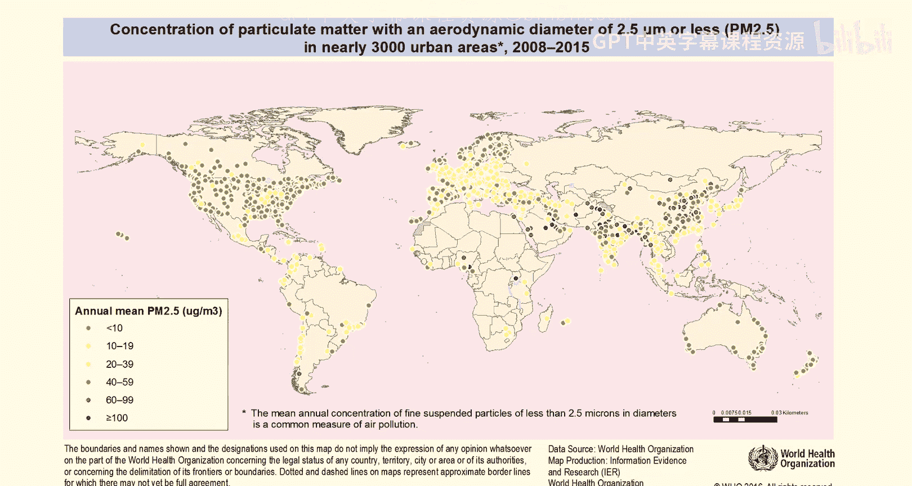
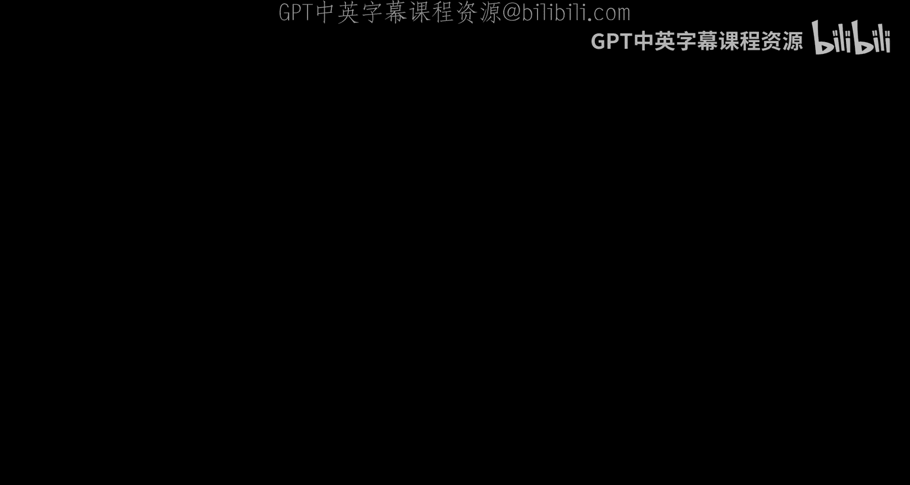
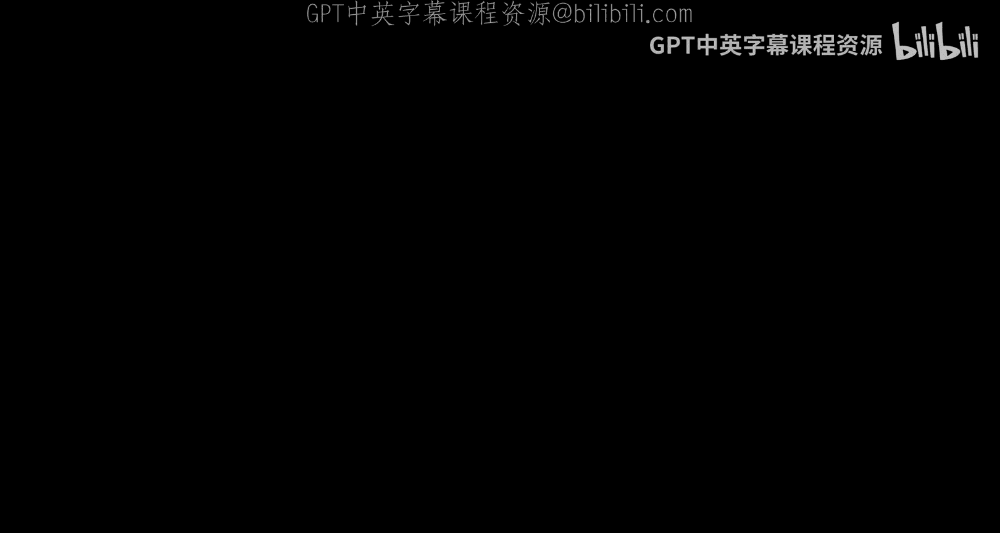
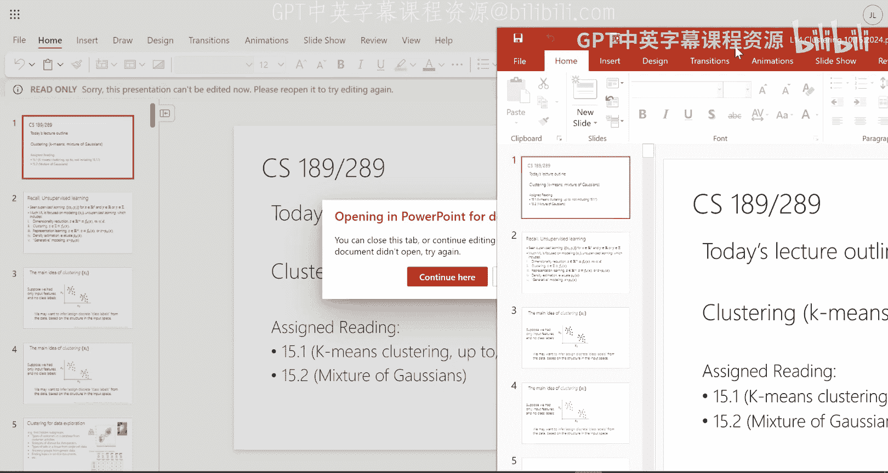
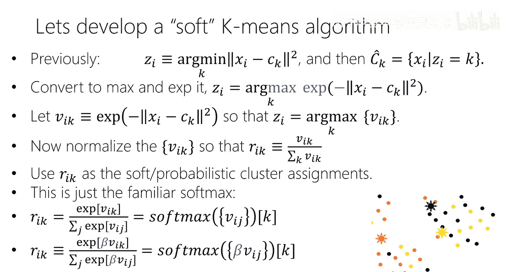
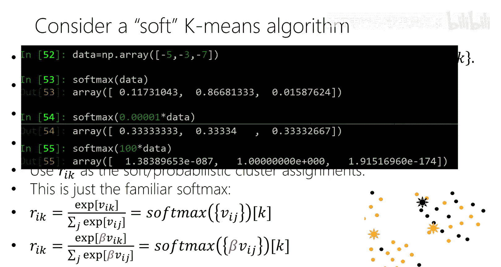
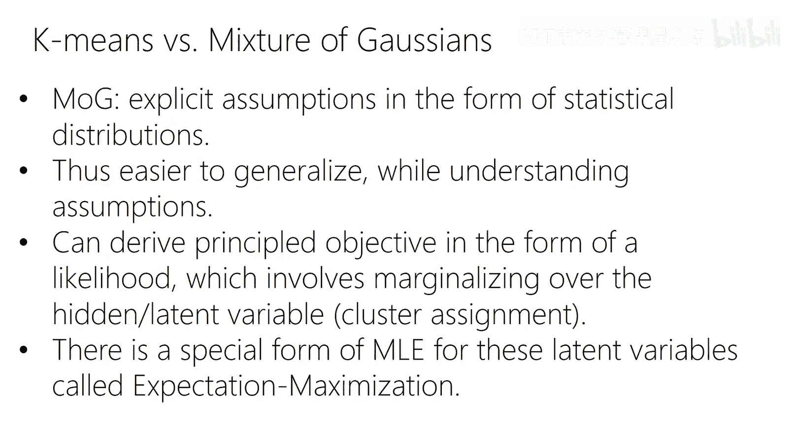

# UCB《机器学习导论｜CS 189⧸289A Introduction to Machine Learning Fall2024》claude-3.5 p14 L14-  Clustering.zh_en -BV1H4421S7bs_p14-

Don has from Russia。South America。You can see that there is very little ground level monitoring。

 that's what those dots are， and so the satellite estimates are really uncertain。

But that's how they do it。A fairly uniform measurements as far as measurement。

Do you know like was that all sort？My study here were different studies gathered this modeling effort out of the university as Hexeter called Dac。

We'll talk about it。 Okay， so it a global a global effort。然后我那。

the entire country mean and the flip side of that is that within a country。

 right the exposure varies。Exactly， it's just averaging。Oh thank you， thanks。

 hi I actually I left early on Thursday from class。

And then I heard from something that we changed full Iivory words。Okay。

 but I just wanted to let you know Yeah， just shoot me in the class note and'll take care of you afternoon。

这据。とばか。As you know。

You can said it。

Ca sitting myaas。My her partner Colleen were out of town and Colleen called me one day saying like this was during the heat wave so Colleen called me one day saying like the temperature on the apartment is over 100 so just go like make sure that the cats are okay so but we tracked it and I think we're going to add them in the discussion section slides。

Yeah， 100 they above like are they in an apartment building like high up， Yeah， yeah。

 that'll do it yeah。And I'll do it， okay。Wasn't my best today， but it's okay， it was great。

I felt like I was asleep up here。Stillt wait for you to hear that。

OkayI just have a question about like that particularly matter。Pro the other。

P inside inside you talking。So for that， Im sorry。It's like a specific。Com both compound。

 but but particularly matter it can be like a lot of different things like dust， smoke， whatever。

 so I was just wondering how exactly know considering how different diverse forms it can take。

 how is it really measured and also like regulated。it's like such a diverse it's measured as that。

And it's also a regulated to go。measured based on mass， so just the size itself。

The the way the mass concentration。AndSo the way it's measured。

We talked about the slow of these so bus， but you basically pull air through a filter and collect。

So the way it before and after and then the other way measured。Dammer。等意是就是。被送的。別で。没そ。被上诉。

And assumes something。我这块。一是工作。Regulatory about this， so this is the case。sort。If you want to sleep。

Some都。So that I have。S theory。But still the I guess， primary criterion。

He doesn't make something else。え生さんと。designignations based on。The对。Regulation。Oh。Thank that。不案。P。我一这。

It' assumed。ちみとい。There's some negative。I that more next week。Okay， what's smoking。这个是。

I actually was about to ask about that if it's so diverse。So give me all。I think。That's right。行了同人。

SoBut if you're thinking about controls。这是第。Yeah。It's not what you do， yeah。Yes，'s。你交他。

I will share one。Pohole sponsor。7。我托同。给发给看了。Arizona。原那个。

Yeah because I was just want to you know because it's sort of。No， it's very question。Yeah。

 well thank you。第案。それが。是给谁？后门。你。是。关于。他是。2法院。

So my PowerPoint got corrupted today。And I'm trying to open it from the web。What that is not。Working。

 wow。Oh。This is not good news。

Okay， you can see that。That is not ideal。That's。Plightly better。Oh。

 a miracle I've been trying for the last hour to get this to work， okay。

It's a。

See if it really works。So I guess whoever is here is feeling confident about the midterm because I think this must be like a tenth of who's usually here which is already maybe half of the whole class so well thank you for not making me talk to a completely empty lecture hall we can have our kind of private lectures like think about 20 people in the class so today we're going to go over clustering and clustering there was a pointer I could use before clustering is another form of unsupervised learning so the last two weeks we learned dimensionality reduction。

😊，Where you start off in some like say image space and then you reduce it down and we looked at the linear version of that which was PCA and then we looked at a non nonlinearar version of that which was TN and today we're going to move on this is a slide I showed you a couple lectures to go to clustering where the goal is to map each example like each image in an image data set to discrete have a discrete label even but it's unsupervised so we don't know the labels we're not going to train a mapping into labels we're just going to kind of feel around in the data and look for patterns that kind of cluster the data points together。

So and to be more concrete imagine you have twodial data so is dimension one and dimension2 and you plot your points in these two dimensions。

 I think that we can all agree here that these points kind of look more similar to each other than these points and so intuitively the idea with clustering is we give just unlabeled data points but we kind of somehow we won't necessarily visualize in order to do the clustering but like to get the intuition。

 it's good to think of it like this， we're going to basically assign all of these points one label and all of these points another label but they are no pre-existing labels the labels just are just kind of arbitrary like they could be an integer。

 you say I'm going to have two clusters and the number of clusters will end up as you may predict being a hyperparameter so if I gave you these points and said cluster them with two clusters you would hope that in this case it would do something like this Of course this is very obvious and whenever。

We show you these kind of cartoon examples， it's obvious and it seems like an easy problem。

 but in high dimensions， these are almost always not intuitive， you can't see them。

 and we want to kind of algorithmically develop algorithmic machinery that will enable us to do it when we can' just intuitively plot it in two dimensions and see it。

And so and this is typically used for exploring your data， trying to get an understanding of it。

 so I think I have a few examples coming up， but often even though these labels are just kind of arbitrary。

 like they have blue and red or one and two， you might with your domain knowledge of your problem。

 maybe these are different your clustering cell types， and you say， oh。

 I think these are like neuron cells and these are kidney cells and kind of gain some insights into your data by bringing to bear your own knowledge of the problem with the clustering result。

So right， so and here's this like a list of things you might have like imagine your Amazon and every time you interact with Amazon they collect some information about you and then they featureurize you based on how often you log in。

 how many purchases， how many returns， and then they want to cluster into like customer types and they don't necessarily know a priorityi what kind of label each cluster will represent。

 but if they featureurize it and put it in a clustering algorithm then look。

 maybe they can kind of assign some meaning and that meaning helps them with their marketing or something about their webp page。

 something like this。Another thing people do is they will cluster wh， doing something interesting。

the cable。So you might also have want to cluster subtypes of a disease。

 so imagine that you have a cohortheard of people all with like say high blood pressure and you measure their genetics and then you want to cluster them based on their genetics and find that there's like two subgroups。

 these people of high blood pressure it's like you can see some sort of genetic determinants and these ones you cannot or they're different genetic determinants and so sometimes actually this is a real thing for a lot of psychological illness like depression。

 it's often put into one bucket， but therapeutically it's actually quite a distinct subset of diseases that you would want to treat and consider differently。

 but we don't necessarily know what they are and clustering on different types of data is a way to help figure that out。

Also in single cell data where you get a measurement of the amount of each of the 20。

000 genes in each cell， you can cluster those and try to understand patterns about different cell types and different organs you can cluster into ancestry groups to try to understand things so I mean basically an infinite number of ways you can do this this is a very old bread and butter technique from machine learning that's you know from decades ago that's still used today and I would say actually。

The methods haven't really changed that much。Maybe the only thing that has changed is the space in which you do cluster。

 it could be you use a modern model to extract a different representation automatically。

 kind of like something like a PCA encoding， but much more complicated and then apply one of these standard algorithms。

 but these the core algorithms here are quite constant。

So the other thing you can sometimes it's used for is outlier detection。

 you kind of imagine you want to do something with your data and you want to find out for many different reasons what the outliers are。

 so here in this example， the black points are outliers in the sense that they don't。

 according to some algorithm and I think we can agree visually it's not implausible that they don't kind of go with either the blue or the red cluster although you could certainly say these are closer to the blue cluster but and again this is in general。

 unsupervised problems are in the eye of the beholder。

 they always depend on what distance are you considering how many clusters or how many PCs are you using and it's much more exploratory than a supervised problem of regression or classification where you clearly want to do well at predicting the regression label or the classification label。

And so there are three broad approaches to cluster I'm going to mention too。

 and the third one is the one that we're going to focus on for this class。

I mean actually this one I was just thinking why why have we focused on this one well let me go through them and then see what comes to mind So the first one is a hierarchical way to cluster where and all of well not all of these but this one requires you define some distance between the points and basically you put a link between every pair of points that are closest to each other that would be like the bottom of the hierarchy and then you would treat each of those two points as a cluster and you would try to merge the clusters together so you'd say now which two pairs you kind of recurse up a tree and then you would say which two pairs are most similar to each other and you would put them together so you' would be merging two clusters into a tree and so as you go up essentially wherever you choose to cut off this recursive algorithm will dictate the number of clusters because at the lowest level it's just like the number of pairs in the data roughly speaking there's many different ways to do this and we're not going to go into this so you're not。

Unless it comes up in detail on a homework or discussion， you're not responsible for these details。

Then there's partitional approaches where you define a cost over partitions and so you don't directly need to define a distance between points or a similarity between points but you can think of I don't know who's heard about graph cuts but you could imagine you define all the points where there's an edge between them with a weight in a graph and you want to find the certain cuts that which way would it go。

 you want to cut the really big edge weights because you want the sum of the weights in a cluster to be small。

 for example and there's ways to actually again I'm not going to go into it but you can do this actually taking something you can take the spectral decomposition or something called the graph lapplian which we won't go into but but my point is that eigenvalues and the spectral decomposition also come in here even though we won't address it。

 but so this is the one and I guess model based there it modelbased approaches are what we're going to consider。

In this class in this lecture in the class on a whole and I guess maybe I'm partial to models where I can divine probability distributions and maximum likelihood because it's a very clear way to think about things that lies within the overall framework of all of machine learning mostly and so we're actually going to start off with a really really famous and old algorithm slash model called k means this is not a probabilistic model it's a very widely used model and then we're going to consider like how to kind of why we might want to and how we'll convert it into a probabilistic model and the probabilistic version of K means is called a mixture of Gaussians or a Gaussian mixture model and that's so that's basically that will span the rest of this lecture and so in these modelbased approaches you。

😊，Well in K meanss we will define a distance， but as you might imagine。

 once we go to a probabilistic model， the distances will kind of be implied through probability distributions。

 like how well does this point sit under the density of that Gaussian kind of a thing and if it sits well under that Gaussian with that center then it's kind of close or similar to that Gaussian center。

 for example，Right。So okay， so what are like if you think about intuitively what I've shown you like in that first slide of these black points and then I paint them blue and red。

 like what are the things we want， we want that within a single cluster。

 that intracster that we have high similarity because we want to kind of get a set of representatives that all share certain features。

And we want that if things are in two different clusters that they don't really share those kinds of features that define that cluster。

 so we want them to be dissimilar from each other， so intra is within and the inter is across the two different clusters but the key here is that how we define similarity or distance will completely potentially change the outcome of these modeling approaches。

And so in some sense， once we latch on to the probabilistic model， we' again， in a sense。

 we're latching on the notions of probability that take care of this for us， modullo。

 some hyperparameters。Okay， and so just also just these。

 these terms get thrown around very loosely in a lot of places in a lot of blogs。

 They actually say the wrong thing。 So they'll say， oh。

 like similarity is sort of like the opposite of distance， right。

 like because if you want points within a cluster to be similar。

 then you want their distance to be small。 And so at an intuitive level， that is true。

 But as you may know， a distance is sort of defined very technically as a metric where if if D is a true distance。

 it's a metric， then the distance between to to vectors J and K is0 only if and only if they're actually the same thing。

 And the distance is greater than0， only if they're actually different vectors。😊。

And it's also symmetric right the distance between me and you is the same distance between you and me。

 and then also there's this notion of the triangle inequality that must also be adhered to to formally be a distance or a metric so and then you have these notions of dissimilarity and similarity So dissimilarity is kind of like distance it's sort of further your distance。

 the more dissimilar you are， so intuitively they sound very similar and op pun intended。

 but when we start talking about similarity or dissimilarity。

 all these sort of strict assumptions are out the window usually a similarity has properties that are similar to a lot of these often they don't have the triangle inequality So one example would be cosine distance does not actually obey the triangle inequality。

 but we often use it in machine learning as a similarity measure because it turns out to be useful so I'm not trying to nitpick all these details here but just to highlight that like。

Disttance is a very formal notion and similarity is not， and sometimes we use one。

 sometimes we use the other when we're doing clustering。

 but I think distance has some nice properties and in general it's nice if we can have those properties。

So and so both Kine means and as well and eventually the mixture of Gaussians are what are called centroidbased clustering approaches or models。

 and that's because in both these approaches， there is a notion of like a centroid that belongs to each cluster and the centroid is not necessarily one of the data points。

 but it lives in the space of the data points and it's sort of meant the way you can think of it is it's like the most representative example I could choose in the space that best represents the points in this cluster。

So this star here is not a data point， but some in K means。

 it end or potentially in mixed Gaussians it will for example， end up as the centroid， and in fact。

 K means the parameters of Ks are actually the centroid of each cluster and then we're going to partition the data using that。

 we'll go through this in a lot of detail。But the idea really is that there's a point in the input space not necessarily in the training data that is a representative of each cluster and again intuitively you can see this is probably a good point to pick as a representative for all the red points that sort of sits in the center right and similarly this black point is a good representative of the black training data because it sits in the middle and so forth。

 but I haven't said anything like right now this is intuition we'll find out how that actually emerges from both of those models。

 Any question so far。So。The kind of overview of Kaen's clustering。

As the parameters are going to be so there's， I didn't write it。 There's a hyperparameter。

 which is k。 That's the number of clusters。 And we're gonna have to pick it in a way similar to PC。

 we're you'll see in a few slides， sort of an elbow type picture。 but we'll get to that。 But for now。

 K is a hyperparameter。 and we pick it ahead of time。 and we may scan through different ones。

 But for now， K is fixed， let's say K is3。 And so if k is3， then I need to find three centroids。

 And usually both well in both K means and in the mixture Gaussians。

 I'm going initialize them either a random or with some kind of clever trick of some kind。

And what I want is I want to find after I initialize them。

 I'm going to iterate well to minimize a loss function that it will write down where the distance of each point assigned to each centroid i。

e。 assigned to each cluster is minimized。 So if I actually color this red one black and that black one red then the red points would be really far from the black and the black would be really far from the red and I certainly would not have minimized that right And so the idea is we don't know where these centroids should sit at the beginning because we don't have these intuitive two-dimensional pictures to look at like this。

 So we'll put them somewhere somewhere and then we'll move them in a way。

 such that the distance of each point is assigned to the centroid where the distance is smallest。

that makes well hopefully it makes sense when I'm going to go over this idea also with the math so if it doesn't make sense。

 it will start to make sense right so formerly we're going to have unsupervised data that lie in some dimensionality D I have n of these data points and I have no labels I just have the data points and I'm going to assume there are k different clusters and so I have k centroids each of which live in the same dimension as the original data because they're going to be like a representative in the original space。

😊，And what we're going to also get out of K means is a cluster partition where for every data point in the original training data。

 it gets assigned to one and only one of the K clusters。

And so the optimization problem that is actually going to define in a sense。

 this model slash algorithm， Well， I guess yeah， this's a little weird here because there's not like a probabilistic loss but so this is the loss function and the algorithm will be how we go about optimizing it so I guess right now I would call this sort of a version of one description of the model K means and so what does it say it says I want to find the argument over all possible partitions of the data points into k different disjoint sets because there's k clusters and moreover for each of the k disjoint sets。

 I want to find the parameter of this model which is the centroid for each cluster which again just lives in the original dimensional space and now I want the argument over all possible clusters。

So K， So K goes from one to the max number of clusters， big K。 And then over all so for each cluster。

 I consider all the points that are assigned to that cluster。

 And I ask how far away they are from the centroid and I want them not to be far from the centroid because I want the centroid to be a good representative right。

 So this centroid is much closer to these red points than it is to the purple or the black。

 And if I minimize this loss， this is the kind of outcome I will get it。

And so this is like a Euclidean norm。 There's nothing sort of fundamental here。 Again。

 this is like always a bit in the eye of the beholder。 But this is how we usually set it up。

Any questions。Okay so let's think about how so the goal is now is to we can understand sort of intuitively that if I can find these centroids and the partition of the points to the centroids。

 then I'll have a model a clustering model which is defined by the centers and the clustering model will also partition the data to assign each point to a cluster and so now I can tell you these points belong to that cluster which is defined by this centroid and those points belong to that centroid which is to that cluster defined by that cent that's the kind of output I get after I've performed this optimization and so the optimization and looks a little bit crazy is actually really。

 really simple and I'm going walk you through it it's an alternating scheme and so to get to the alternating scheme we're going first we're essentially going to do is we're first going to pretend we're gonna to pretend we know this and then say assuming we knew the centroids。

 what would be the optimal partition， and then we're gonna say assuming we knew the optimal partition。

 what would be the centroids and we're going to go back。

Fth and this is going to be very easy also to prove that this converges。

So suppose we knew the partition， so I don't know the centroids。

 but I know which points were labeled red， which were black and which were purple and of course as I'm iterating through this。

 I'm not going to have this pretty picture in fact I'm going to have a random initialization so in the beginning if I were to have initialized the partition the red blue and purple would just be scattered uniformly and we're going I'll walk you through an animation where we see that but it's not going to look pretty right。

 this is at the end after it's converged it will look like this。

 but suppose at some point in this iterative optimization， I know the partition。

 then how could I find the cluster centers。What I would do is this problem。

 is I'm going to keep this at the bottom of the slide。

 This is the overall optimization problem we want to solve， but if I know the partition。

 as I'm assuming， then the problem boils down to this， it says。

 minimized for each cluster K find the centroid for that cluster where all the points that have been assigned to it。

 which I know because I know the partition the Euclidean norm to the centroid is minimized。

And if you just crank through the animations， a' bit weird。

 but if you just crank through some very simple calculus where you take the derivative with respect to C。

 and you set it to zero， you can just double check， it's not worth going through in class。

 what you get is a very intuitive answer， you say that given that I've assigned this set of points to that cluster。

 the best I can do with this Euclidean norm actually just to take the mean of those points。So that's。

 I think， very satisfying result。😊，And。Right， okay so lets now let's go the other way around。

 and then we're just gonna to flip between these and you'll see。

 I think quite easily why this is sensible。 So now suppose not that we knew the partition。 instead。

 suppose we knew the parameters the centroid K， how would we find the optimal partition。

 and when I say optimal， I mean， the one that minimizes the loss， given that I fixed the other thing。

 That's what I'm doing here is I'm fixing one of these and saying given that one of these is fixed。

 find the other one that minimizes the loss， given that I can't change the one I fixed。

 So here if we knew all the cluster centers， what we would do is for each point。

 we would assign it to the cluster that has the cluster center that's closest to it。

always pick if I'm a data point and I pick I assign myself to the cluster that's closest to me。

 then intuitively， I know I'm going to minimize the loss。

So right so I pick ZI is going to appear a little bit through the lecture。

 so for point I I assign I perform argument over all classes K of the distance of this point to each centroid and then I take the one that I'm closest to and that becomes ZI ZI is just the variable of the label that so like for example。

 you belong to the blue cluster or you belong to the third cluster and then now that I've done that for each point。

 I can just readily get the partition， the partition just says the case partition is all the points that had ZI assigned to that cluster。

OopsSo right， so I've just done both ways。 I said， suppose we knew the partition。

 How would we find the centroids， supposeupp we knew the centroids。

 how would we find the partition and these are if you didn't exactly crisply get it I think if you go home like this is pretty easy to see right so the overall algorithm is as follows I initialize the cluster centers at random。

 I'm going to do iterative optimization here。 And I have to start somewhere。

 And if I don't know any better then I initialize them at random And so for example。

 you could just pick a points from your data if I'm clustering into three clusters。

 I could just arbitrarily pick three of my data points and say you are the three initial centroids and then I'm going to optimize you that you become more sensible centroids。

 and then I repeat until convergencies two steps So now I know the centroids even though it's nonsense because I just initialize I find the best partition given these initial。

centroids and then once I found the best partition。

 I go back and I recompute the cluster centers given the partition。

 and I just go back and forth and back and forth。So I already said this converges。

 so you know the answer， can anyone explain why it converges？It's not tricky。

 Also if you haven't seen it， maybe it's not super obvious。So if I write it in， yeah。

 I did write it in， so at each step I'm reducing the objective function。

 I'm either making the like when I update either the partition or the centers。

 I'm making the objective less。Unless I don't change them in which case I've converged again。

 So like， I mean， you'd have to go home and convince yourself of this。

 but it is a really kind of easy proof thats so easy， you kind don't need to write it out。

 but any time I change the partition， it's because by changing the partition。

 I'm reducing the loss and any time similarly I change the cluster centers。

 I'm only changing them because they reduce the loss。 and at some point。

 these things will stop changing at which point I have converged have I converged to a local minimum or a global minimum。

Local， yes， local， this thing is like super local， you got to rerun it over and over and over。

 potentially and get different answers。Right， and as I said， if the assignments don't change。

 then we've converged and we have a local minimum， so I hinted， I think at it before。

 so can anyone think of a slight variation， just a very slight variation to this algorithm that would do the same thing and have the same proof of convergence and everything。

The most minor thing you can think of。What could I do， could I initialize differently？

Here I say initialize the cluster centers and then go back and forth， what else could I do？

I could' initialize the partition。And then flip these two steps around。

So there's no reason I have to initialize the centroids before I could equally well do it。

With with the partition and in fact， I think in the animation I'm about to show。

 I think that's what it does。 So okay so this and this is a courtesy of my friend Yong。

 who's a Caltech。 and I took some of these slides from。 So I think again。

 like you can tell because this is a very easy example meant to be a pedagogical example we can see there are probably three clusters here it's never quite so pretty and it's usually in such high dimensions we can't even visualize it。

 which by the way means maybe you want to do dimensionality reduction and then do clustering。

 and often in fact， we do mix and match kind of these Lego blocks in machine learning。

 But so if this is what。What what you're given， then I said you could either initialize the partition or you could initialize the centroid so what's going to happen。

 I'm going to initialize the partition， which means I'm going to just say there's an equal I think it's equal number of orange。

 yellow and brown， so the clusters labels are just random colors here， orange， it's weird。

 I thought there were different colors。Black， they look black here。 black， orange and yellow。

 And that's because I don't know what else to do right。

 And so it's not the pretty final version that I just showed you。 So I'm going to start like this。

 And then given that partition as the initialization， which is obviously complete nonsense。

 I'm going now start to do this iteration where I say solve the suboptim problem。

 the optimization problem that arises， given that I know the partition and for which I I kind of quickly showed you and also told you that it means just take the center the mean of those points。

 So what happens is I take all the orange points。 and I compute their mean and that becomes the center。

 that's the centroid。 again， I take all the yellow points and this becomes the centroid and do it for the black points and this becomes the centroid。

So now I'm going to let's just iterate now what do I do next。

 I just updated the centroid now I go to go update the partition again so the partition said fine for each point x。

 which centroid it's closest to and put that in the variable C and then assign all the points that are closest to a centroid to be in the same partition that case partition and so just to go back the background of the partitioning here is the initial random this that I started with then I computed the orange black and yellow centroids and now on this one we're leaving the centroids alone。

 they're assumed to be fixed and I'm updating the points with with the nearest centroid and so already you can see with one step this has done a massive amount of cleanup on the partition which is kind of remarkable and so everything that's closest to the orange point if you took a ruler out I don't know if eong I computed this this is a cartoon but it looks extremely plausible so all。

The orange ones belong to the orange， the yellow gets all the yellow points that are points closest to it。

 and then similarly the black and what you can see now actually is the black actually has very few points compared to the orange。

 so there's no restriction here on how many points go anywhere。

And then I just keep going back and forth right so this one I had just updated the partition now on the next slide。

 the partition will stay the same but the centroids are going to move around so who can say where's this yellow guy going to move to actually I just showed you but it's going to go more to the center of the yellow point right basically we're not from here to the next so this is these I haven't yet updated them they're going to get closer to the。

To the central part of the points currently assigned to them。

 And so the orange one probably won't change very much。

 the yellow one will go this way and the black one will go a bit that way。

 which is exactly what we see and then I just repeat this back and forth。

 back and forth You can play this yourself with the slides Now you can see the black one starting to pick up more points。

 which is exactly intuitively what we would want to because we knew in the beginning this is probably a cluster and just keep going okay now we're at the point where it will converge and why will it converge because if I try to compute either a new partition or new centroids from this place neither of them will change。

And if neither of them will change， it means I'm at a local minimum。

 and because this is a pedagogical example， it also looks beautiful and perfect。 Okay。

 any any questions。😊，Oh， is there another- oh， it hadn't converged， I lied， okay， now it's converged。

😊，嗯。Okay， who thinks， oh， question， yeah。U。I think that if you initialized very badly。

 but if you initialize， imagine you initialize the centroids with a data point。In that case。

That data point gets assigned to it， and if it's the only one that gets assigned to it。

 it will never change。 and so I didn't go through this deeply。

 but I'm pretty sure that so long as in the first initialization each cluster has somebody in it。

 I think that it will always end up with somebody in it。But there could be some weird corner case。

 but I'm pretty sure that's true。嗯。😊，I have。Nope， nope。

 because every step you reduce the loss function or you can't， but nothing else no。

 so it provably always converges。Okay， so that would oh another question， yeah。

It's a local minimum because the overall loss function is not convex。And。Oops， where did it go。

 Where is it lost it， But it， it's a convexity issue， right。

 If a loss functions not convex in the parameters you're trying to estimate。

 then you have no guarantee that you get to a global optimum。

 And so if you go through with your knowledge of how to test for convexity here with respect to these parameters。

 you'll find that it's not。And。I'm trying to think if there's an intuition on top of that。嗯。

I can't think of a further intuition beyond that。啊。没有。Okay， who thinks we could use gradient descent？

To solve the exact same loss function。Who thinks we can't？

the answer is we can so I won't ask you why if you'd said we could I would ask you how so right so the loss function is a loss function where we're trying to find the argument over the centroids and the partitions such that this is just the loss I showed you before such that when I sum over each cluster K I take the points that belong to cluster K and I want the distance of each point to the centroid for that cluster to be minimized so what I'm going do and this was actually in a paper from now how many years ago is thatow that is a really long time ago。

 yeah and you may know Bennjiio was one of the three people who got the Turing award for machine learning。

 but the Nobel Prize Committee he got it with Jeff Hinton Yahua Benio he is a brother Sammy Benio but Yahua Benio and Janon Lacoon but the Nobel that was just awarded went just to Jeff which is interesting。

😊，Right and in this paper they showed this trick and partly I want to show it to you because when we go to a mixture of Gaussians。

 there's going to be an analog here to what I'm showing you here。

 so mixture of Gaussians is going to be a probabilistic version of K means。

Ands it turns out there's a very wellknown， very technically correct algorithm that looks like this alternating k means that gets used in statistical models that actually does maximum likelihood but also you can just use gradient descent and so I wanted to just show you that you can do both of those things for ks just as you can do them for mixture of Gaussians。

 but so and I'll go through this， but in reality nobody would use this for ks everybody uses what I showed you which is sometimes called Lloyd's algorithm and at the end of the slide we can talk about why nobody would use this。

 but so I'm going to do just a few bookkeeping tricks here to make it easy to see how to use gradient descent。

 So now what I'm doing is and you may not have you may have sort of subtly subconsciously realized that I don't really necessarily need to know the partition because the partition follows from the centroids right if you tell me the centroids then I know the loss function is some over all points I and take the distance between that point and the cluster。

that's closest， which I can just write with a min。 And so now I've redefined the loss function just in terms of the centroids by replacing the partition in a sense with a min function。

😊，And so now I need to take a gradient of this thing and so you can think of this in different ways but the way we're going to do it right now is we're going to say letzii。

 which I made this notation before， letzi be the closest centroid to Xi so each Xi you just check which it's the one that wins the min and now I can say the loss function is the sum over all data points where for each data point I'm going to sum over all clusters and get a cost but I'm only going to pick off the one where this indicator function is equal to one and the indicator functions only equal to one when the case cluster is the assignment that that point got。

So again， this is all just kind of bookkeeping here， like this is the same as this， but I converted。

 I took away the partition and used a min， and now instead of the min。

 I'm going to sum over all for each data point， I'll sum over all possible centroids。

 but I'll pick off the one that I've been assigned to and then take the distance for that。

So I'm not doing anything substantial here I'm just making notation different to make it easier to see how to take the gradient and so now if I want to take the gradient with respect to like the k centroid of this loss。

 then I basically know that nothing can happen if the indicator function is not there and so the indicator function just kind of tags along but basically for the k cluster I take the points and then I just take the derivative of this here。

 which is drop the two down and get this back and then the minus comes because it with respect to C and C has a minus so this is actually the gradient of that loss function。

And therefore， I can do gradient descent。And so if I do gradient descent， it's an iterative。

 also an iterative algorithm， and again I'm going to have to initialize the centroids here。

 and in this case I can only initialize the centroids because I've taken away the notion of partition and made it implicit and I'm going to take my previous value of the centroid and then I'm going to have a learning rate Eda and I'm going to just multiply the gradient times Eda and I think so this is the gradient of the loss and I want to minimize the loss so I actually need to subtract the gradient so there should be a s flip here。

Yeah， so I also swap the order of the terms， so the sum over I of the C becomes the number of points that were assigned to that cluster times the learning rate and this together is positive but because I'm minimizing it becomes a negative and then this is just the sum over all the points that are assigned to that cluster at the moment and so one intuition of this is I take my original centroid estimate and I subtract some amount of itself but add in some new amount based on who's assigned to it and so it's not like sort of deeply intuitive but。

So I guess there's a couple of comments is are we still guaranteed to converge Well we know that for gradient descent that if you have a small enough Eda。

 small enough learning rate， you're guaranteed to converge。

 but if it's not small enough you won't converge and you don't always know how small to make it so in some sense you don't have a nice a guarantee of the convergence and the other thing that's actually happening here is when we do the Lloyds algorithm。

 the standard one that I just showed you you basically in this case I'm slowly changing the centroid to be closer to where it should be but when I do the Lloyd's algorithm update of the centroid I'm doing it like I'm not taking little steps within Ada I'm just completely solving that subproblem in one go and so it's actually more efficient and this is kind of slow and a bit silly to do but they were trying to make some points in this paper about various things and I think it's interesting that you can and in fact it's a bit of learned often there's iterative in many like in a very broad sense there's often optimization algorithms where you condition on something and update。

The other， and they're often very convenient， often have good convergence。

 but usually you can also just do a more straightforward type of optimization。O。

 and and I explained why this might be slower is that I'm basically doing really small partial updates with a learning rate instead of just saying。

 look， if I like here given the current state of affairs， here's how to to it。

 update the centroid like completely， which is what we do in Lloyd's。Okay。

 and so I mentioned before that this K is a hyperparameter and that kind of much like PCA。

 there's not a nice。There's not as nice a way to figure out the hyperparameter as there is with a supervised problem where you can hold out data and ask how well it performs on the holdout data。

 you can sometimes do that in unsurervised techniques but it's very nuanced instead of that people do these kind of elbow plots so you may remember there was a plot that looked like this for PCA to say how many principal components should I use in the case of PCA what was being plotted was the percent on this axis was the number of principal components and this was the percent variance accounted for as I added each new eigenvector and it's associated eigenvalue we don't have eigenvalues and eigenvectors here what we do have is like the cost function of the K means algorithm whether I do it with the gradient descent or Lloyd's algorithm it doesn't matter but for each K and again it's local minima we maybe restart it with a random initialization few times take the best one and what you usually see is that you often see these kind of problems like you get a lot of win for adding。

More clusters but at some point when you add more of the loss function doesn't go down very much and that's because of just the inherent structure or the manifold on which those data lie so in the clustering example I showed you the animation of there were kind of clearly three clusters there right if I forced it to use one cluster and I compared the best value of loss function to two clusters clearly I would get a big win and if I added to three I would also get a big win relative to two but you could imagine if I added a fourth cluster when there were truly only three clusters then adding that it's sort of like adding a nuisance parameter almost is not really going to buy me very much it will buy me something but it's essentially at that point like you could almost think of it intuitively as overfitting。

RightAnd so I guess actually I just realized I was going over the slides that I didn't look at this。

 Does it do something no， maybe oh， I see this goes with this。 Oh， this is great。

 I didn't notice that。 So when I squint at this， I'm not actually looking at that one。

 but it looks like there are four and there are four right like if you squint。

 I think we would all guess there are four and that's for the kind of reason I just described。

 like if you assume there's only one you'd have to put the centroid here and and then you'd have to consider the kind of average Euclidean distance would be the cost。

 if I was allowed two， you'd probably put one here and one here and then you' get the average Euclidean cost would be of this sort of a distance。

 whereas if I put one in each of these four things。

 this sort of average distance becomes more of this width。😊，And now， if I add a fifth。

Imagine I had those four here and add a fifth then what I'm going to do is I'm basically going to take one cluster and inence separate it into two。

 so now I'll put one here and one here， but the overall kind of， if you will。

 bandwidth of the average distance to each point didn't really benefit much from that right it was a very diminishing return and that's basically what you see in this kind of a plot。

So you look for the elbow， meaning where it kind of rapidly goes down and buys you something。

 and then seems not to really matter， but this even like reading off an elbows a bit in the eye of the beholder。

 in this case it's quite easy， but it's not always。Okay， any questions？And so these are there's。

Real examples of this used stuff in the literature all the time。

 This is an example of a time series measurement of genes by their gene expression。

 So you basically get。The data set looks like each row in like an Excel file。

It has how many features does it have something like 20 time points so for the first gene you get 20 time points and how the amount of that gene changed over time during those 20 time points I don't know if it's20 but it goes up to 20 in some units but so I don't I guess it's 1。

23，4，5， I don't know maybe it's something like seven time points and so for each gene and there's like 20000 genes in the human genome you get a readout in some organism maybe it was a mouse of how that gene amount changed over time and then you cluster them using k means and in this case they have1。

2，3，416 there's 16 boxes here so they said K was equal to 16 and what you see is that each of these are all the data together and now like some of these clusters are fairly clean and that a whole bunch of genes here kind of have the same behavior in time and you can imagine that like in some cases the cell cycle like anything involved in cell cycle is going to tend to be kind of coordinated in time and。

aren't won't be but they may be coordinated by other things and then once you've clustered so again。

 what we get out of Ka meanss is I find out here are all the training examples that belong to cluster one and how they look when I plotlo them together and then these are also the centroids that came out although I'm looking this obviously I guess this looks like a corresponds to that one This this is like a game it's like inverted I think this never did that。

Could that be an exam， I'm question， I don't think soh。😊，Yeah， anyway， so that's an example。

And now this was actually a real example， this is， I think this is more of a made- up example to demonstrate that actually the problem of local Minma can do bad things and that you can even see them in just two dimensions。

 so take a look here， this is two dimensional data where each plus sign is a cluster centroid for the like voronoisL and。

😊，U。And then also everything within a cell is painted the same color。

 but there's no notion of ground truth here because there is no notion of ground truth with clustering。

 Nevertheless， I think looking at this， you can see things that are happening that I think we would all agree can't happen。

 like we would get a unanimous vote on that。 Can anyone pick out something weird that happened that you think shouldn't have happened if we thought the global optimum。

嗯。😊，Over here。Here。Yeah， yeah， yeah， that's exactly right。 I mean， you could maybe say it here。

 but in this case， it definitely looks like this is a cluster and this is a cluster and that they gotta got slammed together with this centroid。

 even though the whole thing converged and you might say， well。

 maybe I didn't give it enough centroids and it had to do that。

 but who can point out something to show that's not true yeah。Yeah。

 exactly right here I've wasted two centroids because this is a cluster and I don't really need that and I think you can also understand that Lloyd's algorithm feels kind of greedy right and so it's not kind of surprising that this is happening so yeah you get these kind of pathologies where a single what we would all agree is a single cluster gets split into three and what should be two clusters gets split into two and so on and so forth。

Okay， so。The thing I mentioned in the very beginning of this lecture for clustering in general was that I want very high intra cluster similarity。

 I want these points to be similar or to have small distances and I want things between the clusters to have low similarity or have high distances。

 can anybody think of something else we might want？You might say something like well。

 what if I imagine these points were proteins and they were defined in a 3D coordinate space What if I just used a different like and they came to me in a rotated coordinated space like the clustering should probably be invariant to that coordinate system right so I would say people don't usually think of these things。

 but it's interesting to think like what properties might I want from anything I'm doing in machine learning in this case in particular clustering so maybe you say that if I took each Xi and I multiplied it by the same rotation matrix is my clustering algorithm going to give me back the same clusters yes or no and do I want that I think in most cases we would like that and so it turns out that if the clustering depends only on the distance or similarity as it does in K means actually also in the hierarchical then whatever invariance that distance or limitedity then the clustering will also have it and so in particular。

The distance between two points is invariant to rotation， it is true that with K means。

 I could take all my data and rotate it with a constant rotation and redo K means and I would subject to not getting like if I could get the global maximum let's say there's always problems a local minima。

 but if you pull that aside， then you should get the exact same thing。

And so there's a fun little paper that this is not normally like taught but I think this is just so cool and Kleinberg has these fun little papers again also from a really long time ago in what was the main machine learning conference and so he said that there's actually several things we would like from a clustering algorithm and he's kind of a theorist and he proved that you can only ever get two of these at a time and I think this is just very cool so he says one thing you might want is scale and variance where if I have all the distances between all points but I scale them just by a constant the same constant for everything then probably my clustering algorithm should behave the same right。

😊，And similarly or not similarly， but in a slightly different way。

 he talks about consistency where if I stretch data in a way where the distance within the cluster only gets smaller and the distance across the clusters only gets bigger。

 then the clustering should also stay the same， and I think again， that's like very intuitive。

And finally， richness， which is this sort of notion of capacity of a model like I would like my clustering algorithm to be able to produce any partition or clustering of the data。

 it shouldn't sort of disallow any of them and so what's quite surprising I think is that these are all three very plausible things you would want。

 but he proved that you can have no clustering algorithm that has more than two of them and so I think that is like a fun fact that's not widely known。

 you can use it as a party trickm sure it will make you very cool so let's go back now to k means which we talked about how to use Lloyd's algorithm to go back and forth conditioning on a partition being known or the centroids being known and then getting to a local optimum so。

😊，So there's a couple things that aren't optimal about this。

 So maybe part of this maybe is my bias and how I'm trained。

 but there's no likelihood like I've just kind of plopped down some objective function and like I can't use MLE。

 it's not probabilistic like I just it's so hard to think about it and and as you'll see actually because it's not probabilistic what's happening is there's assumptions sort of baked into there that would be made obvious if you converted it into a probabilistic model which is exactly what we're going to do but。

😊，Oops， so one thing is that implicitly the clusters are kind of assumed to have spherical shape because when I compute the distance here。

 I treat all the features with the same weight basically， and because I do that。

 if I have an example where they actually imagine that the cluster one cluster should be sort of elliptical with this kind of a distance here。

 this Euclidean distance， it can't really get at an elliptical cluster。

 it can only really think about spherical clusters。And。

Each step every time I do Lloyd's algorithm I say here are the new centroids and then are here's the new partition but actually when I compute the partition。

 what am I doing right I'm saying for each point which centroid is it closest to but imagine that this point is almost equally distant to two centroids like it's 0。

49 close to this one and 0。51 to that one but when I do k means I'm forcing it to pick one and you can imagine that that's like a hard you're making a very hard decision when it's not very clear which cluster it belongs to and so you can imagine if I could soften that up and not making these hard decisions that actually maybe I might do better at getting around the local minima because I'm not committing in kind of semiarbit ways and so in that sense like Kines is a little bit like informally I call it brittle which is you're committing to decisions at each iteration that are not as obvious。

they seem， you get I belong to that cluster， but actually maybe it's sort of like 50， 50。

 and I don't know。So right， so the idea is we're going to move from that k means。

 which I call hard kine means because each point gets a hard assignment to a cluster to a soft kine means and once we get to soft k means is going to say。

 no， you can sort of probabilistically belong to each or like more softly belong to each cluster and from there we're going to be almost at the mixture A Gaussians which is the full probabilistic model。

So right， so previously when we were doing hard what I call hard K means。

 we were making this hard decision that says the cluster assignment that the I point gets is the assignment based on whichever centroid I'm closest to。

And then the partition is just those points that belong to it。

 but we're going to soften this so that each point can belong to multiple clusters and the partitions will be sort of soft partitions as well。

 they will each get part of a data point So the first thing we're going to do is I'm going to just change the min to a max。

And because of that， I'm gonna put a minus。 So first yeah I'm doing two things at once。

 the min to the max， which gives me a minus， and then I pipe it through a monotonic function。

 which and I can do both of I should have done this in two steps。

 if you remove the X here and just go min to max， then the Zs will all be the same。

 and then when I also add in the X because it's monotonic， thezis will also be the same。

 So although I've changed the math， the Zs that satisfy this are also the Zs that satisfy this。

 So and you'll see why I'm doing this in a second。But this is just moving things around to get a different expression。

 but the solution for each ZI is going to be exactly the same on this line as it is on this line。

And now I'm going to just to use a shorthand， I'm going to replace this X with a minus and just call it V IK。

Oh yeah。 it's for the ifF data point and the K center。 And I'm just gonna。

 that's just a shorthand notation。 And so now I'm just rewriting this line with that new notation where Z I is now the Arg max instead of over X。

 blah， blah， blah， just of this variable V IK。Again。

 this is just like trivial notational changes that will help us to get somewhere and now I'm going to normalize these VIKs so I'm going to define a new variable RIK。

 which is the normalized version of VIK and so now what's interesting is that all if I sum up RIK over each K meaning over each cluster so this is basically saying for the ifh data point what it actually is is I've turned it into a probability because it's normalized it has to lie between0 and1。

嗯。And。是。Right， and so I can use these sort of as soft probabilistic cluster assignments。

 and so that's why I've done this。 So instead of getting that ZI you know is equal to the blue cluster。

 now I get that ZI is going to be like 20% blue cluster and 80% red cluster and this probability that it belongs to each the sum of the probability belongs to each cluster is going to equal to one because of the normalization here。

And so this is actually just the familiar softm that we've heard about in logistic regression and a few other places。

Right， so。Actually， I think there is a typo on the slide。I don't think it should be Xpa V， I K。

 It should be X Oh， yes。 I think because the exp is here。

I think I need to fix something on here because VIK already has the X and here it says X with VIK so sorry。

 I don't know how that ended up there， but basically what you're doing is you're doing a soft max over these guys to get the probability for a given data point I that it belongs to each cluster and so I'll fix the slide and post it again。

But intuitively， you're essentially right treating this mind you're doing a softm over these guys here for each data point。

So each data point you do a softmax over essentially intuitively what you're doing is you're saying how far am I from the case data point and then turning it into a probability by well also using the X which ends up making it look like a softmax sorry。

 I kind of bungled the slide。But and something you can do now。

 And so this is part of the reason we're going in this direction is you can also add a hyper like another parameter here。

 beta in the softm that will control the entropy of that distribution。

 And that's sort of like you could think of it for now as a hyperparameter。 But at some point。

 there will be something like this parameter。 And we could actually do maximum likelihood estimation on it right now。

 we can't because we don't have a likelihood。 but we're working our way there。

 So I could also have this beta here。 And so I think。

IThink that Saed is the one that taught you softftmax。 if I'm not mistaken。

 And so I don't know if he mentioned this idea that if you scale all the values that go into a softmax with a parameter。

 you change the entropy of the resulting softmax distribution。 And so just an example。

 if I take these data here， which would be like so that that would be these values here。

No sort these values here yeah I really screwed up whether the xs in it or not so these values here would be the like5 minus3 minus-7 and I put them through a soft max。

 it just means I'm doing expiating them and dividing by the sum of those to get a normalized probability distributions so these sum to1 and because the minus3 was the largest number。

 it gets the highest probability of 86 the second largest was minus5 it gets 12% and then the minus7 gets。

2% Now if I scale it like with a beta parameter， just a constant， then what's going to happen？嗯。😊。

It would be less pointy It would be more entroic。 Yes。

 so what will happen is it will look like the uniform distribution。

 And the reason for that is that in the softm， if I scale everything here， as beta goes to0。

 these all become one。 irrespective of the value of the V。 And so as it goes to zero。

 the whole thing starts to look uniform and similarly， if not I guess in the other direction。

 if I amplify it， then I decrease the entropy， and I make it very。

 very peaky and very certain if I do that now it basically in the limit， it actually makes it binary。

 So this is essentially0， this is essentially one， and this is essentially0。

 and and that's kind of the joy of softm is you can make it look like a max if you crank this up high enough。

 you basically have a differentiable version of the max。Actually。And so but in any case。

 all that is to say is when you're clustering now you have this extra kind of wiggle room。

 you can play around with this parameter and depending on how you said it。

 it will give you different clusters and there's another way because this is a concept that comes in all over machine learning in many。

 many places， this idea of like a temperature So here I call it beta which people would often call an inverse temperature and this comes from statistical physics we don't need to know about that but often you'll see instead of a beta you'll see a one over t and so if you take a regular softm where implicitly the scaling factors just one so you don't see it if it were to have this distribution over the1。

2，3 I guess yeah there's nine inputs and these should sum to one altogether。

 And if you scale it oops。With temperature in this case 0。7。

 then you make it more like the uniform distribution。And you get more entropy。So yeah。

 this is just a very widely used concept that it's good to know about。And we can use it here to say。

 if I change beta， I'll get different clusters。So right， so how can I use this， What have I done。

 I said I don't on the whole point of this slide aside from this like entropy and stuff。

 the main point of this slide was to say in the original k means algorithm， the Lloyd's algorithm。

 I had to make a hard decision by using a min。 I say you only get to be assigned to one cluster。

 but now I'm going to use this sort of softm instead to get probabilistically assigned to each cluster。

 and therefore I can tweak the K means algorithm as follows。

 So originally I had said I might have switched the R and Z here I said this should be azi that is just the center that's closest to you。

 And now what I'm going to do is you're not going to get just one cluster assignment。

 you're going to get for the I point will get a probability for each K So it becomes a vector and it's going to be from the softm of this thing this now looks correct and so I get a soft partition。

 each point probabilistically belongs to each cluster and so now。

Instead of just taking the centroid to be what previously was solving this problem。

 this was like assuming I knew the partition， this was the problem for the centroid。

 the optimization problem what I'm going to do now is I'm going to replace it where I don't sum over points that belong to each partition because no longer does each point belong to only one instead I sum up for the K cluster。

 I sum over all points， but I weight them according to their probability that they belong in that cluster。

 And so this could be0 in which K that point would drop out。 And in fact。

 if I turn that beta parameter up to a really big number。

 then the softm turns into a hard max and this actually this actually gives you the same solution as we got with k means So if you set beta high enough and you do this you'll actually recover Lloyd's algorithm。

And similarly， right， oh yeah。 And so sorry， that's the new objective function as I weighted。

 And the solution now， originally the solution was just take the mean of everybody in the cluster。

 But now it's take the mean of everybody but weighted by how much they're in that cluster and then normalize out by these are Oh yeah。

 you do need to normalize as a different normalization。

 You need to also sum these out to get the correct answer here。 And you can see that。Yeah。诶。

That's basically just because you have a different。You have to know how many points were kind of。

 in a sense， probabilistically assigned。 So instead of like normally you would have n。

 and this takes the place of n when you're doing the mean in this kind of a way。

If you crank through the math， you'll notice that。U。Okay。Yeah。

 and I said this is that if you have a very high beta。

 then the softmax will give binary values and then you'll recover the original Lloyd's algorithm。So。

So how should we set this beta？ It's not actually very clear。

 The other thing is we're still treating these Xs equally， which implies a spherical cluster。

 And what if we had like an elongated cluster that was a bit different。

 And so we kind of got some flexibility by not having a hard assignment。

 But we still kind of have other stuff around。 And so this is kind of motivates us to go to the full probabilistic model。

 And this is called a mixture of Gaussians or a Gaussian mixture model。 And so。

 and this is a very commonly used model to this day。 And really， the idea is that。

In the K means picture， what we didn't have a Gaussians。

 we just colored each point with a color and said there's a blue cluster。

 a green cluster or a red cluster， but now we define the centroid with a Gaussian。

 which includes both the mean of the Gaussian， which is like the centroid and k means。

 but we also have a covariance matrix， which will allow it to kind of look nonspherical or elliptical。

 and we could constrain when we're learning we're going to learn now both the mean and the covariance using maximum likelihood estimation。

 and we could constrain in that process the covariance matrix to be spherical in which case it would start to look more like k means。

 but we can also say no you can be diagonal， but you don't have to be spherical。

 we could say you can have a full covariance matrix you could say you have to have a low rank covariance matrix you can put whatever constraints that you want in。

But now each cluster is represented by Agaussian， which has a parameter， a free parameter。

 which is the mean and the covariance matrix， and so now we want to use maximum likelihood estimation to get the parameters of this model。

😊，And so all we need to do is write down the likelihood and there's just like kind of one little trick here compared to what you've learned so far and then the rest should sort of seem similar to all the concepts you've learned so far and so the key here is we're going to introduce it's called a latent variable and it should remind you of the previous slides but in statistics and now we're in statistics land with a probabilistic model a latent variable is a variable we define because it's going to simplify a problem in some way。

 but we don't know its value it's unobserved and so in the case of clustering。

 the latent variable is which cluster do you belong to do you belong to the blue this is either like in this case do you belong to the red cluster。

 the green or the blue each defined by Gaussian and we don't know the answer butre because we don't know the answer we're going to marginalize it out to get the correct loss function。

And so in particular， we know from all the rest of this course we've learned so far that the likelihood is the probability of the data sorry I should say given the parameters where the parameters are going be the mean echovariances of all these three guys。

 So yeah I should have the parameters in there， but it's the likelihood of the data And what I'm going to do is this is the trick with latent variables is you kind of pretend there's more data than you have even though you haven't observed it And in this case we're going to say we're going to marginalize out the assignment for each point and so if I can now write the probability of the joint over the observed data X and the assignment of that variable to some cluster and sum over that。

 when I sum over that， I do literally get out the likelihood because that's just marginalization。

I just have to sum overall possible values of k and just by the rules of probability。

 these are equal and this is like a common trick with latent variable models。

 you introduce one because it's going to help as we'll see why it helps in just a second。

 and then you have to marginalize it out to get the correct likelihood。

 which is always only over the observed data， which are X here。

So what I'm going to do on the next step is I'm going to factorize。

I'm going to factorize this joint distribution just using conditioning。

 So instead of px and z I'm going to say px given z and then to make it equal。

 I need to multiply by pz this is just like the what do you call that the chain rule probability So this is just sort of trivially equal to that a condition on it and so then I multiply it and now by assumption of the mixture of Gaussians。

 this is where it's really nice is that if I say probably if x given that it belongs to the k cluster like the red cluster。

 then I evaluate this probability under that cluster using the relevant Gaussian density So the red one is going to have its own mean andcovariance。

 the green one will have its own mean incovariance and the blue1 will and this is let's say K equals12。

3 and so now what I'm going to do is I'm going this one I'm enumerating through all of red green blue here K equals1 to3 and when K is equal to red I take the parameters of that Gaussian。

this when it's blue of that one and so forth。 And then this term here is kind of just like we're going to learn it。

 but it's kind of almost like the proportion of points in general that belong to the Ca cluster。

It's almost like a prior probability in a way。 And we often rewrite this just as an alpha K。

 And you can think of intuitively what alpha K is in the mixture of Gaussians is first of all。

 they're going sum across all clusters， red groubgling， they're going to sum to one。

 And it's going to be the proportion of points that belong to that。

 And we're going to learn it as a parameter。 And so that's also going to enable us to have different size clusters。

And so the parameters right in this model are the alphas and the muse and the sigmas。

 and so we have three parameters per Gaussian， which is per cluster。

And and so just write to emphasize that the parameters are the means and the covariances and this is a scalar where they sum to one of the proportion of points that belong to each cluster。

 sometimes we call these the mixing weights， and so now I have a likelihood that's very easy to compute because I introduce the latent variable。

 I can get this nice what you'll see is if I hadn't introduced that latent variable。

 I wouldn't know how to get nice calls to the Gaussian likelihood basically that's what bringing in the latent variable did is it allowed me to nicely decompposed the likelihood in a way that I can just call these Gaussians which are conditional on having known the correct the cluster it belongs to because I'm summing through and marginalizing out。

And so now I have actually a log likelihood here， this is for one point。

 but I can take the product of all of those and then I can take the log of these and I'm not going to go。

 what do I have actually in the slides？Yeah， no， I'm not going to go through it here。

 but it will probably appear in a homework or something like this or a discussion of like how to actually crank through this is also in the it should be in the book as well。

 but there's no tricks here like this is just using the machinery you've already learned。

 the main trick is the trick I put on the slide which is why I put it on。

 which is how to write the likelihood of something like a mixture of Gaussians and the main concept here is this introduction of a latent variable we have not observed and the fact that we need a likelihood which is the probability of the data we have observed。

 but we need this latent variable and to get the nice access into calling the Gaussian densities。

And so， again， this is not going to be convex， I'm going to have to initialize my parameters。

 and then I can do gradient descent just as I would in all the other ways we've done that in this class。

Am。So yeah， and something that you couldn't get out of K means but that you can get out here and there are different times you may want to do this but because this is a probabilistic model。

 once I've estimated the maximum likelihood value parameters up to a local minimum of course I'm not going to be able get the global minimum so I also may want to initialize in different ways and then run that algorithm like gradient descent to convergence but I can also just take a new point and just ask how well does it score under my mixture of Gaussian models。

 but also ask how well it scores in any given component。

 but can actually just treat this as just a way to say imagine I had these initial data points and here's their density and I want to know if this point is an outlier or not relative to all the clusters in this and this is what we call density estimation but it's not sort of the main point of why people do it。

 but I just want to highlight how different concepts are connected and we could also in principle you hear about fancy generative models like chat EptT and stuff but there's very simple gene。

Moels maybe among the simplest would be to just sample from a Gaussian。

 this is a mixture of Gaussians and once we've estimated its parameters we can sample from the mixture of Gaussians and the way you would do that is you would pick which cluster you're going to sample from proportional to those mixing coefficients and then once you've picked which cluster then you just sample from the corresponding Gaussian and now you've sampled a sample from that distribution。

😊，So so let's think about Kaines versus mixtures the Gaussians。

 So one notable thing is that if I take the zero noise limit in mixture of Gaussians。

Then I get back actually， cameians。A。And。The other thing as I highlight is the mixture of Gaussian allows nonspherical clusters because the covariance matrix effectively lets me treat different features in different ways and I can have a different covariant per cluster and so to highlight that。

😊，Here's a data set where the original data look like this。

And I think the colors here are meant to indicate， I believe this would be a good clustering。

 Tell me what other algorithms do。 So there's not a ground truth。 I think this is we can just。

 probably they I see， they probably generated from a mixture Gaussians， that's what it is。

 And this was from one Gaussian from another and from another。

 I'm actually not sure what these yellow boxeses mean And if you do K means。

 So K means kind of assumes that they're spherical And because it assumes they're spherical。

 it does weird stuff， right， So like the colors don't have to map， but this sort of。

Assignments should map well and what you see is this cluster ends up bleeding out to here and this one kind of gets reed in and this one bleeds out to here and again don't like I don't know actually the details of this experiment and it's probably not the global optimum but this is the kind of stuff that often happens in K means precisely because it's implicitly assuming a sort of spherical covariance matrix and if you do mixture a Gaussians where you get to actually learn the covariance matrix in this case I think it would be sufficient to just allow a diagonal covariance matrix but not required to be spherical because basically these are look like ellipses and and their axis aligned well roughly anyway when you do mixture a Gaussians you see that it cleans it up and so the intuition for that is precisely because the covariances generalize what you get from。

From the Kaens algorithm。And so right so the mixture of Gaussians has these explicit assumptions in the form of statistical distributions。

 and so it's nice because we can better kind of more obviously understand what assumptions we've made。

 it's also easier to generalize it or to constrain it in different ways like in the ways I described I could choose how to constrain the covariance matrix in different ways and I can get a principled objective function which is like the log likelihood which through marginal marginalization over this sort of nuisance or latent variable but now I can use the machinery of maximum likelihood that comes with all the guarantees that we don't go over in machine learning but the statisticians have proven it for decades that are quite nice。

 and so。😊。

See， we're out of time。