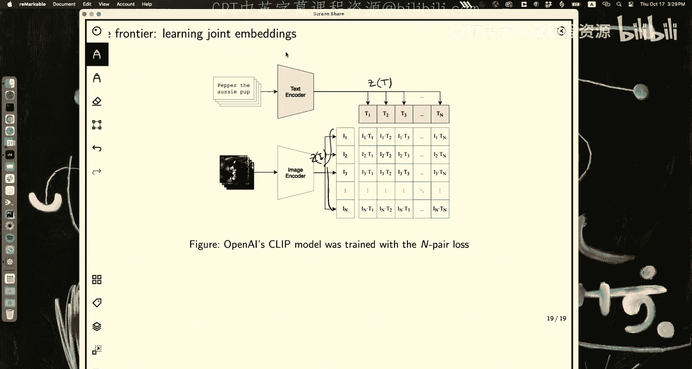

# UCB《机器学习导论｜CS 189⧸289A Introduction to Machine Learning Fall2024》claude-3.5 p15 L15-  Nearest Neighbors & Metric Learning.zh_en -BV1H4421S7bs_p15-

Okay， so let's gradually begin。I think this is a massive sushi。

 It Look like this wasn't reflected in the course website。

 So there as me swap it in this lecture and next lecture。诶。So。

I'll be talking today about nearest neighbor and metric learning。And next week。

 Professor Liz Carten is going to talk about the decision theory， I believe， for the next lecture。嗯。

So it's like， I think it's a nice。 you know， you've learned about PCA， you know。

 you've learn about T。 and it's like a nice。😊，You know， sequence of lectures now。

 so we're going to go to near sleep and metric learning。As you can see it's connected。

And I'm not happy that none of the colors show up。What is going on in here。Do that transfer again。

Okay， I guess it's fine。 I can stick with it。So this is the。Yeah， there is something off here。

What's what's going on。Let me redo this， actually。To figure this。すいように見え。

I'm good just gonna read for you。 What's missing。 So that's outline。

And so there are two parts to today's lecture first we're going to talk about Kenin year's Neval classification。

And so we learn some very， very fancy classification techniques and we go back to the simplest of them all。

😊，So this is an example of what's in a statisticss called non parametric model。

 So I'm gonna give you some flavor of this very， very general term non parametric versus parametric。

 So I want to。Give you some insight what goes on into each framework。

And then we're going to talk about what's the role of k and K and N。

I'll give you a generous derivation of this KN N。Whis kind of fun。

 So this is event I was very surprised。 This is even mentioned in the。

 in the textbook so we can even take a look at in the textbook。😊，诶。And。

Then we're going to talk about two things。 It's very important。 first is how good is KN。

 The other is how bad is can。And the bad really takes over。

 and this leads to the next part of the lecture， right， So。

 so we'll find that we will learn that there is there two problems with K with K and N1 is the cur sub dimensionality。

 The other is what is near。 if they came near a snake we have to define what is near。

 And and then this naturally leads to this。For literature on network learning。I decided to。

Make it focus on contrastive learning。 which is partly covered also in the textbook。 I mean。

 you can give a have a whole lecture on metric learning is very deep topic。

 But contrastive learning is really now， you know。What people use， so I my Tla give you。

Good flavor of what's going on in contrastive learning。

 And we're gonna end with one of the marvels of contrastive learning。

 which is open a eyes clip model and so。It's gonna be a good ride today。Let's go。

So whats me think is parametric versus non parametric statistical models。So so far in the course。

 we have focused mainly on parametric models， right。

 So we have started the whole lectures on linear regression， logistic regressions。

 soft max regression。 And then we learned that if you paraize Tt by neural network。

 we can take great， we can set up a loss， we can take gradient of it。

And what what's very nice about these type of models is parameters are estimated。

 You first one time run through your data， right， after you estimate your parameters。

 you can just throw the data away。 You just don't need data anymore， right。

 The whole prediction model is captured in Tita， right， Tita really is everything。And， but， you know。

 you have to go through the pain of these are very complex models， you know。

 depending how you set up your Teto。And there are， on the other extreme。

 there are class of models called non parametric models。 talk a bit about regression。

 but it's really the focus is on classification。And it's like the opposite。

 really the opposite extreme where you have to， there is essentially no training as， as we will see。

 but you have to keep， you have to store your data。 You have to have it around。 You know， you。

 you need the data set at in line。And so effectively， you can think about。What's。

What parameterizes this model is the dataset。 right， So as your dataset grows， essentially。

 a number of parameters grow， right， So these are like the two extremes of statistical models。

 and they have their own benefit as， as we will discuss。Okay。

Anybody has a idea for a solution for this。Interesting problem。 we are having。

We want to fix this on there。Maybe I should do full screen。嗯。It strange。Yeah。

 so this is the head the header is the metric of space。 So the whole lecture is about near。

 And I want to just first talk about what mathematicians think about near， you know， what is near。

 So that's the notion of metric space。 and it's a very， very simple notion。 So you have a set right。

 And you define this function as the notion of distance between the elements of this set， right。

 So D is a function。😊，Between two elements， X and X， my said， I define it to be X and to R， you know。

 I mean， in， so this has to satisfy， satisfy certain axoms。

 One is that the distance between an object and itself is 0。 The other is that distance is symmetric。

 And， and the other is distance is positive。 So it's really this is。Or plus， right？And。

And there is also an important notion， which is the hardest one to satisfy。

 You have to say delicate notion iss a triangle inequality。 And tri inequality says that if you have。

Three points， x1， x2， x3。Right， if you bypass x3 through any midpoint， the distance will be larger。

 right。X1， x2 plus the。X 2， x 3。Has to be greater than our required， too。The x1 and x。

So there are a zoo of metrics that people have come up with that satisfy all inequalities。 I mean。

 the first three is very easy to satisfy。And the last one is more delicate。

 And the one that is relevant for this， most of the lecture is this called Mahalanobi distance by Indian mathematician。

 So this is essentially generalization of Euclidean distance where M is a positive semi defite matrix。

 So M is。😊，Positive semidefinite， and I'm hoping this was covered when when Gaussian distribution was covered when I say positive semidefinite。

 I mean。Any vector。Is there， right。 If you take a dot product we had M we。

This is greater than equal to 0。And。Yeah， so。This is， you， you should know this term。

 and it's important in the literature。 We may come across it in different contexts。

 But for the practical professors for in this actually lecture， M。Identity。

 and then his identity is reallyuc。 Euclidean understands that you know and， and。

You have seen many times。So。嗯。So let's， let's dive in。

 what's then your say classifier is what you think it is in the title where there are。

 there are different。 there are three steps to essentially four steps to set it up。 One。

 as I mentioned， you have to store the your training set， right， You have it somewhere sitting。And。

 and this， there is no training。 You're done。 You know， there is no training。 And then at test time。

 at the inference time， there is a test。Point comes in， right。

 is the point they are interested in is classification。And so the way。

 the way it works is you first find the K closest again， close。 What， what do I mean by closest。

 we have defined in this is with respect to a metric， right？

 And we're gonna stick with this Euclidean metric。So you find the click K closest point to point X and。

 and you just， you just essentially store that set。 And I doote this set by N K。

 So N is nearest and for nearest。And here you looked at the K of them， right。

And this is x is your essentially your anchor。 right， This is what this is the test point。

And this D is the whole dataset set， right， as I mentioned。You need to have it around。Okay。

 so just to。T que you that you are awake。 What is the how many elements are in N K， by definition。

Okay， yeah， it I defined it to be or look at the K nearest points。 And it's the example below。

 You know， these are the zeros and ones that's already given in the data set。 There is their labels。

 and a new test point comes in X。 And here I， I said K to be 5 in this example。 And I looked at this。

 These are this is going to be my。These five points are the closest point， and that's going to be Nk。

And we define， so now we need to have an estimate for this posterior distribution， right。

 We are interested in， well， I cannot call it posterior because we don't have any in this model。

 We don't have any likelihood model yet。 So we want to estimate the probability of label Y given X。

 And we just define it to be。With respect to these sets that we defined， right， We define this set。

 and we go we do count， right， This set has K elements in it right for any label。

 I go count how many are in the label in this example，0， how many are in one， right？ And so if C is1。

嗯。If C is one。And in this example， cave 5。I go count how many labels are one。

 How many labels are one iss three in this example。

 So this probability comes down to in this particular example。3，2，5 for the case of s equal to one。

So， that's essentially the end。And so。To。You know， you have to， the first thing you want to ask。

 the only thing that matters here is this a proper probability。Let's。

Can somebody give me a very quick answer， what is the proper probability？

What do I mean by proper probability？Good。Yeah， can you do them math now， by the way does's lot to1？

Yeah。Exactly， so when I sum over。Yeah， I need to sum overea。 right， let me erase this。

To answer this question。The sum over。 and theres a sum over， I can bring some over inside。

 And this guy， the sum of these is one， right， Y has to be one of them， right？

 And there is a sum over， There is another sum of ones。 Some of ones They are K of them。

 We discussed this So becomes K over K。 So it is a nice proper probability。 very intuitive， right。

 It's very general。Right， and it always works。 You know， the question is， how does it perform。

 And we discuss that。Next， so already did a quiz for you。In this example。

 P of1 given x is3 over5 and P of0 given x is2 over 5， right。So what do we do for regression。

 regression is very， very similar。So training identical， we store the data set。

 we identify for any test sample， we identified the neighborhood right and then what do we do for the prediction model for inference。

 any suggestion。You know， now I have Yi。嗯。I have X， I， Y， I。As my data sets。

Where Y eyess are in R right the case sub regression。Right， I I constructed my set。

 There's a new test point coming in。 I constructed this set。

What should be the good prediction for Y hat？For x。Great。我借不出。There is no collapse， right。

 It's regression。Exactly， like， yeah， I mean， this is like maybe you can do better if you have more knowledge。

 But in the absence of any knowledge， you know， just take the means。

 So this becomes some over X I divided by K that this I。I mean I don't want to make it too busy。

 I is in NK， right？Let's， let's make it busy， actually。So， this is。Some over X， I。I is。

So essentially I look at my neighbor。Let's take that in as， as my prediction。Okay。LetsGo next。

So the case of k equal to1 is special and。And so I like to talk， talk about it a little bit。

 So this is essentially the Ukrainian mathematician， Warnoi。To study this is like a。

Essentially known as Vernoi Teslation or mosaics。So。And so essentially， what it does。

 So let's assume， let's do a thought experiment。 Let's assume each。

 each point my data set has a different label， okay。I just want to identify。In the。

 in the one nearest neighbor philosophy， like I have a one nearest neighbor classifier。

 I just I just my， the question I'm asking is what region in a space will be classified as my exemplar。

 right， So let's assume， I mean。This is like a cat， this is a dog。This is a horse， right。

 It's all different classes。 And I， I have only oh， you don't see anything everything。 I have only。

I have only。嗯。I have only one example for the sake of arguments， right， then。

Then we just want to know what region of a space belongs to that class。

 right And so this is very simple。 And this is another， let's do this math together。Clearly， this。

 I mean， not that clear， but we're gonna do the math。 This。

 it essentially divides the space into these linear regions， right， So。

 and you see an example of it here。And。And by the way， this I， I did with with processing。

 There is a cool programming language。That's， you know。It has a class for Veronnoi。嗯。Regions。So。

 so the question I'm asking。We want to prove that this boundaries between。

 between these mosaics are always linear。Any idea how I should go proving this。Good ahead。Exactly。

 so， I mean， the， the to， what's the， what's the boundary。

 Bo is the place where the the sensors are equal， right？ So let's write it down。 Let's call this a。嗯。

find it。More visible is called it A and this called。Let's call this B。Right， so I want。

And this is essentially X， A。 This is X， B。So I want to know， have the condition。

 and I'm using Euclidean distance here。 I want X minus S X， a。Right， that's we define this metric。

 right， we want this to be equal to。X minus。X，B。Right， restite it down， so。This becomes X， I。Myイナ。

Should me I'm going to use the I open。裁判 x minus。To be equal to。Right。

And here you don't have to do much math because all the X I squares cancel from both sides， right。So。

 we'll end up with。We very abstract here。 You do this at home。 There are no。Xi squared remaining。

Therefore。This becomes at some abstract level。 I mean， you can write it down。 This becomes really。A。

Yeah， so there are no X squared in many only linear terms you。And of proof。

 So this is essentially all the decision boundariess are linear。But obviously。

 the world is hopefully easier not that you don't get one example per class， right。

 And this is the right figure。 Let's assume， you know， you do this for any single point。 you。

 you find this mosaics， right， But you can merge mosaics if they are in the same class， right？

 So if X， A and X， B happen to be in one class， right， They both happen to be 0。

I'm gonna merge it to both of them， Right， This will be one。Right， and this is what happens on that。

 on that slide。Unfortunately， you don't see the， all the black dots here。 So there's a black dot。

Here， year。Ye，y。Y。Yeah， so these are all the points I had。 And these points。

In the blue region happened to be in the blue class。

 and the red regions happen to be in the red class。So you end up with these cool shapes， right。

 this is essentially the story of nearna classifier。诶。Okay。So。Next comes the very。

 very important discussion on what is the role of K in K and N。And here I want to pause a little bit。

 We can have a little thinking going。 So we discuss Can nearest neighbor。

 and there are these are two examples。 This is a real world data。 There are。

 I think there are 200 examples，200 training points。

And I did K nearest neighbor for1 k on the left side。

 and K in nearest neighbor for another K on the right side， right？And I want to know。

 can you guess what is K in a。狗还。Just one， can you say why did you say one？我电话。Yeah。

 is there any specific point you can pick， You know， like I， it's a very good answer。 Yeah。

 for example， here， this， this point， just by looking at this is clearly it's just， you know。

 did the one nearestest neighbor， right， If it was two。

 you wouldn't have had such a close boundary around it， right。And this is。This is not good。

Essentially， you're overfitting to every single point， right， And it's like on your face now。

 just K equal to one。In general， unless you have very， very， highly very， very simple problems。

 it's not a very good choice for K N。 And what is K prime here， Its very， very hard。

 if you can guess it correctly， What's the rough， Is it 1000， Go it。😊，15， how do you know，15。

How did you get 15。Okay， that's good。Yeah， so K prime here is 15。😊，Exactly， this is case one。

And then last question here， what is， what does this。Distribution that we define reduced to。

 if K is big L than D。Beer than equal the dimension。 Oh， I'm sorry， the number of samples。Go ahead。

Yeah， so it becomes a technical answer。 It becomes a prior， right， So essentially。

 this becomes this whole thing reduces to N C divided by n。So in this case， this becomes this。

The answer is n divided by n。 So essentially， is's independent of x， right， It's just your your。

 what does the data tells you the prior is。 So these are the extreme regimes， right。

 There is like a K equal to one that you overfi to every single point， right and。

And the other extreme is k is bigger than a number of samples equal or bigger where you essentially you give the same answer for any point。

嗯。So。So this will come back to actually， I will give this lecture on the bias variant trade off。

 but it's very nice to talk about it here since we are talking about Can nearest neighbor。

And this is， again， is done。For this particular example that I showed。

 So you go fit can nearest neighbor for different types for different case starting from。

It starting from one， with backwards，1 to high k right and you look at your your training error right。

 and you look at also your test error。Can somebody say。

 what is the training error for a K equal to1 for all problems？Exactly zero。

 right for the k equal to 1。I I go look at my training for any point that what was in me。

 I look at the training samples and I store the training set right For any point。

 the closest point is the point in the training set。 and I already know the label， right so。

So that's， so this is not shown here because I think in this figure， the want to show 0。 But here。

 if there is a0 here。呃。Zero is here。This should cross  zero。

 right We already know the answer for any problem， actually。呃。And。Yeah。

 so the other extreme is where k is very large and that's already it may be hard to even fit the training sets right and then the suite region in the middle where your test error becomes becomes the smallest right？

So already you， you see this reverse relationship， right？ So when case is small。

 the model is very complex， right， When case is large， very large。

 we already saw in the extreme regime where case is equal to n。 You always answer one thing。

 And that's the prior。 And that the model is very， very simple。 So here this visualization。

 we already saw this， right， what。What really defines the onset is the number of samples， right。

 So you define n over。K to be your model complexity。 So this is just as a， as a， as a。

 as a preview for what we will talk about， This is a very， very general observation， right。

 So you have something that。Quantifies model。Complexity。And this is your error。嗯。And in general。

 what you will see if the model becomes complex。Model becomes complex。

 a training a road will go down， you know。Tin eventually we go down。 This is training samples。And。

 and you also， you can look at your test samples。 if the model is。Very， very simple。

 you're going to sacrifice both your training and your test error right when the training error is high。

 test error will be high too。And then there is this middle region where test error。

There is a good balance between training and test。 And then when that becomes very complex， youre。

 you're overfitting。 right， this overfitting region。And then， and the test error will go up。

 So these are the test samples。Right。And so this here， as you see， there is not much gap。

 So this is low。Variance。Oh。You need to write in。Call it anymore。So this is。

 there is little variance here， low variance。Here， the opposite is high variance。

And here there is high bias because this is very， very。Large， right， This error is large。

 so this is high bias。And this is low bias。You're gonna cover this。

 Youre gonnana have a whole lecture on this and but it's very beautiful。 came here say I， you know。

 it's very， very nice。 You don't even have to do any math。

 You already know training are 04 K equal to1。😊，And you already know training error is going to be very large when K is equal to n。

 right， because you already saw the answer is the prior。 and that's really poor answer。

 You completely ignore test the test point。呃。So everything you。

 you don't even have to simulate anything。 You already know the answer。 This figure will come up。诶。

Any questions here。Good。Lower K again， is like what is complex。 So when you fit the training set。

 you already saw right， You already any， any， you're creating a decision boundary around any single point。

 right。So you end up with very， very complex decision boundary。 So this is。

 this was the example here。Right。And you can imagine， you know。

 this is a story we carry for any problem。 The moment you have any outlier。You。

' going to create a decision boundary on your top layer。Even though this data clearly says。

That there was some noise involved， right。Right， this region， this， this。

These blue samples just sneaked in through， through some noise。

 I don't need to fit my classification decision boundary around noise， right， So essentially。

I wonder if I cover this， but， you know， you can think of when you have。

 if you have a model that has can do a very good job at fitting noise， then this model is complex。

 you know in this， in this jargon。Yeah，That's how we mean， essentially。

But you agree that this decision under is complex， right。Yeah， so in， in some sense。

 it's intuitive notion。Any questions here， more questions。Okay。

 so here I want to do a cool calculation。Where。We will have a generative derivation of。

In quote un code derivations， like a back of the envelope derivation。嗯。Of what we postulated。

 You know， we defined。Going back， you know， this was very intuitive。 What we said if you。

 if you define a region and K to be the K closest point2 point x， this is a very intuitive。

Intuitive expression for estimation or probability of a class given X， right， This is what we did。

 Now， I want to derive it， right， So we go back to。Like 6，7 lectures ago。

 where we had this notion of a generative classifier， right， And for generative classifier。

 we need two things， right， We need to have the class conditional。 So this is like。So， this is my。

Class。Conditional probability。 And this is my prior， right。We we need to have those。

 And given that you， we're gonna use the base。 If you have this， we can define。We have， you know。

 we don't define use the base rule。We of C， even X。 We have X， even C。PC。Right， that's a big one。

 right。 And I'm being lazy here again where when I say P of c given x。

 I mean P of y equal to C given x， right。嗯。So。intuitively， you can set up this density。

 this class conditional density， you can estimate it by doing something similar， you give a point x。

 you grow a ball， you know， you just grow a ball around this point x until you cover K points of your samples。

 right？You grow this ball， and then you define， you estimate this class conditional。

 This is my estimation， right， This's an estimate。As being one over V， right？ what's the probability。

 probability times of volume should be fraction of samples， right？ therefore。

 you expect one over V should V to show up。 There is one over V。 And there is N， C， X divided by N C。

 What is N C of X N C of x is how many samples in this ball belong to class C。Right。And N。

 the denominator is total number of samples in my training set that belong to Gy， right。So。

 essentially。And this is here Ive written in the footnote。 You expect this is how it's derived。

 P of X given C times V K is roughly the fraction of C class samples in this volume， right。

 and which is N C of x given divide by N C。 So given this let's do the math， It's very simple。

 looks a lot of cancel cancellation。 So this is going to be N C。Of X and C。By by VK。N C。

 divided by n。And I do the same thing。 Now。 There's a sum over C prime。Right， so。

One of the best things in life and things cancel。And we K cancels， right？ So we end up at NC。

X divided by。Can somebody say what's in the denominator。

 The definition of N C was how many samples are in class C in this ball， right？

 And I'm suming over all classes。对。What do you mean by n， You mean this n。Number points。

 And that's K， right We defined it to be。 We grow this ball to contain K points。Yeah， exactly。

 So this is will be， this is class independent。 when I'm summing over prime。

 I don't care about the class， right， I'm literally counting how many samples are in this。Ball。

 right， and I defined it to be， I grow this ball to contain K points。Let's sit here， right。

So that will be K。And what is N C X， N C of x is how many samples are in class C in this ball。

 And that's literally what we defined。 So this is becomes。I。Their I is N。I mean， here I've。

 have the same notion。 This is whether what I mean， really mean。嗯。Yeah。It's not actually the same。

 That's the， the delicate part。 which is the， the volume of the space， right。

 but it contains when I'm， when I'm counting here， I'm really really counting how many points are in class C。

 So this becomes on how we defined it earlier。Is that clear。Right， N C。

 X was how many points are class C in this volume， right， This is essentially your counting。

 The volume。 essentially， the idea is in this， when you do the base volume disappears。

 You end up back to counting。 right， That's essentially the derivation。嗯。Any questions？Great。

So N C of X is， I have an anchor point， right， I have this test point。 I grow this ball， right。

 which contain K points。 I look at how many samples are in class C in this ball。

 But N C without N C of without X is how many samples are in class C in the data。 right。

 So essentially。That's why we defined。That's where this came from， right。The prior。

 the prior of class C。Is you don't care about you， look at the whole data set， right？Yeah。

So now this， with this insight， you know， we， we go ahead。

Its that's how I define it' literally a ball。 I I have。 I I， I am in some dimension。 I take a point。

 I start growing this ball， right until it contain K points。Right。Oh， you mean。

 there are two samples happen to be on decay。Okay， there， you know。

You assume we don't encounter that point。Yeah， yeah， exactly。 I mean this whole thing is like。😊。

You know， there is no。You know， that density estimator actually is called ball balloon kernel density estimator goes back to a paper。

 I mean， you don't， you don't use balloon kernel density estimator。

 but it's just a good thing to think about。 You know。

 in this what I like about this derivation is the in your you're building a density， you know。

 and this density has a volume。 Obviously， at the end， the volume disappears。

 That's the beauty of it。 but， but fair point。 Yeah， so。😊，By David。

 your point you can ask it here too， is possible for the Caniernaber。

 there are two points that are happened to be identical， then what people do， they do a flip。

You know， essentially with the flip， you throw one of them out， right。But， you know。

 hopefully that doesn't happen too often， yeah。嗯。Fair points。Any other questions here？So。

 this now leads to。呃。2 things。 This I'm going to quickly mention。呃。

And then we talk more on the problems of KNN， but how good is KNN。

 and this is a very important result from 1967。That says that nearest never classifier。

 If you have a lot of data。 So next in the next slide， you see a lot can be really a lot。

 So it's not a very good result in that， in that way。 But cover and heart have this beautiful result。

 That's say if you really have a lot of data， this。😊，Stupid classifier， you know， it's very。

 very simple classifier can be never worse than twice。 The base optimal classifier。

 And this is shocking， right。 So it says that if you have the。

If you know everything about the distribution， you know， the class conditional， you know the prior。

 therefore， you can construct this exactly。knowYou have the optimal classifier。

 the nearestnaber can only be twice as worse right So essentially it says in the limit of large data is' a very。

 very good classifier without doing anything we are getting really close to the optimal right。😊，So。

At the beginning， I wanted to give you a proof of this。 This is not in the textbook。

 and the proof is kind of involved。 and we don't have time。 But if you are very， very curious。

 you can contact to me about this， but。But the most important thing is next。

 we will find out actually， you may have to have a lot of samples。 So this is I。

 I want to spend really good chunk of time talking about this。 So we'll come back to this。

 by the way， again， I'm planning to talk about generative modeling in this course。

 There will be two lectures on this。 and Care subdiality is the important topic there， too。

But let's touch upon it now in a more basic way。 And this is essentially the fundamental problem with all distance based algorithms。

 You know， anytime you have a distance。诶。You are thinking about what's， what's near what's far。

 You are thinking in some sense about volume。 You want to fill up the space with， with samples。

 right， you， you know， and so the fundamental problem in in the， in high dimension is this。

 there is a lot of room in high dimension。 right， This volume grows exponentially large。

 And this is a very simple plot on the on here， you see， it's very， very deep。So essentially。

 I have a cube of size 2， right？ And I'm looking at a cube of size 1 within this。

 this cube of size 2， right？ So in three dimension， you know， this is only8 of the8，1，8 of。

The whole cube， So cube is only eight times larger。 But the moment you crank up the dimension。

 this becomes two to the n。Right， and2 to the N， you know， you。

 you just have to go to0 dimension where you can even write it down on a piece of paper， right。

 So it's a very， very large volume in the space。 What does it mean， it means that if I have。

 if I have this space， and I want to do nearest a neighbor， right。

 I really want to fill up the space。 You know， the examples that you saw earlier in two dimension。

It wasn't very sparse。 You know， I had a lot of points everywhere， right。

 I have to have a neighbor to decide what is my class， right？ So I。

 I want to have samples in this space， and it suggests that you need to have very large amount of samples。

 right。So this comes from the volume volume expression。 And also want to do a different。

 There's a dual all perspective on this。 And the dual all perspective is， suppose I want to get。

Epsilon close to a sample， right？ unless I assume I don't know anything about this distribution。

 right， And we just do the math。 I want to get epsilon close。 And so basically， I want my。This。

 and let's assume for now that the space is， again， this is about dimension。 It's not about scale。

 Let's assume youve actually， you are in a， you are in a 1，0，1 hyper cubebe， right？ So I mean。

 this hyper cube。 The word that's my word。 You know， it's very small。 look， looks like a small word。

Right， looks tiny， but it' in very high dimension， right， So I want this。Times n。Right。

 I want to fill up the space。 And this is the small cube I'm considering。

 I want after having n to fill up the space。 I want this roughly to be one， right。

Thats what them demanding。 It's cleans up a little bit。Let the again。So this is what I'm demanding。

Is there any question why I' am demanding this？So， essentially， what I'm saying is。

There are these cubes of size epsilon to the D， right That's the size of these tiny cubes。

 And I want gonna have n of them to fill up the space。 right，Essential。

 I want to be know that Im kind of confident I'm epsilon close to my neighbor， right。

And so let's do the math。So， now。Eppsilon D。You roughly enter the -1。Therefore。

 the epsilon is roughly。And to the minus1 over d。So this is horrible because the moment you have very。

 very large dimensions， the assume D is moderately large。 is00。

 And this assume I want to get only point1 close。To my。To my neighbor， right？Moderately small。

 not even that is small， right， It suggests that N。Has to be 10 to the 10。Right。

 you're never gonna have this many sounds。Right。There is another way of seeing this， essentially。

Wch time do I have。I mean， we just need the math， but。You you wantna see。P of it， too。

That's a plot of it。 So here I have three plots。 One is in 10 dimension。啊。ま热。Yeah。

 so one of them is in 10 dimension， the other is 100， the other is thousand0。

And I'm looking at this plot from one to a billion， right。And basically， this is， as you can guess。

 is the100 dimension，1， This is the 100 dimension，1， this is 10 dimension。

For hundred and00 dimensions。 these are， again， These are very moderately large dimensions。

s not really large dimension in the world we live in。Essentially。

 this function doesn't change at all， right， So， and we already saw that if I want to get to4001。

 If I， if I want bring this curve down to  point1 this， this one， we did bring one。

 bring it all the way down to  point1， I need to put hundred zeros， right， we just did a math。So。呃。

So this is a curs of dimensionality。 and I put this lecture。

 Michelle Telegram is the God in this field where he applied this theory for probabilities。

 which we may talk about in this course event。So he won Applebel Prize this year。

 He has done foundational work。 but he gave this very nice public talk， Mysteries in high dimensions。

 I highly recommend that you watch this lecture。Fll be the lecture notes。

Any questions about the curs of dimension I。Go ahead。Yeah， so Epsilon。 So I put this。

 This is my derivation for this。 This rate and to the -1 over this shows up everywhere。 So。

 and I just wanted to give you some intuition where it iss coming from。

 So epsilon here is for the case of nearest neighbor。 I'm just saying intuitively。

 let's assume I want to make a decision。 right， And we are， I'm leaving this ball in this cube of 0。

1 cube in high dimensions。 I want to make， make a decision at least。😊。

To someone who is point1 close to me。Exactly， so the intuition here is， you know。

 you don't want to make a decision based on your neighbor who is very far away。 right。

 So I demand this again， it's like a back of the envelope calculation。

 I demand that there are these epsilon cubes， right。

 And I want when I have N of them to fill up this space。 That's my demand。

 And this is what what comes down。 Again， there are different ways to look at curs sub dimensionality。

 But this is， this is one way。诶。Essentially， it's suggesting that don't， don't have high hopes。

 If you double your n， you may not gain anything。 right the moment you're in high dimension。

 you know， that's essentially what's showing know。These cubes get just a tiny。

 tiny bit smaller when you double them。Then there is there is a powerpoint over D sitting there。

 right。嗯。Any more questions on。On the curse of dimensionality。嗯。Okay。Pages not moving。Okay。Yeah。

 so let's summarize K and N， the good， the bad and ugly。 What is the good。

 The good is there is no training。 It's very fast， you know。嗯。

And you can learn very complex function easily。 You have a control。

 The control is K is as simple as it gets。 right， You said K， you put aside some validation set。

 could quickly find out what's the right K for your problem， right。

But this whole thing comes at a cost。 versus is a high storage cost。 If you have very。

 very large amount of data， you may want to compress it into some parametric model， right。

 You don't want to have a lot of data for any inference you want to make。Because of it。

 this is slow inference is all connected。And the， the big thing， if I want to have a font。

 this will be a very big font， Pers very poorly in high dimensions， right。

 because the notion of distance completely breaks down， you know， as we saw earlier。嗯。Yeahゃ。Okay。So。

Next， we're gonna switch over。Really， at the heart of this problem。Is the curse sub dimensionality？

 And the question is， how can we break this curse， right， and。

And this will be the topic of next 30 minutes。And really。In for， in full generality。

 there is no hope We cannot break curve curve of dimensionality and we can go home。 But what's， what。

 what's， what's， what's true that is that in reality， the data is not。 It lives in a high dimension。

 but data。Has some intrinsic， intrinsic dimensionality， right， Let as assume。

 I have some data living in this line， right。Who cares if this is in two dimension。

3 dimension or a gazillion dimension， a million dimension， right， This data lives in1，1 D， right， so。

So you starting with this hypothesis， it a hypothesis that the natural data。

 the data we care about is actually lived in a lower dimensional manifold in this very。

 very high dimensional space and。😊，And then the question is， how can we go learn this manifold。

 right， That's the question。So there， there are two things that are related here。

 when I'm talking about in manifold。 I want to somehow unwrap this complex structure and put it somewhere nice。

 right？ So there is a notion of embedding。 Did I talk about in this slide。 Yes。

 so basically want to do our， our learning nearest neighbor。

 whatever we want to do after embedding this data， right， in a lower dimensional space。And。

 and is after you do the embedding。 So essentially， there are different approaches to this problem。

 but。Intuitively， that's to me， that's the best way to think about it。 You have this complex data。

 You em it in low dimension， right， then you use your Euclideium metric， you know。

 after you do the embedding， So this complexity has to disappear from somewhere。 I。

 I bring it into the mapping。 I make this mapping。Can be very complex。

 And we're going shortly use the neural networks to do that。 But after this mapping is done。

In this embedded space， then there is the notion of near and far。

So we're gonna to talk about three schools。1， I did it historically。

 So the first influential work on this was by Y Lecon's group where the whole contrastive learning。

Came about。 And that's， that's just。诶。呃。There are。Let's talk about it here。嗯。

Maybe I want to talk about the。General philosophyophy first。嗯。

So theyre we we're gonna go and the level of complexity。 One is this loss has two terms。

 the other has three terms， the other has n terms， but they all have very。

 very simple philosophy behind them。 and that's really what we talked about is that you want the nearby object。

 you want to put them a similar object。 you want to put them nearby in this embedded space。

 and this similar object， you want to push them apart。 So in all cases。

 we have this pull and push terms in the loss。Unfortunately， the color doesn't show up here。

 I colored all the pools as blue and all the pushes are are are red。And we're gonna go over them。诶。

Yeah， so let's talk a bit briefly about。That's what is the problem with Euclideium metric， You know。

 the problem is that， let's assume I have。I have a， you know， this is。Not a real word data。

 I'm just gonna do it now， but， you know， it's very intuitive。 I have a three。

This actually should actually do four。I have a four。I have another four， right？

And let's assume I have a nine here。You know， just you can do the Euclidean in your head now。

 these four and 9， they are dissimilar as far as we are concerned， but the vertical lines align。

 you know if I do Euclidean distance，This other four is shifted a bit， It larger， It's rotated。

 and very likely， if you do Euclide distance， the Euclidean distance between these two guys will be larger than this two。

Right， so already， you know， it's bad。 You know， we know you clear understand here is bad。

 but it also already suggest a solution。RightThe solution is I want to embed it。

 and I want to bring these four and4s closer together in this new dimension。

 and I want to push the4 and9 apart from each other again in this new dimension。So我。

And this is done with。诶。Sam means networks。So。So there is a poller。I switch to blue and。Right here。

It's always present。So， this is the。Pool term， right， I want to， I set up， I'm setting up a loss。

 I want to minimize it， right？ And I say if the labels are the same， you know， this is。

 I know it's similar。 You know， I define。Define similarity based on labels。

I want to minimize this loss。 Therefore， therefore， I want to bring this two close together。

 And this closeness is not in X。 That's the key。 So X is goes to this V， right， Z is the。Embbedded。

Space。Right。So the first time likes to do that。 The first time likes to bring these two objects that we know is similar and similarity against defined baseline labels。

 In this case， bring them closer together。 And this term says。Push them apart， right？ So。

 but the problem it push them apart is it could take over your optimization， right。

 It's possible the， the network really wants to push them to infinity， right。

And for solving that problem， we're gonna come， I'm going to discuss。nicer solution to this。

 But this is original paper on this。 what they did was they had this margin， right。

 You don't want to push them apart more than M。 If you push it more than m M minus something more than m is negative。

 a max of 0 and negative is 0。Right，So this loss would be turned off。 essentially。

 you' are not going to optimize it more。 You're going to focus on the first term。And。

So this is the original thing。 And actually this figure that I showed here。It's a very。

 very nice result where they did their Teta。Is a convolutional neural net。And the is two dimension。

So they literally take this 28 by 28 pixel，1written10 digits，784 dimension。

They map it only to two dimension， right， And they set up this loss where theyre bringing fours closer together and nines closer together。

 right。Even though Eucli understand， some of these knives are actually closer more to force， right。

 But in this new embedded space， they're gonna be disentangled in some sense， you know。呃。Yes。

 so can you clarify， okay， so。Since we don't have much time， I'm going to sh say。

 why is this called sameese network。 So essentially， this is the architecture You have some。

 you have some force， right， You find another four， right， These are different force， right。

 but they are belong to the same class。 You embed them。This is my exon。 This is Zlon。It is two。Right。

 and the key is。There is one parameter。That feeds to both of them， right。诶。And then， you join them。

So it's like a twin。That's why it's Kas Sam is， and then you define this loss。Right。

 and then you say if they are if they are the same object， I want to minimize it。

 and if they are far apart， I want to push them apart You get， you get a negative sign here。

 again again， there is a margin here。Can you say what's wrong with this loss。New objection。过 ahead。

X is considered， no。The value of x， X as a vector is considered， right， X goes to both of them。

What do you mean by value of x。Y。I mean， what goes into this network is actually good that you mentioned。

 I just want to be clear what goes into this network is X。Yeah， the vector is fitted。 The。

 what that's， that's the important thing， right， The raw pixels are starting point， right？

 You start from raw pixels。 You push them to this newest base Z， right。

But the problem with this loss is the first term the pull and pushed don' talk to each other， right。

Essential， if the， if Y， Y and Y J are not the same label， the second loss is turned off。Right。Right。

 is either this either or or， right， Either this term is active。Or， or， or this time is active。

 right？ And， and there is a solution for that。 It's called triplet loss。 So in triplet loss， you。

 you。呃。You frame it differently。 You have a， you have an anchor， This jargon， is a important term。

 comes up。Anytime you read a paper on contrastive learning。 So there's an anchor here。

 let's say our four example， right， This is my X。 and I have。I have a positive pair。

And I have a dissimilar object， negative pair， right？And then I go the same program。 I embed them。

 right？So this is going to be my lazy notation z plus z minus and again。

 the key is all of them see the same theta。RightThese are now triplet twins， not twin。

 They are triplets。 So there are like three of them now。 And then here they talk to each other。

 right， You have， you set up a loss。Between these two and between these two。

So you get this d squared， another D squared， let's call it D1， D2。So， this is my divon。

And this is the two。And then you combine them into one loss， as we have seen， right So again。

 when you look at this。嗯。I want to be consistent with my coloring。

It has the same flavor of pull and push。 So if you want to minimize this loss。

 you have to bring the D1 lower， right。And you have to make D2 larger， right。

 You want to push apart things that are not similar。

 You want to pull together things that are similar。And。And you don't want to go crazy。

 You have a margin， right， that keeps you in， in check， right， You don't want to be the。

 the push term to take over this optimization problem， right。

 There's a margin that you do it up to a safety margin， right。Okay， so this is a triplet loss。Now。

 can you criticize triplet loss。They are on the roll here。So let me give you a hint。

 Let's ask you a different question。 What do you， what do you think is cheaper to obtain。

 I it the similar pairs are cheaper to obtain or dissimilar pairs。

This I assume I want to create a data set。 I want to I have some anchor。

 I want to first find a similar point， and then I want to have some dissimilar points。 intuitivetuly。

 dissimilar points are much cheaper to get right It's very， very hard to get a similar object。

 And here really this wasted computation。 I have like a world of dissimilar objects。

 and I'm picking one at a time right in this optimization problem。 I'm doing one at a time。

 and that's algorithmically， that's not a good idea。And this leads to an important paper。

So you don't see， unfortunately， the title here is called N Paralos。And。

And I've written it here on top one problem is is efficiency that you have to do compare with negative sample of one at a time。

And。Really， the question you want to ask， what if I want to have a loss where I can get a。I'm sorry。

 batch of negative samples。Right。So。Let's look at this loss。

 I'm going to derive it for you in a very nice way。Hopefully I have five minutes。Okay。

 so let's see again， the push shampoo。So this is my pool。 And let's look at it。 Let's stare at it。

 So， oh， and another thing is， you know， we talked about these push shampoo can go crazy because the。

The push can go far very far away。 And then people came up with a nice solution。 They said， okay。

 what if my， I embed my object。To be on a， on a sphere。 So there is nowhere to go。

 We cannot go to infinity， right？ So this V hat is a unit to sphere。And for a unitus we。

Z had1 minus Z had two。If you take the norm of it。There is as we had1， a square， which is one。

 We had two a square which is  one， right？ So this is 2。 There is -2。嗯。-2。We had fun。 We had two。

Right。And， essentially。That's what this is coming from， right， so。They had fun。There are two。

 By the way， you can also write it as the cosine。It。Z hat v as Z hat。Right。

 so I'm just just doing a very simple tri trigonmetric here。 So essentially what， what's， what I'm。

 what I've written here is that in L2 norm， when you put your object to have a unique norm is the same as the。

 the dot products， right， except that then there is a negative sign there。 So this。

Just do it at home。 This is very simple。So， essentially， now。呃。Now， if I want to minimize this loss。

What do I have to do， I have to minimize。呃，The Z hat and between x and x minus。

 And the best thing to minimize it is to put them far away， right。I get a negative。

 That's the smallest number this can get is -1。Right， actually minus。Yeah， it's minus1。

 that's the smallest it can get。Right， and the largest this can get is plus one。Right。

 where these are aligned， right， So the push shampoo on the， on the unit sphere is。

You put the two object to be the polar opposite， right？ That's the push。 And the pull is。

 you put them next to each other， right。And， and this is what this loss is doing for you， right。

To minimize this loss， you have to bring this lower。 You have to bring this higher。

 And so it has this。Negative thing。 That's because there was a negative sign you saw earlier。诶。So。

 let's derive it。 Let's see。You know， you already have。

 you have a good sense that this is what this is doing what we wanted it to do， right。

 But can we drive it and already had this discussion before in class。 the moment you see a saw。

 the moment you see a loss。What you really should think about is a negative log， right。

 Los is a negative log likelihood， right？ So the second negative of it。 So this is really minus log。

 And here I'm going to be lazy again because we don't have much time left。Here， I call it Z。

This is Z plus Z minus。The， Z plus。Mm。Right。And this is my log。Wn。1 plus。Some of嘅 k。E to D Z。3 minus。

Is a here。Minus E Z plus and Z plus doesn't have any K， right？ That's like inside， right。

 for the positive， we only have one，1 similar for this similar。 We have many， right？

 There's a sum of a K here。 And what do we do here， We just multiply both side by Z Z plus。

So this becomes easy plus。Plus k。E to the z z minus。Yeah。Yeah。And what do you see here。呃。Exactly。

 exactly。 And this is our beloved soft mix。 We had seen it everywhere in the course。

 You saw it in classification， you saw it even in for transformers。Is that's what we have。

 So you can interpret this loss as really doing N class classification where we are classifying。

 We want to classify the positive because we have only one of them， right。

 This is the probability of a positive。And negative log of that is a loss。 right， This is beautiful。

 I， I really like this result。😊，呃。So。I'll come back to it if there is there are questions here。

 but we are kind of getting out of time。Yeah， so。嗯。So that's got Em loss from 2016 and comes。

I think five years after that。Open AI came came up with this crazy model where they said， you know。

 in this whole thing I've motivated this lecture on， we want to embed the data， right。

 I'm embedding my fours to be closer to fours and9s closer to9s and fours and9s far away。

 And they said， what if we want to do joint embedding for language and text。Right， I want to have a。

 I have objects that are images， right， and objects that are captions for these images。

 It's a text that are completely different modality。 And they ask this question。

 can I embed them in the same space？ So I want the label for this dog。Which is pepper。

 the Aussie pop to be in the embedded the space， this label， I want this label to。

 to be close to the embedding of my image。 right， So if I have a another。

Another label that's let's say is a dog running I I want the dog running label。

 the embedding of the dog running text to be far away from this embedding of this image， right。

And they said， okay， we take the emper laws， and we both embed this image。 We have a image coder。

 It's as simple as it gets。 Actually， you have a imaging coder。 So this is my Z space for images。

 So this is the， this is like Z of。Refuse their notation I。

And this is the same Z that's the inside of text。Right。

But these theses are living in the same dimension， and they set up exactly loss we had here。

Where now these positive pairs are the image and text that corresponds to the same。

Caaptioning in the data。And they use this very simple heuristic that you assume all other captions don't correspond to the image。

Right， it's very， very hard to have a caption thats， you know， if you take any other caption。

 that's the assumption they make， it probably doesn't correspond to this image。

RightSo negative pairs， again， are very cheap。 The positive pairs。

 you have to look at the captioning in your data。嗯。Yeah， so this is the next level。

 the frontier in this world of embeddings， learning embeddings， where you learn the joint embedding。

 right， it's not about embedding im modality or embedding。Two different modalities in one space。嗯。

And yeah， so if you have seen on the Web or if you have playedd it yourself， you know， when you ask。

Dolly， to generate。I don't know pannda who makes omeelette。What it does actually， it uses this。

 this embedding literally， you know， it's like a a clip is underlying this， you know。

 you need to have a joint embedding。 That's， that's the only way to do this general。

