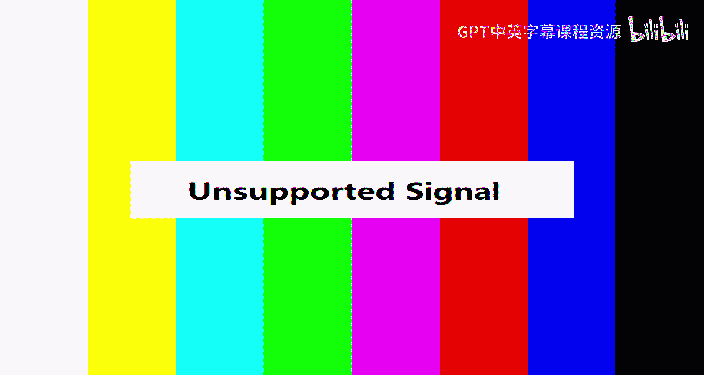
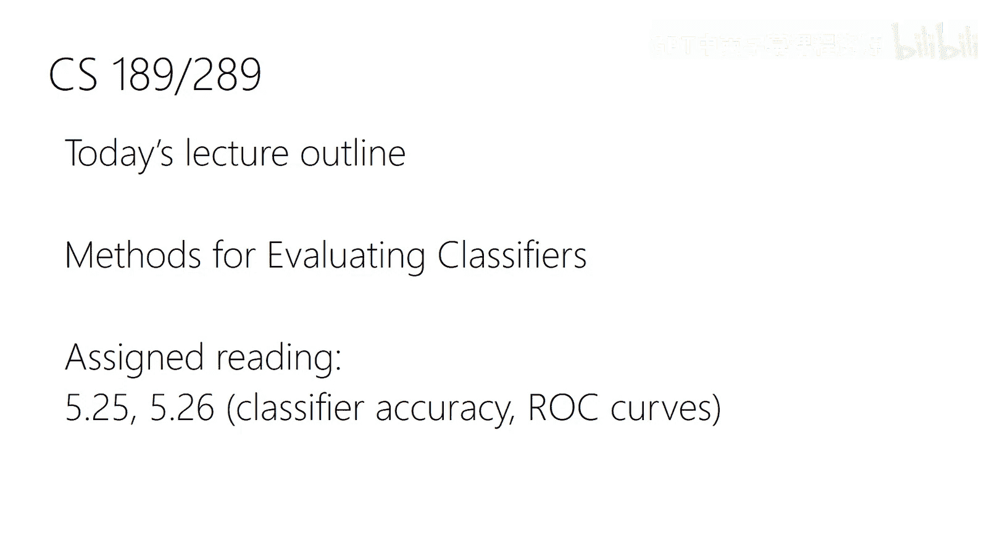
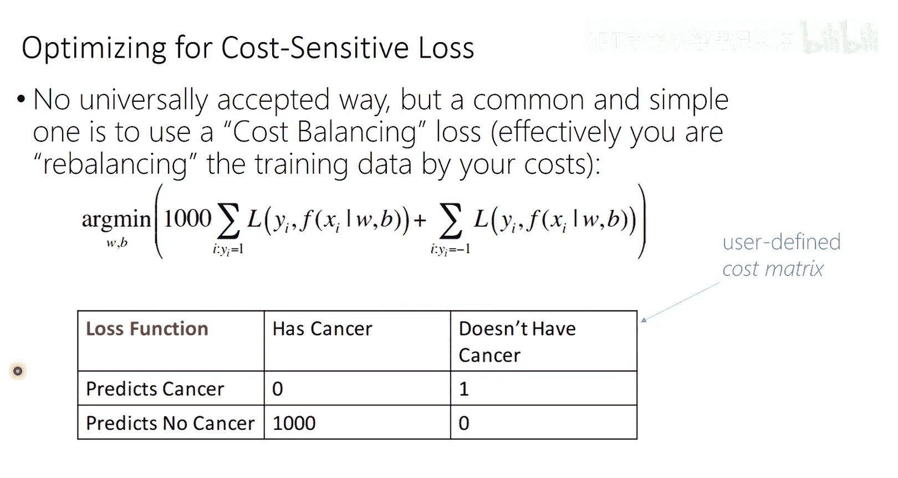

# UCB《机器学习导论｜CS 189⧸289A Introduction to Machine Learning Fall2024》claude-3.5 p16 L16-  Model Evaluation.zh_en -BV1H4421S7bs_p16-

Gett a meadow instead of a lawn， then we don't need to use the herbicide there and goats which can effectively control invasive weeds and through all of those application of those alternatives。

 they got a 90% reduction by eliminating what turned out to be unnecessary uses。

They kept a few uses where they deemed it necessary。

 including like you can't shut down SFO to turn out the goats to graze on the runway right。

 but it was so interesting to me that just by stopping and asking the question is it necessary。

 they got this incredible reduction in use without having to wait for the evidence to mature to say yes。

 this is exactly how much of this chemical is toxic in this use it's the opening question of saying what alternatives are there that becomes so that's where the kind of。

Creative heart starts。 So thank you for today。 And let me know if you。

啊。はい。are here。There everywhere， Yeah， Ru me in Qui right here。

How you about you this was left here open there。That's all I don't know。Oh identification。

 we'll just leave it。Thank you。呵。Thank you so much， by the way。这啊？没关系。すごす。快点。第。Your。いやらしい。没退关。Well。

 this one's like straight up。

All right， hello everyone， so today the topic is Meods for evaluating classifiers。

 which is also related to how to pick an appropriate decision threshold for a classifier。

So at some earlier point in the course， I mentioned to you crossvalidation and I said that you would split your data into some final test set that you won't look at until you fit all your hyperparameters。

 and that you'll kind of do you'll have a sort of repeated validation set。

 which is the holdout fold in the training data set to pick things like the Lambda parameterameter for the regularization parameter for like LaSso or Rige or something like this。

 and so does anyone remember what we would actually compute to figure out the best hyperparameter。

 like what would I compute when I hold out this fold。

What metric or measure or score would I use to decide which hyperparameter to use？Yeah。都 way。

What does accuracy mean here， like for example， for a classifier？

How many predictions are in the right class， so suppose I have a probabilistic classifier。

 What I get is the probability that you belong to class cat instead of dog。

 so what I get is a probability， so how do I go from probability to accuracy。What's it？Cross entropy。

 No I actually need to if I want to assess accuracy or the misclassificationer and to make a decision threshold on that probability like if it's imagine it's probably of cat versus dog I get a probability back if I want to know the misclassification accuracy I have to pick a threshold on that probability above which I call things a dog and below which I call things a cat so I could do that but actually what we've taught you so far in this class is that you should use the holdout log likelihood whether for regression or classification in that case that's not the misclass not the misclassification accuracy it says like if you were truly a cat what's the probability that you were a cat right and you want that to be very high you want the holdout log likelihood to be high but it turns out that for classificationifiers you might not necessarily want to use either the misclassification accuracy or the holdout likelihood and so that's kind of the topic。

This whole lecture is why might you not want to， what are different ways to think about it and we're going to learn one of the very core ways that people use to evaluate and compare classifiers which is something called the ROC curve receiver operating characteristic curve and so we're going to kind of slowly dive into that。

So imagine though just to get going and try to motivate this that I gave you there were1，2，3，4。

57 there's around 12 test examples and the ground truth label we know。

 because like we're not in deployment phase we have like some training or test or validation data and I know whether it was a one or zero。

 it's binary classification and in this case I have two probabilistic classifiers but actually it turns out we sometimes use classifiers that are not probabilistic so at SVM which we used to teach in this class and some people still use for example。

 don't give a probabilistic score and there are other models like that although most models you can get a pro out of them and so but in this case these look at least like probabilities。

 they look like probabilities because they're between zero and one but what we actually never know is are they actually real probabilities like do they actually give us the true pro of the。

label given X。 And I think you know the answer is no。

 we have limited training data we make some assumption on the inductive bias of the model through the neural network architecture and so forth。

 So we hope that by training with maximum likelihood on a probabilistic classifier we get something that that we can think of as a true probability and so I'll dive into that nuance in just a moment but imagine that these are the probabilities I get from a logistic regression model and these are the ones I get from a neural network model And so we discuss that you could pick a threshold on this and then assess the accuracy you could also compute the log likelihood but let let me show so right and got my slides slightly inverted but right so a sensible thing to do might be to just pick a threshold of0。

5 because if these were true what we call calibrated probabilities then picking 0。

5 would be a very natural decision obviously you should pick the。That has the highest probability。

 but if those probabilities aren't quite right， which is a notion that we call calibrated。

 then you could actually go wrong and it turns out that in many cases most cases when you train a model。

 it's not actually calibrated and just to give you a sense of what calibration is it's a technical topic and you can explain it fairly easily So imagine again。

 this like scenario where I'm predicting a cat versus a dog and those are the only two possible classes。

Then if I tell you the probability of this image being a cat is equal to one。

 then any image that gets probability equals one for a cat had better be a cat if the probability is calibrated。

 I think that's obvious， but now what happens if I give you an image and it says the probability of this image being a cat is 0。

8 what does it mean to be calibrated and to have something like a probability of 08。

 obviously that image is a cat or it's not， and so what does it mean that this 0。

8 probability is a calibrated probability， what it means is if you take all the image in the data set。

 imagine you had infinitely many images and you take all the images that were assigned up an estimate a predicted probability of 0。

8， then the model is calibrated if among all those images that got a 0。

8 precisely 80% of them were cats and 20% of them were not。

That's what it means and similarly that would have to be true for every value like on the real valued scale and of course if you want to estimate whether a particular classifier is calibrated。

 we don't have infinitely many images so there's not going to be many that have exactly 08 so we'll have to bin them like take images between 0。

8 and 0。5 and see if on average they have something like that percentage are truly cats and so sometimes you'll see these kind of calibration curves。

 which is this was the predicted probability of being a cat for example 0。

8 and this is the fraction of examples in the test set that truly were cats when they had that prediction and if you get a line that adheres to this diagonal here。

 then the model is calibrated。There's an analogous version for regression that I'm not going to talk about because it's a bit off scope and a little bit more complicated。

 but it also exists。 Does that notion make sense to people。

So if you need to go home and think about it more for the purpose of this class。

 all you need to know is that and I say the probability of an image being a cat is 0。

8 like that probability either has real meaning to the 0。

8 or just happens to be a number between 0 and1 and that's kind of the distinction between a model being calibrated or not And if I want to pick a threshold of 0。

5， it only make sense to do that automatically if the model is calibrated and usually models are not calibrated。

 some of them could be terribly calibrated and some of them could be fairly well calibrated and what might not be obvious to you is you could have an extremely useful model that is not calibrated at all。

 can anybody think about how that might be。We're going to slowly dip into this。

 so I'm going to give an example in a second and so also if a model is not calibrated。

 then using the holdout log likelihood is not necessarily a good way to evaluate your model however if you want it to be calibrated and you care about that then you should use this and this distinction will become clear but and so just to plant the seed here。

 suppose a model is not calibrated， then the idea is there may be a threshold other than 0。

5 that gives me better classification accuracy for example。

 and so we're going to go through an example on the next slide about how that can happen but also if I have a model like an SVM that's not a probabilistic。

 it doesn't give me the probability of each class， it just gives me a score for each class and I normally make a decision by picking the one with the higher score but now suppose I want to compare my SVM to a probabilistic model then I also can't use log likelihood because it。

It has no notion of probability， and this framework we're going to talk about today of ROC curves can handle models that are both probabilistic。

 whether they're calibrated or not， and models that provide a score that is not a probability。

So right， so here let me now plant the seed that you could have a miscalibrated model。

 meaning the probabilities is you can't interpret literally as a probability。

 but you can interpret it as a score in the sense that the higher the score the more likely you are to be a cat and so it has extracted information but it hasn't extracted it in a probabilistic way。

 so in this case if I were to just pick 0。5 under the assumption that these classifiers were calibrated and I should just pick the majority the major probability。

 then what would happen is this neural network actually it would have three errors。

 it would turn out the neural network does if I try all thresholds， not just 0。5。

 but I try every possible threshold， the best the neural network can do is actually at the threshold of 0。

5 and it makes three errors。However， if I allow the。for logistic regression。

 if I allow it to pick a threshold of 0。8， it gives zero errors， and so if I don't enforce this rule。

 which assumes calibration of 0。5， then some classifier might actually give me fewer class errors。

 and yet the probabilities kind of can't be interpreted directly as probabilities。

 it means that they can be just interpreted in sort of their rank order， but not as a probability。

And so this gives you the sense here that this logistic regression this is a madeup example。

 but in this case， logistic regression is not calibrated and we know that because the best threshold is not 0。

5。 I mean， we know it， we could figure it out other ways， but just from what's on this live。

 we know it's not calibrated because the best threshold is 0。5。

 and yet we know that it has in some sense the capacity to rank our examples better than the neural network does。

 even though yeah and so。So we're going to keep going with this idea and so we're going introduce a bunch of these terms are you'll see everywhere you look about classification people are going to talk about false positives。

 false positive rates， false negative， false negative rates， sensitivity。

 specificivity recall and we're gonna to kind of it's a lot of jargon but they're actually extremely useful terms to understand what's going on so I'm going to slowly introduce them but in general。

 a nice way to think about this kind the kind of thinking relevant to this particular lecture is that I have a classifier that gives either a probabilitybabilistic like probability of class1 or it gives some score which is not a probability or it gives me a probability that's not actually calibrated and there's some truth imagine this is the distribution of test individuals and the people that fall under the red histogram are unhealthy according to some test and the blue ones are healthy then。

What you know is that to the extent these two blobs are pushed apart is the extent to which the classifier can predict which class you belong to。

 and if it were actually calibrated then this sort of intersection line here would be 0。5。

 but it may not be if they're not calibrated， but and today we're just going to consider binary classifiers。

 there's generalization to the stuff to more but it's not as natural and this is sort of the core bread and butter material。

So right， if you choose some threshold。what we're always going to have to do。

 which I mentioned in the beginning of the lecture is if I'm given a probability or score in order to make a decision。

 I have to apply a threshold that says which category are you in because if I just say point eight that's not a decision right it's a hedne in my bets and so we're always going to think of putting a decision on the score or the probability and wherever we put it in this case it put in what looks like an optimal position because I will make the fewest misclassification errors if I put it here whereas if I put it here。

 but we'll call everything to the left of this boundary。

 a negative prediction and everything to the right a positive prediction and so we're converting the real valued scores through a choice of a threshold or a decision boundary as a different decision boundary I'm going to say threshold not to confuse you guys with the other notion of decision boundary。

 a threshold on the score in which we now make a decision as to who's healthy versus who's not。

And if we do that， we pick such a threshold， then we could compute the misclassification rate and so in fact once we do that we get these notions of what is called we're going to go through a bunch of these but true positives are people in the test set who truly were positive for like this health condition and the predictive model called them positive so they're true positives because they were called positives and they truly were positives and that's all the people that fall under this part of the histogram because the blue were the ones that truly are and of the ones that truly are the ones that get called a one were positive or the ones to the right of the boundary。

And similarly， the false positives are all those individuals that are falsely predicted to be positive。

 So if you're falsely predicted to be positive， you had to be truly negative。

 So you had to belong to this red set of people under this histogram and yet you had to have been called positive。

 So you have to be to the right of the decision boundary。

 So all the people that fall under here in the histogram are false positives。

And I think you can probably figure out what true negatives and false negatives are。

 So it's almost the same thing。 A true negative means that you truly were under the red curve。

 You truly are negative。 And additionally， you lay to the left of the threshold on the score。

 So you are negative in reality and the predictive model has called you to be negative。And again。

 similarly， false negatives means that you're falsely called negative。

 so it means you actually lie under the positive or the blue labeled histogram。

 but you lay to the left side of the threshold and therefore were called by the wrong class。Now。

 who can tell me if the score distributions actually look like this， is there another one， no？

If there should be four of them， so imagine this is a real setting where this is one red curve before I've even where's the first one。

 imagine this is the true setting， then is there any threshold I could use for this classifier given the score distribution and the ground truth labels that would perfectly classify my test set into no。

 there isn't the only way there would be a threshold that could perfectly classify the test set would be if I didn't have this region here。

And so this region is going to be essentially the overall misclassification rate。

And now if we actually， instead of just whatever the classifier score or the probability was。

 if we knew the true probability of y given x， this would then actually be the lower bound。

 the integration under here would be the lower bound on the misclassification accuracy for any predictive model。

 because the best you can do is if you had the true probabilities in hand， which we don't。

 but if we had the true probabilities， this would be the lowest misclassification error。

 which means that a certain classification model probability of y given x can only do so well with those features X。

 maybe if you give it more features that are of causal relevance to the problem you could do better。

 but for a fixed set of features， there is a lower limit on the accuracy。

 even if you perfectly estimate the desired probabilities which you never do。

Sometimes called I'm not going to go into it， sometimes called the Bays optimal error。

 and I didn't assign it。 There's a little blurb in the textbook， which I find a bit confusing。Okay。

 so right， and so you're going to hear these terms a lot that I just went over。

 there were four of them corresponding to true like you were truly positive and you got called positive。

 you were truly negative and you got called negative or the two different kinds of errors。

 so that's the false the number of false positives， the number of false negatives。

 number of true positives， number of true negatives。

And so every single test point has to fall into one of these buckets。

 there's nowhere else they can sit。 So if I add up the number of false positives plus false negatives。

 plus true positives plus true negatives， I get the total number of points in the test set。

And the false， anything with the word false are mistakes that the classifier is making。

 anything with the word true or correct predictions。嗯。Right。

 so sorry for the overload of like kind of jargon here but this is really bread and butter lingo for classification that you'll want to know and so the way this often gets presented is in what's called a confusion matrix which hopefully isn't confusing I don't know I guess I think it' called a confusion matrix I never thought about it until this very second but I think it tells you how confused the classifier gets basically and so in the confusion matrix you have on one axis these are the one the true negatives are the ones that truly were negative sorry truly negative ground truth and were predicted negative and true positives were truly positive and predictive positive and then those are the two kinds of errors and also what you'll notice is if I sum up this row the true negatives plus the false positives I get the total number of true of true negatives sorry of actual negatives okay yeah let me actual negatives are like。

The number of actual negatives means the number in the test set that had a label that were negative and that it was an accurate label。

 So when I say actual negatives， that's what I mean is like in the test set， they had that value。

And some fraction of those negatives get a false positive in general。We' good。

So now I'm going to make a slight tweak， so on the previous slide I talked about the number of true positives。

 the number of true negatives， the number of false negatives， the number of false positives。

 but actually one of the things we usually use in that is going to lead us into this curve that I told you about an ROC curve are rates where to get the true positive rate abbreviated TPR。

 I take the number of true positives and divide by the actual number of positives。

So this is basically I'm dividing by the total number of items that could have been labeled positive。

 some fraction of them will be labeled negative， and so this is now a rate that applies to the data set。

 it's of all the things that were positive what proportion of them got called positive by the model。

And analogously I can kind of make the same， I can convert all of these into rates and the way I do it is I always divide by the total number of things that could have had fallen into that bucket。

 so in this case the total number of things that could have had a true negative call is the number of actual negatives in the data。

And analogously， the total number of things that could have had a false negative call are actually the total number of positives because if you were a negative。

 you can't be called falsely negative right， and so like that's if you want to go from the number of true positives or any of these four things to the rate。

 you divide by the total number of things in the data that could have been called that thing like true positive。

And then it gets confusing because also， as you can see here。

 the true positive rate is sometimes called the sensitivity。

 The true negative rate is also sometimes called the specivity。I've actually。

 I never really heard of these。 So I just， I made these purple because these you'll hear a lot of。

 and I I had actually never even heard of these， the mis rate and the fallout。

 I don't know who uses those terms。And so now， you know。

 going back to the very first question I asked in the class of like。

 how do I get the misclassification rate from a classifier that gives me a score。

 I have to pick a threshold。And I can pick many different thresholds。

 I've shown four thresholds here， and depending which threshold I pick。

 I will have a different number， well of misclassification。

 but more precisely we can use these terms that I've just taught you now。

 it will change all of those things in general， it will change the false positive rate and the number of false positives。

 it will change the true negative rate and the number of true negatives and so on and so forth so and the idea in a sense of ROC curves is to scan over all possible thresholds and summarize the data in a way that in some ways agnostic to the threshold by using all possible thresholds。

So right， and in fact， if I think about this like each one of these every time I make a different threshold。

 all four of these things will change and the ROC curve plots two of them against each other and we're gonna learn about a different curve that's a little bit different but this is one of the main bread and butter that like in fact if you like our industry and you're trying to understand which model to use you will inevitably be building an ROC curve and you may use a summary statistic of it that we'll learn a bit later。

 but you will definitely be doing this， this is like real like stuff that happens no matter whether you're using a super fancy neural network or not。

 but the idea is that for one threshold here， at some point this is an animation I guess it's not no it's not okay so for each threshold here corresponds to one value of the true positive rate and one value of the false positive rate and so I can plot one threshold is one point。

So for example， this threshold on these data。Gets a true positive rate very high， like let's say 95%。

 and then it gets a false positive rate that's pretty low， which is like maybe that's 10%。

And now as I shift the threshold， I can draw out this whole line here。

 and that's what we mean by an ROC curve， this is the receiver operating characteristic curve。

 which is I take all possible thresholds， and for each threshold。

 I compute the false positive rate and the true positive rate and put a point and then to visualize it。

 I can draw a line between them。And so so far this might just sound really complicated and not very useful。

 but let's see if we can make it useful， so this is just from just to keep this in mind。

 imagine I had a perfect classifier， what would its ROC curve look like？😊，嗯m。嗯嗯。😊，去发生。

Exactly a perfect classifier actually' its ROC curve would not be a curve。

 it would be a single point， it would be the point that has the highest true positive rate of 100% and the lowest false positive rate of 0%。

 so that is a perfect classifier。And what do other classifiers look like so basically the closer you are to the perfect classifier。

 the better your model is doing in the sense of being able to score things that look like a cat higher than things that are actually a dog that's the way to think about it is this evaluation isn't talking of a probabilities it's mostly just saying the score the classifier gave you if it's higher for cats than for dogs generally then you have a better your ROC curve is closer to the perfect classifier and in fact a random classifier is a diagonal on these plots and a random classifier basically means that just assign a random score like drawn from the uniform distribution say on 01 but really kind of anything。

 just some random value that pays no attention to the class if I assign labels in that way completely at random then my ROC curve will be a straight line that is the diagonal。

And who thinks you could get an ROC curve down here？Yeah。一ick。Yeah， exactly。

 so you could end up with a curve down here， but in a sense what you would do。

 that would mean that you could flip you would just flip the scores。

 so if it was saying things that are a dog are actually usually a cat like you just kind of invert the scores and it will pop you back up。

 it will like invert it buck to the regular part of the space。And so you don't normally， I mean。

 also， if you had a classifier the behave like that。

 I think you'd have to have done something really weird in setting up your model and training it。

 like I think in practice that should be kind of almost impossible to get with any sensible thinking and execution。

Okay， what if this just stopped？好。We're working。Okay， another kind of challenge question。

 what if I showed you two ROC curves like this？Oops。It's going on。So oh。

 I think it's my computer is just frozen， interesting， right。

 well we might look at this plot for a while。There it goes right so in this example。

 this is like a cartoon and sometimes if you have a data set and you build ROC curves。

 they will look like this and why is this like idealized， why is do I say it's a cartoon。

 it's because in each model here， one strictly dominates the other across the whole range。

Across the whole range， this orange curve， no matter where you are。

 it does better than the green curve， and I know that because they don't intersect。

 but on real models and real data， they won't be like completely noninterssecting when they don't intersect。

 we say the green curve strictly dominates the red。

 the orange strictly dominates the green and the red。

 the blue strictly dominates the orange the green and the red because you can see for any threshold of FPR or TPR that the orange is always going to win over the green and that's what we mean when we say it dominates it。

 it means no matter where you are operating on this curve you're going to do better。

 but in reality it might look something like this， you might have and model one model that gives you an ROC curve like this So it's not colored and there's a crossover point。

 the other model looks like this。 So who has any idea how I would pick one model over the other in this less idealized setting。

行。Yeah， there's two answers to this question and that's going into one of them。

 it may depend on your use case， exactly， do you have any further insight？Sa you。really don't want。

Yeah。Yeah that's right right so there's two things you might do and what we're gonna to learn about in a second is you can integrate under each curve which is kind of tells you over all thresholds how well do I do and we'll get to that in a second but the point of this year is to say like in a sense I may not care about this whole range I may not care about all thresholds and why might I not so you might be in a scenario such as was just mentioned here which is imagine it's like a high stakes diagnostic and you want that you know that for that diagnostic test like you're reading a radiogram and you might tell someone they have like some horrible disease you want to make sure that the false positive rate is not too high so you may know a priority for your problem of interest that you're unwilling to go to a false positive rate higher than 20% no matter what so that means you you refuse you don't care about any of this so what you do then is you kind of truncate these curves and you look。

In region and in this region， A strictly dominates B。

 so you would use the A model under that kind of argument。め写？Yeah。Yeah。千十五です。It's this。

 it's this threshold， right， I can make a different threshold on the classifier score or the classifier probability。

 And depending where I put the threshold， I will change the true positive rate and the false positive rate。

And every time I change it， it corresponds to a point here。

 So for one model that has one set of prediction scores。

 as I change the threshold for that fixed set of scores。

 each threshold gives me a different point here。And in a second。

 I'm going to tell you how you can actually compute such a curve。WellMy computer's a mess today。

 it's like not responding to touch。嗯。嗯。It's it overheated I don't know what's going on Okay right so how are we gonna make an ROC curve And so again。

 those were kind of idealized they were nice and smooth in practice。

 they're often going to look a little bit chunky like this and I just realize today that the table I meant to explain this doesn these don't correspond to each other but it can still allow me to explain to you this algorithm So if you want to algorithmically go code an ROC curve because you don't want to call the python1 because you want to prove you can do it yourself you're going to exploit a particular property which is that any instance like test example that is with what I mean by instance this classified as positive at a given threshold will be classified as positive for all lower thresholds right So if I pick a threshold of point8 and this image of a cat gets called as a cat then the lower I make the threshold it's still going to get called a cat always。

And so really what that lets us do is what we're going to do is given an example like this。

 we're going to sort the examples by their score probability or not。

 so this goes decreases from the highest of 0。98 all the way down to 0。

08 and if this was a perfect classifier on this test set。

 then you would see all the ones in a row followed by all the zeros in a row。

 and that would mean that it had kind of had scores that rank the examples properly。

But it wouldn't tell you about calibration and now we see that actually it all the ones are not in a row。

 so for example， if I were to pick this as a threshold。

 I know I'm going to incur a false positive because of that zero right and so that's like how can can even just by scanning this you can get a sense of how good the classifiers。

 of course in real world you probably have thousands of examples not 12 like this if you have only 12 v pro to machine learning and so the first thing we're going to do is we're going to sort the test examples which we're going to use to compute the ROC by decreasing score and then just keep the label attached to them。

And what we're going to do is this now defines every possible threshold。

 So one threshold says call everything below 098 a negative。

The next threshold says call oh no sorry yeah below yeah below 0。99 so something above this。

 the first threshold is up here and this says called everything a negative。

 the next threshold says everything below 0。98 is a negative the next threshold is everything below 0。

93 is a negative and you're going to try every possible threshold and although conceptually the threshold is a real valued quantity there's a finite number of thresholds because because we cannot get different true positive rates and false positive rates if we're not actually changing anything in the data so the data dictates a finite number of thresholds that change the true positive rate and the false positive rate and so all we're going to do is use every threshold according to the sortded list and for each one we're going to compute the true positive rate and the false positive rate and just draw a point。

And so that's sort of。I mean， you could compute it all together。

 but you can also use this trick here to kind of just keep adding cumulatively to the numbers if you have a big list。

 I mean， a small list like this you don't need to actually even make use of this。

 but if you have a long list then you can just kind of keep adding to the numbers that contribute to the true positives and true negatives。

RightAnd so this basically is annotated with the probability threshold。

 So normally when you look at an ROC curve， what you see are points that lie in true positive rate and false positive rate。

 but we don't normally see but what is annotated on here for pedagogical reasons is what threshold you use to get each point。

And if I didn't show you these numbers here， you would have no way of inferring them from this plot。

But just to reiterate this leveraging this property。

 like if I have a threshold here and I've called this， this is going to be then a true positive。

 though no matter how many， how low I go here， that thing always counts as a true positive， right。

 And that's the sense in which I can kind of cumulatively build on how many false positives and how many false negatives there are。

 I just have to recompute the rate each time。Okay and so right I also said in these idealized ones。

 they tend to look very smooth because how we draw them indeed you may have a real data set that gives you a very smooth ROC curve that actually you often get these kind of chunky curves which you also saw on the previous slide and basically how smooth it is depends on how many thresholds you have that meaningfully change the true positive or the false positive rates and so that's basically dictated by how many test points you have I mean really what it's dictated by is how many unique scores you have because the number of unique scores dictates how many thresholds you can have and you cannot have more unique scores than there are test points but you could have fewer unique scores than there are test points if you have a bunch of identical predictions and so if you have very few thresholds because of this then you get this sort of very chunky thing like this as basically I might do a one off here but it has something like one2。

3，45，6 has seven maybe eight。I have to check the boundary conditions but its about eight unique thresholds for which I can evaluate the true positive rate and the false negative rate such that they actually change if I were to put in any other values from those it wouldn't change the false positive rate or the true positive rate so I could do it but I would just get another point on top of an existing point right there's not that you can't do it it just will provide the exact same point that you already have。

Okay， and so I mentioned before I asked you this question when A was intersecting with B。

 which one should I use， and one thing you can do there is use some domain knowledge， for example。

 to see if you limit it to some false positive rate you're willing to tolerate if in that region one curve dominates another。

 but actually what we often do in practice， whether they're intersecting or not。

 is we want to just get some summary metric of all the information contained in the ROC。

And that summary is。We use the area under the curve。As that metric。

 and I'll give you some intuition in a moment， basically the area end of the curve gives you the probability that you would rank。

A cat higher Im actually get confused it's on a further slide where did I put it here， okay。

 the AU to a classifier is equivalent to the probability that a classifier will rank a randomly chosen positive sample higher than a randomly chosen negative example。

😊，And so that's kind of actually a cool result let me go back I should have put it on this slide and so what you do is when you integrate the area under the curve。

 you just get a single scalar value and now you could have a scalar value for each of your models which is the area under the ROC curve and the bigger it is the better and thats because the perfect classifier lies here which and it's hard to think about integrating under a point so imagine a slightly less than perfect classifier it basically goes like this and like this。

 so its area will be like 0。99 and as you get a worse and worse classifier the probability will go down and that random classifier which is here。

 it has AUC of 50% and that means that if you randomly pick a negative and a positive example。

 then half the time it will have the scores in the wrong direction。

And so you can just modify the algorithm I gave you before where you're going to still。

 as basically to get the AUC， you can either just take the ROC curve and then do a simple integration。

 like trapezoidal integration or you can do it all at once so you can use the algorithm I just gave you and each time you move forward as you draw things out。

 you can just do the simple trapezoidal integration to get the curve。

 which is basically you just take the average of these two points and multiply by the width and that's an approximation to this area and then you do it for every area。

Right。Okay so here's some examples， AUC 100% means that it's a perfect classifier。

 the random one is 50%， clearly the area under this curve is 50% a pretty good but imperfect classifier。

 90% looks like this and a worse one might have say 65%。

 so this gives you a sense of what they might look like if you were to compute them for different kinds of ROC curves arising from different classifiers。

And then I' just， I can say this again。 It is pretty cool。

 The A U C of the classifier is equivalent to the probability that a classifier will rank a randomly chosen。

 positive example higher than randomly chosen negative example。😊，嗯。Yeah。

so I think there's a very cool visualization here。Some time back， I had a fixed version。

 this is now moving， right？In reality， you can change the decision threshold。

 but you cannot change these histograms， so this is not meant to be something you can practically do。

 you're normally given a fixed purple bump and a fixed orange bump and what you can do is you can change the decision threshold。

 the point of this diagram is to show you that when they're overlapping like this you'll notice once they start to overlap so think of some classifier you've built where they're overlapping then that point let's see when it comes back there。

That point when they're totally overlapping， the points like down here。It has。

So is sensitivity is the same as the true positive rate and it gets back and forth。

Right so when they're overlapping， what that means is that the classifier test score is of no utility。

 it cannot help me to get any information out of it and therefore this becomes the flat ROC curve it's random and as those bumps get further apart I don't remember how do they go all the way。

 they don't go all the way so this thing doesn't get all the way to perfect classifier。

 but the further part those bumps get， then the better the ROC curve gets and again just to emphasize you cannot move these things and you can change your ROC curve given a fixed classifier。

 you can try another classifier and maybe improve the ROC curve and but this is just showing you the connection intuitively between the separation of those bumps and what the ROC curve looks like。

Okay， and so just as we mentioned before that we may care only about a very small part of the overall possible set of thresholds。

 like we may only care about a relatively small， false positive rate less than 20%。

 then just as we may choose to only look at ROC curves in that region and see if one dominates the other。

 we may also compute a partial area under the curve in order to pick the best model that we can for a particular application where we know we want this to be true。

And so there's not a standard notation， but I just call this like AUC 。

2 because we're only integrating up to 0。2 and then you could compare different models in this range and see which one does better。

And again， a lot of the examples here are for medical。Interventions。

Or anything that's kind of very high stakes where you really want a false positive。

 so sometimes you do some sort of high throughput biology experiment to generate some hypotheses and then you want to go spend like a ton of money to investigate the top three hypotheses or something like this or the ones sorry。

 the ones that are called positive and you want to really make sure that the ones that are called positive are positive。

 so you want a very low false positive rate。So right。

 and so I don't actually I should have found out more details because I actually don't know what kind of models they were using here。

 but the history of RSC goes back to the Second World War for detecting enemy objects in the battlefield。

 I actually don't know what features they were using or what models they were using。

Does anybody know or I should have looked this up， I'm suddenly intrigued and I'm surprised I didn't look it up。

嗯，好。Right， and but in any case ever since then like this gets used all over the place。

 so if you go look at any paper that is using a classifier be it in environmental science and some subdomain of biology and chemistry and material science and computer vision if it's like somewhere where people care about a problem。

 they will be computing ROCs and AUCs occasionally in some they don't。

 but you should be really like if someone just reports say and classification accuracy。

 you should be really suspicious because like maybe they just game it in some way and pick a threshold that's convenient for some point they're trying to make like you need to you really want to make sure someone's thought through the problem fully and normally you would see ROC careers and AUC is reported。

So。One thing that's kind of interesting about these curves is that they're insensitive to the relative proportion of positives and negatives in the test set。

So。And so the reason for that is the true positive rate。

 it divides out by the actual number of positives that occur in the test set and the true negative rate divides out by the actual number of negatives in the test set and so if you were kind of to make a new test set that was drawn from the same distribution except you skewed to have more positives or more negatives。

 but you otherwise kept the distribution the same of the labels and the features and everything。

 then your ROC curve would look the same so the ROC curve doesn't change just because you have more positive examples in the test set or more negative examples in the test set and so it's invariant to that I mean。

 of course， if you change the data set empirically numbers will bounce around。

 but sort of theoretically this is insensitive to the proportion and it's because the number of true positives is not。

 obviously if I change the number of positives in the test set。

 the number of true positives will go up but the true。

Positive rate will not go up because I'm dividing out by the actual number of positives。

And so what that means is。If I show you， I say here's my model， here's its ROC curve and you say。

 but I want to know the misclassification accuracy or I want to know the accuracy。

 the number of misclassifications a person has no way to understand what the number of misclassifications would be from the ROC curve because of this property and so if you want to extract what a number of misclassifications would be from an ROC curve you would have to tell me or whoever is going to compute it。

 you'd have to mix the ROC curve with the proportion of actual positives to actual negatives in order to compute the misclassification error on it。

 and that's because the ROC curve is invariant to it so you have to give that information and then together with the ROC curve and knowing the ratio of the number of positives to negatives you could get the misclassification rate。

And so if you wanted， you could sort of back out of the ROC to get the optimal classification accuracy。

And so I would say ROC curves are the dominant type of curve and AU that follow from them to evaluate classL。

 but a second in line that's also very common is something called the precision recall curve。And so。

 and someone might use that because it doesn't have this property。

 The precision recall curve does pay attention to the proportion of positives and negatives in the data。

 So if you want a kind of summary of how well you're doing that does adhere to that。

 then you should use the precision recall curve。 And so。

The grayout stuff here is what I already showed you a few times and I've added in two new things which is the precision and the recall and so the precision is a new concept it's the total that's the true number of true positives divided by the number of predicted positives not the number of actual the number of predicted so take all things that were predicted to be positive whether they're actually negative or positive I don't care and then take of those take just the ones that were true and the ratio of them is the precision and so I think like the word precision almost tells you this definition in a way' like how precise is it in calling things positive like it's precise if whenever it calls something positive of all the things it calls positive they're all true positives and so this now because you'll notice remember before I said the reason that all of these numbers here are well sorry the true positive rate and the true negative rate are agnostic to。

Whether how many positives or negatives I have， because I'm dividing out by these。

 But this one doesn't do that。 So it is dependent。 This value， The precision is dependent on。

On the class balance in the test set and so if we use some curve that relies on precision we no longer have this invariance to the class balance so we use precision and then recall is just another word for the true positive rate which is another word for sensitivity and I find it even hard to remember all of these if I'm not looking at the slide and so the point now is instead of compute plotting the true positive rate or the recall against the true negative rate。

 we're going to plot the precision against the recall and so for。This is actually a real gene Mania。

 my friend did Gene Mania， this is an old paper on some biology stuff that you can if you want to know more about it。

 you can follow the link there I think and so the ROC curve for two models on this problem would look like this this is the true positive rate which is also called the recall or the sensitivity hopefully that's the same thing here Yeah okay good recall tPR sensitivity so this is the true positive rate and this is the false positive rate and that's what the ROC curves would look like and and in many papers you will actually see plotting both of these because they both provide different information and when you want to draw a precision recall curve。

 you basically replace the false positive rate with the precision and flip the axes So recall for ROC is on the vertical axis don't ask me why but this is the convention I mean in principle you could plot it any way you want it as long as you interpret it correctly but this is how people do plot these so they move the recall to the horizontal axis。

And they replace the false positive rate with the precision and so now who can tell me what a perfect classifier looks like on the precision recall curve？

嗯哼。Yeah it's the top right corner now so this one it was the top left and this is the top right because I want as high a recall as possible that is right so that's and that was the same thing here I wanted to be as high as possible here。

 I want to be as high as possible here and the precision I also want to be as high as possible so that takes me to this point here and then the further away from the less。

Good you are， and then some of the other intuitions you get about looking at curves on ROC do not apply to precision recall。

 so just be a little careful there。And so right， these ROC curves are useful if you want to think about different classifiers in a manner that's invariant to whether the test set has more positives or negatives。

 and the precision recall curve can be useful if you do want to factor that into the analysis and actually often people will use both of them as was done in this paper。

But if you want to know if you want a relevant precision recall curve。

 then you actually need to know what the balance of the classes are at test time。

 so you need to have a relevant test set in hand that gives you a representative number of positives and negatives versus like when might you not know that。

 imagine you're doing some diagnostic in a hospital and that the number of positives and negatives in this hospital tend to be different than in that hospital and you don't know which hospital you're going to use it in because you're a company and you just want to prove that no matter what hospital。

 no matter what the balance of test set is， that it's a better model。

 then you want to use the ROC curve。嗯。😊，So that this。It looks like the Christ。1Well%。

So does that mean this data set？U。So。HThat could be， I'm trying to think it through。

You're trying to make an argument that tell me if if I got you。

 you're trying to make an argument that because the precision is very low。

 there's probably a lot of negatives in the test set。U。I'm not sure if one can conclude that。I mean。

 no matter how many negatives you have， if you had a really good。Classifier。

 you could do well on precision， right？嗯。I guess sorry。So are you saying， okay。

 so maybe you're making a different argument， you're saying given what the ROC looks like and given that the precision is very low。

 is it likely that there's a large number of negatives？嗯。I that sounds plausible to me。

 but I'm hesitant to conclusively say yes because I need to think about it just to make sure I'm correct。

So right to just summarize here， what we've kind of gone through is that the ROC gives a more nuanced understanding of the classifier information beyond just counting number of misclassifications at some threshold or at a default threshold of 0。

5， and it does not require a decision threshold because you scan through all of them。

 or you may choose to scan just through those that take you up to a maximally plausible。

 false positive rate for your particular application。And it summarizes the performance。

 and this is all for binary classification models across all possible trade offs。嗯。

And it doesn't care about model calibration。You can take imagine you have a probabilistic classifier that's perfectly classified。

 it has all these values between0 and1， and now you scale all those values by like 10 or you put them through any monotonic transformation。

 you will get exactly the same ROC curve， the ROC curve is invariant to any monotonic transformation of the scores。

And because of that， it can't possibly care about calibration。

 which cares about the exact probabilities。And so you can view that as a pro or a con。

 So I've kind of framed it originally as it's a pro because you may have a model that is able to rank things really highly。

 it tends to give the cats a higher scorer than the dog。

 And so if I can just pick the right threshold， it's gonna make perfect predictions right And so if I have a model that does that。

 it may be very， very useful。 and the ROC curve will show to me that it's very useful。 However。

 you often do care about calibration。 So for example。Right， so you might actually in for example。

 medical decision making， you may want to know actual probabilities in order to kind of really make optimal decisions which are'm not going to go into but there are settings in which like having calibrated probabilities is what you want and since the ROC is invariant to calibration of probabilities that's not a way to think about your model。

 log likelihood is paying attention to calibrated probabilities so if you want a model to be calibrated and to rank order things correctly。

 then you should look at the log likelihood and not look at these ROC curves。

And so you can compare the classifiers either as the summary statistic， the AUC score。

 or just look at the ROC curves， see if they dominate each other。

 but if they do that will also reveal itself through the AUC and you may decide to just look at certain parts of them。

So so I guess I got ahead of myself just now so right just to if you do care about calibration。

 you should not use these curves because as I just said that they don't pay any attention to it okay I apparently I forgot I had this slide here so and I give one example of you may in a medical setting actually really want to have the true probability of a test providing a result given that a patient you know really has a condition or not rather than just to kind of rank people correctly because like the。

You want to don know you have a particular patient in front of you。

 you want to know a probability right， you don't care about how they rank to someone else。

 you want to know in real terms like what the probability is for this person and if you don't have calibrated scores。

 then you don't have a probability and you can't understand that value you can just know how it ranks compared to other patients but you can't really know more than that。

And so also like this is very near and dear to my heart。

 so I'm very interested in machine learningbased design of very focused on proteins。

 sometimes we think about small molecules， but when you want to design a new molecule or a new protein you also want to have calibrated probabilities and I don't really have time to go into it now I don't remember maybe in a later lecture where I think focused on computational biology I may have some of this in there。

 but the idea is imagine you're trying to。Make a protein that binds the COVID spike better than any protein that does so far。

 you're trying to make it therapeutic for COVID and you have some training data of how well this protein binds the spike and that proteins you have this whole training data set and what you want is you want to create a protein that binds it better than any others so it turns out to do that you need to basically extrapolate in Py of X space。

 you want to find values of y， the binding affinity that are higher than you've ever seen and if you don't have calibrated models。

 you can make very poor decisions in designing these things because you're kind of trying to squeeze the model beyond what it knows and so you need to actually understand the true probabilities there。

And there's also something related to this called active learning。

 which is beyond the scope of this course， but also very relevant in the sciences。

 so when we do this， so an example would be that we're trying to also design a protein to achieve this property。

 say that property， for example。And we design a set of proteins and we build a function that tells us a mapping from the protein sequence to the binding affinity of the COVID spike。

 and now our job is to design new round of proteins that will help us learn more about the true value of that function and that's another example where you really need to understand the uncertainties。

 so there's many examples where it is important of calibrated。Probabilistic classifiers。Okay。

 so there's also many other evaluations that get used and some of them become common in certain time periods like this year or that year for this problem or that problem。

 but something you can imagine that when people want to compare different rankings that like Google or some I don't know if they have competitors anymore。

 does anyone use something other than Google。Not a single person for real， I also use Google。

 what do you use？I was waiting for aduct deco yeah okay and that's like more private right or something like this。

 they can't steal and sell your data okay so but but I guess at some point I don't think you see many academic papers now but trying to show rankings of web pages but there's actually other problems where you care about rankings as well so in many cases you don't care about specific scores or probabilities you literally just want to rank things properly and so you get ranking evaluations and it turns out they're hard to they're bit complicated and we won't go through them in this class。

 you can actually have a ranking loss to train your model to rank well rather than to maximize the likelihood。

嗯。And something else you might just want to evaluate is just what is the precision if I take just the top four highest predictions or what's the recall for the top four and again。

 just depending on your problem， you may care about certain things。

 although sometimes what happens in academia is one paper just picks some metrics and they don't make a lot of sense and then the next people are in a rush to submit their paper and they just use the same metrics and nobody ever rethinks the metrics and if they make sense。

Yeah。So okay so here's a question for you， suppose I really do care about the AUC。

 like that is the thing I'm going to use to compare my models。

 then why don't I train my model on the AUC as a loss function instead of doing maximum likelihood slash cross entropy？

Yeah。いすよのし。As继。I mean， the AUC and the ROC are very general， so no matter what classifier you have。

 you can there's no assumption there like any classifier that provides a real value score and all classifiers will provide a real value score。

 have an ROC and have a corresponding AUC， so it is in principle。

 it's possible to always compute that for any classifier。It costs a lot to work。Yeah。

 so that we're getting closer now so many of these clause。

 including the AUC are not differentiable everywhere。

 so there's whole parts of the parameter space where it doesn't change the AUC loss at all。

 it changes the likelihood， but it doesn't change the AUC and so it's very tricky actually to minimize this like in general。

 there are niche tricks that people do but nobody in practice uses these and it's also true basically anytime you have some threshold in the evaluation。

 it's typically not differentiable in a straightforward way。

And also related to what you just said is like you can't really use mini batches anymore。

 so you can't use stochastic gradient descent and that's because if I want to compute an ROC curve。

 I need all the points at once right it's like a very holistic measure whereas when I use log likelihood the log likelihood under the assumptions of the test set being IID factorizes by example and so I can take mini batches and I know that in expectation the mini batches give me the correct gradient but I have no such guarantee here so I you could do it。

 but you wouldn't want to use mini batch and then you'd have to figure out how to deal with the fact that it's not differentiable so it's just like kind of quite a mess。

RightAnd as I said， there's some niche attempts to make some of these metrics differentiable。

 but in practice they're kind of you almost never see anybody training for these kinds of losses the only one exception is people do train for ranking losses which is actually kind of tricky but。

But that's also a very niche area。Okay so I'm going to just slightly switch topics here because I want to squeeze one last thing in so everything I've been talking about today has been on evaluating classifiers and as the slide makes clear I've not set a single thing about training classifiers right so I think just I want just to make sure when you leave this lecture you remember Jen did not tell me anything about how to train a classifier today。

 she only told me how to evaluate them but it turns out there are some ways that we may want to for analogous motivations to some of the things we did discuss today。

 we may want to change how we learn a classifier and' just have a few slides on this just to kind of plant the seed here that there are sometimes easy ways to adjust how we learn a classifier for domainspecific reasons that are kind of related to this like medical diagnosis type thing and so in regular in regular class when we learn we use maximum likelihood estimation。

And we compute the likelihood of every data point in the training data set and then make a gradient step on the joint likelihood。

 which factorizes。And so in doing that， we have no notion of treating different classification errors differently right all we know is we're maximizing the likelihood but imagine that in maximizing the likelihood that we end up with a model that will here me a model that is is not what we want。

 which will be clear in a second so a more general setting then ignoring what kind of errors a classifier is making and just to maximize the likelihood is to learn what we call a costsensitive classifier where we pay attention to different types of errors and so an example of this I think this is from my friend Yong this chart is imagine again this medical situation where you have a patient and you're trying to。

And you're training the model and you have predictions of whether the person has cancer or not versus whether they actually do。

 and so what you may decide， I'm not saying this is the correct way to view it。

 but it's an example of a way to view this problem is you may say that if a person truly has cancer and the model predicts they have cancer。

 then that shouldn't cost me much if anything， however。

 if a patient has cancer and the model predicts they don't have cancer。

 that should be like a really egregious error in the model。

 and you may say that if a patient doesn't have cancer， but the model predicts cancer。

 maybe that's not a severe of an error， it's like a medium error。

 although if you know anything about diagnostics for cancer in the United States you may argue this point because it's a big profit making endeavor with way too much testing and they don't evaluate all the psychological cost but anyway that's my mini rant of the day。

And so but basically the point here is to say if I correctly predict things。

 I should basically have no cost and if I incorrectly classify things， maybe I want different costs。

 a very， very high cost or a lower cost depending on the direction of the error and so who can think of imagine that I know that this box should incur a loss 10 times more than this one。

 like 10 to one how could I kind of make a tweak to maximum likelihood that would pay attention to this？

嗯。Exactly awaited sum of losses。 That's right。 So normally in maximum likelihood。

 I would just sum over all data points irrespective of their true label。

 but now I'm separating out by the true label， and I'm saying that。

The loss will be a thousand times higher when I get things wrong with a label it's actually 1 thousand。

1，10 not 1 to one but same idea or not so basically I just add I decouple the loss and examples that where people truly have cancer versus not have cancer and then the loss will be zero if it's correct and if it's not correct。

 then this one will get amplified by10 relative to this one and so if I train this model then I'm doing kind of a tweaked maximum likelihood we call this like a cost sensitiveensitive loss or a costsensitive maximum likelihood where I'm coercing the model to care about some mistakes more than other mistakes and so if I train it this way versus not having that thousand here。

 obviously I will get a different classifier like clearly those are not the same loss functions and clearly minimizing them will not give me the same parameters for that model。

And of course you may say well how do I know what to put here and that's like you know that's a human clinical question of what to do as a machine learning people。

 we cannot use machine learning to determine what to put here like through any means at all。

 like that really is a very， that's a long discussion with doctors with psychologists with all kinds of other people and you could not automatically pick those parameters with machine learning。

 even though machine learning people like I think they can do everything。

RightAnd so there's no unit right。I don't know why that just appeared， but okay， so right。

 there's not a universal way to do this cost sensitive loss。

 but this is one example of how you could implement it。Okay。

 and that is the end we're slightly early， so enjoy a bit of extra time。

嘿y。っぱいねるし。I do remember your email Yeah yeah I am also really behind on email I've been traveling like crazy and actually yesterday I had a fever from food poisoning and I'm not contagious yeah so I think I need to go do a bunch of catchchup or do I owe you an email somewhere。

YeahOkay。I think it's I can imagine easily that I did say that， yeah， oh， I just was still recording。

 let me get rid of this。嗯。Yeah。I need to get through my emails and when I do then I will reply to you I'm not ignoring you I literally have like a whole stream of emails there you so I think the status is we're going to talk and we have to set up a time。

So basically this week is crazy and then things calm down for a bit in part because the other person is teaching that so yes just stay tuned and I will send an email if you don't hear back from me by the end of the week。

 feel free to send a reminder but like I I have not ignored it I've just ignored all email because that's overloading okay nice to meet you also I have a question for this area under the care you said that you don't use it as an loss function for minimizing you Yeah that's right。

In practice use， right right yeah， and nobody does that in practice because it's not really differentiable。

And if it were， it would still be pretty complicated， but the main point is it's not differentiable。

I saw that in some packages， they have this option to pick that。As a law I mean。

 I think it's possible， but like I don't know how they're doing it like it's definitely not straightforward。

 so maybe I'm sure there's some paper that does it。

 but like I said it's niche and I didn't know someone has implemented it in a package so I mean that's totally plausible I don't know。

 I've never seen anybody doing it myself it what is like in some Python it's its own python package or it's not part of some standard library though it's not standard okay okay。

 that makes sense Yeah， I'd be very surprised if that was in a standard library。

But I wouldn't be surprised if there was a dedicated library。 Yeah thank you you're welcome。

I just have some general。Okay， so we maybe we can make our way outside that when people come。

