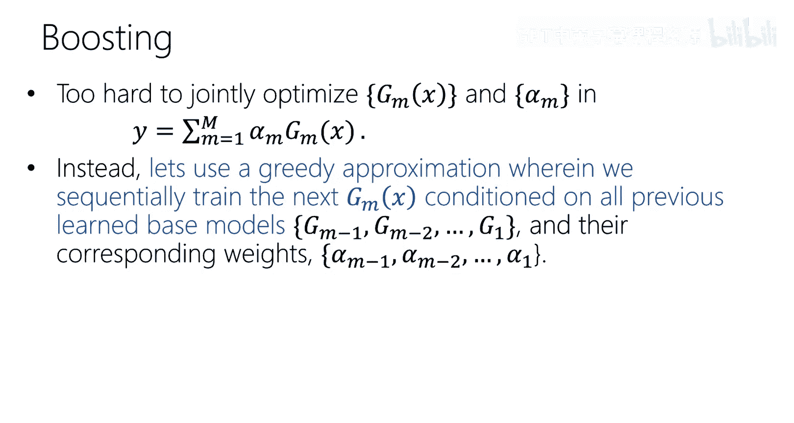

# UCB《机器学习导论｜CS 189⧸289A Introduction to Machine Learning Fall2024》claude-3.5 p17 L17-  Decision Trees & Ensembling.zh_en -BV1H4421S7bs_p17-

Not joke。I do。The slides from the pre lectureors。I don't know if it's possible to do it。

But if someone is not。Need their laptop， I promise not to。WellThank you。

I tried giving you like because you don't have access to the PowerPoint， can you put your E？

Are you on？Okay， and then if this works， then I can use the PowerPoint and if not。

 I can just use the PDF。Thank you so much。That like。it has no。I see okay， and it's like。Okay， I mean。

 if you have the charger then if need be， you can just grab it， right？是ね。Thanks。I don't know which。

Do you know what audio or input cable at？快点。What does it need to chart it and have a mask？

ItsIt's not anything here right that home help you Oh desert， do you want to try it， is it this？全死。

Hello。And then this goes here。

Oh and you have the PowerPoint file？Is it in Towerpoint also？

I just realized I don't know how to use a max。 so how do I start the presentation more email。

Oh present Oh my God， thank you so much Oh my God， you saved my life， What's your name， Kevin Kevin。

 which are you want？Okay， all right， well what's your last name I've got a store a good comma for you。

How do you spell it？I you。Okay， got it， It's a bunch of Kevin Yang's who publish in my field。

 but I don't know why Kevin Yang Y。So I wonder though what's going on， it's not showing up。 Oh。

 there's something weird happening now。Because there're usually like a weight， like on mine。

 it automatically goes。A person should of display toggle that might。But we're still call the AV。

And yeah， it seems like it's snugly。My Mr face。うまもいっぱい。まるす。那べを。Oh， sorry。

 you had it nice pulled it out let me put it back in， oh， mirror extend。

It's weird because they can see Safari， like it just seems like it's showing them like not showing the application。

ありいです。緒に。Yeah。Well， you're doing that。Does anyone have a Windows laptop we could borrow to give the lecture。

 he has the slides， but it's not displaying， and I know my Windows laptop works。Ooh， that。

 I see a candidate， no。Okay。There's a charging cable here that might help as well。おすげす。

It's displaying Safari， but it won't display the PowerPoint， so it's like。

Oh but now it's actually mirrored， so that's good。

I'm going to call AD and at worst they can help us。

If nothing else shows up， let me just get the phone number。

And maybe we can just keep going with it to city。

腰も直す。

ButThat suddenly works。Oh， I think it's something work。Wai no that。Hi。

 I'm having in trouble with the A。呃。What hole is this cool。 This is Do you know the name of all？

Past 25，9529，5，295。Oh， I think we just got it to work actually so we're in business yeah thank you。

Okay， thanks bud。Thank you so much， so much so much。

あ。Okay I've never had to borrow a computer before， thank you to Kevin for savingming the lecture。um。

So today we're going to go through a completely different kind of modeling approach than we've gone through before。

Hello everyone， we're going to start lecture。Yo， we're starting lecture， hello， hello。

 we're starting， thanks。Okay so today we're going to do a completely different kind of modeling that's called decision trees and I know there's a lot of hype around neural networks。

 not just hype， there's a lot of success around neural networks but I'm going to motivate why we're doing these kind of out what might seem like outdated models called decision trees and actually nobody uses decision trees very rarely they use them by themselves they use them inside of something called an ensemble approach which refers to combining several models in machine learning and I apologize but there is no textbook chapter on this because the textbooks on deep learning but we want to cover this because it's a pretty important topic。

So right so far we've heard about linear regression， logistic regression。

 classcondal Gaussians and neural networks and so today the kind of intuition is sort of also never used a Mac before I feel a little okay guess we can't use the pointer I won't walk around as much today it's going be who knows the game like 20 question from near a kid yeah so like we're going to go into this but it's going to be like building a model that feels a bit like the game of 20 questions。

 but before we go into the model and think about it that way。

 who's heard of CaL so Cagle is like a big online competition site where actually and competition like real competitions with real data and real problems in the sense that like drug companies might host a competition that there's a paid prize for and they have a problem they care about and so there's a lot of people trying to win these competitions and so sometimes it can be useful to just scan what's going on in CaL to get a sense of what kind of models 10。

to work in the hands of people that have like time pressure and motivation to like get a prize and so you said my slide before only went up to 2016 and machine learning has changed so much since then so I found something' this is the most recent I could find and these people in the link down here they basically I don't know where they got this but I guess from the Ca site they pulled down what they called the and again I don't know how they picked this because I'm pretty sure there's more competitions than what I'm showing here。

 but they pulled out like different competitions and how many teams there were the data type and which will be important from my point so this is text this is single cellll multiomics data this is images the machine learning problem class was it a regression problem was it a classification problem。

You can see my yeah okay and then here what this is where it gets interesting is what's the winning one what model was winning and some of these I can't even parse like I don't know what all of this this looks like some crazy thing this says neural networks custom architecture neural networks so let me go and I had to split this chart up into multiple pages so this is the first three lines and then we keep going and the ones I want to highlight is every time you see the data type is tabular and the problem kind is classification every single time you see the decision trees are the winner and this is in the era of neural networks already having huge success So this is one example I don't know what it is and you could go click on it American Express something here's another one fourqua tabular data again。

 there's a gradient boosted decision trees which I'm going to touch on briefly at the end of the lecture。

Here's two more so every single entry that has tabular the winner involves decision trees often in a great in fact probably the most common one is what's called these gradient boosted decision trees which is a form to take several decision trees and put them together to ensemble them and boosting is a type of ensemmbling that I'll touch on but most of the lecture is going to be on the core elements of the decision tree and then i'll go through a little bit more conceptually how we can combine them together at the end of the lecture and so we may be asking like what is tabular data it's sort of the same thing as categorical data although tabular we often think of having multiple categorical variables so here each entry is like a sample that I'm going to train on an instance and then each column is a feature and so this is tabular in the sense that it's like some dump from a company and it's kind of just text in there right and some of these are。

Like right so this， I don't know how many classes there are。

 but it's just categorical right there's nothing inherently numeric here and so it turns out the decision trees are really good for tabular data。

AndHowever， if you have images or language or speech， you probably want to just use a neural network。

So this is definitely not for that and so you'll understand why as I go through the lecture but some of the nice aspects of decision trees is that you don't have to like do all this hyperparameter toning and you can do it but if you just use the default settings in psK learn it actually works really well we once with a colleague we spent a lot of time getting through hyperparameters and ended up on the default parameters actually and and what happens also with these sort of categorical features is it just natively handles them if you wanted to give categorical features to a neural network you would have to one hot encode them which is a little bit strange perhaps and not necessarily the right way to go and as you'll see also at least a single tree is a highly interpretable model and the neural network has none of these properties and in a few pages all have some red points down here about what are some of the issues and with these models as well。

But right so these models are really you can think of them as something like a game of 20 questions so if you don't know this game。

 it's like you probably if you do know it， you probably played it on some long boring car ride with your friends or your family when you were like 10 years old and so one person like thinks of an object and then the question and then everybody gets a yes no question a series of questions up to some number or you get super bored you could just limit it to 20 and you have to try to see if you can guess what the object is just what those yes no question so maybe someone has a pomegranate in mind and first you don't know as you say is this thing like alive is it dead。

 can I eat it， can I not eat it and things like this and so that you could imagine that you might be able to build a model using this kind of thinking but also it's not quite clear how if I let you sit with this for a minute you're probably like how is this going to work how would I actually have a classifier and run a sample through that classifier how would I train？

Such a model。And so that's exactly what we're going to go through but I took the power cable out。

Hopefully， that doesn't make it go away。m so scared， okay。So right， so this is a oh note。Wow。

 it went away on one screen。 Okay， that's super weird。 Oh no， oh， interesting。 Okay。

 you can't do both。 That's the key。 Okay， hopefully the power lasts。Oh， my gosh。Oh my gosh。Go back。

 go back， all right， it's going back。Al right， I might have to take really fast today or switch to another computer。

 So you have the charging cable， though。 Where's Kevin。 yeah， I don't think it's urgent。

 but maybe you could maybe you can get it ready。 And if this or maybe we can just use it。

 But so right the idea is that I'm gonna have this categorical set of variables that take on many values。

 they could be binary， they could be K， like they could have arbitrarily high number of choices。

 And then I'm gonna have like some binary classification。😊。

Task and the goal is going to be to and we're going to use this as a running example here。

 this is about classifying the miles per gallon of different cars oh thank you so much there's a plug right there。

And hopefully that doesn't。Disturb the whole。Hopefully the display doesn't go away oh maybe I had to do it there okay thank you thank you thank you awesome right and so we want to use these features to predict miles per gallon and you can actually use real values as features as well but as I mentioned like the real power is that they really naturally handle tabular data and if you use real features which will very briefly mentioned you kind of have to make them look almost like categorical data to get them into the decision tree whereas categorical data with a neural network you have to make it look like numeric data。

So right so this is going to be this running example where the cars have a number of cylinders。

 I don't know what displacement is， they have a horsepower， a weight an acceleration。

 a range of the model year and the country of the maker。

Hopefully there's not a political statement in here I never looked okay so basically there's a hypothesis class that decision trees represent and just like regression or logistic regression or a neural network they're going to take it's going to be a function class and we're going to map from input features X output features Y and and this is the basic setup is you're going to keep splitting on one feature in a hierarchical manner and one of the really challenging parts that we're going to go into in quite some details how to pick which feature to put first in the tree and then as you recurse and go down to put second in the tree and third like because you don't want to just pick those at random you want somehow to pick the most informative one first and then having picked that pick sort of the second most informative one and in fact we're going to have to use a greedy approach here it's not going to be a provably optimal tree but the idea is you're going to basically take an example like imagine we've built this is an instance of a decision tree the way。

Would use the tree is we would take an example so one of these lines here and suppose we want to make a classification from its features。

 we take that whole line and we hit the top node and we go look up how many cylinders it has it has four cylinders so we follow the branch four cylinders and come down here and by following this it tells us that having a car with four cylinders the next thing we need to look at is the maker of the car the country of the maker is it as-am Americanican European whereas if we had an example like which one。

 the fourth example had eight cylinders， if we chosen that example to make a prediction for we would have followed this path and the next question we would have asked would not be what is the maker it would have been what's the horsepower and so basically each example is going to traverse the tree down to a leaf node and the leaf node will tell you what prediction to make and what you'll notice here is there's some leaf nodes up here So if you had five cylinders you immediately get a prediction you don't have to look at anything else however if you。

F or eight cylinders， and we'll come to understand why that is。

 then you have to keep looking at more data。😡，More features and so you look at the maker and then in that example what was it we started with four and the makers Asia。

 so we go down here and the prediction is good。And so that's sort of that's the basic idea of the decision tree of how you would use it if you had already built it。

 and of course， we're machine learning people， So we want to know how to build this thing in a way that will generalize well。

 and we're gonna use a training data just like we always do。

 and we cannot use maximum likelihood here actually。

So we're going to use some ideas from information theory。

And right is there anything and this is often called like the root node。

 leaf nodes are any nodes that have no more splits after them that give you a decision。

 And so here this means if you arrived at the end of this leaf node。

 the prediction you get is good if you arrived at this leaf node your prediction is bad if you arrived at this leaf node your prediction is good and we'll see how that comes to be but intuitively what you're going to do in a way is imagine taking all the training data and pushing it down this tree。

 then whatever then imagine all the examples that fell down to this bucket。

 then you would take kind of the majority prediction for those in the training data but of course that requires still knowing the tree and I haven't told you how to build the tree。

So okay， that's like an overall summary and I'm going to unpack that slowly through the lecture。

So right I mentioned what this is I had on the previous slide and I said I'm going add some things。

 I meant to move this around。 Oh， I see you didn't download the latest latest version。 Okay。

 that's okay， I can come back to this because this doesn't make sense yet I upload it and then I re uploadload it so I'll skip that for now and I'll come back to it because it won't make sense just yet。

 But you may recall this idea of this decision boundary for 15 nearest neighbors versus one nearest neighbors and how the smoothness changes or what it's like for linear discriminant analysis Alice and so forth。

 So what is a decision boundary look like for a decision tree given this sort of completely different style of thinking about how we model things。

 So what it looks like is something like this So what's going on here。

 is sort of schematic of a data set that has just two features。

 X1 and X2 that are both real valued in this case。I guess these ones are real value so when you have a real value。

 you have to just decide what values to split on， whereas when it's categorical that comes for free。

 just for free， like is it Asian， European American， those are your categories。

 if you have a real value range you have to decide where to put the real value split in the data and so this example has these real valued splits。

So the partitions are going to be axis aligned and that's because every time we're just splitting on one feature right so in this case the first split I made is I know is the line that spans the whole feature space so it's this big black one so the first thing I did was I split on feature X1 at this value and then I partitioned all the data into a subnode here and a subnode here and again this will make sense as we go more and more into the details and then。

And it's also piecewise static， so what's shown here are the signs。

 the plus and minuses of the training data， but in this example if this was the partition after I guess there'd be one split two split and then you'd recurse three split and four split you'd have to have recursed four times to get this piecewise boundary here and the prediction you'll make will just always be the majority class。

 so even though there's a green plus here， the prediction here would always be a minus because most of the training examples that got here or a minus and so that's the sense in which it's piecewise static is everything in that box。

 everything in any of these boxes always gets the same prediction and you can see how accurate that would be on the training data because they're not actually uniformly always read or green in this case。

And so as a consequence of the fact that they have to be access aligned and so write again you like draw a division and then as you go down the tree one way or the other you just split up the space more and more recursively but as a consequence of this if you had a set of data like this we know that logistic regression has a linear decision boundary and so it would be trivial to find that if you had these features that are plotted here。

 these are the two features on the two axes however if you had a decision tree。

 you'd have to like throw in these kind of wacko axis aligned divisions by splitting on the data and what would happen is the decision boundary and the piecewise static areas would look like this and so you kind of have like a lot more decision boundary and it's like kind of weirdly complex for what's a really simple problem and then just to kind of drive home that point here's kind of an enlarged version of that is logistic regression would be able to just pick up this line with a linear decision boundary double。

UX+。pl the bias whereas what the decision tree would have to do would be like you got to split here。

 you' got to split here， split here， split here， split here。

 split here split all these splits and it's going to need to do that over and over and the decision boundary if you think about it like sort as how much real estate is along the total sum of the decision boundary to cover the same space it has like vastly more wgggly and this is the kind of thing that in previous lectures we gave you the intuition that this is almost like weirdly overfitting it's not overfitting here it's just a constraint of the decision treee boundary but in fact because it does this it can be prone to overfitting and so one has to be careful with these and so despite I'm going mention a lot of these cons but as I said in the very beginning lecture these are extremely powerful models used on real problems that are often just super easy to use out of the box。

And so because of this kind of like wasted boundary issue that you may be caused to you might have to incur。

 they may not kind of in some sense get the most bang for the buck out of the data。

 so you typically want to have quite a bit of data。

 on the other hand nowadays with neural networks you also want a lot of data。

 but the nonlinearity they provide by throwing these decision boundaries in recursively can be extremely powerful。

Oh okay here it is again， I guess I just scroll off to delete it so right so what are some of the cons。

 these were the pros and some of the cons are that you don't have the smoothness in the decision boundary and you can have difficulty capturing additive signal when it's there well I guess that's for regression so like sorry that should say a linear decision boundary would be the analogy and also these can be quite unstable if you're not careful so if you grow a big decision tree and you perturb the data a little bit you might get a completely different decision tree that makes quite different predictions on a test set it's not likely would make very different predictions on the training set but it could make very different predictions on the test set。

And that's a little scary， butre we're going to get around that。

 And so what does a real decision tree look like， It makes like a huge number of splits。

 And this is actually probably a relatively small decision tree。 for a real example。

 This is another biology example from my friend Eong。I won't go into。

 but you can follow this source if you want to。Right，So that's the beginning of decision trees。

 and so you might think like how many- what is the model space of this class。

 what kind of functions can we represent， is if we have tabular data or even if we don't。

 is there any function that a decision tree cannot represent？

Like how general a class is is that's maybe what you're starting to think to yourself So it turns out that if you make that tree big enough and you split enough times like you can kind of split everything perfectly until you construct like a truth table in a sense。

 so you can capture any function if you make that tree arbitrarily large but because it's arbitrarily large。

 it's going to be sort of exponential in the number of features in the data and that's not a great thing。

And so if you had a booleium function， then the path from the root to the leaf would give you a truth table。

And' that's shown。Here so the decision in each case for each feature is boolean and the outcome is booolean。

 and so as you follow the path you can literally just expand it enough to define an entire truth table and we know a truth table is not constrained。

 so for a boolean function you can represent anything and in fact it's true beyond that as well。

So you may also ask well， what if I mentioned that if you just pertuurbed the training data。

 you might get a very different tree， and in fact， even with the same。Training data。

 there may be several data sets that are sorry， there may be several trees that are consistent with that data set as well。

 not just even one unique one and so there's this question of how will we choose that one。

And so before we kind of， I think once we understand how we're going to build them。

 then we'll have a better understanding of how to think about these questions。Okay。

 so and I've already kind of cded you with the idea that this is going to be a greedy process and we're going to do recursion and so right so what you think。

 what's the absolute simplest tree that you could possibly create， it would be， you know what。

 I'm not even going to look at the data。The second simplest tree is going to be I'm going to look at one feature and the next simplest tree is I'm going allow myself to look at two features。

 but in the case where it's the absolute simplest tree and I don't look at anything on this particular running example here of predicting miles per gallon that you would just have something that says pick the most dominant class and so in the training data irrespective of any features 22 of them have good miles per gallon and 18 of them have bad miles per gallon and don't worry about this pech I borrow these slides from somebody and it appears I'll make reference to it later but you don't need to know really for most of the lecture what it means。

呃。And right and so is it like you could say， well what's the accuracy Well if you call all and then you're gonna call them all whatever the dominant one is 22 so you'll get 22 right and you'll get 18 wrong obviously this is not a useful model it's just majority rules so the next simplest tree as I said is I'm allowed to look at one feature And so in these diagrams。

 they put this root here。 normally you wouldn't actually put this in the diagram you would just put the first thing that you split on as I showed you before。

 but in this case they're trying to just build up this intuition， but in this case。

 you might scan through each of the features which are cylinder displacement horsepower weight acceleration model you maker and we're going to learn how you pick one of those to put as the next thing to look at the next feature to look at and then you basically have a branch for every value that it takes on。

And so you don't see a branch for cylinders equal7 because there's nothing in the training data that had cylinders equals  seven。

 so it's literally just defined by the training data。

And you can see how that might be a problem in that if you had a test one that had or maybe I see maybe cars don't have seven cylinders maybe that's does anyone know never occurred to me either cars don't ever have seven cylinders or it's not in the training data and so in this case we call this a decision st is pick one feature and split on that feature so now if I take all the training data and I put all the ones that have cylinder 3 into this box and it's not all here。

 but you can just kind of trust me in this running example then actually oh no it turns out there's zero of them here so nothing's correctly classified and nothing's incorrectly classified because none of the training data fell into this bucket in this bucket there were 21 examples that had cylinder is equal to4 and so we're going to oh the blue and red I always get screwed up red is good and blue is bad it's like very counterintuitive So here the majority class are the good red 17 So anything that falls into this class if we use just。

This decision stump as a model would get a prediction of red， which is good。

 and therefore four of them would get misclassified。

And so on and so forth and so you can kind of already imagine now that if I'm trying to pick which feature to split on for a decision stump。

 I probably care something maybe about the accuracy。

 find a feature that somehow gives me the best classification accuracy。

 it's not actually what we're going to do， but it's a good way to start thinking about it。actually。

 I think this answered my question。 So I had a hypothesis that there were no seven cylinders in the data because it didn't appear。

 But now， because I can see that there were no with three and it does appear。

 it must be the case the cars don't have seven cylinders。😀Yeah。😊，Yeah， I mean。

 that's my power of deduction in the moment， if someone can find a car with seven cylinders。

 let me know。Okay right so and then what we're going to do is now we're going to take for each of these boxes。

 this one had no data so it won't count but we're going to take each of these all the data that fell into each of these boxes。

 so in this case the brown represents sort of visually all the ones that had training data that had cylinders4。

 the green that had cylinders5 and so on and so forth and then。We're going to recurse。

 so we're going to take just these records that had cylinders of equal to4 and then we're going to find the next best feature to split on given but only using that subset of the data and so as we go down and make increasingly deeper decisions about what feature to use we're going to make those decisions with less and less data and we might want to at some point we'll have to think about do we have enough data to keep going or not。

Right so and that's the sense in which we're going to do recursion。So in this case。

 what's going to happen just in this Iranian example we first picked the cylinders to split on and now there's no data here so I'm not going to keep going with this node。

 this has some data in it and so I'm going to take all 21 examples 4 plus 17 that fell into this box and I'm going to use this way to choose the next best feature that we're going to go into in just a moment to say you know what the next best feature I should use is the maker and then I'm going to on just those 21 examples create a box and hopefully these numbers should add up to 21 so 10 plus7 plus4 is 21 so yeah that's a sanity check so this is now saying you know what maker is going to be the next most useful feature to help get me to a good leaf in the tree that we give me a good prediction and I can also do it with this node and in a bit later I'm we're going to discuss you may intuitively understand why I don't expand these nodes and I only expand these but we're going to go through those rules a little bit more clearly in just a second。

Okay， and so this is the full tree where。Actually。Each leaf。

Has either one example or it's unexpandable。 unexpandable means that。

That there's no more features I can use to split on because all the features for the examples in my box have a constant value。

 so they literally can't split on anything。RightSo that's a full tree and as you might imagine。

 we probably don't want to build a full tree because that's kind of just like building a truth table and we want this thing to be able to generalize。

 but in principle you can build a full tree and we'll talk about how not to build a full tree a bit later。

this is like fully expanded out according to an algorithm that we're about to get into。

 but and just to highlight this idea that there could be for this imagine this boolean function。

 it says the binary value of this boolean function is A and B or not A and C and so you could have two different trees that exactly represent that truth table。

 meaning if you had the data from this function and adhere to it exactly。

 you could use this tree or you could use this tree and they would both classify all of the examples in the data set perfectly and so does anyone have a preference for which which one would you use if you had a data set and someone told you here are two trees and they both perfectly fit my training data。

Yeah。And why would you use the first one？Yeah you have to ask fewer questions exactly and so there's this notion of like simplicity in modeling and it's not always true。

 Moern-day neural networks have turned this a bit on its head。

 but in most classical approaches or probably all classical approaches that are not neural networks。

 there's this notion of the simplicity is better and it's often referred to as this thing called Aham's Raor。

 Aham English Franciscan Far William of Oham and basically the idea and this is like kind of a philosophy long before machine learning this applies to just the natural sciences and so forth。

 if you're trying to explain the stars in the sky and you have a complex system of spheres rather than a few physical laws。

 probably the physical laws which are the simpler explanation will be the more likely to be the true like causal mechanism we kind of closer to it。

 and we often use this type of thinking in machine learning to say that the more kind of parsimonious or the smaller a model is according to some。

And here that could be how many nodes we split on or the kind of average path length or something like this。

 the more likely it is to not have overfi the data by just making a whole series of kind of crazy decisions。

And so right， so one way to think about that is that a short model is unlikely to have fit the training data well by chance alone right。

 whereas if you have a really big model there's like many ways you could fit the data kind of almost by accident。

So learning the simplest， smallest model for a training dataset is an NP complete problem。

 I think like intuitively it's easy to understand why because you'd have to basically consider every possible combination like there's not provable like there's no dynamic programming trick or anything like that you can do here you would have to kind of enumerate all possible trees and so we can't do that and so we're going to resort to a greedy heuristic and which I've already kind of against he to do it is we're going to start with like no tree and then we're going to split on one feature having split on that we're going to keep recursing in this sort of greedy manner and as I pointed out in the main lecture this does work very well in practice。

And so right the key that I keep alluding to here is this idea of how do we pick the next best feature sometimes called the next best attribute and like what does that mean and this is a little bit on the one hand it gets presented as sort of very mathematical based in information theory and if I just like presented it to you。

 you might think that this was provably optimal， it's not provably optimal it's something that works well in practice and people have some math around it to support various ways to reason about it。

 but it's not provably optimal at the end of the day we have a greedy heuristic and it's not even provably the best greedy heuristic but it is the one that almost everyone uses I'm going to present the main one which is called information gain。

 there are some variations that other people use as well but this is probably the most common one and they don't tend to behave very differently anyway。

So and so right this what we're going to focus on now in the lecture is to get into this idea of what measure or like score are we going to use to decide whether to split on x1 first versus x2 first and so this would be an example of splitting on x1 first when I split on x1 first I say that。

I take all the ones that are true in the training data for x1 that's these four here and I look at the majority class for those and it's true and then I say anything that goes down this path has to get a label of true and four of those are correct and there are no incorrect ones and of the ones that are false which are down here they mostly the dominant class is false so that would be the prediction here and one of those is actually going to be wrong so this had an x1 that was future equal to false but actually was true and y so you get one error there and here you're going to get。

诶。One error and two errors。 you're gonna actually get more errors here。

 And so you might start thinking like maybe I should think about the misclassification rate and I've seen people do that but if you go go grab it's not a good idea I'll explain a bit more why in a second it's a little bit handwaavy。

 but I think it makes sense and if you go grab just I don't even know if you could do that in likesK learn or something I'm not sure if they even implement that because it's not considered to be the right thing to do So what is the right thing to do the way to kind of think about decision trees is what we want is at the end of the procedure of growing the tree。

 we want the leaf nodes to be very pure in the sense that we want only one class to exist in that node and the reason we want only one class to exist in that node is they're going get the prediction of the dominant class and if there's only like if there's a pure node where only one class exists then they will all get the correct label。

And so there's this idea of sometimes we call it impurity or purity。

 we want to keep reducing the impurity at each node of the data。

 and or the other way around is we wanted it to get more pure and more pureer so that the leaves have just one class in them。

And so the more kind of pure a node or feature is the less surprised we will be to find a misclassified example there or sorry more surprise that's a typo。

 the more pure it is the more surprise we'd be to find a misclassified example and the less pure it is。

 meaning that you have different classes in that node but are required to make a majority prediction then you're not going to be that surprise to find misclassified examples。

 And so it turns out I know you've heard a little bit about entropy and cross entropy now and I'm going to kind of go through a particular view of entropy that's helpful for decision trees。

 So there's a deep connection between the intuition of surprise and andizing minimizing surprise at seeing a misclassified example and minimizing the entropy of a related distribution to this problem and so。

Really one of the problems with using classification is it's not very nuanced。

 like classification requires you to make a hard classification and the approach we're going to use it's going to be sort of a softer approach that makes better use of the data。

Okay， so let's just talk a little bit about entropy and in a few slides we'll work our way towards this sort of very famous concept in decision trees called information gain。

 and the idea is we're going to choose the feature which provides the largest information gain。

And the feature that provides the largest information gain is going to be turned out to be equivalent to the feature that minimizes the conditional entropy and to get to the conditional entropy let's just talk about the entropy again and how that's related to the idea of surprise so if you think about flipping a coin and I ask you how surprised would you be at scene ahead how surprised you are will depend on how fair the coin is so if I tell you it's a fair coin and I say。

 look I flipped it once and I saw a ahead how surprised are you you're going to be like I'm not very surprised this is kind of very likely however if I told you this head was this coin was very biased and the probability of this coin was only one in1 hundred that there was heads and I flipped it once and I saw a head would be like quite surprised and so that's this notion of the entropy of the distribution is like how surprised would you be and if I told you the probability was biased to always show a ahead and I flipped the coin and said and saw a ahead and I would ask。

How surprised are you， you'd be like， I'm not surprised you just told me it always flips heads and similarly with probability of a head equal to zero。

 and so entropy is actually a measure of expected surprise。😊。

So the surprise of observing that a discrete random variable Y takes on value K is really just kind of be inversely proportional to its probability。

 So I've added like logs in here compared to the intuition before。

 but this is because this is how information there's many ways to get at the intuition and derirogvations of information theory and I'm giving you one intuition here。

 but so the surprise that it takes on is like 1 over right so if the probability of heads was equal to 09。

 then  one over。9 and the log of that just to be given extreme case can I do that one over log of one is 0 Yeah so in the case where it's biased and probably of heads is1 then I have one over。

Probability of one。 And I get log of 0。 So I'm not at all surprised。

 And then I can just write this as minus log P。So that's the surprise and as that's not yet the expected surprise that's just the surprise at seeing one observation and then just to hammer this home right is the probability goes to zero of seeing heads then the surprise of observing it approaches infinity and as the probability of seen heads goes to one。

 the surprise of observing heads goes to zero and the entropy of a distribution of this random variable rather than just the surprise at one observation。

 the entropy is the expectation over all possible observation。

 so the entropy of random variable y is the expectation of minus the log probability。

 you've seen this definition before but it gives you a different intuition that's useful for thinking about why we use it for decision trees。

Because we want to end up with these pure nodes that contain one class and pure nodes in a pure node。

 we want to have very low entropy because we don't want to be surprised。

And just an example here to hammer home， this is an example where the probability of flipping a coin it's bias to 5。

 six as well I guess it says flipping a coin， but so let's say this is heads is five， six。

 tails is one，6， and so the entropy will be the average over all possible observations。

 all possible observations are heads， green tails red， so I just take。

The probability of that observation being 56 is 56 and then I take times the log of that probability like this and so that's basically the surprise at' seen head and this is the surprise at seeing a tail and then I add them together and that gives me the entropy in this plot you get a good intuition here which is I think your intuition should tell you that when the probability of heads is 0。

5 my surprise overall my expected surprise like when I flip a coin just whatever it is I should not be very surprised because 0。

5 is kind of the closest to uniform or it's like it's evenly split and as I switch the probability of heads either towards zero or towards one it's symmetric in that my surprise becomes higher and higher in expectation。

So right，And mean if you think of distributions more generally， I mean。

 this is the concept that comes in and you've seen it probably in your homeworks already in other places。

 but high entropy distributions tend to spread out their mass over the whole space。

 whereas lower entropy ones have massed just at fewer points。Okay。

 so the idea here is to use some ideas around surprise and entropy to pick which feature we're going to split on next。

And so in the training data， there is we could compute the entropy of the labels， right。

 the training data that's given to us， there is some entropy of the labels and it is what it is and there's nothing we can change about that so we're not going to do anything that change the entropy of Y。

 but we're going to do is we're going to choose x's that control the entropy of y given x and so we're going to pick x's that decrease the entropy。

And decrease the surprise basically， after splitting on features X。

 and so we're going to always pick x's that help us to reduce the surprise where the surprise gets defined as this notion of entropy or here a conditional entropy。

And then the goal is going to be to keep recursing to pick the next best feature as we go down and create more and more of the tree to always reduce the conditional entropy until the expected surprise at a leaf node is zero in the simplest case。

So what is， what is expect sorry， What is conditional entropy。 So it like， it's very， very similar。

 I just showed you what entropy is， right， So， and oh actually， I dot have it on this slide。 Yes。

 I guess， right So entropy was just。Where did it go This is the definition of entropy of random variable Y it's just some over all values that y can take on probability of that value times log of that value and with a minus and now for the。

The conditional entropy， I'm just basically I just separated into all the conditions。

 whatever values the conditioning variable can take on。

 I will have a term for each of those here and for each of those so if this value imagine this valuess binary here。

 which it is so it either takes on a1 or0 then I set it equal to1 and I compute the entropy of y for all the values of x that had value to1 and then here I compute the entropy of y but only for all values of x that had a zero。

 so I'm kind of partitioning the data according to that feature and then computing the entropy of the variable y just for that subset of the data and then I need to just weighted by how frequently that feature appears in the data set so this is the conditional entropy and this is going to be the kind of core beast that we use。

And again， here's another example where I have like a truth table and I can ask what's the conditional entropy of y given x1。

 and I'm going to actually do this for every possible feature and then pick the one that gives me the lowest conditional entropy and so here for x1。

 the probability of a t is 46 of false is 26。And。嗯。That' story， that's just being counted。

 this story is I guess this is the data here and if I were to split on x1 in this data。

 the number that's this column here， then the number of things that have a true is four and the number and the number of those that have assigned a target label of false is zero。

 whereas the number of things that have a false is two and one of them gets a true which is here and one of them gets a false which is here and from this I can also just read off that the probability of this sorry I don't need this to do that。

 but so from this table， if I canstruct a little decision done from x1 it looks like this。

And more to compute the conditional entropy I need to know these probabilities so I can just compute that from the table here right so there's one。

2，3，4，5，6 rows and four of them are true so four out of six is the probability of this and therefore the balances in the two out of six and so given all of these things I can now say well actually all I really needed was this and what I'm doing is computing the conditional entropy according to splitting in this kind of a way so this computation conceptually applies to considering that I will split on x1 and then I will consider x2 and so on and so forth but so to get the conditional entropy I just look at the v p of x minus4 that's how often this feature happens and then I take the entropy of the y of y for only those examples so that's the entropy among these four boxes which all are TtTT。

So because they're all tea。The entropy， right， the entropy of y here。

 the probability of y here to compute the entropy is just one for true。

 which appears here and zero for false because they all have the same label。

And I can do a similar computation here， so this is I mean this is mostly just so when you go back。

 you can look at an example just to make sure you understand it。嗯。

And so the goal is we want to recursively pick features to split on。

 which each time minimize the conditional entropy and the conditional entropy of the target variable like miles per gallon given the feature that we're considering。

And when we do that， we're minimizing the sort of surprise of seeing and misclassification and the idea is that if we heuristically greedily build up this tree。

 that by the time we get to a leaf， we will have a node that is pure。

So but when you read books or you hear other people talk about it。

 they don't usually talk about minimizing the conditional entropy what they usually talk about is the maximizing the information game sometimes called the mutual information so and you'll see it notated notationally is an I。

 this is the information gain notation and all it's saying is this was the so an information here is basically entroies。

 this is like the entropy I started with before I split on any feature and as I said that's just defined by the training data so it's a constant and then you want to know how much information you gained by splitting on feature X then you compute the conditional entropy and you subtract the two and that sort of gives this notion of how much did I gain by splitting on X because it tells you how much I reduce the entropy in Y。

It's also a notion of how much how much did I reduce the surprise？And because this is a constant。

 oops because this is a constant， can just I can instead of minimizing the conditional entropy。

 I can maximize the mutual information and so those are exactly equivalent heuristics。

 you will get exactly the same answer， it's just different way to write it out and this constant drops out。

And so yeah， learning here obviously is a very different feel from everything else we've done right I think in every other model in this class。

 we have always written down a likelihood and then set the gradient to zero and if we were being careful we would check the second order conditions and there's no notion of that here is this lies in a completely different part of machine learning space and so。

😊，Again， we're the overall now way to construct is to start from an empty decision tree。

 use the criterion I just described， try every possible feature that you sometimes depends how you set it up。

 there's many variations and depends exactly what kind of data you have but if you have binary data you may say I can only use each feature wants。

 so maybe you scan through in the first step all possible features compute how much each feature would increase the information gain or decrease the surprise of having a misclassification and would use and then you would pick that feature and you would draw a branch for each possible value that it takes and then you would recurse and keep going。

So if we go back to this running example of miles per gallon。

 we would compute information gain for every possible split at every node。

I guess is for every node and then the node constitutes a split the language here is a bit confusing right so you can see that either I can consider cylinders and I'm going to find the conditional entropy over all these values each of these values will be one of the conditions and the conditional entropy and then from the conditional entropy I can get the information gain or the conditional entropy either way and so in this case that's I would compute apparently I would compute 0。

50 then I would try again for this feature and I would see the information gains 0。

22 again for the horsepower and so on and so forth and so after I've done that。I would pick the one。

That is highest。 And yeah， so as I said， there's always like different ways you can do it。

 So for categorical features in what I've been showing you so far。

 the split just has split it into all possible values。

 but you could also instead split one versus all and then do that many Allow yourself to do that many times。

 So there's a bunch of variations。 But I think for this lecture。

 it's easiest to just think all just pick all the values to split on。

 But keep in mind that you can make a bunch of different decisions beyond some of the ones I'm telling you here。

And if you had a real value， then you would just pick as I said。

 you would pick a threshold and why would you have a decision tree and if you had real values。

 you would do it because you probably have a bunch of tab of categorical variables like imagine many。

 many categorical variables and a few real valued ones and want and very categor competition or solve a real problem then you may want to use the decision tree and you need to figure out how to use the real value features and so basically imagine like age was a feature so like you have a bunch of people that lie between 20 and 80 then you can just say I'm going to what you do is you can consider every possible split and each split will have its own information gain and then you could take the highest one。

So split like between you know 20 and the other like split above 20， split above 21。

 split above 22 and so on and so forth。So。So where have we gotten we now know that we're going to use a greedy heuristic because this is an NP complete problem to recursively build a tree and we've argued thats we want this notion of kind of purity and that a good score for getting a purity as we increasingly add more nodes that to split on is this idea of using the information gain what we also pointed out earlier that if I fully expand the tree then I'm just essentially memorizing the data and so I don't want to necessarily fully expand the tree。

 I'm going to want to have to stop at some point so that I have a tree that's generalizable but also I just won't always be able to split the tree either and so let's consider various of these of scenarios so since this is a recursive model I have a base case where and then I keep recursing and then I need to stop the recursion so if I get something like this where all the predicted。

Values are identical so in this case all the examples that had a cylinder of six all had bad miles per gallon and so there's no need for me to split on any more features because I can't have higher purity than this this is as pure as it gets I'm going to use the dominant class as the predictive model so the dominant prediction will be bad and all the training examples that fell in here will have bad so I can't do better than kind of perfect and so that's。

That's why I would not recurse on this one， I'll just predict bad and I'm done。Bm。

A second example of why we might not split， which is written here as unexpandable。

 which I used the word before would be， so in this case it's not， I don't have a pure node。

 I would like a pure node and I hope that my heuristic gives me pure nodes。

 but in this case I can't expand because。All the features here， and I don't know if it's obvious。

 let's see so what features have been used so I've used acceleration， these horsepower， maker。

 cylinder rope， cylinder， what else， what have I not used？I think displacement Well， in any case。

 the idea is that。I would like to keep going because I would like to make this a pure node where everything lies in one class or the other。

 but if the features that I have left to use or simply don't allow me to split the data any better than I can now and so because they're all constant like I can't make a split so I'm just stuck I'm literally stuck because the rest of the features are constant so that's another time you would recurse and in this case again。

 any example that fell into this box， you would predict the majority class which in this case would be you would have to randomly flip a coin and the coin they flipped the same predict bad because it's a tie。

So we have these two base cases of when to stop recursing where it literally doesn't make sense because I have perfect purity or all my features are constant that I can use and I literally can't get any better purity than I already have。

So。So let's think of a third base case， which is if all the attributes I'm checking have zero information gain。

 then let's not recurse， like let's stop there。Does anybody think of if that's a good idea？

You think it's a good idea。 I kind of think it's a good idea too。 And again。

s everything's a little bit in the eye of the beholder here。Yeah。So why。

 why do you think it's a good idea。当时。That's right， but there's one catch to your statement。

 do you know what it is？yeah it's the greedy it's because we're stuck in a greedy heuristic so it is true that even and the classic example is like an Xor basically so in an Xor if you try to split on either variable you cannot reduce you cannot increase the information like you can't get information gain because just looking at one variable tells you nothing right you have to look at both the variables in an Xor and so that's sort of one of the failures of the current setup is you might need to actually push through if you want to handle things that have this kind of in nature you might have to say you know what I'm not going to stop my recursion when everybody has zero information gain but that's a choice you can make and I think what you said is like perfectly reasonable as well I don't think there's like a right answer here and people do it different ways but some people would argue that you want to be able to capture this kind of signal and so in fact we're not going to have that we're going to omit that base case so that we can pick up these things and then。

We're going do is we're going to end up now maybe a tree that we don't want all the nodes in it。

 perhaps maybe we do but if we don't then we can also go back and prune the tree so this is one of the techniques to like these trees are kind of unwieldy if you're not careful and can overfit and so forth so we have this core way to build it and then we're going to try to clamp it down in different ways to kind of make it less prone to overfitting and one way to do that is to actually just kind of start after you've built the whole tree to go back and kind of look at each node and do something like ask what the classification rate there is and put a threshold on it or you can do a statistical test on what amounts to the confusion matrix at that node。

 something like a chi square test or you can just look holdout performance as you include or delete various nodes in some sort of backward greedy fashion and again this is like a it's all a little bit heuristic at the end of the day because it was greedy forward and now maybe I'm doing some greedy backward pruning or things like this。

But that is， in fact， what people do。Although I should say in my life I've used decision trees many years ago before。

 long before Jennifer Doud and I got the Nobel Prize on CRISPR for a collaboration in Boston and we found decision trees worked the best and we never used any pruning and we did all kinds of hyperparameter searches in the default was best。

 we actually used gradient boosted decision trees which we'll get to。Right。

 so the summary here then is that you're going to have this sort of like pseudocode of build tree given a data set X and a data set Y。

 and what you're going to say is and then you're going to recurse on that you can see it appears down here on some subset of the data and so if all the output values are the same in the data that means that node is pure that's one that was the base case1 then you're just going to always predict that value and you stop your recursion in building the tree and that will be a leaf node there。

And if all input values are the same， then you're in base case2 because you can't split on anything。

 you've been given these features X to examine to split on， but since they're all the same。

 you can't literally do anything， so that's base case two of stopping。

 and if you're not if you get past those two base cases。

 then use this process of scan through every feature in X that and pick the one with the highest information gain。

 and that's the one you split on next。And if that one feature that you decide to split on has this many distinct values。

 then you can， again， there's different ways to do this。

 but the sort of standard way would be to create a non-leaf node for each of those values which would become its children and now then that's where you recur again is on each of those values and now remember each of these children here。

 it only gets some of the data I was given in this call a build tree because only some of them have this value。

 so this is where it's like a kind of that's where it gets into the recursion as I say take only those data for that value of NX and then call build tree on those data and keep going and so every time you call build tree the amount of data you're giving it is going to be less and less because you're grabbing it from something that's been divided from a branch based on the value。

So I've already kind of said what can go wrong with this。

 but can anybody figure out what the fundamental flaw is here。I mean I already said it basically。

 if you follow this algorithm I mean so far it sounds great， but what haven't I've said it。

 but if you literally do this， then you're going to build essentially a full tree and it will keep going until the data are perfectly labeled or very close to perfectly labeled and that's basically tantamount to saying I'm going to keep using more and more like polynomial features in my logistic regression until I have this wacko like line that goes through every point and we don't want to do that so we want to somehow kind of use this overall algorithm but we don't want to let it like have too many too many wiggles。

 too much control and kind of memorize the data。So。These trees， like the way we've built them。

 they have no learning bias and the training error is I'm actually a little confused because it says zero which is what I always thought but one of those conditions。

 I might have to go back like in this particular base case， there is an error。

 so I need to go understand why these slides seem inconsistent to me。

 so sorry about that I don't think it can be zero， but I think it often can be zero and that even if it's not zero。

 it's going to be very close to have memorized the data。Oh， I see if there's no okay， thank you。

 I should just read my own slides， if there was no label noise。

 then you would get always zero training data， meaning like if you have the data that comes from the true causal distribution in a sense。

So if we want a useful model that will generalize to unseen test points。

 we need to do something to make these trees simpler and so this is like an idea of regularization but regularization like you got so used to thinking of regularization as like L2 and L1 and there's like I have my likelihood and then I add this other loss and then I run gradient descent but regularization is a concept and here it's going to look nothing like that so what does it mean to regularize your tree building it means for example just say you know what tree depth can't go past three。

Imagine you have like 100 features and you don't let the tree depth go past three。

 it's gonna be very hard to overfit， but maybe it shouldn't be three。

 maybe it should be5 and so this does become these are hyperparameters but as I mentioned for some reason the default hyperparameters tend to work really well。

 at least for gradient boosted decision trees again nobody really uses a pure decision tree the other thing you might say is I don't want to as I keep splitting and recursing I'm getting less and less data and it's like making me uncomfortable because I'm not sure I want to create a rule by splitting here when I've made that rule on the basis of like four data points so the other thing you might say is I want to make sure I have at least know100 data points at each node and if I don't I'm going to refuse to recurse there and in effect will' limit the depth as well but in a different way。

And as I mentioned， you can do this backward greedy pruning to also remove things from the tree。And。

Right， which is actually。Oh I see and then just other ways to stop in an early manner。

 so the same heuristics you use for backward greedy pruning。

 you could apply them when you're going forward and just stop if you'd think the mess classification rate's not good or the statistical test on the confusion matrix at that point isn't good。

 as you can see there's this like it's a lot of heuristics but there's sort of very main ways that people use these things despite all the different ways you can use it。

But the model that people actually like the most powerful models that people use in these kgel are not pure decision trees。

 they're ensemble of small trees and so again ensemble and machine learning means taking a few models and making one prediction from all of them and the way you do that will define what kind of ensemble method you're using so ensemble is just a very general notion of collecting a bunch of models and making one prediction from them so the simplest thing might be you' just average them you could have this neural network。

 this decision tree and you say I'm going to ensemble them I'll just average the prediction and that's my ensemble model。

And such models often win leaderboards in a lot of stuff as well。Oh oh， what's going on？

Thiss a circle here， does that mean the power is gone？is oh， nope。Right。

what happened to this Okay and so right I'm gonna go into that I'm gonna skip regression nobody uses them for regression I'm meant to take the slide out you can look at it so let me in the last few minutes get to how we get an ensemble of decision trees and so one way to kind of regularize them is to have smaller ones but if they're too small then we kind of lose the modeling power and so one way to kind of get more modeling powers to build a bunch of small trees and combine them together and these are the kinds of models that do win the competitions and there's different ways that you can combine them so one of the quite famous ones is random forest and and sorry yeah。

I I shuffles some slides around。If you average several decision trees or this is the general principle of sorry this is the general principle of why you might want to take a bunch of models and average them like how can that help you。

 the only way it can help you is if those models making uncorrelated predictions or they're not fully correlated if every model makes the same prediction then clearly averaging them is not going to help and so intuitively the less likely they are to make the same prediction while still having a good some amount of signal in them。

 then you can average them and have a gain from them， and so you can kind of write this out？

Mathematically to get a sense of it if you had Y random variables that were uncorrelated and they all have the same mean。

 which you can think of as like having the same classification accuracy and variance sigma and this isn't quite map to decision trees but it gives you this idea that if you have random variables that are uncorrelated and you average them you get the same estimate of the mean。

 but you reduce the variance by a factor of M and so that's sort of the intuition between why we want to combine models in machine learning。

 but the main takeaway from this is really that。You want to combine models that tend to make different predictions。

 but like they obviously， you don't want them making wrong predictions。

 So you kind of want each one to have some reasonable amount of accuracy， like maybe not great。

 but a reasonable one。 and to make different predictions。 and then to combine them question。Yeah。

 we're getting to get to that in a second， we're going to talk about how to decorelate them yeah。

How can you have where？75。No， I mean here's a simple example。

 Imagine that you have a truly linear like a logistic regression model that just says linear at like a linear boundary in the original features and imagine you take half those features and make a model they will be predictive and you take the other half and make a model they will be predictive。

 neither will be as predictive as using all the features right and now you might say。

 well that's a bit dumb， Why would you do that but' it's proof that one can do that and that it exists and now the question is like how do we but you're perfectly right is like how are we going to kind of manifest this so that it's useful for us because that seems like a weird thing to do and so I'm going to tell you about this very famous way that people do that。

It's called there's a couple of variations， but what you basically do。

 and there's a lot of theory one can read about this， but I think it's not worth it。

 and it's really just that instead what I'm going to do is instead of training one decision tree on the original training data。

 I'm going to create M versions of my training data set by sampling with replacement。

So if there were I'm going just sample for data one。

 I sample endpoints with replacement and so now I have M different data sets because I sampled with replacement and that's different from subsampling actually if I subsample versus sampling replacement I get some slightly different qualities but now you may think to yourself well just because you sampled with replacement the same size of your data they're going to still be correlated they're not completely different data sets and that is absolutely true they are correlated but they're more weakly correlated and so this is a way to infuse some kind of perturbations into your data and you can perturb the model。

 you can perturb the data so the model is different you can achieve this weaker correlation by perturbing different things and this is one way to do that and so you're going to train M models where each model is trained on a different data which is your original dataset sampled to the same size with replacement。

You could do a different size as well but this is like the default you'll see。

 and this is called bootstrap replicates of the data and you could do that as many as you want。

 and if you build a tree with each of these， then they will be more weakly correlated。

 but they will still be correlated， but you can get a win and it turns out that these will vastly。

 they will always always do better than like a decision tree typically like in practical hands。嗯。

And so the other thing so that was the first thing you can do this bootstrap aggregation and the second thing you could do to also inject some perturbation to make them less correlated with each other is in addition to that or instead of that you could say for each of these M trees I'm going to allow each one only to use a random subset of the features which is getting partitioning the features now I'm just like randomizing it and so now because they're sampled with replacement and potentially do this other thing of random features I get also fewer correlated trees and so if I do both of those things if I use the bootstrap replicates M times and I allow each of those only to use a random subset of the features this is what's called a random forest and these work very very well on many problems and if I just do one this is called bagging and you'll see bagging not just for decision trees but you could do bagging for any kind of a model you can't I mean but I've only seen this。

With decision trees。And right as I said， these are not uncorrelated。

 but both of these mechanisms induce some sort of perturbations that make them less correlated。

 and in practice this tends to by combining these models。

 we just average the predictions from all the models。

 and that average generally works better than a single decision tree。嗯。So。Right， so this is。

It's a bit blurry but this is a decision one decision tree you know you might say well what you know how far did you let it go。

 the depth and what did you set this in that to and so you know there's not sort of a provable argument here it's just like in practice it turns out this tends to work well and this is like one example I don't know what setting these but the decision tree gives you these kind of crazy like complex boundaries that are unlikely to correspond to the true decision boundary but when you do baggging you end up kind of averaging and as soon as you're averaging anything you basically smooth it out and here you smooth it out in a useful way and so I think it gives you some good intuition。

I just oh， that clock is so misleading。 What's the actual time。 Well， it's like， okay， good， good。

 good4 minutes。 I thought I had like 0 minutes， O。So that those are ways we can。

SoAnd when you do this， you might also make those models a bit simpler like you might have a smaller depth or things like this。

 but you don't actually need to do that for these techniques for some other techniques you might want to control the depth even more in these but so what are other forms of ensemmbling that we see I'd say decision trees in particular people always do this like people do ensemble neural networks for different reasons they may ensemble different kinds an SVM and neural network in a decision tree but in all those models people also use them by themselves I think decision trees is like the one class of model where you would not use it。

 not an un ensemble and so I showed you two ways to ensemble one is you just do the bagging which is just the bootstrap replicate samples。

 the other is that you also subsample the features in which case you get a random forest。Am。

But there's just a general idea of averaging several models to kind of effectively reduce the variance of the prediction。

 if you will while keeping the predictions as good as they were， and so you could say。

 well instead of just averaging them why don't I consider a weighted average and so maybe I have like five decision trees I've created with Botrap replicates。

 why average them， maybe I can actually learn a weight for them and so in fact this is something it's not super commonly done in machine learning。

 but there is a word for it called stacking and again you could stack a neural network with a decision tree and you just learn you have to learn now with some loss function how to set that parameter so you are also adding some complexity。

 youd first have to train each of your models and then you would need some data to learn this parameter with a supervised loss as well So you've just made everything a bit more complicated and frankly this isn't done that often。

And you might say， well， what if I want to not just first precompute each model and then learn how to combine them as I would in stacking。

 what if I want to learn both of those jointly？Like now that's getting a little crazy right I'm not just saying learn like like five decision trees and then figure out how to combine them。

 I'm saying figure out both the weights of the five decision trees and the five decision trees all at the same time and as may not be a surprise it's kind of too hard to do' again it's like too difficult of optimization problem but there's a very famous class of algorithms called boosting and again you can boost any kind of model but almost everybody boost decision trees and those are the winning models in cagl they're a particular form of boosting called gradient boosting and boosted decision trees are really。

 really really powerful and so the idea is you want to learn both of these at once but since you can't do that the optimizations too hard you're going to do a greedy approximation。

And so what you're going to do is you're going to learn one decision tree and then having learned that decision tree。

 you're going to basically fix it in this model and in a sense what will happen is you'll subtract it off the target value and you'll predict the residuals from that one first decision tree。

And then you're going to keep greedily growing them。

 So you're not going to exactly fully learn both the weights。

