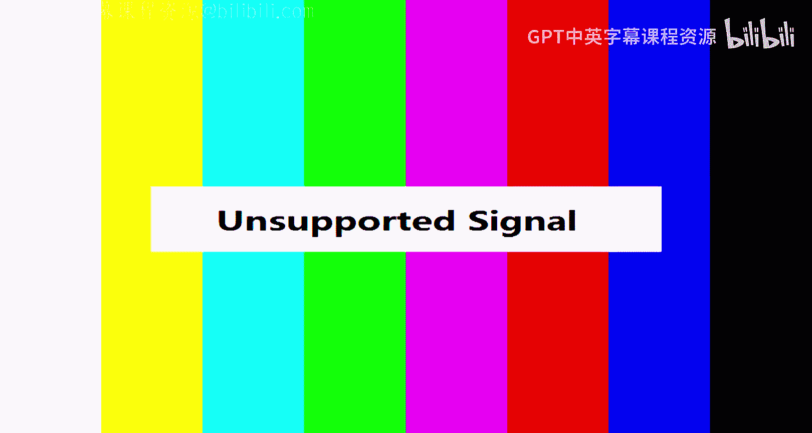
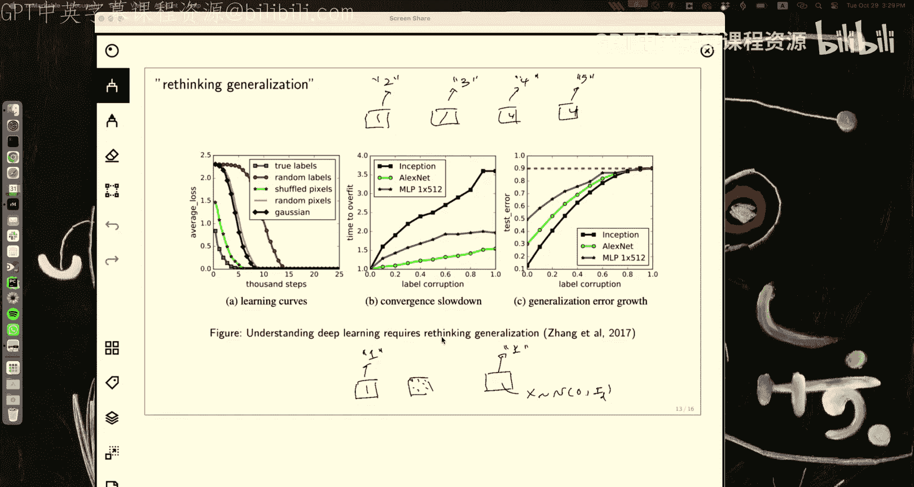
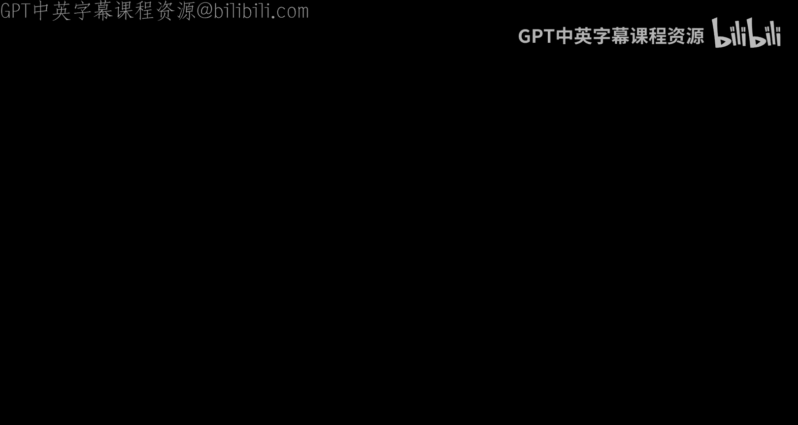

# UCB《机器学习导论｜CS 189⧸289A Introduction to Machine Learning Fall2024》claude-3.5 p18 L18-   Bias-Variance Tradeoff & Over or Under-Fitting.zh_en -BV1H4421S7bs_p18-

嗯。

Bein。Okay， so let's begin， so I'll be giving。The next following eight lectures and。

And this lecture is。Very important in， in a sense that it's almost like the。

Conclusion to the first half of the course。And then next two lecture will have pro graphical models and then generative models。

 But so far， you have hopefully have some deep understanding of what machine learning is all about。

And， today。We have a deep understanding of。Of the most important topic， in some sense。

 in machine learning is the bias variant and straight off。And you will understand it is a trade off。

And yeah， so the As reading is mainly 4。3， 4。2 there is a little derivation that I think I will go through in this lecture。

And， and 9。3。2， there is a， I'll have a deeper discussion of this。 but at least one。

 one part of it is discussed already in the textbook。O。And well have the usual problem。

 But I have found the fix。 She is easy。嗯。Okay。Okay。So this outline of today's lecture。で，ふ。

What is going on here？So this outline of today's lecture。

 so we'll have a decomposition of the generalization error into this bias variances and noise。And。

So for talking about that， we need to first have a definition of a general error。

 So we'll go through some definitions。And then I'll drive the conversation for you。This is。

Deeply related to underfitting and overfitting， and we'll talk about that。呃。

And then we will talk about this is like the first half is almost like the classical view。I mean。

 the derivation is straightforward。 It has nothing to do with is's very， very general， actually。

 but the interpretation of the derivation related to underfitting and overfitting of what is model complexity。

 those are there is a classical view where regarded model complexity as number of parameters。

 what we are learning over past 10 years or so that that classical view needs to be revisited。So。

 and the later part of the lecture， we'll talk about over parameterized models。

 and I divided into like。Mainly three interesting topic。 One， there is a paper， actually。

 that the main authors are at Berkeley rethinking generalization in。In deep learning。

And the other paper is double disscent， which is that that discussion is is also in the textbook for fun。

 I added this gring phenomena， which is just came out two years ago。

 I don't know if any of you have heard about it， but I may explain like。A few minutes on that。

 And then if I have time， I'll talk about very cool theory paper。 I just wanted to state the results。

呃。Just like the last part is for fun really。 don hopefully you get something out of it。

 but such is' out of the scope of the course。Okay， so let's have with a motivating example。So。

 firstst of all， I want to quickly ask what is underfitting， What is， what is overfitting。

 Can somebody define it very。Quick。个。Yeah， what is underfitting。What is underfitting？然了。Any。Yeah。

Exactly。And what's the simples underfitting function， even simple than a line。Constant。

 just a specific line， right you just say I'm gonna output just 0 everywhere。 Like it， you know。

 it's clearly very simple model， but you know， is underfitting。 You know， it's too simple。

 So in in this section on the on the bias variant trade off in this nice example in the textbook where they revisit the first the very first example in section。

 I think1。1 or something on the which you they may have discussed Profesor Liz Car is is fitting a sinus。

 right。You have a。You have a function underlying the line function， which the user doesn't know。

 But I know it it's a sinus function， right？ And then you just sample。

Some points on this function and just try to fit it with with this class of function。

 this class of polynomials， right， These are the polynomials。And in the first version。

 you don't have any， any regularizer， right， You said this you just fitted at least squares。

And if you have end points， as actually here， we have 1，2，3，4，5，6。

 And if I decide to fit this with a polynomial of order 6， clearly you can set it， right？ I have。

 I've given these six function，6 points。And I want to fit it upon them。 you'll have order 6。

 I can clearly fit it， but I would fit very maybe a crazy function。 You know。

 it's like I really want to go through every single point， right。

And so this is the discussion in that section1 in the book or when we talked about it actually。

 in the earlier part of the course， we stopped at that right， we say， okay， this clearly is not good。

 but we can have a deeper view of this and the deeper view is what if we sample these six points many times。

😊，Okay， so this is， I want you to fully grasp this notion， which is gonna appear again and again。

 So the idea is that I'm fitting a function right to a data set。

 But let's assume it's a thought experiment。 In this case， it doesn't have to be thought experiment。

 like， you know， it's a simple function。 I can instead of。😊，Drawing these six points。Right。

 I draw another six points， another six points， I another six points。 I do that many， many times。

 right， and， and for each one， if I draw another six points， I'm gonna fit another function， right。

And this is what's done here， right。So， and here is long the。嗯。Okay。You see， okay， good。

And this is done with different Ladaos， right， So this is large lambda。And this is small la。Right。

 so the log is noted here。 So clearly when Lada is very large， you really I mean， first of all。

 this model to avoid overfitting。 I mean， this is like the the classic example of memorization。

 right， you're given a degree of polynomial， this example are 25 points。

 So the degree of polynomial is 25， I believe。Yeah， so。Then you read the textbook。24。

And I think there's a typo here says Gaussian basis functions， I think they're just mean polynomials。

嗯。And。Yeah， so this is a 24。 And in this example， they have hundreds。Data sets。

 So they gather  hundred0 data sets。But showing hundred is kind of crazy。

 So they only show the any of them in this plot。 You literally see2 many different fits， right。

To this different these00 data sets that are generated。And so small Lada， we know the story。

 Small Lada is this case。 And the story is that。If lambda was 0， it would have been even worse。

 This is like some other。 Its a small lambda。There is some degree of memorization， right？

 And you already see there are the curves that you have fitted。 You know。

 there is a variance over these curves， right， And as we increase Lada。😊。

What happens is all of these functions become more or less converse to one one function， right。

 This is the case of。Large lambmbda here。 You know， I feel are going up， up in Lambland。And so。

One cool thing you can do。 So essentially， this is the， the idea， right， I have。

 I have some underlying function。 I generated many data cells for each data set gonna fit my function。

 and I can take the mean of my functions。😊，It's a very natural notion。

 I take the mean of these functions。And it's beautiful。

 You see on the right side this the underlying function， the color didn't came out well。

 but this is the underlying function is the sinus function， right。

 That's the same function in each case。😊，And then you take the average。

You clearly see the bias in the in the large Lambda regime。 when youre model class。

 you made it too simple， right。There is clearly a plenty penalty you' are paying in the bias on the on the bias。

 right？ And so this is just an example。 I just want to have a take a picture of it in your mind because we're gonna formalize it。

 have right， go over the math of this。 But essentially we， we're gonna see what is these。First。

 we're gonna see the when the average is away from the true function。 It is bias。

 We define it as bias。 And there is the the other notion where the functions themselves have variance over。

You know， this class of that solutions you are find， you know。

 so we we're gonna formalize what is this Wily think， you know。Thats。Yeah， there is clearly。

 in this case， there is this notion of a variance， right。This is like a variance。

Which in this case becomes very， very small， right， And in this case， there is a notion of bias。

Which in this case is very， very small， right？Okay。And is that clear here。Good ahead。Sp。

Subs of the data。Exact。The variance is over different fits to different subset of the data。

 If you imagine if you have the infinite data， you can divide it into subset， right？ But you know。

 you can also imagine you have finite data， but there is an oracle that give a split sub data set for you。

 You say have a data set to any samples in this case。How many samples yeah。25， I think。

25 samples they have。 And ask Oracle， give me new data sets。 I want for the new function。

I go record given new data I want to fit a new function， right， And then you。

 you put all your fits into one plot。 essentially， what what's done here。Okay。

So we kind of formalize this， right， The first notion is。What's the ground truth。 This is Section 4。

2。 I believe it should have been discussed in decision theory。

 but I think the focus there became in professorfes Li and lecture on， on。Clasification。

 but I'm going to drive this for you。Hm。Or maybe I may escape it。Okay。

 I'm gonna give a quick erivation。 But this， this， I'm assuming you know this。 But essentially。

 the problem is I have a， I have a regression problem， right？ It's a regression problem and。I。

 I'm interested in the test error。 the generalization。 What's the generalization error here。

 as we see， there is no D， right？ In this case， I put a D V given a data set but I shouldn't have in this part of the。

There is no D here， right？ So I have， I have the function F that I want to fit to my labels。

 which are real valued。 Y， right？ And I'm defining this loss， which is a squared loss。

Where this P is the ground truth， right， This is the ground truth。And。

And the statement is that if you minimize this loss， if I， if I look at Delta。L， E， F。

Eal to 0 is evaluated that a function is F hat。 right If I。

 if I look at the optimal function where makes this loss 0， this optimal function is very。

 very intuitive It turns out to be the， the mean of your samples， right？ So if I know P of x and y。

 presumably， I know P of y given x， right， because P of y given x is。P of x and Y， divided by Px。

And I take the mean of these samples， right， This is my uncertainty。Essential。

 this is my uncertainty。Over。Y， give it X。Right， my uncertainty。 And I， I take the mean of them。

 right， And that's the best I can do according to the least squares， right。

 So let me quickly drive this for you。嗯。LetSee。그리고 be optimal。Okay， so basically this is the。嗯。

This is what I'm after， right， This is a generalization error for this function。嗯。先设立PF ofX。

inus y squared。Pf。So y D X D Y。Right。Let's write it up。 So I'm interested in。This to be 0。Right。

 this leads to just this quadratic function。 I， I can easily take a derivative。So， this is F of x。

us5。P， X，y。D X y equal to 0， right， and P X。P X and by， I already wrote it for you。

 is I write as P of Y given X， P X。Right。And。So in the interest of time， I already see these terms。

 right？There is a Y P of y given x， right？ Then you take the integral over y。Right。

 is that clear here， Hopefully， you can see well。This becomes。Minus y bar x。Px。The X， right？

 And there is a term P y given x。F of x D Y， right， F of X is not a function of y， right。

 This guy is not a function of y。 And then you take an integral over y here of Y given x。EY is one。

 right， by definition of probabilityability。Right， so this become。F of x。This has be 0。And。

 therefore。I'm sorry。 everybody's have that。Right， therefore， F hat of x。Its really。Wever。Again。

 this is like a review。 You should have learned this by now。 but also in section 4。2 of your book。

 is's not on vice variance straight off。 This is essentially。

 I'm just saying that the optimal regression function。

Is the empirical is the posterior mean of your response， right。呃。But I'm gonna pause here。

 If there is a question， please ask。 is that clear。Go ahead。I'm sorry。

Exactly weighted by the problem。 And that's very important， Right， right， If I just take the mean。

 its， it has to have a meaning， right， because some of these values are very， very unlikely。

I shouldn't take the mean。 I shouldn't take the proper mean。Exactly， yeah。 so this is。

 just to be clear。This guy， you don't have access to。 So in this for this biasvari trade off。

 we're gonna do a lot of acrobatics。 There are these things that we don't know， right。

 but we want to properly define them， and it will show up。

 So one of the key players that you have to keep in mind is this。Is this posterior mean， right？

Essential， this is really expectation。why。Conditional next。And that's really regression， right。

The optimal regression， base optimal regression according to this， according to a squared loss。

 right。Another question。Good。Okay。Very good。Yeah。So I shouldn't say maybe posterior mean， I mean。

 essentially， if the mean of the responses weighed properly by the probability of that response。

 but that is posterior。 you know， if， okay， I mean。Yeah。Yeah。

 so it's like the issue prior post theories all depends on what you define as likelihood than prior。

 right， So essentially， P of y given x， I already wrote it for you， right。

 P of y given x is P of x given y。P of Y， divided by P of X。So you have some prior over responses。

You have some likelihood。And this becomes a posteri， right。And that's what they。

 that's what they meant。It's a good question， though。 But yeah， but really don't。

 don't get bogged done on jargon here。 It should be very intuitive for you that I've given some。

 I have wanted to make a prediction， right， given some input， right。

 presumablysum there is some uncertainty over those prediction， right？ And I should just。

 I should just take the mean of them。Right， taking those uncertainty into account， right， I you know。

 it's very， very， should be very intuitive， right， And but it just comes through math to just want you see through math。

Good。I'm sorry。Are you talking about this question here。Right。Yeah。

 here I'm just saying that I want this to be true and the easiest way to satisfy it is just have。

This F bar to be y bar。 F had to be Y bar。Right。Yes。Yeah， yeah。Well。

 it's called marginal likelihood because you have to marginalize this P of x is really。

You have x given Y， P of y。E， and this is marginalization。Yeah。I think it comes with different terms。

 yeah， but。嗯。Beot。So let's go back。Okay， so。But， you know。

 the mental picture you have is what I wrote as the title expected output， right， you have some。

 you want to make a prediction， this output， this you want to predict this output has some expectation。

 right， And this is you know what we defined here。Okay， and the other is a test error。

 This one by now， you should be。Really， really comfortable with， right？ This is not training error。

 right， I have， I've given some data set。 I've fit it， right， This is the training set here。こ有 inや。

I fit my function， but when I evaluate it， I don't evaluate it on the training set。 That's cheatty。

Right， these are now my test sets。Again。Here， I'm writing it as if I know P of X and y， right。

 because， you know， you're gonna do math。 So if you know P of X and y， right。

 let's assume we know that。 then this is the truth test error， right， In practice。

 you may approximate this like。Keeping some data in your validation set， right。

 and literally computed over that set。 But， you know。

 it's actually easier mathematically to write to write it like this。 And I'm gonna keep it。

 keep it as it is。 right， This is the true definition of the。Expected test error。

Any questions on here。Please。Exile。Yeah， yeah。 So that's the。

 that's the key distinction actually in Boy La and straight off that， so there is。

 we're gonna keep the training set around as a form of D。 This is really the training set as I ex。

 as I wrote it above。Right， this is a training set。And。

We have Fita function over this training starts。 and we're gonna evaluate it on the true distribution。

 And that's the generalization of this， this function， right。So what is the comment or the question？

Is that clear for everyone。Yeah， okay。Okay， so let's go back again。 So we have this expected output。

 Now we have expected test error right And here again， this FD is what we fit。

 It's not a true function。 It' not as right and the other very interesting actually I'm gonna talk about this next。

 later the other interesting thing is the expected regression and that should be very easy。

 So essentially the idea is that I have idea is what you remember hopefully tomental picture of the first first example the idea is I'm giving you a lot of data sets for each one you're gonna come up with a function right。

And， I'm just gonna take the mean， Take the mean of these functions， right， so。So one data sets。

I arrive at this function， the other data set I arrive at。Dis function。

 the other data set I arrive at。This function， I'm just gonna take the mean of them， right。

And doing it， doing it many， many times。Is that clear。Right。

 I call that expected regression function。 It's a very natural term， right。

I have a regression function。 This regression function is obtained。

 They different regression function or for any time you try your algorithm on on， on a data sets。

 And I'm just taking mean of them。Yeah， so this mean as and becomes large。So this ones。

 I don't want to write a mean。 it's just ugly。I would write it as this form or expectation。DFD。Right。

And this， what they really mean by that is。If I evaluated it at the point x。This is expectation， D。

 FD X。This one。Hopefully， it's very， very clear to everyone。Essentially， what it says。

That you given a response， you look at one particular point。 I look at all this function。

 all these predictions that my models are giving me for different data sets。

 and I'm taking the mean of them。Liang。嗯。Very good。So let's go back here。诶。Here， essentially， this。

 this bits we really don't use in a very。meaningfulful way。 but you should。

 I should have some mental picture that I'm talking about functions here。 Clearly。

 I made a decision at the beginning of my fitting， what functions I'm considering， right？

 And let's call that with this tweedel， this tweaky F。Right this whole class of functions。

 this is my world， essentially， right。So， this is the world。According to。啊。Decision be made。

So there are very simple examples of this。 One is the the your world can be linear functions， right。

 your world can be polynomial functions， and our favorites。

 hopefully your favorite too by by now is neuro for， right with a fixed architecture right and。So。

 in， so， essentially at some abstract level， you know， this is like the very， very abstract。

 but it's very nice， meaning that you have an algorithm。 you have some oracle that goes。😊。

Tryries to fit fix your data。 So it takes the data sets， right。

 and fits it and spits out this function， right？ So if we go to the very first slide。嗯。Yeah。

 so this is the oracle we have， right that now this space of functions we consider as polynomials and the oracle goes。

 looks at the data set and spits out a function。 And this oracle clearly， in this case。

 depends on Lada， right。嗯。Okay， so now we are ready to dive into some math。

So this is the heart of the lecture and let's dive in。I'm going to actually start a new。Easier。Okay。

So basically， what we are interested in， we are interested in this thing called the gization error。

And it also goes in the name risk。 So I use the notation R here。 So this is curious， because。

Going back to the question that was asked earlier， there are two expectations here。

The two expectations are， one is。The expectation over your test samples， x Y。

The other is the expectation over the training set。Right。So again， here is almost again。

 I'm assuming I have this oracle that can give me a lot of data sets and I have an oracle that can go and fit a function。

 right， as FD。And， and I define this as a generalization error。

Which considers both all the data sets。And the test points into account。Right。

 and hopefully it' the intuitive for you that you need to also take into account all dataset sets from the very first figure。

 right， you may get lucky with some data。RightYou really want to take into account all the data sets if you are interested in this true notion of generalization。

 right。And so there are two players here。That I introduced earlier。1 is y bar x。Right。

 this is expectation of。Yhy give an X。The other is F bar of x。This is the expectation of the。

If D of x。Right。And our goal is to look at this。😊，And bring these interesting players into action。

 right， That's really the goal。 And you'll see that it's pretty simple。So， lets start。So。

 I want to bring。First， F bar interaction。 What should they do。Any ideas。Good ahead。

But how would you substitute？You know， in general， suppose I want to bring some player A。

 some something I have defined really at some abstract level， right， I have some a。

 I want to bring into this。 But some very simple thing I can do is to just add a minus a， right。

Right， that's the simplest thing you can do， right， And we are going to do that。But it。

 you have a good intuition。 I think it will come down to this distributing the will come into play。

 But， but this is very， very。 this is a trick that's。Very important trick， maybe。Yeah。

 one of the most important traits in this literature you， you have to become really familiar with。

If you want to get into it is。Just adding a abstracttracting it's a very interesting art。Right。

 I'm sorry。 This is F bar of x。Okay， so let's do this。 And now let's call this A， this B， right？

 So this is really a a square plus B a square plus 2 A B。Right。

And I'm going to prove to you that A B is really 0。So let's write it down。 So A B expectation。

The expectation。X， y。If D。F bar x。Thats bar x minus y， right， That's by definition。

 That's by construction。And when you are stare at this， what do what， what。

 can you suggest me do something here。So， the second term。Does not depend on D。Right。So。

There are two expectations here， right， There is expectation over data， the training set。

 and there is expectation over X and Y by test points。 And these are independent by construction。

 right。Right， these are by independent construction。 it are by construction independent。 Therefore。

 expectation of D， right， can go through here。 So this is becomes。Expectation of x and Y。

Expectation D。So the key is， I'm gonna sneak the expectation inside， because。

This guy is completely independent， right， This does not depend on the。Right。

Does not depend on a particular D， right， This already， there is an average taken here。

 but after that is taken， it's just a function， right。And what is this。

What is the expectation of D of FD。贵。This， this is the expected function。

 expected regression function， right。And so this term is going to be 0。そで Aビゼロ。So， we arrived at our。

I。Expectation， D。Expectation。Training set， expectation over test samples， right。

So now it comes to that bringing the second actor in and the second actor is our expectation of y given x。

 right？And I'm going to do exactly the same trick。So， the trick is。You're gonna write this as。

F bar of x minus y bar of x plus y bar of x minus y。Right。Let let's do the。Hopefully。

 you're not tired。 I' gonna do the same math。 is they call it A and B。

 So this is really a square plus B square。Plus 2， A B。And so， let's write A B。A B is now。

 and notice in this term， D is completely out of the picture。 Like， there is no D left here。

 So this is expectation。X and y。And。Here， I almost can give you this as a homework。But we have time。

 So let's do it。 So this expectation of X and y， I can write it as expectation。 Actually。

 let's think a little bit。 So this expectation of X and y， I want to。

Somehow absorb it into these expression。 So what do you see， I see X and Y， There is F bar。

 There is y bar， and there is Y， right？ So clearly， the trick we used above。Was。

 what was the trick here。 The trick was you had two expectation。 And one of them。

 these two things are independent。Right， and one of them， I sneaked it through， right？ So clearly。

 I want to have something that only depends on y and only depends on X。

 So here I can write this expectation as expectation， X， expectation， Y given X。Right， essentially。

 this expectation here is。P of x and Y。 And I write it as Px。A来的PX。Here y given X， write a little。

You know， said。Simple as trick。 So I write this expectation as this expectation。At the moment。

 I write it at this this expectation。So， let's write it here。So， this guy does not。Depend。On what。

I have to， to。Varis here， X and Y， right。And the reason I decomposed it like that was this first term does not depend on。

Does it， it depends on X， right， but it does not depend on y。So this term does not depend on why。

 Therefore， I can bring this expectation insight。Right。

And the moment I bring this expectation inside， I defined。Y bar of x。嗯。

This was defined to be expectation of why。Give the next。

And I'm bringing this expectation of Y given X， taking expectation of y。

 So this really becomes something。Y bar x minus y bar x。你是自己了。Good。Yes， so。Essentially。

 what I mean is I'm taking expectation。Of X and Y over something。Right。

 doesn't matter what that thing is。 So what is this， This is that thing。If you have x and Y， D X D Y。

 right。And I write this as。P of Y given x。Px。The X， D， Y， is that right。

 Yes I'm using base rule here。 So that becomes。PX。Right。And this is。

 I call it expectation of y given x of that thing。No。

 that's the definition of a conditional expectation。Right， conditional expectation， by definition is。

PR y given x。Whatever it is。That's the definition of the conditional expectation。 And this。

 this whole thing， I'm taking expectation of it over x。 So this becomes expectation over x。

Ex expectationation of y， given x。That。Essentially， I'm using basil。And why， you know。

 you did the math already here， you could have written it all sides expectation of why。

Expectition of X given y。This， right。But here， hopefully， have some intuition。

 the second one would be useless because it's very hard to use it。

 But does it mean an expectation probability of x given a response。

 There is a distribution over that with a very， very complicated distribution， right？

 So everything we have here。In these expressions。Or。Or in terms of y and y bar of x。

 it's natural to decompose the expectationpositionition of Y given x， good。Well。Well。

 X and y are X and Y， if you write it as expectation of X， expectation of y is。

 strictly as speaking wrong， right。Because this is becomes P of x and P of y。If you're in your mind。

 you have， you are already conditioning in your mind。 You have to use the notation， right。

 You are really using P of Y given x。喂。Why， why is a random variable。

 but it's a different random variables when you condition it on x。Right。

 that's the definition of a conditioning， right。嗯。Yeah， so it's like。

And this iss an important question。 You know， you have to be very clear that X is in R D。 Y is real。

 These are very different random variables， right。And， but there is a。

 theres clearly dependency between x and y， right， You can capture it with a joint distribution P of x and y。

 right， but you can also capture it with a conditional distribution P of y given x， right？

 And the moment you do that， you get this nice decomposition。Where there we have here。嗯。So。

 essentially， district trick。Try to internalize it。Its very useful。Essential， typically。

 if you do things。Moderately， carefully。These cross terms always vanish， you know。

 we just have to be， but we saw a very nice example of it here， right， In this example。

 there are two we used two different objects。 One was expectation of Y given X。

 The the other very different objects。 which just expectation of our functions， right？ and。😊。

And we use this strict twice， and the cross terms vanished。 So let's， let's not get lost。

 We have a lot of cross terms that have vanished。And so what Where were we。

 So we had we A square plus B is square to A B。 We saw A B vanished， right。

 and we decomp B square as little a square plus B a square2 A B。😊，And the A B vanished。

 So the whole thing。The whole thing becomes。R is。A square。Plus a is square plus B is square。

 and there's expectation outside I'm not writing。嗯。And。So， let's go back to the。Let's go back to。

Yeah， but I' have written it in a clean form。So， this is。Essentially。My。A square。

This is my little a square， and this is my B square。嗯。So let's contemplate on this。 So essentially。

 these are。That's why it's called the decomposition。 It's very nice because very。

 very they're capturingtion very different things。 So the first term note that essentially。

 a strictly speaking expectation of overtraining set has disappeared because we have already taken the mean of our functions。

 So the first term captures how my mean function deviates from the true。😊，命方式。Right。

This y bar of x was if you had the ground truth， what would be the expectation of y given x。So。

 this is the。可能。Yes。So that's essentially ground truth。

As a reminder is really expectation of y given x。Which is。Y P of Y given X D Y。Right。And。

This is the mean of。My fix。Too many。Training sets。Right。And this clearly has a notion of a bias。

 right。You know。So you're really considering the mean of your fits to the ground truth。

 And if this mean is of， you have a bias。And the second term is interesting because the second term has nothing to do with the truth。

The truth is already the first term。 The second term captures the fact that how are your many。

 many fixs。Diateiate from theirmin。Right， so this， this captures the individual fit。

This is the individual fit。And again， this is the mean。

And this clearly is variance as a notion of a variance there。And the last term is。

 we are completely out of control here。 There is no F。 There is no D。

So this captures the fact that how much uncertainty is in this prediction itself。Right。So。

 there is a。There is test point X。 This is the truth。And this is the current response， right。

 This is the response。And as I said， we started with this assumption。 There is some uncertainty。

 inherent uncertainty。For my labels， given my X， right？

 And so this is the essentially the inherent noise in this process， right。So， at this point。

It's a common thing when talking about bias variant tradeoff is like a this。Example。

 I'm gonna maybe have one or two version of it。 The example is。呃。呃。You are trying to fit。You know。

You're trying to what'， what's this game。 I forgot the name of this game。 The darts。 Yeah。

 you're playing darts， right， and I don't have high prescription。 Well。

' that I had a high prescription。 I don't have my glasses on。 but I'm very。

 very good at a plain dart， right？ I just see the center being off， right。Presumably。

 if I played well。What end up happening is。I'm going to end up a lot of。

Samples that are concentrated here。 right？ And what is this。Oh how what would you say this is。

High bias， high variance or low variance。Low variance， right， I have my。

 I have I'm not hitting the target， but I'm not hitting the target always the same way， right。

That's one case。嗯。And the other case。Is。I drank too much， right。

And I have my glasses on but they're dry too much。 And I。Probably， hopefully。

 I hit something like this。Right， what is this， How would you say what， what this is。

This is high variance。 And if you take the mean of them， you know， I'm doing a good job。 This is low。

 low bias So just's write it here。So， this was。Lvi yes。ローバイエスオはいあハイバイエス。And this was。High variance。

Noバ。And I mean， I don't want to bore you with other examples， but this bore you。

So you get a better picture。So， what me think。Low variance， low bias。 That's very boring。 I'm。

 I'm really good。 And I'm， Im I don't have a like very conscious。 and always sit in the middle。

 right。This is like a very simple case。And that's clearly low variance， low bias。

 I'm not going to evenite it。And the other is， I'm also the other extreme that I'm very bad。

 So essentially， I'm， I have drank too much， and I'm also not good at plain art。

And it's going to be way off。Right， so can you， somebody quickly say what is noise here， Can you。

 in this dark example， what would be the process here， The noise is out of the picture， Noise is 0。

 right， What would be the case when there is a noise。This can be a final exam question。

The question is， I don't have noise， right， I have low bias variance。 I'm missing the noise term。

 So this is really a biased variance noise to decomposition。 and the noise is the inherent noise。

What would be a good example in this dart case where there is a noise in the dart game， Go ahead。

What。Exactly， very， very good。 Yeah， so you you can play a dart game where the dart thing is moving。

 wind or whatever reason。 There is a noise that I'm not in control， right， I'm I'm hitting， but。

 you know， I'm good that bias of variance are low， right， but even the bias variance are low。

 If you hit the dart。 you cannot win this game。 There is no way to win the game， right。

 There is an inherent noise in the process。😊，Yes， I mean here actually in this case。😊，Not really。

 I mean， here， this is the definition of a noise， noise term。Right， by in the Dar， the art example。

 it makes sense to consider meaning0 Dartium， okay。Make good。

So let's write it down because I'm going post this after lecture。 So this is。呃。Hi， bias。Hi， Val。

This is robotbi。Low variance。And I'm not good at drawing noise。 It's very complicated。

 So I just explained it to you。诶。I think we are ready to move on Any questions on this。Good。

So this is all for。Yeah。強査なです。嗯。是证。Yeah， and so except with the R。第。Material。嗯。Yeah， yeah。这这该。

Is there any equivalent exercise？寄委。Yeah， you're asking a difficult question。

 and I don't have a clear answer。Maybe you can take it offline。

 but I think it's good to point out when you go through the math that this square played a very important role。

 If I don't have a square， I cannot do any of these things。 becomes very， very complicated， right？

 So it's really。Yeah， so I think its a different way of answering your question。

 but the spirit of bias variance knows decomposition。Is present， you know， as always happens。

 we'll see it in also the problem of classification。 So actually。

 I believe one of the figures I have is from the Tip Shirai book and。I wonder if this is actually。Oh。

Yeah， I don't remember in this section if the model complexity， how it was defined。

 But you could imagine， you remember， I had this case of K nearest neighbor， right。

 with one nearest neighbor， you had a。You had a very low bias but high variance。

 You could imagine this is really classification problem， right， And the same picture holes。

 you know， you draw different data sets， right， and you evaluate training error and test error。

 right， And if the model complexity is small， you have a bias。 but your test errors are very。

 you know， they don't very much。 right？ But the moment the model complexity increases。

 the test error goes crazy。😊，Right， and but the training error， then， you know， it's very。

 very easy to fit。 You fit it really well， right， So this issue of bias variance is present。

 But essentially， the take home message of today lecture is。In all to， in this course。

 we really had a fixed data sets。Right， but in this lecture， we dig deep， right， What would。

 what would happen if you have many data。So this notion of underfitting and overfitting has this reflection in the notion of bias and variance。

That comes， when you fit。You use your algorithm to fit to many， many different data sets， right？诶。

And so this is really the content of this slide。 So you can see both underfitting and overfitting。

 like what is underfitting， underfitting is model complexity is。Very little model complexity。

 You can fit it。 The training error is high， right， When the model complexity increases。

 the training error clearly goes down， right， But then you are。

 you are memorizing overfitting because the test error goes up right。

 and it's really beautifully reflected in the bias and variance of the many fits that you have like in this example。

😊，They have。Hundred sets， right。And I don't know how many of them they show here。Maybe all00。

 it looks very busy a what。Very good。Any other questions？嗯。Okay。

 so let's go to the easy part of the election。 I'm gonna tell you some stories。No math is here。

 and so the essentially the。😊，The classical recipe that comes out of this。

This bias variance trade off。 There is a trade off。 the classical recipe recipe is。

 let's find the sweetest spot， right， So we have this notion of model complexity， right。

 and this can be number of parameters in your neural network。

 And if you have a lot of gigantic neural net。😊，This is going to over going going to fit the training set really well。

 right。But you will encounter overfitting。 And if you have very small neural network。

 you have a hard time even training the neural network， so you are going to underfi and。呃。

And you're after finding the sweetest spot， right。So what do we do in modern machine learning。

 We put everything。Out of the window， I just use a very gigantic neural la。

And so these are called over parametermetricized neural networks。😊，And totally。

 we are happy with getting very， very small training error。It turns out， as I'm going to talk about。

 this story is essentially。I have a feeling， okay， I'm missing the word fear。

 do not fear overfitting。 So that's essentially the modern recipe。 do not fear overfitting。So。

 let's go through。Dig in deep， what' happened， right？

 what are we missing here in the in the classical recipe。So the first story is paper from 2017。

Called to understanding learning， you have to rethink rethink generalization。 The key is rethink。

 And there is a sound coming from somewhere。第。第。呃。Yeah so what they did was their training classifier in this case and what they do is they randomize the label right so you are training an MNIS classifier。

And you decide to label this to be two instead of one。And a different one comes in。

 you decide to label it3。The four comes in。 Maybe you keep it for。Another four comes in。

You decide to have it 5， right， But the key is you， you keep this It's random。

 You have completely randomize your labels， but you keep it as sticks， right。

 It's a frozen randomness， right， Otherwise， you cannot even fit。And hold and behold。

 you train a neural net and neural lets brings that training ered down to 0。Right。

 it learns to completely this meaningless association just learns to learns to do that， right。

 And by construction， this model would be very poorly generalizing， right， because it just， you know。

 it， it has no notion of a digit。It has， it has managed to fit random digits。Right。

 and they go crazy。 They also decide to do randomized pixels。 So in， instead of having this one here。

Is a different experiment， this experiment instead of。1 to be one。

They completely randomize these pixel， also。You know， these ones are go to different pixels。

 and this will be a one， right？ And the other experiment， they， they shuffle the pixels。And。

The case of Gaussian， I don't remember。 I think， oh， yeah。 So they， they just give a Gaussian inputs。

And they say， be1。Right， it has nothing to do with one， but。Right。But it's Gaussian。

 So this is draw from the Gaussian。呃。And essentially， what they wanted to show is that。

The classical notion of generalization think focuses on model complexity。 right， here。

 they are the same neural network。The neural networks are identical between these examples。

 and one overfis， the other underfis。 I'm sorry。1 one generalizes， the other does not generalize。

 right。And so that's why they said we have to rethink generalization。 So essentially。

 in the classical notion of complexity， you have this idea that， you know。

 your neural data architecture is what you have to focus on going。

m curious when they did the digit experiment， yeah。Does it roughly evenly distribute？it's like。

10% is1，10% I think so。 Yeah， yeah， yeah， but you don't have to do it like that， you know。

Maybe can write your own paper on this。 But yeah， so I think they just were。

 they were doing the classic way of doing things， right，10th of the digits are one，10th or two。

 whatever。诶。W。Yeah， I think probably I think you have to dig into this paper。 it's very。

 very likely that， you know。You have learned this。Weir had prior over。

 essentially you're randomly assigning labels。10th of them are going to be11th to1， you know。

 So if youre equally distri in these classes， probably that's what you're gonna get。 But。

 but this is not a message here， right， The message here is my architecture and my procedure。

 everything fixed between these different different one case I random my label。 The other。

 I don't one generalizes the other doesn't generalize， right。

 So you have to really think what do I mean by model complexity here， right。

 then that's what they mean。 There is no answer here in this paper。

 There is no there is very little theory is just experimental observation。

 wethink notion of generalization。As in， you know， this what what do you mean by model complexity essentially。

 And this is essentially very very， I think this probably came two years after that， the other paper。

 So people started really。Rethinking generalization。 So， so this is a very， very interesting example。

 So here we have no， no， no randomization of labels。 So here we have fitting Mist。

 and we only look at 44000 Ms classes。 So as Mniist。

 I don't know if you have had it in your homeworks or 50000 training sets， right。

 here we are looking at only 4000。😊，And， and were gonna use machine learning。

 So it's a fully connected。Fully connected network， right？ And on the X axis。

 you see the number of parameters。 So this is a serogate。4。Complexity。Right。

And what they see is beautiful。 You see the classical paradigm。

 So when you are in a regime where your number of parameters are getting somewhere close to。😊。

The number of samples， right，'s the number of parameters， number of samples。

 And this is measured units of00。 So around this point， you， you do see the trade off。

So this is the classical trade off。But， what you see is very interesting。

 when you give the network more capacity。Right。Then the carouss go down。Right， so this is。

 essentially， this is becomes this double descent。 So this， this is the double descent。Right。

 there is a first disscent。 and this is the second disscent here， right。呃。And essentially。

 they're shedding light onto both the。Allld paradigm and the modern paradigm are one plot， right。

Again， this is the experimental observation， so。But this phenomenon。

 you see all over the place where。Where。As you give the network more capacity， gain。

 you gain in generalization， you know。You know， I can give share with you my personal intuition on this。

 It's almost like。You know， you want to get to a destination and。You are。

 you have just enough items to get there。 You have to really try hard， right， But at some point。

 if you really overload， you have like an。Huge car。 And which you don't have to， right？

 Then everything becomes easier。 You know， it's almost like when you give this this network so much capacity at some point。

 it doesn't the notion of fitting even disappears。 And that's what doesn't have to try hard to fit。

 right， It can do a very， very， you know， it doesn't have to push to fit this function go crazy。

 It have a lot of freedom to fit。 I finds a very nice way to fit it。 right。

 So the last slide actually beautiful theory paper on this。

 But I think I have time to at least tell you the punchline。😊，Of that。

 But to shed more light on this， this is a very， very， very， very nice example， very weird example。

 So these people decide to find this， this you don't see in a classical machine learning problems。

 It a very， very。😊，A specifically constructed problem。 And the constructed problem is they。

 they consider modular division。 So they have two number。

You can go check Viki what modular division is。 You know， modular addition， right modular edition is。

Like，10。Plus， 29。Moarch 28， what is this。11。Yes。Yeah。And there is the notionional modular division。

 they。They construct a data set and some of it training， some of it is validation。

 they do half and half in this case。And what they see is as you。

 and this is a very over parameterized model， right。

 I don't remember the number of parameter should pretend it here is a highly over parameterized model。

 And they look at the steps of optimization。 They're， they're optimizing。Right， so at some point。

 the training accuracy goes very， very high。Right。So clearly。

 you are fitting your modular division samples， right， Youre， you have a， you know， at this point。

 you have， you have a very low training error。Right。And so if I， if it's me， you know。

 I train it a bit longer， and I see my chest error。Is very， very low。 Test test accuracy is very low。

 right， at at this point， it' a give up point， right， I give up。Right。

 I decide that this model is not a good model， right？ I am not saying good a good job。 Maybe I have。

 I'm overfitting。 Maybe Ive picked a bad architecture， right。And I give up， right？

But they didn't give up。 So they just continued this for many， very long time。And at some point。

 suddenly， the accuracy of the test accuracy on the unseen sample just goes up。

And if you wait long enough， it actually becomes like training error， like the training accuracy。So。

 this is。Extremely puzzling。 And it's called gring。M。

 I think it' is not clearly explained in the paper。

 but there is this the origin of the then Gies goes back to a science fiction novel。 So essentially。

 in some sense， it means。Intuitively understanding something。 So essentially。

 what it means is that you are training and you really have， when you're training very。

 very long time， this model is intuitively understanding modular division。And at some point。

 suddenly decides that， okay， I finally understood it。 Yeah， go ahead。Training， accuracy。Test act。

Is that like kind of？Why。Oh， this is a very new phenomenon。 People are trying scratching their heads。

 trying to understand it theoretically。 But I just wanted to give you some insight that， you know。

 it's just you're living a bizarre world this。 Go ahead。from。嗯。Yeah。If you have to。Place of event。

Yeah， I mean， typically， I do earlier stopping。 if I see this regime where something goes up and it goes down。

 This is the earliest stopping regime， right， So this growthken phenomenon is just bizarre because you you're not's like what do stop。

 It's like this model is really not a good model， right you can stop， but you know。

 it's like earlier stopping typically if that paradigm。

 where you already have a good model and suddenly the performance decreasing and it's point to a stop。

 right， here it's like nothing is improving right， and but if you， if you wait long enough。

 it will improve right。嗯。So。Okay。And last but not least， So what do we mean by over parameterization。

 typicallyy the classical of overparization is number of samples， number of parameters。

 number of parameters begin a number of samples， you are in the overfitting regime， right？

 And it turns out if you really are after smooth function。

 So this is a very theory paper and just gonna leave it as a one minute， two minute remark。

 if you have after learning a smooth function is good to be crazy over parameterized。

 So this is like going to a very different regime where you multiply D by n。 And D。

 just as a reminder， D is typically very large。Right第一 can变没脸。呃。So essentially， this is a very。

 very theoretical paper。 There are no figures in this paper。 So they just prove that。

When you are in a very， very high parameter regime。

 it's actually very nice to learn a smooth function right a smooth function is nice。 You know。

 you can imagine you have you can have a lot of prior that smooth function generalize better and they're essentially shedding light on the fact that we in this over parameterized models and maybe what what they are doing is they're learning is smooth function。

 The catch here is is a necessary condition， it's not a sufficient condition。

 which is written somewhere here necessary。😊，So。It's that it doesn't suggest a recipe to go crazy with the number of parameters。

 It just suggests that。Perhaps。The reason these models perform better is learning a smoother function。

 So in some sense， you can imagine what what has happened here is that you just have to wait long。

 very， very long to get to that good part of the optimization region where your your function is very smooth。

 you know。But these are all the stories at this point。 Again。

 like just as a summary summary of the second part of the lecture， these are just。

I've given you some。Recent experimental results about rethinking generalization， you know so。

And I think the story is not fully written。 We don't fully understand what's。

 but we have a deeper understanding that the model complexity is definitely not a number of number of parameters。

 That's not the model complexity。Yeah。Thank you。Any questions you have like。呢边呢度你睇。

But there'll be around after the lecture if you have questions。Thank。

はい。你好，小美。Let did put this away。

