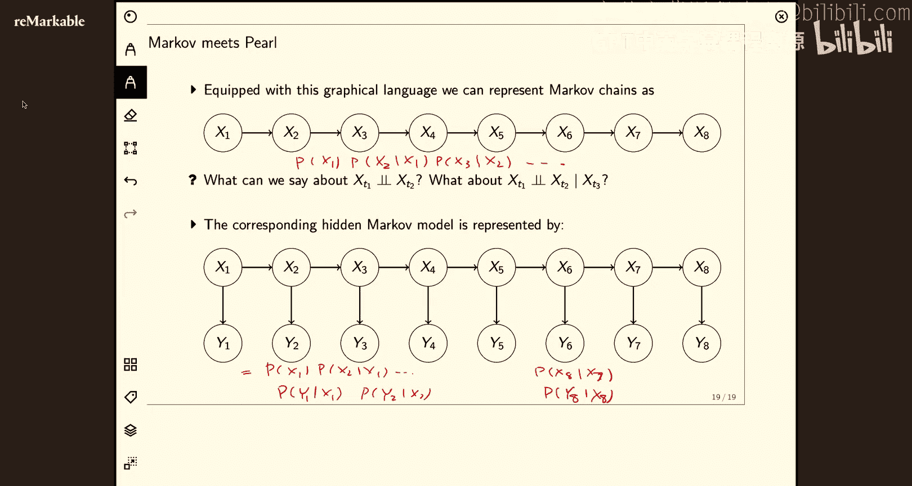

# UCB《机器学习导论｜CS 189⧸289A Introduction to Machine Learning Fall2024》claude-3.5 p19 L19- Hidden Markov Models & Graphical Models 1.zh_en -BV1H4421S7bs_p19-

知ってる。查す。I know would see。参加。Yeah， so add to the。是ひ。道。Thank you。26。是い。私ほ。ちょうといや。那是。先ち？Yeah。

 I think so， but I think it's whenever I。全这个。Yeah。い。Cause I an eye。可。Yeah。What Isics next to。たいが。は还。

いろ。Let'。のかだけ。ちたちる。That' what I feel。To later。还是一个。是。So I。这。这个。飞行。德华说。连带理。次在。So I have you。ok。就是。哦。被告。

不司。It unfortunately is more。Because if you don't understand。哎。Gave like the。我这。こたし。一思。

I guess there are。所以开。じ了没。一。

そいてて。Okay， shall we begin？There are chocolates here。 Any else。Chocolateates。Happy Halloween。呃，So。

So today's lecture， we're going to shift gear。呃。Talk about some more。Quote unquote advanced topics。

 So there will be two lectures on graphical models。 And following that two lectures on gene models。

 so。It's going to be a fun， ride。呃。So this is the outline of。Today's talk。

We're going to start with a warm up talking about Markov chains and then continue with hidden Markov models。

For today days's lecture， we're going to keep it easy and just。

Get the field for hidden Markov models。诶。And next lecture。

 we're going to have more do something more advanced doing some sort of inference and learning hidden markov models。

And then we're going talk about polar graphical models， which is more general class of models。

 And you see。That hidden Markov models and Markov models。

 just a very tiny subset of these parographical models。诶。So， I'll talk about。

The reading conditional independence in pro ethical models。In some sense， maybe that's。

 that's how it came about。 And this is a very。Advanced topic at some level。

 So you're gonna set it up talking about atomic， atomic probability graphical models。

 which is essentially three node graphs， triples。And。And after that。

 we're going to talk about directive separation for。

Where essentially builds on conditional independence on triples。The heroes。Of this talk are。

Andrea Markov。And。judy pair。So， Judy Apparel won。Turingboard。

 which is essentially Nobel Prize in Comp science for his work on。Proboographical models。

 So this de separation is really due to judicialaril。Okay。What is going on in here？Hang。

So so so far in the lecture， we have every time we talked about independent random variables when we had this set。

We were in a II D setting， right， We had。Independent and identically distributed。呃 data等。

And we're going to move on to something more interesting and consider a case where we have a sequence of random variables and this sequence。

The random variables are not independent。 So condition on X T prime probability of X T is not x probability of X D。

 So there is a dependency between X T prime and X D。Right。呃。欠你。I mean， in this setting。

 this T doesn't have to be time， but but let's first start as a warm up。

 let's consider T to be semantically has a meaning of time。Can you give me an example there。Clearly。

 the answer valuable is not a ID。So。And consider x to be。You know， Uian， very simple。So essentially。

 I'm considering some random variables， right。Before in the， in the course， we considered like。

You know， if you are doing classification， I give you a data set。 and clearly。

 there is no dependency。 You know， if I， if I draw random， random samples from this data。

 they are independent。呃。But we want to consider cases that there is dependency between random variables。

Any example。Like here， there。Time tea is your work。没听见。So， what in so can， can you say again。

 your x is what is x here。What what is a random variable？guess。

So what is the random variable in your exam。Yeah， no， in in your example。

 what is their random variable。The order is taken or not。But then when the order is taken。

 the whole thing just。Ends， right。Unless you just keep eating， that would be an interesting example。

 yeah。Yeah， I guess， yeah。But yeah， you， you have your， is， it's not off， you know。

 but I I I I'm trying to have an example where this random variable just continues for a very long time。

 Go ahead。This is a very complicated example， right。So what。

 I just want to consider one random variable。 Yeah， go ahead。Yeah。Whether the boss comess or not。

 It's very interesting that I'm asked ask this question。 So basically， your X is。0，1。Boss arrives。

 Bo doesn't arrive。And one is was arrives。So what happens when the bus doesn't arrive what you're talking about next time。

Yo。That's an interesting example。 So you're saying when bus doesn't arrive。

 the probability of bus arriving next time is higher。Yeah， yeah， that's a very good example， yeah。

simpler example to me， is weather。The random variable hot or cold。Right， and if it's hot。

 today is hot， there is a more chance that next day will be hot too， right。

Its a chance that is summer。 So if a one day is hot next day， it' will be also hot。

 But this is also a very good example， actually。Yeah。

 so you can imagine a lot of examples where you have a sequence of random variables and this thing continues and the state of this random variable in your example bus。

 whether bus has arrived or not， the next time step depends really on what happened the previous time step。

 right？So， so this is a very， very general。You know。Yeah， I'm saying that there can be situation。

 we have random variables， but there is a dependency between random variables。

But the Markov Markov condition is a very， very specific。

 very simple way of having dependency between random variables。

 And what it says is that the dependence， the probability of。The event， at the next time of step。

 let's assume the weather。Tomorrow， condition on the weather， everything in the past。

 like all the events that has happened in the past。诶。It only depends on what。

 what happens in the current time， right， This is the， this is present。This is all past。

And these to our future， right？So， probability of future。

Conditionally only depends on what's happening at present， right。

So in the case of whether maybe is a good assumption right。

 but for example you can imagine language I'm writing in predicting the future。

 the past doesn't matter only the present language itself you can think of it as a Markov process right so when you see a word right probability of next word is clearly dependent on probability of the previous word right。

But this dependencies presumably depends on a lot of things that happened in the past， right？ So。

 for example， this word。Probability of future versus every other word。

Really just doesn't depend on the previous word， depend on the whole context， right。And。And this。

 by the way， these type of models is in a spirit is what is used if you use GT for now。

 there is under the hood there is some fancy version of these models， but in current。

I think current GP model， the context then is of order thousands。

 so it really looks at thousands of random variables before。

 so you know its the generalization of first order markov condition。But in this talk。

 we're going to stay with first order。So I think I want to give start with some some warm warm up exercise on what does Markov condition imply right so let's do this together。

So we want to prove that probability。 if， if we assume this markov condition that in predicting the future。

 the past doesn't matter only the present captured by this equation here。

We want to prove that probability of a whole sequence。You can break it up as P of X1。

So this is started a new page。So， we want to prove that。Probability of x 1。To提议。I P of x1， P of x 2。

 given x 1。And。If you have x 3。Given x2 and so on， right。呃。So。Can somebody say， why。

 why do you think that should hold？ what， what what， what's， what's the。呃。

What's your interpretation of this top equation here？So essentially， we are。

 we are saying in a Mark in a Markov chain， the， the probability of a state only depends on what happened before。

 right。And so essentially， this probability factor arises。 So let's write this down， so。You know。

 we can write this S P of X 1。If you have x 2， given an x1。You have x 3。Given x 1 and x2。And here。

I'm not doing anything。 I'm just using base。 So P of x2 given x1 times P of x bond is P of x1 and x2。

Right。That's the big rule。 You have X 1 and X2 times Q have x 3， given x1 and X2。This P of。X 1， x 2。

 x 3。And so on。 right So in the topic in this equation， I'm just using the defensive base rule。

The x is not just1 for only two variables， and we writing it over T random variables。

And the markov condition says that this probability， right。Doesn't depend on X1 anymore， right。

 only depends on the immediate past or。In what I called the present。So， this is really P of。

X3 given the next。So。And you can repeat this， you can repeat it for a whole thing。

 and you arrive at what we had before。そう。The key insight in， in in general privacy graphical models。

 the very beautiful case version of it is Markov chain is that the probability display really simplifies dramatically this way。

 So if you consider P of you want to， in general， identify。Unless I assume we have a Bernulli case。

We want to have a general probability over t random variables， and each one is 01 minus11， Bully。

 how many parameters do I need to specify this probability？We have some。Ccolate here for。

How many parameters do we need。So let me write it down how many parameters。Do I need。To specify。

He have excellent。THow many states does X 12 T has。Good。哦。No answer。Go ahead。T。Wy。

Can can you consider the case of two when there are only two random variables。Right， the case of two。

Here have x1 and x2， and x1 is 01。X 2，0，1。How many states Xon x2 has？4， right。

 there there is4 coming from。Exactly， so essentially the， the， the true answer here is。呃。

 two to the T。But that's not exactly correct。 Can you correct it for me。Exactly。

 I'm not assuming two potential states。Exactly，2 to the T。 Thank you。2 to the T -1。

 because the probability should add to one， right， So if I want to， in a general form。

 if I want to specify probability over T random variables where each one is binary。

 I need these many， these many parameters， right， So let's do the same exercise for the Markov chain。

So， this is for a general。For general case。So for Markov chain。

 we already you have the expression now for Markov chain。For Markov chain， we have P of。X quantity T。

We have broken it into P of X 1。You have X 2， given x1。If you have x 3， given it's 2。All of A2 P。

X T given X T -1， right。So， let's do the math。How many states do I need to。

 How many parameters do I need to specify this probability。So lets start。 Let's do together。

 So how many parameterss do I need to specify P of X bond。Just one。Right， because it's very newly。

 right。 So let's actually do a general case。 Let's take。For the general case。

 this is if there are K states， right， this becomes k to the T -1。So K states。Instead of two。

So here I need k minus-1。How many parameters do I need to specify this？This can be your final exam。

I'm joking with you。 Yeah， this is it's not really we' are not getting to machine learning yet。

 but it's very important to。Understand that， you know， we're gonna go from K to the T。

 is astronomically large to something much， much smaller。 So it's very very important this exercise。

How many parameters here。K minus1 times is again？K -1 again。 No， that's not the answer。

So there are K possible states in the conditioning， right， I'm saying P of x 2 given x1， right。

 X 1 can have K states， right。And so for each one， I need K -1。Right and so you were almost correct。

 So it k -1 is coming from only one of the conditioning。Right， and there are K of them。Right。

And the beauty is that the same thing is everywhere。That's a beautiful thing。 So here。

 how many parameters do I need to specify you have X3 given x2。It's the same story。

 X2 can have K states。And here， actually。I think I made a mistake。It's really k square minus1。😔。

Right， this can have k states， and each one of them， this one can have k。

 but the probability should add to one。 So this becomes k square minus-1。Look at my notes。Yeah。

Actually， this this was correct earlier， sorry。So this becomes K， -1。Times K。 Yeah。

 each one of them has  one Li K -1。So really， the answer is here for each case states theres only K minus1 possibilities。

And we are done。 So here came -1。Thatmes K K -1。Ts K， and we added up。 What do we get？4第2。

T -1 of these。 And there is one here。 So it becomes K -1 plus T-1 times。K times k minusス。mean。

 you can reorganize it。 What matters is this is polynomial of or the K square。And linear in T， right。

 So we go from exponential growth of our parameters， something very， very tangible。Just polynoous。

Very good。 So we can go back to。Oh。You can go back to the lecture。嗯。So essentially。

 we saw a dramatic reduction in number parameters that needed to a specify probability distribution。

 and you make this some sort of this conditional independence assumption。呃。Yeah， so。The next。

 the next level of simplification is。诶。So you just talked about it， right， There are。

 There are case states here。And I'm interested in the probability of transition to the K prime states。

 right， There is a K to K state transition。And so in principle， this transition。

 transition matches could depend on time。 Like the case of weather is probably the case that probability of a hot day tomorrow。

 given hot day today depends if if we are in summer or winter。 You know。

 it's possible sometimes in winter， you have a hot day comes up。You know。

 problem you have next day in heart。 It's definitely less than if it was summer。

 the same thing happened， right， But for。A lot of problem we can make a simplification that this transition probability doesn't depend on time。

That's another level of simplification。 So if we go back here。We're going to make an assumption that。

All of these probabilities。Right。Orre given by just one set of parameters。 So we go from this。

 we're going to drop T again in this in this assumption， in the homogeneous case。

 but but mathematically should do very， very obviously， right the T。Sitting there。

 if you have X T plus one given X T on the right hand side， there is no T。

 so this transition does not depend on T。So this is called time homogeneous Markov chains。And。

 and when we talk about T Markov models， when we talk about learning and inferen in Markov models。

 we always make this assumption because it's like for many problems， we can go。Sorry。Yeah。Okay。

 let's go。Here。EIt's K  minus-1， because we have。We have K S days。

 but this probability should add to one。So it's really， did you follow why probability of X1。

 There is only K -1 parameters。So to identify probability， probability should add to one。

 right So if I give you probability of a head， it's 0。6。Quality of tail is 0。4。Right。

 so I don't have to identify that parameters。 I， I just need one parameter for two a state model。

 right。So the same thing for K states。呃。Right， so if you give probability of K。

 K minus one of those states， Pro of K state is no because it should add to one， right。And。

So just to check if you're awake， what's the dimension of a here？So A is a matrix， right。What's。

 what's this dimension。And say。K trans scaleia。 So there is K transition to K transition， right。

And what's the basic property that this transition metrics is by。So I'm gonna give you one of them。

 simple one。 So a。My notation。A K K prime should be positive， support probabilityability。Right。

 what other conditions should satisfy。Go ahead。Exactly， thank you。 So， so when you。

Look at this definition。 I have this definition here。Condition on K， condition on K fixes their row。

 right， And you sum over states of these row K prime。 When you go over all K primes。

 you should have a， should sum to one。 So should be a proper probability。 So sum a。K， K， prime。

Some of there。K prime。1，2 k。Capital K should be one， right。And。How much time do we have。呃。Yeah。

 lets me actually。 I will come back to this when we talk about。So Markov change by the way。

 going to appeals to lecture。23， I believe。 So we're going to talk about。

He the mark of decision processes。They gonna to。Revisit this Markov Markov assumption from a different perspective。

 And I'm going to come back to it again when I talk about longevvan and dynamics， Laev and MC and C。

 So I think given interest of time， I'm going to。Skip this part。 and I'm gonna come back to it。

 come back to this example。 But I think one thing I want to mention here is that。

Which is a useful diagram to have in mind， which you can。

 you can have this very diagrammatic view view of this， where essentially you。

 you can represent this matrix。 I have this state。Right， I have a state。 Let's the case of actually。

 I'm just gonna give you the example here。 This one， by the way， I I'm gonna revisit it， but。

 you know， the lectures are out so you can go home and do this little exercise。 Very very fun。

 fun exercise。 So you this is very。呃。an example of a Markov chain。

 we have a frog and this frog is there are two lily pads， right， there is a east pad。

 So this is the east lily pad and this is the West lily pad。 and the frog， or frog flips the coin。

And if the coin comes head。But it came head on this， this part and then it jumps to the other part。

And if it comes tail， it doesn't do anything。 Just stays on the path， right， so。

So when it comes to the state， the state I'm interested in is the place of the frog either east or west。

 and there is a randomness。 The randomness come from the coin， right？

 And so we can represent this diagrammatically。That there is two estates。 There is a east。

 There is a west。State there is a and by the way we set it up， we say that。呃。Yeah， so the。

 the baby we have say that we we are saying that our， our frog jumps when the， when he。

 he tossses heads， right？ and we are saying that we have defined the probability of head to be P on the east pad。

 right， and is Q on the west pad。 So on the east pad， if， if with probability of P。

It jumps to the west part and in the west part with probability of Q。It jumps to the east part。

 And to answer your question for of us staying here。You already know， right iss 1 minus P。

I on my queue。RightThis is a representation of this。This jumping frog。And。So。诶。Whats been。Yeah。

 the thing I want you to do at home is very， very simple exercise if is that you can。You know。

 you can。Start this Markov chain with the probability， the initial probability。

 So we have an initial probability thats called pi。

Of being the frog being on the east side or west part， right。

 And let's assume here I've assumed my frog starts on the east pad。Right。

 so you can start with this assumption， right， and I'm sorry here。The notation I've used。

We are using a raw vector。 So this is the east。This is West。

And so what you can show at home is that it just comes from the marginalization of a probability。

 that the probability of the。Probability of the next time。

It's really probability of the previous time。This is a row vector。

 So it's essentially in our case 2 by one。系。0 vector is 1 by 2。1 by2。And there's a matrix 2 by。

So this matrix happens to be the transition probability matrix。So in my notation， I call it a， right？

So what's very interesting is that let's do little exercise。

 Let's consider this case where our frog starts with on the east path， right， iss 1，0。

And I'm going to multiply this by a matrix。Right， and just happens to be the frog。

The probability of in the next time of the， probability of being on the east part and west part is 。

5。Right， what， what do you think is the probability P and Q is， in this case。So， let me。

Writes it better。So， we have。10。And we had。P1 minus P Q1 minus Q。Right。So if we do this algebra。

 this becomes 1 minus P。Having my。I triple wrong。1 minus P。And。M P， in this case， right。

So if you go to the diagram。We had our jumping frog in the next state was probably half to be on east or west。

So it just suggests that this probability of the coin is 0。5。 It's a fair coin。Right and after that。

On the east pad。 and after that， on the west pad， it just jumps back and forth with half probability。

So it's a fair coin。And。And。Yeah， and so these two examples are fun。 I， I。

 I can go over it when the time comes， when we talk about Markov chains again。

 But you can do this at home。 And it's good fun for you to think about。😊。

What if the probability of P is bigger than Q or not， right？

 But actually you can have a guess of what P and Q is in each case， especially in this case。

 to give you a hint is like it's bouncing。And it suggests that the P is very high。

It happens to be at 1。95， I think。And。Yeah， so， and you can also find that Q is。

 But in in both cases the， the what it saturates this probability saturates at the end in all in a lot of cases。

 this probability end up。Saurating at a value。 if you run it for a long time。

 if you run a mark of change for a long time。And because this probability is below 0。5。

 you can convince yourself that P is actually began Q。But again， we'll come back to this。

So to introduce you to hidden Markov models， we can consider a nice example。

 and in this example we're going to introduce a new random variable。呃。So we had the Markov chain。

 our frog was jumping， right？And let's assume when frog jumps at each at each lily pad。

 it just chirps right， I I don't know how frog chirps， but if you know。And it does it。K times， right？

 This assume is up to three times， right， and， and this probability of chirping of。Sound it makes is。

It depends on the lily pad， on the position it is， right so for example。

 another example you can have this is hot and cold。Or a state to go back to weather。 And this 1，2。

3 is ice cream。 How much ice cream we eat right So clearly， if it's hot。

 the probability of having more ice cream right is higher than when it's cold right So this probability of this new random variable we have introduced。

It depends on， on the state of the Markov chain， right， in the current state of the Markov chain。And。

But the interesting thing is， in many problems， this new random variable is what we observe。

 So essentially， there is this the the the the second random variable。

 the first random variable that caused。The the second random variable is not observed right。

 so in this case we can imagine a situation where we do not observe the frog location。Right。And。呃。

And the case of frog I like because this chirping you can think of is as emitting a sound。

 and this is literally in the literature called emission probability。

 So you're in a state and you emit new random variables， right。It's I call why。

But the key is x is not observed。To the machine learning person right。

 and we want to have some we want to do some learning on or learning and inference we'll find out on this random variable that is observed。

 right。And in terms of the。This transition diagram that I had earlier。

 we're going to make it slightly more complicated。 So this is the old transition diagram， right。

 This is the 1 I had earlier。 and this is the emission part。 These are the emission。

Emission of probability。So you are going to state two here。A you state one here， right。呃。

For each state， you have a new set of probabilities。Any question here is that， is it clear。Yang。So。

With these two definitions， we have now Markov chains。 We have hidden Markov chains。Now。

 we're gonna switch gear to talk about something。It's slightly more general and which we're going to make a loop hopefully towards the end or in the next lecture and this is the topic of oh yeah so basically this is the definition of a hidden Markov model。

 so we have K states， these are the states of the Markov chain。So。States of the Markov chain。

So whether this stays in the example of frog。Ying。Its still rest pad， right。

 in the case of whether it's hot or cold。And we have a transition probability matrix。

 So we assume time homogeneity。 So the transition doesn't depend on time。 It just depends on states。

 And there is a transition probability and。For Hi Markov model， we have observations， right？

So there is this state emits something in the case of frog is emitting sounds。And。And we have。

We have this observation likelihoods， right。So these are given。

 so the high markov models defined by these probabilities are given to you。嗯。And。And clearly。

 we have to start with some probability over the very initial condition， right， very very。

 very initial states， right？So a cool example of a hidden Markov model that's like very。

 very applied is。Is a speech recognition。So essentially。

 the idea is I have something in my mind right speak。 I have an accent right。

 and you have to have to model this probability。 we have a recorder where records this probability。

 So the observation is the sound wave。Right and what caused this sound is what I have。

 what I have in mind that I'm talking， right， there's the words that I'm talking， right。

 So you have to infer these words， right？ So we're gonna come back to this in the next lecture。

So there are three problems in general in a problem of inference and learning probabilistic models。

 so in particular in hiddenarchov models， you want to given some observation。

 you want to determine the likelihood of this observation。

And there is a problem of decoding is what I kind of referred to earlier for the， for example。

 for that， for the speech to recognize speech recognition。 So the decoding is。

 You want to infer the most likelyon exponity， right。

 You don't know what these words and talking about， But you。

 we can infer what would be the most likely words that I talked， right。

 And there's the hard problem which we don't talk about what of'm learning。

 So given these whole whole sets of observations， you want to learn。A and B， right。

 We want to learn all these probabilities that went into into this， these observations。

 We're gonna come back to this in the next lecture。嗯。Good。

 so let's switch gear and I'm going to introduce you a new language。

 It's a very simple language in the case of directed models。

 So essentially you you are given a graph right and this graph is is directed and。😊，And it's acyclic。

 it doesn't have any loop， right？Then you can construct a probability over all these nodes。

That's the definition of a po graphical model by going over all nodes。

 So it's factorial andm factorizing these probabilities right。

 And I go over each node and I look at the patterns of that node。Right。

 and I define a parent by the nodes that02 x1， right， So parent of x1 is the nodes that point2 x1。

 right， the set of nodes that point to X1。Is the definition clear， Hopefully。

 you have seen this before。 We talked about it before。 even when I talked about neural networks。

Is the notion of parent clear。Right， very intuitive， right， So this is a。This in this case。

 x1 is a parent of x3 and x2， for example， right？So let's write down this probability together。

 So now P of x1。To 5。 So x1 to x 5 is P of x1。Given its parents， what。

 what are the parents of this one。Doesn't have a parent you。And P of x 2。What's the parent of X2。

Excellent。If you have x 3。Again， 61。If you have explore， what the parents of explored？

It it has two parents。 It's to an extreme。And finally the P of x 5。Whi also has two parents， X2 and。

Right。So again， as before， you know， we are， we are in a new land。Things are more complicated。

 It's not like a simple Markov chain that I wrote this。

Elegt formula for T can be infinite in general。You know。

 we multiply just little probabilities at the time， here is more complicated。

 but the story holds that here is again much simplification in terms of the full distribution。

 the full distribution， let's assume this binary again， so x or x is binary。Right， so in this case。

 how many parameters do I need to specify P of x 12 5。You know this answer by now。2 to the 5-1。

 right？ You have3，31 parameters you need to specify this。 So let's do this for this one。

 How many parameters do I need for to specify this graphical model。

How many parameters do I need for P of Px1？Just one。You have x 2， given one。H。How many parameters。

 do I need peel bags2 given one。Just one。Yeah， so this is， is， I'm glad we are going over this。 I。

 I I shouldn't assume this P of x2 given an x 1， you know， X 1 is I' conditional on X1， right。

 X 1 itself can have two， two estates， right， each one。😊，Each one， because its a binary case。

 you just need one parameter， so if P of x2 given1。

 let me write it in a different color so you know where these are coming from。So P of x1。

 just1 parameter， P of x 2， given1，2 parameters。Right。If you have X three given one。嗯。

Two Panama a game。This is fun。 If you have X 4， given x 2 and x 3。Go。Yeah。

 it looks like it's a hard problem， how many？4， yeah， right。 X 2 and X 3， you know。

 when you're conditioning， these can， these are free。 There is no， you know。

 probability become constrained because it has to sum to one。

 but the conditioning is not constrained， can be anything， right。So x2。

 x3 combination there are four of them， right？And each one， you need just one。So this is four。 again。

 this is4。 So let's add it up。So it's 13， right？Totally， we have 13 parameters。

 So we went from 31 to 13。But the story is， you know， you can imagine this is a huge graph。

 And for a huge graph， this is two to the number of nodes。And， if if the graph is very sparse。

 then you're not going to get exponential growth， right， You're going to get something。诶。

Something much， much smaller。 And this is really the key。Think about this language。

 It's a very beautiful language。 in that sense。 You know。

 you capture the lack of dependency between your， your variables。And。So。In the interest of time。

 I'm going to use our little， little quizzes。 really， should I can， I can do one of them for you。

 but we're gonna go over 3。诶。3 fundamental graphs。 So， first of all。Let's go back here。

 so I decompose this probability as this product， right？

Can you quickly see why it's the proper probability， Each each conditional。

 Let's assume each conditional is a proper probability。 meaning that it just sums to1 when I。

 when I intake， when I sum over x 5， x4， x3 x to an X 1， right？

 But I want to see that when I sum over。When I sum over x 1 and 5。X 1 to x 5。

I want to prove that this， the left hand side sums to one， right？ That's what they want to show。

I don't want to make this too busy。So this is very easy to see， right， If you do that。

 you go to the node that doesn't have any child。So clearly， there should be a no。

 It's a finite graph。 There should be a no that doesn't have a child， right。So that node is x 5。

 right？ And then if sum over x 5， the previous node doesn't depend on x 5。

You can push your thumb inside， right。You sum over x5， and that term becomes one。

RightAnd then you go to the next node that doesn't have any child。 and that's Exp4。

 You push your sum， you sum over explore。So， this is actually。

The fundamental TorM of directed policy graphical model。

 So if you factorize your probability like this。Then it's a proper probability， right， So given that。

呃。Given that we can start with like three fundamental graph， right？For the。

If you have one node that's very boring， there is nothing to study。If you have two node。

 its also boring。Right。Is。Excell1， x2。If you have x1， you have x 2 given x1。So。

We are interested in conditional independence。 So the next level of complexity begins with three node graphs。

 So the three node graphs are three examples。 So in general， you have four， right， you have。呃。

So each one can be both wave， right。So two times 2 is 4， but this one and this one are identical。

Right。Because it's just。Change renaming the indices， they are the same。嗯。

And so essentially we end up with three fundamental graphs， one is a chain。Right so in the textbook。

 this is called head to tail。 I don't like this terminology。

 It's just and there are two different terminologies for this， but we can call this head to tail。

 but I like this terminology more it a chain and the other example is fan out。

So the variable I'm conditioning on on the arrows are going out。Right。And the other example。

arrow the variable I'm conditioning in。The arrows goes in， right， It's a fan in。And so。

The thing to prove， I'm going to prove it for say the chain。

 but these are very little leader proofs you can do it at home。

So we are going to see that condition on X 2。 First of all， if you don't condition on X 2， clearly。

 X 3 depends on X 1， right， X1。Leads to x 2 and next 2 leads to x 3。 So the P of。

P of x1 and x3 is not equal to P of x1， P of x3。And but what we want to show is that conditional X 2。

 actually， it is。 So conditional x 2， P of x 1 and x 3， even you condition。

When you condition on x2 becomes equal。T P of x 1 conditional X 2。If you have x3。Condition on ex。

Right， so let's do this together。So I'm going to write this， the left hand side。I。P of X 1， x 2。Exre。

Divided by P of x2。 what did I use here。Great。Yes， I'm using the base rule essentially or definition of conditional probability。

 And， and we're gonna write this using our graph， so。If you have x 1， x2 x3 is P of x1。

What's the pattern of x1？Doesn't have a parent， right？ And it's P of x2。 What's the parent of x2。Oh。

Let see if we are， we're gonna hit a ball and of x 3。Oh， yes。 you have X3 given。嗯。P have x 3 given。

It's 2。Divided by P ofx2。Right。And P of X 1。Times  to have x2 given x1， What is this？Thank you。

 H P of X 1 and x 2。So what is this division。You have x1 and x 2 divided by P of x 2。You have X1。

 the next。And we can celebrate。So conditional next two。Pro of Xon and X 2 becomes independent。

 So in this jargon， you say that this conditional X2， this path。Is blocked。And blocking is needed。

 We like blocking， right， And so x2 blocks this path， makes x1 and x3 independent。The other thing。

Please， please， please do this at home。 This is very， very essentially the same thing I did。

 It's actually a simpler one。 I should have maybe I started it this one。 It doesn't need that。

Division anymore。 Do this at home that again， then there is a fan out。X 2 is causing x 1 and x 3。

 right？ You can think of it in terms of this dependency。 X。

 X 2 is influencing x 1 and influencing x 3， right， Clearly。

 X 1 and X 3 has the are dependent in general， right？ So in general。X 1。And x3 are dependent。 right。

 They are not independent， right。But when I condition an X 2。Right。呃，对。Yes， we use it here。Right。

Yeah， so。Actually， I probably should go as slow。 We're gonna let's do this since you asked that question。

 Let's do this again here。Because this is actually simpler。 So let's do the same thing。

 We want to see， But intuitively， think about it intuitively。 Like。

 do we have a variable that that's influencing or causing in GD perils。 this goes into causal models。

 this language。嗯。Its causing these two variables。 When you observe it。

 this becomes like independence because already the influence is coming from the random variable。

 and that's observed， right。So this should be very intuitive for you in that sense。

 But let's do the math again。 So here again。We use the red color。So this one， let's do the same math。

 This is P of x 2。 I'm going to do it fast。 Let's do this。 is P of X 1。What's the pantopic one？

What is the parental this one。Parent of x1 is 62。Yes。3 or three， what is p of x2。

 what's the parent of x2？What is the parent do。It doesn't have a parent。And part this。

 parents of x 3 is x 3。Right， this is， again， simple one because it's still just cancels， right。

And you get this。Conditional independence。And it's a little fun exercise to do that home again。You。

 you can， you can argue， but you can also write it algebra。You can write P of X 1。An x3。Essentially。

 it becomes sum over x2 of what we have above。嗯。Times P of x2。

 So it's good for you to argue and also do it， write it down to see it doesn't factorize。

The issue of not factorizing is。Its a tricky one。 It's nots not。 It doesn't mean not independent。

Nots。Independence。It doesn't mean that。 It just means I cannot guarantee。Independence。You know。

 you can cook up this。Very satoteric examples where， you know， X 1 x3 could be independent。

 but this in general， you cannot， you know， but in general。

 that's it the most important thing that take home message here is that this always holds。

 you cannot， if you if your atomic graph has this structure conditional on the middle node that independence。

 right。So let's go to the fun example。This is the most fun。So。So in this case。

 it's very interesting because。X1 and X3 are causing x 2。Right。And they are parents of X2。

 and they are not connected。Right。So let's take a classic example， this is my alarm。Going on or off。

This is an earthquake。Happen or not。 So each one is binary。 And this is a thief。

Getting into my house。Clearly， the earthquake happening and thief coming to my house。

 they' are independent， they have nothing to do with each other， right？And so， in this case。

In this case， this holes。 and please， again， the important。

 tiny exercises doesn't it it's just three lines of algebra。 prove it at home that X1 and x3。

 given this condition， this structure of the graph， right， That's the structure of my graph。呃。

That X1。Doesn't have a parent X 3 doesn't have a parent and X2 has two parents， right。

 That's the that's the interesting graph。 That's like fan in。 It has two parents the middle graph。

 You can prove that X1 and x3 are independent。And again， here。

 you cannot prove that they are not independent， but you cannot prove that they are。 You can。

 you cannot prove that they are independent。 So essentially。

 this suggests we cannot guarantee independence， right。And this is， again， very intuitive。

 When the alarm alarm goes off。Suppose somebody says， earthquake happens。

I already know a long went of， A long went of an earthquake happened is really the probability of teethf coming at the same time is so small。

 right， so。This is known and explaining a away。It makes the Hall of inference very hard。So。

When you observe the earthquake， the probability of a thf also breaking in just goes down。Right。

 and the same thing。 So if， if alarm goes on， goes off and my neighbor calls this teeth bro broken into your home。

 I already know probably earthquake hasn't happened at the same time。 right。

 So one explains the other。 So the moment you observe the the。The middle node。 then suddenly。

 these two random variables were independent， where theyre independent before by observation of the middle node。

 will become dependent。So any questions here？Is the intuition clear。So again， as before。

So here in the fan out case， when the middle notice observe， this path is blocked。Right。

Because makes them conditionally independent。In this case， is the opposite。

 So it's actually the general case is X1。X3。Has this fan condition。

It doesn't matter if x2 is ob or not， even any of the parents， any of the children of X2。If。

 if you observe any of the children or awake too。Then suddenly， X 1 and X3。

You cannot guarantee independence。Again， this is very intuitive。So， so when you observe this。

 there is an erection that goes to x2。 So x2 in some sense， implicitly is activated。Right。

It's not as strong of it as。呃。As sign was like a。Kind of little bit activated， right？Is that clear。诶。

So this comes to the notion of。De separation， but let's。This first's。

Wai a bit here to see if any questions here。Good。这个人。Can you say again。

Like are you saying that in the case of the diagram in the top right， the X2 has two parents， right。

Right， yeah。There is no connection between the parents， so they are independent。Yeah， yeah。

And but the moment the， the child is observed， then the parents become dependent。

The intuitive explanation is this， this， this child come from two parents， right， but it comes。

I think the case of teethf and alarm and th and earthquake is a good example。 There two causes for。

 for， for my note。 Again， I'm thinking binary， this is a more general thing。 you know。

 it's just con algebra。 But in the binary case， you know。

 if you think of these0 and1 as a causal variables， right。

If the alarm is caused by both teeth and alarm， I'm sorry。

 the alarm is caused by both teeth and earthquake， right， then。

The observation of a thief or earthquake explains the alarm。You know。

 it already suggests that the other is probably off。Yeah， so， but if you are not convinced。

This I assume you' are not convinced to do the math here。I like to do。Maybe suggest the proof to you。

Let's do this。 So， first of all。Yeah。So let's go back to the definition of this。 So P of。X 1 and x 3。

 conditional x 2。I write it as P of X 1， X 2， x 3。Divided by P X 2， right。

And you already have the expression here， so let's。Copy it。 you have X1。You have x 2。

 given x1 and x3。B of x 3。Divided by P of X2。H。And we are kind of stuck here。嗯。So essentially。

 the expression， the statement is， let's actually try to massage it a bit because we want to get P of X 1 given X 2 out。

呃。Yeah， so it's very hard to prove the lack of independence because， you know。

 the previous proofs just factorizes， right？ So this one， you know。The。

 the structure of the the graph doesn't let you do factorize。 right。

 So if you go to the previous proof。Because of the structure of the graph， P X2 canceled。Right。

From den numerator and and denominity。And this gave us conditional independence， right。诶。

And so I'm going to go over some examples actually， I'll come back to this maybe later。

 but let's go over some examples and essentially the theorem， the Julia Pearl's theorem is。

We want to have an algorithm。 Let's talk about it algorithmically。 I want to see， how can I check。

From x1， I want to check x 1 to x 5。 I want to check。 there's a graph I have。

Some the middle node is not。And I'm conditional x3。Right， this X3 is conditioned。

 And I want to check algorithmically。 Is there a dependency between x 1 and x 5。Right。

 so the theorem says， consider all the path that goes。From x1 to x 5。That's the。

The little TorM again， this is like a and we are not going to prove it here， but it， you know。

 I'm just going to give you algorithmically how you go find the dependency。

 You consider all the path that goes from x1 to x5。

 How many path are there that goes from x1 to x5 here。 There is only one path， right？

 this path right。And I'm looking for any node。If any node in this。In this path is blocked。Right。

 if any node is blocked， the whole path is blocked， right， So in this case。I， I look at this node。

Right， this node is a fan in。Right。It's a fanamine， and there is a children that is observed。

So it's clearly not blocked。And then there is a node that's spun out。Right。

But fan out is only blocked when the middle node is observed。So this node is also not blocked。

 So this path is not blocked。Therefore， I cannot， I cannot prove conditional independence， right。

 So essentially， I'm going to do this exercise again。So let's do this。 So here now， X 4 is observed。

And again， I'm checking x 1 to x 5。 There is only one path。Right？And here is very easy。

Here I just look at this path。 I'm I'm only interested in one， one node that's blocked。

 blocking the path。Here is an example of the fan al。Right， and。And the media node is observed。

 so this path is blocked。Because of this。But also happens to be also blocked。 It doesn't have to be。

 But in this case， it also happens to be blocked like this。 So here is a fan in。

But none of the children of my node is observed。 So this is also， also blocked。

So it's blocked by two again。 It doesn't have to be blocked by two。 Any node blocks this path。

 Any node that block， any node that has conditional dependency， blocks the path。So， to this one。Hs。

Let's do。This is a very easy exercise。So， here。呃。You are interested in x1 to x2。Right， and again。

 when I， when I condition， when I don't， when I don't condition is， you know， we go to the case that。

We don't know we go to the case that we know。 So if it's not conditioned on X2。

 x1 and x3 are dependent， and therefore the pass is not blocked， right。

And the same story here So in the。The cases are opposite， right。

 When you have a node thats a pattern to two nodes。Right。Then observation， observation of that node。

Makes the random， the children independent， right， But when they node it has two parents， oops。

And the note has two parents。 then the opposite。The know， the parents are independent。

 but the observation makes the parents dependent。You know， meaning that it's very unlikely for the。

 for the node to have two parent being active at the same time。So。I I did two exercises for you。

 I would ask you to do the other ones。But I'd be happy to also go over it again in the summary in the next lecture。

Finally， we're gonna finish with the， with the graphical representation of the initial。

 We started with this very tedious， algebraic way of writing。Markov models and hidden Markov models。

 and we have learned a new language。 The language is a probabilitybabil graphical model。

 and this language is very nice because it just allows us to to represent that those algebraic formula。

 this is very， very nice diagrams。 So hidden in the Markov model。

I just write it right here is P of x1。 x1 doesn't have a parent， P of x x2 has one parent。

 which is x1。You have x 3。Has one parent， which is x2。And in this case， P of x1。If you have x 2。

X 2 has only one parents， x1。All the VP of x8， x 8 has only one parent x 7。

And we go to observations here of Y1。Why one has why one's parents is which one。杨。

We have one's parents。X 1。Why tooth parents。X2。All the way to P of X， Y 8。6，8。And again。

 this is what we would have written。诶。By the explanations I gave。 So essentially。

 it just said that hit the Markov model， there is a state that generating my observations。And。

 and the states have a dependency， and the observations only depend on the current state。

 That's what is is writing here。 And these are all multiplied， right。

 These are all multiplied together。嗯。And， but， you know。The bottom algebra is hard to reason about。

But the diagrams were very reasonable， very easy to reason about。 For example。

 we know that any two random variables in this chain。A。

