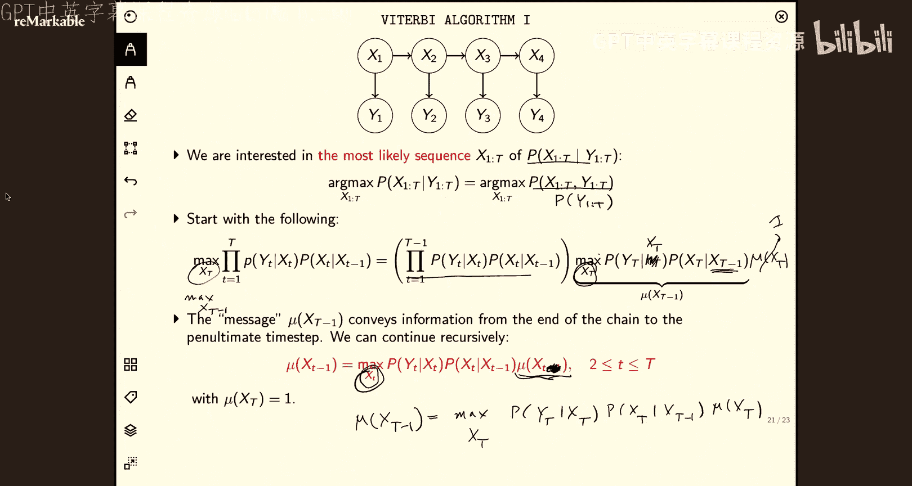
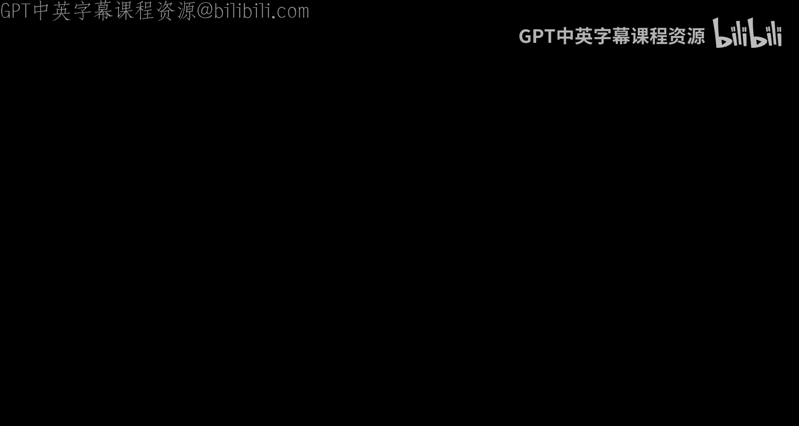

# UCB《机器学习导论｜CS 189⧸289A Introduction to Machine Learning Fall2024》claude-3.5 p20 L20- Hidden Markov Models & Graphical Models 2.zh_en -BV1H4421S7bs_p20-

不第意思了。不清。

厉害。thing年是。O do， shall we begin。So today's lecture。

 we're gonna continue on this line of probabilitybabil graphical models。

 So I realized I kind of rushed through things at the end of the last lecture on de separationation。

So let's finish it up。 So they're gonna go over examples。 But this， I have it。Here。

 as a reminder that we discussed the whole dis separation。 if you really， really。

 really understand atomic graphs and this is as simple as it gets， right。

 make sure you go home and do all the things I drive in the previous lecture。

But if you understand as howomicgraphs， I'll go over de separationation again。

 It's just like playing a game， you know， you just。

Make up a path and look at all the all these triple nodes and decide if a path is blocked or not。

 And essentially， there are two in this three atomic graphs， there are two separate cases。

 One is a chain right And this chain clearly x1 is influencing x3， right， I mean it's a chain， right。

 X1 influencing x2 x3 influencing x3， But we proved in the previous in the previous lecture that the moment you observe X2。

 then these X1 and x 3 become independent。So and this is a notation for independent conditional next two。

The same story is actually easier to prove for these cases， just。Immediately canceled。

 as we saw in the previous lecture， you can also see when you observe X2 now， again， x1 and x 3。

Are independent X2 X 3 condition x2 are independent。And then the cool thing is this。

Fan in atomic graph， which is exactly the opposite。 there are two causes for these variable x2。

 and these two causes don't talk to each other therefore they're independent。Right， x 1 and x3。

Are independent。Condition on empty sets， right？ So I don't write conditional empty sets clearly。

So X3 are independent。 But the moment you observe X tool， you cannot guarantee independence。

So this is a synthetictactic sugar。 So when I say this， I don't mean they are they are not。I mean。

 it could be independent in some if you cook up your model， but in general， you cannot guarantee。

 right。And。So， let's continue。Yeah， good。Okay， so just to this is a prelude for what， what we didn't。

 what we rushed through last time。 And I also noticed after the class。

 there were a lot of questions about the。This counting that I did。

 So I'm going to go slow making give you an example。 and hopefully by the end of this lecture。

 you are expert in count and that's very important。

 And then the wrap up for this first chapter on porissographical models inferenceencing poographical models and I'm going to make a case for you that psographical models is the world right is everything you need and from there you can answer any question you like and we're going to go over some of them。

😊，And so the order is reversed now。 in the previous lecture， we started with something simple。

 and then we went in general， I want to。Finish up the general。

 and then we go back to something very specific about the topic of inference in hidden Markov models。

Okay， so essentially， this is the story of this separationation。 And it's very intuitive to。

 I'm interested in in checking。Check in this condition， whether X， I is independent of X J， X J。

 given some sets。 I mean， this example， I'm continuing this settings just have one element in this case。

 in the other case as the other element。 And to check independence， I consider all indirected path。

 the key is。Which I should have made it read indirected。Right。

 I consider all possible path from X I to X J。And。And。

The condition of independence happens if all paths are blocked， right。

 every single path should be blocked。 But the blocking of a path is very simple。 It seems like a。

Very demanding condition。 All path should be blocked。

 but a path is blocked even even a single note blocks the path， right？ So if I see。

Any of these guys in my path that blocks the path， right and。So， and if you cannot do that。

 if you go over all paths and you could improve that all paths are blocked。 essentially。

 if you find only one path that you cannot， that is not blocked。Then you can say anything， right？

 You cannot guarantee independence。 So let's， let's play this game。 essentially， it a game that you。

 you are looking for， for blockage， essentially。 So let's do this one， for example。

 I'm going to condition on X 6 here， right。And let's consider there are several paths here。

 And I'm considering x1 to x 2， right？ So one path is this path。Oops。啊。え睡？One pass is this one。Right。

And let's go over this。 So this path， you arrive at this node。Right， this is the first。

 first node you arrived。 And this is。This， we， we cannot say anything， right， This is like a chain。

 but the end is observed。 And then we continue。 We arrive at this node， right。You see my cursor Yeah。

 You arrive at this node。 And what is this one。This is a fan in， right。

And the fan that the node is observed。Again， I I cannot guarantee blockage， right。

 And then I go here。 Here is a fan out。This is a chain。 I'm sorry。 So this is let's write it here。

That' a chain。You know I'm talking about this one， the chain。And the chain， if the node was observed。

 I would have， I would have won on this path， but it's not observed。Right， therefore。

 I cannot guarantee blockage。 So this path， I cannot guarantee blockage。 What else is remain。 This。

 The other one is this one。Right。But at this point。

 the nice thing about this game that we are playing。 at this point， we lost the game。Right。

So I found a path that none of the nodes on the path was blocked。Therefore。

 there is a path that's not blocked。And to guarantee independence， all paths should be blocked。

 Therefore， I cannot guarantee。Independence。Right，That's the answer to this exercise。

 Let's do this other one。Now， you are interested in。Condition on x 2。Right， I'm conditional x2。

 and I'm taking path from x 3 to x 7。 This is the。Going to be a long path。Right， this is one path。

 and the beauty of blockage is， if I find one node that is blocked。

 I don't have to check anything else。The past is blocked。And this is on our， in our， in our face now。

 This is a fanin。Right， and fan。Not X is not observed， and none of his children is observed。

Therefore， X is is blocked。Right， so。Let me write it。Fanin。Un blockedlocked。Very nice。

 So are we done with this game， or should we play。So to prove condition and dependence， I have to。

 I have to go over all path， right， I'm not done with this game。 I have to continue。And。

Let's consider a different path。So。X 3 to x 7。The other path is this one。Right。And。Its六歳。嗯。Lucky us。

 because that's that's fan out this one。The fan out notes。An x2 is observed。Right。

 it's a fan out node。And x， the middle1 is observed， right， therefore， is blocking the path。Right。

So therefore， the path is blocked。And we are。 we won this game， so therefore。

I don't know what meaning are losing in this case。 But this is， we can。

 we can say these are independent。Any questions here。Go ahead。Exactly。Exactly。I mean。

 a fan we are hoping that the middle one is not observed and none of its children is observed， right。

 I don't know what you're hoping in terms of blockage or not blockage。

 I'm hoping to block because I like condition independence。 If you like that。

 you like to see block notes。 You're really after looking block notes。 And， and this is bad。

 This is good。 This is good。 And this is also good effects tool was an observed， right， And。

 and it's very nice because， you know， you just， again。

 you just need to find one node on the path to block the path。 The path is blocked。

 and it's very intuitive concept。I mean。Should the pair one touring a for this work， I mean， I。

 I actually don't know the proof of this。 So it's， but the algorithm is very simple， right。

 algorithm， I can， if youre a good programmer， you can just write it up on on your computer。

 Any other questions。😊，We。Yeah。We like conditional independence because of counting， really。

 So if you have， let me write it here so everybody can see。 So if you have， let's be very abstract。

 actually， if you have P of group A and， and group B。Condition on C。If。

 if it decomposees a group A conditional C， group B。Conditional C， right。

If you want to identify this probability， you need how many you need， you need to have more。

You need to count more， right， We're gonna go over the table soon。 But the moment you break it up。

 then is is， you know， you only need to identify two different probabilities。

 It's just much easier to， for example， if this was binary here would have been。

Let's assume this is a very large set， you know， so this will be。

 let's assume the number of this set is C right， and it' large。 It's much， much。

 much larger than one。 So this will be， let's assume these are binary， actually。

 So this will be you need three numbers。 right， We discussed the last time。 And and here。

 immediately， you get to， okay， this doesn't help that much。 We get to 2 C。Yeah。

 it's not a big in this case。 but， but essentially it comes to parameterary counting that that we like conditional independence。

The other thing that's nice to what condition independence you can reason。You know。

 depending on the problem， you can， you can reason about your。In at the inference time， you know。

 you know that these variables are independent。Okay， so this is the end of the previous lecture。诶。

And then the whole program of probosic Africa model was a representation for the joint probability。

So。And here I have an example where this is node。 every node is binary。 and this。

 this represents rain or not rain， right， It's true or false。 This is my sprinkler。Sprinkr。

Going on and off。 And this as if the grass。Is wet or not。Right， these are all binary variables。

 And I have a。I have a， I can make a table， and this should be obvious to you now by the discussion we had。

 this table has eight elements in the table， right？

 There are two condition for rainbing through or falls， two for sprinkleer and two four grasses we。

 And in principle， if I want to have the full description of the system。

I need to know all these probabilities， right？ And this is essentially the story of joint probability。

 right？ And in principle， you know， you can see the example of rain going on and grasses that is sprinkle going on think the world is crazy。

 It's probably very small chance。 let's say a 0。01。 And then you can go you know。

 let's assume you have gathered this data for for many， many， many years， you go look at your book。

 you know， and you do like a simple counting， you know。

 there are every single day you recorded what happened and you go count， how many times was TFF。

 and you divided by how many count you recorded it。 And that's the probability。 right。

 You estimated with that。And clearly， this is a recipe for disaster， right。

 because the word is not doesn't have three variables。 It may have hundreds of variables。

 So there is no way do you go gather 2 to the information for 2 to the 10 possibilities， right。

 And this really motivates the idea as the word has many variables。

 But there is a lot of dependencies between these variables， right， We want to capture it， right。

So and this really at a high level。😊，At the high level is the motivation behind。

Behind pro graphical models。 So let's go over these statements again。 First of all。

 I should have mentioned this last time。 there is a there is a canonical example for joint distribution。

 you have seen it first in the maybe the third lecture or something in this course。

 is it is a multi Ga。The multivari Gaussian has in D dimension is specified by the mean vector mu。

 right。And， and the covariance metrics， which is which must be symmetric。

And we already discussed the case of a binary variable。 And again， here， you know。

 you have these D by D symmetric matrix and maybe your multivariate variable。

 Multivariate Gaussian variable has specific structures right。

 has has some sub matrices that are sub diagonal right and then if this matrix is is crossed is is broad diagonal。

 I'm sorry， then clearly needs much less parameters。 So I identify right。

We already discussed the case of the binary variables。

 and if it has two to the if it if it has the entries， you need it has two。

 if it has if there are D of them， there are two to the D entries in this table。

 since poverty as as to bond， there are two to the D-1 variables you need to identify。

 But among friends， what's the difference in2 to the D and2 to the D-1。 you know， when these large。

 you know， essentially2 to the D。 and so it's very， very large number。 And and again。

 we went over this here。 and we went over larger graphs in this game。

 we played for these two graphs we considered。The secret totractability is conditional independence。

 You know， when you have conditional independence clear immediately， this graph breaks up， right。

 and essentially oops。诶。Yeah， I think I wanted to talk about。 I guess I can talk about that later。

 Yeah， so essentially this， yeah， let's go over this parameter accounting actually。

 since it was an issue last time。So let's consider this example， right， This example is。

 I constructed this graph。And where P of rain and the sprinkler and grasping wet is P of rain。

 P of a sprinkle， a sprinkler going on given rain and P of grass being wet。

 given a sprinkler and rain， right， And here， essentially。

 it' is a boring example because I haven't done anything。 I mean。

 it's a nice recon in terms of causal model。 But in terms of base rule， essentially。

 there is no structure here。 This is P of S and R and P of S N R times P of W， given SN R is P of W。

Yes。And right， so here we do a s check at the end。 We don't expect that if we have gained anything。

 but。But the moment you construct your probability like that， you gather your data differently。

Right I constructed this probability。 I'm， at the end， I'm interested in joint probability。

 We're gonna hammer that point for the next hour。 But this joint probability in this case。

 is constructed as such， right？ So I need to know each， each one of these ingredients， right。And。

Each one of these ingredients is essentially， except for the first one is a conditional probability。

 right before here we had， we had。We had conditional probability。

 We have joint probability table right here。 we have con。

 Were gonna have conditional probability table。 So this is。If you like acronym。

 we can call it CPT right conditional probability table。And。So， for example， right， for example。

 G P of R， there is no conditioning。 There this variable can is rain or not rain can only take two values。

 And I've given the probabilities there。And the next thing is P of a sprinkler going on while it's raining。

 right？ And if you have a intelligent sprinkler， probably doesn't go on when it's raining， right？

 So P of a sprinkler， if the rain is through， suddenly， P of a sprinkler drops。Right。

 you have a sprinkle drops 2。01 and。And， and clearly， this should add to one， right。

 This row should add to one plus plus should plus this plus this should be one， right。

And the same thing for the rainbean falls， you have a probability table for。For。

A sprinkler being going on or being off right So essentially we did discounting last time and again the last one is the case of a sprinkler and rain right so it's very important I think this was came through this question last time is very。

 very important for you to understand that conditioning changes of probability。

P of S given R has nothing to do with P S P of S， right？ there are very。

 very different probabilities， right？ So essentially when， when we did discounting， right。

 this S and R essentially change the probability， right？ So if I want to count how many probability。

 how many parameters need to I need to identify to identify P of grasping we sprinkle and rain。

 right。The sprinklenaicular rain。 There are four possibilities。Right， I don't have a choice。

 There are four different probabilities， right， but this probability happens to be binary over binary variables。

 right， Therefore， I need only one parameters to identify it。Right。

I only need if I point if if I know probability of grasping wets given a sprinkler being true and raining through is 0。

99 and clearly probability grasping false in。01 right So essentially in this in this parameter counting。

 there are essentially four parameters here here there are two parameters and here there was one parameter。

Right， this will add up to what。To 7， right。And we could have done this differently here。

 We would have asked2 to the three。Right， and we have -1， which is also 7。Right。

 we are already at the same expression from two different angles。 One is。

From the condition poverty table， the other is the the。嗯。From the joint direct joint probability。

 right？So。And here we can fill up our table。 You know， we I。

 I left it empty in the first slide because I didn't know these probabilities。

 But now I know somebody gave me these tables， right。

 I have a table of all these conditional probabilities。 So， and I know the probability of any。

 any R S and W It's just multiplication， right， So let's for fun， do one of the rows。

 I'll do this one。Right， so that is true。 I picked this。And this is true given through， right， Tru。

 given through is that。 And then is true given through given true， right， true， true。

 true is this one。 So this should be  point2。0，1。9，9。Right。Whatever that is， it is points。0，0。

 something。2。I shouldt write it since I don't know。 it's not number because 。01 is multiply。Actually。

 it's probably roughly 。02。And let's do another one together。嗯。Let do you throw。

I hopepe I picked a better role。 So this probability of rain being false， probability of rain。

Let's see。 I think I。You way change the order。 Yeah， so this part of raining through。Right。Yeah。

 quality of rain being through again is this gonna use the same color。So， it's 02。

Let's be careful here。 Now， probability of。The sprinkle being false。Given raining through。

 what is that， Can somebody tell me what that is。滚。4。So we picked up this one。

And then the last one is probability of grass being wet while a sprinkler being false。

So here I have to go look at this row。 is sprinkle color green false， raining through。

The sprinkler falls rain through this one。 And I'm looking for probability of grasping true。

 What is that。I'm sorry。We are doing for S being false。Yes， thank you for catching that， yeah。Yeah。

 this is very actually a trickiest state of our first year。Can easily make mistakes。 Yes。

 you're right。 This was 。6。 Thank you。I'm sorry。Oh， sorry， sorry， sorry。

 probabilityb of S being false while R being true。Does that make sense， sprinkler， Oh， yes， exactly 。

99 again。Yeah。Where is the Oh， this 。99 came from this one。 Yeah， sorry， thank you。

 And then this one is part time certain write it down。 So I don't make mistake。

 Pro of grasping wet while a sprinkler being false and raining true。Right。A sprinkleer falls。Op。

 sorry。 this was for the previous one。嗯。Yeah。TheSp Air being falls， while rain being through。

This one， right。But isn' done writing anymore。Ys。Okay， my pen stopped working。 She's not good。嗯。Yeah。

 let's do the math here。 Proty of。This trouble to be fully charged， surprising。

So this one is poverty of。True while S is false rain is through that' 。9。 So it's 0。9 times 。

99 times 02。Right， it's roughly。What's roughly like point to， right？Yeah。

 so if you have a good pro thing written in your computer program。

 you don't make these mistakes I made。 So this essentially is just multiplication。

 You just have to multiply these and hold and behold， you already did this math for you last time。

 if you sum over all these probabilities。 right， But construction is going to add to one。

And that's a beautiful exercise。 Again， Do it at home for any graphical model you see。

 But here is very， very simple。😊，This is a bit of not good news that I cannot write， actually。

I think I'm going to switch overboard gradually。There's a lot of things to do here today。嗯。Yeah。

 so in that one， just do the math in your head that I'm going to you should first sum over the note that is。

That doesn't have a child。 and that note is the wes node。Right， then you sum over thats。

You end up with one， right， because that should sum to one。

 and your probability table gives you that。 It's the correct probability conditional probability table sum to one。

 And then recursively， you go back。Then you啊。Some over S and after that R。 And again， because youre。

 you already check your conditional probability table being the correct probability table。

 the joint will end up being correct probability table。嗯。So。Yeah。

 so this is what we are done with this。 Any any questions here。

 I think hopefully we can settle this down。At this point。Any questions。Okay。

So essentially I wrote something kind of abstract here。

 but essentially what the magic of these ptoographical models is this parent of X are typically much。

 much， much less than D。Right， if you had， if you had， if you haven't known， it had a lot of parents。

 you have a back to score  one。Because to identify that with the condition for this table。

 you need to， to the how many numbers are in parent of X I。Right， and。That number blows up very fast。

 right， actually， let me try to turn it on and off， I think。That could help us this back on。嗯。那个。诶。

Yeah， so essentially， this is really the magic。RightThat's really the heart that many graphical modelss we look at。

 this pattern of Xi is really a small makes life very easy。 The extreme cases， of course。

 my favorite is Markovcha。That is as as small as it gets。So essentially， except for this node。

 which doesn't have a parent， parent of X I。嗯。Is one。 There is only one parent for each node， right。

 Thats this is the simplest one。嗯。And we're going to build on that in this lecture。Okay。

 so the next thing that you I want you to absorb in this lecture is that joint quality distribution is the world。

 And what do I mean by the world， meaning that I mean that you can answer anything you like about this distribution。

And you get an answer。 You know， you have to do not make a mistake like I did earlier。

 but you get an answer。 And this is one example。 You are interested in probability of rain being true。

Condition on grasping wet。 This wasn't on my table。Didn't exist。 I need to。

 There is no row in the table。 I can look at。But this is， I write it as the base rule。

 And that's priority of rain being through and grass being wets。 This is joint， right。

Divid authorityacy of grasping wets。And each one of these。

You can just write it as a joint distribution just sum。 right。 So， for example。

 poverty of grass being wet， you go to your table。Probability of grasping wes is。呃。

Let me be gentle with this device。Is this ones。Right， these are the rows that grass are wet， right。

 And I identify those probabilities。 I have to sum over them， right。

 And this is what's done in that equation。Essentially。

 this the first thing you learn in poverty is called marginalization， right， I'm marginalizing。

And the top role this year is there is less terms involved in the marginalization。

 where Im interested in poverty of。Of rain being through and grasping wet。 right？

 And what's missing is the sprinkler， right？ And again， I put the sprinkler in the middle。

 and I sum over all these terms。 I want。 I don't want to go back to the。The table。

 but you can imagine， you know， just take all the RT and wes being true and then you just you identify those road。

 there are only two of them and you sum over them。嗯。So this is done in this example。

 I did it for you， and I I don't think I made a mistake。 You just go do this calculation right。

 So there are two terms involved in a numerator， four terms involved in a denominator and this answer ends up being 0。

36 right there 36% chance that is raining while your grass is wet because it's also possible that the sprinkler was up right。

So can somebody say， what is this probability。If also a sprinkler is true。

Any guesses does it go down or does it go up。Why。Yeah， so essentially。

 this is the explaining away phenomenon we talked about last time。 I mean。

 it's not that triplet nose， but the same concept。 So when the sprinkler is true。

 it's already explaining the， is the grass being wet。You know， I mean， it could happen。

 Springle goes long。 rain。 It's rain， It's raining。 But if you just look at the poverty table。

 they were like， they were explaining each other。 So please do this at home。

 I think it's really fun exercise。 I did this example。 And this is essentially same story。 You know。

 you write it as， as。😊，2 joint probabilities where in the numerator。

 you have to marginalize in the denomin。 you have to marginalize。 and， and this is。

 this is the template。Essential， you just， you just can't go。 and probably this should be much。

 much smaller than 。36。I don't know my guess is probably 0。01 or something or less。嗯。But I think。

 let's。呃。Contemplate when you， when I said joint policy exhibition is the world。

I really want you to absorb it that， you know， it's really any inference question you ask about my system。

 any。You know， you go to the joint probability and you have the answer。

 And joint probability is is given to you by the factorization。By conditional probabilities， right。

So essentially， this is like a。You know， this is， this is a very nice example that we added。

 You know， that we had， we had this， this probability we calculated it became 36%。

 We have some intuition。 you you expressed you have some intuition that if sprinkleer also goes on probably for your。

 for your range should go down。😊，Right， but we should go check it， right， and we can go check it and。

So soon， we're gonna go fancy and do something more complicated。

Any questions here while I'm switching gears？So， parameter counting is。

Should we do this again for Markov chain， or are you guys comfortable with this。

Let's assume this is a two state markov chain。 So each x is binary， right。My x are。

Or each X T is either 0， one， right。And this assume this goes to Ter steps。

How many parameters do I need to specify this， this， this Markov chain。

Now let' assume it's homogeneous。 So all these probabilities。

 transition propertiesbabilities are the same。What should I do to I， I ask you this question。

 But how should I think about it， I don't want you to give final answer， right。

What's the thinking process here？Good。Exactly， what are you thinking now when you said that answer。

 You're thinking about the factorization， right， You're thinking of that I'm interested in joint distribution of P of X 1 to T。

 right？ And I factorize it。A P of X， T。Give an X T -1。T from 1 to T right by convention。

 soon I'm going to use this before too。 there is no x0。 This is x1 to x T。So x0 doesn't exist。

 And what I mean by P of x1， x0， I really mean P of x1 right。So essentially for the first。

 for the first guy P of x1， I only need two I only need one number， right。For P of x2 given x bond。

 how many number do I need？I'm conditional on X1。 X 1 can have two values， right。

So think of the poverty the conditional poverty table。

 You wantna construct the conditional poverty table， you' gonna put two rows， right。

 And each one you should add to one。 Each one just need one number。So， that needs to。

And everything is2。Right， and there are t minus- one of these guys。So， totally， we have。

1 plus 2 t -2， which is 2 t -1。Right。And 2 T -1 is a tiny number， compared to。Our original number。

 which was due to the。A。Yeah， in my notation。So that Markov chain is rotated clearly。

This is the markov chain。And the case of。2bit之一。If you don't know anything。

 you have to fully identify this as a joint distribution。 you don't know anything。

Right then that's clearly2 to the t minus。Right。Very good。So， essentially， when you。

This is what I want to ask you to think that， you know， anytime you see。

 you think about the privacy distribution in this， in this graphical models。

 you immediately think of a factororization， right， That's how you， that's how we。

 we solve this problem。 We didn't give the final answer。We just broke it up， and， then。

Solve each problem， individually。Okay。So now we're gonna switch gear to this。

Example of a hidden Markov model。And， and Is gonna switch back to this。

 what example I used last year， just as a mental picture you have， the weather ice cream example。

Where。Where essentially my states， right？I。Whether weather is hot or cold。Right， so this is hot。

That's one random variable。 Theres a weather that's changing over time。

 And this weather is either hot or cold， right and。Smite it down。Right。

 and and whether doesn't care about if I eat ice cream or not， whether it's doing it thing， right。

 So there is changing。 And so that's the almost that's the Markov chain on top。

 And condition on a day being hot tomorrow can be hot or cold。 And clearly， if today is hot tomorrow。

 there is more chance that it is hot， right， we expect that。诶。And。And then on top of that。

 we have another random variable where I eat ice cream， right？ And if it's a hot day。

 I'm a normal person， I probably eat more ice cream。 And did I do it right， Maybe it's backwards。

 actually。😊，Oh， I did it correctly。 Good。 So essentially， if it's a hot day。

 probability youre having three off stream。😊，Is 04。 If it's a cold day。

 problem to me having three ice cream is 01， right， so。

So there are these two events that are happening。 And the weather。

 let's assume the weather is causing me having how many ice creams， right。

 and I don't eat more than ice cream。 So this stops at 3。 So the， the one estate has two。

 the weather has two estates， hot or cold and the number of ice cream。

 I I eat in this case has only three estates，1 to 3。And on top of that。

 you are interested in a problem where。We want to run inference on the weather based on how much ice cream I eat。

Very weird example， but that's the example。 Suppose somebody doesn't observe the weather。

 Supp this you know somebody just observe the earth and just sees how many ice cream people eat right and they want to run inference on what's the weather like right And this is a problem of interest here。

 And that's the beauty of graphical models that you can write it this elegantly in terms of what they describe in terms of these arrows and by the way。

 this is called stochastic automaton。Representation of hidden Markov models。Where essentially。

 this loop， hopefully， you see this loop is not， iss not a graphical influence loop。

 This is just a probabilityability of。Hoart being hot， heartke。The previous estate being hot。

 poverty of next estate being hot， given the previous estate being hot。 right， That's this。

 that's this arrow here。 right， This is not a。Look that's forbidden in graphical models。

 But essentially， this is a very different representation where I abstracted away this states。

 So here， you know， theres really these two X1 can have two estates。By compressing into one。

 It's a node。 So probably it's a node representing that random variable， right。

 And why one can have three estate。 It could have had a billion estate， but still is just one node。

 right， It takes different probabilities。Condition on X T。 And this intuition。

 I told you that whether doesn't care about how much ice cream I is。 It's reflected there。Right。

 the weather。The tomorrow's weather just only depends on two's weather。 And that's the top row。

 right。And， and the bottom is how much ice cream I eat today based on the weather today。

 I don't eat ice cream based on what happened yesterday， right。If it was like that。

 if I was that kind of a person， I would have had another note here， right， But I'm not。

 And then this note doesn't this direction doesn't exist。 And this simplifies my reasoning， right。

 as we will see。So。Longest story short， This is our weather ice cream hidden Markov model and it's hidden because the assumption is。

 these are observed。That's the soon we're going to get into that。We're going to observe this wise。

 but we are not observing the weather。 and we want to reason about it。

 And theres some reasoning question you can ask， for example， are there is a list of them。

So these parts are not covered in depth in the textbook。

 but this has been covered every year it' a very important topic and for me a good presentation of it is in David Barber's book。

 which I gave in the first slide and that's online available in PDF you just need to read。

A few sections which I've given。And here we're gonna cover only two questions。

 One is that we have observed how many ice creams haveve eaten over a long period of time， right？

 And I want to reason about the weather at that at the end of this path， right。

 this is clearly a simpler question。 If I want to reason about the weather all the way， right。

 I only want to reason about the weather at the end。 And this is in the。

It's a jargon it's called filtering。And if you search it in that book。

 you'll come to the right section to read about this。And the other。

Very important question algorithmically is that I observed the whole sequence of observation of me eating ice cream or somebody eating somebody eating ice cream。

 And I want to read then about。The， the weather condition that maximizes probability。So clearly。

 this is a simpler problem。 It's already a hard problem。

 but I don't want to reason about the whole distribution， right， This is very， very hard， presumably。

Right， in principle， I want， in principle， I really want to know the full distribution of all these weather conditions。

Given how much ice cream have eaten。 But that's very， very hard。 You know， this is hard。

And the next question that's also very， very applied is。What X， what。

 what conditions maximizes this probability。 And this is very， very applied。 This can be， again。

 I discussed this last time。 This can be your。A speech signal。嗯。That you observe。

 And this can be the words that I， I say， you know， and I think I can have a model。

 I can have a speech recognitions。You know that that the system listens to me and speak and and out figures out the words I say。

 and typically you can assume if you have a good model。

 the sequences that maximizes probability is a good candidate， right。So we have 30 minutes。And。

So here the underlyingline way of thinking about this problem goes back to dynamic programming。

And here I'm assuming everybody knows dynamic programming。 I'm gonna review it。

 How many people have seen dynamic programming， How many people have not。Very nice。Yeah。

 which course have you seen it。1，70。 Okay， so let's quickly go over it。

 just for people who haven't seen know， I didn't see every hand being raised。

 I'm going to just be quick since it looks like most people are familiar with it。

 But please come afterwards， ask me questions if this is not familiar。

 And this is a classic example of a finding cheapest flights。So。And so essentially。

 you want to go from Hawaii， Honolulu to East Coast and East Coast anywhere I get。

 I I'm happy either DC C or New York in this example。

 and we are in 1950s and there is no direct flights。

 I have to go first to West Coast then go to Midwest and roughly Midwest and then go to East Coast right So that's the only way right to go through this And I'm interested in cheapest flights。

😊，And all of these numbers are given from Honolulu to Seattle。I gave this example here， for example。

 here is 300。The price， right， The price is fixed。 and all of these edges， I have the price。

 and I'm interested in the total price going。 you know， there are many。

 many different paths that I can go。 and I'm interested to find the cheapest light。😊，So。So again， we。

 we go back to our。To， very dramatic。Cases where in one case we have a not so clever algorithm。

And Dr clever algorithm is very simple to implement。What do you do。How do you do brutefor？Exactly。

 yeah， you just enumerate all the path。 And let's assume this is like a very， very long。

Sequence of events。 And each one， let's assume you have K possibilities。

 So K in this case is3 in the middle， right？ So essentially， to enumerate the path。

 I have to be K here， K here， K there， K there， K there and I'm continuing for T S T stages。

 So this will be of roughly over the K to the T， and which which blows up really fast。

 is exponential as T increases。And assuming we'm going to see a very simple algorithm。

 which is of order the k square times t。Okay。So， and that algorithm is actually very simple in hindsight。

 And it's called this philosophy。 It's called back tracing。

 And we'll see it again in the last algorithm we're gonna study and。So the idea is very simple。

 The idea is it's really this problem is not arbitrary。It has a structure， right。

 You have to go first to the。To West Coast， then to Midwest， right， So the the idea is first。

 we find the cheapest way to get to Seattle， to SF O and L A。 And here we don't have a choice。

 We stop in Honolulu， right， There is only one path to go。Right， so this will be 300。

And the pass is given 3，50。 It's very boring。 I'm writing it on top。For， right。

And then the other is to do repeat this right for every node in the middle， but this computation。

 this computation in the middle。Is over a K square， right。Right， there are K note here。 K note there。

 is over the K square。 And let's do it。 For example， I'm gonna do it for Chicago。 So for Chicago。

 there， there is a path from Seattle。Right， and that's。500。And there is a path from SFO。And that's 4。

50。And there is a path from L A X。And that's 600。Good ahead。嗯。Let's not be fancy。

 I just want to be very， very simple。 It's probably， I'm sure that algorithm。

 if you comes down to the heart of it is is related to this。 You know， that all of these things are。

 you know， we'll see like there is like a soon we're gonna have this fancy viterbi algorithm。

 and weterby really， it's like in deep down。 iss this algorithm。 You know， it's just very。

 very different way of phrasing it。 but essentially。Here we found it， right， to pass it with the。

 that's the cheapest。 And we're gonna write it。I's 4，50。 And I'm going to erase this。

 I don't need all this information。I'm 4，50。 I'm gonna trace it。I this path。Right。

That's the 450 path。 And then I'm going to repeat this for Denver。 I don't have these numbers。

 Denver and Dallas。 but let' for， for for among us。

 let's assume the best fund the winner was Chicago。Right。

 so the best cheapest way to get to the Midwest was go through the Chicago。

 And this is already should。You know， should， you should think because naively。

 if you wanted to be greedy， you would have chosen， oh， let's go to Seattle。 That's 300。

 It's cheaper than SFO， right， But it may end up。 The best way to get to the Midwest。

 is go through S F O， which was。Some part of it was more expensive， right， But the。

 the bottom line is this this computation is over the case square。Right。

And we're gonna repeat it for every stage， right， And clearly， there are two stages。

 So the whole computation will be about a K squared times t。Right。

 and and the problem is solved essentially because we're gonna write the cheapest way at every stage and we're gonna trace it。

 And maybe the final thing will end up being Chicago to New York。I don't know。

 Maybe let's say this is a cheaper flight。 and the final price we have to pay is 5，50。So。

So here I haven't done the k square computation because of time。

 k square times t but but you know where this is coming from and it's got back tracing because you know you're back tracing now。

 you know， you save this computation going forward and you know the cheapest flights by just going。

 you know the way you came， right？😊，And you have seen this before back tracing back propagation。

 you know， so back propagation， we had very similar idea where we stored the things that was more clever。

 We had to store this specific things in our algorithm like if you recall there was this error parameter。

 there was this gradient of the activation function we stored。

 and then there the computation went from order the。😊，Pia square P number of parameters。To order P。

 This is for backdrop。 right， here is more dramatic。 We go from。K to the T to K square times。

's much more dramatic。呃。Okay， so let's we have nice good 20 minutes to talk about two problems。

 I'm going to warm it up for you。 The really the， the crown algorithm at the end is vi algorithm for solving that seemingly hard problem。

 right， It looks when you look at this， you say， okay， how am I going to solve this problem。

It's a very， you know， I only know the joint distribution and joint distribution is like there is a lot of terms and but soon we'll find a very。

 very nice way to solve this solve this problem finding arc max of this distribution。

So as a review again I'm going to give you symbols， but you already know it。

 Essential HMM is given by this graph on top So there are these x variables which has not seen and they are influencing each other in this Markov chain and there is a direct path from X T to Yt and so it's identified there case states for x。

 there are l states in my notation for for y it's a discrete case for simplicity and there are two kernels that you need to know two transition probabilities。

I use the fancy and kernel， with。It goes with the name kernel。

 These two transition probabil that you need to know。 One is this transition， right。

 and the other is this transition for every A T， right。 And that P of X T given X T -1。

And P of Y T given X D。And clearly， you need to initialize this chain from somewhere。

 And the parent of every， the， the grand grandparent is this note。

RightAnd that node you need to specify is probability right So when you have this youre ready to go right。

 you know the full distribution given at the bottom right。So from here now。

 we're going to warm it up and do a little quick exercise together to we want to answer this question。

 what is P of X T。Given y 1 to T。Actually， I have plenty of time。 I can go a bit slow now。

So P of x T given y1 to T， right， How should I start thinking about this problem？

What do we like in probabilities？I said something is the world。Jojot probability， right。

 So essentially， this one。Clearly， it proportional to P of X T。Why quantity。Right。And。

 and this model has a specific structure where time， you go from time t time t plus1。

 time t plus 2 times t plus 3。 right， So it has a very， very specific structure。

 I want to take it into account， right， How should I take it into account。So I can write this。 Okay。

 let me actually。I can spend more time on TVterby。 So essentially。

 the way I take into account is that I write this as， as I insert a note。Maybe they're explicit here。

Okay。Yeah， let's go do the math directly， actually， because this is very， very simple。So essentially。

 I'm interested in this probability， why。Because。I mean， this is a very sensible object。 right。

 I'm interested in。This state， I have a lot of observation， right？ I'm interested in what。

 what have I not， what have I， the the note I have not seen at that particular last moment， right？

 I've had today， I had one ice cream to， I mean。Two days ago， I had one ice cream yesterday。

 I three ice cream。 and today， I had one ice cream。

 And I'm interested in what's the weather like today。 I'm。

 I'm not interested that the person wants to do in France， right。

 who that hasn't observed the weather。 What's the weather like at on today， right？

 So there is a lot of evidence gathering。 And I'm interested in the the what I have not observed at that day。

😊，And this we saw， I mean， this is essentially。I'm using base rules here。And this is， you know。

 this is the observed quantity， right？ So that's why I use the word proportion proportional。

 So if you are， if you change the state， the denominator is fixed， right， If you change X T。

 the denominator is fixed， therefore， really。What is what we care about is filtered everything。

 What we care about is this joint probability。So the joint probability， the trick， really。

 is thinking about， we're gonna keep thinking about the。The flight example。

 these are fancier because there are probabilities。 There was no probability。

 but it's really the same idea。 I insert a note。In the middle， right？And I'm going to sum over it。

Right， I'm going to all sum of all， all possibilities of， of X T minus-1。 This clearly equal to that。

 I haven't done really anything。 and then。We're going to do something。

 So if we're going to break it up into P of Y T。Givenan X T。X T -1。Y 1 T-1。 And again。

 I did the same thing because I know I'm breaking things up into。Into the last stage。

 So I'm breaking y 1 to T。租方。To，2 random variables y 1 to T-1 and y T。 Again。

 I haven't done anything。 This is really why， why。By definition， quantity。

So can somebody help me here， I have written this one。 What else should I do。

What are we after at the end？You know， we want to trace this back。So we are， were gonna we want to。

 we started from this。 We want to somehow get to X T-1。Y 1 T-1。 somehow。 I'm going to trace it back。

And this is on our face right now， right， There is this variable。 This variable is almost like。

 you see it。So I write this as P of X T。So let me actually be very careful here。 So here。

This is really P of。I don't。 I don't want to lose you。Pf XT。X T -1， Y 1， T -1。And then。

 I'm going to be。More economical here， Y T only depends on X T。This doesn't come into play。

Just look at the graphical model in your head， right， Y T only depends on X D。

So this becomes here of Y T， given X T。 And I'm going to break it up again， oops。

I'm missing something here， Your， ex T。So I'm going to break this up again。 This is P of X T。

Given X T -1， Y 1。T -1。Right， times。P of X， T，-1。喂。10-1。I hope I haven't lost you。 So here。

I'm just decomposing this term。This is this kind stat。Is that clear？I'm just using the basement here。

And again， X T does not depend on y 12 y T T -1 only depends on T -1 by construction of my， my graph。

So， final answer is。The final answer is。Pov。Y T， given X T。P of X T。Given X， T -1。P of X， T -1。Y 1。

 T minus。And the key is essentially， we managed to trace things back。

 So we had started with this object。 and that was the object of interest。

Right that was everything I'm interested in is encapsulated in this object。

And now this object appeared again。But in a very nice form， which is alpha X T -1。Right。

 so essentially， alpha。Xt。This is my final expression。I'm going to。Write it in a nice form after。

 after the lecture in a late format。 So you'll see it。 But essentially， I write。

 I wrote alpha X D as sum sum Al X T minus-1。 But the key is every element in this sum I know it。

Right，It's just if you have a good， if you program it well， you know， all things are known。 I mean。

 that's the definition of a Markov Had Markov model。 P have Y T given x is known。

 If have X T given x T minus-1 is known。Therefore， you can， you can start from alpha x1。 Again。

 Al x1 is known。Right。And and construct alpha X2 based on alpha X1。

 alpha x3 based on based on alpha X 2。 and youve solved the problem。 essentially。

 you iteratively solve the problem。 And it's called the alpha update algorithm。Finally。

 we come at a Vi algorithm。😊，Interestingly， is actually kind of simpler。 Well， let's go over it。

 So we were interested in。In the most likely sequence， right， the most likely sequence。Actually。

 I have some minutes if you have questions here， I just don't。

 you have to really understand what's happened here。Good。Yes。Yeah， yeah。And yeah。

 we added X T -1 because we were interested in backtrack。

 we wanted to bring alphapha X T -1 into the picture。Good。we care about。

Basically what the weather is。嗯。Yeah。In solvinglving that。Yes， but we got rid of it， too。

 We put together a sequence of leather， a sequence of weather， but。😊，You know。

 use this conditional independence。Yeah， so it's like if you really want to go back to the full probability problem。

 I mean clearly it's a harder problem just when you do even parameter counting or any other， yeah。

 it's intuitive but you know each of these problems are different。Yeah。啊。

But I hope I answered your question。Any other question。Okay。

So let's go to the problem of finding the， the most likely sequence。Given some observation。

 most likely hidden sequence， given some observation， and this is really goes through two stages。

 one is first I'm interested in finding the maximum， you know。

 this has really has the same flavor of the the cheapest light algorithm actually。

Where essentially we change cheap minus expensive。We are maximizing something in terms of minimizing something。

So to find a maximum of this， of this。Oh， yeah。 So the first system again is base rule again， this。

 this。We， I cannot deal with conditional distribution。

 I only have to think about in terms of joint distribution， right， as the lesson number one。

 we re we cite every single case。 So in this case， it's also easy。 We are interested in this arc max。

 but this a max is the same as this arc max because this is this literally divided by P。Y1 to T。

And we are R max over x。 The Y is in the denominary just doesn't come into play， right。

 So this joint probability， I just used my factorization。 This is a factorization of the。

He the Markov model。 And when I'm maximizing over X T， X T just pushes goes through， right， The X T。

 the first T minus one term doesn't even depend on X T。

So X T just goes through right So maximizing this over Xt is akin to maximizing this object。Right。

This is the， the very last term of my， my product。And let's name it。 let's call it new X T minus-1。

 right。And the nice thing about this new xt -1 is just a summary of this my maximization operation。😊。

I push this maximum to the very last dash term。 have I name it I name it mu。

 and this mu clearly is only function of X t minus-1， right I'm maximizing over Xt。Right。And YT。

 I don't even write it because observed right， is the thing that I'm not sure about is the hidden states and there is only x minus1 that have remains right？

So I have this。 and this。Goes to the， the very last term of this product now。

 So if you look at this product。Right。If you look at this product， the first T-2 of them。

 there is no term I'm， I'm concerned with。 right， If I'm interested in the next one， I'm sorry。

 The next stage is I'm interested in Max X T。And。So for this problem。

 if I want to maximize over X X T -1， only the term that matters is new mu X T -1。 right。

 So essentially， we end up with。With。This recursion operation， right。

And recursion operation essentially says that if you wanna maximize if J， yeah。

 So if you wna maximize over X T。Right， there is a message you can。 you need to keep。

 and that's come from X T -1。Right。Okay， again， intuitively， this X T and X T X T minus1 x T。

 X T plus1， they only communicate to each other。 You know， It's exactly like the cheap flight option。

 right so。So if I， if I care about this maximization operation， I only need to keep track of X T -1。

 right。And to check this condition， I need to start this， this recursion at some point， right。

 I started from T going backwards， and I want the definition to match this。

 So I want muu of X T -1 with this definition to be equal to this。 And I just said mu of X T。So。啊。

I think actually， I made a mistake here。No， this should be a recursion。

 I think I made a mistake here。哦。Max X71。😔，Yes， made a mistake。 This should be。T， right。 So when。

 when we write it， we get our definition back。Max。X T。Pyqi。😔，X T again。Should be X T。

And by definition， we didn't have mu X T here because。This re has to start from somewhere， Right？

 So we just set this to be one by definition， we define it to be one， right。

But the important thing about this algorithm is this， this message is essentially。诶。

They are the only need， the only thing that you need to keep for this communication。 Again。

 exactly like the flight examples。 So if you really understand the flight example。

 there is no difference here。And， and。So here we were interested in arc max， so we know the max。

 right and we go all the way to the first stage。😊，Right， and that's mu X 1。So with this。

 with this procedure， you know， we have a recursion where if you find all these messages at this at。

 at each stage。All these functions at each stage。 And these functions are functions of the hidden statess。

 We don't see。And we get a number for each one of them， right？And then at the end of the day。

 we want to see what was what was the thing that maximize my function， right？ I go from。

 I take this message。 I take this mules， go all the way to the first stage。

 and this is what's done here。 and take instead of max。 I already maximize it to get this muse。

 I'm interested in the art max。 So again， this goes to the cheap flight option in the cheap flight option。

 we traced it， right， It traced the what what caused the cheapest flight。 remember。

 So this is what it gives you。 It finds the what what was the X that maximize this。😊，呃。And。

 and then we're going to iterate over。Right， we're gonna keep iterating over。

 And this is called backtrack algorithm， where we find all the excs that maximizes my。

My conditional probability。And in some literature， this is called posterior probability because x is not observed。

But you know， that's just a jargon。Any questions。Is the connection between this and the cheap flight clear。

Yang。Yeah， the chip price is actually I like it because it's a very simple example。

 but it really needs contemplation， you really need to fully understand what happened there。😊。

And when you， when you understand that this， this becomes like a simple thing。

 except that the mistake I made， let me make sure。wonderon if I have this note somewhere。

How much time do we have， Yeah， I'll check this at home。

 But I'm sure the this is clearly we are going from T to T -1。 So I made that mistake over that。嗯。

Yeah， think about it。 And if you have questions， I'll go very again on Thursday。

 if you have questions， yeah。I think we terribly， we can spend like five more minutes。Yeah。

 in case you have questions。Thank you。

