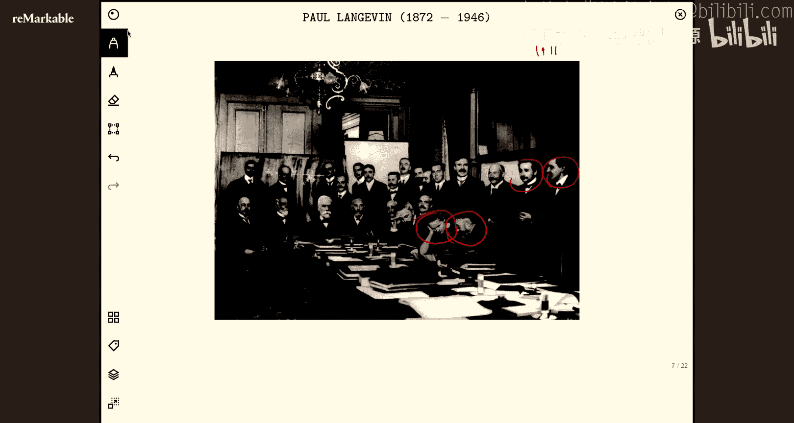
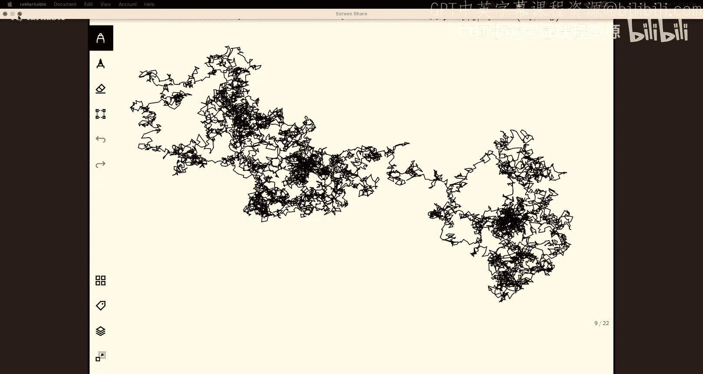
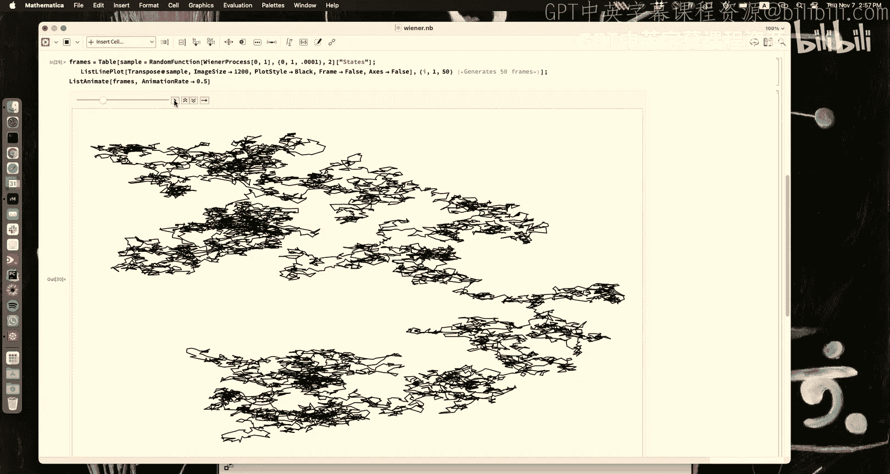
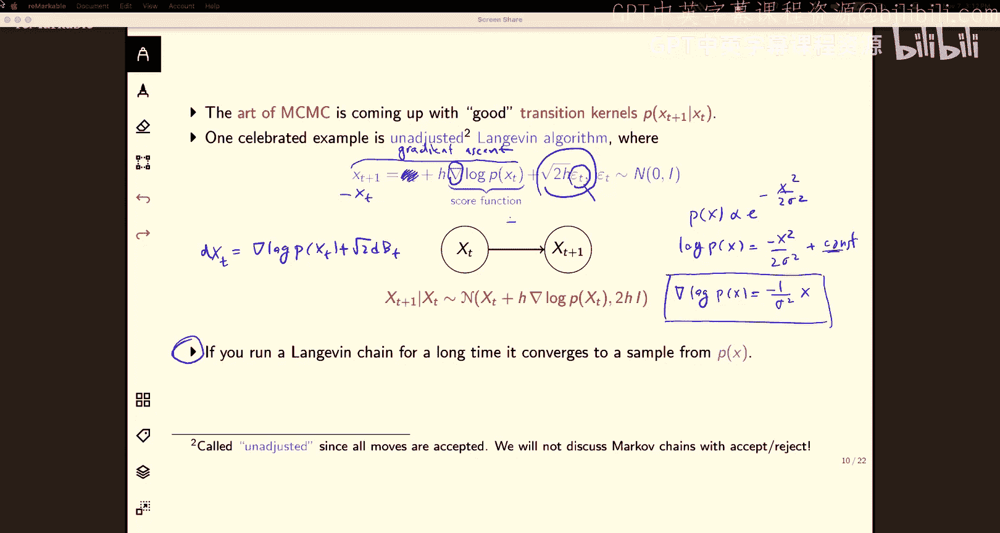
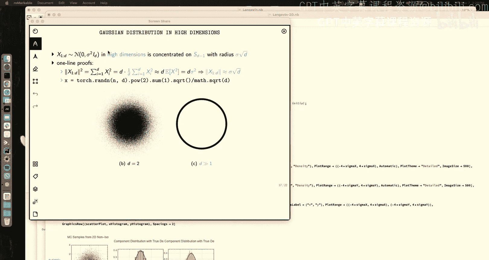
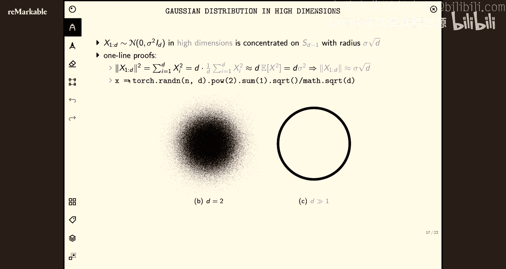

# UCB《机器学习导论｜CS 189⧸289A Introduction to Machine Learning Fall2024》claude-3.5 p21 L21- Generative Models 1.zh_en -BV1H4421S7bs_p21-

你要那个你的是。不的。やだ我でよ。哦， this is the new。い yeahや so we just。And you need to connect to。你还是笔。at least。这是。

There might be some video。We might。可。So。被告人你。Especially those？Is there wrong。どです。So I。いや、来みし。一审年。

要提供给。いろんな。Be mon。你要审。I think。好识 whatever。じゃ出て。7月。放弃。Assortted。email mail有。是不是？て so much。Okay。So。这是打。

Yeah。李案。包我有ます。

那's外。7。Yes。Okay， so let's begin， I'm going to finish up the Viterbi algorithm。From last time。 Well。

 we finished it last time。 I'm going to give you a different version of Viby， which is closer to。

The homework you are going to do。 So first， very quickly， revisit this cheapest flight。problemblem。

 And so basically， if you remember last time we arrived at the best way to get to Chicago was。4，50。

And through SFO。Right。Let's assume I don't have the numbers here。 but let's。

 let's assume to dener the cheapest ways for。400 through Seattle。

 somehow there is a very cheap flight through Seattle。

 and let's assume here is even a smaller let's like 300。 I mean， I'm being very。300 is not possible。

 Let's say 3，50。For the sake of argument， and through。The ce。O。So。Oh， that's possible。Let's see。

500 through V X。And then the， this is， at this stage， right。And and then we we， we are。

 we are interested getting to East Coast。 That's the final。 This is the final stage。 And to D C。

 let's say， is 500 through Chicago。And for NYC， let's say， the cheapest option is。600 through Denver。

So but， what you need to pay attention is that at each stage， I really care about the previous stage。

Right， that's how the model is structured。 And this computation is clearly for each1。

 I need to have k computation here to find the cheapest one。 And there are K of them。

 So this computation here is upward there。Or their case square， right？ And there are T of these。

So the total computation is over there。K is square density， right。Take this off wait done a week。哦。

And。Yeah， so we are interested in the cheapest flight option。 So we have solved the problem。

Essential， the cheapest flight， the cheapest way to get to D C from Honolulu is 500， right。

 We compare 500 and 600。500 is the answer。 And now it's the trace back sign。 We know。

500 came from Chicago。You you know Chicago came from a4。And here。There was only one option。

 So essentially， this part， this Chicago here in our Vi algorithm， is the code andqu arc max。

We are interested in what's in from what I mean here is Armin， right so。In this case， it's argument。

Right， so we know what， what minimize the flight。 And here there is another argument in SFO。

 And then we have solved the problem， right， So let's go with this refresher in mind。

 Let's go back to the。Example， and I'm going to do exactly a three way example to keep it simple for you。

Right。So we are interested in， Let's assume this is the hidden Markov model， right， And here again。

 this is the。He then escapes， I don't observe in this example， hot and cold， right， It's a weather。

 if' either hot or cold。And and but we have an alien who doesn't observe the earth。

 We only observe eating ice cream， right？ And there is a probability of ice creams given this hot or cold。

 right， given by this And on top of that， we have the probability of cold getting too hot， right。

 at each， each day compared to the previous day。 Let's I assume this queue is know。

 it global warming。 let's say this point。6， and let's say P is 05。So if it's a hot day with 50%。

50% shine， tomorrow will be cold。 And if it's a cold day with 60% chance， tomorrowrow will be hot。

 right？ And for each one of them， again。😊，With hot。I have the full probability of。

Of me eating an ice cream。And so with that in mind， and also have on top of that。

 I have the probability of hot and cold for the first day， right， probability of。Excellent being hot。

Again， a 6。6 probability of x1。Being called is 。4。Okay。So。With， with this， you know everything。

 right， We know the joint probability。Right， and if we， if somebody is interested。

 So let's assume in this case， I observe one ice cream。3 ice cream， one ice cream。Right。

 I'm observing somebody having one ice cream next day，3 ice cream the day after one ice cream， right。

 So I set these probabilities here。 This is one。This is3。This is one， right。With this in mind。

 so this is again。1，3。1，3，1。Right。With this， you can just quickly make a table。

 and the computation is。What can somebody say the brute force， What's the brute force computation。

I can compute these probabilities for all combinations of X。How many， how many queries I have to do。

 the bru force way。Okay， I mean， maybe you forgot what the problem is。 The problem is written here。

 I'm interested in artrc maxs。 I've observed。1，3，1， ice cream。

 And I know the full probabilities for full。Probably the graphical model。 is's just stated here。

 right， And observe 1，3，1。 And I'm interested the sequence of hot or cold that's most likely。

Under my model， right。So I'm interested in this arc max。

 and this arc max by basees rule is the same as this arc max as the joint， right。

 And the joint is written for you， right， The joint is coming from the pigographical model。😊，Right。

So I'm interested in maximizing this。 What would be the equivalent of the cheapest flight。

 the rootte force way。各 ahead。Exactly， so there are8 perutations here， right？And。

 and it's very important for you to understand that this8 permutation is a very quick computation for each one of them。

 But it's also important to understand that if this three was， let's say 1 hundred0。Instead of3。So。

 if I have。X 1，200。So this will be 2 to the 100。And this is more than a number of particles in the universe。

 as we say， right， So essentially， no way you can do enumeration， right， and。

But we're gonna quickly see that we saw last time that is exactly like before this。

 this computation will come down to k square。So two to the two。As simple as that。Times T00。

So we go from number of particles in number more number of particles in the universe to to to 400。

So let's do that now again。呃。So I hope this is clear for you that the wires are fixed。

 I want to keep it clean。And I'm going to delete all of them。Okay， so the way we did it last time。

The way we did last time was to。 we want to maximize this object， right？

 What we did was we started from the end。 So if here I followed David Barber's way of doing this。

 So here we followed from the end， we call this。蓝的。We maximize over x3 first， right？ So essentially。

 the idea is when you are maximizing， we are interested in max。X 1， x2， x 3， right。

So the idea is the x3， the first1，2，3，4 terms doesn't have any x3 in it。Right。So we can push。

 push through this maximization over x 3。 And we call this when you're maximizing over x 3。

There is two choices for x2， and each one of them will give you a different number， right？

 So this is essentially max of this， this guy， right。Over x 3。

And so you should really understand that this is essentially a number that takes hot and cold。

An output is a function that gets gets hot and cold and output a positive value， right。

 And then when we have solved this problem， we now have to solve this problem， right。

 So Lada X 2 gets multiplied by P of Y 2， given x 2， P of X 2 given x 1。

 And now we maximize over x 2。So we get lambda x1。And then the arrival at dysfunction， right？

And at this point， when I maximize over x1 is analogous to what we did in the cheapest light。

 We have solved the problem。 We have arrived at the end， right， and this essentially。

 we can call that probability when you when I maximize。P， x1。P， Y 1， given x1， lambda X1。

 This is the highest， highest possible probability。 That's really this。Right。

 and now comes exactly what we did last time we trace it back。 We say， what maximize this。You know。

 then from here we go to Arc Max。Right。An arc max of this this object， let's say， is x1 x star。

 right。Right， and then we're gonna put X 1 a star where， where it matters， right， X 1 a star。

 we're gonna put it here。Yre。And。呃。And here。Right。And then we gonna maximize find the agon max over lambda x 2。

Right， when we find maximumim， when do， when we find a max over lambda x2 again。

 is's exactly like the cheapest light option。 We are tracing back where these maximums are coming from。

 right， that maximumimization gives us x to a star。 So from here， we go to X to a star。 And again。

 we're gonna put x to a star iteratively here and here。😊，And after that point。

 we're gonna do a max over x 3。 And then we have solved the problem， right， So this is the。

So in my updated lecture notes。I。I call it backtrack because really。

 if you consider an analogous to the cheapest flight， we went this way。

 and then we did ag Max that way， right， So back backtracking is all relative。

 So we constructed our maximum operation to go this way。😊。

And then we have to iterly get the maximum values going that way。 right。

 So now I'm going to give you the next the other way of doing this。

 And this is becomes very compatible with the homework that you're gonna do。 Again。

 I think it's good for you to see two different ways of doing things and。😊。

And so you have a deeper understanding of what's happening。 So clearly I I'm， I'm。

 I want to find this， I want to do this maximum operation who said you should start from the max X T。

 I could have a ser from max X 1。 right？ this is what's done here。 So I first， I define， this is the。

 in my， in my recursion。 This is the first step of recursion， right。😊，This I define。

 And then given that， I do Max expand。 this guy， thanks this。Right。

I first two max X1 operation on that。 I find max X 1。 And then x2 chain， this is a function of X2。

 right， It only has x 2。 Again， Y 2， I don't even write here because y 2。

 the assumption is this given to you right Y 2 is the my 1，3，1 ice cream example。

 But if you want to have a heavy notation。 this function is clearly also depends on Y as well。

 in this Y 2， right， Then I find this maximum operation。 And then lets go back to my example。So。

 here was new Xon。I did a maximum operation on this。And then I call it nu x 2。I call them。

 I do a maximum operation over this。 I call it no x3， and this can go on right， And again。

 this maximum operation， you should fully understand that there is only x 1， x2 here playing right。

 So it is2 to the power to computation time， right。

 I should literally make it this list of for every in this case for every X2。

 I want to do the maximum I want to find a maximum。 And again， when you get to the end。Right。

 you have solved the problem in the final maximum operation。 And。

 and then you're gonna find a max and then push this arc max back。 right。 So when you do that。So。

 let's see here。So essentially， this is what we saw。 So at each stage， you get new。X at that stage。

 And then we have P of X T。 This is no X T in this case， right。And then， X T。

And then we have P X T given X T minus phone and P of Y T given X T， which is written here。

 right and gives this gives me the maximum for the next station， which I'm going to push through。

 I like David Barber's technology messages。 It really feels like， you know。

 this is some area of what my computation maximum of computation up to that point。

 and I only need to pass through these messages， right， That's what we are doing。

And then and the initialization here is given。 and then the ag max operation is identical with the really the max flight。

 the mean mean flight example， which we also saw saw earlier at each stage。

 we look at the this becomes really like real backtrack。

 we can call it where if we are going back right， we find the maximum at the TF stage， And then。😊。

And then we use the messages that we have obtained to find a maximum for the previous stage， right。

 So I highly encourage you。 That's what actually there was a question last time after the class。

 and we SAT down and did the T equal to three example。 If you really understand t to 3。

 you have understand this algorithm。 So just go home and I explained several times now。

 But and should be very clear to you now。 what these recursions are this recursion。

 there are these recursions coming from。😊，And finally。

 I think I want to mention the alternative notation for this。So essentially。

 let's go to this algorithm here， this iteration。So it's quite possible that in your homeworks。

 you will see this， this notation， which is not easy for， for driving things， but。

But it goes back to the little handout that when this class was taught last year was。

 wasn't about David wasn't based on David Barber's book was based on some handout。 So essentially。

 this all alternative notation is that。Oops。Is going back。So here， you know， my X。

Take discrete values， right？ So this is， we can call it I。Actually。I think typically。

 this is called I。This is called J， right。 And this one is called AI J。Right， and then X T is now J。

 right。And this one typically is called some。BJ。Waii。Right，It's just a notation。And this is called。

New。I， right。So， I just label my。My X Ts and X T minus ones， there are only two labels IN J。

 and these INJs are discrete。In our half hand called example。

 they can be either auto cold or let's say 01。In termss of indices。And yeah。

 so this is the iteration。 And this max， you can call it max。I， oh， yes， max I from1 to K。Right。

 you're doing the， you find the maximum and running through all the examples from one to K。And then。

 you are arriving at。Newu。Jy。Right。Is this notation clear to everyone yeah so。

So when you do homework， if you see this notation， don't be scared。

 that's essentially exactly what we have done before。Okay， I think I can move on now。

 Any questions onby。Go ahead。Different。Yeah， so essentially。

 you're finding a maximum right at for the maximum advantage stage。

 Depend on the maximum in the previous stage。And the communication happens through this。

This message new in this case， right。Very good。 So let's move on to our。Topic of geneticity modeling。

Yeah， so on thegenerative modeling， it's a very， very deep topic。

 and we made the decision to focus on score based gene modeling because of all the rage on Gen AI。

 And these are all this revolution that's happening in geneative modeling。

 It's almost like can call it a renaissance。 It's really。诶。

what what goes under under the hood is actually the principles are quite simple。

 and this topic I've worked on for like over 8 years。

 So I wanted to just give you the core what's happening really at the core level， right。

 I think it will be a lot of fun for two lectures。So at the end of this lecture， two lectures。

 you may not be able to have the state of the originity model。

 but you understand where where these concepts are coming from。

And so essentially the outline of the broad outline of these both lectures are on the first lecture we're going to talk about this algorithm called longgerman algorithm。

 longgerman Markov chain Monte Carlo， the type of Markov chain Monte Carlo。

 where the only thing you need is a score function。

 and I'm going to define what the score function is the score function essentially is this arrows that lets you navigate in space。

 we define it。And then that's the first lecture。 And the second for lecture。

 we're gonna focus on that we can learn this is score function。 That's the machine learning side。

 using denoizing objectives。 It's extremely simple。 So if you take an object。I'll give you very。

 very broad outline here。 If you take what is denoing at a very high level。

 denoing is you have some R D。Like some data， let's say x。 and then you add noise， you go to RD。

Right， you get to why。And dennoizing is about going back， right， So essentially。

It's essentially denoizing at a high level。 is a R D。RD to RD mapping。That's what denoing is。Right。

And。We we will learn that this R D to RD mapping。 you can write it as a gradient。Of log distribution。

And this， really。This is the most important concept as we you see in almost every slide after this。

 this grand log P， right， And for you， this should be familiar by now because we don't。

 when we comes probabilities， we like log rhythm， right。

 We saw it earlier when we set up maximum likelihood because maximum like log likelihood， right。And。

 and you have already seen this gradient。 But in the past， you， you。

 you saw this gradient with respect to parameters， right here。

 we're gonna take gradient with respect to。Inputs， and that's really where this R D to RD mapping is coming from。

Okay， so。Just wanted to give you like a high level overview。And the。

The more detailed outline of the today's lecture is you basically want to talk about launchman。

 That's really the heart。 so launch ofman Markov chain on thecarddo is a Markov chain， right。

And for Markov chain， as we have seen， you just need to know the transition probabilities， right。

 You are at at one point X T。 and you want to know with what。

 with what probability you go to X T plus one。And the launch of an update based on this extremely simple probability kernel。

 right，Essential， I'm at the point X T， I compute gradient， right？ This tells me where I should look。

Right， the gradient says look that way， right？ And we know we have to take a step size， right。

 You pick up step size H。 I walk with steps H in that direction。 And then I add the Gaussian noise。

Right。I'd have to pick a Gaussian。 the Gaussian noise。

 Gaussian noise says goat way one time could get God way， right。

 I take a step based on Gaussian noise。 So the first step is not。 There is no noise here。Right。

And this is essentially the， the， the whole thing is just the mean of your， obviously。

 it's the mean of the Gaussian。 And then， and then you take you add， you add noise to your move。

 right。So that's essentially， we're gonna go deep studying that。 So to break this down。

 So this is the algorithm， end of end of the lecture， we can go home and you can simulate it。

 But to break it down， I'm going to first talk about what happens if I just。

 if I just do if I don't have any gradient。 If I just do random， random walk， right？

 we're gonna build some intuition。 What random walk is doing。

 And then we're gonna see this algorithm in action。 and。

Case have a one dimensional distribution and a two dimensional distribution。

 I'll talk about some analogies with stochastic gradient descent。And then。

Probably we won't get time in this lecture， but we're gonna see loungegervan has。There are。

 there are very， very beautiful theorems that says if you run this algorithm。

 you always end up sampling a whole distribution。呃。But it has problems。

 meaning that sometimes it can be very slow and we're going to build some intuition towards that and this really motivates the next lecture why we like noise in this world of genity modeling。

any flavor of gene modeling you see， there is some noise somewhere。

 and we're going to build some intuition why that's the case。嗯。So what is gene modeling。

 Gene modeling is very simple to states。It's just difficult to solve。

 but the statement is very simple。 The statement is， we have some samples。嗯。

You have some samples that come from an unknown distribution。 The keyword is unknown， right？

 There is some distribution in the world thats that spitting out samples for me， right。

And my goal is to draw independent samples from this unknown distribution。 right。

 So some there is a machine that's spiing out samples， I D samples。

And I want to generate new samples。 So if I don't know if youve heard of this touring test。

 the other of touring test is these new samples have are indistinguishable from the。

 from the samples that you that the model has seen。 Obviously， the elephant in the room is chat G T。

 If I， if I show you a text that Cha G is sping out。You may not know the difference， right。

 You may not between these samples that the algorithm is generating and the true and the algorithm。

 the samples that the algorithm was trained on， right。Obviously。

 this is an example of the whole thing on。Supervise。Learning。Because we are learning。

To do something in this case， generate new data。 And we don't see， we don't need to see any labels。

 right， We just add in the input to this algorithm。There are no labels。 And as you know。

 getting labels are expensive。 So this algorithm is in terms of in terms of the data。

 it's very data hungry and it's very cheap。 You know， you can just train it。

 train this if it's a language model on all of Internet with an image model like a video image model。

 you can train it on all of YouTube right， So you don't need to have labels。And so， again。

We're gonna find the we gonna and the first part of lecture。

 we're gonna focus on the problem on sampling。 and for sampling。

 you only need to know the score function。 as I， as I give you a broad。

 broad overview of and in the next lecture， let you to get take a mental picture of this this figure。

 So essentially， this will be our strategy at the abstract level。

 we have some complex distribution that that is very hard to sample from right， what we're gonna do。

 we're gonna gradually。Make it makes， make this， make this complicated object more aestheticpherical。

 right？ And then sampling in this space is easier。 So this is， we learn that this is really。

Equivalent to adding noise。And this is what gives us the。Te distribution is the I， right。So。Okay。

 so essentially， this is a breakdown。 as I said。 The first， first thing。

 let's forget about the problem of the statement that I said， which is。

This there is an unknown distribution。 for now， let's assume the distribution is known， right。

But sampling itself is a hard problem。 I just want to focus on what is， how， how。

 how are we going to tackle sampling， right。And。So。First， let me pause here。 Is it clear have。

 have anybodys have people seen everybody， I mean， what， what do you mean by sampling。Right， is that。

So let's focus on， for example， the Gaussian case。Right， Galaxian case is this。嗯。This distribution。

 right。What do I mean by sampling。Sampling is drawing samples from this distribution， right？

 So you should， when， when you draw a sample， you should see a lot of dots here， some dots here。

 right， So this is very， very different and much， much harder problem than optimization， right。

 if I wanted to opt if I， if I want to find a most likely point of this distribution。

It's almost zero work。I just have to follow gradient。Right。I have to follow the gradient。

 I have to not be too crazy with my step size as I talk with you there maybe third my。

 my third lecture。 when you slowly walk。You get around the。

Around the true maximum of this distribution。But for many problems。You are not interested in this。

 You are interested in samples， right？ And this is what is sampling。 You know， it's very。

 very different than optimization。 And so essentially， when you when I， when I'm。

 then I mention sample and just have this picture in mind， right。

 that's that's really what you are after。 obviously， this is a one dimensional case。 and。

We are interested in doing exactly the same thing in million dimension， right。

 This thousand0 by thousand0 pixel images， million dimension， so。

And there is a way of doing this problem， And it's。Very beautiful theory。So， the story is that。

You in for many problems。 And La ofvan is an example of it。 You can cook up a Markov chain。Cook up。

 right， You have to for cooking up a mark。 You have to pick a kernel to walk， right？

 And so if you have。If you consider a transition probability here， right， where。

P of X T given X T -1。And it turns out if you run this for a long time。For many。

 many transition probabilities， this distribution eventually goes somewhere， right。

In terms of distribution。 So if you run this， run this change for a long time and we're gonna see it in demonstration。

 So if you start， you start， do I have the picture here。 Yeah， you start at x 0。你给我 find the boss。嗯。

嗯。You start at x 0。 Let X， let's assume your're x 0， you do something boring and always started at 0。

0，0。0， it's a vector in R D。You all will study at the origin， right？But this process is random。Right。

 I start the origin， and I do at each step， I'm doing some work， right。And if you do this many， many。

 many， many， many， many times， the end of the trajectory。You arrive at some samples， right， right？

 And it turns out that these samples， if you're careful how you set up the probability。

These final samples will end up approximating the true。The true samples on a distribution。

 So we're gonna see an example of it。 for the By case， we're going to see， actually。

 Ill be I was careful。 I always start my samples of the origin。 And eventually。

 I end up sampling the， the full distribution， right。And so， this is the story of。Markov。Cin。So。

 Monte Carlo。We we don't talk about Monte Carlo here。Really， this is a bit of a jargon has a history。

 is that in most of the time， what we care about is we want to compute some integral。Let's say。呃。

Some objective。We are interested in this integral。 And the story of this Mark Monte Carlo part is that I can approximate this integral at O。

 X I。If， let's speak if。If this Xs are draws from P， X。But， I didn't。 It's like。Probability 101。

 So essentially， if I can manage to draw samples from the distribution that I care about。

 I can compute an integral by doing Monte Cardo。 So the first one to draw these samples。

 I'm going do Markov chain， run a chain。To get my final samples。

 and I stick this final sample into that sum。 And that's the Monte Carlo。

 We're not gonna do integral here。 but that's the origin of the term。And。

The other important thing that you need to learn is that this chain。Or。I I。

 I mentioned that you start from 0。 And if you run this for a long time， Keyword is long。

 you arrive at a sample that's。That a plausible sample， right。So this long， what。

 what do I mean by long， right？ for some problem， maybe long is 10 of steps for some problem  hundred thousand of steps。

 Clearly， we want this long to be shorter， right， We don't want to wait very long time to get a good sample。

 And this is called the mixing， How， how much my chain mixes， You know， how much。

 how fast do you go from one sample to the other， right， So these are the some。

Dargon for an intuition behind。呃。Markov chain。 So Markov chains is very general。 You know。

 there are a gazillion Markov chains out there。 We're gonna focus just on Lonjavan。

 and Lonjavan is the hero。So this is he was a French physicist。😊，And there are。Unfortunately。

 these pictures dont are not coming out good。 So this is a picture of Longgervan with Einstein。And呃。

Yeah， unfortunately， these pictures are none of them are coming good。 this is a bit better。

 So this is like a famous conference。 first Sal conference。 This is 1911。😊。

That's a fun picture again。 that's Einstein。 that's longja here。And it's a very fun picture， because。

Marri Corri and Poan Carra don't even look at the camera。Theyre doing some math。

 And this is the most famous。

Arguably the most famous science conference。 This is 1927。Again， Salway conference。 And again。

 this is Longjavan。 This is Einstein。嗯。So it's a very interesting thing I'm mention Longgervan Einstein because actually Longgervan's most famous paper。

😊，In the introduction， he pokes fan of Einstein that I have a better theory for Brownia motion。

 And we' got talk about launch events way of doing things。And really。

 the story of longjavan dynamics goes back to Brown new emotion。So， the Brownia motion。

The history of it is this person who， I think his name is Brown。

 probably who looked at my looked at the particles under microscope。

 and these particles were moving in this very， very。Like this moving like this， right？

 And it like was a very curious phenomenon that why is this particle going moving so erratically。

 right。And。So essentially， this is the first thing you want to understand about the。

 about the longrvan chain。 This， you know， longrvan chain had a had a term where you follow in the grid in the direction of the gradient。

 right， and then add noise。 Let's focus on what， what happens with if we just add noise。Right。

 I'm just gonna run a Malov chain where at each should step。I'm just gonna draw a noise。 I'm in 2D。

 right， drawaw a random noise。 and noise says I have a particle here。

 I I give me a magnitude in this direction。 I walk here。 I draw a noise。 maybe I walk back。

 I draw a noise。 and then at each step， I'm doing that。 And。Sofuse Mathematica。

 which I like is there is a， and this os。嗯。Oh， I see。

诶。So this has a very deep history， this brown air motion， so the first。Mathematical。

Understanding of it came there are a lot of contributions， but one of the main ones by Robert Wier。诶。

And that's what also goes within a winner process。 And so here we're gonna see。

 we're gonna to build some intuition。 So I'm running this。 I'm running this。Okay。

 it is going to be kind of interesting， see。嗯。Yeah， I'm running this Markov chain literally。

 So at each step， I'm gonna draw， I'm gonna draw random noise。

 and I'm going to make the variance of this random noise to be H。Okay， is that clear。So here is Don。

Donown from time 0 to time 1。And I'm breaking down the H， the size of H。

 This is really the size of H this point。 Let's actually go smaller。Yeah larger。So 001。

 So I'm dividing my time between 0 and 1 to 001 steps。 So there are1 hundred of them， right。

And I'm drawing this Gaussian。And so each one is multiplied by the ga the， the variance of。

 in this case， the， the variance of the Gaussian is H is 001。 Clearly。

 if you make the variance larger， What， what， what os， I don't want you to， I don't w to run it。

 What do you expect to see。Should be larger， and there are fewer steps， right。That's what you see。

 But the very， very curious thing that's really。The most beautiful thing about this is。

 the theory of Brownia emotion is what would happen if you make this step size smaller。Right。

And let's do that at the point of breaking my computer。 So this is 0。01， right。You see a still。

 is's very， very erratic， right？ And you would think， okay。

01 is erratic because it's a large variance， right， It's too large of a variance， right。

 But if I make it a smaller。So we make it the smaller。That's what happens。Still， there are these big。

 big moves， right。It becomes become a bit finer， right。

 It's becoming finer as Im as I am making this smaller。 And when you run this again。Clearly。

 it very random。 You know， it's just。I mean， it's a random process， but it's really fun to。😊，Okay。

Fun to visualize， you know， sometimes it's like this， it's exping a neighborhood。

 sometimes jumping into a different neighborhood， right。嗯。

And the fun thing happens when you make this really small。So there is no this， this object is really。

 really complex， right， It's like this， it's not even。 So the。

 the theory of this is that's the one of the most beautiful theory for me。

 for theorems in mathematics。 is this path is nowhere differentiable。 You can prove。It's continuous。

 right， Clearly， Im what by definition， when I go to a new path， I start from the previous loan。

Right， but it turns out it's nowhere differentiable。 So there is no。

 I think the continuum limit is that you cannot find a single point where this object is differentiable。

 And let's do one more time。And this is last one。Yeah， so this is like you see it， right。

I think at the， we are getting close to the point of breaking。My computer。 So let's go to the。呃。

And this is I made also visualization for you。 It would fun to see it in a sort of a movie。So again。

 I'm sampling， you know， I'm running these chains。This change is run。

These chains are run for many different initialization。But each one is a different chain， right。

 looking at the whole trajectory that this particle is taking。Any questions on the setup。

 I just want to understand that you should think of this。

 And that's why I like this history connection with physics。 because we really。

 we're gonna start thinking about these samples that I generated as particles。 They are particles。

 right？ You start from a point。 This particle is started at 0，0，0， right， in this case 0。

 And then I'm gonna follow random process。 And I'm interested in various this particle as at the end。

 right？ And。😊，So this should be at this point of the lecture should be fully very clear to you what。

 what we have set up。 Go ahead。Exactly， thank you。 Yeah， this is like very。

 very important to understand。 The path is just one particle doing random walk， right。Okay。

Go back。And。呃。So， essentially。This leads the next thing， which is like the。

 this slide is really the heart of the lecture。 is， as I mentioned earlier。

 this art of Markovian Monte Carlo is about coming up with good transition kernels。

And a good transition kernel is something that gets you to a true sample from a distribution fast。

Right， that's what you' are after。 So you want to start from anywhere in the world， run this chain。

And after， let's say， depending on your budget， after hundreds of steps。

 you want to arrive at this at a place where it is a good place and a good place in the case of Galussian。

This has has to be。 if you look at all your samples should be capturing the Gaussian， right。

 and it should be very， very important for you to。 It's very。

 very important to understand a good place is not a place that's high probability。

A good place is not。 right If I， if I have a sampler that always wants to sample lesions of high probability。

 that's a bad sampler。 right， I don't want this sampler。

 I want a sampler that then look at all the particles。

 These particles are capturing the distribution， right， You really wants。

 I want a sampler that also captures the tails， right。呃。And so I want to give you an analogy。

 for example， for the case of images， you can imagine the fine texture of an image is really a tail of a distribution。

Like， the corear structure of this image is like the。呃。You know。

 maybe it's the high probability points。 But it really， if I adjust， if I， if I。

 if I generate an image as a human， you immediately recognize if you are not capturing texture as well。

 and textures are probably a detail。 I'm just making of a story， but in the case of Gaussian。

 it should be very clear， right， This is not a good sampler。 This is roughly a good sampler。嗯。

So that's really what do I mean by good trans， what I mean by good transition kernel and。To me。

 the most celebrated example is this unadjusted lunch of algorithm cause extremely simple。

 Its so elegant， right， What you do， You know， you're interested in sample in this distribution。

 P and P， let's say a Gaussian。😊，嗯。Theci p。Of x is。

E to the minus x is squared divided by2 sigma squared。 So the algorithm says， take a log of it。Lock。

P，x。Is minus x square divided by2 sigm square plus some constant。And the keyboard is constant。

 It's just say constant， right， And I take a gradient of it。Gd， log P， X。Its -1 sigma squared x。

Right。And the algorithm says， that's all you need。You just have this stored somewhere your Python code。

D define this function， the score function。 and at each step。I just follow the gradient。Right。

 this is why now it's familiar for B should be familiar to。 I'm just doing gradient descent。

This step is really gradient a sense when it comes to probability。 So this is gradient。Ascent。

Then it comes to log probability。 I'm sorry to be。To be technically correct。So I'm doing。

 I'm doing gradient ascent over my log probability， right。But if I did that。

 I end up with this high probability regions。And this is not what I want。

 What I want is to get to a sample from this distribution。

 And what I would do is just the algorithm says， you just add this noise。Right， and the， the。

 this term is just normal distribution， the epsilon。

And the curious thing is square root 2 is very nice。 And there is a square root H。A squared root H。

 can somebody make it very quick？I just wanted to be quick。

 Tell me why there should be a score with H。Is simpler than that。 That's not a wrong answer， but。

I'm looking for the simplest answer。 And here， you know， I was trained as a physicist。

 anytime you look at the equation， you always look at the dimensions。 Each term should。

 the dimensions of each term should match。Right， so let's say this term has dimension L。Right。

 the length。This is L L， again， length。And this is very important。 This is1 over L。Right。

Because I'm taking gradients， log。And probability don't have any dimension。

 So this is dimension less。 So this is H。And so H has to be dimension。 What dimension should match。L。

 L 1 over L， S has to be。L squared， right， So dimension of H is L squared。And here again。

 this doesn't have a dimension。L 0 doesn't have a dimension。s one。And so I want to get L again。

 and I have to have a square roots。H， a square root of L square is L， right。

 So you expect to have this dimensionality popping up。And I have this。When I release this， but。Yes。

 I mean， this is very clear， right。But also， it's very。

 very interesting if you think about small edge regime。Like a small edge。Right。

 for when edges is small。H。A square root H divided by H。Is one over square root H。 So essentially。

 a square root H is much larger than H。Right， when H is is small， right， so it's already。

 is already suggest to you that it's very aggressive。

 This algorithm is just moves in the step side of H in the direction of high probabilities and adds a lot of noise。

😊，To it， right， this really wants to explore the space。 And obviously， if I。

 if I did Brown your motion。 So if， if I didn't have this term。Right。

 I'm gonna go crazy because we saw it earlier with brown E。 I'm just gonna go these box， but the。

 the gradient is grounding me。 Like gradient is pushing me to the regions of high probability。

So it has to very nice。I say very maybe poor termology， but exploration， exploitation happening here。

 You're both exploring through noise and you're also greedy through this term。呃。Okay。

 I think here I want to pause。 I just want to make sure you。

You fully understand what you see on the slide。 Go ahead。I'm sorry。Exactly。

 so we're gonna come back to this in the next lecture。 So for now， I just want to focus on sampling。

 And for the in the next lecture， we're gonna find a way to learn P， X。Yeah。We don't know， I mean。

Yeah， so we have to， we have to break down problem one way， right， Yeah， so I broke it down into。

What if you know， actually， you don't need to know P， X， algorithm suggests you。

 you only need to know gradient of the log P X， right， That's first thing it suggests。

Because there are many gen modeling out there。 And if you。

 if you really are hard believer of this algorithm， you say that I don't even want to learn P， X。

Right， because I don't need P， X。 I need gradient of the log P， X， right， That's what they need。

 And But in the next lecture， I'm going to answer your question。

 So we're gonna come back to this issue of how can you learn this。 Go ahead。No， no， no。

 this L is a length。I'm just saying that， let's assume x is a meter。Right， in meters。

It's a dimension of my x， right。I'm doing dimensional analysis again。 I'm sorry。

 this is if it's not familiar to you。 I just wanted to。 This is a very physics thing。

 You have a dimension for objects， right， Let's assume。

 let's assume I'm I'm exploring this is space and have a meter。 right， Yeah， No， no no。

 it's just by L I meant， it's just length。It's a length。I mean， x could be a different dimension。

 could be whatever could be energy or whatever you can imagine。 But the dimensions should match。

 right？ And we just came that this term has to be a square root H。So originally。

 I was planning to give you a 30 minute derivation of score root 2。This goru 2 is very。

 very interesting。 But people who people talk me out of it just put it that way， so。😊，But yeah。

 so this go the edge part should be， you know， it's just essentially dimensional analysis。

 That's where it is coming from。Any other question？ Go ahead。Yes。こ。

I'm thinking we have like a 2D case。So I thank。也会。So。The focus。

 my focus in these two lectures will be the Xs that are let say R D。You know。

 when it comes if x is discrete， I have worked on this。 You can， you can think about gas。

 You can use Ga signalss。 I may mention it。 But for now。

 let's assume you have a continuous space you want to sample from。 Again， take of this picture。

 X in this case is R and it can be two dimension where I was walking in room。 That's R， R 2。

 It can be R 3。 If you have an image， let's say。呃。You have a endless image。And this is a grid of。28。

By 28， classic amist size。 So this dimension is 7，84。Right， that's their， you know。

 that's their sampling in this very， very high dimension， right。But essentially， think of these xs。

 Each， each of these xs belong to。2D。Right， yeah， that's the。That's the though。Any other question。

Let me see if I can quiz you a little bit here， but this is too simple， I guess。What can we say。Yeah。

 so here I can also mention something else。 essentially， when you look at this algorithm， right。

You can write it as this。X T， you can bring。In the interest of time。

 I'm going to just bring it this here on that side。You can delete this and write this as minus X T。

RightB at that side。 And this is， and you can take H to be very small。Right。Take limit of very。

 very small age。 So you can write it in the differential form。

So I wrote this algorithm because the algorithm we want to implement in a discrete form。

 We can literally go home and implement this now， right。

 But if you want to think about it mathematically or。

Non mathematic theory and think about it let's say in terms of a continuous process， This is really。

 you can write it as this。And again， this is curious is square root 2。Ria motion。 And here。

 because things are continuous。 We can have these beautiful theories， which we。

 we won't talk about in this course。 but just take， this is。

 you need to believe me in this statement。 So it turns out if you run this chain for a long time。

 again， long is problem dependence。嗯。The， the chain converges to a P X。

 So meaning that these particles， you start from 0，0 from anywhere。 You run this， you run this many。

 many chains for a long time。 You look at the final particles。In the case of Von de Gaussian we look。

 we would look like this， Not this， right？ And this is what we're gonna do in the next two slides。

 Okay， here actually， this is really the answer to your question right？ So in the next here。

 we're gonna learn。 This Tita is the parameters that we're gonna learn， right。

 is previously I had P X here I P Tta。😊，And it's very important。

 this slide is just to show you that when you take the， when you find the score function。

This normalizing constant disappears， right， normalizing constant is here。

 When you take log of it is here。 But when you take the gradient， this whole thing is 0。Right。

 and it's very very nice。 So this well see in the next lecture just as a sneak preview。 It's a very。

 very nice aspect of this class of models we're gonna study。

 We don't have to worry about normalizing constant。

And now let's focus on the my demonstrations for you。 So were gonna start with the， and here。

We have this setup， right， The setup is we are having， we're gonna just want to sample a Gaussian。

 right， And for the Gaussian， again， this algorithm just need to know gradient of the log of a distribution。

 And for the Gaussian gradient of the log of distribution has a simple form。 Os， has a simple form。

This is what's done in this。呃。

In these demonstrations。So， so here I said me to be 0。 So the Gaussian is center at 0。

We are are the example I have on the board， right， the sigma that save one。

And I'll take a step size to be 01， right， start with 01。And I'm gathering 10000 samples。

 and had a little bug in my code。 And so I was getting error messages， and I。It was a quick fix。 I。

 I made a number of steps with a number of samples。 Clearly。

 a number of steps has nothing to do with number of samples， right， just。Try to fix the bug at home。

 But essentially， this is the number of samples。Right， number of steps is here。 right， In principle。

 I want many samples。 and hopefully， with the fewest steps the the algorithm would converge， right。

 That's the， that's the ideal setup。And so let's actually make it smaller for now。

 and a score is computed。 And that's what you saw earlier is minus x mu is 0 divided by sigma square。

 A long ofvan does exactly what This is what it does。 Itatively does step size some score function。

 a square root2 a step size times a Gaussian noise。😊，And I。

 I gather the samples when I make a histogram of it， right， And the histogram。 let's run this now。

And the， this is a histogram of the final samples。Finr particles， right， So I run， I ran this chain。

 How many steps I said here。Thousand steps， right，1000 samples for thousand steps。

 That's what they did。 And I'm looking at the final， final samples。 And I， I fit a probability。 this。

 this is， I'm looking at it as a probability。 and this is the true probability， right？

 So if I run this chain again。Clearly， it's a random process。 Oh， and most important thing is。

 I started my sample at 0。Right， I started my chain all in all cases as 0 at the origin， right。

 But the final samples are not at 0。And theyre going places where they should go。

 except for there is a P。 We're gonna solve it soon。呃。So let's run this chain longer。Already。

 the peak is softd a little bit， right better better sampled because I ran it for a longer time。

Un let's make this smaller， what do you think will happen if I make this smaller。

These are my step size。Right， I'm making my step sizes smaller。 Go ahead。嗯。It will be a smoother。

 But let's imagine what would happen if the site is very， very small。 What's gonna happen。

The algorithm has a hard time moving， right， It will take longer steps to get to the destination。

 right， So it will be more if you， if I， if I look at here。It will be a lot of particles around 0。

 right， and none it not enough particle that details。 right， Let's do that。

 I'm gonna go a bit more aggressive。 Let's do。0001。 And that's what you see。 You know。

 there is a lot of particles around 0， but。But not many particles at the end。

And so let's go back to 0，1 k。 What's going on in here。呃。Yeah， so this is。Again。

 it suggests it's too a small， right， The algorithm has a hard time exploring， right。

And what would happen if I make it too aggressive？ So point1， I found by tuning。 this is。

 this process got tuning。 by the way， I'm tuning my sampler， right。If I make it too large。

 if my H is too large， what would happen。It's very curious。 Let's see what happens。 It's not。

 you know， that's the very interesting thing you said the spread， but， you know。

 there is a force that will， there there is a force。 There is this minus x divided by sigma square。

 that doesn't let my sampler to go crazy， right It is trying to bring it back。 But yes， you're right。

 So the intuition is if it's too large， it really sampler wants to go away from the mode too much。

 you know， So this is called the bias of this algorithm。 The step size really dictates the bias。

 If it's too large of a step size， you will have high bias， As you see here。

 but you will have low variance， meaning that if I run this again， I see very very similar behavior。

 you know。And you already saw when the sampler， when the step size was too small。

We have the other regime where if I aggregate more and more samples。

I end up with with different chains。 Let actually focus here。You know。

 there's a lot of variance to these samples that are generated。's all over the place。 each one。

 each each run， each time you run it， you get different。 But if you accumulate all these。The whats。

Whats the story of Longjaman is， if you have many， many， many， many， many samples。

 this will capture distribution。 we can， we can' do that again。 The 2。01。And。

And I'm going to run it for。Hopefully this doesn't break things 100，000 steps。It's beautiful， right？

 I ran this 400000 step with the smallest steps。 It's really， really approaching the。

 the distribution。 But again， this is called the process of tooling。 maybe 100000 steps an overkill。

 And I think with my。10 minute tunic I did， 0。1 seems reasonable here。诶。And in this case。

 on the right plot， I'm really showing you the particles One， there are there are 10000。

 in this case，10000 trajectories I looked at， right， I have 10000 trajectories。

And I looked at the very last sample。 I， I looked at where they are。 and I did the histogram of it。

 right， And in the right plot， you see a single。 there are 10000 chains。

 looking at a single one of them。 but looking at exactly where the these particles are moving。

Is that clear？And you see very similar behavior as I'm gonna do the 2D case。 Thanks。

 very similar behavior to Brownian motion， where you see this random movement。

 But the random movement is grounded， right， It doesn't go crazy。 It doesn't go very far away。

 It just grounded around 0 because that's the， that's the gradient of the log density。

 That's pushing you to the high probability regionss， right， So let's switch over to 2D case。嗯。

And the 2D case is very interesting because 1 D， you don't have a choice。

 You have just variance In 2 D， you have two variances。Right， you have variance for x。

 a variance for y， right， And this is the this is how elongated your your distribution is。Right。

 and if you remember， we discuss this for， for the sampler， for the sampling。

 exactly the same problem shows up there， if you have a。If you have a distribution that's really。

 really elongated and a distribution， if you have a loss function that's really， really elongated。

The step size， this dictates the step size。Right。And then if you have that step size。

 you have a hard time。 draw I plot in case of sampler。

 but the same thing happens with the the case of optimization。1， step size dictates the1。

The thin part of my loss， whatever， whatever I'm optimizing， dictates the step size。

And it will take me a very long time to traverse this space。So， this is really。

The are heart of the problem that in the next lecture， we're gonna address。

 But let's first observe it。 So if this is like3。It's moderately elliptical。 And you see。

 it's kind of nice。 Oops， actually， I'm gonna do it here because this is nicer。Right。

 so this is a 2D Gaussian， right？ And you know it by now， a 2D Gaussian。

 if you project it is a Gaussian right in each each projection， right？

 So I'm doing exactly the same thing as I did before。 I run a lojavan。Right。I ran it for。

The same as step size， same number of particles，10000， right？

 And I looked at 10000 particles are aggregated here。

 I'm sure maththematic is doing something smart in terms of。Number of particles。

 But these are the aggregation of all these particles at the end， right。

 And I'm looking at the histogram of X and Y。 And as you see， the X is the more elongated one。

And you already see it's kind of harder。 The algorithm has a hard time。Capuring this distribution。

 right， It has a hard time spreading masses along the X direction。Which is very， very intuitive。

 This， you know， essentially， there is a long way to go。 You're starting at 0，0，0。

 Some directions are small。 You make your walk very fast around there。 Some directions are very。

 very large， right。And again， this， if this was optimization。

 it's not a big deal because we are after the optimal point。But we are after sampling。

 We really want to explore this as space and clearly it' a much more challenging problem。

And here we can really see if you go very large。So， now。Is the ratios of these sigmas are 20。

 and it's like clearly the y1 hasn't changed。 is capturing the small dimension really well。

The shorter part of this ellipse is elliptical Gaussian。And the one that is very eststrched。

 the algorithm has a hard time capturing it。Caption this distribution in your homework。

Youll see a very nice example， which is not a Gaussian。 Gaussian is good to build intuition。 and。

 but also you see examples of non Gaussians where this algorithm does something very reasonable。But。

I'm going to move on after this is any questions here。 Is that very clear。Right， essential。 Go ahead。

Yeah。Exactly， yeah。Fair point。 Yeah。 So here， essentially， I'm just doing a sanity check。

 I want to be able to sample。I mean， essentially， I'm answering your question this indirectly because this Gaussian is a standard normal。

 right， here I I'm sampling Gaussian。 that's not a standard normal。 But I'm building it from that。

 But yeah， that's the fair point。 But this is always the first thing you do when you have a new。

 shiny algorithm。 you check it on a Gaussian， right， And， and to answer your question。

 I added it sometime。 somewhere。这这。Yeah， so here is the heart， right。

 Let's assume you make it uniform。I wonder if I break this。 So let's assume instead of a。

 you do launch ofvan， right， you add， you follow the gradient。 actually， in the interest of time。

 please do it at home I I revisited。 If you change this to uniform distribution。

 everything is gonna break， you know， so this Gaussian is very， very important。And。

Any other questions。But that's a very good question。

 The other thing that I actually didn't check at home， but we should check it together。

 What if we don't start， what if we start the initialization far away from the where the most of the masses。

 So for a Gaussian and most of the masses were at center， right？ and Im I initialize it there。 right？

 If I initialize it very far away So the algorithm should the story of sampling is should end up with a good good sample。

 right， So initialization shouldnt matter。 explore it。So if I change the initial point。Actually。

 let's go to the case of a simple one。I'm just gonna make it uniform for simplicity。

So I started the chain at 1，1，1 now。But algorithm doesn't care， right， I started that。22。And2。

2 is a very bad point。 really almost like the， there is no initial sample there。

 algorithmgom doesn't care。You started that somewhere very far away from the true samples。

 but the chain will find this way。 That's beautiful。 And， but you， obviously， you can break this。😊。

I can make it 200，200。Well， it looks like it's working still。

But these algorithms in high dimension inialization matter。 So if I make it let say。

I really want to break it， so you can see。The breakage point。Maybe I did it too much。嗯。Well， yeah。

 so。I'll find a way to the next lecture to break it really。

 But probably the is story is the dimension is the small。 And so the initialization， this， this。

 this part of the tuning and initialization is identical， almost word toward。

 but what you do in deep learning in terms of optimization in deep when you're opt when youre。

Running your algorithm， the first thing you have to tune is the learning rate。

 right Here we swap learning rate with the step size that are identical。

And the next thing is initialization。 If you train the neural net， if you initialize all your weight。

0，0，0，0， you don't get a good place。 You， initialization matters。 and， but for， obviously。

 for very simple case of 2D， we just saw， I tried to break it。 I couldn't and。😊，I have two minutes。

 I just wanted to give you a sneak preview of what coming tomorrow next lecture。呃。And。

One thing is this。And the most important thing is how do we solve this problem。

 So the problem was when when part of this distribution is elongated。

 we will have a hard time exploring this space， right， and distributions are in a million dimension。

 in this case，784 dimension， right， and it's like very。

 very hard to to know which directions are small， Which directions are large。

 This will change as we move in the space， right， and the story that we're gonna focus is noise comes to the rescue。

Essentially， Gaussian noise。Is a device for， for making my distribution more systerical。

 So this will be the topic of the next lecture。 But I have the slides on the， on the。

 for this lecture。 And please， it would be good for you to have some。

I have two one line proofs。 So essentially the the the bottom line is it's a very。

 very nice story here。 is that the Gaussian distribution in two dimension。 You have this picture。

 These are real particles I generated from the Gaussian in 2D right， It's around the fence。

 If I generated Gaussian。 most of my part most of the particles of the Gaussian is。

