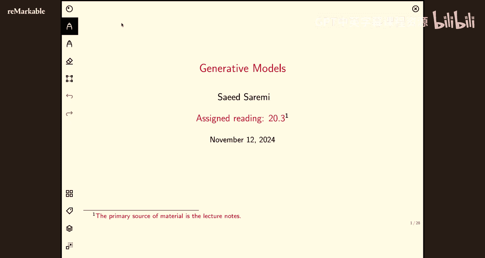
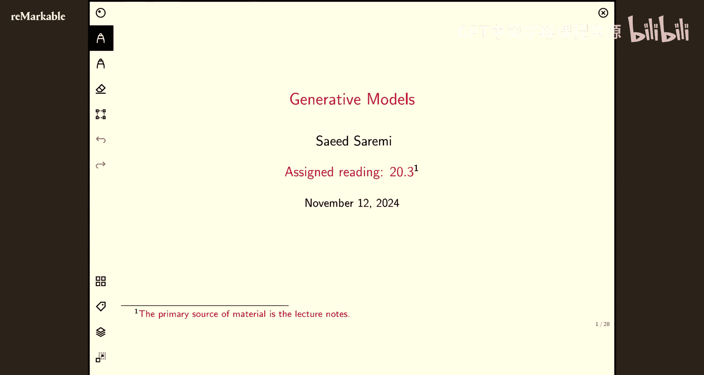
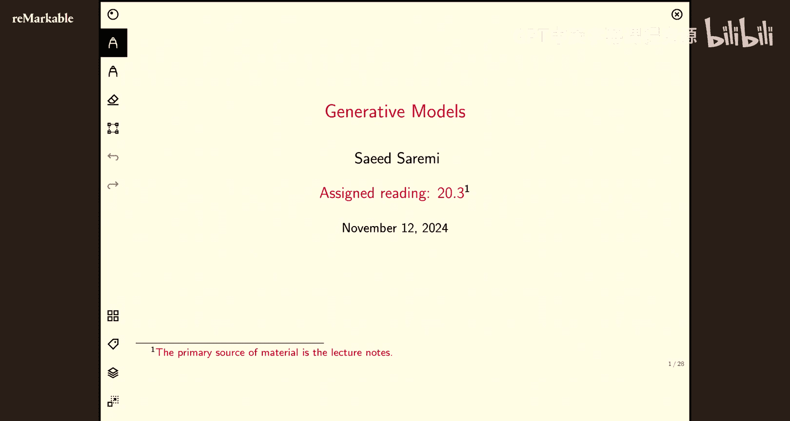
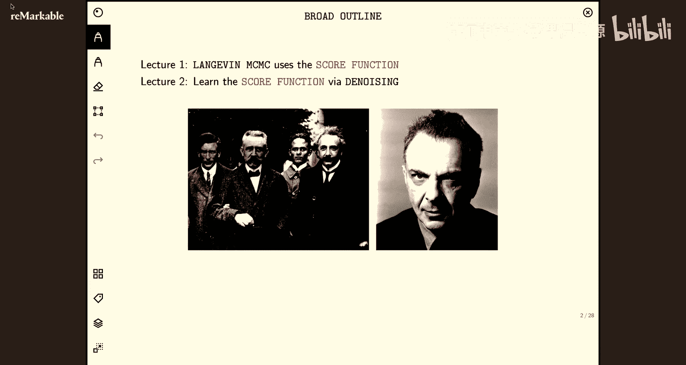
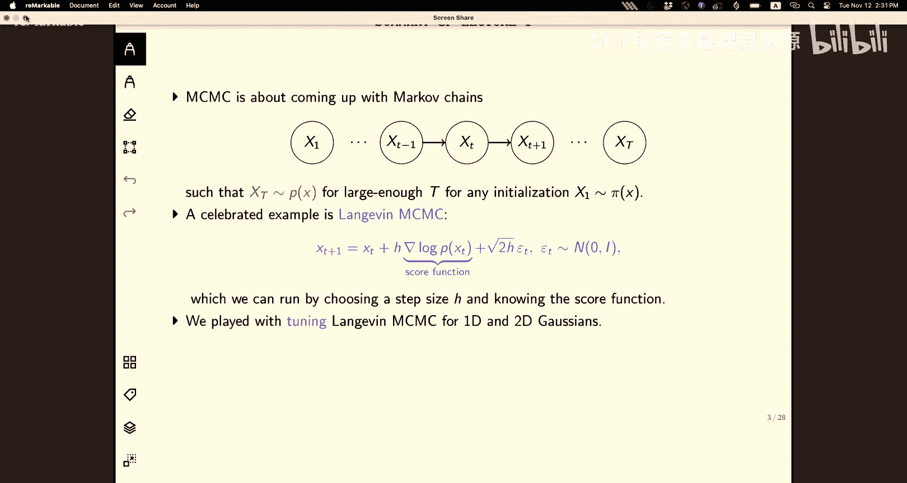
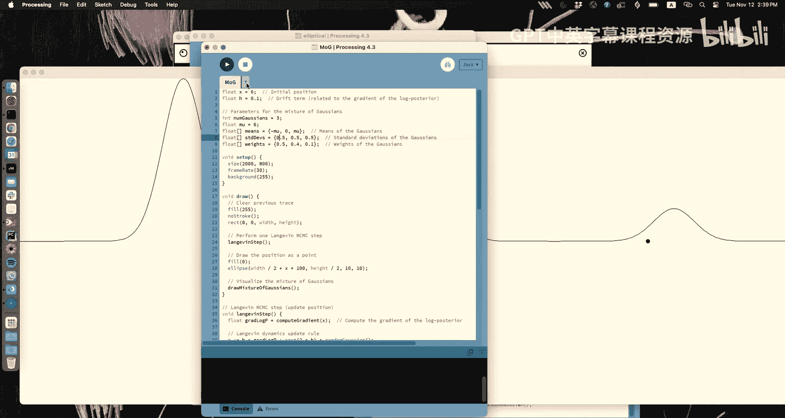
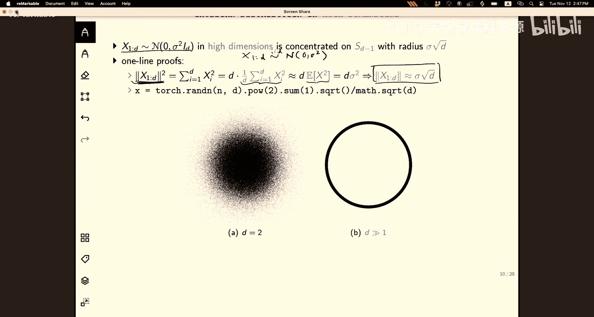
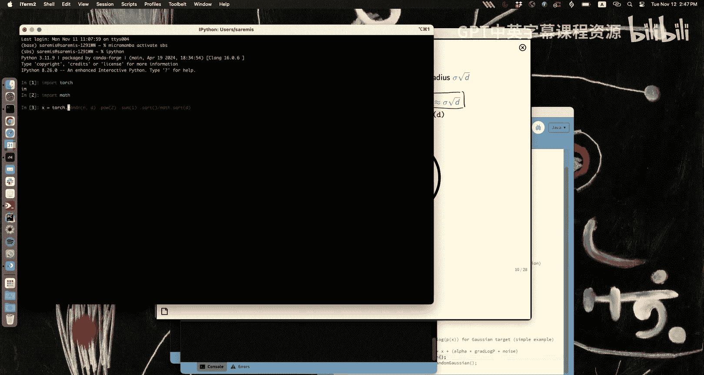
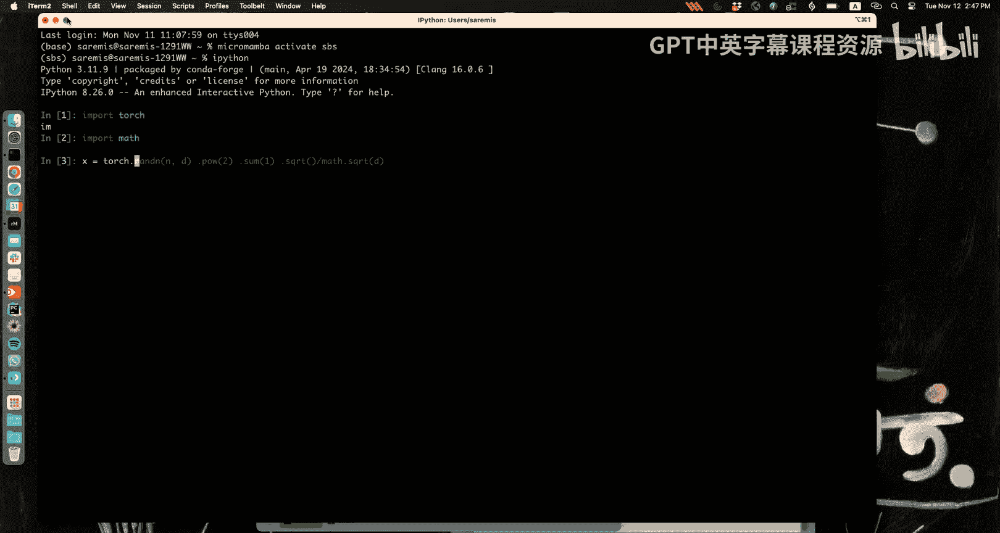
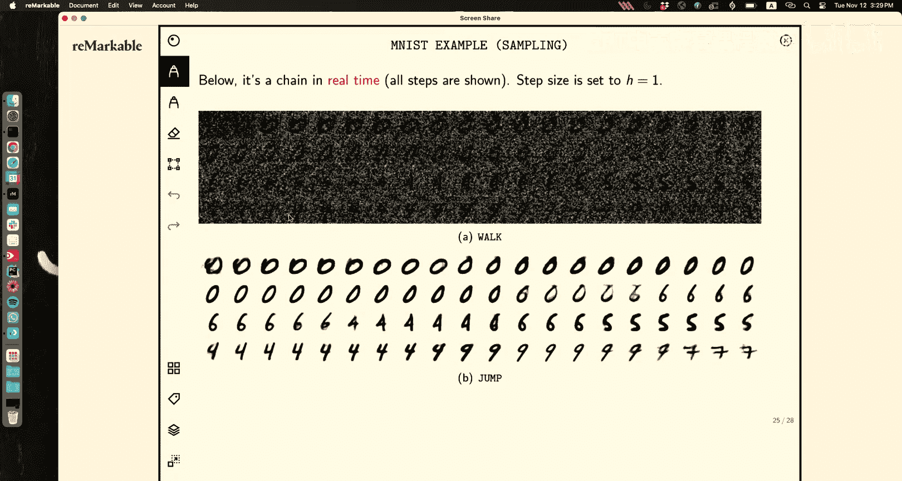

# UCB《机器学习导论｜CS 189⧸289A Introduction to Machine Learning Fall2024》claude-3.5 p22 L22- Generative Models 2.zh_en -BV1H4421S7bs_p22-

Does anybody of you know why you don't have to。なんですか。No。It's not good。You have some nice chairs here。

 but we don't have to thing that's working。啊。嗯。Make a call。近いです。一そ的。还次是。在一告。

Essentially nothing project。Let me try another one。Is there anybody we can call to fix this？

当次你查封。H0。So it's the little thing where there are places where I can get the microphones， right。

 is that the place？嗯。Let me see。That。

We connect this again。

I you see， there is a smaller screen， yes。When I do up and down， instead。

You may have to just get the lecture on。那你没事。It sounds good。

。

So today， is' gonna continue with the。Lecture on geneity models。 So previous lecture。

Talked about。We talked about。All you need to know is the score function to sub sampling from a distribution。

看在老。ペ？That is gradient and respect。呃。Theres a question in that。

Back of the little dimensional analysis。運明して。Essentially， this is like。be let's go for oh ahead。

Nothing is working today。Let meSw to something else。If possible， I accidentally turned off the mic。

Is this better。Okay， good。And I encourage you to come closer a bit。 It's going to be。

Everything is old school。Yeah， please just come closer。嗯。Yeah， so basically， I mean。

 this is an algorithm， right， So you can go implement it， but it's always good to see， you know。

 first， when you look at algorithm， we want to just。Without doing math。

 just have some understanding of the terms right and the first thing that stands out here is there's a H is a square root H right。

 It's curious right and the analysis I did and by the way。

 longjavan wasn't at that time there was no Markov chain。 there was an MCMC。

 this is like you know he was interested in understanding motion particles。

It's really a particle moving around。And so here let's say I measure it in inch。

I could measure it in millimeter， I could measure it in centimeter， right？

And this guy doesn't change。 That's my decision。 The decisions I。

 I made is that this is isoropicic identity。 So this one doesn't have a unit。No units。Right。

And this pump probability doesn't have a unit。Right。

Doest make sense to say probably have something is 1"。 Does't make sense， right， is it just a number。

 So this one doesn't have no unit。And this is one over the units。Right。If we have unit。

 we have one over units， right So H we are expected to be unit as square。That's what you expect。

 right。This should be unit a square。 and I use the physicist notation。

 whatever the unit is is I pick to be length， It can be something else。 This is length a square。

 right。And if you have a lengtha square divided by length is length， This is length length。

And we have something。Right， and we want to， we want to have H there， some， something of H。

 And we already know H is length of square。 And this whole thing， we want it to be length。

Like on the units， I use the good unit。 Therefore， we expect it to be a square root of something square to show up。

 right？ So this is essentially it's like a。呃。A bit of a it's not。

 it's not what you learn in computer science， but it something cool to learn， you know。

 So essentially， if somebody， I， I'm very， we have some smart guy go home and I says， oh。

 I came up with the new algorithm and， and I have。😊，Let's say。The Hassian。

 I'm using the curvature of my。Log P in the algorithm。

Some how it came up with this very cool algorithm。And it happens to be a school root age。Like。

 let's say it's squared with 3 h。We look at it and say you're probably wrong。 right。

 We just did analysis。 So then， then， I mean， you can go home and figure out what would be the correct correct factor here。

 But essentially， without even doing any math， you already know there's something is off here。

 So this is the bit of a recap from the previous lecture。So in today's lecture。

 we learned how to tune launch of randomCncC。 So that was kind of cool。嗯。And。So in today's lecture。

 it the we gonna there was a very nice question in the previous lecture that I just defined generative modeling as the problem of I've given you some samples and I'm asking to draw new samples and I don't know anything about the distribution right here in this formula。

 you know something。 I know the score function right。😊，And todays slide share。

 we're gonna finish the other half。 You're gonna to learn how， how to learn score functions。 right。

 That's going to be the topic of this course。 And when you learn how to learn a score function。

 you know how to do gene modeling。So。Yeah， I prepared quite a few animations for you。

 so I don't know how this will work。嗯。Let's see。嗯。Let me， actually。At least try it。

I wonder if you can see my screen。Prink it up。So the first thing is this idea of this as a dynamical system。

 So it's a Markov chain， right， we already studied this。

 so essentially it's a markov chain the transition kernel is the Gaussian。

 the mean of the kernel is this， the mean of my transition is this。

 and this is this gives me the variance。And in the previous lecture。

 I didn't show this for a single particle。 So let's， let's look at a single particle。

 wonder if you can see。Do people see particles moving。No。Okay。

 so this will be discussing in the next lecture。 I'm going to animate the particles here。So。

I'm sorry。The slides are on the website， but there's no animation on the website。 So， yeah。

 it's okay。 So one case is the case of a Gaussian。 And what you will see in the animation。

 I'm just seeing it right now。 I'm just gonna show it to。 There's a particle moving around。😊，Right。

 and particle spends most of its time around the mode， but also goes to the edges， right。

 And that's not what a optimizer would do。 And that's what I emphasized last time。

 We are interested in drawing through samples， right We are interested in these tails。

And the other extreme is we have， the other cases we have a2D Gaussian and2 the Gaussian。

 already things become interesting because we have two variances for the， for your sample， right。

 And I'm going to just。This is my picture of a2 the elongated to the Gaussian。And what you will see。

 the particle starts moving around。Right， it starts going up and down as， as we expect。

 because there is a step size that we tune。 Let's say the sigma。Is this sigma， right？

And we already tuned。 That's what you saw last time。 You need to tune your step size。

 So this step size is tuned to explore this direction。 But then you will have a hard， very hard time。

To go along the X direction。Yes， please。Thank you。So I'm gonna just connect it。

 I'm gonna continue since I have no idea if this will work out。

嗯。So this is the case we saw last time。So the other thing that is of great importance for us this time。

 let's go back to the one decays and the one。And the one decay K is considered the mixture of Gaussian。

So the mixture of Gaussian， we have this， this mixture of Gaussian， right。

And let's assume we initialize our particle around here。Right。

 so the particle starts exploding here this mode。Oh， very good。 Thank you。What was the fix？

How did you turn it off and。I see。 Okay that want This is good， actually， this is what they want。是。

I think it's very good。 Yeah， thank you。同意会。Okay。So， this is our。We bring our particle moving around。

So， this is our。Single particle， right， I initialize this anywhere。

 I could have initialized it very far away。 And there is a force， right， this， there is a。

force that brings you to regions of high probability。 and there is noise。

 And this particle starts exploring the space， right。And。And here we can play this nice game。

So I can change a square root 2 H to be a square root H。And I start doing the same thing。

And you see the particle is not exploring as much。And we can check or do the sanity check。

 changes to be H。Do the wrong thing instead of a score root age is H。No。

 it's not really exploring at all。 So the noise magnitude matters as we saw， right。

 This is essentially the， the unit at squared versus units。呃。And so this， you believe in Laerband。

 right， This is the launcher and MC C。 And now let's go to the。Now。

 let's go to the interesting cases。Where we have。The elliptical Gaussian。This essentially really。

 this is you are now half， half an hour in。 we are recapping the previous lecture， but this is very。

 very important actually， this is really the heart of today's lecture to understand the two problems that Longevvan has。

And so this is elliptical Gaussian。 And I tuned it。 Oh， I tune this to be。嗯。

I choose the right step size for the for the y direction， right。

But the step slide set for the y direction。 And now the sampler needs to traverse the x direction。

 right， It would take a very long time for the sampler to do that。And this is the first problem。

 And this is a problem， but it's not a big deal problem。 The big deal。

 thats problem thats really a big deal。Is the next one。Let's turn this off。Okay， this is。

 I'm gonna do the first。Start so this is a mixture of Gaussian。Each one of them has the same weight。

 roughly one third， one third， one third， right， And I originally。

 I let's set the standard deviation to be like 05。And my mixtures are at 6-60。 You see that。So。

 this is the。啊。So essentially I have I have three mixture。They're roughly the same， right。

 and the the distances are 6，0， minus-6， and their standard deviation is very small。Right， now。

 sampler。Exploring one mode。Right， why do you think it's not going to the other mode。

What's happening here？Can anybody make a story？Go ahead。Yes。That's very good。 Yeah， exactly as。

 as you， as， as you said。 So essentially， this middle land is a desert when it comes to probability。

 There is no mass there， right， So if you wanna have an algebra view。

 This is a geometric view you had。 What's the algebra view for this。Which one is that fault。

 This one is that fault or this one is that fault。This one is that fault， right， Theres no。

 there is no gradient there， right。And we can fix this problem。 Well fix。

 We can try to make our life easier by， by increasing it， right。

And I'm gonna first do a little increase。 Let's say， make it one。Wanhuan。So now things are smoother。

 right？And suddenly， you saw the particle， right， Ar the noise。

 the noise put the particle to be in the middle， and the gradient carried it over。

RightThe noise is helping if there was no noise， you would have got the stock there if this was optimization problem。

There is no way to go to the other modes。So the noise is this term， the noise term。

 somehow sometimes randomly， This is this is a random process。 right。

 If you watch it for a long time， next time around it would be a different story， right。

 Now it's doing this two mode exploration。 Somehow it's not going to the third mode。

 justs watch it a bit more。And。Yeah， so essentially， this is the， the the， the， the。

 the randomness come from the noise， right， But in the middle。

 there is some chance because there is the gradient is not0。 It is some chance that it will。

 it will go in that direction。 So there are two things that are helping each other。

 One is the gradient。 The other is noise。 But we can make our life even easier。 Let's do 1。5 for fun。

😊，So now I'm increasing the standard deviation of each of the， each of my。Come on。

I think I'm looking for it to go the neck to the left node， left mode。Yes， so we can celebrate now。

 So it's， it's doing that。 You know， it， it made it to the， to the leftmost mode。 And， and this is。

 the story is you can， you can， this is a bit of a， I made it simple。

 but you can have a case where actually， there is more weight on the middle mode。 Let's say 04。4。

 I mean， I'm pushing it now， But let's play this game one more time。😊，So now。

You started at a place where there is not much mass， right？

 So if we were in the if you were in the and traversed it to the other modes， right。

 and this is very interesting。 the left that what we started with。

 there was not even much mass right， and it managed to make it to the other modes。 So if。

 if we do the same thing where where these are much smaller。

 the standard deviation is much smaller again， we can wait until the end of the class。

 nothing is gonna change So we started at a small mode。

 this mode essentially doesn't have a right to exist even if we can make it even smaller。

 but the standard deviation， but because there is not much mass in the middle。

 the particle does not cannot even make it to the other modes， right。

 So this is really almost like existential problem now。 you know。

 the other problem is not existential。You just wait long enough your particle traverses， right， This。

 the particle doest event。Of a aware of other mode。 That's very bad。 So we're gonna fix this problem。

 That's essentially the topic of this lecture。 So I'm going to turn off the。

Videos。Let's go back。So you saw the animation。 And this is the。诶。These are the equations。

 So thiss a mixture of Gaussian， right， This is a mixture of Gaussian with。嗯。

With mixtures pi pi k right and then I take the gradient this very easy math gradient of log Px is gradient Px。

 which is in the numerator divided by Px right and the idea of modes are well separated what do I mean by well separated What I mean is E to the minus muk minus muk star。

Square divided by  two tau square， much， much， much less than one， right， So when these are much。

 much， much less than one， this gradient is not even aware of other modes。

 This is what you said geometrically。 This is at the break view， right， This gradient is really just。

 you approximated by where you are at， right， You cannot even look at your other modes。

And the chains get trappeds， And this is really， really bad。嗯。These are the animation you saw。

 And the solution to that you already saw What I did for the mixture of Gaussian， I had this。

I had these。诶。Towo squares here。 What I did was I just increased my tau square。 right。

 instead of tau squared， I， I just made the tau square plus sigma square。Right。

 and that's essentially what we learn in this lecture that's I。

 that's identical by adding Gaussian noise， right？ So there's this sense that， you know。

That adding Gaussian noise is a smoothly distribution。 So instead of。Instead of having these modes。

 right， it makes it to be these modes。Os。Right。So this is what。

 what we will learn that Gaussian noise will， will give that to you， right？

 So it makes our sampling easier。 So that's the first half。 And so let's focus on that， so。For this。

 is actually it's also good to have a。Mental picture of the unfortunately is you don't see it really well。

 but， you know。Actually， I think I can't。Maybe this is better or now。If we can live it that， thats。

 Yeah。 So basically， the noise。What， what does， it brings the modes together。

 And it's just really fun to visualize it even for Mnes。 So when then， when the noise is very high。

 A4， when if you look at it as， as a noisy for。😊，Even for a human eye could be like a noisy9。

 So this is what we will see。So this essentially， this idea that adding Gaussian noise brings the makes mixing easier。

 You can even visualize it， by looking at noisy images。

So there are two views I want to talk to you about。 One was already mentioned。And the geometric view。

 but you kind of have a deeper understanding of it。😊，And then the algebraic view。

 So let's establish the geometric view。The geometric view is。Essentially。

 the picture of a Gaussian that you have， what's the picture of Gaussian you have？So you。

 you think for 1 D， you have a lot of， you have a Gaussian center that's 0。

 you get a lot of samples around 0， right For 2D， I literally draw samples from a 2D Gaussian。

 So these are the samples you see in 2D。And。But the picture dramatically changes when you go to a high dimension。

 So in high dimensions， if you sample from agaussian。With 999。9999999 probability。

 you never see a sample close to the center， right。

 and close is specifically defined to be sigma square root D。

So I want to give you two proofs for that。 There are two1 liners， really。So essentially。

 if I'm interested in this， what would be the norm of my vector。 So I have a。

 I have a isotropic Gaussian。 I sample the Gaussian， which is isotropic， right， as you know。

 isotropic Gasian。 you can think of as the independent samples， right， because there is no these。

 these， all these components or independence， right， So I'm drawing， I can think of this as。😊。

X 1 to D， independently， I I D。Drown from and。Normal sigma squared。 right。

 So these are now random variables， right。So each component is a Gasian。So let's do the math。

 I'm just going write a norm。Right， the norm is sum of X I squares。Right。

And I write some of a sky X I squared as D times1 over D， sum of a sky X I squared。

And what is this as D becomes very large。What is this， This is expectation of x is squared。Right。

That's the definition of the expectation。 I， I'm drawing samples from my， from my distribution。

And I'm taking average of them。 That's the definition of expectation。

 except that we are taking the large D limits。And。So expectation of x square for the Gaussian is just sigma square end of the proof。

 So essentially， we just saw that for large D。The norm of my vector。Become sigma squarerup with very。

 very high probability。The high probabilityive art part is a lot of math goes into that that we didn't improve。

 but we just saw for a very large， very large D。 That's the case。 And the other proof is really fun。

 It's just another one liner。 I'm gonna do a quick copy paste。😊，In the interest of time。Oh。Okay。

 looks like nothing is working today。 I'm gonna just gonna type it。

So we have our X， which is torch。 I do it torch。 Do you see the screen really well。

好。嗯。Yeah， you do not see the screen really well。I have the slides up。

 So let's go back to the slide again。

So please do this at home。So essentially the first what what what I've done here I've made a vector。

 this is the number of my samples right， This is the dimension right。

 and I'm taking power a square of it and I'm summing over the dimension。

 That's what did I've done here， right。And I'm taking a square root of it。

 That's what the square root。 It's not the square is square root2。And then I'm div my score with D。

 right。And this is around n sigma is1 so please do it at home so you do this for dimension。

 let's say 10， you do it 400， you do it 4000 right and you can take any n you like right let's say  thousand0 samples right？

And just look at these histogram of this axis。 You know， the moment the dimension is small。

 this x is scattered around。 The moment the crank up the dimension。

 all of your samples go to this shell。Right。嗯。So essentially。

 the mental picture you have is that you have these two points in high dimension， right？

 And I'm adding Gaussian noise。 And if I can add enough， enough Gaussian noise。

I'm going connect these two modes。 right， I'm going to make them connect in some sense， right。

That's the geometrical picture。And。So， essentially， the。

The punch line here is that the isoropic as noise makes our data manifold more spherical。 you know。

 and this spherical， really。In some sense， comes from this notion that Gaussian noise is like a sphere in a high dimension。

嗯。And I wanted to give you an algebraic view of what does adding Gasian noise do？So this one。

 this part of the lecture is really beyond the scope of the course。

 So just bear with me for 10 minutes。And but I think to me， its very much， much deeper view because。

 you know， it algebraic， you can reason about it by looking at the equations and it's relatively simple。

 actually。 But there are just little details that you need to。No， which I'm going to talk about。

So this will be short， but you can come after the lecture to ask questions about this。呃。

So the first part is you have this， this visual notion of adding Gaussian noise。

 you fight for images， right， You have an image。 you take Gaussian noise。 you add it， it looks noisy。

 right， and that's the sample view of a additive Gaussian noise。 But really， the question is。

 what does this Gaussian noise do to your distribution right and And the story is that additive noise is like a convolution right You essentially you're convolving your。

 your distribution with a smoothing object。 This is like your your smoothing kernel we call it。

And the proof of this is very simple。Essential， this is base rule here of Y is。P of y， P of x。

P of y given X， D X， Y， because this is P of x and Y， right， That's what I've done。And。

And P of y given x is really this Gaussian。That's the， that's what they've done。 Essentially。

 that's the end of the proof。So。嗯。And the only thing that you need to know if you learned it in in when we talked about convolution for the。

 for the neural architecture， about the same as story。 you saw the equation before。

 this is a short time notation， right， essentially， any time you see， let's say H is， if。

Convolution G is means that H of Y。Is。F of X， G of。Y minus X， d X， right。

 That's the definition of a convolution。嗯。So I haven't really done anything， but it's very deep。

 essentially， the idea is that when you are adding Gaussian noise， effectively。

 you're getting a smoother object out。Right， let's dig deeper hair。 What。

 what do I mean by smooth air。How many of you know Fourier transform？Wow。That's good。

But not everybody。So we're gonna talk a little bit about free transform。

 And so the only thing you need to know about free transform is really。

That Fourier transform is a biject。 Fourier transform is this transform。 You get the function， right。

You take an integral。 You multiply by this three。 This omega is called frequency。

It's a different variable。 You just take e to the I。Oomega X， P， X， D， X， you take the integral。

 You get a new function out for any omega。 You do this integral， right， You get a new function。

 So essentially， it a mapping from functions to function。Right。

And we're gonna see a prime example of it。 And so it's very。

 very cool operation because some things are easier in the fullier space than the original space。

 And the most beautiful example of it is convolution。😊，So if you take， if you come， essentially。

 these little arrows I've done， you can all do that home。 We may， we may make it into exercise。

 We haven't decided， but。I'm just gonna tell you the， the gist of it。 So you have this convolution。

 I defined it here again， right， This is the convolution。 And I'm。

 I'm doing I'm gonna take a Fourier transform。Right， divide。And I have E to the I。DY， right。

And what I can do， I can write is to y omega y as y minus x plus x。Right， do you see the。

Thing on top。And so， this one。The end of the proof， essentially。

 you can these two integrals separate because you have。Y minus x here。 Y minus x here。And you have。

Ex year， ex year。And I'm sorry， you have also Dx。So， here you have。Dy， right。

 There is essentially D Y。Wish I can write it as dy minus X。 and there is D X。 So the little theorem。

 I mean， you don't even have to know the proof。 but the little most important theorem。

 perhaps in full year。Fian analysis is that the if you fullyier transform a convolution。

You get a product of real transforms。Okay， so I have two function。 I convolve it。

 and I take a Fourier transform of this whole thing。That is。

 I can take a full transform of each one of them and just multiply it。 right， That's the idea。

 That's the proof。And the other thing that we can go home and and do。

 this is essentially comes from making a square。So， essentially， here I have。你 to the eye。

Omega x and the Gaussian， I'm interested in the Fourier transform of the Gaussian。E to the minus。嗯。

S square divided by two sigma square。 I want to do this integral right And this integral。

 you just look at it。 You have a square。 you have a linear。 You just make it into a square， again。

Right， so it turns out the Fourier transform of the of a Gaussian is another Gaussian looking object。

But the beautiful thing， is is like a very， very deep。😊，The what D is that。

 you have one over sigma square here。 You had sigma square comes on top。

For Gaussian and Sigma square was then the denominator。And for the foliier transform comes on top。

 And now we have two things。 So essentially， let's step back。

 the foliier transform of a convolution is the multiplication of foier transforms。

 And we know the foliier transform of a Gaussian。 So we know the foliier transform of the distribution you get after you add Gaussian noise。

Right， so essentially， this is the。F a transform form of。You're clean。Your clean data。

And this is the Fier transform of the Gaussian。And this is the freeer transform form of the noisy data。

And the most important thing here is that this for noisy data， anytime this is large。Right。

 the Fourier transform comes very， very small。Essentially， what Gaussian noise is doing。

 it really dampens the high frequency。 So you have this distribution。 Sometimes it has wiggles。

 right， And the Fourier， when you come up with the Gaussian。

The the art theorem says all of these wiggle is going to disappear。It's gone， right， and。

 and this is essentially there two view of the same thing。 So in the geometric view， O it。这个场所。

So this is。他律是。Yeah， good question， so。I mean， they are if you， like。

 if you read Stehan Mala's book on， on wavelets， they are， they come from the same thing。 So。

 but that's very much deeper views really beyond the scope of this course。 But I would， I would。

 I would。I mean， this is really this two a slide， three slides beyond the scope of the course。

 This is more like a continuous view of convolution。 That's fair。 But theyre really the same。

 If you go look at your kernel that what we are doing。

 we are doing exactly the same things as we have done here。 And in fact， actually。

 we we're gonna talk about graph neural networks， I could have given the lecture on graph neural from the perspective of。

A spectral way of doing graph neural networks。 But we're not gonna do that。 So we're gonna keep the。

 keep the space view。 But this is essentially， this is a spectral view， right， If。

 these are these frequencies。 That's how it shows up here， right。Yeah。

So this is really end up parenthesesis。 We had。So essentially， let's step back again。

 gonna step back several times。 So we saw that longrvan。

 we have this beautiful result that longjavan can sample any distribution。 You just run this。😊。

algorithmgo。For any starting point， right PR your H wisely。And when you pick your H wise Z。

 you end up sampling the true distribution。But this is， iss true mathematically。

 but you may have to wait a very long time。 It's a bit of a fantasy。

 And you saw it for the mixture of Gaussian， right And I could have run this simulation。 Actually。

 I should have done it for the whole lecture， Your particle is gonna not gonna move If youre。

 if these mo are separated。 It's not gonna make it from that mode to the middle note。😊，Right。And。

I'm gonna come back。 So this is， we know Longgerman is， is good。 And we know it has deep problems。

 And so the next part of the our approach to tackle this problem is to smoother distribution。

 And we saw it smoothing。 I mean， you add Gaussian noise。 And we saw two views of Gaussian noise。

 One is that it creates mass。😊，Really， this a lot of spheres going around the space。

 You're really gonna create put probability mass in the middle of the space。 So I'm， I'm， I'm， I'm。

 let's say I'm a digit 1 in M this。 There's a digit 2 there。 There is no way I go from one to 2。

 It will take me a very long time。Right，But the moment I add calcium noise is all these。

 There is mass everywhere。 So I find my way to get to2。 And we're gonna see a simulation of it。

 So that's the geometric view。 And the also algebraic view。 Al view what sigma does for you is just。

😊，Get rid of all these wiggles， right， so。And now we gonna see。 So， okay， so essentially you you。

 your will object。 I think I want to ask you， what do you object about this approach now。

 So I I decide to。Tade one problem， right Pro of modeling clean data is hard。Right。

And because there are all these modes that are not connected。

 I'm gonna trade it with modeling noisy data。 right， what， what's your objection with that。

sense like。妈的。Yo。Yes。You mean sampling is not I I D。有。Y yeah。It's most likely。Go to be with。

A certain。That's a fair point。 But that's the story of this algorithm。 If you wait long enough。

 it will go to other modes。So it， it is I， it's not a idea that's a very good point， right， La ofvan。

 the point is that your friend is making is that launchgervan MCN C， you know， is Markov chain。

 and nearby points are dependent on previous points， right， but all these algorithms。Essential。

 there is these。There is this time。We call it mix in time where this。

 where if you look at the samples far enough away， is actually can think of it as I I D。 It's like。

It doesn't have to be the last。I'm Im， I'm going to show it to you that you can run this event on images and you see like a mix in time of order 101 steps。

 You only walk 1 steps and you get a very， very new sample。 But you have to do it correctly。

 And that's the topic of this lecture， really。But essentially one main criticism for this is what about clean data。

I originally I was interested in sampling clean data。 that's how I started the problem。 I had X。

 and I had P of x right and I was interested in sampling P of X and this whole thing X is gone。😊。

Right， have noisy data Y。 So the now we're gonna spend like。This is really the heart of the lecture。

 We're gonna spend some time on learning how to go back。How'll go back from y to x， right？呃。And。

That was another question。Yeah， okay， okay。可开。So this is problem dependent。

 We're going talk about it。 Yeah， yeah， so you saw for this， this mixture， right。Right， essentially。

 you're stuck， you know， so it's， you know， if， if these are well separated。

 you can even compute what time it takes to go to the other mode， and it may take a really。

 really long time， right？ so this is like a really problem dependent。 But。诶。Yeah。

 I think so to come back to this issue， one， one way that people tackle your。

 your question is initialization。 You know， if you initialize your。

 your particles different part of a space， you can pray start praying that this some of these particles where go to the all the modes。

 right？ So if in here， if I had， if I had initialize my particle uniformly， I would have been done。

 the problem is solved， really， right？ But imagine you're in high dimension， a million dimension。

You know， there is no way to， you know， your prayers won't be answered essentially。 So。

 so this is like a a very deep thing in high dimension。

 So this is essentially really the very deep topics。 actually。

 But there are quick fixes to what you mentioned。 You know， essentially。

 initialization is one of them。嗯。Okay。Let's dive in。And really， the hero of。

 of the second part of the talk is Herbert Robbins。

 And it's quite remarkable Robins in like span of five years came up bit stochastic optimization。

 So this is really。😊，The workhor。For whatever we do now， S GD， it came up with bandits。

 which we're gonna talk about， not bandits itself。 but essentially， this is really leads to R L。

The sequential decision making。 I came up， came up with empirical bay。

 which is really the most fundamental way to look at dennoising。 So this is。呃。

And it's quite something。 And this paper。You know， I think again， you don't。

 it's beyond the scope of this course that you go read it。

 but I highly recommend you read the first two pages。 It's really fun。 It's a historical thing。

 And the notation， the only， the only thing that I'm gonna follow the same thing that Robin has done。

 except that X。 He calls noisy data X for us is Y。 That's it。 And I'm gonna， he calls this Lada。

 we called it X。 That's the only difference。😊，And the rest is gonna just follow Robs。

And this is essentially in 1956。😊，So the first thing is Robins asked the question。

 We already actually saw it in lecture 18。 So this is a setup。 I have some data， which is is cleaned。

 My data is in R D。😊，These are clean data。Right， and in pure formulation of this problem。

 we do not observe clean data。 like clean data， Nobody observes it。

 I only observe noisy version of it。 right， That's the setup。 I only observe noisy version。

And what what I know is a noise model。 I know that condition and X， the noisy data， let's say Gausse。

In the 1956 paper， Robin said Poson， very curious didn't do Gaussian， Poisson geometric。

 Theres like a lot of noise models， but not Gaussian。 But the story is actually very general。

 It turns out， but we're gonna stick with Gaussian here。 So this is an example， right。

That conditional clean data， the noisy data is additive noise。 So essentially， to sample。

 this is x plus。sma。This is what， what we do。That's the noisy data。

And this is the Gaussian as a standard normal， right？ And he asked the question that I want to。

 I have observe one noisy data， right？ And I want to estimate， I want to find this5 function， right。

I'm interested in these P5hi functions， such that when I do list squares， like， I'm interested in x。

 right， over all possible x's。 So I'm， I'm doing this over the whole distribution， right。

 I get the lowest error， essentially， a set loss， right， It's a list of squares was。

 and you saw it in lecture 18。 That's the the， the answer you expect for listed squares is very intuitive。

 What you do， the best estimator， given a noisy data is you take the average。😊，Right。

And this is Robbins wrote it in terms of the things。 you know。 He， he like he。

 the idea is we don't know P of X given y， right？ We know P of y given X。 I mean， it's a choice。

 but the expression is written here in terms of P of y given X。 And you can see it， right。

 This is P of Y given X， P， X， D X。 This is P of Y。And。And P of Y given X， P X divided by P of Y。

Use P of x given y。Is that clear， right， So essentially。

This is what essentially is almost like a scientist to check。 if you don't。

 if somebody ask you answer immediately， what's the right answer。 If you have a multiple choice。

 you don't even have to do math， right， you have some noisy data if you know you have X given and y。

 right， then you take the mean of it。 That's the natural candidate。 for the， for the。

 for the best estimator。 So that's the step 1。Which is kind of obvious。

The step 2 is quite remarkable。 The step 2 says that actually you can do this integral。

 So when you look at this。😊，It's very， you know， it's hopeless。 We have， we know P of Y given x。

 right？ We have no idea what P of x。You you just don't know it。Right， so you stare at this equation。

You have to give up。What would you do。I know P of Y given n x。 I don't know P of x。Therefore。

 I cannot do the integral， right， But it turns out for many， many， many noise models， actually。

 you can do this integral。And you write it purely in terms of distribution of noisy data。

 And this is really the heart of 1956 paper。 And let's do this algebra for。

And it's very nice because this algebra for noise mothers。 I know it's really one line error。

 You write the whole thing in one line。😊，So let's do it for Gaussian。 So this is a setup again。

 I'm gonna go over it。 So I have distribution of noisy data。 And you said earlier。

 This is a convolution of clean data and the Gaussian， right，  essentially， I'm using base rule here。

And for those of you who haven't objected yet， have been lazy with my notation。So。To be very strict。

 this should be P of X。 I mean， these distributions are all different， right。

 You know that this is like， we have already。诶。Use this shorthand notation before。 So hopefully。

 you're familiar with it。 So essentially， I'm what I'm saying is， this is P of， when I say P of Y。

 what I really mean is P sub Y， y。These are different Ps， right。诶。So， I mean， you said earlier this。

P of Y is smoother than P of x。 It's just a different function。And this should be P of y given x。

Right， but。Is this shorthand not clear？Please object， if it's not。Any objection。Yeah， okay。

 very good。 So this is also using。 I don't know if you have taken course in information theory。

Maybe it was popularized there because it's really tedious to write all these subscripts。

 So anytime you see P itself by itself， you have to object。 What do you mean P itself。

 It has to be either P， X， P， Y， P， Y， given X， These are all different distributions， right？

 But if I write P of X， I already mean。P of X， X。 No， essentially， that's the convention。嗯。

So the only thing that I'm using here。Is that when you estimate at the Gaussian it's quadratic。

 It e to the minus something quadratic。 So if you take that's the only identity I'm going to use。

If you take a gradient of the Gaussian， it relates to why。Right。

It becomes one over sigma squared x minus y P of y given x。Right。

 so this is essentially cs  one of one， right， I'm taking gradient of。Gradient of this guy。

 which is E to the minus this。 And the gradient of this is x minus y divided by sigma square。

 So the sigma square goes on this side， right， That's the only thing I'm going to use。

And now let's do math。 It's just again， as I mentioned， it's the online line error。So， let's compute。

Gradlock Py。So gridlock P Y is grad P Y。Divided by Py， right？And grad P Y is grad。Grad P。

 So here I have to be careful here because there is only why I don't write the Ys。

 but let's write it for now。Is that clear， This is the。Right， and here。

 I'm going to use my little lemma here。And so at this point。

 it's nice to add Sigma square everywhere。So， this becomes。X minus y。P of Y given x。P， X， D X。

And we are pretty much done。 So when you look at this， what do you see， You see X P of Y given X， P。

 X， D， X divided by P of Y given X， P， X， D， X， right？ And this is exactly this。Right。

So this becomes X hat of y。And there is a y term， which is a dummy thing because the integration is over x。

 and these two terms cancel becomes minus y。So it we。

 it then became online liner because my handwriting was not good。What is the one line N X hatta y。

 we regroup it is y plus sigma square grad log， grad log， P Y。So， this。

Really quite a remarkable result， that。Then you look at this integral。Really， you don't hope。

 perhaps that P of X completely disappears from this picture。So this is， in some sense。

 is's almost like philosophical。 It says that there is a world out there。 I don't see。

 I only seen this noisy observation， but somebody has told me how the noisier data is obtained。

 right， I don't see the outside world。 I only see this noise， right， And what。

 what it says is that if I can manage to model noisy data and we know model noisy data is easier。

 Everything is smoother， right， if I can manage to model noisy data well。

 I can actually estimate clean data。Or any single noisy observation， I can just。

Generate a noisy data and then clean it up。 Even though I have no idea what the true distribution is in the world。

 right。So。呃。Any questions on this slide， go ahead。Exactly， so this is like that's what actually。

 if you read Robin's paper， That's what he did for the Paul song case。So， you can。

Lets I some Poson case is interesting because X in that case is positive。 The rates and y is counts。

 Poson counts， and you can make a distribution of counts。Like make casetgram of them， right？

 But we're gonna do better。 I think the idea your， your intuition is correct。 I mean。

 you can model noisy data however you want， right。But what we're gonna do is we're gonna use a neural network。

 It's introduction to machine learning， right， and， and。So the idea is that we are in a simpler set。

 So in Robin's case。AndIt's like this pure world where you don't even observe clean data。

 But that's actually how we started the problem。We have started with clean data， right。

 So we're gonna have this thought experiment where were gonna engineer noisy data and we are。

 we are the designers。 We can pick whatever noise level we want， right。

 We're gonna just generate infinite amount of data we can generate now。 right。

 You can just sample noisy data。 And that's what we have done here。 right， You go from X to y。😊。

And then， and then we're gonna set up a deno in loss。 right， So essentially， I have some clean data。

 right， This is the clean data。And this is my noisy data。And already know the。

 the estimator I found is the least squares estimator， right， I subtract this to。 I square it， right。

 And I want to find a t neural lens to dens it right， to， to find the best。

AB way to estimate the clean data， right？ And so this is we can do， right， This is like a。

 by the way， at this point， there is a whole， like， I could have given a whole lecture on this。

 like a very deep topic called denoing auto encoders。 So essentially。

 it' a auto encoder but its denoising。 You have some clean data。 instead of encoding， decoding it。

 I add noise to it and tried decod it back。 right， I'm adding noise。Right。And this is my decoder。

 This is my decoder。 and my decoder back goes back to clean data here， right。But， you know。

 but what's nice here is that we have a fully probabilistic view of this。 thanks to Robins。

 We know when you find the， we already know Xhas。Is x hat of y。Is y plus sigma square gradlock Py。

That's what we obtained。 so we can regroup it。 So Grlock P Y。

Is x hatta y minus y divided by sigma squared。Wei。And， and that's what， what I've done here。

 So this is an approximation。 I'm using a neural net。 and I I'mm approximating my， I。

 have some learning procedure to learn the optimal den noise there。😊。

So I'm approximating the optimal denno there。 And this becomes an approximation to the true score function。

 right。So， at this point。Hold and behold。 neural net are really， really， really good at the noise。

 It turns out。 So this is really， the story of this models picked up around 2019，2020。

 because we learned that actually this neural net， we can go crazy with noise。

 It's almost like superhuman where， when I see a noisy data， I cannot guess what's on what's， what。

 what would be the clean data。 But when you train it， train these models for a long time。😊。

It learns to make a stuff up。 And you are a glimpse of agenerative modeling。 You know。

 here there is an event on sampling。 I added noise to the left face。

 And the right face is not the left face。 is's different， right， Well it's very plausible， right。

 It's very face， right， So the network has has managed to even the den noise there to make a stuff up。

 right， But this is like a very we can have a deeper view of it。

 But already the story here is that you can pretty much believe that your den noise there is optimal。

 You know， we have we have come with good architectures for that。 Go ahead。Oh， question。Yeah。Yeah。

Yeah， so this is the。And really the workhorse for the applications。 This is a story that's evolving。

 but as of like， like， let's say last year， two years ago， the， the。

 the best architecture is a unit architecture。 And that's already textbook。

 your textbook this is covered， but。Yeah， so this is essentially has this shape of a U。

 that's what is's called units， so you go down in terms of resolution。

 you go back up and the key is there are these skip connections。That is。That's。

 it terms of it's very， very， it's needed if you wan to have a really good。呃。So， we are pretty much。

There in terms of now we have a sampling algorithm。 We have a generative model。And the idea is that。

So theyre essentially we， we we， what， what have we done。

 We realize we don't want to sample clean data， right。We， we just don't like to sample clean data。

 We like， we like to sample noisy data， and we also learned that if you sample noisy data。

 you can clean it up。 You can， you can clean， clean up your samples So to get to clean up your noisy sample。

 to get a clean data。 And this suggest sampling algorithm。Where essentially。

 we have learned the score function of noisy data。 This is the score function of。Noisy data。

And the only thing I've done in the top row， I literally just change x to y。

That's the only thing I've done。嗯。And so this chain， essentially， this。This really。

 the real chain is this chain。RightAnd that's why I'm using the regular graphical model arrows。

 likebal arrows。And so this is a chain that generates noisy data for you。

Meaning that it generates the noisy data from the true noisy data distribution。

 That's what you're after。And for any of these samples， you can clean it off。With。

 with video dinoisizer。And these are the jump samples。 right， This is a walk。And these are the jumps。

 right。And the jumps， the most important thing about this algorithm is that these walks and jumps are decoupled。

 You know， you can， you can do your walk， right， gather the data and you can jump any of them that you like going back to your question。

 you can jump every tennis steps because you have this idea。

 You don't want to jump every single step， right， because these samples are probably correlated。

 right， You just dens dennos every tennis steps， for example。诶。And this is very different。

 There is like a whole history of algorithms that were like this。

 You can generally change where you sample noisy data， you get X， you add noise to it。

You another Dno sample。 You add noise。So this chain is coupled， right， You add noise， D noiseise。

 add noise de noise。 You would expect that the sampler will do something interesting。

 But it turns out it's very， very hard to make the bottom one work。Any ideas why how if I。

If I introduce this algorithm， what would be your main criticism on the bottom algorithm。

Do you have a picture about this algorithm doing the bottom row。 So I， what I go here， I。

 this is my algorithm I。Let's assume for simplicity， I start from， from a true phase from a data set。

 I add noise and D noise arrive at here， right。And then I add noise to this face。

And then dennos it again。 We already thought there was a big move from here to here。Right。

 so you would expect that this gradually， these phases starts to change。Right。

 you're gonna start generating some samples。And so probably， I mean， this will be in your homework。

 And I think now that we are talking about it， this should also be， you can。

 you can experiment with it。 So this algorithms essentially never work。 If you do full denoing。

 add noise， de noise， add noise de noise。 And the problem with it is。

The main problem with it is that here the algorithm is very nice because。With the best。

 with the optimal di noise， we have learned。The true really good approximation。

 true a score function of noiseisy data。 So this sampler， if you look at the walk。

Really is exact in some sense。 If you really believe in La ofvan。

 if you have smoother your distribution enough， you can really believe in these samples， right。

 So this d is there you in a cost， right， the dno is there you just saw it。

 It's not the exact samples， but you just incur that cost once。

 right The problem with this algorithm is you keep incurring cost。You know。

 you're just gonna you denise youre off。 You add noise to it。

 You added the noise to something that was off。 You're gonna be off。 You're gonna dennoise。

 You're gonna be off again。 So this is like a。So these algorithms， people try to make it work。

 but it just doesn't work， right。So this is an example。 I'm gonna give you。Actually。Yeah。

 let's just talk about Mni。 I'm gonna finish it up。

 finish up the the lecture because we are out of time in the next lecture。

 but just to give you some a sneak preview of this algorithm。

 So this is a training phase and this you're going to do， hopefully in your homework。

 you take Mni digits。 you add a lot of noise and I den it。 and you already see。

 this is what I emphasize earlier。 this three。Right， visually it's kind of close to 8。 It's a  three。

Clearly， it's a3， right， But when you add a lot of noise， it really goes to the8 territory。Right。

 and the Dno is is very smart。 actually， It's not a bad Dno is。

 The Dno is doing a really good job at Dno thing。And the same thing with other cases。

 like there are a lot of cases that this6， the denno is or 6 is arguably it's better than the original6。

Right， the denno there is making a stuff up based on everything it has seen in the data set， right。

So， and。But there is a big problem。And。

