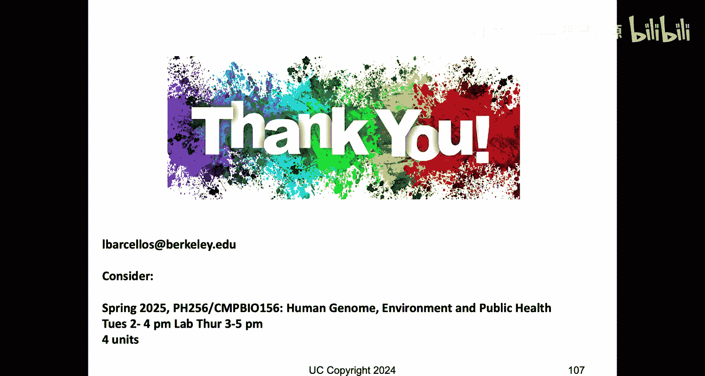
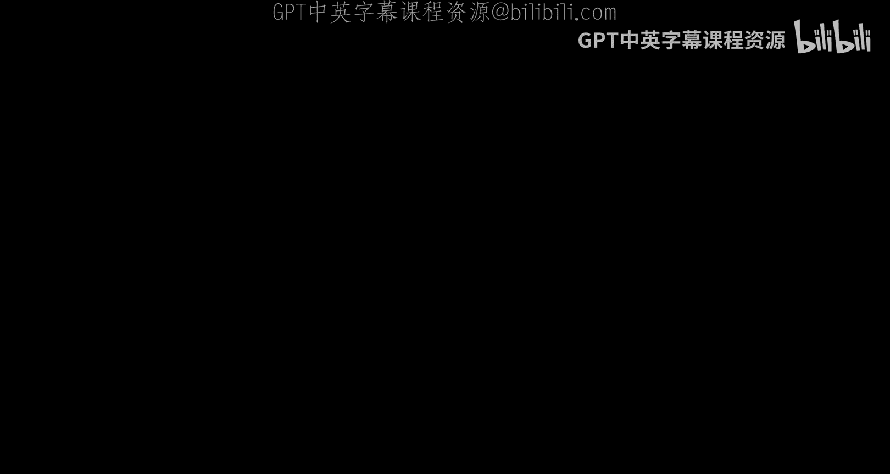
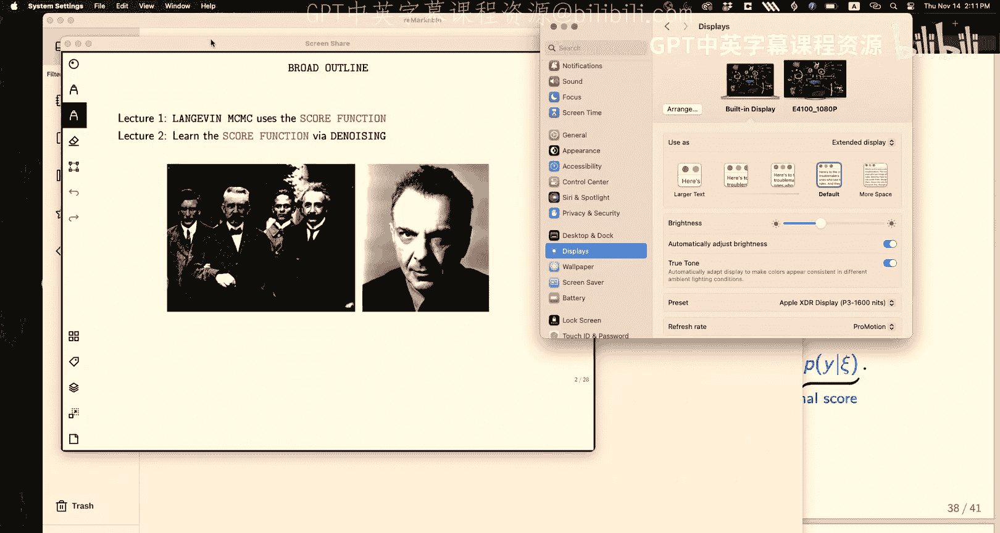
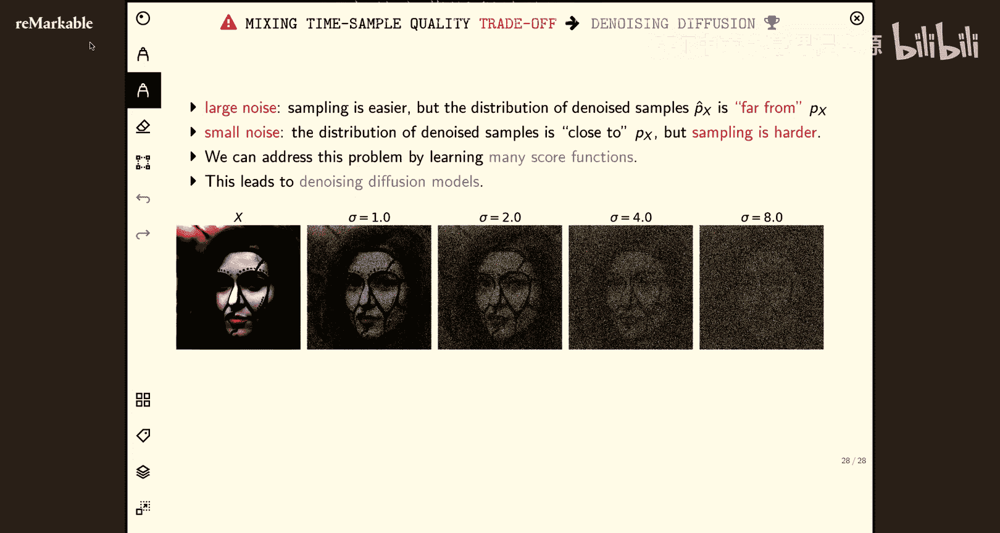
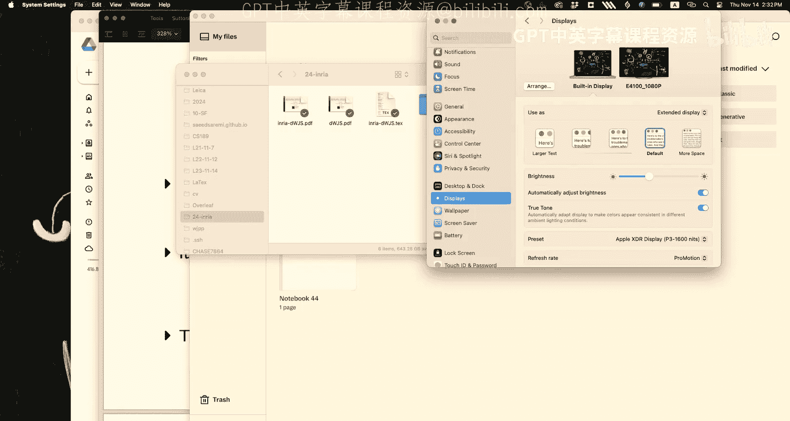
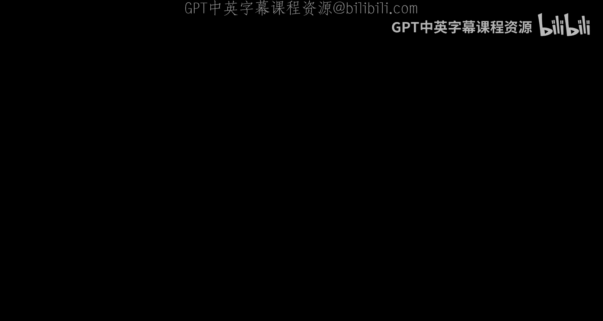
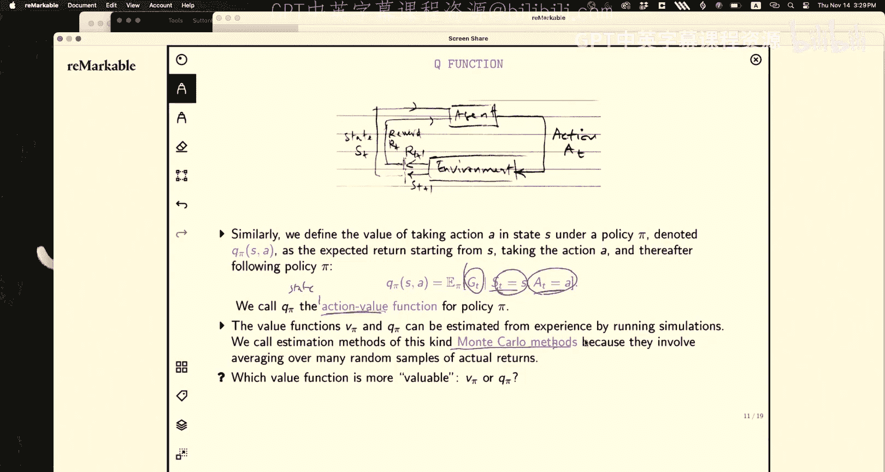

# UCB《机器学习导论｜CS 189⧸289A Introduction to Machine Learning Fall2024》claude-3.5 p23 L23- Markov Decision Processes & Reinforcement Learning.zh_en -BV1H4421S7bs_p23-

Tudinal measures of methylation and then where you could actually look at gene expression。

 correlating gene expression data with your findings。

And then just a major limitation really is the failure to consider mixtures and the interactions of numerous environmental factors。

 if you're interested in stress and nutrition and exposure to these six chemicals and so on and so on。

 that is still hard to do。So I'll end there。And。If you have an interest in epigenetics or learning more about the human genome environment and public health。

 definitely consider taking my spring course， which is a capstone for undergrads in public health。

 and I also have a crosslisted comp bio offering if you're interested in that， thank you。H。

ん对。なスも？That's a really good question。对呀。So they did ask me。And is this this？And second， that's。

job induced。手机啊。Definitely。I was also one。You said， you have a。Oh， no，Looking at like research。

在。いのい。はい、あす。My last year。I really wanted to get some。Sure。

Send me a message and then I can forward you on to my。Mana。She just took on。Undergrads。

 but I can see what she says for the。Yeah， to send me a message and tell me your name again。

 Cammelia， so are you a man？No I'm MTV， which is why I really like you your lecture。

 which part I'm CDP， I'm doing the like or the medical physiology。😊，全件。 just yeah。

 send me a message Nice meeting you too， Thank you。I wanted to give you a thank you so much。

I was wondering if you got the email。Yeah， I。 I have。Oh， I totally understand。

 but I just wanted to checks going on。Like right up to。

So don't worry and you should feel free to email me if you're。You should know like it's a huge。

I totally understand， but if you get nervous。Thank so much。

 And then was a music your question thought。Yeah。Reccolation change of。Environment。I was wondering。

If you take away the environmental。that cause isolation。Thank you，Oh yeah， no matter。

Did you take away the environmental exposure。The maulation。So it's original statement。So it can。

It can and it can and cannot。So that's like。What's been observed with smoking and it takes time。假呀。

People have shown like。你给。Stationary bike and I not use this leg， but use this leg。Pedling。

patterns are different。This muscle is being used。It really varies。Okay。I5 parts。

Thank you good to see you。So in the DNA methylation chart that you showed last。

 it showed cancer patients。Do you mean in the slide that I showed in that one， yes。

 so that's hypermethylation cell gene。Well， like I feel like I always imagine cancer as like uncontrolled growth。

 It depends， you can have repressors， you can， you can have all kinds of things。Actually。

 the monitor are turned off and not able to do their job。So。Yeah。

 there's a lot the whole of work in cancer。But that's like。All the early methylation work。Wass key。

People were studying just。这边。Thank。SR。I' so good to see I'm like， hey。How's it goingYeah good， yeah。

 I really love the lecture today， I just had a couple questions kind of following up。

But the CPG region， is there a reason why specifically like citizens followed by guans are mo？

Cne。And not like settle things in other places， Yeah， I don't， it must have to do with confirmation。

Maybe。for the。Be placed， but I。They can occur in different places' always。CGs， but that's where。

I really。Do something to go like scaryreochemistry or something I think， yeah， Yeah， that。

And I was also curious。Like， I guess kind of。Kind of a counterpart to DNA methylation。

 Is there also like interest in like DNA atylation and like epigenetic studies。

 so like especially in the context of history。Yeah， this's just harder to do large scale。

 so we don't have easy ways。To do。Large scale。Aation of。Similulation。Mhylation of Houston stone。

Is there anything like that？Because you have to still like。Yes。

They're just not there yet for Bo big scale studies。

 so you kind of have to decide what it is that you're in。trying to do like。やりてくて。Hypotheis free。

 trying to generate， or are you really interested this specifically？

And so then you could actually do much more。But。But is there a reason why acidsidilation has went on as much attention as because it's hard to do？

嗯。Meing， meaning the chips。Texnic。你们呢。应该吃。You convert methylation sites to SNPps and we。

The whole scientific community knows how to do s program。Yeah。Not as。For us。Yeah。啊，要。那是人。

Thank you so much。还 think老。对对。He said。对的吧。Well。Theyre just。对。お民が。这个。个是工。Always， hes always sh。

Do the homework。的一律。我い。The two。ご実さ。对申结论。他们是。

我也 kind of。Sure。Okay， guys， let's begin。诶。So as you recall， last lecture。

 we had a little bit of a glitch。 So I'm going to。Quickly， go over the。

The lecture until we arrived at the later part of the lecture。

 so hopefully this will take about 15 minutes， 20 minutes。嗯。So essentially。

 we have been on this path of this really believing launch of event。So right。

 so we have this algorithm that says if you give me the score function。

 I can sample from a distribution。And。So this is to remind you again。This is Mr。 launch band。

And here this algorithm really drives on two things。

 one following the score function to high probability region。

And the other is using noise for exploration。But we realize this algorithm has two problems。

 One is if the density is very long， it has a very hard time traverscing this landscape。

 let's call it， the other is like the more existential problem is if the density that many mos。

 so you may get a stuck in the mode then you're done you know you cannot you cannot sample the space which was our goal。

And this is where Robins on the right side come into play。 So essentially。

 we had this view that what if we solve a different problem， What if we add noise to our data。

 and we had two views of this， one is algebra view。

 which is essentially gets this adding noise gets rid of the wiggles。 the in the density。

 and the others was the geometric views。It's more intuitive。 where essentially， when you add noise。

 you put mass everywhere。 When you put mass everywhere， almost get connected。 You know。

 there is an empty space here。 There is mass here so I can navigate this space。And。And the。

 the big question is， so what about the original problem。

 And it turns out these two problems get unified in some sense。 And that's the very nice story here。

 And the story is that with denoising， you can learn the score function of noisy data。

And the score function of noisy data we know from launchman is all you need to sample noisy data。And。

嗯。And for any noisy data that you generate， you can clean it up with be the denoisr you have left。

 right， So that's essentially， that was the punch line from the previous lecture。

 So the main result is this is the denoer。This is the best D noise thing you can do。

 Optimal Dino era call it。And this is my beloved score function。And the score function。

 as that's the whole thing， the score function is all you need to sample noisy data。So， this LED to。

To this sampling algorithm。And so in the middle， we also learned。

 we have learned over the past five years，5，6 years or so that neural is actually really good at thenoizing。

 So when I say optimal， like feels like it is really optimal。 You know， its doing a， you know。

 everything can be improved， but。But they are very， very good at Deno z。And so this， so with the。

 with the neural net， you have learned optimal den noise there。 So this is my。

This call it optimal all。You know is。 So this is trained， right， This already， a user。

 I spent some time to train in this model。And then we have the Robbins formula。 Well， it's got 3D。

Forula。 And then it turns out Mi Ozava is the one who discovered it。 It's a bit of a mess。 So it's。

I won't talk about the history of that。 but this formula that the score function is related to the optimal d is there。

 from that， we get the score function。 So this is my score function of noisy data， right。

And this immediately suggests that we can use longjaband to sample noisy data with very， very， very。

 very high accuracy。 Go ahead。Or really。我给你买。Yes， getting towards the end of the course and nothing。

Everything starts breaking。 it looks like。So let's see what's in our store for us today。😊，Yeah。

 so basically， this walk phase， I just want you to fully understand that if you have learned the score function of noisy data really with high accuracy。

 And if you know sampling noisy data is easier， then the walk phase is really you are sampling noisy data with very。

 very， very high accuracy。 You know， you can believe in your samples that you're generating。

And you are incurring a cost， you know， when you are denoizing。The distribution of。嗯。诶。

Expectation of x given y。 So this was our x hat of Y， right， This distribution is now at P X。

You know， you understand that， right， So this distribution is a distribution of my D noise samples。

 So the， the best you can do if you go to our image。

The best you can do is this image quality thats the in the case of images that's the best you can do right。

 but this is a tradeoff， so this is the topic of what we didn't talk about last time there is a tradeoff here。

And。But the nice thing about this algorithm is， oops。

The nice thing about this algorithm is this walks and jumps are decoupled。And this goes。

To competing algorithm。So以。Compette algorithm is let is say you start from。X from。

 that's actually from P， X for simplicity。 I mean， I'm gonna cheat a bit。

 I'm gonna start from a good sample。 I add noise to it， right。

 And I've trained a denor to dennoise it。 I go to X that。Then I add noise。 I， I think this is。

 you know， kind of like。Clean data， let's say， add noise to it。And I D noise， add noise D noise。

 And the idea of this people who thought about this type of algorithm at the time。

 the idea of there was。啊。That you already see you are moving， right， You move from this to this。

 These are not the same。Right， and imagine if you move， if you move many， many， many times。

 you can imagine， you know， if you tune your noise level well。

 you end up going to a feature of a different phase， different gender， whatever。 right。

 different hair color。 So it started exploring the space。 But this turns out to be very， very hard。

 part of the exam was。That people tried very small noise。

 and it turns out you really need high noise for making these algorithms work。

But the moment you crank up the noise， you have this problem of accumulating errors。

 so the algorithm bulk jump sampling doesn't have an accumulation of error problem。Right。

 that should be。 that's the if you have questions。 you should ask it。 So it has。

 it doesn't have that problem。 We have learned the score fraction noisy data。

 score function of noisy data。 You're using long of an algorithm that has guarantees。

 So you can sample noisy data really well。 So this algorithm can sample。嗯。

Can sample these noisy data It works， right， So these are the idea is these are really。

 really good samples。Then it comes to noisy data。 So we have the algorithm is generating noisy data。

And then you are jumping， you are dennoising and denno there。😊，Has has penalty， right。

 Do you know is there。 So this algorithm。It's very fast， right？ You see you， these are。

 I'm doing this with in real time。 So I'm not skiping any， any samples here。 So here， Delta。嗯嗯。See。

 yeah。So here， Delta T is one。So I start from noise， I walk follow the gradients， right？

And add noise， follow gradient add noise。 And I use a very， very aggressive step size。

So I train this model with sigma 1， so the noise is very high， Sigma is 1。And and I use this very。

 very， very， very large step size。the reason I can do that is because this。

 this distribution is really， really smooth。 right？ So if you， if you go。

 if you go back to the picture of everything goes back to the Gaussian。

 if you really understand the simulations I I had for you。 So it's just the same picture。 So if， if。

 if the density of a scale sigma， the smoothest of the density。

 I can walk with that what with that step size。But the problem is， you see it here。 It's very。

 very fast。 right here。 It's like boom， boom， boom， you're going between digit and digit。

 but then you are paying penalty here。 right， These are not， you know。These are too fast in some。

 you know， and you don't have a control over it because this， this。

 you are in the territory between 0 and 6。 And this is not the distribution of clean data anymore。

 It's a different distribution。 And the denizer hasn't have， has a hard time Denoizing it。And。

But the story is this can be repeated for for many， many different data sets。

 So I've given you examples of examples of them on images。

 I've been working on in my cell on molecules。 And nice thing about discrete data。 I mean。

 images are hard because， you know， you want to model texture。 And here， you know。

 you have like hair， hair has like a very thin hair， It's very， very hard to model with large noise。

 But if you have some sort of a discrete data like a molecule molecule doesn't have any texture。

 You know， there are atoms that needs to be。To be in。Good position with respect to each other。

 For example， if you're modeling 3D molecules， if you're modeling amino sequence is discrete by nature。

 so you can have a lot of noise。 And when you're denno z， you can do a better job at denno z。

For those problem， this trade off becomes less， but there is a trade off。

 I think that's essentially I'm going to finish this talk on the， on this note that that we。

So there is， there are many ways to teach energy modeling。 I took the。In my opinion。

 on the most easy routes。And also， the route that longev is going to become bigger and bigger because we have。

 we have learned to crack the problem， how， how to sample the log in CMC。

 It's good for you to have a deep understanding of it。

 So the route we took was we just picked one hyperparameter。You just took one hyperparmeter。

 and that was the noise level。And， and that's a hyper parameter。 right， You have to tune it， right？

 So if the hyper parameter is too small， you know there easy， but you're back to square  one。

You cannot sample this distribution really well， right。

 The modes are not they are still well separated。 And if， if you go crazy， if you had too much noise。

 you're gonna， you're gonna have all your most come to be mapped into one mode。

 you're gonna use what's the English expression。 lose the baby with the bath What's the bathwater。

 is that right。 Yeah， so you， you're not gonna go there， right， So there is this regime of sigmas。

 and that's problem dependent。 but you can do gene modeling。 And this is like， you know， if you。

 if you like me have worked on gene model。 you can cry and you look at these MMC change because you're seeing MMC in real time。

This is only a single step it's taken between digits。 And in 20240 steps， you got。

 you go over all the modes in the digit classes。 So you go from 0，1，2，3，4，5，6，7，8，9， right。

And this is like if you， if you had done this like 10 years ago。

 nobody would have believed you that MCM can be this fast。 but again， as as I mentioned。

 there are these tradeoffs， like there are these digits that are。That's。Don't。

 belong to our data set， so these samples are not。Good samples， right。And on that note。

 we're gonna finish with diffusion models。 So how can we address this trade off。诶。AnyAny talks？

你 actually。Don't give you the answer。So we have a trade off here， right。

That we have to pick an noise level。How can we address it。So let me go overboard again。

 where where is this tradeoff is coming from。首先设你。If there is a solution for this。

Is this pattern now or it's not good to still。good。So。So basically， let's assume， let's take our。

 our case of a Gaussian， right， mixture of Gaussian。 We add these two mixture。3 mixture。And。

And these mixtures are well separated。So even though this has very little probability mass。

 And let's imagine this is， I'm drawing it in one dimension。

 but just close your eyes and imagine this is in a million dimension， right。

 So this is like there are many， many modes around。 I'm looking at just three of them。

So if a particle stuck from some initialization gets， gets to here。 really we just saw it。

 saw it last time。 it gets stuck here， we cannot explore。 and we had a solution for that。

 And our solution was to add Gaussian noise and adding Gaussian noise thatly wasvolving convolving it with the Gaussian。

 So literally we gonna add sigma square to the variances。So we're gonna have。Something like this。啊。

Supposed to be。That connectets， forgive my drawing。嗯。So and here we have been careful。

 we could have choose a higher noise， and if you pick a higher noise。😊，In principle， you end up。

Combining， combining all amounts。Right。And this is not what we want。Right， presumably， right。

And the idea is at each step， when you denise， you learn the correct score function。Right。

 you don't know the score function of clean data， but you can learn the correct score function。

Of noisy data。 So you learn these arrows pretty well， right。But this arrow for each fund。

 you learn different arrows， right？If will learn a different arrow。Right。So。

What would be a good solution， right？ We had one。 We had one sigma that has a problem。If you have。

 if you want a smooth with one sigma， we have a problem。How， how do we go about resolving it。

Any ideas。Don't be shy。So our goal was the blue sampling from the blue distribution， right。Right。

 and we know adding noise makes the smooth air， right。Whathy should we stop with adding。

 should we stop with smoothing with one noise。Right， there is no reason to stop there。 In principle。

 we could have a table of。Different noise， right。 So here， let's say for this form， my sigma was 0。5。

And for。For this one isigma is 0 sigma is 1， right？And we kind of make a table， right？

You can train model for Sigma 0。1， 02。5。1 and so on， right。What's the benefit for that？

We're gonna end up many， many， many score functions。 I mean， there will be another trade off。

 You have to， you know， the origin that we have to solve one problem。 Now。

 we're gonna solve many problems。And the moment you solve all these problems， we can store， You know。

 the easiest sampling is here， right。And this one generates particles everywhere for me。Right。

 I'm sorry， I should put it here。 Gene particles everywhere， right。

 And then I can use these particles， right。And then as a good initialization， it's a very。You know。

 a naive looking algorithm。But in terms of that really powerful。 You， you search the easiest problem。

 right， And， and here I'm assuming I have an oracle that has given me all these different score functions。

 right。And any particles that I get from the easy problem， I give it to a slightly harder problem。

Right， and this is slightly harder problem uses the score function it has learned。To， to sample。

 and then the sample that it gets gives it to a slightly harder problem again， right， So。

 and the the beauty is that each one of them， you need to， for training。

 for learning a score function， youre really denoizing back to clean data。

 There is a clean data or sigma 0。Right。So each one of them is about Dinoizing that。

You knowThat's essentially， that's our theorM that I drive for you last time。

So in at each schedule your D is into clean data。 And by this process， we can learn。

Distribution of the score function of all noise levels that we have trained。

And this is essentially the foundation for the noise in diffusion models。 So essentially。

 you add noise。This is sweet me。我哋知。

Of course to this。嗯。It's okay， I guess。嗯。Okay， now I lost the old pink。Yeah。

Is there anybody expert here in the display。So， I can not go to my。对。嗯。

The problem is actually fully this。

Yeah， just look at the P D F files at home。That。

But to get the gist of it。A。Yeah， so basically， the idea is what I said for Mitro Gaussian。Right。

Exactly the same idea。 So I have some clean data here， X， right。And I add noise。Sigma 1， sigma 2。

 sigma 4， sigma 8。 And at some point， Sigma 8， you can still see the face。

 So the mode is not fully dissolve yet。 But at some point， when sigma is say， I don't know。

2 any or 100， you're literally for any distribution。 You're gonna make it unimod。 right。

 You're gonna approach a very simple distribution of a Gaussian。And what we did before was。

Was we had this object， right， We have this loss， x minus。Ex the X plus sigma epsilon， right。

And the did the expectation over x。And my noise， right， And the noise。It's just from isotropic asN。

S to normal。 And this is from my training dataA， right。So， what we're gonna do。

You're gonna add the little thing。What people did in theusion model。Essentially， you say。

This is this neural net also sees get sigma as input。 I'm going to do some expectation over sigma。

Right， so now my loss。Has clean data。Noisy data and the noise levels， right。

 And gonna take the expectation over all of them， right。

And so here there is becomes an bit of an arts。 What would be the good distribution to get eil sigma over there。

 So there is a whole。It's called noising a schedule。 You know。

 you have to pick your noise the the noise levels wisely。

But putting that aside after this is said and done， when I do my training after training。So， after。

Cuning。I learned grad log。P，y， but now Pbo has a sigma， too。

I learned the score function of noisy data for all the noise levels I've trained on。嗯。So， and this。

 I can run my algorithm。So the very， very simple one， you literally use longband MCM C。

 where you start your long ofvan at a very， very high noise and get a particle and give it to the longband at this time。

 smaller noise。Round your launch of a few steps。 Give it， give it a final particle to the。

 And essentially， that's what's gonna happen。 If you gradually， your particle finds the correct mode。

 It moves around。At the beginning， it's very wild。 And towards the end settles one amount， right。 So。

 for example， this particle here， let's assume this was the true sample。 I mean。

 this is end chi that I added noise。 But let's pretend this is what sampling is doing。 You know。

 at this point， this phase， and my face and your face and anybody else's face there are almost all of them are the same。

 You know，s the noise is so high that you cannot differentiate between face， right。But gradually。

 this particle settles on a face。 Still， this is on a good phase， right， But it's already。

 you already know where this particle is going。 So if the particle has found a mode which corresponds to that phase。

Right， and when you run it long time， it settles down， settles down at a very， very good sample。

 for all these things， of course， are metrics， right， And so you can go and tune your algorithm。

But the really， the key here is we traded there was a tradeoff。

And we solve this trade of solving many score functions。So we come with another。Not a bad trade off。

 but we just have to do more computation。 At that point， we just have to learn more score functions。

So I think this is the end here。 if there are questions。Let's take it。

 and then I'll move on to Rl and mark up decision processes。Any questions on？The whole sampling。

 long ofvan andgenity modeling。And diffussion models， go ahead。Yeah。

 the difference is the jump is a single stepinor， right。We are doing single step denoising， right。

 and we are paying a penalty。Exactly， we just doing one grade，1 step， right。

 So its a one largest step。 That's why， you know， I came up with the name。 I called it jump。

 you know， you see。The direction is given to you by the， by the by our。Dino is their formula， right。

 so there are two ways of doing it。But the direction is really， first of all， you use your。

 your neural network dens。 But if you， if your question is about probabilistically。

 what's the direction， the direction is。Here。呃。Oops， yeah。 So the direction is this。

That's the direction。You're taking noisy data and moving in the direction of gradient log Pbi。

And the key is， the step size is very delicate。 Sigma square， is's very， very large， right。Exactly。呃。

So the diffusion， essentially， you are doing this many， many， many， many， many steps。

 You can think of it as you are doing little denoyizing。

 but it's not really that because denoizing is to youre learn， during learning。

 you learn the score function by denoizing。 But during sampling。

 you should really have this view of a particle where you started， you had a multimodal distribution。

I add so much noise that make a unimmodel。 So this is not in the world of a sampling。

 That's a bad idea， right， because youve got rid of all your modes， right。

 But in the word of diffusion mode it is a good idea because you have many access to many score functions。

 And we know sampling unmodal distribution is a piece of cake， right。

 We sampling unmodal distribution。 We get some good particles。 Good samples， right。

 and this coulds good samples are used to gradually go to the right mode。Right。The。

 get back the multimod by， by essentially， in some sense， anneing。 I don't know if you have。

 if you have heard that terminology anneing。 but in some sense。

 these particles are going to start sampling a different distribution at each stage。 So gradually。

 we are， you know， we have so many score functions。 and some of them are really， really， really。

 really close to the true distribution。Right， so if we are giving this particles gradually。

 I'm finding my way to the right part of the distribution， right。But it's a very good question yeah。

Any follow question on this， ahead。这。铁然自己。Exactly。増えってし。The P X， blue is the P X that you don't know。

 The green is the easy distribution to sample from。 So if you take sigma to very large。

 that's what diffusion models do。 You can think of it as you can make it。

 You can mathematically make it to be。It stand normal。You know。

 which you don't even have to use lungjavan。 just sample the standardal norm， right。

 So that's your initial particles， which can easy， very easily get right。

 And then you have access to many， many score functions， And at each step of longjavan。

 you use a different score function。 I gradually， you bring your score function to the true score function。

 which is the true data distribution。You wantt be tested on diffussion models because it's like a very you know。

It's more mathematically heavy， but essentially， you know， the material， you know， it's like。

 it's really， in principle。You know， you should be able to run diffusion to， you know，Essential。

 it's a need launch of event。 It's just， you have to make your code larger。

 You have to learn more score functions， right。But， but at this point。

 from the perspective of lounge ofvan it's like you are done。 you know。

 score function is really all you need and， and but we realize that one score function has problems。

 So we say that one score function is all unique to many score function is really。

 really all you need， right。嗯。过。Yeah。I'm sorry。Exactly， yeah。So you start from。

From the isotroppic oceanally， right， you don't have to。

 So this is like a bit of a research that I'm working on。 But， you know。

 that's the easy way of doing it。 You make sigma very， very large。 right， And if sigma is large。

 You can really think of your final sample as standard normal。

The only faculty here is like the final sample is I missing Sigma here right？

 and there are ways to scale sigma。 So it's called there is one way to variance exploding。

 I've been teaching you variant exploding。😊，嗯。And there are ways where。You。

You make your noise process in such a way that the final sample。At the end of。

At the end of trajectory here， I don't have dot dot， dot here。 The last one that I cannot draw。

 is really approximately standard normal。 You can make it like that。 But this is like a。

These are really details。 at this point， you know， the idea is。The bend the noise is so high。

 Sam that distribution is easy。系。嗯。Okay， can we move on。Any other question？ Yeah， okay， good。Okay。

 let's go to Markup decision processes。So。The outline of this lecture， and probably。

30 minutes of the next lecture or so is we're going to talk about Markov decision process。

Processes or process。 And so this field， you know。It's a very big field， know actually。

 it's not even covered in your textbook so。So we're gonna to cover it。诶。

Mainly the lecture notes are the source material， but a lot of them are ci in the footnote and typically the best textbook for this。

 the classic one is by Sa andbarto， reinforcement learning and introduction。

And it's one of those things that's very interesting because I'm I。

 I can't teach you sampling by just， you just need to know a score function。 That's all you need。

 right， I and a Markov process。 It's like very， very minimal。 So for Markov decision process。

 you need definition of the definition of the definition。 So you have to ask questions。

 if it's not clear for you。 Im， I'm trying to make everything clear。 But you know。

 definitions are typically， you know， our definitions， you should just grasp it。 And。

 and then for the next part， we're gonna see the return of dynamic programming。

 we have already seen it twice， right in two lectures。So that part， when you really grab。

 when you know the definition， that part is really easy。And really， you're not going talk about RL。

 you're not going to be tested on RL。 and RL becomes， this is a nice quote from S and Barta。

 They have this quote about the finite Markov decision process is 90% of modern reinforcement learning and they are the people。

Who wrote the enforcementment learning book。 So really， you will understand， in some sense。

90% of what's happening in this fast pacecing world of research。 And as you know， Berkeley is。

The mecca of R L。 So， you know， there are advanced courses。 If you are interested， you can take it。

But we cannot briefly touch upon it at the end of the lecture。So Markov again。

 So with some Markov change， that's how we started maybe three lectures ago， was it。

Three or four lectures ago that we started talking about graphical models and arguably the simplest graphical model。

 some the most elegant is a Markov chain。And the Markov chain is defined by P of。呃。X。T， given x 1。

T-1。It only depends on the immediate past。Right， that's the definition of a Markov chain。

Have we made life bit more interesting。 So this is Markov chain that all our valuable were observed。

And then we had the notion of hidden Markov model。 So hidden Markov model has a Markov chain backbone。

 is the backbone。This is the Markov chain。But they are not observed。 We had a weather example。

 for example， this。 you don't observe the weather， but you observe this emission of this。

Something is emitted which you observe in the case of whether it was how much ice cream we eat。

So these are observed。 And so this was an interesting word。 But again， we are not in control。

 There is a weather out there。And I have a tendency to eat how much ice cream per per。

 depending how hot， hot or cold it is。 I guess ice cream is not a good example in this case。

 But you know， you get the point of it， right， There is like a probability distribution that's given to you。

 right， and and。And when you know P of x1， right？Then you know， P of x 2 given x1。

 This this is homogeneous。 And yet， then you know， P of y given P of x。 you know everything， right。

 you can just run this chain and， you know everything。 So this is， you studied it。

 And we had the fancy vi algorithm， which you may have done it already in your homework。

 studied it more。And then we came to this probably my favorite Markov chain is launch Markov chain。

 where it's kind of interesting where we are adding more structure Here is like this is like arbitrary。

 but here we are having this structure where we have this interesting object score function showing up。

And， and also， this is very delicate。 It has H。 It has2 H here， right。And we learned that this guy。

 if you run it for a long time， it actually generates a sample from the distribution。 So X T。

Is going to be sampled from Px and T is large。So again， here we are not in control。 This is。

 this is running something is。 And you saw the particle moving。 you know， in the previous lecture。

 I really wanted the particle to go to the。To the left mode， Do you remember。

And we just have to wait for it to go。 We are， we cannot push it to go。 You know。

 it's a random process。 and we just have to follow the randomness。 But now in this lecture。

 we're gonna see。You gonna make life interesting by adding an notion called an agent。

An agent I was just looking at the etymology of it today。

So it's a nice epitology you can look up later。So about acting， right？So for example， we take。

 we can take our mixture of Gaussian， right。And this particle。

 we are running around Java is exploring the space。 Sometimes it goes here， sometimes it goes here。

 But let's assume we have this world when our particle moves， right。Sometimes it gets a reward。

You wants to do something wrong here。呃。Sometimes it gets a reward and reward just happens to be on the tail。

Right。So this particle， if the goal is sampling， it has to sample。

It has to explore in the case of sampling。 But if the goal is getting rewards。

 it has to give up the other goal， right， So lounge ofvan is a bad idea。

 You don't want to run launch ofvan， right， And then we have to do something else。

 So that's the topic of。Topic of today。So is the setup clear， So we're gonna add。

 we're gonna keep the mark ofness right， We're gonna see what it means。

 but we're gonna add another variable。 We have we have states previously， Ill call it X。

 but I'm going follow thought on Barto's notation。 So now X I'm going to trade it with S S is a state S Stan for state。

And， and our， our agent。Can take actions， right？ And this we are gonna start with a motivating example。

 So this example was discussed last year。 and I personally like So。 I'm going stick with it。

 No changes there。 So this example is from Ro and Norbe。Artificial intelligence book。 These。

 by the way， all these two books are， you can get the P D， F online， so。You should have access to it。

嗯。So this is the word， the goal it。We just want you to fully understand it。 We have an agent。

 and there is a very very small word，4 by3， right。1，2，3，4。1，2，3。

And the agent starts at a start point， let's say， And at each at each square。

 it gets a reward when it moves。And the world is set up where the agent can take these actions。

 right？It's the possible set of actions it can take。 And I made life， my life simple。

 This actions set could change according to where you are in the world， right。

But I'm going to change it fixed。You know， it's a simple setup。 So my agent can go up down east west。

 right。But the world doesn't respect， doesn't obey doesn't follow what I want， right。

 That's the world we live in， right， You want to do something。

 But the world does something different。 And this is the rule we have， right， we， we give the。

 we give our agent this rule， that the rule is， then you go in any direction。 If you pick。

 if you pick to go this direction。 You go in that direction with  point8 probability。Right。

 you never go opposite direction。It's not。 the world It's not that harsh， right， You always。

 if you pick a direction， you point8 probability， you go in that direction。 But bit  point1。

 you go and be  point2 direction， point2 probability。 you go in the per nuclear direction。

 this is divided half and half。Okay， that's the word， right and。

And there is obviously the word is finite at 1，2，3，4，1，2，3。 So for example， here， if I take。

 let's say this action， let's say I took this action here， right。

But let's assume the word decided that I would go to the rights。Right， I cannot go to the right。

 right， I hit a wall here。 There's a wall。Right， so I stay put。Is there， are the rules clear here。

 the rules of the game。Any questions on the rules？So， for example。And here is also another wall。

 right， I have walls in the middle。 And the most important thing is this also comes up a lot in the。

 in the， and this literature。 Sometimes there are terminal states。

So terminal status is you go to a point and you cannot move anymore。 You get a reward。

 and you're done。Right， and here we have two terminal estates。

 One is has a very high negative reward，-1， The other， the other has a high positive reward。Right。

 so did I explain everything here。 Yeah， we have the agent。

 We have a sequential decision making problem。 And this is my transition model。

 A keyboard is transition model， right， where you are in a state， you take an action。

 but your estate。Will will change according to some probability， right。

 And here I've given you the probability rules， right， So probability rule for going up。

 but the same thing can do。For down， cry or left。And then we have two terminals stay。

 And informally speaking， our agent's goal is to accumulate reward。 I want to。

Discuss a bit this informally。 We want to make it formal。And so the agent wants to do that。

 What do you think the agent should do here？First of all， there are two questions。

You have to do a start with something。 What should they do And what。

 what do you think the natural definition， If I want to make it formal。Right。

 what would be the natural definition of the best thing we can do is。

 So let's start with the first one。So the agent has to start with some mapping from state to action。

 right， So let's erase this。Let's assume I haven't played this game at all， right， I don't know。

What the right strategies here， right， I'm gonna start with with going up here。

 going going right here， going down here。Going with the， actually。

I'm going to make it just really random。And here this。And here that， right。 This is。

 this is called what I did， what I did， what I did just here。 And terminal states。

 mean know by definition， when you get there， you cannot move。

 So there is no point of defining action in terminal states。 these arrows。Its called a policy。

 So policy is a function from my states。So again， states in here is a。3 by four world， right。

So this is the three， I'm sorry，4 by three word。Its a 4 by3 grid。 That my set。So， for any points。

Excluding terminal in other states places I cannot go。So essentially it' four times 3 minus3。

RightSo there are nine allowed positions。From any estate Ive， I have defined。呃。An action to this。

Sets， right。So this is called policy。 Is the definition of policy clear。

So policy is how the agent is acting in the world， right。And obviously， my action could change。

 there are how many policies are here。 I didn't do the math， actually。Derage。This with the mass。

 is's essentially nine to the four policies， right？There are 9 possible grids。

 grid points that I can be in。 And for each of each one of them， I can take four actions， right。this。

 the space of functions。There are 9 to the four type of policies。 Is that clear。Thank the4。

Number of policies。Right， and the question is， I want to pick the best one。

 And the key question I that I want us to contemplate is what， what do I mean by best。Good。Yes。

 thank you。Thanks for catching that there are four to the nine policies right for each grid I can have four different actions and there are nine and they are all independent you know when it comes to accounting So going back to my question。

 what do you think a natural definition for optimal policy is？I have access to a computer。

 I want to evaluate these policies。 Go ahead。Highest。Expect re。 Thank you。 Yeah， so this world is。

Not deterministic， right， So I can run。 I can pick this policy。 I have it。

 I have it now on the board， right， This is the policy I picked。And I can run it one time。

And I get a high reward， and I'm happy。 I that a good policy， no。Because you may run it again and。

And it may not be a good policy。 So what do you think what do you think you would do if you access to a computer。

 what do you do。Exactly， so we're back to problem of sampling， right。

But here is the easy sampling because the finite and the finite and D P， we don't have。

 We don't have to deal with a million dimension of continuous， continuous dimension， right。

 So we start our particle here， right， and， and we start。Accumulating sample right。

 aulating trajectories I'm sorry。 So we follow the we follow right， when we follow right。

 the agent may go up right before 2。1 right and then we arrive at that point So let' let's run this in our head now So I'm going right I'm studying at this point my policy is to go right。

But the computer I'm running this with 0。1 probability。 It go up may go up。

 Let's assume that it goes up， right， And then it says go down。Right。

 as the policy says goes go down and go down with some probability。1， it code left。

You stick the wall。 So go down。 Finally， we make it down。 You say right again。

 we ended up going right。 we ended up going right。 So this， you have to run a long time， right。

 And for each fund。At some point， hopefully， you end up with the seminal states， right。

 You will end up at some point with the semi states。 And then you're done， right， And then you。

 you evaluate the。The the reward you got for the total reward， right。

 and the key here is total reward。So a policy over short term could gather very。

 very a lot of rewards in the middle， but the end one could have a very， very negative reward。

Like a classic example is you do your homework。Right， as negative reward， right， But you go。You know。

 have ice cream or have parties thats positive reward every day， right， But there's a terminal state。

 which is like the final exam， right， And that's if you do well， it's a very high positive reward。

 If you do that， it a high negative reward， right， So then these， you know， this local actions。

 this local reward。You know， it depends， depends。 It could。 It could be the case for some。

 If I give you the exact numbers， maybe the best strategy to do some party and get a B versus。

No parting at all。 I'm getting A。 You just have to know what the rewards are。

 But what matters at the end is the the total accumulated reward， right， So this total reward。

 you start gathering it。 Lets， let me draw this。So at this point， I want you to think about。You know。

 there is there is like very clear hopefully that when I run a simulation at some point simulation stops and I'm counting how much reward I'm getting。

 I'm accumulating my reward right for this simulation for one simulation。

 I see it total reward right。😊，When do you think how many。

 how many rounds of simulation should I do when I stop。Clearly， I have to do a lot of them， right。

 and take average。 But what does a lot mean。Any ideas。Right typically what would happen。

 right you are doing a total reward and at some point this total reward is still saturating， right？

And this is where you stop， right？ So in principle， you can， you can take。

 you can also gather standard deviations of your total rewards， right。

 I the standard deviation is a small， then you stop， right， then you。

 you really believe for this policy。 So this is for a particular policy。

 So apply out of my4 to the 9 sets， right， the4 to the9 policies。 I pick one of them。

 I ran many simulations and I stop when it was when it was good time to stop， right。

 And so essentially， the you have solved the problem。We can。 we can now go home。

 We have solved this problem， right？ And the solution is， we have found the mapping from each pie。

Right， to the total expected total reward。I'm going to write it。Not mathematically at this point。

And this expectation is overall path， right this expectation renewable policy。

 because each policy will give you a path right So I'm taking this expectation of the total reward and I have it for every single policy。

 and I just go pick the maximum。喂。That my goal is to maximize the expected reward。

 and that would be the optimal policy， right。So， and this is the math that goes into it。

 So essentially this。Do define some notation。 We have this notion of accumulated reward， right。

 and accumulated reward is accumulated reward at each time T。

I'm looking at the next reward and added up up to some terminal time。 So this is terminal。

And your friends suggested this Montecard average， that's a very good strategy。

If you don't want to do anything， if if you don't want to do math， you already know how to do it。

 We take the Monte Carlo average of this G0。 So because we start from time 1。

Over many such trajectories， and we already also answered the question of what do you think we should stop when running our samples。

 right， essentially I just showed you at some point average of these total rewards。Converge。

 And this is when you stop。So this is called value。

 So value clearly by it all says that connotation is different reward。

 Like reward is something satisfies you now。 But value is about。The long。

 long horizon accumulation of reward， right， is we define this to be value。

 And this is the value of a policy pie。 This is the most important thing。 If you change your policy。

 your value changes。 just saw it， right，  clearly， value would be policy dependent， for example。

If we go back here。If you are。If we had picked a policy， where。At this point， we go up。

 this assume that was one of our policies out of four to the 9。Right， the support policy。

 And were gonna see it in our accumulation of reward。 You， with 08 probability。

 you end up in negative bond reward， and you're gonna get the stuck there， right， You cannot move。

And this also clearly depends on what R is， so。呃。呃。Did I already ask you this question。Oh， oh， yeah。

 this is a more interesting question。So let's assume you' are at three1 position。 So this is the。

Position of interest。Any suggestion？ what would be a good， Let's assume I do my optimal policy。

I count over this 4 to the 9 possible policies， right， And I'm looking for optimal bond。

 The one that had give gave me the maximum。Accummulation， expectation of expectation of total reward。

And what do you think。This direction would look here at this point。So let's ask you I mean。

 the question is， does it depend on our， This clearly depends on our， right。Let's assume R is very。

 very negative。Let's assume R is like， let's assume that R is less than minus-2， for example。

What do you think I should do， I should do there， Go ahead。Exactly， you want to go up right。

 For this1， I want to go up。Right but let's assume is a is。Tiny， that's the same minus0。04。

Which is excellence of being here for this particular game is's a very interesting number。 Go ahead。

Exactly， yeah， so this one， you want to go around it。

 And you already know the penalty or paying is not that high， right？ So you have a chance of， of。

Of getting a better total reward， right？And， and the other extreme case Venez all is positive。

What do you think are good strategy is when art is positive。关。Exactly。

 you just want to find a strategy。 just avoid terminal sleep as much as possible。 right。

 You just keep accumulating the want。 and， and this ends up being the， your intuition。

 It ends up being the。Correct answers。So， for example， when R was very， very negative。呃。Yeah。

 so actually， it depends。 I think it depends。 It looks like it doesn't have。

 shouldn't be too negative， you see。To going back to what they suggested， What did they suggest are。

-2。 Yeah， if you order is less than -2， it turns out it's better to go right。 Yeah， So that's the。

 yeah， So this， this is the the first book that I， I picked I， I said I cited。

 so you can go see this result。 But essentially that the whole result is here。

 And the interesting thing is again， that artist is positive。 you want to avoid。

 you want to avoid terminal state。😊，Yes， it' pretty much intuitive， but not all that intuitive。 Like。

 for example， this one surprise me right now a bit。 But this one then are is in the medium range。

 medium negative。 You do want to go up。 So this case is a tricky one， of course， you know。

And this all， all of all of these models we do very different things over there。

So here is a easy one， you know。Every estate says go right。

 except for this which wants to avoid a terminal estate， right。It's kind of acute。嗯。

And the interesting thing is that's another thing you have to absorb。 I mean。

 it's a trivial one is that for some world， right， in this case， it turns out for when R is minus004。

 there are two optimal policies。Just happens to give you exactly the same expected total reward。

So is the notion of expected total reward very clear to everyone， yeah。Clear， bright and clear， okay。

 good。So， let's move on to the。Notion of value function as some deeper way。 So here。

 I always started with start point， right， but value function is really。

I'm going to extend this definition。 value function。

I defined it like this because in back of my mind， I started at the start point。

 but really value function is。です。嗯。Right， so essentially。

 you are starting at some time at some state S。And then you are running this trajectory gathering after that。

 right， That's where you started。 And then you are taking expectation of it over all of your trajectories until you end。

 right， until you end up in a term， right， So this is the， that's what's done here。

And here we're gonna learn a technique to actually find these numbers。

 but here let's assume you do it simulation。 actually， you can go home and do this simulation。

 It's really fun probably right， It's just very， very small come to program you have to write。

 you have a little wall in the middle your terminal in states and you know。

 it's been nice to run a program to get these numbers， you know。😊，And again， the results are very。

 very intuitive。 If you are very， very close to this is a small negative reward， right。

 and you are very， very close to again， I'm sorry， this is for optimal policy。

 It's not for any policy for， for， for optimal policy， right。

For optimal policy are doing the right thing。 And if you are very close to terminal estate。

 you have a very， very high value， of course， right？But it's not one。 Why is， Why is it not one yeah。

Can anybody say。Why is this value go ahead。Yeah， so you go to the right， right， with  some。

1 probability， it go down。 It could go down， right， And then down whatever the optimal policy。

 you may end up in a terminal state， right， And then naturally， it's not going to be one。

 and it's also kind of nice here is as the smallest value This this。 and this is also very。

 very intuitive Yeah， so there is a gradient of values， right。

 you can see values are kind of decreasing。I that' way。呃。Decreasing。Going this way。

 But here is like kind of complicated。 So it's kind of always decreasing going that way， I guess。

 But， you know， for each problem is different。 But this doing something sensible， I guess。呃。

So this motivating example， we're gonna gradually get more formal。

 gets us into the of a Markov decision process。 So let's read this together。

 So we have a general environment that respond at time T plus1， right。To the action taken a time T。

 So we have the environment here。 Do you have the right color area。We are taking action T， right。

 Our agent is taking action T， right， and this。This environment emits a new estate and a reward。

 right， This is what we sign our motivating example。 We decide to go up。But the environment says no。

 you should with。1 probability equal， right。And there is a reward that's given to me by the environment。

 right， So this is a very abstract notion。 But in every problem。

 you can really abstract it away with this diagram。 right， you have taking action。

 You go to a new estate， you get a new reward。And， and we are interested in this probability。

 This is a very valuable probability。Anm interested probability of。Get into a new estate。

 which is this prime and getting a reward of R。Right， and here youre already。

You should be hopefully have had good coffee after lunch。

 You should be paying attention to this notation。 One is S prime。 the other is R。 we gonna。

Usually the gain and again。So， and in principle， you can live in a complicated world where this probability depends on the whole history of everything that has happened until then。

I mean， you can't imagine a word， I can design a word to be like that。I can cook it up。

 I can cook up a word where this probability really depends on the whole history。Right。

 but the Markov assumption， Markov property is we assume that that's not the case。

 We assume this exactly goes to the first slide。We're going just going bring action to the picture。

So in the first slide， we had this Markov assumption sitting at top， right。

For Markov hidden Markov model a similar thing， for the longjavan chain is a similar thing。

 that the next step， the action you take an next step only depends on what happened right now。

 for future right now， right now， just the time before， right？

So we're gonna make exactly the same assumption。 And we， we are going to assume。呃。

We are going to assume the macro property says the environment response at time t plus one depends only on this state and action representation at times T。

 So I'm getting this exactly from Sa and Bartto。 It's beautiful the way it's these are explained。

 It's very， very very written textbook。 and this we call environment dynamics。Right。

 and dynamics has this very physically feeling to it。 like， you know， is， you know， in physics。

 we never think of things happening。Because of what happened in this study。

 everything is like time T plus  one， depending on what happened time T， right。

 It's a dynamical system， right。And and this is。You know， it's a jargon。

 But this is essentially my model of the dynamics of the environment where。啊。So this is。

 this gets familiar with it again。 Next state S prime。Noted by sp。Next we。What's it by R。And。

Current estate。And current action。Right， so we have this sequence of current estate。

 current action next reward， next estate。E state action， reward， state， state， action reward， state。

 But the beauty of this our assumption is， and it turns out for many models， we're gonna consider。

 we're gonna respect that assumption that this probability doesn't depend on the whole past just that just depends on。

On the， on the present， you know。So future， that's what's the Markov assumption。

 future only depends on the oppress and not pass。 right here doesn't come into play。唔啲咩。嗯。Okay。

 the Marov process is clear to everyone。 Go ahead。Yeah。Exactly， yeah。

 you can call it a memoryless system。 Yeah， it's a good， good， good terminology。 actually。

 doesn't have a memory of the past。Okay。So now we're gonna get a bit more fancy。So one thing is。

At the beginning， I talked about the policy， and it turns out for the game we considered here。

 the correct policy is deterministic。Right， in principle。

 you can have a non deterministic policy where you save an am at at this point， right。

 at this points。呃。At this point， I'm taking a distribution。Distribution of actions。Given the state。

 right， So let's say with some  point5 probability。 I'll go left。It。1 probability。 I go up。int1。

 I go down。And。int3， I go， right。I mean， making numbers up， right， This could have been our policy。

 right？ And it turns out for this particular game。 And by the way。

 a deterministic policy is instantation， instantation of non deterterministic policy， right。

 So a deterministic policy would be。It poverty bond。I go left and everything else 0， right。That's。

 that's a diminishality， right？ But it turns out for， for a lot of games that we're gonna conce。

 a lot of games， a lot of environments that we' gonna consider。The good policy is not deterministic。

And the there is a very nice example of it。 Can you say， I think you mention it at the end。

 but don't read a footnotote。There is a very good example of a longdeacy game。Nondeministic policy。

 rock paper scissors， right， If you play rock paper scselle， right？

 can you say quickly why deterministic policy is a horrible idea。Gect。Exactly， if I。

 if I decide whatever， if I realize， oh， a stone it looks really cool， it can be you know， good。Y。

Are you advocating for deteracy or nondeminacy， I didn't fully understand。

Are you objecting to our setup or。Like agent。Yeah。Yeah。然灰色。Yeah。Its still like。

But did I define environment to the aesthetic mode。

 I mean environment is defined by these action probabilities， right？That's the， I， I get your point。

 That's a fair criticism。 I， in the world I'm considering。 I mean。

 it's almost like become a bit of a midm game of become game theory。 unfortunately。

 it's not a good example。 in that way。 I agree。 But， you know。

 you can also abstract make your notion of environment abstract。Right。

 environmentron response and response changes over time， right， right。

 And I can run this policy many， many times， right， I can do exactly the same thing I did。

 I run this simulation， right， The environment is changing， right。

 I run my simulation with some policy， right， And I will learn this is a very nice result。 actually。

 the rock papers is there。 because there is a exact solution for it。

 and the exact solution is random。Yeah， you really have to do if you have a best。

 if you have a good simulator for point3 for mobility， that's the best simulator。

 That's the best strategy， right over long run， right。But that's the fair criticism。 Actually。

 I and I made up this slide。 I thought of it， too。 Yeah， it's a good criticism There。

 The criticism is you're talking about environment as something given to us。 But this example。

Clearly， the environment is is changing its policy according to what I'm doing， right？ So。

 but just to be clear， the markov assumption is through。In this environment， right。

 it doesn't have a memory， right， And， and it's just the environment is just changing over time。

 right。嗯。The other important thing is we don't like infinities， who。

 who likes infinities in doing math。 So in a lot of。

 a lot of scenarios we're gonna to consider this reward can go on forever。

Example is rock paperper scissor。 know， you can't play this game forever。And there are many。

 many other cases where for mathematical convenience。

 and this is going to play a very important role。😊，We're going to discount。

Future rewards by facts or gamma。Right thats the。That's it's called discount factor， right。

 And here we can do a very quick math together。 Let's assume the rewards are bounded by R max。 So R。

 there is a R max。That。That rewards can never exceed， right？ So essentially。

 this accumulation of reward， even if the sum goes to infinity， is less than。

You can do this math at home。R max。Vsly， you can put all your rewards to be R max。

And1 plus gamma plus gamma square plus 2 infinity is1。Its convers one over minus gaml， right。So。

So it's very nice， right， We're gonna have this set up。And， you know， just。

 those are one of the definitions。So we have a nondeministic policy down。

 So nondeministic policy now， given a state doesn't give me an action。

The policy is a probability over actions。 right， That's the definition of a policy。

 And the case of rock paper。 Caissor is for every time I just read probability 1。

3 peak between rock paper and scissor。 That's an example。

 And then the other concept is we're gonna discount future reports。So。I think。I want to， I mean。

 we already talked about the value function。 Let me give you just one more concept。

 So because that's at least we can think about it when you're walking outside the class。

 So value function， we already talked about it。 I'm gonna recapitate an next lecture。 So essentially。

 you are at the state S。 and you're looking at the total accumulation of reward discount or not discount depending on the heading。

 and you're taking expectation of a policy。 You understand what the expectation of a policy。

 intuitivetuly， you run this simulation many， many times just take the average of it， right。

 That's the expectation。Of this policy。 And then for this state S， we got this expectation。

 We call it a value。Of state S under policy pi under this policy。

 I ran these simulation I ran these simulations。 I treat the average of the total report。 right。

 So that's the value function。 And it's called by the textbook， by the S Albertor book。

 It's called the state value function。It's a value function of a state， and the other。Very。

 very important object is the Q function。So Q function is very interesting。

 Q function says that I'm in a state S。Right。And I know that my policy is probabilistic。

 It doesn't matter， but I take action A。So I'm in a state S， and I've decided to take an action。

And then I run my simulation。 So I do exactly like what I did before。You know。

 instead of taking being at state S， running my simulation， I now am a state S。 take an action。

 right， And again， the word may not follow me that that's what simulation simulator will do for you。

 right， will compute all these different trajectories。 But this is the interesting object， right。

 And it's different than the other one。 And in the book it's called action value functions。

 How people call it the state action。Value function because they remove state and action， right。

So essentially， essentially， it's a value。Of in some sense。

 I like the word action value function because it just emphasize the action is the value of the action I'm taking at the particular states。

Right。And。Again， this is just a definition。 and we know how to do it， right。

 We know if you have access to a access to a powerful computer And if the states are not as astronally large。

 at the state as you take an action。And see what happens following that。And again。

 gather your accumulation of reward and take the average of it right。 That's how you compute it。

 So the food for thought question， what do you think is more valuable。

The state value function or Q function。You can finish the lecture on that note。any thoughts。

So let's assume I'm God or I'm an oracle。

