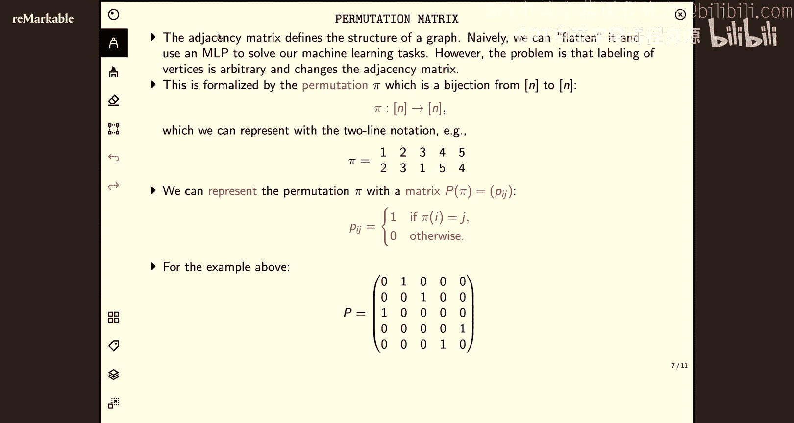

# UCB《机器学习导论｜CS 189⧸289A Introduction to Machine Learning Fall2024》claude-3.5 p24 L24- Graph Neural Networks & Rotational Equivariance 1.zh_en -BV1H4421S7bs_p24-

Yes。

是。ますが。Yes。收。So。在这。原ね収三。Okay， let's begin， is the voice good？Yan。Okay。So。

Last time we went like third way through almost halfway through Markov decision processes。

 I'm going to start with a very， very quick review of that。诶。

So essentially we're going to add action to what we know as a Markov process。

 so Markov process in general is the notion that the system is essentially meless。

 as your friend mentioned last time。So essentially， the future only depends on present， not the past。

 right。So we started with this motivating example。 and the the key ingredient。In this example。

 there are several things， you know we introduce an notion of reward。

We introduce a notion of reward right and we introduce notion of action and also there is this transition model of the environment。

 So when you are in a state S and you take action A，You get a new estate。

 There is a distribution over a new estate。 So sometimes in a case that even when you want to go up。

 the environment will say no， you know， with4。8 you go up， but you4。1， you go right，4。1 you go left。

 right。And we define the notion of policy that's very， very important， as's a new notion。

Policy in general is mapping from states to the distribution over actions given a state。

 know it's a conditional distribution。So when I started the lecture last time。

 I started with this deterministic mapping this was deterministic。But， of course， a distribution。

 a distribution is a general case of a deterministic case， right， So， for example， if。

If this distribution， if this probability is one。Yif。The mapping if A A of S， the rest is 0。

Then this maps to the other one， right？I that clear。 So。

 so the deterministic model is a probabilistic model。

 where the chances of deterministic thing happening is one， right， the rest is 0。

But it's very important to distinguish between these two。

 because sometimes a policy will end up being。Probabilistic， sometimes deterministic。Some好。

Slower than okay， as long as it doesn't break， we can continue。

And the other important thing that's really the core part of RL。

 you know RL is about a shipping goal， you want to achieve goal right and there is this hypothesis really I'm going to come back to it at the end。

 the hypothesis is you can summarize the goal into you can define goal in almost every problem we know as maximizing an expectation over a number。

Like it's extreme reductionism， right， youre you're going do you're going for every problem。

 you're going to look for this number。 It's just one number and。😊。

And and this number at each stage changes。 But at the end， there is a accumulation of this reward。

 and we， we are interested in maximizing it plus our goal。

And so we discussed this and we went over different ranges for this little game that we had。

 little problem that we looked at。And we， you notice that， you know， the， your policy。

 the way you act in the world changes， depending on， the little reward that you have。

 because the accumulation accumulation of reward will be different。And。So。

And this came the key part in introducing the， the， the Markov property。

 and Markov property is simply a states that this， this environment that the agent or agent is acting is defined by these sequences。

 state action reward， state action reward and state action at the end， right， and。And in principle。

 we could live in a complicated world where the distribution that that what we care about。

 the distribution of next state and next reward depends all， all the history of the past， right。

 but we are not we are we make this assumption that either we。

 we come up with the environments that respect this assumption。

 or we just make this assumption because we want to do math and we want to。Program， make progress。

 So we make this assumption that。The next estate， these are the next estate only depend on next reward next estate only depend on the current state and current action right and this is a notation that I'm going to come back to in the remaining 30 minutes or so 45 minutes that this is you know this is the current state current action and this is the next state the prime refers to next state。

And this is the next reward。If you were coming up with this formalism 30， 40 years ago。

 you may have come up with a different not， but that's the notation right so we are going to stick with that。

And。What's going on？It's like a big delay。啊。Okay， good。

And the other important notion was it's just a simple generalization of what we have as a total reward where we are going to discount future reward by a factor of gamma right so the really the very next reward that we're gonna get is real reward and the future rewards are discounted。

 it's a very intuitive notion， but it's really really the main reason is introduced is this infinity right So if you have infinity and if and if you have a total if your rewards are upper bounded by some maximum reward。

 you can show that this G will be less than or equal to one minus。1 divided 1 minus smo。

 this R max right and this is nice。 So we're going to deal with finite objects。

 So this is really discount rate。And， but it's also intuitive notion， you know， the。

 the rewards that's gonna come in like two years from now。

 maybe not as valuable as the current reward， right， I mean， yeah。waitai for this to get updated。

Okay。So， and we gonna define， we define two quantities。 That's gonna play a very important role in。

 in Markup decision processes and reinforcement learning。 One is the notion of a value function。

 and value is essentially expect expectation of this accumulation of reward for any state， right？

 So this value depends on a state， right。And the current estate you are at。

 you take this expectation。 So this expectation is always， always。

 always good to have the mental picture that you're gonna run a simulation。

 If I'm in the current estate， I can make an action。 The word is probabilistic。

 I go to a different state。 I make another action。 I go to a different state。

 I I I make another action， I go to a different state， And in each state， I accumulate reward。

 and I run， I have a experiment， I have an access， I have access to infinite computation。

 I run this simulation many， many， many times or in parallel。 And I get all these rewards。

 And I I take the average of them， That's this expectation stands for。 So this pause here for。

 for us to understand， is this very clear， this notion of expectation。😊，Any questions？Go ahead。

GT is the total discounted rewards， essentially is。

R T plus 1 plus gamma R T plus2 plus gamma squared。Aips3 on， right。So essentially。

 youre at the current state at at some time T。At this stage。

 and you take this expectation until infinity。Right， until your simulation ends， essentially。

 the simulation could go on。 And during this time， you accumulate these rewards and you run this simulation in parallel。

 right， for many， many different， different， different scenarios。 For example， if we go back to our。

It's very annoying that this is has a big delay today。呃。Okay。Yeah so if we go to this example。

 these are how these numbers are obtained I mean in this case we're gonna come up with an algorithm to obtain it。

 but you could also run a simulation essentially were here right in one simulation I went up and at the simulator decided to go up right and then in one simulation the simulator went right right and I had a policy I had exactly how to act my policy was determined by this distribution of a over S so at any state I am I take a sample from this set of actions right？

I say simulator go there， but the simulator with there is a rule， right。

 Not always goes there some probability goes somewhere else。 So you run all these， you， you take。

 you take。You act according to your policy and your policy is fixed， right。

 So this is the key that this value function has a。诶。This value function has a subscript。呃。

Which is policy， right？ So your on policy， right， you have a fixed policy and you're acting to the acting in the world according to your policy and and you run this simulation many。

 many times and you you you evaluate this G T for all these simulations and take the average of them。

 right。And then we introduced this notion of a action value function。 I mean。

 state action value function。 What's really the key thing here is action。

 And so in the previous previous definition of a value function。

 So the action that you can take is incorporated in the value， right， because when I'm in a state。

 current to state， I can take many， many actions， right。😊，And each one of them。In this definition。

 we want to capture in each one of them， the the future of simulator will be very different。Right。

 so， so in the previous definition， this is like buried almost right， It's buried in the。

 in the definition that there was no action。 I was interested in the value of a state here。

 I'm interested in the value of a action when I am in a state， right？ So I'm in the state S right。

 and I take a particular action。 So this is not probabilistic now， right。

 because I'm conditioning on it， right， I'm taking a particular action， And then after that，I。

 I see the future of the simulator。 So let me pause here。

 Suppose I have this thought experiment that I mentioned to you。 I was in a state， right。

 and I gathered infinite number of simulations， right。To evaluate my value function。

 how from and those simulations are saved。 How can I get this function from those simulations。

 Obviously， I don't want to run these simulations again， right。How can I get this value function。

 action value function ver of simulations？It's a very， very simple answer， actually。对。Exactly， yeah。

 that's a great answer。 So essentially， when you run this simulation and you。

 you have taken many actions at a particular state and each。

 each action lead to a different partitioning of your simulation。 right， So essentially， let me。😊。

Draw a abstract figure for you。So， I mean。It a bit maybe too abstract。

So essentially this is my world of simulations， all simulations I've done。On a status。

So I was in a particular state at time T。 I ran all of my simulations。

 This is like infinite world of simulations， right， So these simulations clearly become partitioned。

Right， into what was the action you took right at each at that state。 So A T was a1。Here， A T was a2。

A was a 3。In this particular example， I only have four possible actions I can take。Right。

 the this simulations partition into the action I took。 And clearly。

 there is no overlap between these two because these actions are distinct things， right。

And then I end up with， I had infinite simulations。 Now， an infinite divided by 5 is infinite。

I have many， many simulations， right， And each one of them， maybe some of them are larger。

 You know who knows。 But if there are a lot of simulations。

 I can take the average of total reward after this。And， and call it my value function， right。So。

 so this is the point， the point we paused last time。 And the key question is， I。

 if we the good to contemplate what we what are what are these， we have to， these two functions。

Which one of them is more valuable in some sense。 I mean， this there is no universal answer here。

 But which one of these。呃呃。Function， Q function and the V function that we had。

How can you use Q function that you can you and how can you use V function So you cannot use Q function。

 You know， we， what are the advantage of each。Yes。Yeah。Yes。Yeah。So it's really like the expectation。

Yeah， it's a very good question。 And essentially， there is no T there because of Markov assumption。

Right， so the its only current。 Only the present determines the future， right。

 That's why there is no T there， so。一疗。Yeah， this， you should ask this question from Sa。

 I followed this notation。 But yes， it's a good question。 But essentially， we want to emphasize that。

 you know， essentially， first of all， you see the Markov assumption there。 right。

 that the left hand side that you you observed doesn't have any T in it， right。

 but also kind of emphasizes that this， you， you took this action at at a time。 It's just a notation。

 But yes， absolutely。😊，Yeah。Which。Yeah， so by， the value function is valuable in a sense that you have this holistic view of a state。

 right， But essentially， you cannot think if somebody gives me the value function。

 I really don't know how to act。 right， A good example， actually， this was as。

Last time after the lecture is actually looking at this example， which I overlooked。 This is a very。

 very good demonstration of it， actually。嗯。Let's waitai for this to load。Yeah。

 so a good example is here。😊，And here we have given somebody you know we have this oracle who has given us for the optimal policy right。

 for the optimal policy， there is a policy to act and one of them is optimal gives us the maximum accumulation of reward when you start from this start point right but for this optimal policy。

 you can evaluate value of each state right and the question is suppose you are in a state one right？

Can you use this value function to go to decide where to go next？Right， I'm in X state 1。

 and this game， I can only go to my neighbors， right。

 And the only name available neighbors is this one。And this one。Right。

Can I use this value function to say， let's go up。Yes。Yeah， so that's the issue。

 Then you have to resolve the problem。Essentially， the answer is， you know， you alluded to it。

 when you are here， you really cannot use value function to decide that going up is the best action。

 right in this particular case， you know， first of all， there is a disparities，08。7。

 And we already know our game。 when we take a action to go off。 We point 80% of the time。 we go up。

So it suggests that that's probably optimal。 But the moment you come here。

 it becomes tricky right here， point69 and 。7 are really， really close， right。

 And we already know when we go up with some chance may go left。Or when we go left。

 we with some chance we go up， right， So， and you can see it。 actually， You can see this very。

 very interesting case where。呃。Where for this particular case。呃。For this particular case， the every。

 everything is sensible。 but this one is a tricky one。 right， This， this point。

 it turns out the two actions are equally optimal， right。But， but yes， so essentially。

If you really understand this， this， what we talked about that based on the Q function。

 you can take the optimal action when based on value function， you just don't know， right？

 in some sense， it it suggests that Q function is more valuable， in some sense， right。诶。But。Yeah。

 so this， I mean， obviously， it doesn't suggest for every problem。 you know， for some problem。

 you can actually tackle the value function， but。For example， you can think of a board game。

 You know， if you know， a value of any state， the value is the same as action。 You know， you。

 you know， taking that action leads to a certain state。 but， you know， it depends on the problem。

 So essentially， the， the heart of the problem is for some problems。 when you take an action。

 the word doesn't respect your action。 The word behaves differently， right。

 And this is captured in Q function， but this is not fact captured in the value function， right，So。

 so then we come this notion about optimal policy。 We have already talked about it。

 but essentially optimal policy is a policy where for all state， right。

 this policy gives me a better value function than other policies。 you know。

 there is there there is this policy where gives me the best value for every estate。 I mean。And。

 and this is clearly， this is just relating the this optimal。 This is we talked about now。

 the optimal optimal value function and optimal value function is essentially。

The maximum of the Q function where you take the best action。 right， It's very， very intuitive。

 right， I have this Q function that tells me for every action that I take。

 what would be the final expected total reward， right。

And one of this action gives me the to the optimal value， right。

 And we already know this is the optimal value because， because that's how we defined it。 right。

 We define the optimal policy to give to give me the maximum value， right。Okay。

 I think this is hopefully the last definition。 I think this is the last definition you need to absorb。

 so。And then after that， we can relate these， these definitions to each other。

 Any questions here on the optimal policy。So as you have seen， as you may guess， you know。

 we have defined these quantities value function， state value function and action action value function。

 and this depends on these sums of quantities right and we already know the process we are building up is Markov right。

Everything only depends on the the future only depends on the present， right？

 The next step only depends on the present， not the past。 This immediately suggests， you know。

 you went through this problem of the finding the cheapest lives。 It's exactly that setup。 you know。

 it's like， you know， you are there， the reward was to have the cheapest life and this only depends on the next estate。

 right， at every estate you when you fly， you have to fly to the next region and so we're gonna see。

That thing showing up again， dynamic programming。 and actually， dynamic programming。

Is the first book written by Bellman， Richardhar Bellman。

 and so he's the father of dynamic programming。呃。And。Yeah， so these derivations are essentially。

Different flavors of it shows shows up everywhere， but it all goes back to the same， same。Philosophy。

 in some sense。So let's start with the first。Set of equations。

 So this Belman equations is Belman A equations， B equation C equation。

 There are also sort of Belman equations， right， So I'm going to go walk over the Belman optimality equation。

And this one I， I asked you to do it at home。 I may add one more derivation online so you don't just see the equations。

 We can just derive it together。 What time is it now。Okay。嗯。So let's go。

 So basically we are interested in finding some sort of a recursion relationship。

For a value function of a state， optimal value function of a state。

 given the optimal value function of other states， right。

 So this is like clearly will be very valuable， right， if I。

 if I know the value function at any state， given all other value functions。 I cant use it。

 And we will see we we're gonna turn into， turn this into an algorithm。But let's start。

 So essentially， I actually， I sneaked in an error here。 So try to be up。

I want you to find the errors， so theres the errors somewhere。see。So， so essentially。

 this optimal value function， as we defined it。 So there is this Q function that takes that gives me the。

 the expected value， right， And I'm sorry， the expectation of total reward under this policy。

 and this is optimal， right， This is， I'm looking at the optimal value function。

 So I clearly have to look at the optimal policy。 So this is。The optimal。好lic see。Okay， good。

And I'm maximizing over。All actions I can take。And this one， as you can see。

 is kind of going to be repeated， right。You know， just give you a hint。 So the key is expectation。

 right， we're gonna， we're gonna rewrite expectation in a different way。

 That's essentially the magic here。 And， and we know we define the Q function to be this expectation of the total reward。

 So as a reminder， G T is is given below， right。This is my， this is my total reward discounted。

 right。 So essentially the next step is R T plus1 gamma R T plus 2， gamma square R T plus 3。

And so on。 And when you look at this。I see gamma plus gamma square plus gamma to the third it really suggests to bring out a gamma。

Right， so I have this。And this is really the step that shows up in every single derivation for Belmont type E。

 So I have this G T。That is our。T plus v plus gamma。R T plus2 plus Ga Square。T plus3 so on， right。

 So what I'm going to do。Is。I have this gamma。And I'm just going to reduce this。

 This becomes smma square。R T plus 4。And so on。And then what I like to see in。The。

 the things I defined was based on something plus  one， right？ I'm gonna do another trick。

That I'd like T plus 2 to be T plus 1。Plus one。a heavy math here。

I write T plus 2 to be t plus 1 plus 1。And this becomes。T plus 1 plus 2。So when you stare at this。

 this essentially， I'm massaging it said you know， to be in the same form that the G function is。

 right， This almost looks like the G。For the next step。Right， that's the idea。 So essentially。

 this was a reward for the next step。 And I write it as a G total reward for the next next step。

 I'm sorry， right， That's what they mean。So that's what is done here。

And did you guys spot the error here， There's the error。Somewhere。Go ahead。Yeah。

 you should still have a gamma。Thank you。 Yeah， so there is like there is a gamma inside。

 And the key is this gamma。Shui。😔，The same four， right。Is gamma like K， right。And。And essentially。

 the last step that I haven't written here。I I write this S T plus lawn。Plus， K plus。Right。

 essentially that algebra that that you see there。Right。And this is very nice。 It's very simple。

 but very profound in some sense。 So essentially， when you look at this。

 this is really the value function。😊，As if you started in the next step。Right。

 I pushed my cheapest slide to the next， next slide。 That's really what I've done。 right。

 So essentially， this， we already know， this is the， this is a reward in the next step， right。

But when you take this， when you are in a state S and then you take the action A。

 you go to an exit state， right。And then from that， you look at your simulation。 essentially。

 If you go back to my simulation analogy， right， simulation is not really an analogy。

 You could run this in simulation， right， then。Then that's the reason you have the value function for the next states。

 right， So let me actually make this very clear。The different color。So really this value function。

 this if you look at this whole thing。Right。Its really this。Right。I mean。

 that's essentially my definition because I'm conditioning on the， on。

 on this state with some probability。 I go to the next state。

 So we're gonna talk about in the next line。But essentially， that， that some that you see here。

Right iss just really looking at all the rewards that you are getting starting from one step forward。

Right， that's the reason you have this T plus one showing up。呃。Any questions here。

Don't be shy if you have questions， your friends also have questions。But yeah。

 so I'm going to redo this calculation for a different case， but。Yeah。

 so this is essentially this is really the universal trick for beman type derivations。Really。

 it starts from here。Right。At the end， all of these quantities， we are interested。 That's， again。

 that's the R L。Essential， you are interested in maximizing expected total reward and a total reward is discounted。

And you always have a gamma that you can pull out。And you can write the rest as a term that the first term is doesn't have any gamma。

 right The only difference is you're pushing the time to one a step forward。

You started at time T T plus  one now is t plus one plus one right you're pushing thing1 to step forward again。

 youre youre always go back to the shortest slide because really。

 really that's that's maybe the simplest example。You're really。

Kicking the ball down the road essentially in some sense。嗯。Okay， so now comes the next step。

 And the next step essentially is what I， what I said。 So this is。Reward。The next step。

Next step reward。And if we go back to our。Everything going to be a slow， but bear with me。

They hard to fix this problem。It's go to my definition。Yeah， if you remember the definition。

 this was by this was the next reward。 right This was really this little R was R T plus one， right？

 and the X S prime was the next state。 and S and A， we know。

 S and A is the current state and current action， right。So， let's go back。Yeah。

 so essentially what this was we were at the stage。We got states。呃。And the two an。

 So this is we are at a state。 We are taking an action， right， with some probability。

 we go to a state S prime。And this is really S T plus 1。 S T plus  one is。

These are really just for simplification， right just。It's just a shorthand notation。

 And then writing S plus when I write S prime。 and I'm getting a reward。

 But there's a distribution over this， right， This is this is my Markov model。

So Markov model says I only the only thing I need to know is just the next step。

 And this is the next step probability is condition on the condition on the current step。

 a state and action， right， and and I am， so I'm computing the expectation。

 This is the expectation I'm computing。 So let's write it。The different color。

So this is really the quantity I'm interested in。Rightan。识点。This is really the。

 the quantity of interest， right， And this is really， this is this one， right。Right。

 a next reward gamma， the value function is starting from the next state， right？

 this is weighted by properly by these probabilities。 right， So essentially。

 what is' saying is that this expectation， I have to run it。

I have to run run this expectation over a long simulation。 But if I really。

 really know this probability and I know this system is Markov right。

 everything only depends on the previous estate right So Im I'm going write this this expectation。

 in terms of the next value function starting from the next state right。

 So essentially from this state， I know the transition of the value function to the next state right。

Different way of saying it。呃。So， this is really。This。Way of driving things。 You can have many， many。

 many versions of it。 So in the bottom， I have a different version。 So this is。

 I'm looking at the Q function， the optimal Q function， right， And the optimal Q function again。

 is written in terms of this right， And this you do exactly you replace what I what I've done， right。

 and and we gonna essentially you're gonna write this as the as the。As the。

Optimmal Q function for the next state。 right， So this， I'm going to leave it for you。呃。

So the key here is all of these algorithms have a iterative nature， right， andm relating the， the。

Value function to another value function， right？ So this immediately suggests I can。

 I can write a recursion and algorithm， right， So I start from a guess for my value functions。

 and value functions should satisfy this almost like a self consistency condition。Right。

 so the these equality should hold。 and I， I iterate over it。 I compute the right hand side， right。

 and then give it to the left hand side。 And it if the left hand side and right hand side are not the same。

 I continue right， And the same is by some tolerance， right， So that's essentially very。

 very general thing。Let's actually write。 I'm gonna do the live derivation for you for here。

 Let's do the value function。 this， this quantity now。 So this was， this is different right here。

 I had this。Because it's optimal， right。Because it was optimal， I did a max operation here。

 So it became kind of boring。 Action is out of the picture， right， I'm doing max everywhere。

 So I'm going to do a bit of a harder derivation now。So here there is no max because I'm。

 I want to evaluate value function for any policy。 It's not just optimal policy， for any policy。

 right。嗯。So let's do this together， actually。I'm going to start。

You see what the definition of a value function is。So how should I start。So， you know， what。

 what are we after。We define the value function to be expectation， value function。

As a function of a state is the expectation under this policy I'm running the world according to my policy。

Of the total accumulation of reward conditional state， right。That's our definition， right。And。Then。

We're gonna repeat what we did before。 G， T is gamma。Is。Is T plus1。Plus gamma is T plus 2。

Those camera square C plus 3， so on。啊。You guys should complain， you know， when it's not good。

 I don't see it on this pad。And switch to black。So。We're gonna do what we did before。

 So we write this。 This is very valuable， right， This is really the os。Any complain here。

 and I don't I have some big typo here。Go ahead。Yes， you have to be capital R。Please complain early。

We would have gone all the way to the end。So this is R T plus1。Gamma R T plus 2。

Plus Gama square or cheap plus3。Conditional estate。Right。And again， you know。

 this R just see it coming。 The R T plus  one gonna become a little R， right， soon it's gonna happen。

 So we just gonna rewrite this as I I have it on the board。 gonna write this as gamma。Or。

T plus1 plus one。Plus， gamma or T plus 1 plus 2。Plus gamma squared R T plus1 plus 3。

Any was take here at this point？No。Okay。And so， here。It's going to become interesting。So here。

 really this。Is expectation by R T plus 1。Gamma。Vi。Pi。S T plus one。Rightai。So what I'm doing here。

 right， Im doing， I， I'm running an expectation， and I'm starting from the time T plus1 I time T。

So I'm accumulating my rewards， so this is really the key。

I have started accumulating my rewards starting at T plus one。Right。

And that's why you have T plus1 here。RightYou already went to the next state。And。

And this part is becomes interesting。Essential， this part， when you are in a state S， right。

You have to take an action， right。 So essentially， in this， that's the key here when I'm。

Computing value function under policy。 I have to take into account。

 take into account all action I can take。Right，Previous in the for optimal policy。

 I just looked at the maximum action。 But here I can take many， many type of action。

 So what do I need here。Right， if we go back。At the cost of everything being slow。It wait here。

If we go back here， we had a probability of a N state。given achieving next reward， right。

 current state current action， right， But current action， you know， I can take many actions。Right。

 so clearly， I have to multiply this by probability of actions that I can take given my estate。

 right。So。So， this expectation。I'm going to write sum over it a。

Probably have all actions I can take on the when I am in the state S。 And then when I'm in state S。

 I take action A， I go to some。Some I go to a different estate， right？呃。And I get a new reward。

 there is a distribution over it。So now this one is some of their。Some over a。

This is some over is prime。An O， right。So let me actually color it for you so you can see。So。

 essentially， here。There is all these things I have to marginalize over。

 There is all rewards that I can get， but there is a distribution over them。

 all next to state action， there is a distribution over them and all action I can take。

 and there is a distribution over them。 right So that's how it's coming。And finally。

We're going to do what we did before。 We had this this guy here and we're going to write it。呃。

R gamma， V P S。Right。So， this is one。You know， the third bellman equality is see。

And you can go home and do it for。For the Q function on policy。

 you can do all sorts of things you like， you know。

 But this is probably one of the more complicated one because also there is a action coming。

 So in in the in the previous derivation， there is a max everywhere。

 So you didn't have to do this step。呃。Okay， so after this derivation。

 we arrive at this very interesting algorithm called policyiteration。😊，So， essentially。

Polic situation is。We have it。 Yeah。 policy iteration is first。 You have to evaluate the policy。

 right and evaluating the policies， you start with some random random start for your policy， right？

 There is some random guess。And。And then。And then evaluate this right hand side。

 Everything is known here， right， This is like， essentially， this set。I'm sorry。

 I should have said it earlier。 We are in a finite Markov decision process world， right。

 Everything is finite。 There is a finite state of a space of actions， finite number of states， right。

 So this can be evaluated。 You know， it can be very large， but everything can be evaluated。

So this one， we know everything we know here， right， So we compute this sum。Right。

 and then and then this gives us a new value， right， And this value should be should match our value。

Right， why， because Belman equality is， the equality， this equality should hold。 And I。

 I iterate over this。 and with this situation， I arrive at the， at a value function， right？

 And then the next step is， is that。Is I'm going to pick an action right。

 where I get a better policy，The key here is that this is for a fixed policy， right？

 So everything policy is fixed here， the policy。Is fixed。And in this policy improvement， I just。

 I'm just gonna improve my policy， right， with this， this very simple。

 simple iteration that's given to you， right， I just go over。All the policy I have the policy。

 I have to take an action。 and then I find what maximizes my my value right。

 or max is over action and this gives me a new policy and this policy also has to be stable right So essentially Im I'm keep gonna improve my policy right。

 and when the policy is stable， meaning that the policy doesn't change。

 it's already improved then the algorithm of stops right。诶。So you can make up a story。 This is。

Maybe not。You know， depending on the problem， maybe you don't want to do to a step to a step computation。

 and the that's why the optimal beman optimality equation is becomes very valuable here。

 because we can iterate over the optimal value function directly。 right， And that's done here。

 it's called value iteration。 essentially， this is the beman。This is what we drove together。Sbelman。

 Opity。Equation。And the key is optimality， right， Thiss already， this is for optimal policy。

 right the value function for the optimal policy。And。And with this iteration。

 you do exactly the same iteration。 But the end the end of convergence of this iteration process is the optimal value function。

 right， and， and and I just take the， the my policy to。

 to look at the actions that maximizes maximizes this quantity， right， so this is essentially okay。

 here I'm using。The weight bits。Maybe I can just say to you directly。Yeah， the last step is。

 is as intuitive as it gets。 Essentially， I I'm just looking at the。

 the policy is the action that that maximizes this， this quantity。

 So this is coming from here obviously， right。So I'm just changing max， replacing Mac or a max。

That's what's done there。So essentially， the nice thing about this。

 this value iteration is you go after the optimal policy directly， right， And at the end。

 you have the optimal policy。 you get the I'm sorry。

 you get you go after the optimal value function directly。

 And then when you have the optimal value function， you extract the optimal policy。嗯。

So I'm going to finish up with some。So here， there is no R L。

 So we're gonna talk about R L very briefly， but essentially。

You can already see that this it seems like an enormous task， know you have。PPrevious when。

 when we were discussing like classification problem or geneticative modeling。

 there is a notion of curs of dimensionality because there is abundance of a space in high dimension。

 right， now， on top of that， any action that you， to take changes the world。Right。

 so it's like then said it's a super duper version of cur sub dimensionality。 And actually。

 the word care sub dimensionality is coined by Biard Delman。😊，So。

 so this actually is just from the purposeface to his dynamic programming books。

 They are reading something from 1957 here。 which is really cool。😊，So essentially。

 he just says that I arrive。 We're gonna arrive at the system of a question。 Okay。

 let's read it together。 or however some details to consider。Right。

 is like talking about this that essentially when you look at the previous size。

 the problem seem solved， right literally have mapped the problem into some linear system sum of equations right。

 these value functions are unknown。 There these quantities that are fully known as' a linear linear equation right。

 and we just solve this linear equation iteratively。

 So its saying that some details to consider the first place is the effective analyticsnatic solution of a large number of simple equations。

 for example， linear equations。Is a difficult affair， right， it's a large number。呃。And。

 and then it goes saying all this， maybe some subsum under the heading the curse of dimensionality。

 since this is the curse which has hung over the head of physicists and astronomer for many a year。

 there is no need to feel discouraged about the possibility of obtaining significant results。

 despite it。 it is already 1957。 He sees the curse of dimensionality。 And he already sees that。

Probably， it doesn't matter。 We can。 This can be cracked。 It's really fun to read this。

 And we come to。😊，First，1995。So this is another algorithm called temporal difference learning for learning the value functions。

 actually。 Yeah， so I just followed the curriculum from from last year。😊，Let's connect this again。Oh。

 that's the reason。哦。Why is it not connecting。Okay。So we go to 1995。

 so this algorithm called temporal difference learning。

 it's just a different version of this iterative value function algorithm。

 again I'll just followed the curriculum last here so this stopped at the policy iteration and value iteration algorithm。

 but you know essentially it's an algorithm to get the value function。And。

And so 1995 and the state of does anybody know， does anybody doesn't know how to play back Kevin？

Yeah， oh， yeah。 Okay。 Yeah。 I cannot talk about the move then here， but essentially， yeah。

 it's a very kind of a simple game。 But the state of state of possible actions we can take。

Is around 10 to the 20 Its estimated， right， So you cannot write 10 to the 20。哎呀。

Linear system sum of equations， right， It doesn't even fit in the in the current hardware。

 And this is 1995。 And I checked the web at that time， he had access to 100 MHz processor， right。

 It's a very very simple computer。 and， and， and Tearro Jerry Tesarro won the。

His machine won beat the world champion，Yeah， it's a very interesting thing。 He talks about it here。

 And this again， happened with go that I'll talk about。 So here， you know。

 there is a white has to play。 And the thing that has come is two four。So there are two dices， right。

And the top one is four。And as you know in vacuumham you can take you can know you can move four of the elements to four places so human。

It's very， very natural to do this。 You， you take over。

 you take over and you're gonna to block the black。Yes， I'm sorry。

If you take four there and block the black in this line here。But the computer took defection。

But instead took for the other one， took this action instead。So there's a white here。

 because you don't see。诶。And it's kind of fun to read this paper because it comments on it。

 And the fun thing is that actually we can see what the computer sees the value of this two。

 two configuration。😊，Right， we have found the value functional algorithm。

He use a different algorithm。 but in our essentially in any algorithm。

 we find a value function for any state， right， And this estate is very， very large， right。Clearly。

 we don't want to enumerate this。 So what， what Tearro did， And you can see in his papers in 1995。

 He paraizes this with a neural network， right， There is a。Our neural network comes in。

 So this is a neural network。And neural network has a magic of neural network。 It doesn't。

 theres the， There's no enumeration there， Right， It's a parameterization of from from any state。

 you get the value function， right， It's parametricized by neural net。And you can query。

 You can query in run net。 There are this， these two possible configuration。 One is I go there。

 I go there， The other is I go there。 I go there， right， These are two different states and， and。

And the computer likes the non the counterintu state。 and we go 2016。 you may have seen it in TV。

 I don't know if you have watched the movie。 This is like a famous alphago。

 and it was fun because like I was at the conference two years before this。

 And people are talking about whether alphago can be cracked。

 and the state is roughly2 to the 19 by 19。Roughly 10 to the hundred70。It's a huge state。

 We go from 10 to the 20，10 to the170。 Okay， we have gained some computation here。

 We have 100 MHz now， maybe 10 to the 12 Hz。Right， you may say terror Tlo。Right。But， you know。

You're not gonna compensate for this， right，10 to the 20 to 10 to  under 70， right。

 But hold and behold， the same thing happened with Alphago。 And it's really。

 really sheds light on Belman's19757 remark that there is no curse dimensionality。

 when you approach the problem correctly。 So if you are not here looking at the state number of states。

 You are looking at how this value function is evaluated。For any state you give it to， right。

 So this really comes to the issue of the reinforceal learning。So this is a finite slide on this。

So essentially， this Markov decision process。You know what we have talked about we are summing over state action is finite and we are these algorithms。

 there is no neural network currently right so the algorithms I outlined。

 you have to do policy iteration and value iteration。

 but essentially what what's done in modern enforcement learning is you parameterize everything So this pi we define policy value function。

 Q functions， all of them are paraoidized with a neural network right。And。

And that's the story of all R L。 So the final remark I wanted to make is like this two end of extreme。

 So it's a beautiful subject。 Unfortunately， we spend just one lecture， one lecture。

 but I extended it to the one and a half now， so。😊，It's， you know， there。They are essentially very。

 two very different camps。 So one ca says that reward is enough to achieve intelligence。

So essentially， there are two hypothesistheses here is that if the reward hypothesis。Rewardt。

Hypothees。 so reward hypothesis is that， okay， the other， the first one is intelligence。I。

About achieving goals。Is a computational system that lets you achieve goals。 So without goals。

 there is no intelligence。 So this is how you start。 I mean， you may disagree with that， but。

But essentially， we have goals and we have ways to try to achieve our goal。

 But the reward hypothesis is already extreme reduction of it。

 It says that goals can be summarized by maximization of the total reward in expectation。Right。

That's how the whole thing is based on， right， We are expecting。

 we are doing expectation of a total reward that's accumulated， right。

And the reward is enough hypotheses， essentially， it states that。All the faculty we have developed。

Can be reduced to this。This problem， right， essentially， to solve this problem。

 you may have to solve gene modeling in some sense in your brain。

 You may have to solve how to do classification。 You know， it all comes back to that。

 So that's one extreme。 The other extreme is people who don't like R O， in some sense。

 And who work on。 They think。诶。On superupervised learning is the key。

 So this is goes analogy goes back to your Lacon is the analogy is if intelligence is a cake。The。

 the whole cake essentially is on superervised learning。And。This icing on the cake。

Is supervised learning。And just the cherries on the cake is Oal。

RightIt's just there is like a and the analogy has a deeper meaning for young cons。

 So essentially the idea is the samples that you get for any sample， you know， there is。

 there is a lot of bits。 You can can say there are。You know， around a million bits per sample， right。

 Let's take an image。 You know， there's a lot of bits here。 and I don't have any rewards， right。

 I can do， I can start learning without anything， right， based on these bits。

 And we went over one of them。 We can do gene modeling， right。There is no reward there。

And there is a lot of data for supervised learning。 This comes down to， let's say，1 hundred0 bits。

Right， sometimes there is a label for your samples。 It's very just。

 you can condense it into like 1 hundred0 bit。 maybe， maybe a bit more。 And Oriel， if you're lucky。

You get few bits， right？ So what's， what's reward， what Im， what reward am I getting currency。

 you know， so it seems like。You know， that's the other end of extreme。 That's it's a view， right。

 So it can be on。It can be a future。Wellknow recession and come up with your own analogy。 But yeah。

 so this is the， I just wanted to tell you the to， to end of the extreme。

 So before going to the giving you a very quick overview of the next lecture。Any questions on the。

And this， go ahead。嗯，有。Yeah， but yeah， I think that I've seen some framing of that。 But。

 but it's not really you're not doing R L。 It's not like you， there's like some maximization。 R L。

 A lot of times， the reward is very sparse， right。So。I mean， some games are very extreme。 Like。

 for example， go， you get a reward at the very end of the game。You' have seen you I played hours。

 And at the end， you know， you've lost a one。So， so it's very， and it's pretty fascinating。 I mean。

 you know， people who managed to pull that， pull off that one， you know。

 you have learned a lot in the middle， you know， so。I don't question， I don't question your， your。

 your perspective， but I， you know it's not formalized yet。Yeah， yeah。 exactly。 Yeah， yeah， yeah。

You know， I like sampling for mis sampling is enough for all these problems。 You have to sample。

 We saw it earlier。 This expectation is about sampling， but maybe sampling is enough， but。呃。

Very good。Okay， so let's switch topics now。 I'm just going to give you an overview of the GNN lecture。

诶。So essentially the remainder of the time that we have。About 10 minutes。I。

 I can introduce you this general notion of that's。It's a bit of a switch in topics， actually， but。

But yeah， so in some sense， perhaps this is， this fits after convolutional neural networks。

 iss very related。 But in some sense you have now learned about graphical models。

 We have some understanding of graphs。 So that's how we're gonna teach it at this point。呃。

So essentially we're going to talk about doing machine learning on graphs。

 That's that's the topic of the day。 and I'm going to first give you some introduction how to think about the graphs。

 and theyre a very， very key problem that you need to fully understand that that's the key thing that I think we can start the thinking is the permutation symmetry。

呃。And then were go over certain graph architectures。 And in some sense。

 if you understood convolutional networks， and I'm going to give you a review of that， really。

 graph cannot not really。It just comes， comes out， comes out。 you know。

 it's just simple extension of it。And hopefully， I'll have times， like to me， unfortunately。

 it's not in your textbook。 And the subject of the all the things I'm going to cover is really chapter 13。

 I've done a pretty good job。 except that for whatever reason。

 at least there is no mention of wisefa Leman test， So essentially， this is in some sense。

 maybe they are the fathers of this field。 And it turns out this G and N that we are gonna talk about。

 It's really as good as this test can get。 So we're gonna go over that at the end。 hopefully，Okay。

 so。Essentially， we we are interested in doing machine learning on graphs。

 and there are many graphs that you can consider a molecule。You can represent it as a graph， right？

 There are atoms， and there are bonds and these bonds are either single single bonds or double bonds。

 there is obviously social networks， right， and there are recommender systems。

 This can be a gift or it can be like a movie that you watch and there is some connection between these people。

 right， And there is a famous problem called Netflix problem。

 I don't if they're still giving me a word for that。 that you want to you have some， I like a film。

 my friends like some films， and I have connection with somebody else。

 and they want to make a recommendation， you know， so based on this connectivity。

 you want to recommend something。 And in all these cases， underlying model is graph。

 So and we want to do regression， you want to do classification you not about gene modeling you know。

 in principle， you can do gene modeling。Stta， right。嗯。

So essentially graphs or abstraction of this data， so let's talk about graphs。😊。

I don't know if you have seen these definitions， but I'm going to over the key key notions here。

 So graph essentially， you can think of it thats two these two。

 these joint sets are a pair of verortics and edges。

 So edges essentially this verortex verortex unored pairs of vertex vertex vertex。 I'm sorry。

 the node node。 So these， these are called also node。 sometimes。And edges called links， sometimes。

You know， they're need the same thing and。The key notion here is the notion of a neighbor。

So given a graph the nodes that are connected to me are my neighbors right and so this is like almost like algebraic view but you can really think of a graph colloquially has a collection of vertices there is a set of vertices which are joined by edges right so for example this algebraic view of a graph I have and this algebraic view we're going to come back to it I have this set of vertices。

  one to 9 and one is connected to  two，2 to 3，324，42 5，8 to3，3 to9 and so on。

So that's one view of a graph。 The other is you just look at it。 It。

 I just have a visualization of it。 That's the graph， right？ So this means the same thing。

And you can identify a graph with an adjaing matrix and it's a very， very。😊，呃。Intuitive definition。

 right， You have a set of nodes here。 my my notess are here， which are indexed。Right。

 and this matrix is binary。 So and is only one if the nodes are connected。

 So I look at this is node 1， node 2， node 3， node 4， node 5，1，2，3，4，5， and here。

 node 1 and 2 are connected。 And here throughout this next lecture。 and throughout this。Yeah。

This G G N that we are considering。 we are only considering undirected graphs。

 So there is no direction。 So this matrix is symmetric。 Clearly。

 if I is connected to JJ is connected to I， right。So let's draw this graph now， so I have five nodes。

And I'm going to put it on a Pentagon。So it says one connected to 2。2 is obviously connected to one。

And then two is connected to 3。3 is connected to 2 and 4。4 is connected to 5。

And 3 and 5 is connected to one。 That's the graph， right。And we already。

 we are already down to a important problem。And the problem is， who said that I。I mean。

 this is like it is a nice looking graph， right。 But who said that I should throw my Pentagon。

Heagon indexed like this， right， I could have indexed differently。And I did this。Before the class。

I'm sorry。I could index this。You know， these indices are， first of all。

 shape of Pentagon is arbitrary。There is no shape to a graph， right， I could have put in on the line。

 but， you know， I just wanted to be geometrically minded。

 but I could have done it something different。 I could have done， let's say this，1，3。5，2，4。

I could have labeled it like that now。My graph would look like this。Right。So in some sense。

 it's like where in this case， I like it。 It's kind of curious because it's almost like when you look at the shape。

You remove all the edges。The edges that don't exist actually exist in this one。

 So it looks like a very different graph。Right， but they are the same graphs。Right。

 it's like I like this game a bit。 And we're gonna see from a different perspective。

 These are the same graphs， really， right。So the key here is that you really。

 really have to think about it before the next lecture。 There is no notion of ordering for a graph。

 You know， this notion labels 1，2，3，4，5。 is really arbitrary， right？ And here for Pentagon。

 maybe it's natural to stars。 I mean， things are on this on a Pentagon。 I not 1，2，3，4，5。But。

 you know， look at this graph， even though it looks symmetric。

 but how how on earth and Gamma you start naturally ordering it， there is no natural order， right。

 There are many， many node。 And at some point， you have to make a decision to， to label these notes。

 right。So essentially， this program， you could， when you look at the e matrix， you will think that I。

 oh， I am done。 Why do I need to do graph neural networks。 I have。

 I have a representation of my graph。I flatten it， give it to a deep neural less work。 I'm done。

 right， but that's not going to happen because any time you flatten and make shakes。

If if you change your your node labeling， you end up with a different different matrix， right。

 So essentially， this matrix， there is no ground proof for this matrix。

 it it is the ground truth when you are given the given the node labels。

 but your friend could pick a different node label， right， even you， after having coffee。

 you may pick a different node label， then your whole computer program is going fail， right。

 So this is going to what we going to discuss now or next lecture。 So essentially。

We're going to see how this matrix or how any object that we are interested in for some machine learning task is going to。

