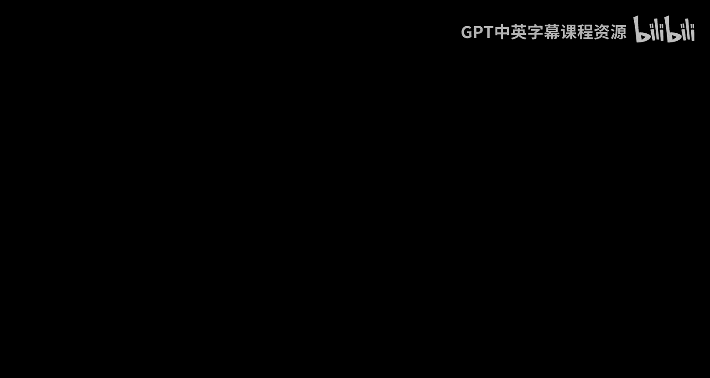
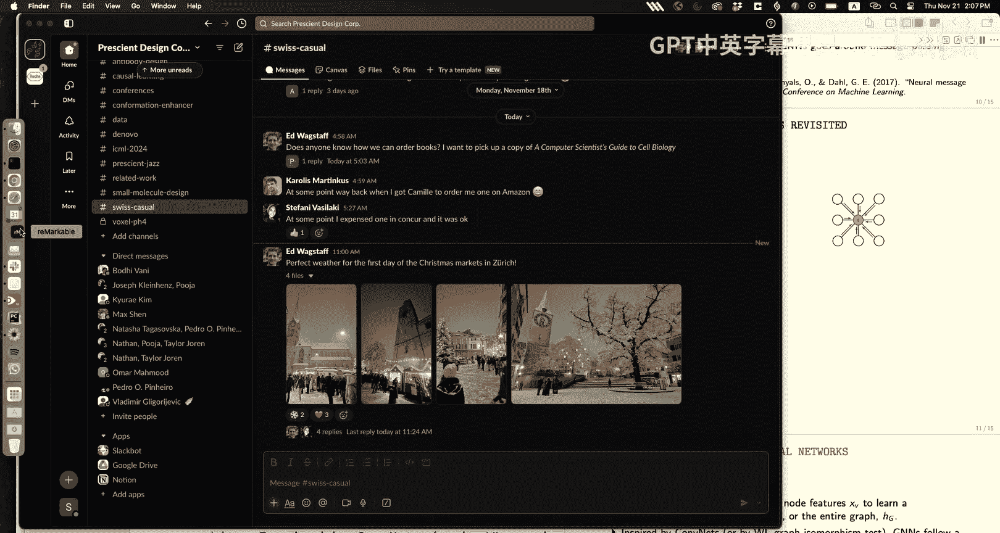
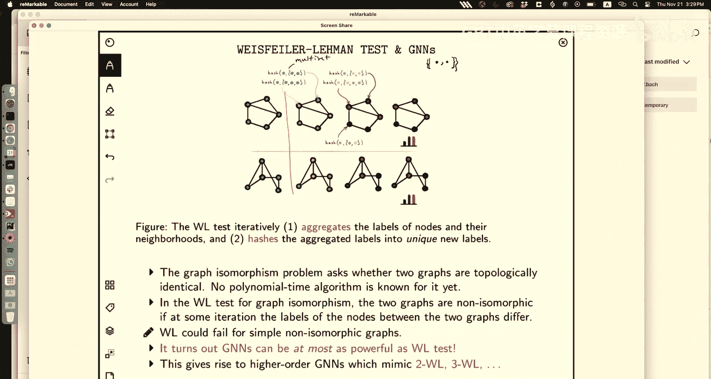

# UCB《机器学习导论｜CS 189⧸289A Introduction to Machine Learning Fall2024》claude-3.5 p25 L25- Graph Neural Networks & Rotational Equivariance 2.zh_en -BV1H4421S7bs_p25-

It's your nasty。Yeah， can I have a picture picture。给不知的。可以的。で。收。

Yeah， it looks like everything is breaking gradually a slow breakdown of everything。

 this there is no。Is the voice okay， I don't want to。Yeah。I think。

Any questions from the previous class？Okay。No， I'm going to start a bit early， like one minutes。

 early two minutes early， because I there was a typo actually in the previous lecture。

Nobody caught the typo， so I didn't correct it this year， I didn't correct it right now。

 so let's find the typo together。So this was we wanted to do。Evaluate the value function right。

 for a policy， right， So this is my my policy。And I want to compute this expectation。

 starting as sometimes T， right I want to compute this total reward and total reward is written here。

 right that's the total reward。And what we did was this trick that comes up always in Belmon type derivations where we wrote this object right there is a gamma here this factor as Rt plus1 gamma parentheses right in the parenthesesis we extract gamma out so and we write Rt plus2 as t plus1 plus1 right so this was Gt this is total reward as a time T right so this becomes Gt plus1 right essentially what's the definition of this this is Rt plus1 plus gamma ort plus2。

A sma squared or T plus 3， right。So on， so literally we have R the T now is's changed to T plus1 here。

 right。So this becomes G T plus1。 and I have a expectation here， right， I have。

 I have a expectation sitting outside， right， And so the expectation of this and this。

 And this becomes v pi on policy， right？ I'm evaluating the policy。

And I was starting one step one time a step forward。

 and that's the reason we had S plus one showing up here， right？呃。

And then we have this expectation and we are down to only next time a step。

And next next value function at the next states。 and this is what's written here。

 so we write this expectation， so essentially let me change color now。So， we have written。诶。

We have written this expectation， right， as this sum。And the sum。Right， so does current estate。

Current estate。And current action， this is next reward， which is this。 So this is that， right。

 And this is the next state， right。Next state。And this was also next state。

 So can you catch the error now。And I wrote this， right， I wrote this one here。It's not that tricky。

I'm in a current state。喂， this is tea。And I'm taking an action with some probability。

And I go to the next state with some probability and I get a reward with some probability， right？

And my estate gets updated。 and what is it updated to， it was updated to S prime， right？Right。

So therefore， here should be as prime。And this is like a very bad mistake， actually。

 if you had done that mistake。嗯嗯。It's a big reduction。Yeah。

 so this is like the the mistake I made and also one thing that's。I mean， I alluded to it last time。

 but essentially it's good for you to understand that this V with the finite Markov decision process。

 the states are finite， so is this guy is really a vector I can write which V。先車病。Some mix up。

That's why it use our algorithm to find it。And turn into insert。YouCan you for you want as long as。

Just wanted to mention this typo from last time。呃。Is。This clear， if you don't， if you have questions。

 please ask。You have time。Yeah， okay。So。Let's move on to the。Second topic。Okay。

 so we started last time on。The discussion of graph and run networks for。

 so I went over what is the graph and I talked about the adjacentsymmetrics and we left it in the air then it came to permutation symmetry so that will we're going to pick up on it。

AndThen when you are equipped with with this knowledge that you want to construct a neural network such that it respects permutation symmetry。

 naturally， as we will find out， naturally this notion of graph neural network。

 graph neural networks pops up。So this will be the main topic of today together with understanding permutation symmetry。

And then at the end， I'm going to cover what's not covered in the textbook is the deep relation between graphraph neural neural networks and this very。

 very famous algorithm for it's called We Taylorer， Lehman test。

 there were two one Russian mathematician， I think the other one was Russian computer scientist。

 they came up with an algorithm to find if two graphs are isomorphic。You know， you last sign。说的可以。

For example， this graph。But''re going to go over one more example。Different。

 this is a bit symmetric case， different example。 And there is a very。

 very nice algorithm to actually。Tackle this problem。 So this problem is unsolved。You know。

 it's amazing that it looks like a simple problem， I give you two graphs。はに回。Well。

 the working graph is， what I mean is I can move a note around。我准备。这是你。1问的。

But essentially the two graphs have exactly the same connectivity。And。So we'll find we we。

 we will learn that these are， these are connected。 So that's。

 that's hopefully if we get there that I I'll be very happy。

 but this is really the last part of the core， the last。

 the last part it's really not covered into textbook。😊。

So take it as extra but to me it's very very important actually so okay let's begin so we talked about this already so we want to do classification regression gene modeling for a different type of data right data doesn't have to be a vector doesn't have to be unstructured it can be highly structured and the very complex we already have seen an example of a structured data and those very images you know there is a clear structure to an image。

But the class of structured data are very， very large and are more much more complicated than images and so this is the topic and then introduced this so this graph is structured data and actually there is a graph there so in mathematics this is well as studied so this is a definition of a graph there is a set of nodes V and a set of edges right and edge is just a pair of two node。

And and we are we are considering we are considering just undirected graphs。

 right there is no direction here， you know。I mean， this is in general， you can have direction。

 but for this lecture， we are not considering direction。 So this is the。

The setup and the key that will play the most important role in this section and graphal networks is this notion of neighbor。

 you know you want to know what your neighbors are and I use the notation and gamma and the textbook this notation is used。

I just use a different notation because they don't want to mix it up with the Gaussian。

 And so this this conventional notation actually in mathematics literature so。Anyway。

 so we have this function we can call it that query for any node right it goes looks at your whole graph right and finds it is neighbors for example。

 if you are looking in this particular graph that I've given this particular edges if you are interested what's the gamma of neighbors of two neighbors of two is one and three right。

And。So this is the important notion notion of a neighbor and from this you can define this matrix called adjacentjasymmetric matrix so adjacentjasymmetric is very。

 very intuitive it what you think it is so for node U and node V you look at if UVV is in your edge set you assign one right the rest you assign zero and this matrix by construction issymmetric right and this is an example。

And here we saw that you can do one，2， three， four，5， this is example I have on the board。

And this is really this graph 1，2，3，4，5。 And here was the point that we pause。 and we realized， oh。

You know， why did I assign 1，2，3，45， I could have assigned different numbers is note， right。

 and when you assign different numbers， you could get that gap。

They're identifying the same adjac metrics identifies two different looking graphs and here that's one perspective so in general there is a of just want to emphasize this complicated looking graph that there is a notion of there is no notion of canonical order you cannot just assign numbers to know that remember。

要说一下。必须都月嫂。Maybe you come up with it in 10 years， but so far we don't know of any canonical ordering。

And so a different perspective on this。That's the thing we need to understand next is the notion of what do I mean by reordering you I said。

Ordering of nodes is arbitrary right so let's understand mathematically what do I mean by reordering and the notion of reordering is a notion of permutations right So essentially a permutation by in mathematics a permutation is you have a set right lets say 1。

2，3。And these are really labeling my notes you know in the graph so it's really the same set right and I find to find I am interested in finding mapping between this set and the other set right and I want set to this mapping to be a byion right we are left with no choice right we have to do you know we have to do some mapping and we have to we cannot do this right that's not allowed。

It has to be a byject。 For example， this is one mapping， right。

 I could have done something different。I could have done one，2，1，2，2，3，3，22， you know。So how many。

 how many such maps exist。回家驶。So essentially the answer is I I could connect one to an n possible connection。

 right， let's assume this is really goes all the way to n right， This goes all the way to n。

 So one can one can be connected to n different nodes。And then after that's done。

 youre left number two and because this is a bijection， I cannot use any of the nodes as。

It's been connected to some left feet and -1。And then go on all the way to one。And that's in factual。

 right。And so after understanding this this is a very nice notation in in in math。

 This is not talked about in the textbook， but it's very intuitive。 this notion of two line notation。

 I define this function by just writing two rows right have 1，2，3，4，5 and then math。And from this。

 we can define this first interesting matrix trivial。This tri notion of a perutation matrix。

 So perutation matrix essentially looks at node U。啊。Right。

 it looks like node U and looks and it sees what was what is this permmeterut to。

 So node U is permutated to node V right So and this we defined it to be。

 we look at the roles right we look at we go to row U。So， this is the role。U， right。

 let's go to row 1， for example， this is row 1， right。Pro1， and I look at what。

 what was one permeter2。1 was permeter to 2， and I make the two to be 1， and the rest is 0。Right。

So another example is four I go to row4 and row4 was permitted to row 5， two I'm sorry，25。

 note5 and then。I just mark that one and the rest is zero。So any ideas if this。What what proper。

It's very beautiful， right if you the mattress is constructed。

 So if you take that product over any of these two vector， these two columns or rows doesn't matter。

 right， It's ortho normal， if you take。Any dot product of this is 0。And the norm of Israel。被审理员。

But it's a very， very nice thing， So essentially P transpose P equal to P P transpose equal to1。

 right？So from this， we can talk about what's the effect of permutation。

 And this is becomes the first interesting thing in Gra neural networks， because let's assume。

I have a very complicated。Boring， let's go back to the more interesting graph。I have。

 let's I assume I have this graph， right， and I have many of them。 but I have a sample。

 I have a data set with。Thousands of example like this and these represent on something that these nodes represent。

 for example， my theres some features to this representation。

 for example my these nodes are people and you can quantify it by their。I don't want to be political。

 but by the say race， age， whatever， there is a feature that sitting on each note right and you want to make a prediction。

没得。based on some， some， for example， we know this note voted Democrat， is not voted Republican。

 you know， and we have a data set and we want to make a prediction。So， this clearly。M learning space。

And if this was on a structure， we know how to do it。在。没。代告。

You want to make a prediction of anything I'm interested in， right？

So this is essentially the topic now。 So we have some feature vectors。 you know。

 I chose the political example where you can think of any example you like of these vectors sitting on every node right and these vectors are vectors in Eucliidean space let say in R D So that part is nice。

 So this part it could have been a graph too。 it would be a bit more complicated but for now we assume that these feature vectors are just you know just just a vector right and and our graph has end nodes right。

 so we can construct a matrix。By putting these vectors on the rows of this matrix， right。

 So we have n node， these are。And notes。And this is the dimension of my feature vector。

You mentionedion of the。Feture。Next。Right， and the question is， like， given you the answer。

 could I made into a quiz。 The question is when， when I comm these。

Meaning that this assume I had the graph here。啊。I mean， I'm gonna make it everything very boring。

 because。don't want to。Do something too complicated。 Let assume have this very simple graph， right。

So this vector is of size three times D， right， and then I did it。 I labeled it like that。

 but my friend labeled it。诶。2，3，1。Again， you know， there is no canonical order in this case。

 maybe it's natural to the one that。でなけ。So then this phone， we arrive at this adjacency matrix。

 this phone， the adjacency matrix is。啊。1，1，0，0。0。1，1，0，0， right，2 is connected to  one and 3。

And that's the， that's how I arrived。 I did。 Oh， there's a mistake here。

So when you are not catching my mistake， I need to make sure you understand it。 So essentially。

 what I did was I， I labeled this。 This is my A J sym a， right， I labeled it one。There is 1，2，3，0，1。

2，3， column。I'm literally looking at which edges are connected。

 which nodes are connected to which node， right， There is node one connected to 2。

 That's why we have a one here。Right， and then this is symmetric。 So two is connected to one。

 of course， two is connected to three。 That's why we have a one here。And3 is connected to two。

 That's why we have a one here， right。And then， and then we have。We have this other labeling。

 Let's choose a different color。Right， and this gives us a different adjacency matrix。呃。

Dge symmetric here is。1 is connected to 3。2 is connected to 3。嗯。ok。It's a bit looks a bit weird。

 This matrix。 Yeah， yeah， exactly。 So two is kind of systemsymmetric matrix。

Just to make sure the three is connected to one and 2。 Yeah， and two is connected to 3。

 So this is my， let's call it a tilde。Right。So I came up with one metrics。

 you came up with a different metrics because we are talking about the same graph。

This is very important on this。And the key question is。

 how does my feature vector transform under these， under these。呃。诶。Different node labeling。

 And in this case， the way I constructed it is very simple。 We can do the math together actually。

 let's do it for here。 So here I had three features。 I had X 1。It's 2， x3， right。And so again。

 I wrote you that x 1 transpo， x2 transpos。Its three transpose。

 So these are x1 x which lose a column Im made into the row。My X matrix， right？Right。This is my x。

 And what is x tilder。Can I get the help。收过。那笔。Yeah， I。

 I want you to answer first before me answering。So then I said x1， you know， this node essentially。の？

When I said x1 is really is is there is a x sitting here。 I call it x1 now， right。

 So this x1 here was in row 1， but the same x1 will be in row 2。Right iss that clear？

And x2 now will be node 3。An x3 will be node one。Right。So， so I chose this。第て。你。ject city的。

And then you next silver is difference， right。And you already see how these two metrics are connected together。

 right，Essential， I'm literally using permutation to move things around。 So if I multiply x。

 so if I multiply x by my permutation metrics， okay now comes the permutation metrics。

 so permutation metrics。I't want to make it too busy。

 but I think we have a space here so we can you can see everything。

So what was the permutation metrics， Permutation metrics。 I'm， I'm looking at if pi pi U。Equal to V。

Then PUV。Is  one is 0 otherwise， right， That was our definition。Good， have time。

And so let's do this together。 So my permutation now， and let's write the permutation notation here。

Wh peration is one。3 goes to 2，3，1。Right。And I'm looking at。What was one perimeter2？

So  one is permeter to 2。 So this becomes 0，1，0。Right。2 is parameter 3。So this becomes 0，0，1。

And 3 is permitted to one。Coms1，0，0。Is that clear？Great。到此。

I think you can define this like this pi u equal to v or can define it pi v equal to U。

So essentially the transformation， the correct transformation is this actually。Let's do that， see。

So the P trans。Is。嗯。0，0，1，1， zero。1，0，0，0。Does that solve our problem？Okay， very good。えし。他对此。

You it's a very good catch， actually。 So this I have to fix after the lecture。

 So this one will be also。I believe P transpose AP。 we can do it together knowledge。 you have time。

 let's do the the other one is's more interesting。 This is kind of boring and it's a good scientific shake because you caught it very immediately right。

Essentialtenly， do you see what happened here， Your friend called this error。

 because when I multiply P by x。Okay， this is the busiest slide in the universe right now。

 But let's do it。 So if I multiply P。By x。What does it show of。P by x， it I arrive at， you know。

 this， this is my P。What it does is bring the second row to the first row。 That's what it's doing。

はい thisす。Multiply by that becomes 0 x2 trans for x3。So this is x2 transpose。

 And this form brings x3 up。X3 transpos and this function bring the x1 down。

And this one is not equal to extilber。来。But the moment we change this to P transpose x。

The our problem gets fixed。 So P transport is this one。Right， and P transports X brings the x 3 up。

 So this becomes x 3。And this form becomes x1。And this form becomes x2。Right。

 which is exactly what we have here。 right， And this notion of P and P transpose is really。

 this is the heart。 This is how we defined it。 We just have to know what we did。

 So here I defined it to be pi of U。Equal to V， right？ Its a row based definition。

 I'm really looking at the row。 The way I I construct。保一。你现在一直是在我我光。And。哦。Ruck has stopped。And so。嗯。

Yeah， so the moment we are careful with this definition。 If we had done the different definition。

 if we had defined it to be pi of V equal to U， you can go check it at home。

 then the equations I have are correct。But we defined it like this。

 So then this steps to be P transpose X。 We just derived it together， saw it。 And the other1。

 I believe should be P transpose AP， but let's do it。 Actually， this one， I need a new page。

Lets do this now。啊。For this particular matrix。So let's just， I'm just gonna do a copy paste。

Make it easier。 So this is our。哦。Okay， so this was our definition， right。

 If we have two graphs and adjustsymmetric， there is no thing to worry about。 And we have a P。啊。

So we de， we derive， we derive the P， right。You also copy paste this。Okay， very good。 So now。

Now we're going to do a very cool derivation， we're going to arrive， hopefully it will vote。

adventurous to it。 So we have this。 We want to show that a。The new ad matrix is。嗯。P transpose A P。

 right， So let's do this math。 It's a very small matrix。 We can do it。 So let's start。

 P transpose is 0，0，1s，1，0，0。010 a is。知ロ one知ロ one zeroロ。知道环子咯。And p is 0，1，0，0，0，1。0。And this one。

 you already know what it does， this is the interesting part， right？I mean。

 essentially this one just brings the roles different ways， so this one really brings， I believe。

Okay， let's just do it。 So this one is 0。Wan。例如。Like， I'm doing this on now。IPlease catch my errors。

 if I catch an error， if I have an error。 So this is 0。1。0。And this one should be。1。0，1。

And then we have 0，1，0，0，0，1，1，0，0。Let's do this now。哦。This gives me0。这种。One fully。For now。

 it's good。 Yeah， it's good。This one。0。0。One again。Last fun is one。1，0。Right， so we can celebrate。

 so essentially。We arrived at two different。 is that kind of， right transport。Even your presentation。

The other one， I gave you different ordering。So in this case， a Tilda was very easy to drive， right？

But， but okay， so that's what we did。 So I'm going to fix this typo after the class。

 So essentially with our current definition。The P has to be P transpose and P transpose of UCCP。

So essentially we know there are objects that have just notess in there。但。呃，上诉。上诉是。Yes。

Iject systematic matrix very。And so this is the effect of our mutation。

 Is there a question here before I move on。This is what parent mutation。诶。How permutation affects。my。

My vector is essentially on the graph。嗯。And the other notion is we already talked about it。

 and we talked about convolution。It's the notation notion of invariance and equivariance。

 which here becomes even more important。嗯。And essentially， this is the issue that the generally。

 we consider two different tasks in。Most important one to say that listed here。

 One is the node classification， like this example I said， right， I have some。呃。Be some feature。

OrAm I or whatever in your in your graph， you want to predict the features。 So each feature。

 you want to classify it into a set。1 to K， right， I'm going to talk about it in a little bit later。

 and the other is a graph void。The graphite prediction is。For example， I have these molecules。

 molecules I， I。I represented with a graph， right， we saw it in the first slide。

 and I want to predict if this molecule is soluble or not。Right this's a very simple question。

 It's a binary classification。 I not about a node。 You want to classify a whole graph right so and for the first task。

 clearly if if I chose one ordering So I represented x with a vector right with the matrix I'm sorry and I chose one particular ordering So this is one particular ordering right and you decided to choose a different ordering you haven't even told me that it's just hard to communicate these things right you chose a different ordering and we just derived this right with different ordering clearly the permutation we are talking about both of us are talking about the graph within end nodes So you have chose a different permutation of my ordering so the adency matrix transfers like this and。

And my features transformed like that and the point is because this is a node prediction。

 this whole thing is predicting per node， right this G that really goes g1 to GN。There are n of them。

 right， I'm doing note prediction。Therefore， when I permute it。

 my prediction also has to be permuted。Right so this we already talked about the notion of equivariance。

And then the imvariance is easier。 and the idea is that if I am predicting a molecule to be a soluble or not。

 then。Then this doesn't depend on my choice of ordering right So if I choose some featureturization。

 some adjusted metrics， when I transform it， I should end up be the same same。Prediction。

So you would you would think。Because what if I choose all？说这会的。

I did augments and if your graph was small， maybe that was a viable option。

 but we just saw the number of ordering you can use is n。And in factctor。

 this external formula is essentially hugely exponential。没 explanations。And so。It's a。

 it's exponentially large， but therefore， this is not an option， right。

 So any questions on the recapping of invariance and equivariance。Yeah。

 so this is what you are after。 Really， this is the heart of the problem。 I want to come。好吧。

I need to have these constructions for F and G。that disrepects this demand I have。

 that for graph white prediction I want it to be imvariant， for no prediction。

 I want it to be equivalant。So this comes to the general framework。As we can imagine， you know。呃。

You know，If I want to give you what the graph is。那车的一笔在。呃就你。just use that。

Obviously this is encoded in a matrix， right and that's the only thing you want to use。

And so in the next 30 minutes or so， we're going to talk about this notion of。嗯。

Message passing essentially want to aggregate the node features right and that's essentially as umbrella term message passing。

So let's talk about it。So before going there， I want to revisit convolution on neural networks。

So this is really a recap， so remember we had this convolution on neural networks where。啊。

We had these notess。 These notess now are really pixels。

And the pixels were ordered and so what we decided to do， we decided to organize our hidden layers。

Into an image also。 so we had started an image。 My hidden layer in general could be could have no structure。

 but we decided to keep the structure of an image right and this pixel now I'm going to gradually switch to the notation we're going to settle to let's call it this X。

 It's call it this H。 So this H。A layer L plus one。Actually， we can't keep this。

It's really sums of weight。Right。嗯。哦。So essentially H。I L you bring my notation。Swe notation now。

Yeah， so basically， I'm looking at the。Should I like this notation please。

So we're gonna compress this， all these。RightThat was the convolution。

 And this double used in this particular case， how many of them are there There are nine of them。

Right， I have。I have3 by3。I decided to pick a three by three kernel， so it goes from one to9， right。

So if we're gonna massage this now， let's think about it。 I want to I started by saying that。不在里的。

Imagine I want to think of it as a graph。How should I think of it as a graph， Any ideas？Great。

Exactly， they agency see it's almost like。 I have a， I have， I have this graph sitting here now。

And the way I define it is that these nodes are clearly connected。

 but also these nodes are also connected now， right？Right and so essentially what I'm doing here。

 I can write this as。诶。W。Zj。Being my neighbors of I。Okay， I've made this graph too busy。哦。Right。

 so I'm looking at， I'm looking at the node I， right。

And I'm writing what convolution that you know and you've seen it many times in a different way So I'm writing this convolution as I'm looking at all the all the weights that are in the neighbors of I。

 So neighbors of I， this is my definition of a graph。

 these neighbors happen to be this happens to have eight the size of this or eight elements in it。

 right。My note I has eight elements。And then。Plus， W self。Right I have this self interaction almost。

H。嗯。Now， I。有。Pty。Right。So， in this。If you， if you go back。

 we decided to have exactly the same computation。Right， happening。 So is it clear this notation。

 So what I'm doing is I'm gathering there eight pixels around me。

I'mLooking at all the messages coming from this。So it's the value H。And that multiied by。

And then I have a。呃。Selfter， very。Could be different numbers and this was a bias， oh。

 I'm missing a relu here， some reality actually let's take it to be relu for simplicity。

RightThis was our common。So the key， this is the most important thing。

 the key is that if I look at the next one。Mixler Na takes exactly the same weight。I chose theses。

 Ws were different， but exactly this way can be。Why did we do that？啊。是0。Yeah。

 so essentially the idea is suppose I have some strong cell value here， this was very strong value。

 right？But this is strong P value could have been the next door。

 right I could shift this value to the next。predictiondi。哦，孙公。This operation gives us。

As long as I have。import that symmetry into my weights， I'll get there。But now let's reflect。

 let's say， I mean， this is in some sense much， much easier problem than grasp。我在他使用。你说人他。の。首比。

To be paraization imbal， right？So I've won this。This network to have a different symmetry。

 to have a permutation symmetry right So with this setup。

 we know how to do it right if we want to permute node Js， clearly this I have a WJ here。

 let's give a different color。I have this WJ， right？And this WJ， what does WJ means？If发。我认。

That时 order人 to。My labels， I don't have a right to choose WJ， right， so we're going to get rid of it。

 right。And so if will be W。 There is like W neighbors。 we can call it。 And then there is W self。

 we can keep。And then you have a B， right？So， this is。You have this idea that。

You take any conversation on the work。You think that， okay， I want to satisfy different symmetry。

A translation is easy， I want to do permutation in' a much larger group。So then， you know。

 you can do very easily。You're gonna see actually， this is a bit problematic。

 So this is bear with me。 but this is the first instantiation of a graph neural networks for。So。

And we're gonna， we're gonna stack it up。他必史类也。在是内扣10元。So， I can。先份。

This same was transition equivalent。So you can have。But obviously， there。

 you want to use a different W， right， because this is about the permutation at this level， right。

 because it's like a layer voice computation。 So this will be really W L。W self L， right。

 The different layers could have different。That looks a great communication。

So we want to satisfy permutation symmetry at each layer。嗯。Any objections here， Any comments。

 questions。Okay。So we come to Gphma for。And here， I'm pretty much following closely the notation in the textbook。

 There are some minor differences。 I'm pretty much following the notation in this。嗯。

Very important paper from six years of the canal。Yeah。

 so essentially I would say the main differences here in your book is called Z here A for aggregation。

 and here I'm using Com again it's just a different words used but same same thing as in that text。诶。

So。Essentially， let's recap what we are after， we have this graph。

Each node has features X V data in R D。Right。And we want to gradually， this is the spirit of run。

You want to iterly。op。都。W should that we are going to take into our home。

Such that the prediction our prediction becomes simpler right So this prediction in the original graph space is really。

 really hard。嗯。The same thing that we image started。You cannot do English at the pizza though。你看出来。

あそ？A classification in that space。诶。So this is really inspired by covens。😊，And as we see later。

 you can have a much deeper view view of it from this graphomorph isomorphism test。

 so essentially GNS followed this neighborhood aggregation philosophy strategy。

 the iteratively update the representation by aggregating information。

And you have some information at the current node， and you're going to aggregate information。对可有说事。

As simple as it gets， so essentially there is this aggregate operation， this is your layer K， right？

😊，You aggregate。You， you want to go from layer K minus-1 to layer K， right。

 You aggregate information from neighbors， right。From your fish from from your neighbor。

 So this is mine， this is。You're at note V， youre change color。

 you're aggregating information from neighbors。Right。

And the only thing that we like to respect for this aggregation。

Fun is I wanted to satisfy my permutation symmetry that's all and then the next thing is you're going to take all this this aggregating information right and you're going to combine it with the current node information right and this is a different function so you're going to update your representation。

I'm going to aggregate combined。Agregate combine updates。

And the nice thing about this setup is there are problems in it。Satisfiies what we are after。

 which is this， it doesn't care about permutation not label， because they're only getting for。就是说这个方。

他在这里。Really， so the key here is the only thing that that happens in this computation is you're using this。

Neighor information。So let's think， let's go over some example。 Oh， and okay， so here。

The say iterative algorithm right at each layer I'm going to do aggregation， update aggregation。

 aggregation combine aggregation combine and I have to start it from somewhere and clearly you start it from your input features right so this is the first situation is my input right。

嗯。So it's good to have some understanding of how this。Gives you a richer representation。被つ也发。他是实了我。

先设的， you know。It goes back to the original。希光自己。该し了没得那似。我的是。

So why do you think this gives me a higherarch product？Like what matters那个。呃。

Like if you look at this graph。I'm gladlad I put this。Crazy picture。 And the slides。

Like if you look at this graph， right？😊，If you just look at your neighbors， you know， you're missing。

好的。嗯。So。The question is， how does this aggregation operation will give you that？

 What what's the here about this aggregation operation。1。意思原装或是原东。但是。

And what we want that is essentially you answered in。The feedback。啊嗯。Feedback loop。 I mean。

 this is a hierarchical one， right， there's nothing。这还可以。Unlawful about this。information。

 but you both answered the same thing， actually essentially， you， if you look at this node。嗯。

If you look at this node， right， at the first layer， it gathers information from these three nodes。

 right？Right。But when you get to the next layer， these three nodes are already updated to All nodes gets updated。

 It's not like you're updating one node。 You're updating all nodes， right。 So if you look at here。

So I am， I am doing this operation for every single node in my graph。

 So every single node gather information from its neighbors。

 aggregate information from its neighbors and combine it with itself。 right， That's what it does。

 So essentially， this node。Was already。Getting information from these neighbors， right。

 this node was getting information from these neighbors and this node was getting information from these neighbors right So you imagine the blue one if you' are not on thearrow。

For the blue note， then you're updating。This known。From these ones。

 these were already getting information from these notess。 Is that clear。In the previous layer。

So effectively， this node in the next layer is getting operation from getting information from I maybe symmetrical。

 so it's kind of nice to visualize， but obviously it doesn't have to be symmetrical so。note。

 this is layer  one really。This is my layer1 Ros getting information from from。From neighbors。

 it's very important to understand this because in the layer2 its still getting information from these ones。

 right？But layer 2， this information was getting information in the previous layer from its neighbors。

 So effectively， this is effectively。If you go to your bare data， you are getting information。

From aggregategreg information， from， from， you know， neighbors that are not reading your name。おまス。

Yeah， you're first in ones exactly So yeah， it's a very good mental picture you have。

 This graph is by the way called Cay G it like。Well， let's study it。

 There's a lot of interesting properties， but it's a different topic。So hold and behold。

 the next layer has these neighbors， right？This one has these neighbors。

 This one has these neighbors。 So this becomes。Information。Effectively。Your same information。

From the next layer。 And so you know this。So in some sense， some people call it。

 your friend called it information propagations。他他给是。我写的没进你的。买卖地给个放包地弟。联系。

They are aggregating as higher layer， that node is really effectively aggregating from more。嗯。

So you are的。The problem。And essentially， and all this is the key。 I mean。

 this is like the heart of graphph neural networks is that。This aggregate function， right。

 has a tita。Wais。Has a has a parameter， right， S network。

 you can call it double T to whatever right This is I paraized。你上诉。我 give再下。

But for any aggregation function， there is a parameterization， right？I cannot use， unfortunately。

I cannot use theta V。That's not allowed。I cannot have the。that was to tackle， so these Tita。

 unfortunately have to be the same。And obviously， it can be different for different layers， right？

It's still okay， but it's not dependent。But different layers can be different。So。

I'm gonna come back to this， but throughout the。Next 14 minutes， think about it。

 what disaster that thing cause。So but yeah， so this is a very nice thing what graph neural is first it you know。

 it does that for you automatically， you know， even though the computation is very local。

 as you go up in the hierarchy of the iteration， you are seeing information from everywhere so you're updating your features。

By understanding the graphic function。And this gives you better prediction。So essentially。

 in the textbook， there is like。different。They talk about three different architectures。

 but you know， if you really understand this aggregates combined operation is really the whole。

Graph Moura as spokes literature comes down to what is aggregate， what is combined。So the case of。

The case of。Convolution on neural networks you do is this simple， very simple aggregation， right？嗯。

And the simple aggregation is you just so here， unfortunately， I mean， not unfortunately， I mean。

 these are combining to one。 So essentially， the aggregate function。Oops。

The aggregate function in convolutional networks in the vanilla version， you just take their mean。

There is that。This is a set you just take the mean， right？And。And to make it more interesting。

 I had this this linear transformation。 So you linearly transform it with with with a matrix。

 and the important thing I should have had here here， this w is。Is shared across all your ver。

But it can be different for different layers， right。So this is really。

 is just the simplest aggregate function。 you can imagine。 You just take the of your。被个人。

Your neighbors。So。Unfortunately， it's usual I'm a bit out of time， but let is spend five minutes。

 at least how many like say have。 Okay， you're at the end， actually。But here， I wanted to。

Do something fun。嗯。Let's assume you want to you know there is a。

Graph neural networks called graphraph attention Network。Let's drive it together。Right。

 you know everything now to drive graph graph attention networks。 So essentially， you know。

 you have some。You have some node V。Right， I you have some neighbors。嗯。Right， and I want to have。

 have some sort of attention。 You know， the， the graph convolution I was really boring。

How do I do that。So I want to have an aggregate function。Let's call it。

I don't have time to write a whole thing。 That's right to dis stylize a。

 So use my aggregate function。And I want to aggregate。Information from my。啊。And this is say。

 you are in layer K。Information from your， your neighbors。

And I want to attend to it with different ways。 what number should I put here generally。Right。

 so essentially， I want my aggregation。 This is my aggregation function。

I wanted to be to pay attention differently to different。 And this is for node V， right， this is。

I want to update my note V。So， I'm looking at my neighbors。And I want to have these weights。

Such that。You know， the sum to one， right， This is the attention。

 If you remember attention mechanism。 So you。Ising my neighbors of V this sum to one。 and obviously。

 Chero should be positive， right。So。You are almost there。So we write row V U as E to the A V U。

Divided by each day a。B you prime。You prime is again， is my neighbors。

This is a very general way of writing attention。Our beloved softm if you remember。

 so it by construction for any AVU disrepects that if you sum over， if you do this sum here here。

You get this sum den numerator cancels and denominator one， right？

So we have boiled down the problem to what is AVU。Any suggestion， okay， everything has to be K。

 of course。Any suggestions？I want to。I'm not you。When come upで。I some。呃。From picturector。

I want to construct a number。 So these are these are real numbers， right。A is the real numbers。

I'm going to construct a real number based on two vectors。公责人啊。Oh the rose。Normalize。I to a。

I constructed it to be normalized。So any A would do the job。Right， the simplest one you can write。

 I mean， you can use any function here at this point。 the simplest one。

 as long as you you respect that the your， your waist should be tied。 in the weight sharing。

 you know， going back to convolution， Yeah weight sharing to satisfy translation。这一该。

So there is no node has to be singled out。 So the simplest one is。H。V LV K。Some weight mat。Okay。H。Oh。

 this transpo， of course。HU。So essentially， I look at my neighbor， like you have two vectors hanging。

今这。And the key here is if you decided to do V U here， you are doomed， you shouldn't do that。

So essentially， you want to have， you want to have。呃。Extreme wage areas。

Because there is no if all my neighbors know when it comes to a graph。での？Question yes。

This is like self attention。す処で生か。To cross。系啊。嗯。Yeah， anyway， so you I came up。

 we came up together with one of the most important graph architectures， graph attention。And really。

 what was the underlying thing is what's is aggregation， right？Okay， we have。

6 minutes to see what they missed here。Oh yes， so and the other thing is that the issues is most simple on。

えこれ。需要。suppose want to do。Some node graph white classification tasks。

 so you repeat this process k times， you arrive at this capital K， and you need to combine it。

 it's called readout。All these representations get。We can take the。

I can't take the noded element wise max。These are all permutation invaris， whatever operation you do。

 you arrive at you summarize this whole whole graph all this。原告。哪一点没他新的的没。

What you have learned throughout the class， you can do regression， you can do classification。

 essentially at the end， you have just one vector to deal with。嗯。Okay， so finally。啊。

I want to talk about the thing was that wasn't uncover in the textbook is that actually there is like this very important algorithm to solve graph isomorph and tests。

 so this is the problem I'm interested in is I've given you two graphs。

 one is on the top the other as the bottom and I want to know if there are isomorphic or not so wise failure limitman came up with this very cool algorithm so you color your node blue right。

And you look at different structures of the each node。 So in this particular graph， there is the。

 and this is called the。Multiet。So a multiet is I set some people use this notation where you can have two elements that are identical。

so it matters right in this case I have two blues， but the different are clearly different blues。

 I just color it blue right so you see this note has two blue nodes， this note has three blue nodes。

 this note has three blue nodes， this note has two blue nodes。

 this one has two blue nodes so there is essentially two types of nodes， one node two blue nodes。

到你自据。I'm going to hash it I'm going to hash it and come up with a different color。

 so the ones with two blue notess are called green and the ones with three blue notess have three blue node they are called yellow。

And I repeat this process。 So now how many do we have we have three types of here we have two types of nodes here we have three types of nodes where the green has two yellow。

 We have a yellow that has one yellow， two green and we have a green that has one green。

 one yellow These are three different types of neighbor Iap。 I'm gonna hash it again。

Come up with a different color for each one of them。And now you don't see it very well。

 This becomes like a purple。 So this one has， this one has a green。That has two node， two yellow。

 And there is only one of them。There is only one， so that will become purple。

 and these two nodes are similar。That become orange， they have the same hash， I mean。

 and this becomes， let's say if you go home， look at this figure is gray。So essentially。

 I and then at this point the algorithm is stops because all node Im done。

 so each node have a different color。And if you look at it， there is no。

There is nothing more I can do， so I have this purple one that has a two orange。

And there is only one of them。 And I have a gray one that has orange and and gray。

 gray has gray and orange。 And there is two of them， and the two are gray。

 right So I'm done with this。 The operation officially stops at that point。

 I cannot do more discard color refinement。The color refinement terminates。

 and I do the same color refinement for the bottom one。And that terminates。

 And these two happen to have the same。好嘞人。Type of colors。

 and at this point that's the critical part at this point。If， if they were different。

 I would say with certainty。 That's the beauty of this al Then I would save certain。

But if the test passes， I cannot say anything。

