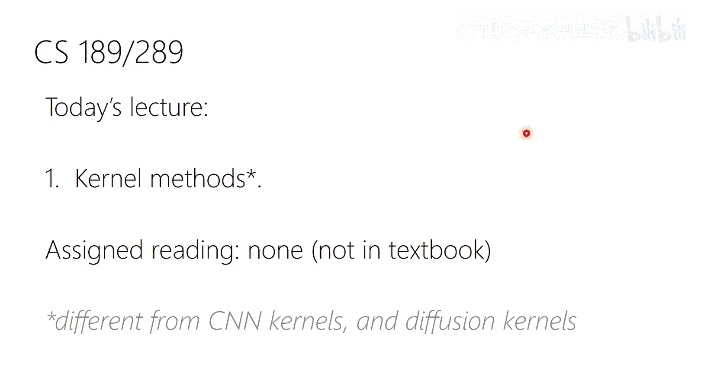
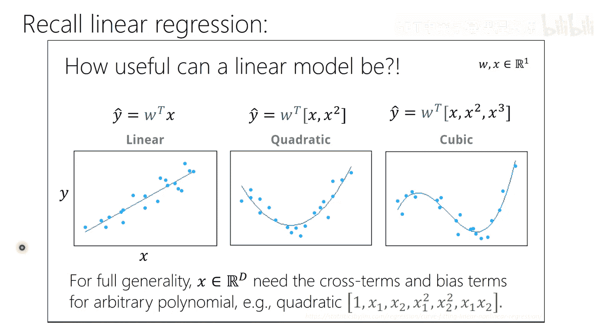
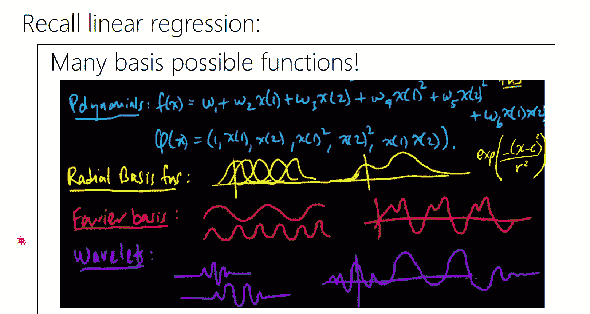
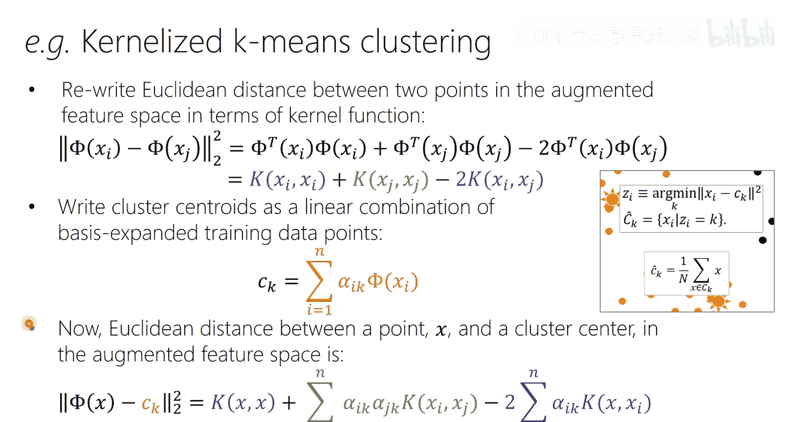

# UCB《机器学习导论｜CS 189⧸289A Introduction to Machine Learning Fall2024》claude-3.5 p26 L26- GKernel Methods.zh_en -BV1H4421S7bs_p26-

清。そかに。中。也是。然他。It see。是么。

So so。挂了。Is this the new standard attendance or is this Thanksgiving attendance？Not。呵。

I think next year I'm going to ask for a room that holds only 30 people and allow the enrollment to go to 600。

Okay， so I think let's get started， haven't seen you in a while。

 I hope you've been having fun learning lots of cool modern day machine learning today is going to be a more classical topic that is still important in the modern day but this was taught even when I was in graduate school。

 but it's still infused I'll give you a point form list of why it's still useful。

 but first all oh it's not showing up there。Oh。Is it showing anywhere？Showing here， am I supposed to。

 oh？Oh。Projector screen down that there screen。啊。Okay。So， I'll keep talking。

 and hopefully that shows up。 So the topic of today's lecture is called Colonel。

 This doesn't feel like it's being recorded very well。 kernel methods。 There's no other mic here。是。

Okay，ll， I'll just hold this。 And so where else have you heard the word Colonel in this course。

CNNs right， so the convolutional filter we sometimes call a kernel that's not the kernel we're talking about today。

Top confidence monitor。Wow。I might call them while I fiddle with it until it was good。Okay。

 hang on a sec。Touch screen for A V。Touch here。嗯。Do you guys remember this room number。

 what it's called。T， what is it？F 2，9，5， okay。 I mean， F 2，9，5 currently teaching。

 and it's not behaving。 I can't get the main screen to work。 Usually， it just works。

And it's not working Okay， thank you。系。Okay， well， they're coming。So I have no idea what else。

To do here， like laptop。I think it's already doing that。嗯。Okay， well。

 so anywhere else that you heard the word kernel， one is the CNN and then I don't know when say you taught diffusion。

 sometimes you hear the word kernel there as well， so it can be very confusing in machine learning because the word kernel means different things and so today you'll get a very crisp definition of what today's kernel is about and why we're using it once we get some slides up。

So。嗯。It was really frustrating。Wow。Hi， I don't know。 It always just showed up there。

 I've been fiddling with it， trying to see what to do。It's like displaying there， so it's connected。

 it's displaying， but it's just not on the main， like nobody can see it。呃这些。Wired lens。

It's clearly I use it。 this this is how I've been using it all semester。

 so I don't think you should change that cable。 Like there's obviously a different problem。I mean。

 it's cables fine， right， It's right there。 So this can't be the problem。

Yeah， I pushed all nothing thingss ever。这哪你那个。Well， at worst， can I roll this。

 like I can't lose the whole class， Can we just move this in my？Can come closer。All right。

 you might have to come sit closer and so you can see this。

That might be all we have today unless these guys figure it out。

 and I'm going to just start lecturing well。Figre this out。

Okay， so where's the slide remote I just had？don't you didn't take this， oh， I'm holding it。

 I'm holding it， okay，All right， so。です。Okay， thanks， thank you。Turn it on。Okay， great okay。

 so this is like a slide from way back in the beginning of the course where I was saying this point okay this pointer doesn't work on there。

 but how powerful can a model that's linear in the parameters B。

 and the trick is that if you have given features in input space X。

 but you augment them with a basis expansion like a polynomial basis expansion is an example here。

 the more general version here， that's just for one dimensional data。

 then you can get arbitrarily complex regression curves and you can also get arbitrarily complex decision boundaries inside of a classifier。

So everybody remember this slide？Great， and then so I didn't go into the details。

 but I said that's like the polynomial basis expansion and there's other basis expansions where you can augment your features with these other basis expansions and I just touched on them briefly and I'll go into some of these a bit more carefully today but there was one called the radio basis function I think a lot of you in one of your earlier courses learned about a fourier basis expansion and then there's something called wavelets which is kind of a more niche area And so the point of bringing this into linear regression was to say that all the machinery we used for linear regression to do maximum likelihood estimation was exactly the same if we had a fixed basis expansion。

 So if I said I'm going use polynomial features up to order3 then I just pipe my feature each data point through this mapping the basis expansion phi and now I just have this new set of features and then I turned the crank of linear regression。

 the maximum likelihood， the predictions。 everything was the same。 It was just a choice I had to。

Make ahead of time。And so in a lot of cases when we talk about basis expansions。

 we're hoping that by enlarging the feature space we'll have more representational capacity。

 but just to give you an example of a place。 and I thought I put this in a lecture somewhere I couldn't find it today have you seen this in lecture in this class。

 so in this case， this is really clever it's a classic example that people give when talking about kernel methods。

 I know you still don't know what the kernel is in this class。

 but the kernel is gonna to be intimately related to a basis expansion。

 they're gonna to be sort of duals of each other。 but we'll get there in time。

 but imagine you were given you have a classification problem， blue triangles and white triangles。

 and this is one feature dimension and this is the other feature dimension and these are data points that you can learn from So if you want to draw a linear separating hyperplane using just these two features then you can't do it right Like there's no linear separating hyperplane。

 but you may cleverly see。clevereverly read the slides that if we were to convert these two features into two other features。

 namely polar features where you get the radial distance out and then the angle along the circle and instead you plot the points and after you've transformed it into the polar coordinates。

 they're now perfectly separable so here's an example where I need to just transform them doing a change of basis。

 but I don't even need more features than I had originally。

 but usually when we do basis expansions and usually in these kernel methods that are intimately related to basis expansions。

 we are going to usually take the original size of the data with the sort of native number of features and we're going to do something that at least implicitly makes it much much larger in order to get better representational capacity but I just wanted to point out that even if you keep the number of features the same you could dramatically do better on a given problem。

Okay。So what are some of the properties of linear and logistic regression for which we might use such an expansion。

 so given that we can do an expansion using a complete basis。

 we could in principle capture any function at all if we go and use enough of these basis functions and with a finite set of data than we only need a finite set of functions to perfectly fit those points。

 but we may need more to capture any arbitrary function。

And so also knowing a suitable basis like one that's better suited to the data could allow us to use fewer basis functions and not go so far out and still do well on the problem。

 but of course we in general don't know what a suitable basis is like here we can just look at it because it's low dimensional conveniently follow polar coordinates but more generally we can't plot things as we know very well in high dimensions and we don't necessarily know what that transformation is so even though this concept of using a basis expansion with linear or logistic regression because' sort of nearly infinite capacity to represent any function we either need to go very far out in the basis expansion or we need to know a suitable basis but if we do have one of those。

 then the loss functions are convex right for both logistic and linear regression they're convex and one we can solve and closed form and one we need to do iterative optimization。

 but we can always get to the global maximum and historically in machine learning people have always and some people still really like convexity because you don。

Have to worry about which minima are good or bad。 Or can I get to a better one by doing a random initialization。

 So for many people， it's very like warm is their heart to have a convex loss function。Okay。

 so let's contrast this some of these properties of logistic regression with those of neural networks。

 And I forgot to。 it was on the first slide。 But just unfortunately。

 there's no book in the there's no chapter in the book on this topic。 and I didn't find a good topic。

 But I think it's a good topic to learn about。 So yeah， there's no reading for this one。Okay。

 so right。 So just telling you the properties of logistic regression。

 you can expand with a basis and it's convex， but you may need like many。

 many basis functions to get good representational power。 And so one people。

 one thing people say kind in quotes here neural networks kind of learn basis expansions in a way。

 And so a way to think of that is that you take the thing as work， you take your inputs。

 And when you pipe them through， you could， I mean， you can think of it in different ways。

 But you could think of each of these as a basis function。

 you could think of these as a basis function， which is a complicated function of the original inputs。

 they're not put it in quotes because technically the basis functions should be linearly independent And in a general neural network。

 they're not linear independent， but people like to colloquially say what neural networks bias。

 is they adaptively choose a good set of basis functions for the problem。

 And if if you don't like if you want to quibble with the technicality there。 Oh， hallelujah。

 all right。嗯。But it's kind of intimate with a small screen， right？嗯。Right。

 if you don't like the idea that they're not like calling their bases。

 you can just think it's adaptively doing feature construction。 Thank you。

And so given that we can choose any architecture we want of any size of any depth， of any width。

 then we can therefore also capture any function because we can， in principle。

 choose any set of these basis functions。And so however。

 the neural network loss is highly nonconvex right you might initialize it from different places and get to a different solution。

 and so in the older days people would think this was problematic in the modern era。

 we still are concerned about which local minima it gets to we almost never get to a global minima as far as we know。

 but but and I don't think we went into it in this class。

 but there's actually an area of research that shows that certain minima that are not global are the ones that generalize well。

 they're wide and flat， but that's sort of a more advanced topic。

And so but now what's the downside of neural networks is to make use of this very powerful machinery。

 we need a lot of data， so all the problems for which neural networks work really well have an abundance of data and there are many real problems in the world that actually neural networks are not the state of the art one we learned a little bit about that with decision trees for tabular data that it can do better than neural networks and also if you have very little data then neural networks may not be the best place to go and so the idea of kernel。

Of these kernel methods is to say， well， I want to use the simpler methods that don't require as much data。

 but I can't quite deal with these huge expansions that I need computationally。

 and so there's going to be something called the kernel trick which lets us use we can actually use an infinite number of basis functions without ever having to compute them and then only implicitly compute them and so essentially we're going to get to use an infinite basis expansion if we want to for a good computational efficiency。

And so just to sort of drive home the point of as the one example， the polynomial basis expansion。

 you can see in this chart here how the number of features grows tremendously。

 So suppose you knew the polynomial basis was particularly good for your problem then here so P is the degree of the polynomial basis you choose to use。

 So if you use degree 3， you get terms that are order 3，2 and1 and 0 and so forth。

 And so here for example， this is if your data， this is the dimension of the raw input。

 So here if the inputs are scalrs that's equals to1。And here the order of the polynomial is one。

 then you get two terms right， so the polynomial order is one， so you get these terms in these terms。

 If the polynomial order is three， then you use these terms， these terms。

 these terms and these terms So you get four of them。

 And so I'm not going to go through there's derivation you can see online or in these notes that shows that it scales kind of really badly。

And and this is going to be true for kind of any basis functions that are just generally useful and not tailored to your problem is you're going to potentially need many。

 many， many features。 and and this is going to be computationally problematic It might be problematic in terms of overfitting。

 but we know we can have regularization and so forth。 So you sometimes you might want many。

 many features and you just regularize some more。 So you kind of have a richer flexibility because of the features and you clamp down the degrees of freedom with the regularization。

 but if we want to go very big here， we just can't do that because it will be too computationally expensive in particular。

 it's going to be cubic in the number of the features in the expansion because in linear regression。

 you inver matrix which is D by D for D features。To get the solution。Okay and so right so as I said。

 this whole idea of kernel methods is to leverage a duality that's going to let us bypass having to explicitly deal with this augmented feature space from the basis expansion and only implicitly computed and it's kind of really elegant and cool。

 I hope it also blows your mind once you get to it。

 So right so fundamentally there's gonna to be this thing called the kernel。

 sometimes we say the kernel， sometimes we say the kernel matrix if we computing it over a set of points。

 sometimes we call it the kernel function， it's kind of you'll figure it out from context if you don't you can you can ask me and usually it's written K。

 sometimes like this， sometimes like this。 but these are all kind of the same thing and hopefully it's clear from the context。

 But fundamentally， as I said this kernel is basically going to let us bypass dealing with the explicit basis expansion space。

 And the trick is what the kernel is going to do and we'll see an example。

 I know it's quite abstract now。But you'll see in a moment how this is true because it sounds magical。

 Imagine this is a polynomial order expansion of like 500。 And so I don't remember how many I don't。

 let's just say 25。 Let's say the dimension of the data was whatever 25。 and it had 25。

 So there's this many features in it。😊，In each of these。 so each of these vectors would be this huge。

 huge vector。 and in naively， I would have to go through and create each of those features with the basis expansion。

 and then I'd have to do an inner product in that massive space。

 And as we're going to see in moment specifically。 This is just abstract。

 I the kernel is going to say I'm going to show you a shortcut to compute this scalar。

 This is a scalar right becauses a huge huge vector transpose inner product with a huge huge vector and it gives me just a scalar。

 And the trick here is I'm going to do that computing it a different way， that's very， very cheap。

 And in in particular， I'm going to compute this in a way that does not depend at all on the dimensionality of the basis expansion。

 Does that sound magic。😊，I think it sounds magic So so the key is going to be that if I can show you how to get these kinds of kernel functions。

 then the second thing I'm going to be able to need to do is to take something like linear regression or whatever we talk about kernelizing a method so you'll hear kernelized linear regression。

 kernelized logistic regression， kernelized PCA kernelized K means you can kernelize many。

 many different types of models， which is why it' a very powerful concept and to do that you're going to have to rewrite all the operations for that model。

 whatever it is PCA linear regression in terms of only inner products in the input space if you can write it in terms of inner products in the input space。

 then you can write it in terms of inner products in the augmented space and then use this trick like that's the kind of overall setup。

And so just in words， if we can massage our loss functions and also if you're doing supervised learning。

 you would want to do the same for the prediction to use only dot products between feature vectors X。

 then you can suddenly just lift these x's to another space。

 not compute them and instead call the kernel function。

And you're never going to have to go into this massive dimensional space。 This thing is a scalar。

 and we're going to compute it in much， much better time and space complexity。Any questions？

 I know it's a big vague。 Like it sounds weirdly magical， but we'll。

 we'll get to the details in a second。Okay， right， And as I said。

 this is sometimes called the kernel function。And when we do that， fundamentally。

 what these kernel methods are going to let us do， they're going to change having to deal with operations that are usually quadratic or scalar on the dimension。

 which is the number of features and instead have the computational depend on the number of training examples and so depending on how many training examples that might be bad but in the kinds of cases where we want to use kernel methods。

 we usually don't have that much data， and so this it can be extremely powerful。Okay。

 so this is an example of how I'm going to derive something that looks like a quadratic basis expansion。

 And so I thought this was animated。 Sorry I just dumped out all at once。

 But so the animations wonder what else happens， Okay sorry， what's going on。 All right。

 So what I'm gonna to say is the kernel is always between two data points that live in the original space。

 So this is data point x in the original space。 in this case， it's a dimension 2。

 So x has an x1 and an x 2 as I expand it and z is also in the original dimensional space of two。

 And the idea is I'm going to take these two dimensional features。 And I'm going to compute a 1，2，3。

4 I thought it was six dimensional 1，23，4，05，6。 Yeah。

 I'm gonna compute a six dimensional basis expansion， which looks a lot like the quadratic expansion。

 except for these weird square roots of2。 and we can talk about that in a second。

 but I think you can see this looks a lot like the quad。Expansion。

There's an x1 term an x2 term and x1 x2 term and an x1 squared an x2 squared。

 and other than the square root of two that would literally be the quadratic basis expansion。

 And so if and the way I can compute that without like the way I can compute the inner product between x and Z in the six dimensional space。

 I'm going to going backwards here is actually by just computing this thing。

 And then we can go through the math to see that that's true。

 But what does it say it says take the inner product in the original space which is d equals to2。

 this is a two vector in product with a two vector add a one to it， which is a scalar。

 and now I have a scalar， and I just square it this operation here doesn't know anything about the dimension 6 that I'm gonna show you it's related to。

 And so how do we do that， let's just work through it So actually that's just repeat here the same as that And then as I said each dimension of x and Z is X1 and Z1。

So I'm just going to square this thing here in terms of first。

 I'm going to write it into its component。 So this inner product is x 1， z1 plus x 2。

 z2 from here plus 1 and all squared。 And now I'm going to square this term。

 and I get all the kind of usual cross terms you can。Double check the details at home。

 but this is correct， So I'm going to get an x1 z1 squared here。

 I'm going to get an x2 z2 squared here。 I'm going get a1 squared here and then I'm going to get all these cross terms from hitting the one on the other side And so that's going to basically give me two x1 z1 to x2 z2 and then I'll get a big cross major kind of cross term there。

 So this is just there's nothing fancyer。 I'm just turning the crank of expanding in the square here。

And now what the kind of trick is having done this very straightforward math， if I'm clever。

 I can see that I can factorize this exact thing into an inner product of phi over x phi over z for this particular phi and so again like you can double check as an exercise at home。

 but if I define phi in this way， then I can rewrite this thing here as phi transpose of x times phi of z。

 and the point being here， of course， is that if we accept even though it has square roots of2 as the polynomial basis expansion。

 then what I've done is I've shown you how to compute inner products in a six-dimenal space。

 which is the second order polynomial expansion by only using dimension2 data。Which is kind of crazy。

 right？ So， so this is like a very concrete instantiation of what I mean by the kernel trick。

 And then， of course， part of the trick is， how do I get these algorithms to be written in terms of just these inner products。

 And we're going go through those details as well。And now and so you may be saying well yeah。

 but what about the square roots of two。 And this is a fair point。

 This is not technically the polynomial basis expansion we expect。

 but in terms of kernel methods in the kernel world of kernel methods。

 this is called a polynomial kernel this would be the polynomial kernel of order2。

 And it does differ from a standard polynomial expansion because of these square roots of two。

 And if you expand a three or four， you'll get other factors in there。

 So you're getting the right basis functions。 But you're getting like a different factor on them。

And so right， as I've said， this basically has the P equals to quadratic polynomial expansion。

 It has all of those terms in there other than the square root of two。

 And as I've been hammering home， is that instead of explicitly computing these phis。

 I don't need to do， I don't need to do this expansion and inner product with this expansion。

 I instead just compute this thing here。Okay， and so this is one example。

 but I'm gonna tell you about all kinds of kernels and how you can combine kernels to get a valid kernel。

 And I'm gonna explain to you， like， how do I know if something is a valid kernel function or not。

 Any questions so far。Okay。So right And so it turns out that in general。

 we call a polynomial kernel of order P is the same operation I just showed you where P was equal to two。

 but if I turn it to p equals 3， I can make exactly the same argument that I get something that contains all the terms for polynomial basis expansion up to3 and 4。

 and so this is the definition of different polynomial basis functions and each basis the kernel polynomial kernel。

 sorry we call it a polynomial kernel function。And right so the quadratic one is the one we just looked at。

 I just instantiate P with  two， the cubic 1， I would instantiate with P equals 3。

 and no matter how high I go， if my original data is two dimensional。

 I'm only ever taking this inner product in two dimensions and then I have a scalar and I'm just raising it some power and just whatever power I raise it to。

 I'm getting this like free computation of an inner product in a combinatorially large space。

Okay right okay so and when actually we haven't taught this in a few years and I decided to put it back in and I made this slide this year and so sometimes people some people say。

 oh well I usually think of kernel methods as something called a support vector machine which is something we used to teach in this bus and I think it's taught in the version of this class currently taught in the spring。

 but those are and so sVM support vector machine， people still use these you'll still see papers that use them on application areas but I'd say people interested in cutting edge machine learning are not usually using an SVM there's actually nothing wrong with them they're very powerful methods。

 they just kind of not as sexy anymore but even if you don't care about those methods as I said there's many reasons you want to understand this kernel trick and and I'll just go through them one by one but people use PCA all the time they use clustering all the time and they may want to use linear and logistic regression with quite large basis functions and you can use this kernelization I didn't show you a kernelization。

I so far showed you was this trick of how to compute inner products in really high dimensional spaces much simpler。

 and what I'm going to show you is how to use that trick to make PCA into kernelized PCA。

 how to make linear regression into kernelized linear regression and that's going to require one other part of the trick as well。

 but the kernel trick is what I just showed you is usually what people would call the kernel trick。

So also I won't go into it， I have one slide that just kind of hints at it。

 but you can tailor kernels to very specific objects so quite a few years ago people were developing very specialized kernel functions for computational biology for proteins to work on graphs to work on molecules and I feel like they're not as sexy anymore but I know've never actually seen a modern day comparison with things to like graph neural networks which have problems and I'm actually curious to know if they would hold their ground or maybe even do better but one of the really important places that kernels come in is in something is an advanced topic that you maybe could find in another course on campus called Gaussian process regression and these models are widely used when you have a really high need for good prediction uncertainty so if you want to know when you make a prediction for regression how uncertain you are and you expect the uncertainty to be different in different parts of the space these are basically the state of the art models for that and this is very important for。

Like protein engineering for small molecule design and a lot of high stakes decision making areas where you really care about knowing the uncertainty。

 and these are very widely used still。And the core part of a Gaussian process is to pick a kernel。

 which is essentially picking a sort of basis expansion。

They're also useful for density estimation and just more generally they infiltrate modern day research papers like if you pick up some random paper。

 it's not unlikely they're going to make some reference to a kernel of this kind of kernel and one particular area is the theoretical machine learning people who like to analyze neural networks and try to make sense of why they work and what their representational capacity is。

 they make a link to the kernel methods through something called a neural tangent kernel。

 so all that is to say there are places where they've fall by the wayside but they're still very important across many areas of machine learning。

Okay， so this is gonna to be the shortcut version， I'm going have a few slides ongoing going detail by detail how we're gonna to kernelize logistic regression。

 but I'm going to do PCA really cheaply。 You can do PCA a more complicated way。

 but I don't know because this was a while ago， I haven't seen you guys in a while。

 but I showed you PCA and so just to remind you in PCA you usually have data written in X。

And you take you mean center it and then you create the covariance matrix which is of dimension D by D for d features and then you use the spectral decomposition and this gives you the eigenvectors and this is how you do PCA right but what I showed you at the very end of that I think before going into TN which is a nonlinearar method is I said there's a related method called multi-dimensional scaling where someone just gives you distances between cities and they ask you for a low dimensional or some dimensionional representation and here you can't compute x transpose x because you don't have the raw data。

 all you've been given is an n by n matrix which is xx transpose but as you may remember from the spectral decomposition and the generalization of it many of these operations are all kind of related and so it turns out you can take this matrix M which is distance by distance for each of the cities do a spectral decomposition and essentially you get。

A low dimensional representation out of it， which is you and so I'm just trying to reload you here to tell you this very simple trick to do kernel PCAA question。

😊，Yeah， so it's a bit strange。 like in PCA， you're given X and you say find a low dimensionional representation in multidimensional scaling。

 you're never given X， you're giving distances between all points and you're asked to find give me some X I could use as a representation。

Yeah， it could be longitude latitude exactly right， but yeah， you were never given one。

 but it might in this case， it's very likely to find something like longitude latitude。 Yeah。

 thank you。 So now now what does this have to do with kernelizing PCA？ Well。

 the key here is what you might have noticed is each similarity each distance here can be thought of as。

As creating an entry in the kernel matrix， if I'm willing to define a set of， of。A basis function。

 So imagine that I。嗯。Right so I'm flipping it on its head now。

 So what I'm gonna to do is I'm going to say I don't want it's not that I've been given a matrix like in MDS。

 I'm going actually say that I've been given my original data such as PC。

 sorry this slide turned out to be less easily explained than I had imagined。

 So imagine you were given your original data。 but you create you use say I'm going to use a polynomial order 10 kernel。

 And I'm going to compute the inner product between them， which is like an inner product distance。

 And so I'm going to compute a matrix like this。 with a predefined kernel where I was given the original inputs。

 Then I can use the same。Operation that I do for multidimensional scaling。

 which is this spectral decomposition of this matrix M， which was computed with the kernel。

 and I again get the lowdisional representation。 So yeah， there's a lot of moving parts here。

 But the point is that in multidimen， you can view multidimensional scaling as being very related to PCA and you get the sort of representation through this the spectral decomposition。

 and the difference is going to be that instead of an MDS where someone gives you the distances here I'm going to give you the raw inputs。

 I'm going to do a basic expansion， but bypass computing the inner product by instead calling the clever kernel function and populate this thing。

 and then I do a spectral decomposition。 and now I've done kernel PC。

 I've done kernel PC on my original features X for the kernel matrix K。

The next example will go more slowly。 I， I didn't realize this， Does it make sense to anybody。

Any questions？So yeah each it's the I data point and the J data point and so if I were doing this without the kernel trick。

 I would take what I would do is I would take my input X。

 I would pipe it through the basis expansion to become higher dimension and then I would take a different data point and I would do that for all data points until I had a matrix of the pairwise inner product distances between all of them。

And then having done that， I would use this spectral decomposition。

 which would give me the eigenvectors。Yeah， the distance is the inner product distance from the inner product and either I could do it。

 if I was doing non kernel PCA， this would be the identity。 but in kernel PCA。

 these would correspond to some basis expansion that I would compute cleverly and efficiently through the kernel function。

Yeah， that's a great point。 Thank you for bringing that up。 I like well。

 I kind of turned the crank here。 But I didn't explain why you might want to do it。

 And you kind of pitched a very good version， which is like PC。

 you're finding the directions of major variation， because you want to project down onto them either for dimensionality reduction or some sort of visualization。

 And so the premise here is maybe strange， which is to say before I do PC。

 I know I want to reduce the dimensionality。 But first I'm gonna go into super high dimensions。

 And then I'm gonna reduce it。 And the idea really。

 what's happening is enabling me to use PC to do non nonlinear dimensionality reduction。

 So it's it's linear in the augmented space。 But it's non nonlinear in the raw space。

 And PC is normally linear in the data。 And so that's what's what's really happening is I can do depending on my choice of kernel。

 I'm doing a different version of nonlinear dimensionality reduction。

 even though it's linear in the augmented space。😊，Any other questions？So okay。

 so I've talked about like this kernel thing， I showed you how you get a polynomial kernel kind of provably by showing you that this inner product gives you this kernel function。

 But what if right So we proved for quadratic case that I could write this thing as an inner product between things that are sitting in the basis expansion of the polynomial quadratic space But suppose someone just gives you some function between two data points and sort of says this is a kernel or I think it's a kernel。

 can you tell me if it's a kernel how could we know that like because this was a very specific crafted example how would you know if it's a kernel function or you have something you want to use and you want to check is it a valid kernel function。

Because it's not valid then none of these procedures will work。

And so in other words to rephrase the question is like the same question is this is a valid function is to say does there exist some implicit feature space that gets expanded by Phi such that this kernel function between x and V is equivalent to an inner product in that space。

 so it's basically does there exist a space of any dimension such that the inner product in that space corresponds to my kernel function。

If that's true， then it's a valid kernel。And， if and only if， actually， it's if and only if。

So if you create a kernel like by hand like this， you know it's true， but the kernel functions。

 you're never explicitly computing them。 So you don't know， yeah。Yeah， you can't no， you can。

But there are， no， absolutely。 so you can say， but the problem is， if you do that。

 suppose you iss exactly right。 if I give you any expansion X and I take the inner product。

Then that is the kernel， like， by definition。 However。

 I don't want to have to compute that whole like that may be infinite， In fact。

 I can have an infinite dimensional space。And so the key is like how can I know without going to this huge dimensionality because I won't in general。

 be able to do that。 And so we'll go through some examples in a second to get a bit better understanding。

 But the fundamental theorem that answers this question and then we can instantiate it to ask if particular kernel plausible kernel functions are or not is something called Mercer's theorem there's a slight simplification of it。

 but basically it says if only if for any finite set of data with n points。

 the matrix like so this is this hypothetical kernel function on points I and J。

 if it's that matrix on the finite set of data is positive semidefinite。

 then there does exist an implicit feature space phi。

 such that this function is equal to the inner product between them。And if that is true。

 then I can call this thing a kernel function。And so really， what it says is like， if I don't know。

 I don't in general， know the implicit feature space。 Someone just gives me some function here。

 Like maybe it says take the sign of of x here times the co of X there。 Tell me。

 is that a valid kernel， Yes or no。 And and in fact， that one's not。 And I'll show you in a second。

 why not。 But you have to do that。 And then you have to show that for any finite data set。

 that matrix would be positive definite。 And that's not always easy to do。 Actually。

 Sos the theorem is， is relatively easy to understand。

 but it could be hard to instantiate the theorem。But at the end of the day， it's all about。

 I'm going to have some quick computation that I propose。

 which gives me a scalar back for every two points。

 and if that matrix of those scalarrs is positive semi definite。

 then I don't know which basis expansion created it， but I know there exists one。嗯。😊，I I。Yeah。

 it's supposed to be the same as the K。 But I at the moment。

 it's M because it's like questionable whether it's a kernel。 So once I've proven that it's a kernel。

 then it's just gonna be the same。 it should be the same notation as K。 just I haven't yet proven it。

 So here each of this is a scalar。 It's the distance。

 the kernel distance applying the kernel function to point I and point J gives me a scalar。

 And over a data set of n points。 This will be an n。 I will do this n square times。

 basically get an n by n matrix。 And that matrix has to be PSD。

 If that function is a valid kernel function。😊，Yeah。

 right now it's an arbitrary function and the question is。

 does it have this implicit feature space or not such that I could call that arbitrary function a kernel function？

Yeah， so if for the finite set of data， the matrix is positive definite。

 then there does exist in implicit feature space such that the inner product gives you the kernel function value。

And so in principle， you might like， yeah， so it's a little。

 it's tricky to test this because you need to know it's true for any finite data。

 So if someone gives you a finite data set and you compute this matrix between all the points and you find its PSD。

 you don't know that it's a kernel because that was just one finite set of points。

 and it has to be true for all finite sets of points。

 And so that's where it gets a little bit tricky to use the theorem。Okay， so。Actually。

 I feel like these slides are slightly。 Let me， I'm gonna go back。Oh's weird。 Why have I done this。

 Okay， Well， meant I should have moved this earlier。

 Maybe as I go through it all realize some reasons。 But so here's an example of a nonval kernel。

 So and this is this is I think getting at what you maybe needed to have instantiated a better understand。

 Someone says， hey， I have this kernel function。 you take point the first point X。

 you pipe it through a sign。 take a second one， I guess it's assumed to be scalar dimensional。

 That's fine。 Like you can define a kernel that's only valid on one dimensional data if you want。

 you can only use it there。 And then I pipe it through a co。 the other one。

 And then I multiply them together。 So this is not symmetric。

 So if I swap the rules of an X and x prima， we'll get a different answer。

 And because it's not symmetric， it cannot be PSD。And so that's how I know that this is not a valid kernel by using Mercer's theorem。

Okay， here's another one。 This one says take the first point， transpose it， hit it by a matrix M。

 and then multi hit it by the， the second data point。 So is who thinks this is a valid kernel。

So it might be valid， and it depends on the value of M。 Basically。

 the answer is gonna be that if M is PD。Then this kernel function will， the matrix will be PSD。

 and it will be valid kernel， so。So as one example， if m was equal to minus1。

 so imagine the data are onedial， so m is a scalar。

 then this is the value of any kernel between two points， is just minus x transpose x。

 and so just by itself because it a minus like that matrix on the finite data point is already not PSD。

 so that's already telling you according to Mercer's theorem that because on this one data point is not PSD。

 then this cannot be a valid kernel。However， suppose that M is PSD itself。

 then I can use these tricks that I showed you before to basically get a square root of the matrix。

 for example， through the spectral theorem I can get a square root such that m is equal to h transpose H and if I do that I can rewrite x transpose M x prime like this x transpose h hx prime and therefore I've essentially found the implicit。

I've found the implicit feature space for which it is an inner product。

 so in this case I'm showing by construction what the feature space is and because I can find the feature space。

 I also therefore know that it's a valid kernel， but it depended on me being able to take the square root in order to create the correct feature space and the square root requires that MBPSD。

 so basically the condition is that this kernel is PSD whenever M is PSD if and only if。Okay。

 so let's see。 Okay， I'm gonna go back。 I don't know why I didn't put that one right after。嗯。Okay。

 so this is。Sorry， this is where we were I was telling you Mer Theorem and then should have had that slide way down there next and then what I wanted to say。

 and I've sort of said this a little bit before and I'm going to say it a few times as you come to understand the general idea more and more but what's the art of constructing a kernel method like kernelizing PCA kernelizing logistic regression and so forth so the versions is you start with some known method and the first thing you have to do is you have to write whatever algorithms are needed for training or prediction in terms of just inner products of the data points。

 x transpose x between however like the lost function looks like or the prediction。

 you have to write it in terms of just these inner products。

 then what you do is you replace all the versions of those inner products with the kernel function。

And now you've kind of lifted it into this expanded space without ever having had to deal with the expanded space。

And as I said， it can actually be infinite dimensional。

 So these radial basis functions correspond to an infinite dimensional。sorry， the radio basis kernel。

 which I hadn't shown you yet okay， and then you proceed as you would otherwise。

 So once you get the loss function in terms of this kernel matrix。

 then you turn the crank of setting the gradient to0。 if it's analytical， you analytically get it。

 if you need to do gradient tocent， you do gradient tocent。Okay。

 and so how might you use known kernels and combine them and know that you're saying like within the set of valid kernels so there's a lot of easy operations you can do so suppose you have two valid kernels。

 K1 and K2 then you can add them together and you have a valid kernel。

 you can multiply them together and you still have a valid kernel you can multiply for any positive scalar and still have a kernel and you can even put them through a polynomial with positive coefficients or an exponential function and then you can combine all these operations at Infinitum right so like you could first multiply add these together then multiply by this one and so forth and you can kind of get arbitrarily rich kernels that you know are valid given that you knew the first two are valid。

Okay， and so what are some examples of valid kernels that form this sort of dictionary of valid kernels for which people might want to combine in that way。

 So you've already heard quite a lot about this one。

 it's the polynomial kernel of order D sorry the notation changed on this slide right and then there's something called this radial basis function kernel and so it looks a lot like a Gaussian and basically the distance is going be you take the square distance between the two points and you divide by some sort of what we call a bandwidth parametermeter。

 So depending of that this is actually a hyperparameter in the kernel function that you can learn in the same ways we learn other hyperparameters。

 you know if you're doing ridge regression you have like a validation set you might use to set the parameter。

 So if you're doing kernel Rige regression you would similarly use the same scenario to set the hyperparameter of the kernel function。

In PCA， we don't know like how many， yeah PC is a different story because there's no holdouts it。

 but like whatever the method is for the thing you're kernelizing。

 you should set the hyperparameters in the same way。嗯。

Right and so I think I left it in as the last slide just for people who are curious。

 I'm not even sure if I remember the details， but you can basically show that this art radial basis function is has an infinite dimensional phi in particular I believe it's the infinite dimensional polynomial basis expansion if you go through a whole bunch of very clever math。

 but don't worry about that for this course， just maybe know that it corresponds to an infinite dimensional basis expansion and so that's where things get very interesting so now I can augment my algorithms like PCA or linear regression into an infinite dimensional space by kernelizing them and then using this kernel and now whether that's helpful or not like just because it's infinite doesn't mean that's going to give me the best answer but it might be useful and in fact these kernels are very useful and get widely used and it's kind of neat to realize you're working in an infinite dimensional space that you've never computed。

There's also the laplace kernel again that looks a lot like a they this is sort of smells like a Gaussian。

 but there's no normalizing constant， this smells like a laplace distribution。

 but there's no normalizing constant， but that's like this is the other part of laplace so here instead of taking the square distance I take the absolute value or this the eucuklininus is the absolute value of the difference between them times some parameter which is also sort of like a bandwidth or a length scale parameter。

That controls。How smooth things get kind of the relevant scale in the data space， if you will。

And it has its own hyper parameterameter。 And that actually， I don't even remember this one。

 Apparently， this is also a valid kernel for data that live on。

 on the positive numbers as they take them in。And so you can use all of those and there's many more。

 this is just an example， so there's more kernels than this still and you can kind of look up and mix and match them in a given method you may have piper parameters on how you even add them together and so forth。

 but let's get into a more advanced topic than I want to touch on here。And if you want。

 you're not responsible， but there's some more technical details if you follow that link。Okay。

 I did this one。 So you guys should know the answer。 What's the answer。 It's when Im okay。

 so that 1 I did。 And then I mentioned that。There has been work this is actually really old work but it's a super super well sorry it's quite highly cited paper and here I'm not going to go into the details but just to sort of inspire your thinking as people create very hand crafted kernels for different problems in fact when I was a PhD student if you would go to the computational biology workshop at what's now called Ns one of the big machine learning conference is half the talks were on creating new kernels for some problem in biology which is kind of funny。

And so in this case， the kernels， they leveraged other people's idea of how to define kernel similarity on graphs using random walks and showed that it was useful for understanding for making a supervised predictive model on the function of a protein。

Okay， so now I'm going to dive into like the PCA one was a little bit of a shortcut to get to it by using MDS。

 but this one I'm going to go through in a more standard derivation of how you typically would kernelize a method so as I said the first thing that you need to do to kernelize a method is you need to make sure that the loss function is written in terms of inner products so that you can this replace the inner products or the kernel function and for most all the ones that I'm aware of。

 I think it might always be true， you're going to do this really interesting thing and there's a theorem around it I'm not going to go into is a little technical called the representatives theorem but basically it says that and you'll see it in a second is we're going to either show or make an assumption that the parameter we're trying to solve for here we're trying to solve for W can be written as a linear combination of the training data。

And if you can do that， then you can turn the crank and kernelize your method and we'll see this in a second just to give you a bit of an orientation of where we're going so this is the standard loss function for Rige regression we have the squared so this is MLE but I'm just going to do the squared lost part for now。

And then this is the regularization term and what I'm going to show you is that the solution like W to this。

 the MLE solution can be written as some linear combination， alpha T of the original input vectors X。

 and then having done that， it's going to let us turn everything into the inner products that we need。

So first I'm going to take the gradient。Of this and set it to zero just to get W and when I do that in a few steps you'll see in some almost trivial way that in fact W is a linear combination of the data points。

 so I did disresspec to w transpos because it's like slightly easier to directly see it so right the derivative of this guy who respect to W transpose gives me back this whole thing the squared hits the half and it's gone and the minus comes from here and then I get an Xi term from here over here and then here I just get the lambda w back and that's equal to zero so now I'm just doing what I always do。

 I haven't used any notion of kernel or anything right now。

 this is just the standard standard math of just ridge regression。And now what I'm going to show you。

I'm going to now isolate W。 I'm going to pull it well I'll pull this to the other side so it's positive。

 and then I'll divide it by lambda isolate W。 So I get the solution for W transpose is one over lambda times this sum here。

 I'm just doing very simple math。 I've done nothing。

 I'm just doing the regular so far I'm just doing ordinary redirection set the gradient to0 isolate W。

But now I'm going to start writing things a little bit differently from here。

 and I'm just going to say， well， there's some blue term here， this blue term is a scalar。

 and I'm just going to call that scalar L I。It's true that it depends on x and y and so forth。

 but I don't care。 it is a scalar， and I can call it alpha I as a shorthand。

 and so now this turns into a linear combination of the data points X I。

And then I can just write it in vector notation if I want。

 which is to take all the alphas and hit it times all the data points x。嗯。

And so this is like really trivial， it's a bit weird because I've just basically decided to call this thing alphapha。

But now what's going to happen is I'm going to plug in w equal to alpha transpose X back in to the loss function。

 but just to get rid of this annoying half， I'm going to multiply the loss function by two So it goes away and that's where this two is coming from just so that as I expand it。

 I don't have to have the half everywhere。 So I'm just taking two times this loss function and and I've written it in vector form now that's the only difference。

 This is two times that written in vector form， which you guys have all seen plenty of times and now what I'm and now I'm going to expand it out in vector form。

 this is the same thing you've seen a million times don't need to go through it。

 it's just these cross terms， these cross terms and then this is the regularization term And now here's where it gets interesting now having shown that w transpose is a linear combination of the data points。

 I'm going to plug that equation in which is w transpose equals alpha t X。

 So now every time I see a w or a w transpose， here's a w transpose， I'm going to plug in this。

alpha T X because of this equation So now this W tree becomes alpha T X， there's no other ws。

 this W T becomes alpha Tx， this W I take the transpose， so I get x transpose alpha。嗯。

And here I have a W transpose W。 so that becomes alpha transpose X， X transpose alpha。 Okay， so far。

 so good， It seems weird， but nothing too complicated， but who can tell what's happening。

Who notices anything really fantastic in that equation？

It's written all in terms of only inner products。 X only appears as an inner product there。

That's our whole goal。So what that means is I can replace all these x transposees x as a kernel or the kernel。

 yeah， it's always kernel vision of kernel。Oh， sorry， the kernel is symmetric。

 So kernel transpose is kernel。 So right， so I'm just gonna now take this X X transpose。

 that becomes a kernel。 I'm gonna take this X X transpose。 It becomes a K。 This will be K transpose。

 which is equal to K。 And then this one again， is another K。

 And that's true just by defining K equal to the inner product。 And that's sort of。Well， right now。

 I haven't done any like right now， because I haven't actually used anything but a trivial kernel。

 which is the inner product in the original space。 right now， it's exactly the same math。

 It's just written differently。 So I have literally not changed anything。 And in fact。

 if I use as a So right So what I'm gonna to of course say is now。

 replace everywhere you have K with whatever kernel function you want。

And now I've done Rige regression or I've computed the loss function for Rige regression in terms of the kernel。

 I don't know of a kernelized loss function， but the thing to note is just to make sure your point is addressed is if phi of x is just the identity mapping。

 then this is exactly kernel Ri regression， the only time it's different is if I make a kernel that lifts it into a different space。

Yeah， that's one of the key points here is you want this kernelization to always kind of reduce to the known algorithm when this mapping is the identity。

And it does。Yeah， that's just like arbitrary how you're choosing to write stuff， but yeah。

 that's right， yeah。Right fundamentally the kernel is an inner product between two data points so well yeah。

 so that's what you always need and then what you need is inner product between two data points so depending on the rows or columns things will look different yeah。

Yeah， is K is literally this inner product until we go to a non trivial kernel。So here x， sorry。

 x here is number of data points times number of features。

And so this is number of data points times number of data points。

 And that's actually where things get interesting is there's there's no dependence on the dimensionality of the augmented feature space。

 It's only on the number of points。 And that's again， that's the key。Oh， question back there yeah。

Yeah， we're going to。 we're gonna to do it。 Yeah， good question。 We're gonna do it。

 We're gonna learn alpha right so the key here is I now don't have a W。 I have an alpha。

 and so I'm going now have to have a loss function for which I find the alpha that minimizes the loss function instead of the W because W doesn't exist。

 And so this is part of the duality that arises when you kernelize a method is that by writing the parameter as a linear combination of the data points。

 you reparameterize it where the original parameter W here， you're instead going to learn alpha。

 which is the linear combination of the data points And that's almost always how this kernelization will work。

 and we're going to work our way through it actually。Any other questions？So right。

 so what have we done？We made this bizarre assumption and showed it's reasonable like not reasonable。

 we can write this solution W the parameter， the MLE solution W can be written as a linear combination of x by doing that。

 we rework the loss function module2 which doesn't matter the minimizer is the same whether I multiply by two or not。

 and I rewrite it in terms of only the kernel and now I have a kernelized loss function。

 So now the goal is if I'm going to do ridge regression， I need to learn the parameters of alpha。

 then minimize this loss function。And so that's exactly what I'm going to do next。

 So this is the new loss function that has been kernelized and I'm going to just write it up here and we need to set the gradient to0 and just as when linear regression is analytical right I set the gradient to0 I do some math and I get a solution I don't need to use iterative optimization and will be the same thing here。

 So now instead of taking the gradient with respect to W I'm going to take the gradient with respect to alpha and set it to0。

 and so this is just from the last slide， it's exactly that term。

 and I'm going to take the gradient with respect to alpha or am I doing or sorry alpha transpose so this has no alpha and it goes away。

 this has an alpha transpose， so I just get minus2 Ky this has two alphas in there so the rule of vector cculus gives me2 Kk alpha and similarly here I get2 lambda K alpha and so recall this comes from the regularization term and this comes from the loss function and that just dropped out because it doesn't contain alpha。

And now I can collect the terms， well first I'm going to divide by two。

 so the two is gone everywhere and then I'm going to keep this KY over here and on these guys I'm going to collect and pull the alpha out。

 which leaves me with Kk and La decay， and so I'm just doing a little bit of refactorization after I've pulled out the two。

And now I'm going to， just to isolate the value。Of alpha。

 I'm going to premply both sides by the inverse k inverse so kverse times 0 is 0。

 I have a k inverse and all the other terms， and so of course this is one。

 this is one and this is one so what I get now is I pull the this became a1 so I pull the y over to the other side and I'm left with a k and a lambda alpha。

I guess technically， I need an eye here to keep it in matrix form。

 So I've now got to the fact that that this is true。 And now it's， of course。

 trivial to isolate alpha。 So the， the the minimize the minimum of this loss or the the gradient set to 0。

 I'm not gonna do all the checks on that。 But the gradient is set to 0。

 when alpha takes on this value， which is the kernel。嗯。

Matrix plus some scalar times the identity inverted and hit it with the vector of labels。

And so what will the dimension of alpha be。Alpha， each component of alpha is the tells you the linear combination for each training data that composes the solution W。

 So there should be， if there are end data N data points， then alpha has n values。

 tells you how much of each training data point makes up the solution vector W。Okay。

 does that look at all familiar。What does it look like。嗯。😊，So in standard Ri regression。

 it looks really similar like I can think of this as k if k is the identity mapping。

 Lambda I inverse， the only difference actually is this X here。

 And that's okay that they're different because this is the solution for alpha and this is the solution for W。

 They should not be the same， but they're remarkably similar， which is kind of cool。😊，Okay。

 and so but here is the key， like in standard Ri regression。

 I have to invert this beast and this beast is going to be in the dimensionality of the of the data point。

 So this is a D by D matrix。No。Yeah， that's right， this is a D by D matrix， this is a D by D matrix。

 this is a D by N matrix and this is an n by one matrix。So I get a one by D matrix back。

 but the point is that I have to invert a D by D matrix and if I because of essentially of this。

 and so if D is this huge basis expansion， potentially infinite。

 I have to invert this like massive massive matrix and what I've shown you is that instead of that I can invert a matrix which is D by D and that's again's kind of the punchline of the kernel trick because once you put all these pieces together is you take this kernel function where you don't have to explicitly compute the large dimensional space。

 but you nevertheless get these inner products very cheaply。

 then you rewrite your loss function in terms of the inner products and now everything's operating in a D dimensional space instead of an n dimensional space。

And so if you have a really big basis expansion and N is relatively small。

 this is gonna be like a huge huge savings。 And， And as I said， if the base expansion is infinite。

 then it's definitely a savings。Okay。So what have I done though yeah let's keep track of where we are and what we want to do。

 So what I've shown you is how to get alpha， which is the parameter， the dual parameter if you will。

 for kernelized ridge regression but now how do I make a prediction doing this and remember the key is the prediction has to also be written in terms of only inner products if I'm only going to use K so I have to avoid the step of the explicit feature space everywhere。

 other words it's not useful if I do it here， but then a test time I have to go into an infinite dimensional space so let's see how at test time we also avoid going into the large dimensional space So just from this previous slide we have that alpha is equal to this that's just written here and then we also have from two slides ago yeah I'm not gonna go all the way back there's too many animations but this was this idea that the MLE parameter W can be written as a linear combination of X and if I'm doing the kernelized version then I lift X。

to the high dimensional space， of course I'm not practically going to do that。

 but I'm going to use that on this slide So right so to make a prediction assume we've already learned alpha using the procedure I just showed you kernelize a loss function minimize it and you get this alpha hat the MLE estimate now suppose I have a new test point after I've found the value of alpha and I want to make a prediction on it。

Then I just what do I do to get a point prediction for regression。

 I take the point and I inter product it with a parameter vector and that's what I get because this is kernelized。

 I first again I'm not actually going to do this I'm going to work through the math to make this thing disappear so that we only have a kernel but for now I first augment the feature into the fully expanded space and hit it by W and I'm going to get rid of of course both of these so that it's in terms of alpha and K and so the first I'm going to use that same trick from before which is to say I know that w is equal to a linear combination of the augmented features in the training data so I can replace W with this。

And leave this the same。 And now you already see here。

 I have an inner product and it's going to go away。

 So this now is the kernel this is the kernel matrix between one test point and all the training points。

 So this is there's n training points。 So this is a matrix it's a vector。 that's one by n。

 So it's a sort of degenerate matrix because column this dimensions one。

 but you can still think of it as a matrix times alpha。And so yeah， just in the shorthand notation。

 like here， this is one data point and this is N training data points。 So it's one by n。

 If I put all the training data here and all the training data here。

 then it's a kernel matrix of N by N。 That's the convention that we use here。Right。

 so this would be the inner product between all the training data points with all the other training data points。

 which is why it's N by N。And now what I can do is I'm going to take this equation here。

 I have k between the test point and the training data and I'm going to instead of alpha。

 I'm going to take alpha and I know it's MLE solution from the last slide， the MLE solution is this。

 so I just drop that in and now I'm done now I've made a prediction for a new test point with in a potentially infinite dimensional space if K is defined as such and I'm operating only in the kernel space。

And again， if you chose to use a kernel here， which was the identity mapping。

 you would get exactly the same solution for the MLE estimate and you would get exactly the same prediction。

 It's only different if you use something that's not the identity for the kernel function。And so。

 right。 And so in particular， if you use this RBF kernel I mentioned now。

 you've done Rige regression in an infinite dimensional space。嗯。

Maybe you'll wake up in the middle of the night and be like， wow。

 that was so cool because nobody seems very excited now。

 I think this is like one of the coolest tricks in machine learning。 Okay。

 so that that is kernelized Rige regression。 And we have we have enough time to go It's very easy to do kernelized K means clustering much。

 much simpler than this， But and I'll do it， but are there any questions before I go to those last two slides。

 yeah。😊，嗯。Yeah， I didn't do the step of checking like the Hessian， basically， right。

 So when I when we first taught you ML E， we said find global find where the gradient is 0 and then check that it's semi positive。

 I always get which way it's confused for minimum a maximum。 I think for loss function。

 it's supposed to be positive semi。negativeative def actually， I。

 I always have a bit problem in my head。 One where what。

 there's a check that the Hessian should be either PD or negative S。Oh， I see what you's I think。Oh。

 okay， I so one the way I first interpreted your question was you didn't do this check， like。

 do you need to do the check or can you leverage some machinery to know that since it was true for regular ridge。

 that it's also true for kernelon Rige， that this is a global optimum。That's a good question。嗯。Hm。

 Im my， I， I want， like my gut feeling is that， you know， it's true。

Because the kernel is a valid kernel， which is that it is PSD。 but I can't。 I'm trying to like。

 see if I can string together technically the arguments rather than just tell you my gut feeling。

Yeah， I'm actually not sure。 I suspect the answer is there is a technical argument that you don't need to check again。

 given that you checked that it's a convex problem for linear ridge regression。

 My guess is you don't have to check again for kernel Rige regression， but I'm not 100% sure。Okay。

 let's now very， very quickly look at kernelized K means。Kians， we had this big joint opt。

Objective function。 and we would kind of do this alternating optimization scheme where we would find given a partition。

 we would find this cluster centroids and given the cluster centroids。

 we would find a partition and we would go back and forth and and so the first thing we're going to need to do to kernelize K means is whenever we all the steps in K means we're looking at distances between points right It said you get assigned at the cluster for which the cluster center is closest to you by Euclidean distance and this is the Euclidean distance。

 So everywhere in K means there is a Euclidean distance So the first thing we're gonna to do is rewrite the Euclidean distance in terms of kernel functions and this is fairly simple here。

 I'm just expanding this out。 so I get a phi and again。

 like normally in K means this phi wouldn't be here。

 but the point is I'm trying to lift this into an augmented space but never actually compute the augmented space and only use kernels。

 So I'm going to expand this out， this is the distance between augmented space of Xi and augmented spaces of。

So I just get these squared， I get these squared and then I get two of the cross terms。

 and so it's pretty easy to see this is the kernel between XI and itself。

 this is the kernel evaluated at point Xj in itself。

 and this is two times the kernel evaluated evaluating the distance between the two points。

So I've rewritten the Euclidean distance of， of two points in an augmented feature space。

 potentially infinite in terms of just these kernel calls。 So that's the first thing。 And now。

This is this this thing that comes up in all the kernelization is we're now going to write the parameters。

 the cluster centers， which live in the dimension of the original space as。I sorry， not。

 I guess in this case， because we're augmenting the space， this。

 the centroids live in the dimension of the augmented space。 So they're potentially。Infinite。

And I'm gonna say that they are a linear combination of the data points。

 And so last time I showed you that it can be written this way。

 Now I'm actually making an assumption。 So this like slightlytrain constrains the solution space。

 I think because in normal K means。The centroid， actually， I think in normal came means the centroid。

Is always a linear combination of the training point。 So I think perhaps it's not a constraint。

And now the Euclidean distance between a point X and a cluster center that's an operation I'm going to need to do to see which cluster do I belong to。

 I want to find the one that's closest to me but now I want to do it using this sort of kernel math and so I'm going to put together these two ideas is that I have written the Euclidean distance in terms of kernels and I've written the cluster centroid is a linear combination of augmented data points and so now the distance from any augmented point x to the augmented to centroid and the augmented space is going to be I'm just going to use this equation up here combined with this equation down here together so this this is the kernel function evaluated on the first thing here so that's the kernel on Xx with itself and now it gets a little funky because as I instantiate these I'm instantiating it with C which is a sum over n terms for n training data points and so this。

Xj with itself ends up， it's a sum over all pairs of these things。Because all pairs。

 all pairs that appear in this sum。I'm now taking the kernel product between all of these things。

 So I get all pairs， Al I K here。 So it's for the Kate Center。

 So all the I Js for that Kate center times。

