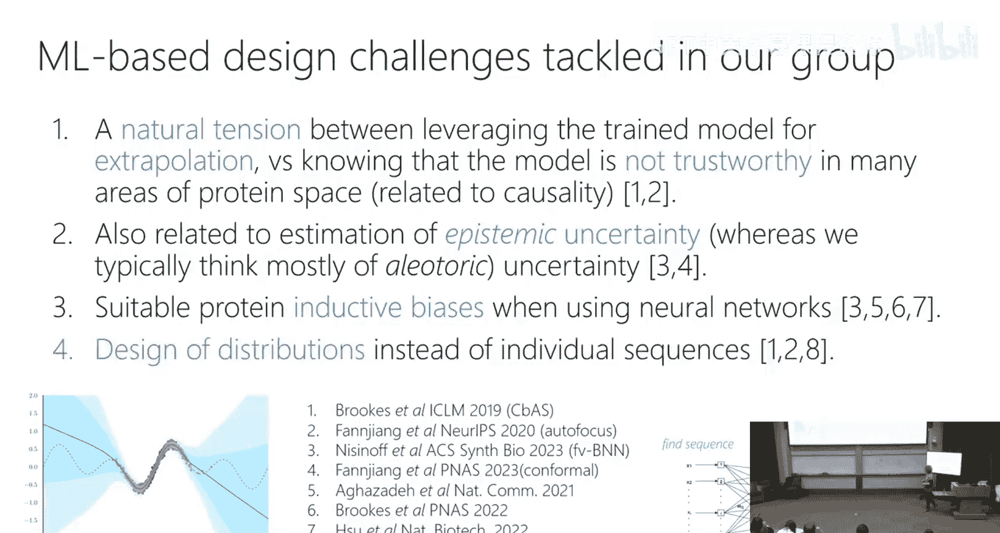

# UCB《机器学习导论｜CS 189⧸289A Introduction to Machine Learning Fall2024》claude-3.5 p28 L28- Special Topics - Computational Biology.zh_en -BV1H4421S7bs_p28-

。か data。say。

いや。第。当是。まあ、取材かも。All right， last class everyone， and now I get to talk about what I'm most passionate about actually I'm passionate about all machine learning。

 but my research has always been at the intersection of molecular biology and machine learning and since arriving at Berkeley around seven years ago I got very interested in proteins and when I got interested in them there was nobody working on machine learning and proteins and now all the big tech companies are a Nobel Prize was just awarded for this it's really taken off which is a double edge sword for me but it's very exciting times and so I want to just tell you a little bit about what's going on in this area who here has heard of Alpha fold。

Okay， well you will， if you haven't， you'll hear about who sort of alpha go。

Who's heard of chat GptT calibrating all right very good but and I can't actually remember I think the topic for today on the lecture schedule said computational biology and this is actually kind of a crazy word So there's a center for computational biology on campus there's meetings for computational biology。

 there's journals， but it's kind of weird because it's not a cohesive area it's like the crossproduct of all the disciplines in computer science with all the disciplines in biology although as the years have progress's like it started off mostly an algorithms from CS。

 and I'd say it's moved almost entirely to machine learning within all of the CS but technically there are still other branches there and then even with AI and biology there's still like a huge number of different techniques and a huge number of biological focuses So what I'm telling you here is actually a very very narrow slice of what someone might call computational biology in my mind this not even a field but。

😊，Is a useful word and it's useful to have groups of people who are interested in the topic。

Okay so I'm going to tell you about protein structure prediction， which is what alpha fold does。

 and so so proteins basically are strings of amino acids so you fully specify protein by just writing down a linear string of amino acids and there's 20 amino acids that you can use and one of kind of the whole way that not the whole way but one of the ways proteins function like whether they bind to something or block something has to do what their 3D structure and so proteins like you can just print this protein like in a sense you can order a linear chain of amino acids from a company and then it will not in the beginning have this 3D structure it has to actually fold itself and so one of the grand challenges over decades and decades has been to ask like can we predict from the sequence alone what the structure is so this protein here that's now the fully formed structure that would。

They're living breathing entities， but we often just think of them as a static snapshot of one of the primary confirmations that they take on。

 and at the moment in the field of predicting the structure。

 the successes that exist are to predict one single structure for a sequence。

 which is sort of its lowest energy structure that you would find if you crystallize it。

So and so I personally have not taken biology since high school。

 even though this is my bread and butter research， but just if you haven't you probably did learn this and you must have learned this in high school。

 I don't know what I learned in high school anymore but each of these amino acids is encoded for in your DNA by nucleotides and every amino acid has a triplet of nucleotides that codes for it and so and it's a redundant encoding which is what this kind of it's a complicated looking circle but it's very simple。

 so each of these letters is an amino acid like shorthand notation for one of the amino acids sitting around the edge here and so this is phenyl alanine which is sometimes a breeded phE up there it's written as an F and you can get a phenylallanine by in the DNA having a T followed by a T followed by a T or by having a C followed by a T followed by a T so it's a redundant encoding in that for one amino acid。

 like this one here， serenine， you can encode。With an STC， ST， STC， so it's highly， highly redundant。

But so fundamentally， when we want to do something like protein engineering to create a drug。

 the thing that we need to do to tell the wet lab is we need to specify the amino acid sequence。

 we could also do it at the nucleotide level but it's efficient to say here's the amino acid sequence and they could go make that thing in the lab and so that's sort of if you think if you're interested in protein engineering or you just want to understand which will be the second half of my talk like that's kind of the fundamental goal and when we talk about the problem of protein structure prediction。

 it is to be given an amino acid sequence and then to describe in 3D coordinates of all the atoms where they sit in space relative to each other。

So that's the problem。So and proteins like so why am I so why are people excited in proteins like proteins are everywhere like you're able to sit here and listen to me and breathe and go to the bar and go to the gym because like all the proteins and you are doing all kinds of important stuff but aside from keeping us alive so antibodies are proteins and so part of developing therapeutic antibodies is designing proteins and understanding the structure that they create and how they bind to the targets like the COVID two spike for example。

 gene therapy is this idea of maybe someone has a genetic disease where they're missing their ability to create a protein and it makes them ill and so one thing that can be done to a limited extent now is to give the person the missing protein by putting that missing gene in their body but we need to deliver it to the body and we need to deliver it to the correct cells and that's what we mean by a gene therapy delivery system and one of the ones that has already gone through some approval but there remains much open work for is to take what's called the A。

V virus， it's an innocuous virus that you all most of you probably have been exposed to。

 doesn't really do anything， which is why if we could repurpose it to infect exactly the cells we want to deliver the gene therapy to then we could get this sort of therapeutic payload to the correct cells and not the incorrect cells so I have an ongoing project about this with some collaborators on campus in bioengineering so who's heard of CRISPR Cas 9 being at Berkeley because we are home to Jennifer Downa who got the Nobel Prize for advancing this technology to do human gene editing and this it used to be a video I don't know what happened to the video but the PACman you see there so one thing you see is the DNA this double stranded DNA this PACman is the Cas9 enzyme and it comes in why is there no video interesting and it comes in and pulls apart the DNA and so and people are engineering this protein to do all kinds of different types of edits and so forth so that's another active area and what you may。

I know is when you take an antibiotic， one of the big large scale ways that people manufacture antibiotics is actually using a giant protein called a PKS polykeide synthase that is this giant protein that does chemistry。

 it takes some input substrate， it does a chemical reaction protein kind of rotates around does another reaction and it keeps going and this is actually how a lot of modernday antibiotics are actually manufactured at scale。

 but again， people J Kene here on campus is trying to reengineer these things to manufacture other kinds of antibiotics and so forth also there's this enzyme called so enzymes are all proteins I'm saying enzyme it is a protein。

Pase is an enzyme， therefore protein and it can help to degrade these plastic recycling bottles that I see very few of here which is great。

 but it's not quite ready to do that。 you need to adjust some of its thermal properties and some of the efficiency of the enzyme to do the required catalytic reaction and so I'm just trying to give you a sense that proteins are really have a tremendous potential for impacting society at large be it for therapeutics for drug manufacturing for plastic degradation。

 the last one is also quite interesting。 this is a protein called rubisco。

 it's actually the most abundant protein on the whole planet and it's involved in carbon dioxide biosequestration and it kind of lives on an optimality frontier between two chemical properties and people who are trying to reengineer it to have better properties which could help with biosequestration and problems in agriculture so I just wanted to before going into some of the details say this is like。

Really exciting stuff that proteins touch on everything。And so as I said。

 this problem of protein structure prediction is to take a linear sequence its just wrapped here。

 but it is really is one long sequence and then to do some predictive model in the computer and get the 3D coordinates of every atom in that protein。

 So I'm talking the Lego blocks are the amino acids， but each amino acid， of course。

 like ultimately is formed of atoms and bonds。 And so the idea is I want to know the coordinate of every atom。

呃。And so right， this is like a really longstanding problem。

 But the first thing that people weren't even sure of until 1972 was。

 is it sufficient if I just give you the sequence， what makes you think that I can predict the 3D structure like this was unknown。

 it was thought to be true that this guy showed in the wet lab through a series of experiments that I won't go into that indeed we now know after his experiments that you should be able to take just the sequence and predict the structure。

 which then made people really chase this problem computationally。

So right so Alpha fold for those of you who haven't heard of it。

 Al fold is a model that so well to back up what is this what are these years。

 So I mentioned the people in trying to tackle this problem of protein structure prediction for decades and starting in 2006 which is relatively recent in that field they created a competition called CAP where they would secretly get the structure for a new protein that's not been put in the database so that nobody in the world knows it and then hold a competition to see who could best predict that protein structure knowing that they've kept it secret and it hadn like they literally had to prepare this years in advance because it often takes one or two years to get the structure from a protein sequence usually it's done through something called Xray crystallography not going to go into that but it's a really big deal very expensive and it doesn't always work which is why people really want to be able to do a computationally so you can just snap your fingers and have these structures and so for。

ear people were playing this competition and the leader was often this guy David Baker who got the Nobel Prize this year。

 not for this problem， however， because actually he got his ass kicked really in 2020 and he had so when I started my job here it was 200。

18 and at that time， David Baker had no machine learning people in his lab and I forgot these are recorded and public。

 I should be careful what I say， but they're going to be removed very soon from the okay I mean。

In any case， this company， Deep Mind， which is now a subsidiary of Google。

 the CEO of that company decided to basically put all his eggs in one basket。

 not completely but a large number of eggs， which was to try to tackle this problem with modern- day AI and a big software engineering team and a lot of smart people and what happened is the first try they did pretty well but it looks like they're a lot better。

 but it was actually not like it was impressive because the first time that a machine learning model was competitive with the other models but in 2020。

 it went through like a phase transition and the world was blown away。

 people who'd spent their lives working on this problem were suddenly like my baby just left home like I don't know what I'm going to do and the world has kind of changed ever since then and as you may know they were awarded the Nobel Prize this year some people at Deep Mind who worked on that project along with David Baker who got it for protein engineering not for this problem which is a different problem。

So this is really an important period in time， and from there the whole interest。

 I think in machine learning and any kind of problem with proteins has really taken off。

And so sometimes people say， like， well， you know what？

De in mind I've written a perspective piece on this is they were clever in their engineering。

 their architecture， all kinds of stuff， but the thing they were most clever about was picking this problem because I think of all the problems in science out there this was the one that they could really make strong advances on and that's primarily because of the data and the crisply defined problem I don't think I have a slide on it here but to do this and what everybody has been using is there's a database where you have a sequence which is like our x- variableable input and then a label which is why which is the 3D coordinates of all the atoms so you have the supervised data of 170。

000 structures with a sequence that you can use and everybody has access to that but that was actually publicly public data generated with public funding over decades and that database of just 170。

000 points has a estimated replacement cost of $20 billion and so like with a really。

Just resource here was those data combined with some smart engineering as well。

 But so one of the things that the Alpha F team really built upon was other people's work for this problem。

 namely， the statistical physicists had noticed a very interesting thing， which is。

Suppose you want to know you have some protein you're going to query and say what's the structure What they would do before alpha fold existed is they'd go look in these large databases of sequences that had been deposited of protein sequences that have no structure but there's like like I forget how many like hundreds of thousands of sequences unlabeled but we know this protein existed someone found the protein found the sequence put it in this database and so now suppose you want to take the sequence and you want to know what the structure is and your statistical physicists what they did is they said I'm going to go into these big databases and I'm going to essentially in an approximate heuristic way。

 build like a phylogenetic tree to see which proteins look similar to me that I believe our evolutionarily close to me you can think of that as a particular similarity or distance metric and then they would take the proteins that were close to the protein that they want to find the structure for。

And they would collect them together。 This is an example of two proteins to do binding。

 but you can do it just for one protein。 You get all these sequences that are evolutionarily related。

 I don't know what that white square is。嗯。And then what you can do is build a density model on those sequences。

 If they were real valued， the density could be a Gaussian because it's not real valued and it's in a discrete state space。

 they use another model that we didn't teach you about。

 It's an energy the machine learning people would call it an energy based model the physicists call it a pots model。

Wwhichch is a generalization if you took physics of an icing model for spin glasses。

 but this is not super important， The point is that what they do essentially is by collecting a bunch of sequences that are related。

 they are essentially through modeling it with a density model finding out which sequences tend to coevolve with other which positions like if I change this G it might turn out that in another sequence I have to correspondingly change another letter so that the structure remains stable because there's basically when you fold it up into 3D spaces。

 things that are far away on the linear chain maybe be in proximity and they have certain chemical complementarities that keep them like this and so if I change one of them then I probably have to make a compensatory a mutation in order to maintain the structure and so as a consequence of that if I collect all these sequences that look like are kind of belong to the same protein family。

 I can find pairwise correlations between positions in the sequence and then from those pairwise correlations with some。

From modeling steps， I can make a guess of what the 3D structure is between every two amino acids。

 I can't get at the atom level， but I can just say on the whole。

 this amino acids closer to this amino acid by this much than these two like this and you can kind of infer a structure。

 but it doesn't work very well。And so but this， however， was a key insight that went into alpha fold。

 So in fact， in Al fold， the very first thing that happens， is a very complicated picture。

 until you've looked at it 100 times and then it looks simple。

 but this is the alpha fold So there's Al fold1 which kind of worked Al fold2 is the one that blew everyone away and I'll tell you about alpha fold3 very briefly in a second。

 But the idea is you give it an input sequence specified by the amino acid letters here。

 And at the very end， you get the 3D coordinates of all the atoms。

 And now I'm going to try to explain what all this junk in the middle is。

 So this MSA is actually this set of sequences or this set of sequences here。

 the first thing that Al fold does is you give me an input sequence to alpha fold。

 it goes and searches the database and finds all the evolutionarily related sequences because we learned from the statistical physics people that that contains information about the structure But the way they were using it wasn't like gamechan at the structure prediction problem。

 but the way。😊，Alpha fold used it was game changing。 So that's the first thing they do。

 And then basically they。You have like some some of their own innovations on what kind of transformer architecture。

 but basically， it's a transformer that processes this layer by layer。

 And you've learned about like selfatten， like on a sequence。 It's not super important。

 but they have like row attention and column attention。

 So they have sort of two dimensional attention here。 And they process this thing。

 The other thing they do is they。Is they take that MSA， and they。where does this one come from now。

 So okay let's start at the beginning。 me a do is they go and they see for each of the sequences that were in this evolutionarily related set of sequences called the multiple sequence alignment。

 they say do any of those happen to also have structure information if they do grab the structure because I think that's going to be helpful for me even though I don't think it's the correct structure I think it's going help me and those are called these templates and basically it's they call it like a distaogram。

 So it's each point here is distance between those two amino acids or is this might be at the atom level I'm not sure sorry let's say I think it's probably at the amino acid level。

 but you can just take for all those each template。

 is a 2D matrix giving you the 3D information projected on like a 2D graph basically the edge weight as the distance And then from these you kind of。

You do some processing and get what's called a pair representation which is essentially this kind of like graphlike representation of some current estimate of what the distance between certain things might be and this in turn also gets processed with this so-called evoformer and not only that but these actually I can't I think they get to talk to each other as well along the way。

 but you can think of this basically as taking sequence information from sequences related to the query sequence。

 taking structure information for among those that it can find which is often not very many and then making some representation and processing it with a transformer until you get to hear and then from here the idea is take this final set of representation and pipe it through what's called like a structure module to finally make the final prediction of the protein。

And it's not super important what's in the structure module。

 but of course it also has some attention and transformers there。

 although what is interesting is one of the really big people were really impressed because they developed a new way to do rotational equivariance in this layer。

 I think we sometimes teach that I don't think we taught you any rotational equivaris this year。

 is that correct？So we learned about that the convolution operator is translation equivariant。

 rotation equivari means if I give。嗯。If I give you essentially an input and it gives me an output。

 if this is rotation equivari， then if I were to apply a rotation operator to the input。

 then the output would be similarly rotate it if that's true then that this function represented by that neural network is rotational equivariant。

 but anyway it was a big deal but they threw it away in the latest model and so now it's kind of funny because everybody thought it was such a big deal and now they've done away with it。

 but so those are kind of the main parts and then there's something down here called recycling where they basically take the output here。

 projected back into this kind of representation and feed it in and they show that this also helps the model so they train this model and then you use the model afterwards。

Any questions so far？Oh， I guess I said everything， but so right， just to be clear。

 this is the evolutionary data that came from this sort of approximate phylogenetic search。

 and this is what I was saying the statistical physics people would build a model with it。

 but these guys learn end to end， they just literally of sort here。

 put the sequence here and then pipe it through。And said， I said everything。

 and then the slides come after。Okay， and so this is all end to end。

 The problem is when you just run it like this。 what might happen is you might actually get atomic positions。

 they literally violate the laws of physics。 So like some physicist or chemist could look at it and be like that that's literally not possible。

 that bond length is not possible， this atom is sitting on the electrons of that you know over there。

 like it can't be possible。 So after they run that whole machine learning that they actually have to resort to an older style method to refine it where you have essentially it's approximate biophysics。

 you create like an energy function that in a sense。

 scores different conforms of the atoms and you need to wiggle the atoms around until it obeys to gets a good score with that energy force field。

 although people don't talk about this a lot， but and this is required less on the more modern models if I understand correctly。

So right and as I sort of was saying in the beginning。

 so I don't want to in any way diminish the amount of credit they deserve like this was a tremendous like gamechanging success for all of protein science like really。

 really phenomenal the kind of success。 you see like once in a decade or three kind of success in a field like it was a really。

 really big deal。 However， do want to just emphasize that part of the big cleverness here was to pick this exact problem because I don't think there was any other problem in biology or the sciences where they could have had such a big success。

 So they're very smart to pick the right problem here and by right problem。

 I mean it's crisply defined how to evaluate it。 you can if I have a test protein。

 I have a test protein。 just take like they don't quite use mean squared error。

 but I'm not gonna go into what they use and why but roughly speaking。

 you can just check the mean squared error whereas in a lot of scientific problems you can't do that。

 Imagine you' trying to predict the property of something and you want to check it。

 you probably have to。嗯。Well， that's actually I take that back。

 but but this is a very crisply defined problem。 and there was this really。

 really expensive data that had been collected。 And in the grand schemes of all of the sciences。

 like although this is a hard complex problem， it's actually relatively simple in a lot of ways。😊。

So right they took this long standing problem that was welldeed， had clear data。

 had clear benchmarks， had this competition for which they could prove to the world that they were best。

 and as I mentioned the data that went into that has an estimated replacement cost of $20 million which is disclose my mind。

 in fact I gave a talk about this at the National Academy of Sciences in DC and this woman came up to me and she said oh I was one of those people that made those thank you so much for saying that。

And and they relied heavily on years of work that had to do with how do you even curate how do you do this approximate evolutionary search。

 people had studied that for years just to get this set of proteins that go into that multiple sequence alignment or MSA and then they built upon the statistical physics who'd understood you could use that to do extract some information about the structure and so yeah as is true with most Nobel Prizes they're building on a lot of people's work。

 which is not diminish what they did， just want to acknowledge that it's not somebody just came and said machineachine learning will conquer the world I don't need any domain expertise。

 like the first author on this paper who got a Nobel Prize I think three years out of his PhD。

 which I think maybe the shortest gap ever but I suspect he's the one that decided to put that MSA in and do end- to- end learning and so it did really require quite a lot of domain knowledge。

Okay， so that was Alpha42。2 was the really thing that blew the world away and more recently just in May of this year。

 the same company DeepM released Alphafold3 and it was a really big scandal because they wouldn't release the code and you couldn't even call the model you were restricted to 15 calls a day so neither the reviewers nor anybody at large could check whether the statements were true that they were making the reviewers complained and the problem is that most of the I don't know if you guys know this but these journals like nature and science well that's not true of all of them but nature let's say nature and sell are profitmaking companies and their incentive is not good science。

 their incentive is to make money but they happen to publish science and this causes a lot of problems in science people think that science is clean endeavor。

 but actually science is rife with politics and competition and egos just like everywhere else in the world。

And so anyway， there was a massive protest people were very pissed off just I think a few weeks ago they finally did release the code non for academic use so if you're not a company。

 you're not profitmaking like anyone here at UC Berkeley we can go request the weights of the model and we can call it as many times as we want and so so I'm trying to give you a sense also a bit of science here while I'm telling the story but so what have they changed in alpha fold3。

 the biggest change was they're actually trying to build a model that would be good at protein binding because protein binding to other things is actually one of the key mechanisms by which protein are useful either an enzyme which catalyzes something it has to bind and then do some chemistry but also like I said antibodies their main job is just to bind it doesn't even need to do chemistry thats just to bind to the right target and not bind to the wrong target and so in addition to wanting to understand how one protein binds to another protein which the other model they generalized and they could kind of do it but here they said we want to be。

Pdict how one protein will bind to another protein like the exact confirmation。

 also how a protein will bind to DNA or a protein will bind to RNA or it will bind to like a metal ion。

 and so they generalize their whole architecture I'm not going to put it up here。

 but now they had to deal with specifying things not just at the sequence level。

 but if you're an RNA or a DNA， you may not have some translation into protein so they had to change the input to be more general。

And things like this and so and in fact， in their paper。

 they don't do a direct comparison with their other model for just protein structure prediction because they're trying to emphasize that it's for this binding problem and then they show how they do better at that compared to other things and the one kind of last thing that is interesting here is in the last part of the module this part。

Here the structure module， up here it's just like a deterministic module， like whatever the input is。

 this module will always give you the exact same 3D structure。In Alpha fold3。

 they change this to be a diffusion model。So it's actually a generative model what that means is you give it the input and it samples from a distribution and each time you run it。

 it could provide a different structure And so I know I haven't seen this publicly but as far as I understand the reason they made a diffusion model is actually not because it works better is because they were hoping to tackle one of the open problems in this field that their original model didn't solve which is if I give you a sequence。

 So their model is really good at predicting the one main structure。

 but what their model was unable to do alpha fold to the original one。

 it couldn't predict other confirmations that were energetically favorable。

 So many proteins have two very favorable confirmations one in an unbound state。

 one in a bound state and things like this， and this is one of the open challenges in this field right now that nobody knows how to solve is how do I get multiple different 3D structures or multiple confirmations as we call them from one sequence and so the hope was that if they put in a diffusion。

Model here， which could sample that it might sample different confirmations and they may make progress on that problem。

 However， they did not make progress on that problem。

 but they left the diffusion architecture in there and they ignore they don't say that they try to tackle it in the paper。

 but they do say that it does not solve the problem。Okay。Oh yeah。

 I think that's the last part of that， Any questions？嗯。😊，嗯。😊，嗯。Actually。

 for these models there's a whole there's parts of the academic community that as soon as like Alpha43 was released。

 there's like about three or four groups trying to reproduce it open source。

 so there's always an open source version and it may take a little bit of time for them to catch up but they do catch up so I don't think that's true。

And also the data they used like you know had they spent the money themselves $20 billion and created the data。

 but like that data wasn't theirs。 So I think large scale engineering effort are best done at a company because it's so expensive。

 but if we're already in the right ballpark of things that work and you just want to be in that space。

 I think that's open。 But if you try some brand new problem。

 you have no idea what this giant architecture should be。

 you probably need more resources than sort of trying to reproduce what someone did。Mm。😊，Yeah。

 so in fact， I think I took it out of here。 I don't know if I always get confused who I'm giving talks and I'm teaching。

 I don't know where I said what， maybe I should have put a slide and but if you look up on my web page in my name and there's a perspective piece in nature biotechnology from I think earlier this year in which I specifically talk about basically I say what was so special about this problem that they picked it and had success and do I personally think that this is like unlocked massive success in the sciences now we're just going to see AI like having this level of success here and here and here and what I write is I personally don't think so I think there's a very special problem。

 I hope that we will see it again， I think we will if you ask me what problem do you think is most ripe for this kind of success by using AI I don't know。

 I think it's under the radar right now there's tons of there's Google put out a paper joint with UCC Berkeley people I think there's two papers in a very high。

Profile journal last year on creating new materials， huge scandal， huge backlash。

 problems with the science， problems with the claims。

 and actually you see a lot of that now these big journals like as I said there motivations to make money which is to get hype and visibility and they often sometimes throw out reviews they don't like and go get new reviews or they just rapidly try to publish it's a very interesting time but as a result。

 there's a lot of exciting real fantastic work happening in particular this but not only this there's also just like wild claims and stuff and papers and so like every time we as a research group some new big paper comes out like we have no idea whether to believe it or not at the moment and it's pretty hard for science question。

HaThere was actually a you should have too bad the ordersverse this morning at the Simons Institute。

 they had a debate about this， specifically that exact problem。

 I don't pay too much attention to math and large language models， you can go read stuff about it。

 I don't know very much about it。😊，嗯。😊，嗯哼。Yeah。And the generalは。Together。呃，对了。あ週？in this case。Well。

 it's interesting。 you should say that。 So let me just go back and make sure that I understand your question and that everyone else is。

 I think you're saying， like could I， instead of just of feeding this directly into the model。

 maybe I could have done something like learned a statistical model on top of it like this sort of statistical physicist did and extract some of the parameters from that model and give it as features。

 iss that your question。Okay， so in fact， that's exactly what Alpha fold did。

 it only did that and it did not give the MSA， it only extracted information from the ASMSsA and passed it on。

 and we can only conclude from the fact that they're no longer doing that at all and only using this that this is helpful and adding those doesn't help like that's not stated somewhere。

 but it's implied by the fact that they are no longer using it。嗯。😊，Okay。

 so that was a little bit about protein structure prediction and I like in my research。

 I stay away from that problem because I'm basically， if I were to do it。

 I'd be competing with Deep Mind and their resources and I would be competing with David Baker。

 who's an academic but has 120 people in his group。

I don't know if you know the size of most academic groups。

 but I'd say here in the AI group a 20 person group is considered absolutely massive and he has 120 people in his group and so I'm not going to compete in that space but we always try to understand what's going on there and make use of these tools for our own research which is more more interested in protein design which is this idea of like how could I create a new protein which binds to that target like for the spike COVID spike or whatever it may be or for any challenge at all like all those examples I put on the first slide。

 actually many of those are examples we're working on with collaborators who build proteins in the lab and have a long history of doing pure wet lab-based protein engineering but if you think about like protein engineering or protein design I'm going to use these a little bit interchangeably like if you're just a computer just you just if you are a computer scientist and you abstract away what is this problem of protein engineering as I said you need to specify the sequence and。

😊，to the people in the lab and it does what we want or it doesn't。

 but the game is you tell me the sequence， if the sequence does what I want。

 or I give you 100 sequences and one of them does what I want。

 then we have our protein and we go like start a company。

But as you can see that so and proteins are usually just to say like a small protein is usually already maybe 100 or 300 amino acids long。

 And what you'll see is that with just protein that has 50 amino acids the number like from the combinatorics of having 20 amino acids。

 the number of possible sequences that are valid proteins of length 50 is already very close to the number of atoms in the universe。

 And so in some way as a computer scientist， you can think about protein design。

 a protein engineering is having to navigate some massive nearly infinite combinatorial space。

 and as you're navigating this nearly infinite space。

 you actually don't really know anything about these virtual proteins。

 you don't know they binding affinity you don't know their thermo ability。

 you don't know their solubility So you're navigating a space almost blindly。

 and so it's like a really hard problem。Of course we are all here living and breathing so clearly something can solve this problem and that is natural evolution。

 but the problem is the natural evolution works over millions of years if we today want to engineer some new protein we obviously can't use natural evolution however we do know there have been many engineering successes of proteins what have people done so they've actually the second one is actually a synthetic version of evolution and it's synthetic because instead of nature letting proteins evolve as they might in an organism。

 you basically take some protein of interest here and so here's how directed evolution works which you call the Nobel Prize in 2018 Francis Arnold Caltech and two other people but what you do is suppose you want this protein so one thing the proteins do is they fluores some proteins are fluorescent the discovery of that which came from some underwater animal it also got a Nobel Prize but these fluorescent proteins。

😊，Use as workhorse proteins all over academic labs and pharmaceutical labs because they tag things so it lets you see things from the fluorescence and they're very。

 very important。 but so suppose you want to use different colors and not just this green fluorescent protein so you want to engineer a yellow fluorescent protein so you can tell the difference between two things when you use it to look at stuff so if you want to use directed evolution to do this which is a purely wet lab-based endeavor you need to start with a protein in directed evolution it has like the smallest essence of the thing you're trying to engineer so here we could start with a protein that fluoresce is green because it doesn't fluorece yellow。

 but at least it fluoreorescence， it has like a little bit of this quality that we're looking for and what we do is we start with that parent and then we basically copy it many。

 many times over like hundreds of thousands of times in the lab but we copy it with errors so that we induce mutations in it In fact。

 if you just use routine copying enzymes that take the DNA and copy it they do make errors and you can。

Control how much error they make so you can just basically say copy this thing with errors。

 Why do you want to copy it with errors because you're trying to simulate evolution。

 How does evolution work， you get mutations， things that make you more fit they have more progeny things that make you unfit。

 you die， you don't have progeny and the rich get richer and the unfit are not And so this is like a simulated version of that so you take this parent you do this diversification where you copy with errors to be fair that's just one mechanism。

 there's more complex mechanisms than that which is quite interesting because we bring machine learning to bear on this。

 I don't know if it's in my slides where I'll have time to get into it and then what you do is you need some way to measure the thing you care about and actually that's a really big problem in a lot of biology。

 it's often very difficult to measure the thing you care about if it's fluorescence。

 that's one of the really easy things we know how to read off fluorescence and just grab the stuff that fluors highly if you want to do this kind of a thing with not a fluorescence as your target but say some catalytic activity for a particular end。

Then that's why people get a whole PhD in the biology department because they figure out how to actually measure that and so this idea of and but if you can't measure it。

 you can't do this so you need to screen or measure the like how much each of these fluorses yellow and then you take the top performers like maybe the top 20% and you bring them back here and you start the whole process so now you have instead of one parent you have like 20 of the best ones and you now again copy them with errors so what am I doing this is a computer scientist I'm doing a local greedy random search starting somewhere I'm making random moves on the protein at a few places I'm doing it over and over in the space and then I find out which parts of the space are better and then I kind of move in that direction and then I do it again and again and so obviously this has had tremendous success because it got the Nobel Prize people can do a lot but there's a lot they can't do and that's actually where I first started to work in this space was to say。

I want the challenge I set to myself as a computer scientist working with these folks is to so as I described it's a local greedy random search。

 so as you might imagine you can easily get to a local minima and then get stuck there。

And so how might you not get stuck there， one thing is if you could find a different starting point one thing。

 or maybe you move through the space more cleverly。

 but as soon as you start thinking about it like a computer scientist in a large commoninatorial space。

 you can start to see maybe how you could work in sync with the wet lab biologist to make this a more powerful method than it is and in fact。

 Francis Arnold who did get that Nobel Prier group now has a small contingent of machine learning people because they know that that's going to help them do better and the other thing that happens is so with one of our collaborators on campus David Savage who's like a world leader in AAV engineering for delivering therapeutics in this gene delivery vehicle of a virus。

They use a lot of directed evolution they also have for decades。

 but there's just some stuff they can't。 It just doesn't work。 no matter how many times they try。

 like they can't actually get the property they want。

 And so they're hoping that by working with us that they'll have a better chance。

 And so like one example is they're trying to target particular cells in the brain for therapeutic reason。

 something called a glial cell And no matter what they've done to date。

 they cannot get that AA to infect the glial cell。 So the hope is by working together that will be able to do that。

 And so so I forgot to mention the first method I got so excited about directed evolution。

 So this has been one of the really big ways people have done protein engineering。

 And this is the other one。 And this is the one that got the Nobel Prize this year。

 actually so David Baker， there's a lot of confusion about why he got the Nobel Prize because deep mind basically got it for protein structure prediction。

 But David Baker got it for protein engineering。 and he got it for work that it was from before the machine learning days And so he used these physicsbased energy functions。

 So is the kind of thing I mentioned that you use after Al fold。

Clean it up if it has any physical violations in it。 So but before it got used to clean up Al fold。

 it was the primary method you didn't just refine something。

 you had to use it wholesale to do structure prediction。

 And as you could see on that competition curve， it didn't work very well compared to alpha fold too but David Baker was the leader in that field in that game for many。

 many years。 and now his whole labs doing machine learning And so these energy functions I say almost rest in peace So's few you never used to have this but once after I gave a talk someone said no no。

 we're still using it for antibodies and they're using it for this。

 So I think there's some corners of protein engineering where alpha fold doesn't work well。

 and particular I mentioned that proteins might undergo a structural change upon binding and so antibodies in particular antibodies have like a structured region and they have these like loopy regions on the end。

 they have no structure until they bind to something and only when they bind something they like tighten up and have a wellform structure and so Al fold can't deal with things that have。

Be like kind of like loose structure like this。 And that's where this kind of model could still help you。

 But I think in a few years， I don't think anyone's going to be using these。

 I think it's gonna to be all machine learning。 And even now there's this tiny little corners of the world that are still using those physicsbased problems physicsbased approaches and I say it's data free。

 I don't think I used to I added the quotes recently also because I gave a talk on someone complained。

 So the reality is these energy functions have a few kind of like hyperparameter and over the years。

 you know over decades maybe they set 20 hyperparameter with a little amount of data。

 So it is there's some knobs that get set with data。

 but not in the way we think of setting things with like largescale data with machine learning yeah。

Because they're very approximate right like I mean the only thing that's actually real is Schrodinger's equation and then there's hierarchies of more and more approximate and I don't even remember all the layers somewhere and there's like density functional theory DFT which also go to the wildrise and if you pop up several layers like so if you go from Schrodinger to here to here basically you're approximating quantum effects more and more and then you're even approximating Newtonian effects and this is like above all of that and the reason you have to make it so crude is everything else is way too slow and even this is very slow so it's all about speed versus the accuracy of the true physics。

RightAnd so but of course why I'm telling you about this in this class and why I have research is that over the years and interestingly。

 I do think it started around the time I joined UC Berkeley is that that's when I started when I actually thought I had my own corner of research because I thought no one was doing it and now as companies right and left big small startup academics everywhere but this is infusing both of these methods and in some sense all of this is kind of coalescing together。

 although I think that people who came from this field like to pretend they're not doing directed evolution and people who are using machine learning like to pretend they're not doing directed evolution。

 but in fact mostly if you have a true success story you've probably used several of these methods together in some way and I think it's likely to be like that for a long time in fact I think it will be more and more of a trend and so in particular with machine learning methods and these computational biophysics-based approaches what often happens just by the nature of something in the modeling is you。

You tend to create， design a protein that they call them rocks。

They call them rocks because those proteins are sort of hypers stable， they're super super stable。

 like you could heat them up and they just will not change and that might sound great because you want proteins that are like robust and stable。

 but if they're too stable， they can't bind to anything in order to bind something they need to have a little bit of breathing room and so usually they design a rock and then they use directed evolution on the rock to loosen it up and get it to do what they want but they kind of bury that in the second part of the paper。

嗯。RightAnd so when I tell people that I work on protein engineering and they're not in the area and they don't really like know what the moving parts are they often say。

 well didn't alpha fold solve your problem and I say no and so I got this question so much I started to put it in my talks and so why you might think alpha fold solved this really important problem。

 you go from sequence to structure and this sort of general thinking is that all functionality is mediated by structure so now I understand structure so now I can do everything but there's two problems with that the first problem is that we don't know which well first of all we don't know what structure we needed and if we knew what structure we needed we would need the opposite model right Alpha fold goes from sequence to structure and if we knew the sequence we'd be done that's the end game so maybe we don't know the sequence but we know the structure but then I need to reverse this model to go the other way around from structure to sequence and this is sometimes called inverse folding and in fact one of my students PhD students who's graduated。

 she did an internship at Facebook and she basically inverted。Alpha fold。

 she took all the training data that Alpha fold was on then she took all proteins that don't even have a structure。

 predicted them with alpha fold。 Now she's this huge data set of more than alpha fold had because she uses alpha fold to predict structures and then she just trained it not just she trained it the other way around and other people have built models like this as well。

 but that also doesn't solve the problem because we don't usually know the structure right if I say give me a protein that binds the COVID spike I have no idea what that structure is So this tool by itself doesn't help but if I had another tool that could first predict the structure and then from the structure predict the sequence then we'd be in business and in fact this is kind of what people do I guess there's one。

there's a nuance here that you maybe didn't pick up on。

 but if I actually told you the structure in terms of all the atoms in every amino acid。

 then it would define the sequence because if I tell you all the atoms that literally defines the amino acid。

 so when we talk about these kinds of models I've glossed over this。

 but the structure here is a coarsed version of the structure that doesn't contain all the atoms。

 it actually is just the structure of the central atom of every amino acid。

 which is not reveal the identity of the actual amino acid and we just call that the backbone。

 so it's just like 13D coordinate for each amino acid。

And then the other thing is that in all of this work that's out there nowadays。

 people often like like there's huge， very popular papers。

 and they often ignore the fact that we don't actually know how to predict the function we care about from the structure or the sequence at all。

 And so。so there's this missing piece but these are all tools that help us to get where we want。

 but maybe by my main point here is I think I just want to convince you that although E fold was like super amazing and it's a useful tool that we can incorporate in protein engineering。

 if by no means does it solve the problem of protein engineering and if anything you want to probably use it the other way around。

Although people might design something with some method。

 and then they might push it through alpha fold and like look at it and things like this。

 so it definitely gets used， but it's not like a key ingredient to protein engineering。

So if you pick up a protein engineering paper， it's very easy to get disoriented in this field because each paper will claim to have made this huge advance for protein engineering。

 but it turns out they're often solving just like a subpro because many of the sub problemsm are themselves quite difficult and so I've just broken them down into two things here one is I call prediction tasks and the other one I'll call design tasks and so I call these design because they're trying to get to the sequence which is the thing I need to give to the wet labb collaborator at the end goal is this and if we're trying to design a protein we want to be design we want to either specify a desired function to get the sequence。

 specify the structure to get the sequence or maybe at least going this way is on the way to getting in the sequence versus prediction tasks where you might say if I give you a sequence please predict the function or if I give you a sequence。

 predict the structure that's what Al full does or if I give you the structure predict the function and so all this is all of these are important problems and people。

Ting to advance all of them and all with machine learning， plus sometimes other stuff。

 but mostly machine learning。So and so that's sort of just yeah。

 different kinds of problems that people are working on and if you go pick up just some papers in this space that are using machine learning。

 like what are the kinds of things they're doing， one thing they're doing is representation learning so they might say use an auto encoding transformer or。

And then extract a layer that they use as a representation so naively。

 if you want to do machine learning with a protein like what are you gonna to do。

 you're gonna to take those amino acids and if you have no other choice you're gonna one hot and code them right so each amino acid just becomes a 20 length bit vector with a one in it because there's 20 amino acids and then you stack those together and in a sense there's nothing wrong with that we do this all the time but it may not be the best we can do And so I can't remember if did we learn anything I don't think we taught to you about representation learning did we。

Okay， so representation learning is this idea of instead of just naively doing one hot encoding。

 can I learn somehow from data in this domain what a better representation would be and so like how could I do that So in the case of proteins suppose that I mean they didn't do this for alpha fold but just to give you an example since you now know alpha fold so they had to sort of one hot encode the sequence but a training time they have just 1 hundred70000 examples it might sound like a lot。

 but for such a complicated problem it's not that many。 However， there's many。

 many more sequences that don't have structures there's hundreds of thousands of sequences and so in many domains this is true you have a small amount of supervised data from the input space to the output space and you have many。

 many unsupervised examples and so the idea with representation learning is to say can I use all the unsupervised examples to get something that's smarter than a one hot encoding that understand something。

About this domain， and then I go use that with my limited amount of supervised data instead of using one hot encoding。

And so that's what people do so they might do build something that's kind of like like chatTBT to imagine it takes all of Wikipedia and it does like next token prediction on a word so you can imagine doing something kind of like that with a protein sequence and then what you do is you take a layer of the transformer and that's just like numeric vectors sitting in a realvalued space and now when you want to go build your supervised model on a small training data going from sequence structure instead of doing one hot encoding you pipe it through that transformer and you take the layer out which gives you a vector representation of real values which is not a oneho encoding and presumably understand something about proteins because you gave it hundreds of thousands of examples of sequences so it can pick up on certain patterns that occur in that kind of data and you could do that in different scientific domains and so you'll see this all over the sciences you'll see it in many many areas and this is basically referred to as representation learning and in the context if you know some machine learning which。

I doing a density estimation over the input space through some sort of like auto encode or something and then extracting a layer and just calling that your representation。

So another big thing that people do is they build generative models for sequences。

 so just like chat GT is a generative model on words。

 you can imagine instead of words you spit out a sequence and so people are building sometimes unconditional models they just say。

 I want a model that spits out something that is a protein。

What does that mean if I have this strict alphabet of 20 amino acids and as long as I pick an amino acid from the 20 amino acids and I string them together。

 I have a valid protein so I don't need a generative model to have what's like a valid protein in the syntax of proteins However。

 what people actually want is not that you adhere to the syntax of those 20 amino acids。

 what they want is they want a protein that doesn't just fop around with no structure。

 any useful protein has some amount of structure in it and it may develop more structure when it binds And if you just pull like an arm like a lottery ticket arm whatever for each position from each of the 20 amino acids and create at random a string amino acids。

 it's very， very unlikely that that thing will fold up and have any structure So if you just generated random these are not actually useful proteins for anything for a protein to be useful it needs to have some structure and so people started to say well let me build instead of sucking up all of the。

And building chat EBT， let me suck up all of the sequences that exist in the database and build a model on those and now when I sample from that model。

 it should give me sequences that are like real proteins in the sense that they have some amount of structure so that would be unconditional generative models for sequences but people but when we do protein engineering we just don't want random proteins that have some structure we want proteins that have some structure and do the thing we want to do so we actually want like a conditional generative model。

So we want to be able to generate a sequence condition on a particular property of some kind and so I mentioned that Chloe。

 my former student had flipped alpha fold around so that would be a structureconal sequence model。

 she specifies the backbone structure of the protein and then she gets a generative model over sequences for which she can sample so that's one example sometimes people may specify some other properties and so people are trying to do these things but of course you have to remember that just because they've turned the crank and you can specify some condition doesn't mean like it is a model and it's fallible and the model is only as good as the model so sometimes people make these out to be a bit more important than they are working better than they actually are but I think it's an important class of models that serves a useful function。

And then another thing。 so yeah， this was a generative model over sequences。

 it's a generative model and it's discrete state space， much like chat GBT。

 the other thing people do or build generative models over the structure。

 meaning over the atoms in 3D space。 So now this is not in a discrete state space it's in a three-dimensional continuous valued space and they use diffusion models and this kind of stuff。

 but again and there's a few seminal papers from last year from Johninggerham another from David Baker's group and so here and so you may have when you learn diffusion from normal people who don't biology you always see this like dog picture you see this dog image and then it gets noise。

 noise noise until it just looks like a broken TV right and so what's kind of interesting in this one paper is they don't just add Gaussian noise they add noise in a way that maintain some basic properties of a polymer and I won't go into it but if you're wondering why in this diffusion process and this end doesn't look totally。

Random instead it looks like a collapsed protein， that's because they designed the noise process in order to generate a collapsed protein that actually still obeys physical laws of what can be near each other。

But in these papers， what they again， they kind of tend to overlook is like how do I know the connection between the 3D backbone structure and the function I care about And if I don't know that like in order to generate a structure that will have the kind of function I want I need to know that link and if I don't know that link it doesn't matter what fancy machinery of diffusion models I use it's not going to just manifest itself。

 I have to put it in there in some way and I think this is kind of one of the big open challenges of the field there's a lot of very sophisticated machine learning。

 technology of generative models and so forth， but at the end of the day if you don't know how things connect to the function you care about you can sample those models all you want。

 but it's not going to help and so in fact most of the successes in these fields have to do with function that is mediated solely by the structure and that's usually binding。

 So if I want to bind this thing this protein to that protein， what determines it as the structure。

If I'm looking at a protein that fluoreces or a protein that catalyzes a reaction。

 like let's talk about catalysis， so if this protein is going to catalyze a reaction that requires binding doing something to this protein。

 first it has to bind but it's not sufficient to bind then it needs to do a bunch of quantum chemistry stuff and we don't know how to understand that from the structure alone so it's therefore much harder to engineer because it's not mediated just by the structure。

Right and so people do use these generative models for the backbone coordinates so they'll specify like but they can't generate new functions really so they'll in fact what they'll do is they'll take an enzyme and there's a part of the enzyme called the active site that does all the interesting quantum chemistry they carve it out and they say you have to be this you're not allowed to change that I'm going to just change the rest and maybe make it smaller or something like this and then they generate a backbone with this model doing that and then they go to one of these inverse folding models with the backbone generative model so they've obtained a sample from the backbone generative model and then they call an inverse folding model to get the sequence and that's like one example pipeline of some machine learningbased protein engineering。

And if you're interested， we wrote Chloe and my students have graduated。

 we wrote a little this is a Nature biotech， theytom published these things called Pris。

 so they're meant to kind of teach people about an area which doesn't necessarily mean you can start from scratch to read it。

 but if you're kind of interested in how generative models， get used for protein。

 engineering and so forth， you can take a look at that。

Okay so I mentioned that Al fold has two and three had this tremendous success but I mentioned in the very beginning that it was at kind of one particular problem。

 which is I give you the sequence and it gives me one single structure and it does a good job if that structure the structure you care about is the kind of lowest energy of all the meeting the most favorable according to the laws of physics of all the confirmations it can take in reality。

 as I said though these things like move around and there's there sort of sampling space according to some distribution and what alpha fold can do is find the max of that distribution basically and so one of the really。

 really important things for protein engineering is actually to understand maybe a bit about dynamics。

 like dynamics refers to kind finding a time course trajectory of how that protein is like breathing and moving but what's probably more important and a bit easier than actually figuring out the protein dynamics which by the way。

 there's a field called molecular dynamics that tries to do this which is very doesn't work great。

It has a lot of problems doesn't work super well people are trying to do it with machine learning。

 but I think more importantly rather than understanding the nitty gritty of how it evolves in time。

 we want to at least know what are the two or three main confirmations this protein can take on and with what probability like we don't need to know every little bit in time but at the moment we can't do either of these problems so these is some of the really huge open challenges in the field and one of the big problems is that the data is just not there so the question is like what will it take to unlock this problem and I think the jurys still out on that。

I mentioned that Alpha fold3 was really targeting this problem here of how does a protein bind to another protein or DNA or an RNA is when I first made this slide it wasn't out yet。

 but I think the jury's still out， I don't think this is anywhere as good as just the static protein structure prediction but I think they made big headway with alphapha fold3 but because they didn't release it in full until recently kind of we don't really quite know just how good it is but the one thing that's maybe I don't know why I'm going backwards in order here but this one's really。

 really interesting has anybody have an idea what this sentence might mean。Yeah。Exactly， exactly。

 and so you know one would like to think that Alpha fold was so successful。

 it must understand something about physics and right like if it can take the sequence and get a structure so reliably。

 surely it understand something about physics and I mentioned in the very early slide deck this guy they got the Nobel Prize in 72 because he proved in the wet lab that a sequence by itself could determine the structure but what I've told you is that Alpha fold relies on evolutionary information at train time and at test time and it turns out that if I have a test sequence that doesn't have evolutionary related proteins in the database。

 Alpha fold fails and so it's sort of proof that it cannot go from sequence alone to structure and it's proof that it is not doing that much physics maybe there's doing some physics and there is obviously not doing that much。

 and so people are trying to tackle this problem is like surely if I know from that Nobel Prize in '72。

😊，I should be able to give you a sequence and you should give me the structure and we're not actually there yet。

And actually， something that's not on this list is it also turns out that if I get a sequence to alpha fold and it gets the correct structure and then I want to ask alpha fold。

 well what if I make one mutation in this position， how does it change the structure。

 alpha fold is also very bad at that， it will just mostly give you back the exact same structure even though you changed one of the amino acids。

 So if you want to understand fine grade differences between very closely related sequences。

 it's also not very good。Okay， who can explain this slide？I'm completely sort of switching topics。

 I didn't put a slide to seggue into this， but this is now a new topic。

So this has to do with what I was saying is that there's all these fancy diffusion models and machinery out there。

 but in some sense they're only as good as our understanding of the relationship between the function we're trying to engineer and the structure or the sequence and so at the end of the day what we rely on no matter whether you using a diffusion model or some other approach at the end of the day you're going to need a classifier for the property you care about and so for example you might take a classifier that goes from the sequence or the structure to the catalytic efficiency and you're going to have to build a machine learning or bio you need some model to do this and nowadays we typically use a machine learning model and now if I have this model。

 I could use it with a diffusion model in a particular way。

 I could do this that but however you're using it like the mechanics of how I use it whether it's with a diffusion or not the same problem happens which I'm going to describe with this image and so let's pretend we're not using diffusion。

 Imagine I give you this network which goes from the sequence。

To the catalytic efficiency and now I'm going to try to design a new protein sequence that has twice the catalytic efficiency for this particular reaction that I've ever seen。

 so now I'm trying to use the model outside of where it was trained I have training data that go up to catalytic efficiency too and I'm trying to push it to go to for by using the model but if the model never saw anything that high and I ask it to go that high。

 it very likely doesn't know what it's talking about。

 and it turns out the computer vision people understood this problem very well and so。

What they did so unusual machine learning， our goal is to train this network。

 but in the problems I'm talking about right now of design。

 the idea is that basically I give you a network that goes from sequencenc to catalytic efficiency。

 I've trained it my best on my best job cross validation， hyper hyperparameter selection。

 everything it's the best model I can find and now I'm going to fix the parameters。

 leave them as they are is my best model and what I'm going to do is I'm going to set imagine for catalytic efficiency。

 there's just one output node which is the catalytic efficiency and now I set it to four even though I only saw two in the training data and now I backproagate not to set the parameters。

 but I backproagate to set the sequence。Which is different。

 So this is what you do for design is you set you take an already trained model。

 you fix the parameters， you set the output and you back propagate。

 you start with some random input and you do back propagation to update this thing。

 and you'll see in a minute you'll know why I have an image in a banana there。

 let me just keep going and then I'll answer a question。

 And so it turns out like that's what you would do for design is you would take the network。

 say make the catalytic efficiency high， start with some random protein sequence and then do gradient descent on the input to get the sequence that gives me catalytic efficiency of four。

 So the reason the banana is here is it turns out that the computer vision people some years ago。

 did something very analogous。 they were not trying to design bananas。 However。

 what they were trying to do is take a really state of the art large neural network that had different nodes like one node for banana。

 one for kiwi， one for person， one for house like hundreds and hundreds of classes and what they wanted to do was say I've trained the state of the art neural network。

 I want to。C at the network and see what it knows and what it understands。 And in particular。

 I'm going to set the banana node to1。 I'm going to set the other nodes to0。

 I'm going to start with a random image and I'm going to back propagate to get the quintessential banana that has probability of one。

 So what's it going to do Any guesses。That's what it's gonna to do。

 So now if you're doing drug design and you needed the banana to be your drug。

 you're like in trouble right like definitely not going through FDA approval On the other hand。

 you can see why it did this it has like the right kind of curvatures。

 it has the right color but it's like obviously it's not a banana it's abstract part and so why is this happening it's because you're kind of squeezing the neural network beyond what it knows right you're like squeezing it for all it's worth it was trained on bananas but you're like I want banana probability one and so in a sense there's always pathological regions of the input space that the model can find to maximize an output but it's doing it's like pathological because it doesn't correspond to a part of the space of where any of the training data lay right like we can be sure none of the training data look like this and so but it can find the space that scores very highly because it's out of the training domain and this is fundamentally a problem with all neural networks if you squeeze them beyond where。

They're used to thinking they give you complete nonsense。 And this comes up in all kinds of places。

 But equivalently， if I specify that I want very high catalytic efficiency on my sequence to catalytic efficiency neural network。

 Im with high probability just going to create some garbage protein that does nothing for exactly the same reason。

 And so this is actually， if you want to do what I call extrapoative protein engineering or extrapoitive protein design where you want to create a function that's higher than you've ever seen。

 you're basically always going to run into this issue。 And so the。

And just actually another cool example so there's a whole area called adversarial machine learning where sometimes you think about how would an adversary attack a neural network here in protein design。

 we're not attacking the network， but we're posing a question which is to squeeze it for all it's worth so we're almost accidentally attacking the network even though we're trying to just get what we want but as an example of an adversarial machine learning this is pretty cool so you can take a state of the art network and and it's been trained on like let's say stop signs and you give it this input image and it will predict stop sign with high probability and now what people figured out was they figured out how to find the pathological regions of the input space so that they can make imperceptible changes to an image these look the same they figured out the exact tiny amount of noise to add to this image so that to the human it looks the same but that with high probability gets predicted as a yield sign so you kind of mess with a classifier in the sense that。

You can through a small gradient to send step I won't go into。

 you can take this image and basically you take a tiny little step in image space where you add this to this to get this and you can cause the basically you can make any stop sign get classified as any other sign you want even though it still looks like a stop sign to all of us and it's the same problem as here is there's these corners of the input space where the model just has no idea what it's thinking and if you want to like make use of that for some nefarious reasons like making a stop sign look like a yield sign then you can do that but fundamentally it's the same problem that arises when I'm trying to extrapolate on some property of a protein using a model that's been trained on some finite set of data that doesn't span into the space I care about and when I'm doing design you can almost be certain it doesn't span into the part of the space I care about because that's why I have the design challenge in front of me if it already span into that part of the space I just take that protein from the training data and I'd be done。

So right， and so in some sense， protein engineering。

 if you're thinking about trying to create new properties or stronger properties。

 it has this like fundamental challenge， which is there's a tension that always arises between how well can I extrapolate from the model and when when do I have to rein myself in like how far away from the training data can I go before I need to go back to the wet lab that's kind of like at the heart of a lot of these problems of extraolative design and so this is actually a little bit related to causality in the sense that if I had the true causal model。

 I wouldn't have to worry if I had the true causal model I could go as far away from the training data as I wanted but as I said last class。

 we never have the true causal model and in fact nobody in my group even looks at causality because we know we can't do it but what we do often care about is quantifying the uncertainty in the training data。

 which is usually like if this is a simplistic regression curve but what is。

one of the points here is to talk about actually there's two kinds of uncertainty that you don't care about in an undergraduate class but the standard of when you think of linear regression has a scalar noise parameter。

 just standard linear regression that you learn in like stats the first year and like usually you would think of fitting that line to hear and that homochoastic single scalar noise parameter would be basically the width of the data points around the mean right but now imagine you're trying to do design and you're trying to push the model away from the training data out here。

 there's no way that this tiny error which is arising from sensor noise measurement noise has anything to do with the notion of uncertainty from being far away from the training data those are two kinds of uncertainty one is because my measurement noise there's measurement noise and measuring these points and another is I have uncertainty because I literally wasn't there and so these are what referred to as epistemic uncertainty is I wasn't there I just don't know versus adatoric uncertainty which is the more conventional sensor noise and so there's a whole。

Field of research and machine learning， trying to estimate these two types of noises and so forth and in my group we've been trying to think about given that we can kind of estimate them reasonably well。

 how can we incorporate those notions of uncertainty to understand how well we can push our models to their limits before we have to go back to the laboratory。

I'm going to skip that one。嗯。okay， I'll mention this one a little bit。

 So I used to think this was not an interesting problem， but。

So who can say what inductive bias is for a machine learning model？It was never， I think we use it。

 but did we never define it。Yeah， I think you have the nugget of it there。

 which is like the inductive bias of a model is like kind of defined by the if it's a neural network。

 the architecture right if I have a very simple neural network that has like two hidden layers each with two hidden variables。

 that's not very representative and so whatever the complex function is。

 it's going to have to sit in the space of the model hypotheses of that architecture and the way in which that architecture constrains the functions I can estimate is the inductive bias of that architecture and similarly if I choose to use convolutions in an architecture。

 convolutions have an inductive bias， which is that they assume this thing called spatial or they obey spatial。

transranslational equivariance， meaning that if I convolve over an image and I translate a feature in the image it will still get picked up by that filter in exactly the same way。

 and so basically any choice you make for which features you're using what architecture you're using of any kind be it are you using attention or using convolution are you using a diffusion model。

 any choice you make generally imposes some sort of constraint although for some of these models as we know they're universal function approximators and if you make them bigger and bigger they can in principle capture anything although we also know that depending on how you initialize and how you run gradient descent and so forth that even though they can represent everything。

 in fact the gradient descent and the initialization themselves can be inductive biases which has complicated to know and modern day machine learning but in any case so how did convolution came about because of the image people。

 the vision people said convolution make sense。For images like in fact。

 it existed in image processing long before machine learning and we're going to kind of repurpose this idea of convolution within a neural network to learn convolutional filters and so that's like an inductive bias of people in computer vision understanding something about the domain and then putting it into the architecture and so what happens in a lot of computational biology is people just take inductive biases from vision from natural language processing and they just use it wholesale but there's some work including a bit in my group on asking like are there inductive biases we should use that are specific to proteins and。

I actually， I don't have， I don't have a slide on it。 It is too hard to explain， maybe。

I think this is quite a complicated topic， okay， so I shouldn't have started talking about it but one can do that as well。

And then there's this is actually really near and dear to my heart and what my group does a lot of maybe it sounds kind of boring designing distributions So what does this mean when I just think like at first glance I said what is protein engineering as a machine learning person it means I use some model to tell this person in the lab to create this sequence for oh I realize we're also out of time well I'll just finish this and then we'll go but if you're interested in this there's also I have talks online that are fairly accessible if you pick the right one and you could find out more but anyhow so when you are a machine learning person like when I go tell my laboratory collaborator make this sequence is very unlikely that sequence is going to work and so I actually need like a set of lottery tickets and I hope that one of those lottery tickets is the winner because these machine learning models are totally imperfect in particular when we start an engineering campaign we don't。

