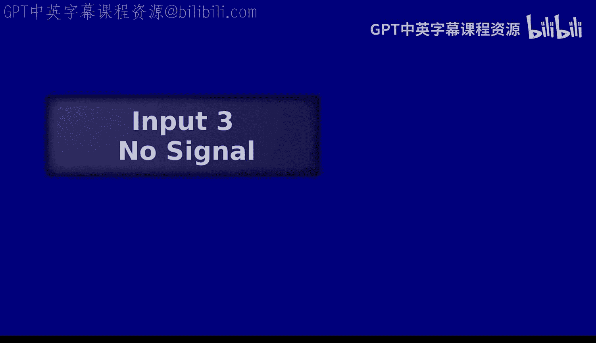
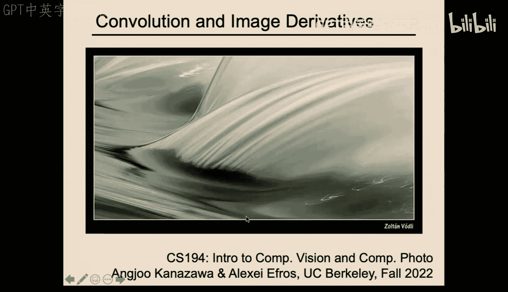
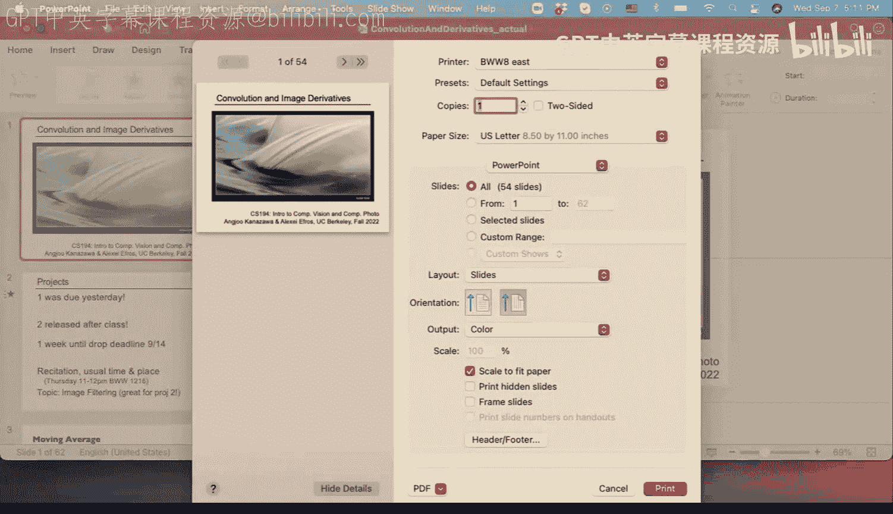
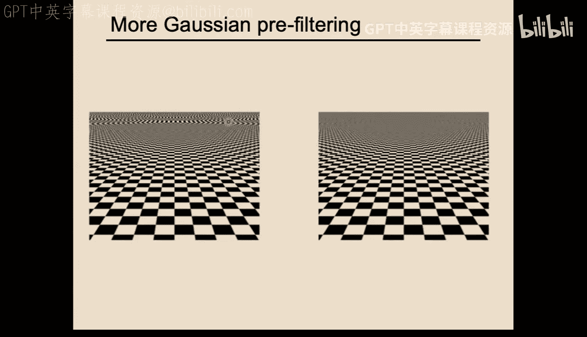
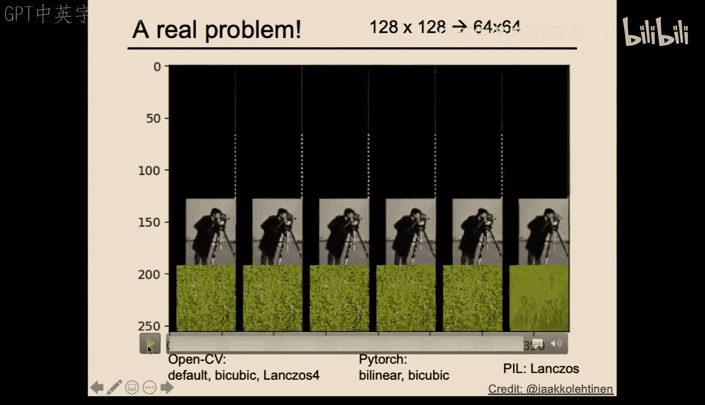
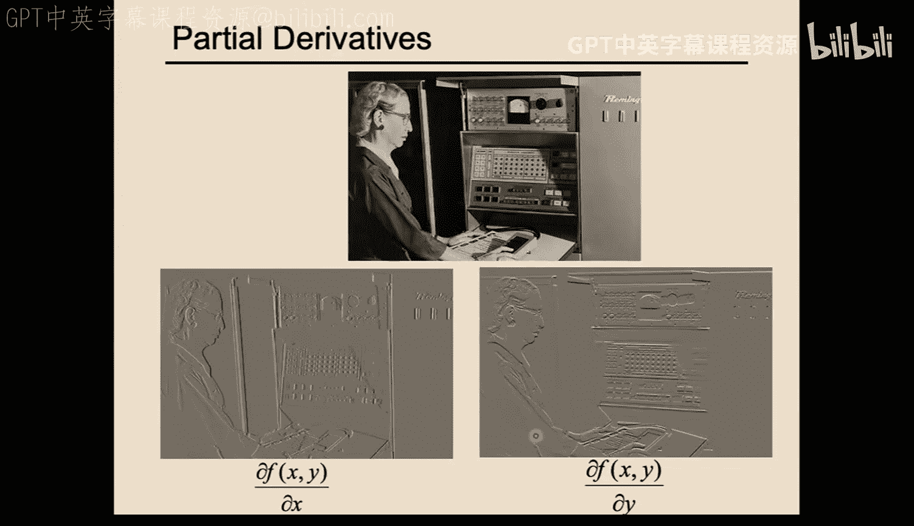
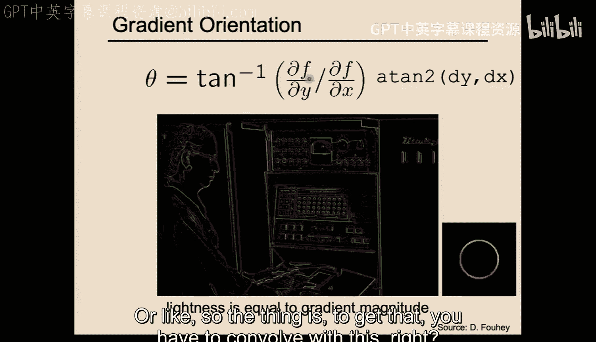
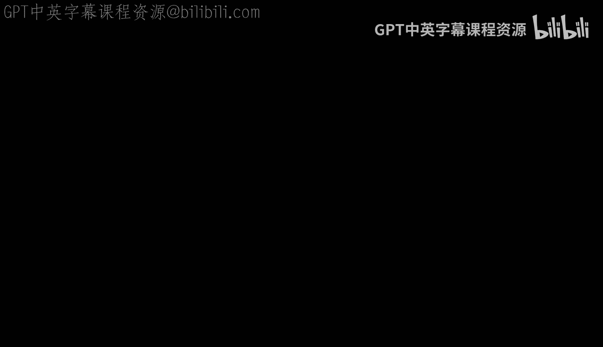
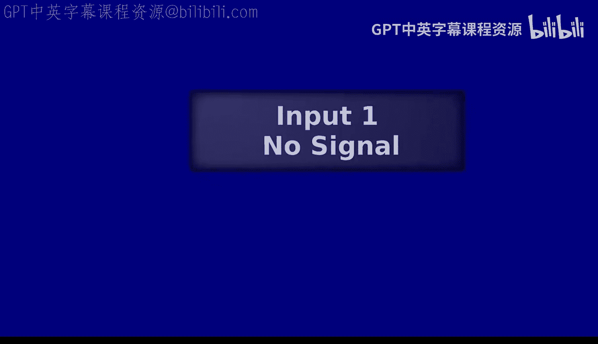
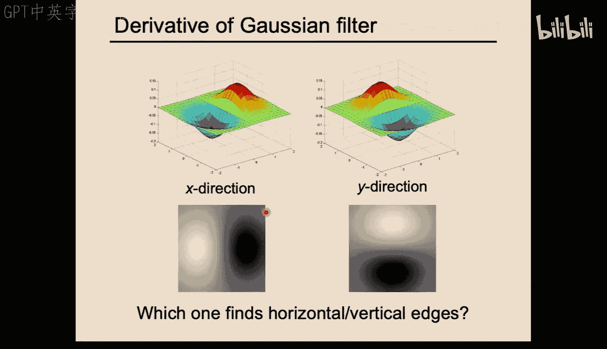

# UCB《计算机视觉与计算摄影学｜CS 194-26 Computer Vision and Computational Photography 2022》中英字 p04 -P04-4_Convolution and Image Derivatives-clean.zh_en -BV1w7UfBdELA_p4-

Thank you so much。 amazinging。 All right。😊，Okay， perfect。I didn't have this microphone。啊啊。

It's working。All right， okay， perfect。Okay， so project。Project going new yesterday。Yeah。比。Was it。

 was it， How was it， Was it good， It was all alright， It was fun。 Okay， that's great。

 And the project。😊，It is released after class。ok。So this is an intense class， it is， you know。

 going through 194，26 is like a， you know， Ba honor。Okay， so it is gonna be intense。😊。

So if you found the first。Project hard。You know， something to keep in mind is that a week。

I'm still the drop deadline。For you to consider。There's more people in the waiting list。Okay。

 recitation。😊，Happens at usual time and place， which is Thursday at 11 AM to 12 PM at BWW first floor。

 And this week's topic is image filtering。 and it is great for Project 2。😊，So， please go。Okay。

 any questions。呀。These tensions， I don't know if they're recorded， but you can ask them。

 They could record it， but I'll leave it up to them。 They are。 thatsar。 ask Riang or Yvonne。Okay。

 Ivonne is from Austin。 and she was like， oh， this heat is not， It's not even a real heat。Okay。

 so let's just get started。😊，So where were we last time， Because it was the long weekend。

 I hope you had a nice long weekend。 It was so hot。😊，Couldn't do anything。 Okay。

 so we were looking at this moving average。 Alright。

 where you wna take the small regions and you w to do compute the moving average。

 We talked about how to do this as a linear algebra using vector multiplication and some top product。

😊，Okay， and we were talking about how theres this one crazy bump。That is coming at you。

 this one outlier。 and you don't want to be surprised by this one。 So's a good idea to wait。😊。

When you take an average， you want to wait away the far furthest away points。

 You don't really want to listen to it too much。 So that's why you。

 you want to do something like Gaussian。Okay， and then we were talking about how in 2D。

 you can compute。 So what is the moving average filter， this H。

 What is the shape of H or what's the values in H。You know what， From now on。

 I'm gonna bring candies so that when you ask questions， I'll throw it at it。😊，Okay，8。

What is the value of age。Oh one。Okay， wait，s。No， no， no， you're right。 for moving average。

 I guess there's no answer here。 It's all ones for， for just move as for for， for， for box filter。

 And for the Gaussian， it will look like this。😊，Okay， and you wantan to average。

 you have to divide it by the total sum of these weights。Okay。Alright， then And then， okay。

 and then we were looking at the difference between the average。

 like the average filter and the Gaussian filter。 Oh， could you please turn off the lights， please。

 thanks。😊，Yeah， and then you can see that there is this kind of artifacts here。Okay。

 so that's not really good。 And so we want to do Gaussians。 Okay。

 any questions before we start talking about this。All right。Okay。

 so this is where the Gaussian comes in because you get to wait the center and then download the things around it。

😊，And this is， you know， has many， many nice properties that we will see this again and again。

Let's see。 So this is what， like indireet 2D grid the Gaussian looks like， okay。😊。

That thing on the right， This is divided by。16， probably or something like that。Okay， and then。

The parameters of Gaussian is its sigma， which is how peaky it is。So what。In the limit。

 if the sigma becomes like super， super small。I speak a little louder。Exactly。

 it just becomes like the deelta function where it just gives you the value at the center。

 Then what if the sigma was infinitely large。😊，Yes， we must uniform。 And we get the box filter。Okay。

 and so。In the box filter， where it was 1，1，1， like everything one。

The size of the kernel determined like how big of a space in which you want to average。

 But with Gausians， it's really the sigma。Okay， so signal is the size of your kernel。 So。

 and then you just wna make sure that your box or the， you know。

 the size of the kernel is big enough。We' come to it。 but let's look at some examples。

 So you take this image of this owl。 You filter with this one pixel。😊，And is there any difference。

Yeah， you shouldn't see any difference because it's just the Dlta function。

And then as you increase the sigma， you get this much， much blurriier image。O。All right。

So then really， Gaussians are supposed to be like an infinite thing。But， you know。

 you don't want to store all the way through。 And then they're gonna become really， really small。

 So you just cut them around。 And so this is like the kernel with the size of the kernel。

And you just want to make sure。That it is。The stigma is the main controlling parameter。

 And you need to make sure that the kernel size is approximate。And there is， there's a rule of edge。

 rule of thumb。 So you should set the filter。About half a width。To about。3 cinemaigma。O。😊。

So there's like， you know， during you， during your project。

 you're gonna have to blur your images and you're gonna pick some sigma。 Okay， and you're like， oh。

 how should I set my kernel size， You can use this。As the。Is this kind of rule of thumb。So， so。

 so let's look at these two sigma， to， two Gaussians。

Both actually turns out not to be a very good Gaussian colonel。

Can someone tell me why this is not really good。Yeah， you mean like。我。Exactly， exactly。

 it's too tight， too tight。 You want a little bit more outside。

 And then how about this one conversely。Is not that great。 Like， what is the negative， So this one。

 on the other hand， is okay because it has all the zeros， but。回复。Exactly， so it's just， you know。

 it's just gonna take a lot longer to convove with something like this。

 And so you might as well clip it a little bit。😊，And so this is why you have this kind of rule of thumb of how you should be setting these kernels。

Okay， al right。嗯OK questions。要。发一。呀。あい。I think it should be the same， but it's。

 it's our eyes unique thing， isn't it。嗯。は teleカな。😀啊哈。😊，So， okay， let's just say。

 I think it depends on how this Sigma 1 is defined。

 If it's a single point in the all the kernel and the kernel is all 0， but the center。

 it should definitely be the same。😊，Yeah。It's possible that like， this is， I don't know。

 I think it should be the same， yeah。O。Good question。Okay， all right。So， then。There's lots of math。

 but we don't have to worry Well， we're gonna break this down。

 But let's just talk about cross correlation， which is what we've been doing。

We talked about this in last class， right， like this dog product。All this situation where we wrote。

 you know， you， we wrote the vector， we wrote the kernel and you take the dot product。

 That's kind that's cross correlation。😊，And now we're going to talk about convolution。

 How is it different from the convolution， And convolution is what we're mainly going to use because it has a lot of nice properties。

 But before you stare at this， let's just go pictorial。 What is the convolution。 So this is the。

F for the signal image that we want to smooth out or convulve with some kernel H。

So what does convolution do， Convolution does this。Flip thing first， upside down。

And then you flip it again。And then you take this kernel。

 and then you just do the same thing as cross correlation where you scan this through。😊。

To get this outfit。Okay。W， why are we doing this crazy thing。We will see。In a little bit。Okay， so。

Yeah， why do we do this crazy thing， We should just do it on the board。 Okay。

 let's just do it on the board。Here， we're gonna do some lots of blackboard in this class。

 And unfortunately， can you， can you。If I write here？Like everybody in class， you can see it。Okay。

 so let's just do some blackboard math cross correlation。O。So let's just make a signal。Say like 0，1。

2。O。😊，0，1，2， And that's our。啊，哎。Okay， and I want to do cross correlation。Cross correlation is。

Cross correlation。But say， like1 minus-1。O。So。Let's try to do this。

So then what do you do is you take this kernel。It is the8。This is the filter or not， no no。

 This is the signal。 and this is the filter， this is the kernel filter。 Okay， so you write this here。

1 -1。 You multiply  one with 0。😊，What is this。Native one。You do that one minus-1 here with one，2。

 and this is。😊，Negative one。Okay， I think I need another0。So then the d1 -1。be true。Okay。

 so the output of this is going to be。M-1，1，2。Okay。All right。It's not the same as。What I wrote。哎。😊。

Oh， you know what。 It is because I did it with a -1，1 filter。 That's fine。 This is more exciting。

 Let's see if this works。 I it might not。😊，For some reason， but we can read again。

I might have on accident selected a special case。😊，Okay， so now we're gonna try flipping this。 Okay。

 let's just say。That the ages the ages like this。I'm gonna make 1-1。-1，1。Of my filter just flip this。

Okay， and then compute。Cross correlation with 0，1，2。O。😊。

So now we just have to center this this thing。 So it's 0，1，2。And then they just pad this side with0。

 So they basically， this is12。 And what is this。How it works。1。Yeah。

 and then let's just put this in the middle。Like 0，1，2。So this is 0 to minus-1，1，21。😊，And I get one。

Okay， so this is one one。Okay， let's just ignore the third thing that I made over here。

Let's just ignore this number two， because it doesn't really fit。 Okay， so all right。Okay。

 so I come the first one with this one，-1。 and I got -1，-1。😊，But they did the same thing。But。

 justs flip。The locations of each other。And we got1，1。Okay， we did。

 did we not do the computation properly。Why， why， why， this is 1-2， So -1。This is-1-1-1。啊，给点位。誰だ？

I accidentally flipped it。 Thank you for pointing that out。 This is why blackboards are difficult。

 Oh my god。😊，Okay， so what is this。0，1，2。So this is got be -1。And this is going to be  minus-1。

Filter where this is actually works。 Oh my god。This is not。啊。This is an unlucky situation。Okay。

 let's just do it again。 You， we get to see。哎呀。Pick the good feel。

 Good H that is actually commut by accident。 So it can happen。 It can' be commutative。

 but it's not always。😊，Alright， let's did it again。Okay， it again。I I think it's one one。ok。啊。

What is that。1。And this is gonna be。3。O，1，3。Okay。And now， this is one，1。Okay，0，1，2。

So this is gonna be。3。And one。I oh， you know what。 I， I feel like I。Maybe that was confusing。

 Actually， there was a change in sign already over here。 But anyway， this makes it more clear。

 alright。😊，Okay， so on the top， it was 1，3。And in the bottom， it's 3，1。

 Maybe you can't see it because of my computer。 Can you see it， okay。Okay， so this is the problem。

 which is that in cross correlation， it's not always the same。嗯。

And then we can do this again with convolution。😊，And then we will see that。 it's the same thing。Okay。

 but I w to keep this。 I'm trying to see if we can。Bring this up。Can I in。Ching the。I see。

I can't really do this。 So we have to do this。On the other side。嗯。OK呃。Yeah， so， okay， so I， okay。

 so let's， let's do it over here。So啊。Okay， so what what is， can you read me the F， What is the F。嗯。

0ro， one， two。And now we want to do convolution or you could just write it， you write it as a star，1。

 one。😊，Okay， now this case is one one is special because like。

 now you're gonna flip this and apply this。 But this is exactly the same as cross correlation。

 So we know that this is。😊，1，3。As on the right。Right。So let's do the other side。Which is0。1，2。St。

 okay， star。我 no no。嗯。Flip this。 fliplip this。 Okay，1，1。Convold。With 0，1，2。😊，O。

But now this is a convolution。 So I'm gonna flip the filter。😊。

And so I'm going to multitply this with 2，1 and 0。O。So then， this is going to be。1。😮。

And then over here， it's gonna be multiply by 2，1，0， which is going to give you 3。😊，So in the end。

 this is going to give you1，3。啊。So now we have a situation where you can flip the filter and the kernel and change this order。

 And then you're going to get the same。Outbit。How the euro。Yeah， well， okay。

 so what I'm doing is I'm just going to center。😊，Center the center the kernel at every single point。

 And like， whenever there isn't anything， I'm just adding the zeros。Yeah。

 it is a little bit weird with the old kernel。 If we did it with w， w， w or something。

 I think it would be more clearca it would be the same pattern。😊，Yeah， in in general。

 you like the odd because odd， you can always center it。有。呀。O。😊，Good。On this。Question， yes。

If the filter has， I think， okay， whenever the， if the filter has four number。

 we will just keep on going。 We'll just apply。哦， it just。不的明意是。You mean if the age is4。

I say if this is longer， you will just， I mean， you can。

 let's just do the odd case because the odd case is just easier。好不好。嗯。O， well。If there's another one。

 we， we will just have a three here。Okay， you put 1 to1。 And so this is gonna be like 5。😊。

With the bottom， if there was a three here。You will also do three here or be 3 to 0，1。😊，Okay， I mean。

 we can't center this。 So that's why it's kind of like annoying。 Yeah， that is annoying。

 But you just have to pick in the middle。This is why all， this is why like。in this case。

 you just pretend that this is a。Like， this just extends with 0。And then in this case。

 you can't center it。 So just pick some alignment。有。Yeah， you just， yeah， just pick some。

 this is why this is why it's not really good to have a even kernel。 It's kind of annoying。

 You basically， okay， okay， the right way to think about it is if the kernel is even and you can't really center it what you're really doing it is you're computing the like response in the middle。

😊，Right， if you just think of the space as like subpixel， then the actual responses at the middle。

 But then you can't like show that result。 So then you'd have to like， you know。

 show one or the other。 So then it's kind of like， the same。 you know， you clip it on the other side。

That's fine。 That's fine。Cross correlation。 Yeah， okay， in the cross correlation， when I flip it。😊。

You don't do anything to the age。 But when you do convolution。You take the H， and you flip it。So。

Over here。I didn't really show the flip of the H because H flipped is still one1。Right。

 so top top is fine。 And here it's 0 on 2。 But then when I apply it。

 it's actually flipped and becomes 2，1，0。😊，Yeah， you always flip the second one。No， you。

 you don't need to flip the first one。Just flip the kernel。Not it， O， so。In this one， F is one one。O。

 and you don't need to search。No， you flip on the left and you flip on the top。Not diagonal。

 but you just do like mirror once and it mirror this way。Yeah， like here， just exactly。 like。

 So age is like， this is why there's like a lie at the bottom。 You flip it upside down。😊。

And then you flip it left side up， lift or right。Yeah， it it is a symmetricrical letter。

Li littlettle different。Right。Okay， okay。Not in this time， O。Okay， so。

What you're saying is that you can really flip the signal and the kernel like A A convolved with B or B convolved with A。

And it's gonna be the same。 So it's like， you know， it makes it really like a multiplication。

 like process。And it's just like， you know， mathematicians found out this nice properties like， oh。

 you wanted to cross correlation。 But then if you flip the order。

 you actually get the different answer。 and then theyre like， oh。

 you can just flip this filter and then apply it。 Then then you're gonna get the same result。😊，So。

That's the nice thing about convolution。It's also associative。😊，As in， like。

If you're going to take an image， right， and you're gonna blur it1 Gaussian kernel。

 But then you also want to blur it again。You can first convolve the Gaussian filters together and get a new。

Kind of like a super filter。 And then use that。 And then you're gonna get the same result。So。This。

 this is socialciivity is really nice， because。😊，You can really save on your computation。

 So some say suppose a is like very， very big， like  thousand24 by 1 thousand24。

 But B is only like 30 by 30。 Then doing convolution on 30 by 30 kernels is much faster than doing A to B and A to B2 and A to B 3。

😊，Okay， so that's kind of， we will see that。 And then you will implement this later。Okay， so yeah。

 so in， if you， if you're in convolution， you don't have to make a difference between filter and the signal。

 Like what is H， What is w， What is S doesn't really matter。Okay。

So we'll see that it has all of these nice properties。 Okay， so then maybe if you took182。

 you learned about convolutional neural networks。😊，And maybe you， do you know， what do they use。

This this convolution on neural networks， is it。Actually수 or is it。They， they actually。

 it's even more annoying， which is that sometimes they use cross correlation and sometimes they actually do convolution。

 And so depending on the library you use， you don't really know what is happening。 But， yes。

 they mostly use cross correlation And in， in in CNN confidence concept or in that framework。

 why can you use cross correlation and not convolution。😊，Why do they can。

 Why can't they be so like a daical about this option。呀。嗯。😮，Another is simpler as， simpleimr answer。

Exactly， they're learning the filter。 So it doesn't really matter。 you're not predefining the filter。

 They just learn the filter to be whatever they want it to be。 And there it's always， you know。

 you don't ever convulve your CNN with your images。 So it doesn't really matter。But yeah。

 you're learning them。 So that's okay。Okay， so that's convolution。And。So， Gaussians。

Is a low pass filter。 I mean， this is the context in which we were talking about。 Remember。

 we were talking about aliasing， right， aliasing is when you look at the image and you like subsample or。

 you know， you sample the image and you see stuff that wasn't there。

 And this is why it's called aliasing because it's pretending to be like someone you're not。

And to prevent dailying。Because you don't really want to be fooled。

 You're gonna do this average filtering， which will give you the， you know， average， on the average。

 you're correct by removing the， you know， high the actual information。

 So that's really called the low fast filter。 And we were looking at the average kernel。

 But then the average kernel is kind of sensitive to these edges。 So we were like， let's do Gausians。

 That's where we are。😊，Okay， so we want to do low pass filter。

 which is all which is gonna come back over and over again。Can any questions at this point is good。

If you forgot about it， if you weren't here last time。Feel free to ask。呀。Yeah。

 that's the second thing。 So convolution， the Gaussian is super nice because you convol Gaussian with a Gaussian。

 and it's also a Gaussian。 It could be a different Gaussian， but it's still a Gaussian。

 but with just different sigma。😊，O。So that's another reason why it's nice。嗯。

So basically convolving twice with the Gaussian kernel with W with sigma。Will be similar。

 same as convolving one。With a kernel a width that is slightly bigger。

Which is this thing on the right side。Okay， so this is the。

Kind of speed up that I was talking about instead of doing this with an image and that with an image。

 you can do this once and do that with an image once。Good question。 There is no difference。

And I did all of these things， but it's not difference with Gaussian because it's symmetrical。

 It's just like the one w。 And I didn't have to do it because it's the same。 It's。

 it's just basically the same。O。O。Alright， so let's look at the actual examples of why aliensing is bad and the need to do this lowas filter。

Okay， so this is a really， really big image of Vango。 And we w to generate a smaller image。Okay。

 so what is the， tell me the dumbest possible way to reduce simplest way。

 It's just the simplest possible way to reduce the size。Re。Keepaping most of the information。

Take个 screen shot。😊，哎，这要。Fixel， I heard every other pixel。 great。 So let's do this。

Throw away every other row and every other column。 And then you can create this half a size image。😊。

So this is called image subsampling。So that gives you one one heart。

Let's do it again because I want it smaller。And then smaller， you can do that。

 Just take every other pixel。Okay， but then if you do that。

And then if you just zoom into each of these images， you start to get something like this。

 which is all these terrible things that's happening in the image。 You look at this。

 all of these blocky artifacts that wasn't really there in the beginning。Right。This is not good。

 This is， what is this called。Yes， this is God A thing。 Allright。嗯。What do we do。A't I aliasistic。

 Yes， aren es， Yes， yes。 How can we do aren aliasistic。😊，O我老吧。Viilin yourself sampling， okay。

 that's another good debate。 That's one other way。 So， okay， well。

 let's look at this in detail again。😊，Okay， how does this happen。Suppose you use。This sampling。

And this happens to be good。Okay， this is just taking lots of samples。

 and you take average or something like this。 Okay， wait。

 this is not really changing any image sizes。 Okay，4 to 4， This is fine。

 All of the signals preserved。 But the moment that you reduce the size。😊。

You get these weird situations。 This is why aliasing happens。 Okay。

 so because you're just unlucky with where you put your signals。Okay。😊，So that's A thing。Okay。

 so the solution is。你在哪地啊？Exactly blur it。 Okay， so you filter the image once and then subsle。😊，Okay。

 and then if you did that， that's the result over here。Which is， you know。

 you feel blur at once with a small Gaussian， and then you take every other。

 and then you do that same。The filter size should double for each half size reduction， y。

This is like the amount in which you。嗯。Come above。The amount in which you the the。

 the sigma of the Gaussian。why should we increase the filter size。For each one size reduction。有。Yes。

 exactly。 because the the smaller it goes， it's actually， you have to， you have to come。

 you have to average in a bigger， bigger location。😊，要。1三。This by have。Yes， you can have this Mr。

 Shannon relationship。 Yes with this yes， yes， yes， that's thats a good。

 that's another good way to think about it， yes。😊，Okay， so here are some results。Gussian。

 the results are now。 okay， it's blurry。😊，But at least you don't really see kind of weird stuff。

 So this is before， and this is after。Okay， great。Okay， so let's just show you another example。

 This is an example from 1，84 to。 This is in particular， whenever you render。

 you have these checkboard that you want to render and the stuff that this is filtered and this is not filtered stuff。

 you know， far further away because it gets really， you know， close together and small。 you can get。

 you can get misalignments。😊。

I have another really good example。 and this is really interesting because you are learning about this very important concept called aliasing。

 And you're like， oh， you know what， Ad should know this。😊，Right， and so so all the libraries。

 like open TV or Pythtorch。😊，You know， your favorite pyths， when you do your， you know， CNN。

 when you do your deep learning stuff。 Of course， they know this。😊，But， they don't。

So here is the video。 Oh god。Here is the video。Okay， so what I am showing。 so what。

 what is being shown here is that， first of all， these are different images。

 just to illustrate the how the problem happens over different image types。 Okay。

 and this image was originally 1，28 by 1，28， and you reduce it to 64。😊，Okay。

 so this is a reduction result。 And the first column is using the default option of in resize half in open C。

 The second one is bi cubic。 and the third one is La Lachoos， which is supposed to be anti filter。

 anti aliasing。 This is bilinear。 is bi cubic。😊，And then the final one is the PI Ls Laos， which is。

The the， the anti alias filter。 But， and then this is being moved because the motion really tells us what the noise is。

 Okay， because alias gives you all these noise。 And as it moves， it's just so obvious to you。😊，Right。

 like， you see all of these patterns。Bt again。Right。

 and then you can see that in this version in the last column。嗯。It's blurriier。

 but you're not getting any of these weird flicker。

 but you're having all of these flickering because you're not doing antialliaing properly。

Okay， so it's really， so there's， there's a really nice paper by one of my colleagues who is Alyosha student a while ago who graduated。

 Richard Zang did this。😊，Problem this is this。Paper where this is like， say。

 like baseline Pytorch convolutional neural networks。Okay， and if you do antiallia thing。

 which just means Gaussian。Filter， and then youre on CNNs。

 you can see that like as you move the image， it's a lot more stable as opposed to because of aliensing。

 the baseline is so。😊，Sensitive。 And so whenever you're doing your confidences。

 maybe like for Project 5， you can do one Pip install and make your confidences better。😊，Okay。

 so this is a real problem。 And people tend to kind of neglect the signal processing me like。

 how important can it be， It can make a difference。O。All right。So。Like I said。

 you can take one Gaussian， You blur this， You run it against the big image。 get this one。

 You can take another Gaussian。 that's a little bit bigger。

 And then you got blur this again to get this one。 and then you can do it again and again。

 But how can you speed this up。😊，Oh， how can he speed this up。I think I， I said the right answer。

 Okay， I said the right answer if you， okay。😊，If you guys didn't catch it。What I just described， yes。

😊，is呀。I just describe， ya yeah。Yes， okay。 that's a good I。 That's， that's good tube。

 this is slightly different。 So what I just described is actually the fast answer。

 So maybe you can think about the non fast answer。😊。

So what did I just describe what I did what I said was take an image。Take action convol it。Okay。

 get the smaller image and then subs samplele and get the smaller image。 Now。

 take another gas on this one and then run it on this one and then subsample it。但。

Like this iterative kind of procedure that I just explained， which was so natural。

 So that's what I said it。 But that's a faster way of doing it。 What is the slower way of doing it。😊。

Like， none。Kind of like recursive or just， just like the pretty simple way。Exactly。

 every single time you do it on the original。 You just take one filter， and then you run it。

 take a bigger filter， and you run it on the original image。 And if you did that， that's very slow。😊。

我。こ don to beたて。要有个对到。Yeah， I think you could do that。Yeah， if you're going to take every other。

 but I think it's just easier to just。要的对。要。Oh， they are。 It's possible that they are doing this。

 but you don't really notice it so strongly。Yeah， or it could be that， you know。

 you don't really see the aliasing too much， but it's probably doing something like that。对啊。O이 야。

That's a really good question。 And we're gonna get to it。 There's many kinds of lowas filter。

 And it actually turns out that Gaussian is not the ideal in the theory sense。😊。

But we're gonna get to that in the next lecture。 But the answer。

 quick answer is this Gausians are nice。😊，Okay， it has nice properties。

 Like you can conulve Gaussian。 It's still a Gaussian。 And it's like kind of relatively flat。

 So you can cut it。 and then itll be okay。😊，对啊。Like a really good low pass filter is really。

 really long。 It's infinitely long。 And so you can't really cut it。 And that's one of the。

 that's the one that's know。 But， but we'll see that next， next next next next week。Okay。

 so what I just described。Is this thing called Gaussian pyramid。And somebody said this thing about。

 yes， like， you know， this property of our sociativity， This is why we can do this。 We can convolve。

😊，The level 0 with one Gaussian。Okay， and then take Gaussian and then convolve it again。 the。

 the output convolve the outputs to reduce it。That's really because you can actually， you know。

 convolve Gaussians。 and it will still be Gaussians It nice， nice properties。

 That's why you can actually do this of。Convolution， okay。Okay。

 this is also known as Mimap in computer graphics。😊，And so let's look at this。

 So any questions about this procedure， right， I think in in your project。😊，You did this pyramid。

 right， pyramid of to search over。And so you should have made this， you know。

 when you reduce the images， hopefully whatever algorithm you use to make the pyramid is doing this。

Okay， so let's look at this。嗯。So this is like the original image。And this is the reduced one。

 And then the one， after one， after one after。😊，So that's the kind of pyramid that you take in。嗯。

So how。Yeah， I mean， this is how it's made。 guess。手哈哈。😊，Yeah， so how， how do you make this。

 It's like you take original signal， you convolved it。 That's what was your filter mask。 Okay。

 and then you dropped every other one。So you're dropping this guy。Okay。

 you're up and you ignore that one。 So you got much subsampled， smaller image。

And now you're gonna convol that one。With another Gaussian。And then repeat。O。😊。

And you can just do this until the minimum resolution is reached。And the magical thing is。

This whole pyramid。You might think， right， Oh， instead of keeping one image。

 I have to keep so many images like this。Right， because I need to make sure that I'm， you know。

 some sampling properly。isnn't it expensive。And it turns out that it only takes4 third the size of the original image。

And。Any guess， I mean， it's not that important。 It's just a cute thing。 I mean。

 you can intuitively get it， right， Like， this is the image。

Right like this is a yellow in the original image。 and you reduce it to this purple first。

 like the one，11 half，1 half。😊，And then you'd put it like this。

 So you can kind of like visually kind of guess that if you like， rearrange this。

 this is not gonna be more than。Like。You know， four thirds of this thing for like four thirds of the original image when the four includes the one goes through that original image。

 So everything fits in a third。Third of this。Right， and the third is like this pie。

 So you can take these purple and you can kind of like align it。 You can kind of think about it。

But the mathematical way of thinking about this， How， how yeah。Yes。It's a geometric series。

From your favorite， the high school of math。Exactly， so in this case。

 what is the ratio every single time you're reducing by how much。One fourth。Yeah。

 and then then the geometric ratio， geometric series is like。😊，啊。I I mean， you guys。 I mean。

I don't anybody remember the geometric series of the。😊，Infin。Right， A R。Right。

 and then this is approximate  to。A over 1 minus R。And then in this case。For R less than one。

 And then in this case， the R is1 over4。A is just one。So， then you get。You know，1 over three over4。

 and then this is4 over three。So。Your。high school math。O。Great。Okay， so it's not that heavy。

It's not that bad to make it because you can just make it successively。So why is this good for？Yeah。

 like， so you used it in project 1。You know， you search over translation。

 You can do course define strategy。So， you know， if it's too much to do like your 4K images in the tip。

 like， you know， you had to do this or that was helpful to do it。Okay， any questions。Are we good on。

Are we good on。Convolution， insions。Okay。Okay， now we're going change it up。And talk about。

Driivative。啊。Driivatives。Okay， we you， what nice thing about the convolution is that you can also compute the derivative with convolution。

Okay， so let's do that on board。So who can recall your high school or not high school。 I mean。

 this is high school。 right， I don't know。 Maybe this is a calculus。 how。😊，Okay。Anybody can tell me。

What is the definition。Of I got of derivative。Yes， what town wine。Okay， and。

Can we write this in this， like。How is the expression？ How do you express this。What is the。

So how do you compute， How do you compute the tangent line。Yes， so you have。Some F of X。

 then you take some Epson or some deelta。And then你 minus。The F ofX。

And then you're divide it by this delta， and then you pick the limit。Until this goes to。0。Okay。

 all right。 So this was this。Definition of derivative。And you guys can say goodbye to this。

We don' have to。 We don't have to worry about this at all。 This is not useful for computers。😊，ok。😊。

first of all。Computers， you know， you can't really do this limit thing。It's not continuous。So。

 you know， we image is discrete。 So you should really forget all of this thing。

And we're going to think about how to think about image derivatives。啊，没。啊， in啊。Victor。

What we want to do。Is not to take a derivative of this continuous function。

But we're going to get something。Like a vector， because it's， you know。A discet thing。

 So now I'm gonna follow my notes so that I know mess up this time， okay。Let's say。0，1，1，2。Okay。

 that is my image。 or let's just say1 D vector。What。😮，It是的。嗯。Convolution filter。

 if I want to compute the derivative with a convolution on this vector， what is the filter， What is。

 what kind of filter would I use。 maybe I shouldn't have。Deletd。辩说完。If of x plus epsilon minus。

F of X。Actually， let's just do this。Okay， so， okay， so let's just dissect this and get rid of this。

 Okay， so we don't have any of this limit business。

What is the smallest step you can ever take in a discrete vector。Exactly， so that's one。

 So you don't need that thing。 You don't need the denominator anymore。

 And so then it's x plus 1 minus x。Okay， so then can you think about what is the filter H。

That you would use。To convolve this image， to compute this。Yes， one negative one。😊，Perfect。Okay。

So then let's do the convolution。Again， okay， we're gonna get to this like weird situation of like。

I don't like this even Colel。But the even kernel， basically， you're gonna align it to here。

Where basically the center is here， right。You're kind of computing it for this thing。

 And then this is what0 to 1 and -1。😊，We do it again here，1 minus-1。Whi is 0。Over this one。-1。

 which is-1。有。So then this game us。-1，0，-1。Okay， now we've computed。The derivative of this signal。

Yes， I have to flip the kernel。 Yes， but let's just say that the derivative is -1 to1。😊，Okay。

 so everybody， it's just like a flipping thing is yes， yes。 You have to flip the kernel。

 But it's this thing that's the flipped kernel。😊，O， so。😊，We got -1，0，1。

So we computed the derivative using convolution。O。So。Any questions。呀。Thank yes。 thank you。对。Oh no。

 okay， okay。 alright。😊，I see。 I see。Okay， I'm glad。 Okay， alright， Okay， let's see。😊，Right so 0，1，1。

2 is my signal 1， I'm just gonna say。😊，Let's just say-1，1 was my filter。 I call flipped it。😊。

And I applied it there。 Okay， let's just be coher then here。😊，But then that's the right thing to do。

Cause I flipped it。You get -1，0，1。Okay， and the thing。

I want you to really think about derivatives in an intuitive way。😊，Okay， okay。

 maybe because we're gonna this wasn't 1 D。 Okay， we'd have to do it in 2D。But it's the same thing。

 Yes，有。Are you suggesting a change to the kernelel。Yeah， yeah， yeah。

 I think what you're saying is gonna come up in the next next slide。So。That was oney。

We're gonna get there。 So that was one day。 Okay， but we can also do this in 2D。😊，And that is called。

 remember this。The gradient， but D， F over D X。Is partial derivative。Yeah， and then the same thing。

 you can't take any epsilon bigger than one。 Epsilon is the smallest epsilon。 You can do one。 Okay。

 and then so you can do this。 So that's， I think， what you're asking。 right， instead of -1，1。

 you can do-1，0，1。 Like why would you choose1 over the other。😊，Both are valid。

So this kind of comes into the question about the edges that。We were talking about。

 why would you use this one， What's nice thing about this one。Exactly， it's odd。

 And then it liness up。 And like， remember when I was doing this， I'm kind of like putting it here。

 But that means I'm really like kind of doing it in this in in betweentwe point。

 And it's kind of like annoying。 So you could do this one where it's like nice and odd。

 You just always apply this。 It's nice。 and it's symmetric。 in that sense at the center。 I mean，😊，O。

 but it's a little bit more compute。 Maybe the difference is further away。

 So it's like a little less。 but it's either is fine。Okay。So。

Here is what the partial derivative of an image looks like。嗯。Okay， so here。

 I really want you to think about this intuitively because it's not that complicated。

 It's really about like， if you're walking on the hill， which direction is the strongest。 Okay。

 so I am living in I can't fly。 Okay， so basically the position space。 I can go is 20， right。

 I can go this way or that way， okay。😊，So what is the derivative in front of me。Yeah，0，0。

 cause it's like super flat。I guess if I was， like。supposeuppose that staircase was like， you know。

 slope。 That means I'm going up on the derivative on one direction。

 It depends on my coordinate system。 What's my X and what's my Y。

 But that's how you can think of this。 Okay， maybe you can turn off the light。 again。 Thank you。

 I don't have any more。Board， so like， you can think of the tiger as like a surface， right。

 you think of this as like a mountain。😊，B is。L， because 0。Right， white is 2，55。

 So that's like the peak。Right， so you can kind of think of this as you're a little person。

 You're like kicking a hike up this tiger。Right， you're like， whoops。

 it's suddenly I'm on this like super black bar。 There's like super low。

 I walk on the black bar and then whoop。 there's like you white thing。

 It's like a very strong cliff over here。😊，So that's what you see， really。Okay。

 and then the same thing on this direction。 If you're here and you're walking that way。

 there's like a strong change。Over here。 So that's kind of what's showing， so。

Which shows changes with respect to X。呃。Remember in somebody asked this for project 1。Then why。

Maapsu Roan Colin。Right X is going this way。So changes with respect to x。 Which one is it。

 iss it the left or the right。Its left on。 Yes， so the changes in with to X gives you this vertical line。

 which is kind of weird。 But if you think about it， it's。Kin of makes sense and。So。What is。Yeah。

 and so this， this thing is -1，1。 Like we talked about it。How about the one on the other side。Yes。

 transpo is like 1，-1 or1。 both can be either flipped or one or the other。Okay。All right。Okay， so。

 so this is the gradient of the image。 So you need to think about the this。 So this， this one。Okay。

 so you can think of this as really strong hill up really steep hill over here。 That's very tall。

 You're starting from a low place， and you're walking up。😊，Okay， so which derivative。

 which which gradient is the strongest here。1 is 0， and then one is。

 there's the gradient on one side。Which side is 0。Why， why is0。Or you basically。

 there's a lot of change in X。 Okay， how about this one， A lot of change in。喂hy。This one。不。O。😊。

So the gradient points in the direction of most rapid increase。Next time you're on this campus。

 And as you walk down， you should think about is my derivative， you know， I it。

 is it just one or is or is it like， you know， is it in both。

 I it activated in both or is it only activated in X or Y direction。😊，O。😊，Okay。

 so we saw how the direction related to the direction of the edge。 It's like， you know。

 changes in X's gives you vertical edge。Okay， so gradients give you direction， right。

 What gives you the strength。So there's like a hill， very big hill and like a very， you know。

low Hill。Or somebody said something。Yes， the magnitude。

 So the the strength of the change is given by the gradient magnitude。Which you can basically。

 this is the direction， right and。I'm trying to find the place in the room。 That is。

Has the strongest gradient changes。 But， I mean， like the wall is very strong， obviously， but yeah。

 so you can take。The direction， you can just kind of think about it。

 How much does your uncle kind of points up。 And that's kind of like your radiance。 your。

 you're magnet when you're walking on the street。O。😊，We don't really have slopes in this room。

 So I was like， let's point to the location in the room that has the highest。Magnitude ingredient。

But there's no hill。 So it's all just。Just walls。Yeah。对吧。Okay， questions。Okay， maybe yeah。嗯。Yeah 유。

You don't really。 you basically look at the changes in x。

 and you basically look at changes in y and see all the responses。Yeah， that's a good question。

You can yeah。I mean， I， I guess you can do changes of access。

 change of coordinates and do it in that。 You can kind of orient your image and you can always know。

 define your access to be that diagonal one。嗯，不要。Okay， what is the gradient。

 What is the direction of the gradient given by。So you have a vector that points in the direction of the rapid increase。

What is the direction。Like， if you're， what is a direction like you're thinking about as in like。

Okay， I'll try to draw this big even though it's black， but like。Suppose you are at。It's origin。

 And you were like， you have this vi。Okay， the length is the magnitude。And what is the orientation。

 the gradienting direction of this。Let's please again。 Thank you。Thank you。😊，O。

So that is your gradient。I mean， that's just kind of intense way of writing it。

 but that's just your vi。Right， and the length of this is magnitudeed。要 what的是暗个。Yes。

 it's like arc tangent， Arc tangent。Of this thing。And that's， you know。Arc town of。Yhi over x。

Re like you know， your， your tri tri from high school。O。😊，Alright。So let's do this image gradients。

 So so here are the descriptions of this。😊，Okay， so somebody can tell me。

 why is my gradient image so great。😊，And why is the magnitude1 goes from 0 to one or like， you know。

 black。Ma can you please， Thank you so much。 Thank you so much。Why is it so great。Yeah， yeah， yeah。

 So， so， so gradients go negative。 And so0 gradient is basically， there is no gradient。😊。

Because I'm going down the hill， that's like negative。Okay， this is 0。 Like， this is F place is 0。

 So gray means 0。Okay， so then why is this one black and white goes from black to white。

All the values are positive because you take this， you know， you take the norm of it。Perfect。Alright。

 so here are some examples more。Right in the gradient。Can be negative。 And here's more examples。

 This is。

怎么给你 do。And this is the illustration。Of the orientation。If we made it into。We we added color。

 so you can see， right， so。😊，Like this， this direction， like a vertical edge。 Okay。

 has we assign the color red around this circle。都。You can see later in the slides。

 This is red because this edge is red。Okay， and then if you go on the， you know， the。

The horizontal edges are green。 so you can kind of get the feel of this。 This is bad diagonal。

 So it's kind of like this color。So you can visualize this。Okay， all right。Okay。

 so the next yes question。还为。然后说。I see so。I don't know if you have the filter。

 but like we did something， right， We had this like。You know，1，1，1，1，0，0，-1，1，1。

 And that was like this horizontal edge detector filter that we did in class。😊，Right， or or like。

 I I so the thing is。To get that。

You have to convolve with。With this。Right， and then to get the to get that。

 you have to come up with that。 So you're still doing it twice。Does that， Does that make sense。Like。

 it was like over here， I was like， I'm taking these two， two values。And then taking the angle。

 looking at the angle of it， Where did these two values come from， These two values come from。

 the response of doing this， this， this direction gradient and that direction gradient。

So it's not still like， it's not all in one go。 You're still like running two filters。我。Yes。

 you can definitely see it in Amez。 This is a very good way。 exactly， exactly。

 This is a very good way to visualize this。😊，A little caveat here， though。

 we are not showing the gradient everywhere。啊，没。I just want， if I did this。

 if I showed the gradient everywhere， you're gonna get an image like this。

Where you get every all the gradients。Okay， it's this so。So， so no easy。hy， why is it so noisy。呀。

Exactly， there's all this noise that you don't really see。 There is this， you， I mean。

 obviously in this， in this one， you see this， you know， there's a clear white edge。In this too。

 there's black， there's nothing， but it's really like the salt and pepper noise。

 especially with like older。Camerons， even your cell phone cameras。 The cameras are not， you know。

 cheap lenses。 You get all these noise from real world。 So if you look at it， our eyes don't see it。

😊，But there's a lot of noise。 And this is why you get all of these stuff。

And we're going to talk about how to get rid of this， but。Today， we have this pop quiz。啊慰。前で。A。

Let's say。对对对。But you can submit it by the end of course。But it's not。 don't worry， yes。Your phone。

De。Here。I will let you use my。Iadd。喂。Oh， there's no Internet。 Let's see。 are you lucky。 No， no， no。

 no， let's see。嗯。呃。No internet in this world， is it。Do you guys have intra maybe no， no， okay okay。

 here we go。Here we go， Cal visitor。呀。Here we go。嗯。O。O。Oh my god。 you know what。

You can just do it through here。嗯。

No， no， no。 Don't worry。 It's good that you don't have your phone。

 That means you are focused or your focus your phone is dead。 Okay， here。又讲。

And then Nor worries you can use them。My account， But it it stores the email and I D。

 so you can just write your stuff。And then if you're DSB， you can take until the， you know。

 end of class plus 15 minutes to submit， you can only submit one。So， don't。You know。

 you can't change it。啊。呀。Can you don't。 You can't You don't have Internet。See， I see here。

 Let me try。哦，yes， yes， yes嗯嗯。😊，This is a situation， isn't it， Let me。 Can I I， I drop。Airdrop。

 airdrop。Because。This is name宋 iPhone。Okay。嗯。嗯。Ct。O， okay， good， great。

How about you just take a picture here。Great。嗯。And let's see， let me log you in with another account。

All right。Even的是。The histogram， like a flat histogram。 actually。

 the classes is still guys still have some content。😊，は呀。干点で。哦，嗯。Well。

 I thought you guys might complain like if you did it in the end， people would be like， who。

 I have to leave to this class or something like this。 So I'm giving five minutes。😊，We。

 we have just a little bit， just a little bit， just a little bit。嗯，Maybe if you prefer it in the end。

 I can do it in the end。In the future。Would you prefer that？O。Can game because my。好那是。no situations。

 Can we， Can we let her scan， Sorry hear here。O。Take time。on time吗。This is it's one。

 This just one value of one。Okay， all right。Great。😊，Okay。Good experiment。嗯。We do have these。

 sometimes。啊。

O。We just。Let's just finish it quickly。 motivation。 Okay， so we were like， yes， we were like， great。

 we can see all of the gradient information in one image， amazing。

 except if you don't threshold where the magnitude is not high。 You get all of these noise。

 And so that is just the bad things。 and then we're gonna come back to this alien think situation。😊。

Or we want to do this smoothing because it's noise， okay。So let's think about this signal。

 It's almost like a step function。 But if you look closely。

 somebody threw lots and lots of noise at it。 So there's this noise over here。

 And there's also noise over here。😊，Okay， so you have this thing。

And if you compute the derivative of this。You get something garbage like this。Right， like。

 where is the edge， It's supposed to be here。I mean， like。Yeah， there's a lot of noise here。

 but like this is so big， shouldn't you see more difference。Why don't we see more difference。

Why don't we see more difference。Why isn't this like， you know， more bigger change of this change。

But it's like so noisy when you look at the difference in derivative。very chaotic 마시 but it？

Function or like， yeah， chaotic。Exactly， so it's like over here， it's also going up and down。

 up and down， up and down。 So when you look at this， you kind of get this。

 you can't really tell the difference。😊，So what can we do。Yes， blur it。 I heard somewhere。 B it。

So you take the signal。 You take a， your favorite Gaussian kernel。😊，You convolve it。

 and you get this nice， smooth function。And now， when you look at the derivative， you get to see。

 there's the peak。😊，Okay， that's much better。Then， the other ones。O。

So this is why you have all of these noisy input。That's how you can compute your gradient on the X direction。

And you zoom in and you have all of these noise。But if you smooth it， it looks much better again。啊。O。

And so。How many convolutions are in here。How many convolutions did I do。3， I got three。Where's the。

 Wheres the third one。Yes， you're right。 for image， it's 3。 This is Wy。So this is2。 Okay。

 so you're think too。 Tell we just do。Can we reduce this computation。嗯。Step convolution。F them。 Yes。

 so do you have this nice property， So you just。Computer。Convolve the filter。

 Do this first or the do the do the derivative filter on the kernel。 And you can do this once。

 And you can get the， the right kernel size。😊，Then you can just apply this once。

 and then you can get this。Okay， this is like the property we talked about earlier where you can combine convolutions。

 and it'll be the same thing。😊，So what you can do is you take your favorite Gaussian。

And then you convolve it with this your， your derivative filter。

 And that's gonna get you something like that。😊，I mean，Since right， you look at the one side。

 you subtract the other side。 But now it's all smoothed out。Okay， and so that's like your extraction。

 That's like your y direction。 This also looks like gor filters or like the first filter in the cons that you learned。

 because this is basically like the edge direction edge detector。

 It's really interesting that in confidence， it doesn't get you like this black and white like。

 you know， the， the hard edge one and， but it gives you this smooth one。😊，Okay。

 which one finds horizontal， Which one is horizontal edges。😊，The right direction。

It finds the horse side。This does。