# UCB《计算机视觉与计算摄影学｜CS 194-26 Computer Vision and Computational Photography 2022》中英字 p06 -P06-6-Pyramid Blending, Templates, NL Filters-9_14.zh_en -BV1w7UfBdELA_p6-

啊啊啊。啊，O。好。Anybody know how to use this projector。My computer is recognizing it。But then。

 it's not showing。And it's laptop VG。呃。No signal。I guess I。 Oh， there you go， perfect。Awesome。

All right。We have a lot of content today。So。Let's get going。Oh， my god。So。看觉はたた。

Take one more minutes， guys。オッケー。負けたれ。啊。Let's get started。下一次。ok。Project 2 is due next Monday， right。

Next Monday。 All right， and then you're going to implement this。So hopefully， it started already。

After this class， you can。Do it。Guys， today this morning。I was sleeping in my bed。

And there's a conference called 3DV， which is like an O good， reasonable computer vision conference。

 And I'm supposed to give a keynote talk there。😊，And I thought that was tomorrow morning， at 8 AM。

And then I'm like sleeping in bed and somebody calls me， and it's from the organizers。

And it was like， tomorrow in Europe。So the thing I thought is tomorrow morning was actually happening。

 like this morning。😊，And I woke up to that。 And I was like， oh my god。Yeah。

 that was the great way to wake up。 I didn't do the talk。😊，I was like， I was already 10 minutes late。

 I could have done it with that old one， but I didn't have the talk ready。 I have to make it now。

Anyway， but then they were so nice about it。 And now I get to do it tonight at  Three，30 AM。😊。

So I have a long night to go where I have to make that content here。😊，Anyway， that is my day。

 Alright， Okay， so let's do this。ok嗯。Okay， so the four year transform stuff。

 this is on the class website， but please watch it because it's a nice review。😊。

So what were we talking about， So we were talking about taking an image。

Converting it to this SF four year domain to look at this amplitudeed response。

 which tells you a lot about the frequency that is in here。 Okay。

 and then we talked about how the Gaussians。😊。

Are not the perfect the low pass filter。 as in， you know， it's， it's not square。

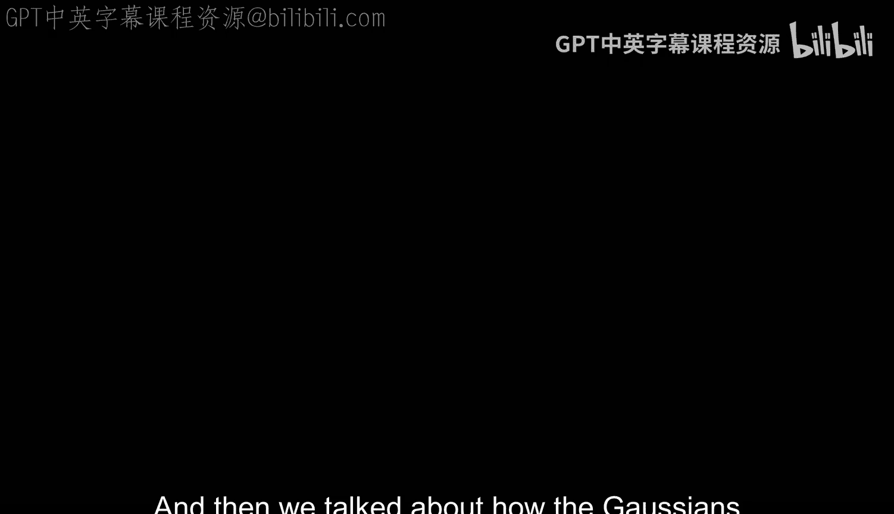

But it's much better than the box filter， which in the frequency domain looks like that。

 So you can see that like these high frequency components are still left。

 And those are like the ringing， weird artifacts that you see。😊，We talked about how。

How you can directly edit the frequency spectrum， right， So the more further away from the center。

 you go more high frequency coefficient that corresponds to the high frequency component。

 So you can zero out the center， which is a low frequency component。

 and get this high frequency high pass filter。😊，Okay， and。

This is just another way of doing The low path is just doing the blur with gusian， right。😊。

And you could have actually kept。Like， you， like， you zero out the everything out like high frequency。

 but you also get rid of the low frequency in the center。

 and you just keep this like donut or a band。😊，Okay。

 that kind of keeps like high frequency that is in that specific map。Like it。

 it's it's like if I zeroed out the inside。 But then if I drew another circle here and then zeroed out everything outside。

 I would be only keeping the stuff in that band。

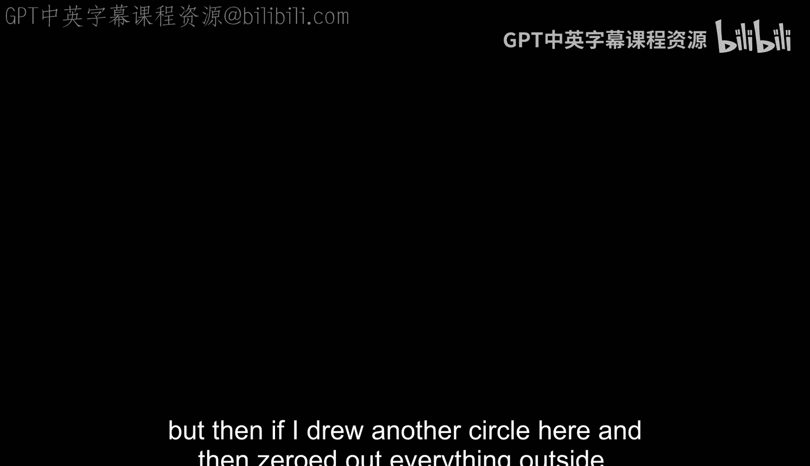

Okay， so basically， the concept is you can like pick different bands。

 and we're gonna come back to that。But。We talked about high pass filter in the frequency domain。

 But not always do you want to do this 50 transformation。 So can someone tell me。

How could I get the high frequency information if I have these two things。

 the image and the smooth image。

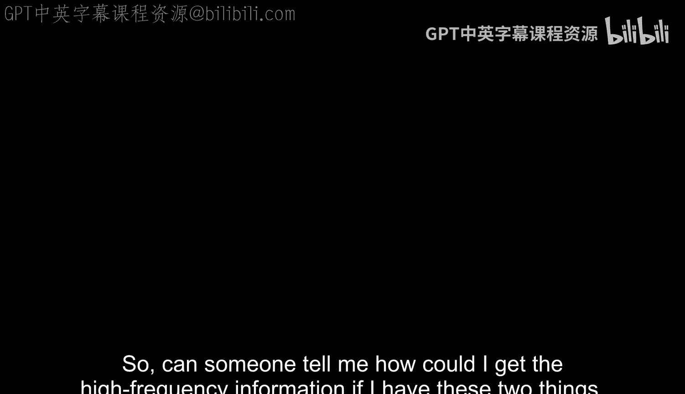

So subject。Wow， yes， exactly。 That's easy， yes。Okay， because this is the low frequency component。

 This is everything。 So if you subtract it， you get the details。😊。

And then this particular detail image is a high frequency image。

This is actually used quite often for this thing called sharpening。

 especially when your phone tend to take bad pictures。 people would do that behind the scene by。😊。

Adding high frequency， like emphasizing the high frequency。 by， so， so。

 so suppose you take this image and the details， right。

 And then alpha equals  one means you just get the original image。😊，Oh no， no， no， no， it's not。

Alpha equals 1 means you're doubling the amount of high frequency detail。

 because this is the original image。Okay， so you can take this detail， multiply with some scalar。

 added to your original image。 And then this has this effect。😊，Of sharpening it。So let's just check。

 if it's alpha is 0， then you're not sharpening it。 So the image is exactly the same。

 But maybe you see a difference， Maybe you don't。 But between 2 and a 0。

 you kind of see the difference。有。And then like， you can keep on adding。More。With that 0 and 2 in 10。

0 and 10。 I see you see， see all the edges。So this is like a weird thing to do。

Because the actual high frequency is already lost， right， You don't have it anymore。

 because by the time you captured it， you know， your lens had some limits to capture。

 So this is just kind of like doubling down on the frequency high frequency component that you could capture。

 which is not really sharpening， but it does give you this illusion。

So that's just the thing people do in your phone。You could try it out， too。And。

People unconsingly call this unsharp mask filter to call talk about sharpening。

And it's because this thing is。You're multiplying it by。I forget it's a weird name。 It's just called。

 This is basically the filter。 Its sharpening filter。

 because this is what you're doing is you take an image， right。You take the high frequency component。

 which is the subtraction。😊，Of the original image and the smooth image， right。

And then you add that back to the original image with some alpha。

I think it's because like you're masking it out， masking out。 This is on sharpharp component。

 This is a mask。 And then you add that。 It's okay。 I don't like it。

 You should just call it have frequency sharpening filter， but you can do out this math。😊，You。

 you can actually just look at this just from this too。 But， you know， you can take these things out。

 And what remains is the original signal。Convolved with one plus alpha of E。

 which is this unit impulse。😊，Right unit impulse is the delta function。

 So if you convolve this with the original image， what happens to the image。😊，Same exactly。

 So this is the identity。 And then you minus the Gaussian。😊，You know， with some alpha。

 you could just really look at this F minus if。convolve the G， Take out the F。

 Then that's like identity mine， minus the G。 Okay。

 and then you take out the F in convolution outside。 Okay， so that's the identity minus the Gaussian。

And that gives you something like this thing called Laluian of Gaussian filter or like the Sorero hot filter。

😊，Okay， and if you multiply it with this， you basically get， you basically get this thing。

So now you have like two ways of computing high pass filter， which is to。

Which is to， you know， blur it and then subtract it or do that in the filter space to begin with。

 because convolution is linear。 and you can just create this funky filter and then run it。

 And a couple of you asked me about this when we were talking about D X C Y。

 like the derivative filters right， because you have to do it for one direction。

 You can think of this as like， you know， thing that looks for sharp corners around that will give you these high frequency image just another way。

😊。

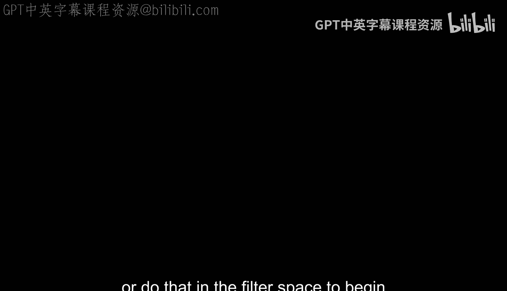

Any questions。呀。Yeah， yeah， yeah。 or I mean， it really is what all it is doing is this。

 you just take out the details。 Yeah， because the Gaussian is this smoothing thing。 So yeah。

 but you're right， because you keep the center and then you subtract it out。

 And so if there's any difference that gets emphasized。😊，O。In the class， in your homework， though。

 you're going to implement it with the subtraction method， which we're gonna talk about today。

Which is for you to make that cool Dali fixture with the。😊，The gal啦。喂。The gala and the。😊。

Nver have Lincoln。Okay， so can somebody tell me the idea behind how you would make it。Hopefully， now。

 after all of the class。呀。Yep， you take the low frequency of one image and then take a high frequency of one image。

 and you're gonna combine it one way or the other。😊。

But there's one more very， very important thing for this to work really well。

 That's not really as emphasized。

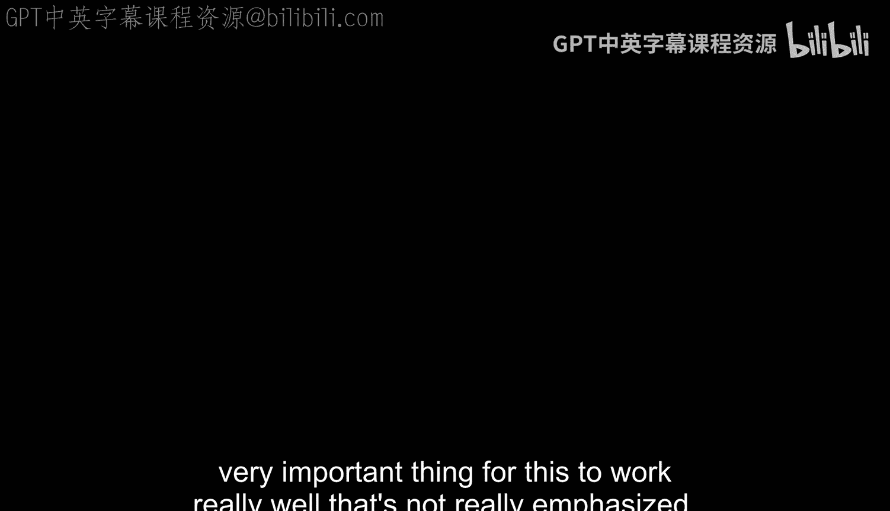

Oh， you know。😮，Oh， very nice。 Yes， it' it's， if you didn't hear him it's， it's a line。All right。

Right， so maybe you did the homework。 That's let you know。It对。

Oh I'm glad you're reading this thing so well that you can like go like this。😊，Okay。

It's really important that these images are well aligned。 Okay。

 I will come up with this because if you， you will notice that if the eyes are off。

 it will still look weird。 You're still gonna have ghosting， right， So we're gonna have more example。

 But， you know， so you can do this Gaussian。 You can do the little firepas filter of this elephant and you can do highpa filter of this Lalaian of Gaussian filter。

 And then you can combine this to that。😊，But again， this is pretty。

 you can kind of see here that it's not really aligned。 So， so。

 so the artistic choice is really important and。So this is previous many years ago as a homework result。

 And if you know， Christ Papa Dimiru， who was a professor here。😊，And didn Ra Malik。

 professorfessor didn Ra Malik。You will know that this is a very， very good hybrid image。😊。

And can someone tell me why。Their eyes are aligned。Same hair。 Yes， they're both bold。Okay。

has like the beard。 So it kind of has this like nice kind of like effect。

 So this is a very good hybrid image。 And so in your project， it's very， very important。

 that you're kind of like creative about this because there's many students who can technically implement all of the things properly but like。

 you know， don't really have fun with the， with the， you know， with the， with the images。

 And I think project1 grading is gonna be done soon。

 And we're gonna do this thing called class voting in this class where everybody is gonna the T is gonna suggest like P 10。

 And then you're gonna， you're gonna vote on which one is whats the coolest kind of project。

 And to win that。 you need， it's more about picking the right images。😊，That appeal to people。

 So go have fun。 Like， think about what kind of images you want to do。 Maybe do I like， you know。

 Photoshop transformation so that things are better aligned。 you know， use your artistic creativity。

 And that's really a lot of the fun。 You can think about what would be a cool hybrid image。😊，O。

Alright， so how do we actually do this。Hybrid image。Before we get to it or in， in。

 in discussing this。Recall how I was telling you about this。

 like Ba the pass images where you only keep the frequency of a particular。You know。

 like a donut in the frequency space。InIn the four year space。

Could someone tell me how I could compute a band pass image。As in every single pyramid of that。

 this is my cat photo。And you know， how can you see like the high frequency or like the band pass band pass frequency of total space。

 And then give it to me as a。😊，As， as a pyramid。How to compute， like。The band。Frequency。

How how would I computer。High frequency。呀。Crrect， that that would do it。

 But suppose I don't want to run a 50。For one reason another， what else could we do。

To compute high frequency component。Yes， the subtract that the high and the low。 So。

 so suppose we have the， this is say this is the original image。

 and this is like the low frequency image。😊，Right， what do you need to do to subtract this image to that image。

Yeah， you got to ups sampleample this and then subtract this。

 That will give you the highest frequency。😊，Okay， then what if I want the， you know， not。

 all not the highest one， but like a frequency that's in between this image and that image。Yeah。

Do you侬 that。Next layer。呀。Does that make sense。Okay， so what you're gonna do is take that image。Okay。

 and up sampleple it。Notice it's a little bit blurry。Right， you subtract that image with that image。

And then you're gonna get a response like this， which， you know， you can kind of see all of his furs。

You can see the high frequency component， which is like the， the， the whiskers。And then you do up。

 and then subtract。

And then you'll get the other band。Up and subtracting， you'll get the other bound。

 And then that's the other bound。

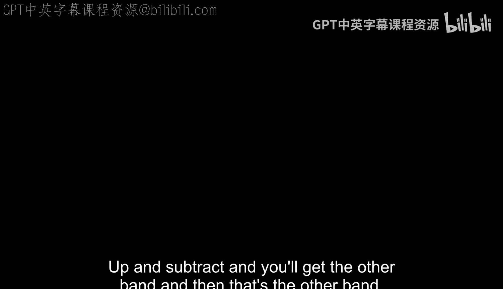

Yeah， so you can think of this as like the out outer kind of。A donut。

 that's like becoming bigger to smaller。And。This is called the Lalu pyramid。

 So you can keep on doing this。 Well it's not exactly called the， Oh yeah， this is。

 this is called the Laluian pyramid。 And it's a sub band of images。😊。

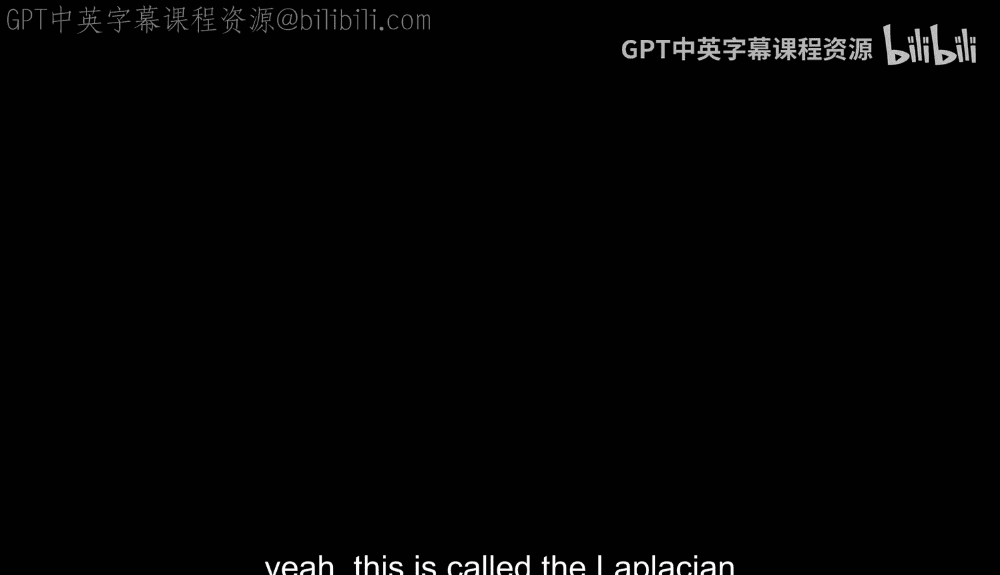

啊，没。And。You're going to use this to implement this hybrid image。嗯。And in your homework。

 So here I am drawing it as a pyramid。 Okay， but in your homework， you can do it as a pyramid， too。

 but then you have to do deal with this changing in the spatial size。

 So we make things a little bit easier for you。 and you can actually implement it as a stack。😊，Okay。

 where you don't really downs sampleampble damage， except what do you need to do。What do you need。

 if you don't change the image size， what do you have to do。呀。Y ya b it and。When you blur it。

 how do you pick the kernel size。啊。if you did the Gaussian。Yeah。

 you have to double the Gaussian every single time。 or， you know， you can think of you can。

 you can look up the actual values in which you will increase your standard deviation。

 But in this one， what's happening is that you can reuse the same kernel because the image is getting smaller。

😊，Okay， and so the Gausians naturally cover bigger space。

 You're also blurring an image that was already blurred。 So recall that， you know。

 that was like square root multiplied some， some constant multiplied by the sigma。

 It's kind of like a bigger， bigger Gaussian。 So you have to use bigger。

 you have to use bigger Gaussian kernel every single time in this one。😊，And。Yeah。

 and then notice So these images are made by every single image is half the size of the previous image。

😊，And so this is also called the octaves。 like in， you know， when you play an instrument。

 octave is like the same C， But like in a higher C， the next C， like the same note， but different。

 you know， So it's it's an octave difference。😊，Anyway， so this is Lalashian pyramid。😊。

But it's almost the lepressian pramid。 But there's like one more thing that you need， okay。Crap。

You guys are not supposed to see this。'， I'm gonna gonna go professor E style。 O， so。😊，So。啊め。

The nice。okay， so so what one thing you want to do about the Lausian pyramid。 Okay。

 is that you want to be able to recover the original image。😊，我 to think。The La blushian pyramid as。

A way to hold information。Okay， in a sense that look at the Gaussian image。

 Gaussian pyramid already has the original image， right？ So this is like 4 over 3。

 We did this computation of how much， you know memory you need to hold this。😊。

But if you only get these subbound images， I think there's another thing is like。

 you can keep on doing this forever。Right， so like， when do you stop。那个。how how有。因。

When could you stop。Like， if every single like me do this。

 you're making your images smaller and smaller and smaller。 And this， this process can keep on going。

Right， and I even made it。 and it's like a dot， dot， dot。So you need to like， stop this somewhere。

I mean， you could do it until like one by one。But that's also kind of expensive。So。

In Laluian pyramid， you don't keep the original image。 You throw away the original image。

 You only keep these。バンデムジ。到。我第一句。Yes。😊，Keep the left。Yes， you give the last one。

So you keep the last smallest。You give the last smallest one here。

 Let me just make this so that in my future。😊，Thinking this is not。This is。Then disappear。 No。

 disappear。 not appear。Here we go。Okay， so you need to keep the lowest frequency。

 So that's what's what constitutes a impairmentyid。 Okay。

 what you do is you keep the lowest frequency image。😊。

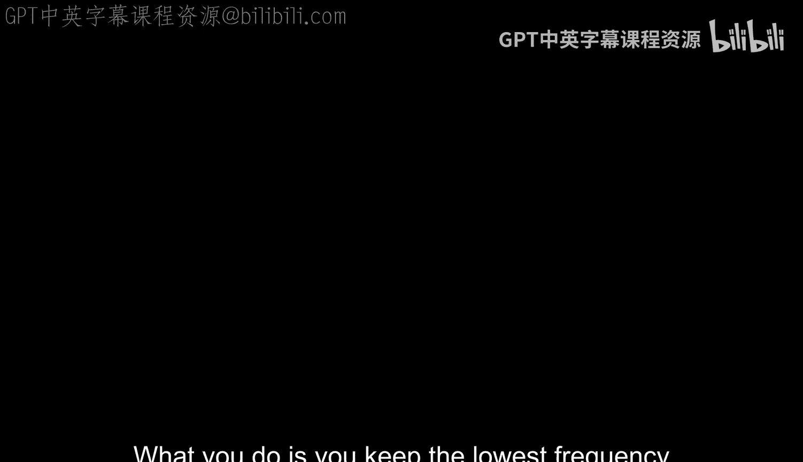

And then， all the subs。Okay， so how do I retrieve the original image。Yes， exactly。

 you add them all together。 You take this， you upsble it， and then you add this。

 and you're gonna get this image back。You're gonna upsampble that thing。

 and then you're gonna to add to this， and then you get that image back。

 And then you keep on doing that。 And then you're gonna get the original image。It's great question。

 And it's it's your， it's your option。 It's， you know， however many， how much。

 however much detailed that you want to be。Probably 4 is more than enough for your homework project。

Even two is enough。 even like the， you know， lowest and the highest frequency is enough。要。Good。Okay。

 so this is basically a La Pian pyramid is like a way。 And it's completely lossless。

 as then you can always go back。 I mean， to the degree of， you know， the， the discri。

 to the degree of for transfer like， no， this is completely。😊，Reeverible， yeah。Yeah， reversible。

The amount of information， because you can recover the original image by adding these things。

Question。呀。This how they story。It's super close。's that's the idea。

 And then we're going get to in this class。

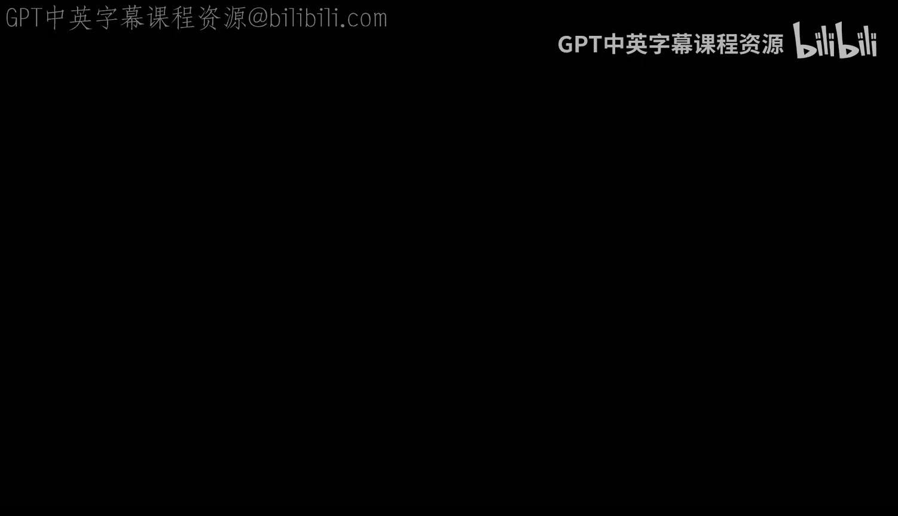

呀。And you have to implement this Lalashian pyramid。 So any questions about this。

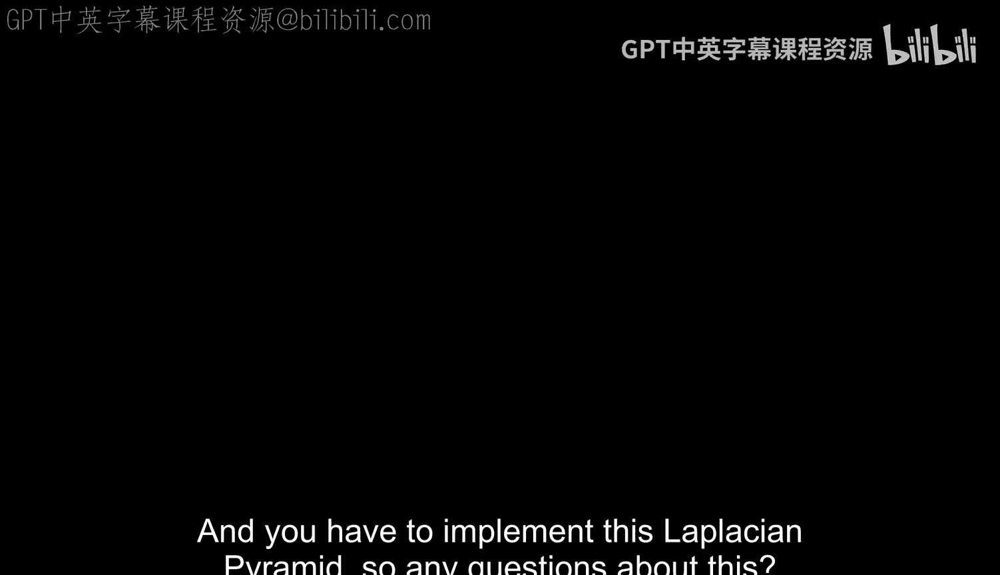

呀。あいな。it' it's love。 when I say lossless， It's lossless in a way that we're not like removing any information that's not there because。

If you， if you sum up。If you add the， if you take this image and if you add that。

 you get the original image back。Yeah， and。You can say that the blurring gets rid of the information。

 but you're actually exactly storing the information that you get lost， lose by that。

 by that blurring。Good， okay， so there's some applications。

Which turns out that Leonardo da Vinci is probably the first person who used the Luluian pyramid。

And we don't know how。We don't know for sure。But the point is that he must have known about this because it's just so good。

 There's just so many things that goes on in here。And this is a really cool intuition from this book called Margaret Livingstone。

 And I actually have it。 And I'll leave it there so you can look at it after class because there is really cool。

 And I encourage you to get it if you're interested in this stuff。

 because it's a really nice book that has a lot of interesting things to do。 about humans。

 human vision and art。 And I I hope somebody reminds me that I don't leave it there。😊。

But O， so there's so many cool things about who went to see this in person。 I've never seen this。😊。

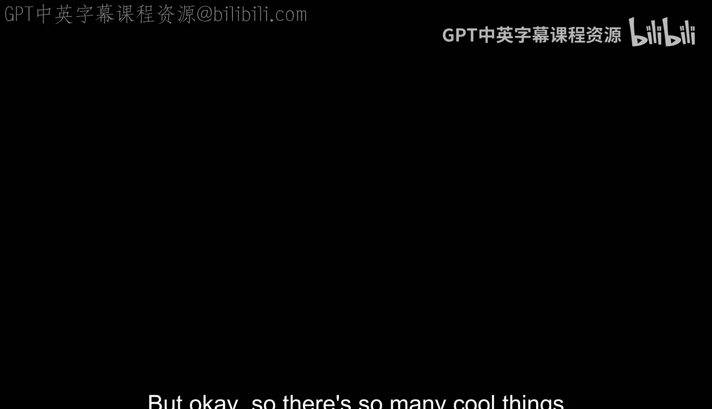

Oh， nice。 couple of you guys have seen it in person as super cool。 So it's a misery。😊，Painting。

 for many reasons。So let's point。 So can you point out where like the horizon is in this picture。

Yeah， oh， you're pointing where， where。Otherwise。Whi which horizon， which horizon。Exactly。

 there's actually two different horizons。 And then we by might get through this。

This class later in the 3D lectures。 But it turns out that the horizon encodes the height in which you're looking height of the viewer。

 So when you look at the right side， it looks like she's on the same ground as you。

 But then when you look at the left side， it looks like she's looking down on you。😊，要。So that's。

 that's one of the little bit thing。But really， the interesting thing is， is she smiling at you。

Or is she looking at you。Is she angry at you。一二。2。So interesting that the angry thing came from behind。

 Is that correct， Let's see。It from the back。From the back。Okay， so the thing is， the Margaret。

 Margaret。Margaret Livingstone， what she did was to compute the La blushian pyramid。😊，On this image。

And so this is what， so over here。Is the low frequency stuff。O。😊。

And then this is like the medium component right in the middle。

 And then this is like the most high high， highest frequency。😊，O， so。

Let's go with where she's looking at you。 So in the highest frequency image。

Is she looking at you are away away from you。Away， right？ How about the low frequency。

She's got directly looking at you in the low frequency。Okay。And then how about the mouth。Okay。

 I think。In the high。She's kind of giving you like this。Not really a smile。

Kind of like a scary smile， like an angry smile。You know what I mean， like， like a disapproving look。

But then there's low frequency， this is definitely a smile。😊，Right。😊，So。What does this mean。

 And we call that our eyes。The peripheral vision of our eyes。Right， we don't really focus so much。

 And so those are going to be low frequency。Okay， so can somebody describe what what。

 what happens if you look at her eyes。でも。They。Well， did they，'s okay。 when you focus on her eyes。

Which frequency are you looking at the mouth。L frequency exactly。

 So she's smiling when you look at her eyes。But she's looking away from me。Okay。

 but then so if you look at the mouth。Then what what is she doing。She is a。She when you look at。

 when you look at the mouth， you see the eyes in low frequency。 So she's looking directly at you。

 But then you're seeing a frown。😊，Okay， so this is a really， really cool stuff。😊，呀。😮，So it's like。

 it's like Rionardo must have known about this。 and it's like trolling us。With this picture。

 this is why you can't really tell when you look at this image。

 you look up the eye and our eyes do this sarcas thing。 and it moves around all the time。

 And then looks at different parts。 So when you're looking here。😊。

She's smiling at you by looking away。 And you look I hear if she's like， oh， not happy。No， yeah。

 Not happy。 And then looking directly at you。So that's one of the mysteries。Okay。Any questions。

So it's really cool stuff。 If you're interested， you can， you can， you can ski fit the book。😊。

All right。So that was it。 That was it on the hybrid images in the facial domain。

 So you can now do this homework where youre gonna make something like this。😊。

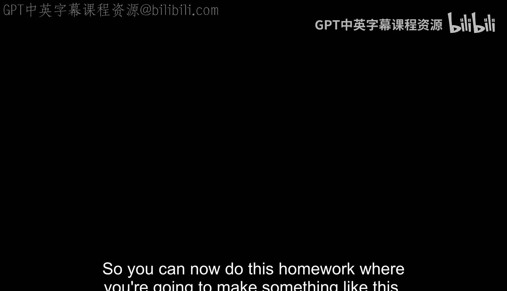

Oh， wait。We need to describe how you do it。No， no， you do it。 No， no， that's it。

 You know how you do it。 now。 You know how you do it now。야 이너 되나 되나。Okay throw away some slides。

 I think that's it。O。Yeah， I mean， hybrid image is really just doing this， right。

 summing the low frequency and the high frequency。 So you know how to do this。

So why are we talking about this love blush impairmentid。Okay。

 so the other homework assignment is to do blending。

 So the blending is this thing where you take these two patterns。

 and you w to make an image that is in between these two。😊，Okay， so this is the。

 this is this picture。 You want to make the oracle。Okay， but how do you make the orle。

 Because if you just stick them， you know， if you just cut it at the side。

 it just looks like two images， you just put it side by side。Right。

 and so there is this technique called alpha blending。So this really cool stuff。

 The alpha image was developed by Alvi， who is one of the early Pixar employees。😊，And she。

 he is still alive。 I mean， very well。 is actually professor， you know。

 one of our psychology professor's husband。 And it's a really cool time when you like talk to somebody and like。

 oh yeah， I was seeing graphics。 you know， back when。 And I made the alpha channel。😊。

So that I thought was really cool。 Anyway， what is an alphapha channel。

 Alpha channel comes in youre like RGB P And G， you might have seen it。😊，So also channel of one。

Means it's completely opaque。And 0 means completely transparent。Okay。

 and this is the alphapha channel。And so you're going to combine this。

So this is something you also learn in like graphics。 when you do linear interpolation。

 So you're linearly interpoolling the alpha values in here。😊，Right， and you're gonna do this。

 which is that the blended image is alpha times the left image。Multiply plus。

1 minus alpha of the right image。So， so the thing you see over here is just one minus alpha。Okay。

And this creates this effect called feathering。 It's like a smoothly changing。

 You go from this part pattern to 0， smoothly。😊，And so you might be able to get something good。

Question。呀。Exactly， good question。 It's actually very difficult。Yeah， in fact， it's， it's。

 it's half artistic eye。 But the point is， that's exactly the question of like。

 how do I pick this window size， right？ So suppose the alpha goes to one to 0 like throughout the entire image。

😊，Here， I'm just showing the-1 minus alpha。You get this thing called ghosting。

 where you see the other image behind the other image。 And that's no good。

So you don't want that。 And so you w to make this window like much smaller。 But then like。

 if you make it too small， then it just becomes like a normal image。 You put it side by side。

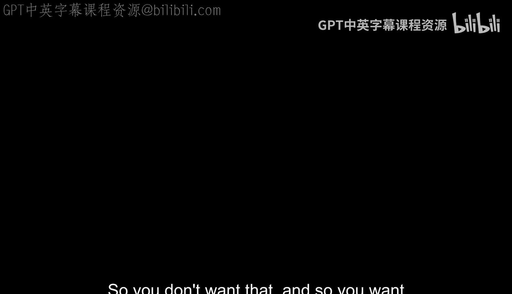

So it's kind of a delicate balance to pick this。And there is some optimal window。啊，没。

But it's not really， you know， maybe you can find this or not。 And then this is really good question。

 because。You know， we're gonna build up to it。 We're gonna figure out how to do it。But。

 but let's review the reason why this is such a difficult thing。

 It's actually in contradiction of each other。So the optimal window size。

 like wind transition is really hard because to avoid the seams， right。

 The window must be as big as the size of the largest prominent feature。😊，Okay。

 and I am drawing the largest prominent feature。 is like the horse。

 You don't want to cut the horse in half。喂，so。This is the， I am drawing this。This is the largest。

 largest feature。You wanna be， be like big。 The window kind of goes over it。 You don't want to cut。

 cut it altogether。 You don' wantna， You don't want to cut this in half。That's what seems。

But then to avoid， go think。Your window has to be。Smaller than twice the size of the smallest。

 prominent feature。😊，That's kind of complicated。 But if you look at this picture。

 you see that you don't want your window to go like。

 you don't want to use this line over here because then you would like have all the ghosting。Right。

 like this window is much smaller。Right， like， if it was this small， then it would be good。

But then this image might have the both of these things。 And so if you use this thing。

Then you're gonna really cut this thing in half。有。But then， you see what I mean。

 it's basically a contradiction with each other， yeah。That's a good question。

 It doesn't have to be a linear function。 You can discs or like， you know。

 No nonlinearly like this or non nonlinearly like that， or， you know。Yeah。

 but it would be moreonic in one direction。 Yeah， but it's still an issue。

 I think that will definitely help。 And that's actually what artists do。 Like， if you go to like。

 you know， video， video editing tools or something like this。

 But you still have to figure out like when to start pushing this in。

 pushing the other information in。😊，Okay。啊，没。受。Can you think about a situation when there is none of not。

 not where this conflict doesn't happen。Is is there some time when both of these things could be true。

At the same time。Like， you could satisfy both of these things。Oh close。 Yes， yes。

 It's something that we saw in this lecture。😊，It'。Change the word feature to frequency。Yeah。Exactly。

 is exactly。 So it's more like。啊。It's more like， you can。It so you can compute a band。You know。

 think about it in a four year domain， You can compute a band。 This is a low frequency。

 but you can compute a band like a donut over here。

 where each band only contains that frequency and no other。😊，Right。

 so then you can use whatever window that works for it。

But it doesn't really hurt the everything else。So you could do this with like low frequency and high frequency。

嗯。呃嗯。Here， let me just。The这 the。So， this is the idea。That you， like。

 you can do this in a Fourier transform。 Okay， so you compute the fourier transform。

 and then you decompose the fourier image into octaves or different bands。😊，Like different donuts。

Okay， and you can feather the corresponding octaves。Basically， just do it in the band。

 combine the images。Then you can choose different window size for each one。

 And then you can put it back together。So you can do this in the four year four year image。

 but we should really， we can still implement this in the spatial domain。

And that that's how that's when we use the Lalashian pyramid that we talked about。

 this bombba images。

So can someone。I mean， if we did talk about it， right， someone， can we。

 can you say that idea against that。

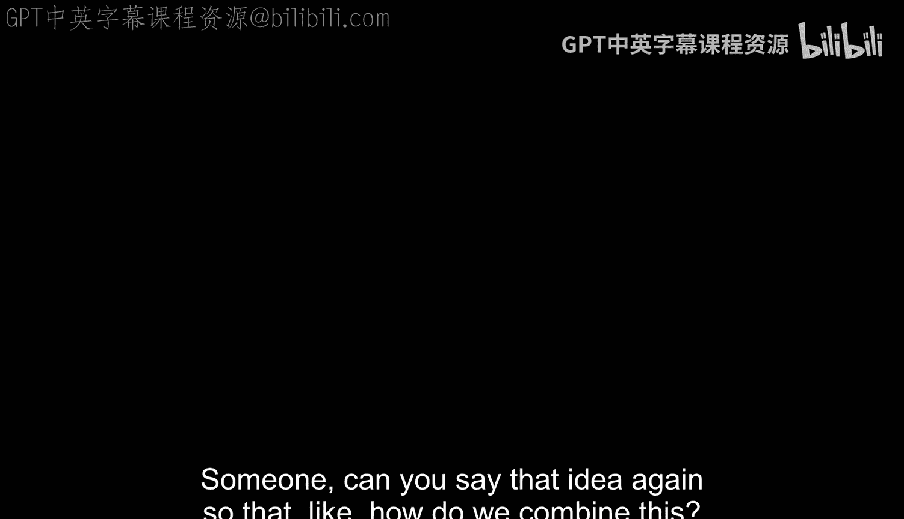

Like， how do we combine this。温は。Exactly。Okay， so what you're going to do is you're going to make the laplashian pyramid of the left image。

You're gonna make the leftless pyramid on the right image。

You're gonna pick one window blending function。You're actually gonna compute the Gaussian pyramid。

 You're， you're gonna see why。And then you're gonna sum， you're gonna combine not。

 You're gonna blend each feather each layers independently。 And then you just sum everything back。

Okay， so that's this image。So this is a leftluian level 0， which is the most high frequency。 Okay。

 and then you're gonna combine this or blend blended pyramid。😊。

And then the next level and then the next level。Right。

 and then you can see that the lower frequencies have bigger features or bigger things。

And so you wna blur it floor。Okay， and then high frequency is like， you know， small features。

 So you can almost， this is almost like the window is very， very small。😊，Okay。

 and so what you really do in practice is you make one alpha， basically say this is the the。😊。

You decide the first seam kind of window size。 And then you just compute it。

 So you just make it into binary image of like， here's， you know， the alpha is，0 and 1，1 to 0。😊。

I mean， it doesn't have to be binary。 You can， you can。

 You can't make it feathers in some linear some window like this， like something like that。

 And then you ran Gaussian pyramid on that， on that alpha image。

Because then it will automatically blur it and make it bigger for you。

And you can also do this by hand。But的。Does that make sense。Basically， the lower frequency。

 you want it to be more smooth， changing。 And in the high frequency。

 you can do pretty abrupt changes。And then if you do that， you can make this oracle。

And then if you can do that， you can also burn regions。And do these cool， funky things。And then。

 this is one of the。Homework project， one of the projects from a student。😊。

I you so you can have a lot of fun。😊，You can do。 you can have a lot of fun doing this。Okay。

 so let's recap。 How do we do this。 I mean， this is what we talked about。Build a Lalashian pyramid。

 L A and L B from each image。 I' build a Gaussian pyramid from the selected region of transition。😊。

And then you combine the pyramid using the， the Gaussian Gausian pyramid alpha as the weights。

 This is alpha plus 1 minus alpha。Again， then you just sum sum the pyramid again to get the final blended image。

呀。MIt's just， it's just， it's really just this。 it's just， just this。So you。

 you define this on the first image， right，1， and then you decide somewhere it goes to 0。

 You can make it linear。 You can make it linear。啊，But then you。

 you just run Gausian Gaussian pyramid on this image。Then because the Gaussian blurs it。

It will get more and more blurred。Like， it will approach like a window that's like bigger。

 much bigger。It just that that automatically。 If you wanted to， you can just pick it by hand to。

 But then you'll just， you can just。

Like， it should， it should look like this where like the seas。

 seams in each level is like a lot blurry here。

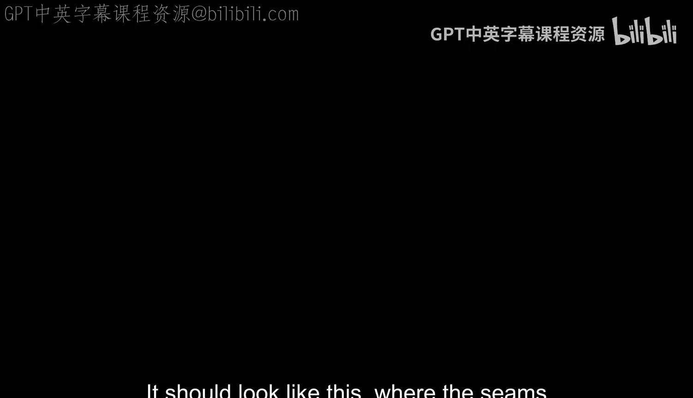

Like soft transition and， yeah， smaller and smaller， sharper， sharper transition。So I。

 I would try with like， you know， almost a binary 1 and 0 and then see if you need to do anything in between。

 It also depends on the picture。 You know， that you're blending。So。야。Use your creativity。

Somebody was saying they like to take pictures of photos。You can do that。 change mix different。

Photos and photos。Other ideas。Fund ideas to combine。 Oh， you know， I think Mar is like a iss like a。

You know， the artist who， like French artist who like。Draws like the， you know， bright， like sky。

 But then there's also night。 you could do that combine night。 You can also look at。 Yeah， yeah。

 you can just get， you can just have fun。😊，And you can cut。 So this is， O， this is the alpha image。

 right， And this is just binary。 So you basically run Gaussian filter on this thing。😊。

So you can just make it， make it just binary。 You just draw a shape。O， any question。

Because this is what you'll be implementing。呀。So， this is。Like， how would you。Yeah。

 so I think you can just do  one0 image。take a， take a photoshop or， you know， preview。

Make a white image of your image size。Draw whatever you want。Paint。In misspa。

You don't know that maybe。Alright， yeah， you could just draw it between1 and 0。😊。

And you can programmatically later， make them a little bit more featherered。😊，You can change that。

 too。You can program it programmatically drill the disk sizes， too。Okay。O。Alright。

 so in your homework， you're gonna implement it as a Gaussian stock where it's not a pyramid。I mean。

 it's， it's like this visualization here。 You know， they're all the same sizes。

But there's another simplification。That you could do。嗯。Which is。Just use two levels。

Don't do that blush pyramid over 4 or 5 or 3。 Just use two。

 and it would still be able to blend reasonably nice images。😊，So what you do is super simple。

 You just run Gaussian filter once， make it blurry， subtract that from the original image。

 get the high frequency， and then just combine those separately。😊。

They blend the low frequency smoothly， but the blend the high frequency with no smoothing and use the binary alpha。

 Just， just use the binary。Okay， so this is an image。

 This is and this is really useful when you get to project 3。

 because you're going to be doing all the stitching of different images。

 And when you stitch the images， the same issue happens， you're gonna see the scene。

 You don't really want to see the C。 And so you can just do this quick two level implementation。 You。

 you can implement it as a utility or something like blend image to。

 to pyramid or something to two levels。 You， you will use it later again。😊，If you do it。

 it will look nice。Instead of looking all of these themes。It makes it really nice。So。

Here's the low frequency， and here's the high frequency。O。😊。

You subtract this from the original image。If you。Do linear blending。

So if you blend both with the same alpha。You kind of get an image like this。Which is still okay。

 But then if you do a two band blending or the high frequency component。😊，You know， the the is less。

Maybe you can see the different。You see a lot more high frequency components in there。

Remember the original input images like this because you're stitching a lot of different images。

 right， So there's like。You， if you blur too much， you lose the high frequency information like in there。

 too。And so， so this way， this is just adding different， you know， smoothing the alpha or。

Using different alpha at different levels will give you this kind of effect。跟。All right。O。我 right so。

We they're talking about the frequency stuff。 We can get to this。 How does JPig work。

And the fact that we want to do this image compression。Because some images are very high heavy。

 This is not heavy this old old slides。 It not that big， but you w to reduce this。

And so how do you do this。And so before doing that， though we should review this approach。

 which is worthless。Okay， you're not throwing away any information。

 And so this is called the halfuffman coding。

Okay， so this is like what's happening in your zip file。 Okay， or the P And Gs use。

 So what happens is that you have all of your input images and you're gonna be like counted the number。

 compute the histogram。 I have a white pixel， a red pixel， blue pixel and a black pixel。

 And I'm going to count exactly how many times they happen。😊。

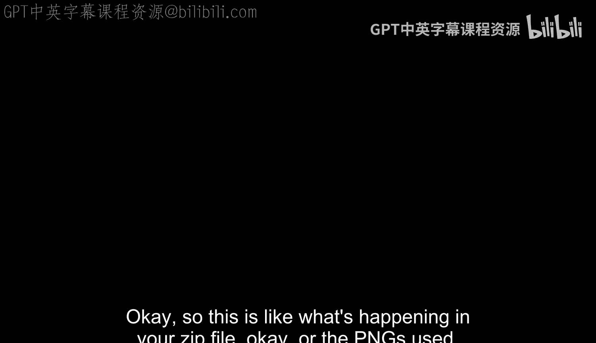

Okay， and then I'm going to convert that into a bit code。

Where the most frequent one gets the smallest bit and the high。

 least frequent one gets the largest bit。

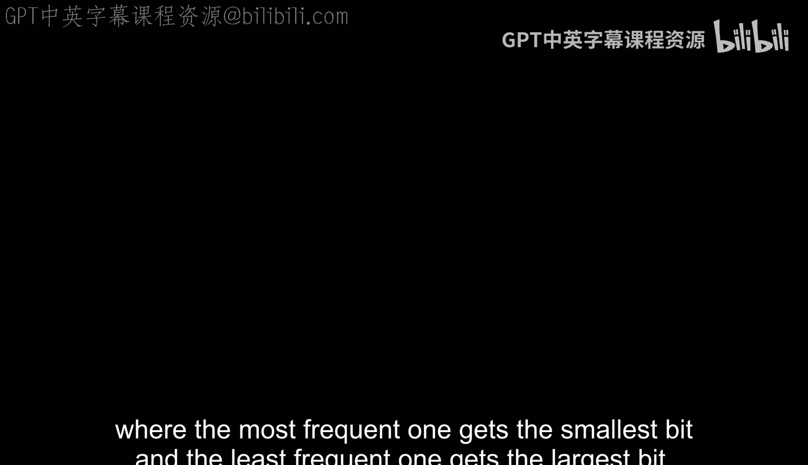

And maybe you covered this in data structures or some courses like that。

 where you create a tree out of this。

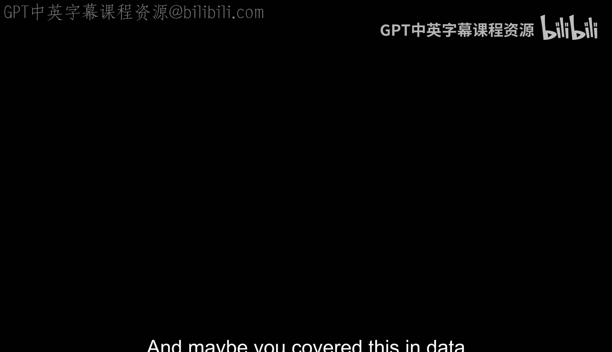

And then you're gonna go down the tree to make this toughman coat。

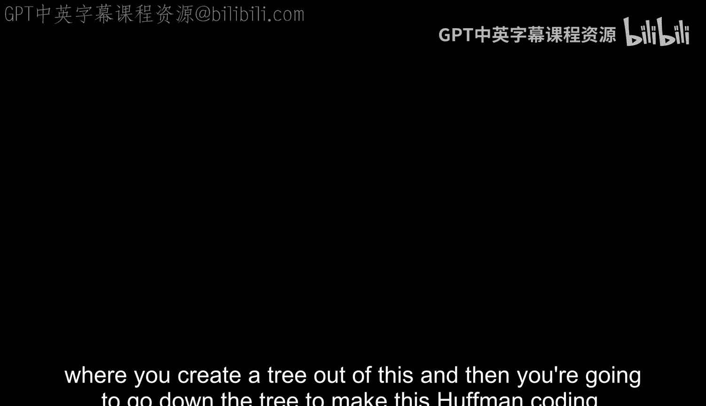

Okay， this allows you to compress image as 0。😊，1，1，0，1，1，0，0，0， bh， bh， b， b， bh。

 But then the last rule is all zeros， which is， which allows you to compress this much smaller than using。

 you know， a bite per pixel。😊，But this alone， and this alone is， this is like。

 this is lossless because you're holding on to all of the information。

 You're just storing it in a smart way。

Okay， but this is why I don't think you can get more than a factor of two compression。

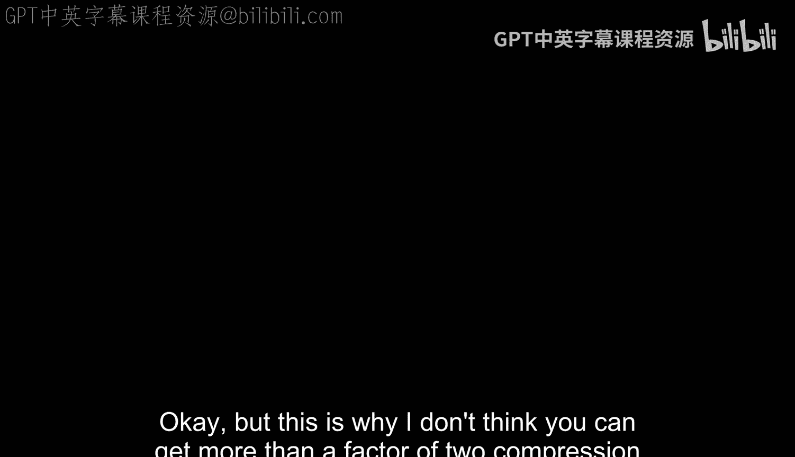

And probably two is not， you know， dividing by half is just not that much。O。😊，So in pictures。

 you can do voice less。 No， no。Losy compression， because lossless compression is not enough。

 So we're going to do lossy one when this is not a very good idea for your text file or zip file。

 You're gonna you're gonna upload your zip file for your homework。😊，And it's like， mostly okay。

But sometimes one of the， you know， minuses become pluses。Something in your homework。

So doing that in a text file is not a very good thing。But why would it be okay for images。Exactly。

 because you can't see we're not sensitive to this certain frequency。

 Remember this curve that we were looking at last week， last this this week。😊，So you can get rid of。

 you know， the lowest frequency and then the highest frequency stuff most， most， most。

 most importantly。😊，So this is all we're going to do。 And many of you have been asking。

 which is you take an image。And the first thing that you're going to do is to cut up the image into 8 by 8 blocks。

Okay， we're gonna， we're just gonna poify this。 And for every single 8 by 8 image，8 by 8 pixelel。

 Yeah，8，8 by 8 image。😊，We're going to do something like four your transform。

 except we're gonna use this thing called the discrete cosine transform。

 which is basically the same idea。 Like the here are the basis。😊，Right。

 this is like the D C component。 Remember， like we have these bands of signs and cosines oriented。

 But instead， now they look like this like checkerboard patterns。😊，Okay。

 so this is like the basis for your， for your transform。

 And nice thing about this is that this isn't using any of the complex number thing。😊。

So if you look at the amplitude image， it same situation。

 like the center close to 0 is low frequency。 The further away you go is higher frequency。😊，Any。

 any questions about this。So what you're going to do is you're gonna save at 0，0。

 How much of this do I need， How much of that basis do I need， How much of that basis do I need。

 How much of that basis do I need， Like you， you sum the you。

 you keep the coefficient that is required for each of these。

 And what you're going to do is take that number， multiply with this thing。Take that number。

 multiply with that thing， and then keep on summing。

 And then you're gonna be able to get to the original image。他。How do we know it what。

all sets of images， all sets of。In the space domain面に take。都可以。It's just you mean。

 how do we know we can represent the 8 by8 block using this frequency。

 It's same same idea as like four year transform。 like any signal can be reconstructed as a summation of sine waves。

😊，Signs and cosines。 where it just so happens that here， we。

 we divided the signal into an 8 by 8 image。呀。그 question야。Good question。 Yes， we， I will。 we。

 we don't really describe that didn't I didn't really describe what to do when you have color。

 when you have color， you're gonna do the procedure that I'm going to describe on it too。

 But we're gonna do it on an image that is half resolution smaller。 Like long time ago。

 I think this is lecture 2。 I showed some images of how you can downsample the color and then you upsble it and like we were not very sensitive to it to the color。

 So you're gonna do the same thing。 But like in a smaller image。 So you get even more， more。😊。

Any questions？呀。I like。Liftover stuff。You mean like， why could。

 why didn't I use like more than 64 basis。Oh correct。It。I think he's just patted with zeros。Yeah不。有。

Okay， so， so we're cutting up the image into 8 by 8。 Then we're gonna treat 8 by 8 separately， right。

 So already， we're kind of getting rid of like the very low frequency that spans the entire image。😊。

ButThat'sO。😊，We don't really。 We're not super sensitive to that kind of changes over here。Okay。

 so what are we gonna do this？ So how are you， So， so what's the idea。Like， you。

 I think you guys get the idea， right， like the high frequency component were not really sensitive to it。

Right， so we wna like， get rid of it， right， but we can't just keep the low frequency information because then your images are gonna be blurry。

 You don't want blurry stuff。Okay。And so the way we're gonna do this is， first of all。

 we can have an ordering of this picture that goes from lowest frequency to highest frequency。😊。

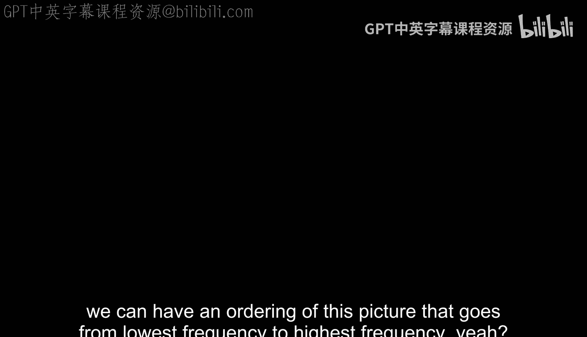

Yeah， I mean， this is just kind of like， you know， D C component is like。The average intensity。

 like the super， super low frequency。 And then like， you know， you just， just。

 that's the ordering in which it goes， meaning the more and more you go here。

 the less important it is。😊，So what we're going to do。Is we're going to quantify the values， so。

Let's look at one thing。 Okay， so over here， the thing， this， this thing you see is 8 by 8 image。

And this is the filter responses。 You multiply this numbers with this basis。

 And then you're gonna sum it all up。 and then you're gonna get the original image back。This is like。

 your amplitude image。Yeah， like if you make， if you， if you plot this this with in show。

 it's gonna be like bright here。The big numbers here。现在呢。You know， a smaller number here。

And so the question is， you know， I don't really care about the high frequency component here。

 Like where I'm like looking， what I'm looking at over here is like this area， okay。Right。

And then they tend to be smaller values anyway because you don't really need that many high frequency components。

 So， but then if I completely zero it out。You're just gonna get a low passive image。

 And you don't really want that。 And so what you're going to do is you're going to quantize this as in like。

 give， give bit allocation。Right， so。

People。Through human， human like experiment came up with how important each， each frequency is。

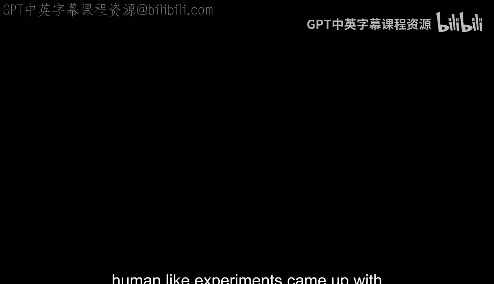

And so this is like， you know， somebody handed to you this quantization table。

Meaning that you're gonna divide the highest frequency here with 99。Okay。

 and so unless it's like over 9th and value is over 99， It'll just be 0。 So most things are gonna be。

 you know， between 0 to 99， everything is gonna get to 0。But the lowest frequency is important。

 So you're gonna give it more， more bit。Yeah， and so you're just gonna take this value divided by this quantization table。

 And then you're gonna get this response。😊，Which， like kind of zeros out most of the things。不是你看ake上。

And this is like， this is obtainedt through human and human experiments。 And this is like the J Co。

 when people say like JPg standard， they mean like this quantization table。😊，And in your preview。

 when you like， resize things。You can like， change the compression rate。

 Like sometimes you can do like compress a lot。 like compressed levels。

 like the higher level means like low， like you low quality。 you。

 you're multiplying this quantization with like a bigger number so that they're gonna be bigger and bigger。

 So most of the images is gonna be white。 is gonna be 0。😊，啊。Question。呀。No关呀。Do you do this what。Yes。

 exactly。 You do this once for every 8 by 8。 And then once you're gonna get this quantized value。

 you still might do halfman coding on top of this get gain more。😊，So what you're going to do is。

You're gonna color。 You're gonna subsle the color by a factor of  two。

Because people don't really care about the color。 You're gonna split the images into 8 by 8 blocks。

 And then this one， they also came up。 If it's 16 by 16， you see more blocky artifact。 You know。

4 by 4 is too small so you can't compress enough。嗯，被告 themin。If for each block。

 compute the DD coefficients， and then you quantize。Put it into bins with like， you know。

And then you do this encoding。要。That's just the color thing。O。Basically， the idea is， yeah， like。

 I mean， you basically want to get rid of the high frequency component and you don't exactly cut it off。

 but you just quantize it and give it less bit。And so that's kind of what it looks like。

 I'm sure in your own experience by saving JPgs， you can change this。 and it's gonna get really ugly。

 Sometimes when it's too strong， you see all of these blocky artifacts。😊。

That really comes from throwing away high frequency information。啊。要。Any question。Yes。😡，Exactly。

 if the image has a lot of low frequency components， like the image。😊，Like the sky。

 is's gonna compress well。嗯。If it's gonna have a lot of high frequency。You know。

 it's not gonna compress well。 and not only that， but you will get more artifacts。Yeah， yeah。

 So you exactly。 You do this on It's actually done done on L A V channels or something like this。

 or like L is ill。 It's a grey image。 And then like the， you know。

 blue red and then the sayan or something like this The different colors。

 But the color images are even reducing the spatial resolution， too。😊，Okay。

 question questions about this process。 I mean， I mean， the details of this is not。 I mean， yeah。

 I mean， hopefully you， you get， you get the mechanics like the coefficients on the high frequencies all also pretty small because not。

 not often do you really need to use like。Not often do you really need to use this one and that one。

 It really depends， right。So most， mostly， you're gonna be getting a lot of it。 I mean， you know。

 as you've seen in low frequency images， it's like if you， when you look at these。When you oh， no。

 when you look at this。When you look at these old picture and when you look at these things。

When you look at this picture of total。Like high frequency is like super small。 No not， I mean。

 not that not， not that many not， not， I mean， it， it's not like everywhere uses it。 And so。You。

 you tend to have a small number on the high high frequency component。And so when you quantize it。

 that even tends to go to 0 even more。有。Okay。Good。All right， okay。Then。

Let's review everything we talked about because we talked about filters for a while。

 And for this is it we were， you know， this is basically learned a lot about the filters。😊，So， okay。

 let's just do a review。 So we did this smoothing filters。Which is the Gaussian。

Or the average filter。 And then it removes the high frequency component。 It's a low pass filter。

Can the values of a smoothing filter be negative。Can the moving filter be negative。Yes。😊，嗯。嗯。That's。

That's an average。 Let's think about the average filter， right， because， okay。

 when you hear smoothing， the Gaussian is like the nice one。 But the first。

 what was the first smoothing filter that we talked about。😊，The box filter。 Yeah， is the box does it。

 what is the box filter， Does it have negative， Does。

 Does it make sense for the average function to have negative。Not really。 Yes。

 so it doesn't have any negatives。And what should the values of the smoothing filter or the box filter sum to。

1， exactly because。Any idea why。It's a way to average。 Yeah。

 another intuitive way to think about it is if there is like a flat region。

 you take an average of this thing。 You don't want to change it。Can you want to keep it as it。Okay。

 so this is surface is7。Constant vision， don't change。On the other hand。

The derivative filters are very different beings。Like， we talked about it。 You can take the D X。

 D Y or -1，1， like the Sobel filter。And then you can compute guusing on it and look like that。やってあい。

That's a good question。 Yeah， which is the think function， which does contain the negative values。呀。

You can。 I mean， O， in that sense， you can。 But nobody actually uses the thing filter in practice because you need like infinite kerneld。

Yeah， so most of the times you don't really use it。But good， good， good point。 good， good。

 good memory。Okay， so you can do derivative because can the values of a derivativemin filter be negative。

Yes。The sun is， yes。And why。Or like， what should the values of the derivative filter some do。0， yes。

 exactly。 because you don't want any response。 So derivative filter， again， remember。

 you have to remember about hiking。 It's really just about how much you're gonna be hiking， right。

 And I'm not hiking。 It's a flat ground。 And so there's no derivative here。 right。

 So if there's nothing， you wna say 0。😊，Okay， and then the filter will be negative because you're gonna be looking at what the difference that you have to take the difference。

Okay， and。High absolute value at the points of high contrast， meaning it's the slope is high。

 slope value is gonna be high。Okay， so that's the way that we've been looking at the smoothing and derivative filters。

 But this， you know， you might think this is just for image processing。 but it's very。

 very important in computer vision because you can think about filters as like a template。😊。

It's like a detector。Okay， it's kind of like。Find the thing that look like me。 Okay。

 so you can take this image and you can like， take this patch， make that my filter and be like。

 I wna find this particular eye in this image。😊，Okay。

 and then theres multiple different similarity measures that you can do about this。

So let's just do the simplest thing。Which is。You're just going to convolve this image。Okay。

 with that。To find it。Okay， then you're gonna to get some image like this。So can someone tell me。

 what was the problem here。It kind of looks like a smoothing， you know， smoothing filter。啊。😮，对啊。

There's a bigger problem。 There's a bigger problem。There's a figure about。

 why does it look so blurry， Like， it's， it's all like it's。In， in a sense， it's all like。

Positive response。 Like what， what went wrong。Like， okay， this template， when you use the filtering。

 like convolution is the template matching， I that closer to the smoothing filter or is it closer to the derivative filter。

😊，我一直直接。To the derivative filter because the derivative。Theres like， I want this change。

 It will show me all the differences that happen in this direction， right， and it will fire。😊，Right。

 your question。I just， I mean， I know it sounds。What are we。Make a window。

That' that's basically what's happening。 That's exactly what's happening。 You take this image， right。

 and you're gonna convulve it at every single location like this。So that， that is what。 And here。

 it's like you， you do cross correlation， even。 you do it's just say cross correlation。

 So that is what's happening。And why do you。That it's like more like Ever filter。It。

 it adds to a positive sum。 as in like this will add to a positive sum。 Yes。

 which is exactly the problem。 Okay， so what went wrong。

 What went wrong was your filter only had positive values， right， Like you mean。

 I just cropped this from the image。😊，Right， and then the images only have 0 to 255。

 So all of the values are gonna be positive， which means it's gonna behave like a smoothing filter。

 Maybe that's not you guys said。😊，So that's what it's doing right now。

 So this is why it's kind of doing this smoothing thing。😊，But that's not what we want。

 We want the activity。 We want it to behave like the derivative filter。

 because I w to find the patterns that look like the eye。So what can I do to fix it。

Yeah something something。呀呀。The value is center around 0。 So what do I need to do that。

Sububtract the mean。Yeah， you subject it。 So that's what you can do， which is you take this builder。

😊，Right， and you subject it's all mean。Right then it's gonna have negatives and positives， right。

 It's gonna be at zero。 So it's gonna be like different sub Gaussian。

 And so you convolve or you cross correlate that image with this one。 And you're gonna get this。😊。

Where it's like at the eye， there is there is like， you know， detections。

 but you're also getting these， like false detections。😊，Right， and。What， what's happening。

 Where is this， Where is the false thing happening and what， what kind of patterns do you see there。

关。Yeah， like， like like this over here。Yeah， what's， what's kind of special about this region。

It's bright。 It's bright。 It's all white。 So like this pixel is like all 255。 And so if you take a。

 you know， some， some， some derivative Gaussian filter or something。

 you multiply with something that is all 255。 It's just gonna automatically make it bright， right。

 So it's like kind of like brighter regions。 win for， for no reason。

 It's just like very sensitive to bright reasons。 So what can you do。😊，Normalize it。 Yes， that's the。

 I think you're a little bit ahead。 But basically， that's the idea。

 You can do some obscure differences where you actually。😊。

You should look at the difference in between them。 but this is also sensitive to average intensity。

 well。😊，You can do some of square differences。Yeah， I think we。

 our transition goes through better to the next one。

 because the normalization does happen in the next one。 But before the normalization。

 instead of normalizing。😊，That is what you're looking for。You can。 That's a good idea。

 which is that if the eye was like， you know， maybe somebody scaled this image a different size。

 you have to actually run it at multiple scales。😊，That is something to think about。

 This is very relevant in convolutional neural networks。

 because in the convolutional neural networks， The first filter is you're learning like a con。

 you know， you're learning a kernel， right， Basically， you're learning like。

 what are the patterns should I detect in the first layer that the next layer is gonna use that is useful And you're also going to be learning that。

😊，And then actually， when there's like multiple patterns that happens at multiple scales。

 they're just gonna learn kernel size that capture your different sizes。You know。

 like smaller circles or bigger circles as， as a kernel。

 like depending on how big you currently give it to you。

So one thing you can do is some of square differences where you take the difference difference between them。

 So this is， this doesn't look like。Linear filter。 but you can actually write this as the combinations of linear filters。

 which you can think of it as a fun exercise at home， how to write this。

 how to write some of scary differences as as linear filters or cr correlation。😊。

But the problem with the SSD is that it's quite sensitive to the average intensity。

 So somebody came in and then drew like a black black kind of paint on top of this face。

 Then what happens is that it's still really sensitive。😊，To the average intensity of the region。

 And it's not gonna react anymore。Okay， so this is why you really need to do the normalization。

 which is something that somebody said， which is you want to subtract the center or the average of the template to make it into a derivative filter。

 You want to subtract the average of the image patch so that you're not too sensitive。

 And then you divide that by like the the standardgg deviation or the variance of this。😊。

So that's what the normalizedized cross correlation does。And so that way， you can find these eyes。

Okay， you're gonna use similar ideas to look at。Key points later about， you know， you will get did。

Okay， and then now this this guy that this trolls you with this black， black region。 It's still good。

😊。

You're still good。 You still get to find the right thing， cause it normalizes in that in。

 in that patch。

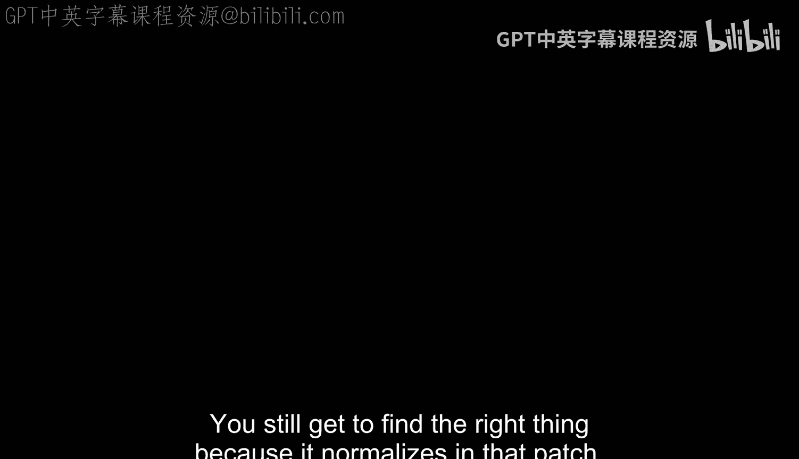

Yeah， so that's a nice thing because now you're basically looking at。有。

N like the statistics in that region。 And it doesn't actually matter what the actual values are。不是要。

If it's half of the eye， it will kind of get， Yeah， because the normalization will get， you know。

 better， but better good。😊，い发。Brighter， you mean like， this is brighter or。In的。

So this is the cross correlation。Without any normalization。Like this one。

 this is some of square differences。So there's no normalization here。

That's the problem with the sum of square differences。那个没笔。

I think this is the first time the bond came up。You mean， like here。

 in the normalized cross correlation， this is the impot is。 This is with the bomb。这个没有问。どの？yeah。

 it's， it's because of the like kind of the normalization the I show does。

 I think like these values are gonna be the same， right， Like obviously。

 all the value responses outside the bands are the same。 But now like the。

 the reaction here scale is going to be different。😊，The was the moment。Yeah。In this case。

 it changed the highest value。 Probably when this is here， this was probably like， say。

255 or something。 And then when it is here， it's like smaller number or something like that。

 And then just the image just normalizes this image。 Like it these。

 this value and that value should be exactly the same。😊，Which browser with in template， Which one。

You mean like you were matching the colors。Yeah， and then you were also doing like normalized cross correlation or SSD。

It's same。Yeah， it's exactly the same There。 you wrote like for loop， right。

 like to like kind of check， is this here， iss it here， Is it here， is it there is it there。

 You could have thought it， You could have written it like a linear filter。Yeah， so， so there。

 you know， you don't wna use the whole image as a kernel。But like， suppose you， you know， cut that。

 Yeah， it's kind of it's a similar idea。It's just there。

 The image was the kernel was like the size of the image。认。😡，Oh， oh， no。 Okay， there's more。

 than4 minutes。 Okay， so。Okay， what's the best method。 The zero mean filter is fast。

 but it's not great。 You know， the sum square difference is fast， but it's sensitive。

 normal cross relation is the slowest because there's more flu flop。

 But then it's nice and imvariant。😊。

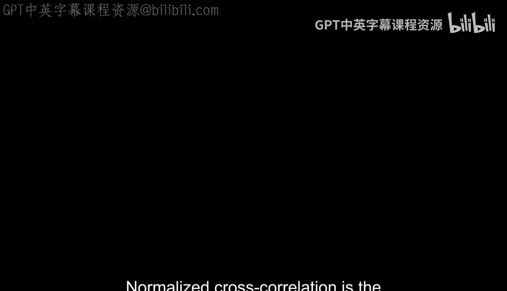

So， there's nice things。There's another way of using filter， which is to do denoing。

And so you have all of these， like， noise。And then you can do Gaussian。

 if you have this additive Gaussian noise， randomly。

 I just generate random number generator from Gaussian。😊，Flat it over here because， you know。

 whenever you take pictures， there's lots of noise， like， you know， dust flowing around。

 dust in your sensors， right， And so you can do this。😊，But the problem is， is that often。

There are this kind of salt and pepper noise。Okay， and the problem is that like。

 if you just smoothed it， you just get like。Like， you know， blur your images of this。Okay。

 and just blurring it is not exactly what you want。And so， in these cases。

Alternative is that you can actually do something called the median filter。

which is you take this kernel image right， and you compute the median。 What does the media do。

 The median sorts them value and takes the thing in the middle。

 And you're gonna replace this 90 with the median value， which is 27。😊，Is medium filtering linear。No。

 it's not linear because you know， you can try some， you know， examples。

 and you will see that the that the the additive property doesn't hold。

But that's nice thing about the median filter is another way of saying median filter is like being very robust to outliers。

 You don't want to be sensitive to these like one off noise。 Then you run median filter。

 and you're not gonna be affected by it。 as opposed to if you did a Gaussian filter。

 it's still gonna pull you out， you know， move， change you。😊。

And the medium filter is a very nice way to fix the salt and pepper noise。😊，嗯。See。

 so the median is the thing at the bottom。 And the Gaussian looks at the top where like， you know。

 you do get deterioration in both ways。 But Gaussian。

 you can still see the salt and pepper annoyings。 as suppose it was the median。

 You don't really see it。Okay， and now I don't really have time， but。

I kind of want this is the topic that is going to get covered in this recitation on Thursday。

 So I'm just gonna leave it there。 maybe， but I w to tell you like a super。

 super high level idea because this is super important。

 And it's very similar to what transformers do。 Okay， maybe that will get you interested。😊。

The thing is， you don't want to just blur the whole image because you're going to get this blurry mess。

Obviously， it's kind of what you want is that you blur the stuff that are nearby and you blur this。

 but not across the edge。Right， what you want is that you want your Gaussian filter to be like， oh。

 if there's an edge， I am not gonna mix it。You know， what I mean。

 it's like you eat the Chinese hot pot。 There's like the white one and the red one。要我的。

But diffusion can happen inside it。So what you're gonna do， which they can tell you。

 is multiply these filters。 And then you're gonna to figure out a way。To basically make it。

 you multiply this。 Then you're gonna。 So this is like basically the edge response。

 You're gonna multiply that with the Gaussian。 That gives you like， the separation that you want。😊。

And then so you can think of it as that Chinese hotpot。So this is， that。

 And then this is a really nice way。 It's called bilateral filter。😊，It's， it's nice。 You mean。

 it's like all of these edges are preserved。 You're not mixing above them。

And it changes you have to change the filter size of every single location。Anyway。

 this is kind of what transformers do， But you can ask Gulong and yvo what that means。😊。

