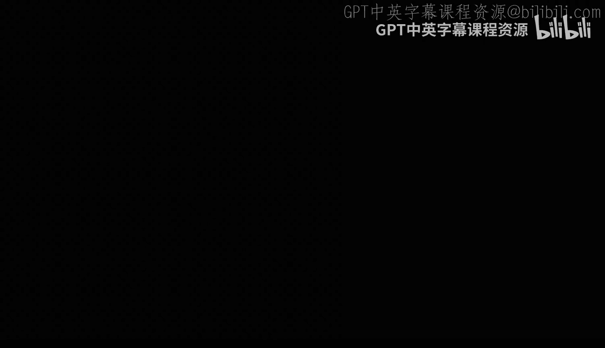
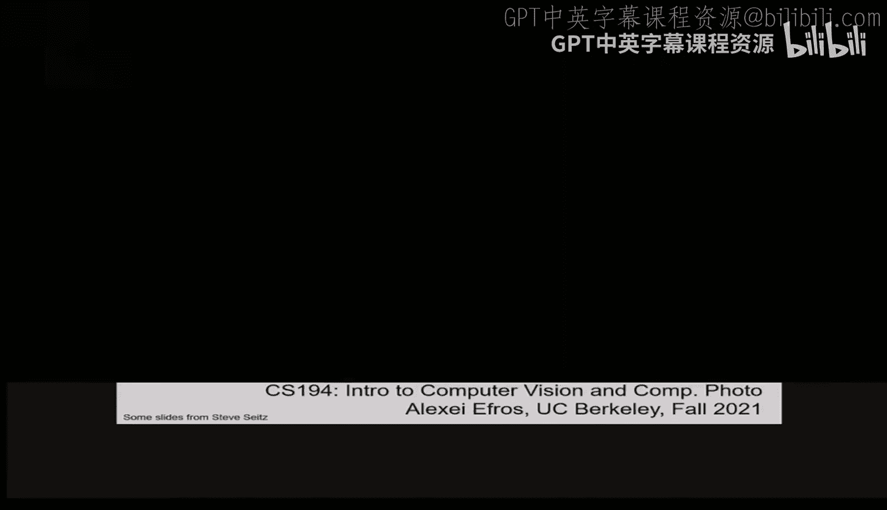
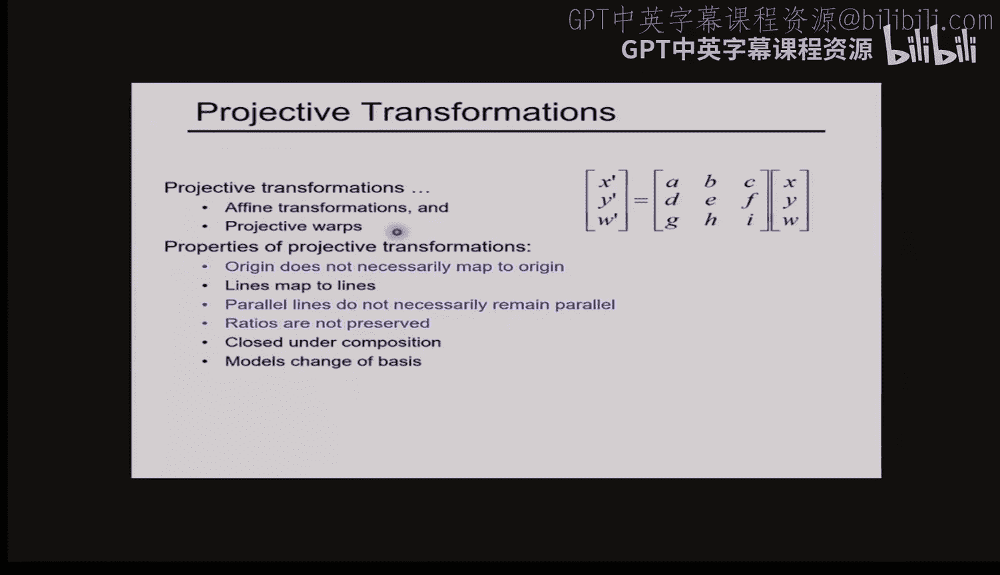

# UCB《计算机视觉与计算摄影学｜CS 194-26 Computer Vision and Computational Photography 2022》中英字 p07 -P07-7-Image Transformations-.zh_en -BV1w7UfBdELA_p7-

えてて。二年。Alright。And。I guess。We are good to start。Sit down， sit down， I will turn off the light。

 and then you'll be stuck in darkness with no photons to guide you way。We are。

Continuing our tour of the world's great museums。Today's exhibit is from the National Gallery in London。

 lovely museum on Strfel Galllery Square， free admission。 And if you walk。

 I think it's in the third room as you enter， we have Colbein， the ambassadors。😊。

Something interesting in this painting。😡，Supposedly nice to rich dudes。 Obviously， you can see。

 you can see example of how rich they are because they have all this fancy stuff。 They also have。

 you know， arts， right， represented by this loot。 So， you know， everything is great。 except what。😊。

Except there is death in the background。How do we know there is death in the background？

Any sharp eyed person can tell me now or do you need a hint。Scall， yes。Does everybody see coal？

For those who don't see it yet， what you do is you come close to the painting on the right side。

 and then you turn left and you look at it obliquely， something like that。And then you see a call。

So the point here is everything is groovy right now。

 but don't get too obnoxious because death is going get you eventually。 And this is51533。Just the。

 you know， the very beginning of the Renaissance。 So this must have felt like magic。 It's like， wow。

 you know， you have the secret message encoded in the painting。😊，But， as we'll find out today。

Not secret at all。 In fact， it's called image transformations， which is the topic for today's class。

All right。So image transformations。😡， you know， what can you do with your。

Your two dimensional array of pixels， right， And so far。

 we have talked about one type of transformation。Image filtering。 Okay， image filtering。

Can be modeled as where is my little point， you think。Can be modeled。

As transforming the range of the image。 So you have your image F of X。

 and then you put a little transformation T on top of the output of that image。

And you get a new image G， right？😡，So point processing like make things brighter or darker。

 blurring all of these things。😡，They operate on the range of the image。 They operate on F of T。Okay。

So the X， Y is not changing at all。 The only thing that's changing is we're operating on making things bright。

 brighter or darker。 Okay， so that's image filter。But there is a symmetric， well， not symmetric。

 but another type of transformations that we haven't touched on yet。

Which operates on the domain of the image。So here， if we look at the equation。

The transformation is on the coordinates， on x。F itself is unchanged。😡。

But the transformation is on the coordinate。 So G of X is F of some transformation T of x。唔该。

And here， the actual brightness values。Of the pixels are we， you know， they remain。Untouched。Right。

We don't change the brososis。 We change them。 We move them around。

 We move them around the coordinates。 Okay， so here we move around the range。

Here we move around the domain。 Okay， now， of course。Once everything is said and done。

 we can combine them and do both of them， but。For now， we are going to just， you know。

 examine them separately。 So all the image filtering stuff was this guy。Something like this。

And today， we' are going to talk about this guy。How do you change the domain of the image。

 How do you change the coordinates of the image？Okay。Here are some。But not。

 by no means exhaustive list， but some transformations。That we'll be touching on in this class。And。

And， and there is， there is， there is many more different types of transformations For today's lecture。

 we will focus on。Parametric or global transformations。 Okay， what do I mean by that。

What I mean by that is that we have some。Point P in our image。

So we have a point B that has coordinates X and y。And then we apply a transformation to that point P to get a new point P prime。

应该。And。It's basically a， this transformation T is like a coordinate changing machine， right？

 It basically just maps coordinates of P into some new set of coordinates， P prime， okay。And。

What does it mean for T to be global？😡，It means that for any point B on our image。😡。

T is doing exactly the same operation。ok。It doesn't have to be the case。

 and we will see later how sometimes you for the left side of the image。

 we maybe move it up and or for like for my left eye I move it up and for my right eye move it down like。

 right？😡，So we can do that。😡，But for today's lecture， we will focus on。

A set of transformations that are。Independent。off。Where you are， it's the same transformation。

 not independent where you are。 but it's basically。

 it's one formula for all of the points that we want to transform。Okay。

 it's the same transformation for every point P。And being parametric。

 we can describe it with a few parameters。😡，Okay， so a small number of parameters can describe this transformation。

唔该。In fact。We are going to even make even another simplifying assumption。

 We are going to consider linear transformations， T。Okay， so what does it mean linear。 Well。

 one thing it means is that T can be represented as a matrix。 Okay。

 so here is a standard transformation。Our point P prime。Is。

Our point P multiplied by some transformation matrix M。Okay。

 and here I will write it out in terms of x and ys。 Okay， so basically， anything。Any matrix M。

By the way， what's the， what's， what's the size of M。2 by two， right。So any matrix M。

What make is a valid transformation。That can bring our point X Y into a new point x prime y prime。So。

 first are good。Questions。Okay。So let's just look at some of the for those of you guys who took 184。

 this should be all review， some， some standard transformations。For example。

 I have a picture of a house， and I， you know， I want to make it bigger to， you know。

 to sell it for twice as much money in the， in the this today's market。 What do I do。

 How do I make it twice as big。If this is a picture of a house， how do I make this picture。

What's the transformation，Well， in this case， you just multiply x by 2 and y divided 2， right。Yeah。

What about this thing。I can make it wider in x and squish it in y。Well， it's the same thing。

 I multiply x by 2 and y by by one and2。Okay。So here is our transformation for scaling。

RightSo I have x prime is is some a times x Y prime is B times y。 What's the matrix form of that。

And let's see if we can。Find。😔，What's the。Yeah。Also young， but less like。 Okay， so what what's。

 what's，'s the way what's the matrix form of that。Yes。A， B， and sub zeros。Right。

 and hopefully you guys will remember that this is all going to work out。 Very good。Allright。

 what's the inverse of this transformation。 S， S is for scale。If I want to undo。What's the inverse。

S equals that。X inverse is。Somebody from here， maybe。Yes。1 by A，1 by B， still zeros。Very nice。

 So far， so middle school， right。😊，Alright， let's do a little trick here。 What about rotation。

So I have my po X， Y。And I want to rotate it。By angle theta。To x， prime and Y prime。Again。

 there should all be， hopefully a review of your linear algebra。 Does anyone remember。

Shouldn't have been too long ago， I hope。Anyone。Well， it's， it's a little bit annoying。

 but it's this。Anyone remember why。Well， okay， we could do it。 It's not that hard。 So let's do。

 let's do， let's do this。 Let's add this little fee。For， for now。

And we write x and y at the original X and y in， in polar coordinates， right。

 So you basically we have， we have R， which is the length of that vector， cosine p， right？

 That's our x。And our s that's our y。 So far so good， no， no complications， right。

 And then x prime and y prime。 Well， it's the same thing except that we add this theta of ours。So。

 far so good。Okay， now let's just ch chug in some， some identities。

 So hopefully somebody remembers this strict identity from， from middle school， right。

 that that we have this whole。sum of two angles is that thing， right。

So if we have the sum of two angles here of like cosine of the plus theta， it's that whole thing。

 and we put R on the side and we have that guy is equal to that guy。So， far， so good。Okay。

 now we just plug and play， right， now we say， wait a minute。That thing。All this stuff with the。

Is x and Y。 So we can just replace everything that has p in it by x's and y's。 And today。

 we have our solution。 And the nice thing is that the solution does not have any fees， right？

 So it doesn't care or or ours。😊，So we got rid of the fees and the Rs because it doesn't matter which angle you start with and how far your point is。

 all that matters says how much of an angle you want to rotate by。😡，Yes， hopefully you remember this。

Okay。那么。This this is how we write it down in a matrix form。 this is our matrix R for rotation。Okay。

Now。Oh I shouldn't show this。Because usually everybody or some people like myself。

 when I was learning this， get confused。Because it's like linear transformations， right。

 Linear transformation should be， should be linear functions， right， basically multiplies and ads。

And here we have something that's obviously nonlinear。 Remember， the sine function and cosines。

Not linear。So how could this be a linear transformation if it has signs and cosines inside。

Somebody from the back。 I want somebody from the back。

Because they always think that they can get away without answering questions。 Last throw。

 somebody from the last row。be brave。I don't bite much。Okay， and what about。

 what about all these sides and cosines。And。Yeah， because we fix theo。 We decide ahead of time。

I want to rotate by 15 degrees。So as soon as they decide that。I can evaluate cos theta。

 Cos 15 is some number。 Sine 15 is some number。 Now， those things just become constants， right。

 And so now， this is just four numbers。Okay， so this is nonlinear。It， either with respect to the。

 with the to with the with the angle， but。We， we can just， you know。

 we don't need to worry about the angle because we decided it once and for all。 Okay， and this is。

 this is， this is why this is still all good and linear， okay。嗯。What about the inverse of R。

How what if I want to， you know， undo this。V rotationation。What do I do。Transpose， why。

So what does an undo operation means。야呀。That's all fine。 But why is it transpose the inverse。

Can you prove it to me。Very good。 You plug in negative theta， instead of theta。

And then all the things the the signs become cosines and everything becomes a transpose。

 exactly exactly。 So a rotation matrix。 And， of course， you know。

 you also should know remember for linear algebra that a rotation。

 the inverse of a rotation matrix is its transpoposedse。

 But here you could actually viscerally test by just plugging in the the negative of that angle。

 and then you， you get it back。😊，O。第二一个。Okay。Okay， so we have other2 by2 matrices， identity。

 what's the identity matrix。Identality transformation。Well， it's what it sounds， right。That thing。

What about。Scale around 0。 I think we did that one。Yes， we did that。Rotation， we did that。Shear。

 here is another one。So sheer is this guy。You basically have。

The of the aagonal elements are doing this like。 Shear basically looks like， you know。

 you have a house and then like earthquake。That kind of thing。 That's a shear。

So you don't want too much shearing forces。呃。Merr about the Y axis。W。What is it， Juan， onean， right。

Mere over 0，0， I think。Look at this。 I got it right。Okay， duty translation wants to do this one。

Translate an X。啊的啊的。Add a translation term。What's the matrix。看完呀。

Can't be done into the exactly trick question。We can't actually do it。 This is kind of crazy。Right。

 like one of the most important operations。 And we can't actually do it in with 2D transformations。

We'll have to do something annoying and go and grab ourselves a third dimension。

 So hold that thought。 But for now， cannot be done。O。Y。Can't it be done， Can you give me a little。

Kind of intuition， why。So if you remember， you have your x。Needs to be X。Plus。T X， right。

But the problem is。So here is your x。Right， you're multiplying it by something。You have your x prime。

 Y prime。So you， you multiply x by something here。 So this multiplicative term。

 then you multiply your y by something。 That's， that's that's another multiplicative term。

But you don't have a place to put the constant in front of， of， of this guy。 Like。

 there is no place here for that。Extra shift。O。So。Shifts are a problem。For22 D transformations。ok。应该。

So。Here are。All the 2D linear transformations under the sun。They are ABCD。All two by two matrices。

Can be thought of as a transformation。So， any。ARandom four numbers， ABCD。Produce a transformation。

 Induce a transformation of your image。Do something else。唔该。

What are the things that these transformations can do。Well。Turns out that all transformations， ABCD。

Are made up of these four basic types， scale， rotation， shear and mirror。😡，O。That's it。 So all。

 all of the transformations out there that are possible are some combination。

 some multiplication of these four types of transformations， okay。So， you can basically。

You can keep multiplying by a whole bunch of different matrixes。 You can have a rotation matrix。

 You can have a scale matrix。 You can have a mirror matrix。 You just collapse them together。

 You have， you know， pre multiply all these matrices together。 You have some matrix。

 And that matrix still is only。😊，Only be able to do just these four operations some in some order。

 okay。What are the properties of these transformations。Origin maps the origin。Okay， if you started。😡。

If your house was centered at zero， no matter what you do， it will still be centered at zero， why？😡。

Why is that。誰。Sure， you， basically， we don't remember we， we cannot do translation。

 so we cannot get it away from 0。 Yes， so basically。There is no way to shift anything。O。

L lines map to lines。 Okay， so if you start with a straight line。No matter what you do。

 it's still going to be aligned。 It's not going to become crooked。

It's still going to be a aligned line。 Linear stuff。Parallel lines remain parallel。

Kind of good to know。O。Ratios are preserved， and it's closed under composition。

 So closed under composition is a term from a group。A theory of groups。 It means that no matter。

How many。Transformations you compose， and here we're composing them very simply by just keep multiplying by different transformations。

You， you will not be able to get out of this set of this group of 2D linear transformations。

 They will， you're all stuck in there。 You， you cannot jump out of this。

 of this family of transformations。 You are still。Fixed by all of these properties and all of this。

 all of these rules， okay。So far so good， any questions？Okay， yes。Yes。Can you could just defined。

Example to be like。哋翻台嚟噶。这三。Okay， Segan， you you define what。top left。This one。Left， this one。

Like one。P one。Plus。TX。Over oh， no no， But I cannot have x here。 It cannot have x in the matrix。

These should be constants。 Yeah， yeah， the X should be here。款9二0。でれか。So we will get to them。

 This is basically what we're going to be doing， but we need to do it in a linear algebra way。

 which is we can only have variables here。 We cannot have variables inside of the transformation。😡。

Those should be constant。RightBecause we want it to be independent， right， We want it to be global。

 If you put an X here， it doesn't， It's not global anymore。 It's dependent on the X。Yeah， cool。

 but we'll get there。 No worries。All right， any other questions？O。Now。

Let's think about this whole thing in a slightly different way。 And again， this is hopefully。

Linear algebra view。Okay， but I think it's， it's， it's good to， to think about it again in。

More concrete terms。So， let's say。That you have。You have a point Q。唔。A point Q。Is。

In a particular basis。I J。Okay， and this happens to be our Cartesian basis。 So I is a vector 1，0。

J is a vector 0，1。 So this is kind of like our x and our Y。 Okay， and then we have a point Q。

 And remember how we can write point Q。Using vectors， right， we can say our point Q is what。😡，One，2。

 three， four eyes。And then plus1，2，3 Js， right？😡，So our point Q。Is that。

Vctor algebraic expression here。 You go four times over for you you follow J four times。

 and then you add three of I'。 and here you get to that point， Q。And then we arrived it for short。

Shortness of notation。 We， We write at 4，3。But four or three just means in the current Cartesian coordinate system that we are of by default。

 assuming。😡，This is basically shorthand notation for4 or y plus three of js。Remember that， yes。应。Now。

What if I have。A different coordinate system。Okay， I am allowed to do that。

 I can define a coordinate system UV， for example， okay。😡。

And the U coordinate system is not the same as the Cartesian one。

The U coordinate is actually points to some vector U I， U X， U， Y， and V is V， X， V， Y。And who knows？

 It's not even orthogonal。ok。😊，But。I can still write down point P。In that coordinate system。

 So what's that point P going to be。In， in vector。In terms of vector sum。What is it going to be。

It's going to be4，1，2，3， four times I go towards U， and then I do one，2， three times towards V。这个。

So point P here。😡，Actually， has the same notation。As point Q。

 but actually they are different points right， because these four。

3 mean completely different things that these  four， three because they' are in different bases。

 theyre based on different， they're shorthands under different definefis of your coordinates。😡。

So far so good， hopefully people are remembering this， yes。Okay。Now。Imagine。

And you don't have to really imagine very hard， because。Your project number three。

 which is going to be out on Wednesday， will actually have you do that。😡，So， you know。

 imagination does， doesn't need to go that that far， imagine。That you want to。You want to change。

You want to know what a particular point。😡，In one coordinate system。Will be。

In a different coordinate system。Let's for now， consider the kind of simple case that you have some crazy coordinate system。

 U V。 And so you have point P in， in coordinates U V。And then you want to see what that point be。

Is going to be。In。In the Carteian coordinate system， I J。Right。Well。

That is actually not that bad because what you can do is you can say， well。The point be on IJ。

Is going to be。 I'm going to take。Four times。You。Right。One，2， three， four of you。

And then I am going to add three of V。 And since U and V are defined in the quoitian coordinate system。

 Im actually going to get exactly that same point。😡，Using this a computation。

 it just that you and V now， instead of being。You know。0，1 and 1，0。

 They are actually vectors that actually point somewhere else， okay。

So this transformation turns out to be not that hard， okay。In fact。This transformation。

 we can write down。In， in， in a more， in a more nicer form。 So first。

 we can write it down separately for， for the X coordinate and the Y coordinate。

And then once we do that。Then of course， the natural next thing to do is to write it down as a matrix transformation。

So what is the matrix transformation。That is going to transform。My point P from coordinate system。

 U V into Cartesian coordinate system。啊。😮，A little bit louder。You。Okay， yeah， yeah， yeah， yeah。

 I think， I think you got it。 Yeah， you basically， all you do。Is your just。

Put your you as one column。Your V as the second column。

And youre basically your coordinates of in the original in in the U coordinate system。

 The coordinates are 4，3。 That's your coordinates in， in the original thing。

 And you're just multiplied by this matrix。And boom， magically。

You get their coordinates in the Cardian system。Right。So， this is actually。Kind of cool。

Because what does this say？That says that， any。2 by two matrix。You can think of it。

As a change of basis。😡，Any matrix you can come up with。Can be thought of。As mapping points from some。

Coordinate system。To the Cartesian coordinate system。And what is that coordinate system？

What is that coordinate system if I give you a random matrix。😡，Where is my。Have a random matrix。1，2。

3，4。What does this matrixx do？What is this matrix？What is， what is， what basis is it changing from。啊。

😮，Well， to Cartesia， but from。It's changinging from the base U being this guy and V being this guy。

Right。So this is， I don't know。 I， I thought it was pretty cool that basically any matrix out there。

Acts as a change of basis from。The basis from the basis being the the two vectors being vertically stacked。

To the， to the Cartesian coordinates。OK。So far so good。Now， this is not everything yet。

Because what if we want to do the other way around？Okay。What is the inverse question。

Was there a question。Maybe not。 I don't see anyone question no。

What if we want to do the other way around。What if we want to go from？Our Cartesian coordinates。2。三。

😡，We are new bases， Uv。ok。Now， you would think it's the same as just writing them down in a matrix somehow。

 but it's a little bit more complicated。So if you look at this。

 So here is our point in Cardian coordinates，5，4，5， I plus 4G。Okay。

 and now we want to see what that point would be in a new coordinate U。So what is that thing？Well。

What it is。Is that thing。Is going to be。That coordinate times u plus the the y coordinate times v。

Okay， so basically， what it is is it's the inverse。Of that transformation that we had right now。

 okay。So we need to undo that transformation to get where we want。Right， so basically what we。

 what we have here。Is we need to have an inverse of our mapping from this guy to this guy。O。

And that will give us。A way to convert from Cartesian coordinate system。

Cdion basis to any other basis。ok。So。呃。Do I have this。Yeah， okay。So。Now， we can go。From。Cartesian。

Do any basis。Easy， write it down vertically you're done。We can go from any from sorry。

 from any basis to Cartesian， you write down the vertically the coordinates and you're done from Cartesian to the back to that basis in the it's the inverse of that。

Now， what if I want to convert from any arbitrary basis？UV。To any arbitrary basis， W， whatever x。WT。

What do we do。I mean， there's， there's many ways to do it。 but the easiest way。Is。

Since you have all these building blocks。😡，You can go to Cartesian， and you can go from Cartesian。

What can we do。呀。Yep， exactly。 so you can have one transformation that goes from your basis to third basis to Cartesian。

Then you do the inverse of the transformation from the second base to criticalthesian。

 and then you just multiply those two together。 And boom。

 you have a transformation that goes from any basis to any other basis。

There are other ways to get there， but this is， to me the simplest thing。😡，Very good。Now。

Inverses are hard。An annoying。Under。Which。Conditions。We can， this inverse could be easier。Like。

 what if I want really want the inverse to be just like a transpose， just like with rotation。

When would the inverse of this transformation be a transpose。有。呀。24呀。😡，Asogano。Right。If。If our core。

 if， if if our bases are orthogonal。Then indeed， the change of basis is nothing but a rotation。Right。

 because here， imagine if， if， if our V here is like going this way， which。Like this。

 I already have it written down， right？Then， look， it's totally rotation。

And so then we can undo the rotation by just the transpose， because we already decided that this is。

 this is how we do it。O。So if you want to just move around， change your bases and they orthogonal。

Easy， P。 It just， it says a transpose。 In the general case， you have to actually， you know。

 take the inverse。Okay， yeah。 so look at this。If it's orthogonal。Or I guess north than normal。

Then it's basically， you just write down your coordinates horizontally， and you get your。

You're inverse this way。唔。So far so good。Any questions？change of basis， all figured it out。😡。

It will be totally easier on the， on the project。Well， I'll mention it again next time。

 just once we get to。You know， more applied part of it， but。You know， hopefully if you're。

 if you're unclear， just get， get out your string book and， and。And double， you know， reread the。

 reread the the the change your basis part。Question。Yes。Yeah位。I will ask my dear co teacher， who has。

So he's saying like if they're both the same angle， if the angle between the bases is the same。

 even if it's not 90 degrees。I'm not， I feel like no。Like the angle is like 30 degrees。

 instead of 90。Between the， the two base vectors。Will it still be？Yeah， no， another。

 I I don't think so。If I were to bet a gelato on this。I would go， no， but。

This is a probabilistic answer。Yeah， I don't。 I don't think so。 I think。

 I think you actually want them to be orthogonal。 But， you know。

 extra brownie points for anyone who remembers and posted on piazza。

And we do keep track of brown newar。 Oh， yes。Yes。And。啊哈。な理。don。The point that。Cation make。

The general。O I。おまだ。You're thinking of this as rotation。But I think it's better to think of it as a。

这る。Yep， because remember， this is， this is actually a basis。 So you like。

 you need to make sure that everything inside that， it also。Corresponse。

 so I think it's not quite right。 But， but we will， we'll check on that。打给。😡，Okay， now。Now。

 let's get back。To translation， because， frankly， you can't really live without translations。

 unfortunately。You have to move。And not just multiply and divide yourself。

Like that house it needs to move sometime。So we need to figure out a way to get those Ts in there somehow。

 okay。And so， the idea is。What we need is we need something here。😡，To get to get this T inside。

 you know， inside of this expression， right？We need to have。

We need to have this T multiplying something in the matrix。

And if there is no place for it in a 2D matrix。😡，Then， the argument is。Make it a 3D matrix。O。And so。

 the idea here。Is kind of obnoxious and obnoxiously simple。YouJust add another dimension。O。Now。

 these are called homogeneous coordinates。I guess at some point we'll tell you maybe if there is time。

 we'll tell you the beautiful， glorious story about homogeneous coordinates are relate related to a beautiful part of mathematics called projective geometry。

😊，But not now。 for now， think of it just。Hack to get your。Translations inside of of， of the matrix。

Okay， make translations part of a linear transformation。Okay， and the hack is。You just add one here。

And what does it mean， once you add a one。This guy has to be now。A 3 by two matrix。Right。

So now there has to be something here of multiplying X。Alpha x。B multiplying y。

And now you can have your little T X term。That will get you that offset that you couldn't have before。

And you can even have a T， Y term。If you want to also change it by white。O。

So the homogeneous coordinates basically。Just， you add。You add a third coordinate。

But that third coordinate is not really。Kind of an independent coordinate in itself。

It's basically just a little hack。So。This。I one？But it's also equivalent to2 X。2， y2。Right。

 so these two vectors in homogeneous coordinates are the same。

 They're not really the same in like 3D。Li algebra， obviously， right。

But they are the same homogeneous coordinates。So that's kind of， that's what。

Makes homogeneous coordinates different from just saying， oh， we'll just do everything in 3D。

 because this is not quite 3D。 It's kind of like laboomized 3D。It's， it's a 3D except that。

It's still， this is basically still a 2D point。 It just this is a 2D point with three coordinates it。

唔该。Does that make sense。Hopefully， it will make more sense， when we actually talk about。

Talk about projective geometry。 But for now， it's basically think of it as a hack。Because now。

 look at this。Now， our transformation。Translations could be written down nicely and elegantly。

In a matrix notation。You can do it as a 2，3 by 3 matrix。

 but you can also do it as a2 by two matrix because the。

 the first coordinate you don't really use anywhere， okay。So here is an example。

 You have your little house。 You want to shift it by 2 in x and one and y。 just put it。

Put your little guy here。2，1。 And then you do the whole multiplication thing， and you get x plus Tx。

 Y plus Ty。And in the end， it's still， it's still one， which is good。Okay。😊。

And the nice thing is that not only can we do that。

 but we can now add translation to all of the other 2D transformations that we know and love。😊，So。

Here is our translation。But we can also have。A scale in homogeneous coordinates。

 We can have rotation and homogeneous coordinates。 We have shear in homogeneous coordinates。

 basically everything else。Just works。 You just add， you'd add the little， you know， you make a3。

3 by three matrix and you add the little one at at the at the left right lower position。And now。

Things just work out because now you can compose。All these transformations， including translation。

So you can say I'm going you know， I'm going scale things。 I'm going to rotate things。

 and then I'm going translate things， and I can just multiply them one by one。

 multiply my point1 by one， or I can pre multiply all these matrices together， compositionality。

Grouped them together Pre multiplying。 And then I have a1。

3 by3 matrix that does all of those operations boom at once。 And I。

 I save a whole bunch of computation because one matrix does everything for me。

So basically it's the same story as our 2 by2 matrix。😡，Except now。

 this also includes the translation， which is just very nice。Okay。Questions。O。Yes， good question。

 I have it on my slide。Does it？For example， you can also think about it in terms of。Like。

 do you first scale and then translate or do you first translate and then scale。

 You get to get different different results。In general。Matrix multiplication order matters。

 just linear algebrawise， right？😡，So， and it does so for transformations as well。 Yes。

 so the order does matter。 So again， for project 3， be careful， make sure。

You' are ordering things in the right way。O。Oh， I love the company。Allright， so now。Same story。

 but now。Plus， translation。And these transformations are now called a fine transformations。

Theyre like fine， but even better of fine transformations， okay。The， the 2D transformations。

Had four parameters， ABCD。A fine transformations have six parameters， right。

 because we have our friends， ABCD， but we also have the two translations。

 translation and X and translation and Y。O。What is， how are they different？😡，So， now we have。

Linear transformations。Like before， plus now we have translations。Something we didn't have before。

 Actually， this should be blue。Okay。What are the properties？😡，Well。

 the properties are basically all the same， except we have this new one。

 which is the origin does not have to map to the origin anymore because now we can shift。

 we can move it around。 We can have transform translation。 So that's the one x of thing that you get。

O。QuQuion。Here we are writing it down the homogeneous coordinates in a general way。

 So instead of putting one， we put a W， right。So which is perfectly fine。 You have a。

 if you have a vector。A B W。How do you know what is it。Canonical homogeneous coordinate。Well。

 you can just divide a by W。B by W1。Right， that's the same thing。Okay， so here I'm。I'm putting a。

It in general terms of W。But。The question is。If I start。With W equal one in the beginning。

Will there ever be a case when at in the end。W is not going to be one。No， why not。Second again。Well。

 that by itself is not enough。啊。There are zeros exactly。 This is one， and these two are  zero。

 so you cannot screw it over。Exactly， so。Here the homojis coordinates。

 If you start with something with one， it will always be one。Very good。Kind of important。Okay。

 because。Now we can go and we can。Fill in those zeroes。Okay。We can fill in those zeros。

 and this is going to be the more complex transformation that we're going to study。

 and it's called the projective transformation。 and the projective transformation is awesome because it just comes up in many wonderful places and there's such cool things that you can do with it。

But basically， it's kind of the more general thing。 right， This is the form。These are your unknowns。

 ABC， D of G， H， I。 Okay， What are we getting here。So。

Its projection transformation is basically all the fine transformations we know in love from here。

 which is all the linear transformation press translation。

 you kind of see this nested Russian dole kind of thing going on here。Plus。Projective warps。

啊，可以。And projective vers。Are things that I'm not actually going to talk about yet。😡。

