# UCB《计算机视觉与计算摄影学｜CS 194-26 Computer Vision and Computational Photography 2022》中英字 p08 -P08-8-Image Warping and Morphing-9_21.zh_en -BV1w7UfBdELA_p8-

啊啊。

Alright。Okay。Let's get started。Soう。啊。I。I did the talk。 I don't know if you guys remember。

 but I was supposed to do a talk at 3，30。

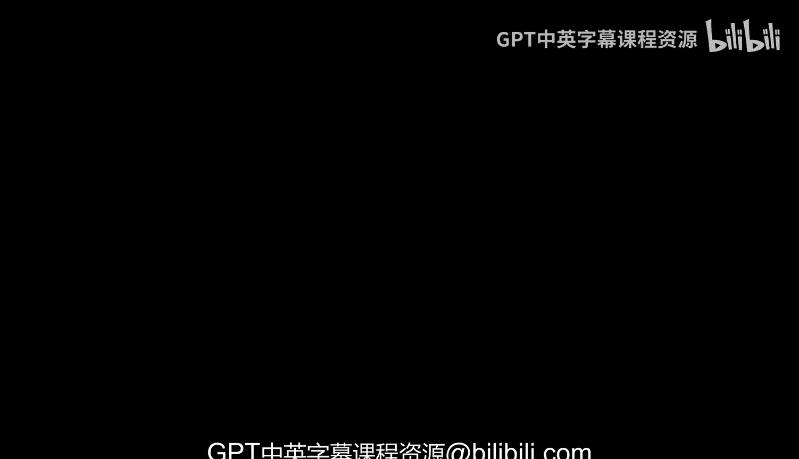

Which I did Thursday night。Thank you。 Thank you。 Thank you。 Thank you。 Thank you。 Thank you。😊。

You guys are don see。 It's gonna be on YouTube when it's ready， Maybe I'll post it on Piaz， but。😊。

I think that kind of messed up with my balance a little bit， but I'm all good。😊。

And I'm happy to be back here today。😊，Showing you these cool images。

 because this is what you're going to implement。😊，In your new project。

So you're going to learn how to do this。And even after this class， you would know how to do this。

We have。Of the technology or you know techniques that in order to do this。嗯。

And you can think about what you would like to do for your project。

 What kind of images you would like to do this morphing。In between。Okay。

 so hopefully that is motivating enough。Maybe a couple of you might be like， oh。

 I've seen this that like style again or like， you know。The recent generative model based approaches。

 this is actually， you know， pre deep learning。😊，嗯。There's some， you know。

 clicking involved which you will see， but。Anyway， dive into this。 This is super cool stuff。😊，Okay。

 so today's topic is image warping and morphing。 But before we get。😊，Going。I hope your project， too。

 went well。How was it。 Is good。Okay， good。 I see some thumbs off。 That's great。😊。

Project 3 is gonna be out today， after this class。😊，Or maybe it's already online。

Project  three is going to be harder。Then the first project。So。

 and then you still only have two weeks to do this， I believe， so。😊，You know。

 make sure you get started。 And after this class， you can get started， so。Let's get going。 And so。

 this is。bit of a recap， because I really hope you watch the lecture。

 Please watch the lecture that I sent。 Like， if you haven't watched it， who watched it， honestly。😊。

Okay， maybe I should be like， who didn't watch it？はいやい。Awesome， okay， this is really good。

 That's okay。 It's good。 It's good。 If you didn't watch it。

 you should definitely watch the five minute one， and you should watch the lecture。😊，Cause， okay。

 so then this is a quick recap， right， so。😊，Okay， with the， with the， with the。

With the hybrid emissions and such， we were manipulating the value of the intensity of the pixels。😊。

And now we're going to change the domain of this image mapping。 Okay。

 you're gonna do spatial transforms on the grid。😊。

Okay， not on the height， which we can do later， which we figured out how to do this is like the point processing that we've been talking about。

 Remember thinking about the image as like a surface。

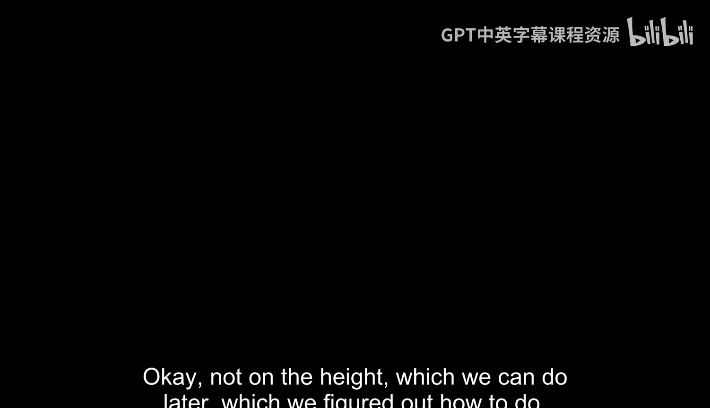

We're just moving like the underneath ground， shrinking it， stretching it and stuff like this。Okay。

 so the stuff that we've been talking about above is like， you know。

 you use the histogram to change the contrast of this image。Now。

 we are going to stretch the domain of this image。Okay。

 and we can do this by applying 2D linear transformations。And in this class。

 we would like to write everything as matrices， because then you can do things in linear algebra。😊。

So in 2D， you can write。Scaling rotation shoe and mirror with this。

 I think if you look at the lecture， you will see， you know， if you keep the， you know。

 identities into 2， keep off diagonals into 0。😊。

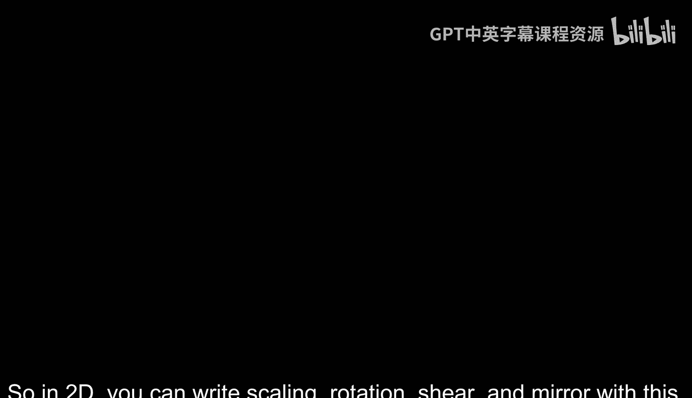

That will scale the images by two。In fact。Okay， question。

 can you do trans translation with this model。No， good。 Okay， great。 Okay， we're gonna get there。

 But one really useful insight from this particular lecture is that any point that you're writing like H is written in this Cartesian coordinate system。

😊，Where like the axiss are 1，0 and 0，1。

Right， and then you're， you're writing， I am four pixel to the right in this coordinate system。

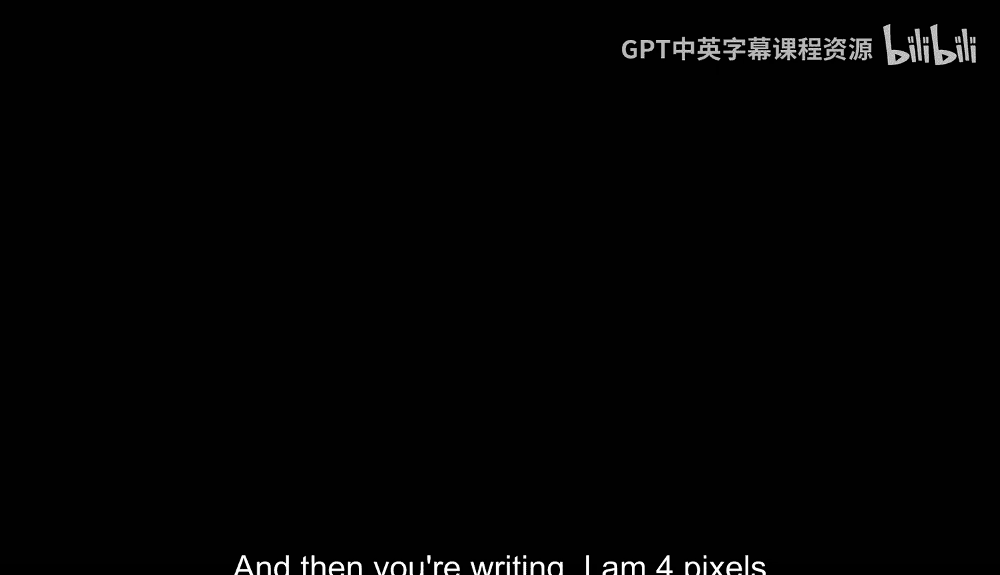

Right， like oops。I am 1，2，3，4。 So this is why I'm 4， I， and then 1，2，3。 So this is y 3 J。

 And so these are my coordinate system。😊，But you can't have a funier basis。Alright。

 and then you can also figure out in this coordinate system， which is a slightly different basis。

 What is my P。Okay， if you can count this， it's also 1，2，3，4。 So  four of you。

 which is given to us some UX U I。 And then again，1，2，3， a V。😊，Okay， now。

 even though these are both 4，3， like the meaning of the units are different here， right。Like。

 this is like units of one。 But I don't really know what this is。 It's a little bit off。Right。

 so you're still counting for in that basis。 Do in that basis。Okay， so then it's really a matter of。

You can basically ap point。 It's just a coefficient。Okay， in that particular coordinate system。

 where the basis is this or basis is something else。

If you think about correspond transformations like this。Then you can go from one basis。To another。

 Okay， so here's the problem statement， which is you are given。 this is your coordinate system。

 somebodybody gave you。 this is your U1 axis。 and this is your V。 And then you are 。

43 in this coordinate system。😊，Okay， but you're like， okay。

 but what I really want to know is what my coordinates are in this usual。System。Okay， so what is the。

 you know， value coefficient。To model。Is that clear。Okay， and then how。Mike， you do this。你呀。Okay。

 so you， you， you write U and B in a matrix。 and then you invert it。😊，I think it's， I think that。

 I think it's。The direction is something that it's， it， you're almost correct。

 you just don't invert it， but。诶。We can derive it， actually。 So this is really more like P U V X。

 P U V Y， Okay， basically， this X coordinate of this P U V is 4 in this month and4 in that one。😊。

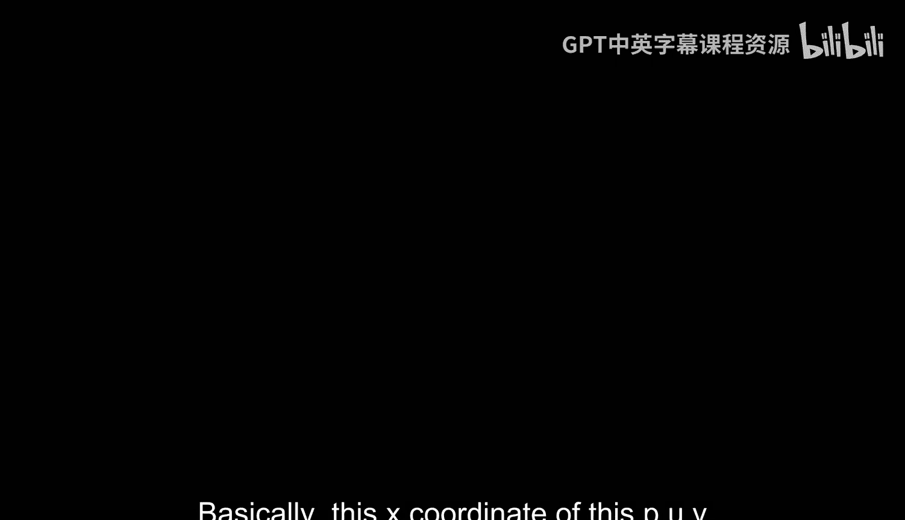

Okay， so then you this starts to look like systems of linear equations。Right。😊。

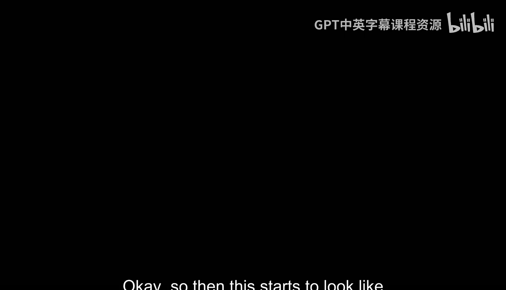

What， what is the matrix form。Of this， How can you write this as a matrix。Matri。I mean。

 this is almost a matrix， right。有。是的我 what is the tell me。Tell me的。I mean， okay， I think it depends。

 the annoying thing is in the slides。 It's kind of written in。Slightly different format。So。So。

Suppose I am writing 4 and3 here。Okay， what should it be。

有X。VX。Y， V are U， and then this will give you。

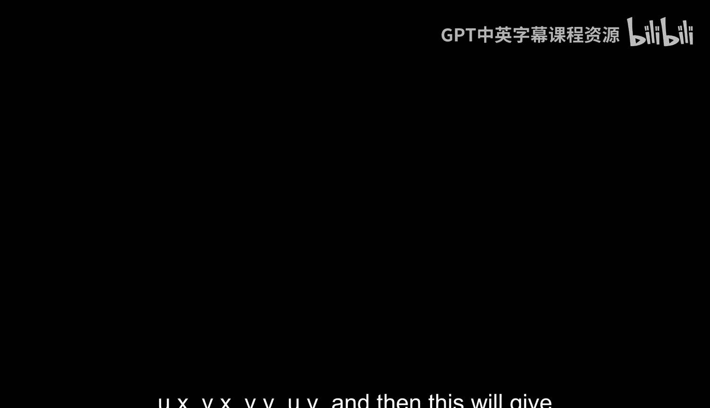

What is this gonna give you， P， X， PY。ok p x。PY08。No no no。Yeah， that that will give you PXUI。

That's on the thing on the right。Okay， and so basically， you can write。PI J。

 which is the coefficients， which we want to figure out。As a change of basis。

 you just basically take this。Coordinate。In that coordinate system， multiply with its basis。

 and you can。Get to the P I Z。this is just P U V， which is 4，3。Read in this way。Okay。

 and so the point is that the linear linear transformation is the basis。 And so this is the basis in。

😊，So if this is the PI J。Let me write it as P I Z。These are the question mark。系姐。PI。P X，BY。i姐。

If I wanted to。Go in the other direction。 What do I do。So， suppose I have。I know this。

I know what the world is defined in this funkiier new thing。

But I now I don't know what this point is in that one。What do I do。Yeah。

 take this inverse and you multiply here。 You multiply that inverse here。

 You multiply the inverse with this。 And then this becomes identity。 And so that's really what。😊。

Its kind of happening here。That's how you go back and forth。Okay。

 and you want to know this because in in your， what we will see。

 you will use this to go from one to the other。嗯。So you can change from any basis to any basis by multiplying it with its Oh yeah。

 So how can we go， So this one was going from like the Cartesian basis to this funky basis。

 What if I wanted to go from like one funky basis to another funky basis。😊。

Like。牙3呀。で。Exactly， you can go to the middle。And then go back。

 So you can use this as like a connection point。 You always go back here。

 and then you go back to the other ones。 Okay， so you basically compose these two。

 two kind of transformations。 And then you can go from anything to anything。😊，嗯。

What is nice about it if the bases are orthogonal。

You could야。So what happens if you take dot product of the basis if they're orthogonal。

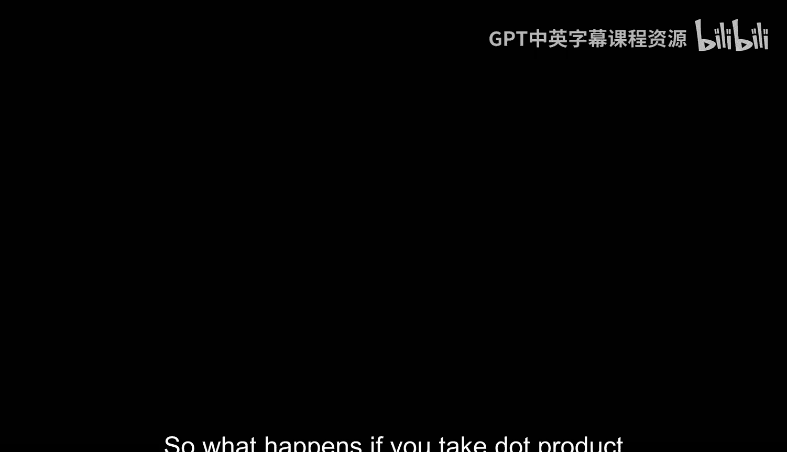

Or dog product of two orthogonal bases。Is there0。And， yeah， it's 0。 And then with itself， is。

 if it's orthoormal。Right， you take a ortho the you take a do product。Itll be0。

And then so this is why you take， you take this and you multiply it with itself on the other side。

 and they will get a1 in 0， and then 0 and 1。It's identity， right。

So this is why the inverse becomes transpoposedse。Yeah， like it's。Right， you did like。You。V。Yeah。

 so you take this。Uv， right。And then you啲 you。Is he go to one。UDV。Did he go to0。

So this will basically give you like。The identity。Okay， so whenever the matrix。

 I'm writing in this funky way。 But like， whenever this matrix is the columns are orthoormal。

 you can just take transpose。 And that's your inverse。😊，Good。Okay， so it's pretty nice。

 And most of the times， you know， we'll see。 I mean， I guess not all all the time。 It's。

 it's orthotgonal。 But so that was one we。 So you do watch the， you know。

 lecture more because it gets in close more detail。😊。

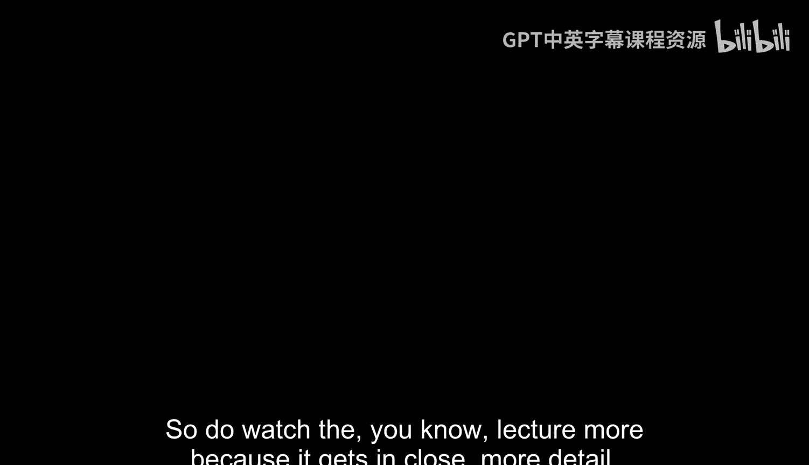

And then I want to talk about the homogeneous coordinates because， like we said， with this one。

 we can't do translation。😊。

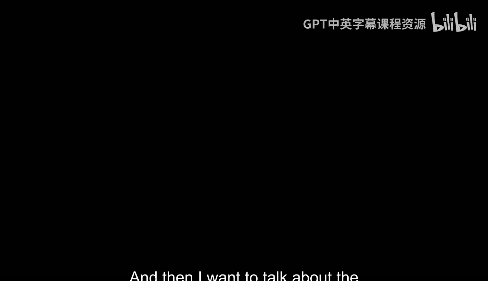

So how can we do translation。Yeah， at a division。 So this is like this hack。 Okay。

 the only reason why the homogeneous coordinates exist is we want to write everything as A X。😊。

A matrix multiplication， okay。You want to write everything as a。冇 by x。He goes why。O。

And then if this X was X， Y 1。You can do。Okay， so suppose A B。CD。啊。

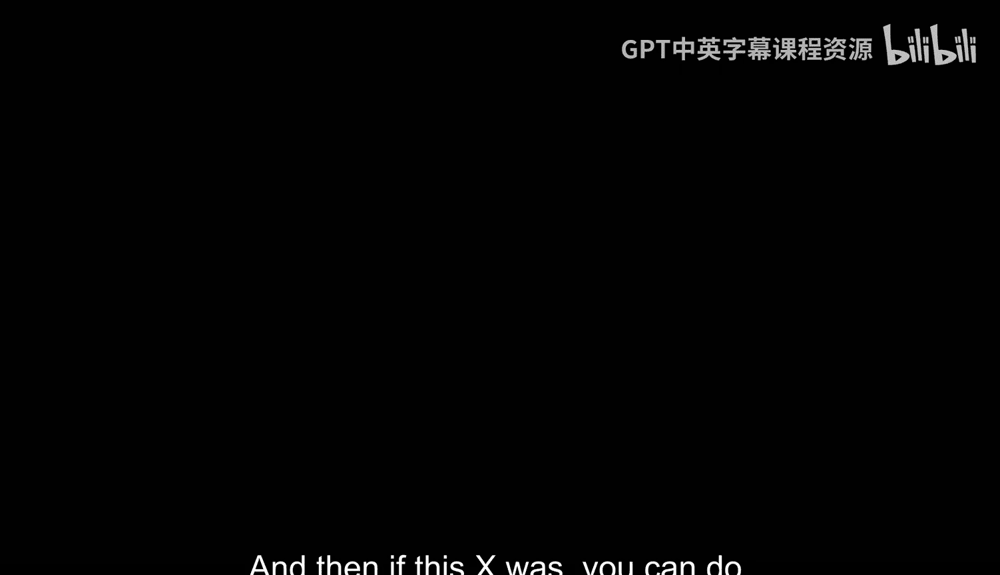

What is that。He。P。😊，BX。😊，你 then志位。And then0，0，1。Okay。

 because I will take this thing and multiply with that one。 That's A X， B， Y plus T T， X。😊，O。😊。

So you go like this。 And then now you can write。你好呀AX。😊，快 b。Plus see， or T X in here。😊。

I was like a single matrix multiplication， so。😊，Re you just really want to write it as this matrix multiply。

Because then， it's linear。And you can。

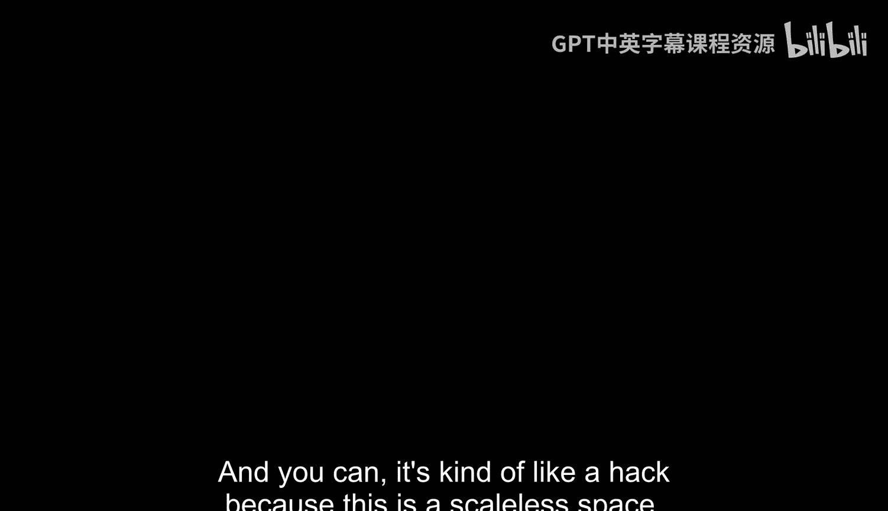

It's kind of like a hack。Because this is a scaleless space。Any questions about this。

Okay， this is gonna come back later， too。 when you do 3D reconstruction。

Its a very， very common thing to do。So， okay， so that's kind of this。And。

Another thing is that these mates can be composed， but is this commutative。😊，No。

And how do you remember， I mean， of course， maybe you remember from linear algebra that in general。

 matrices are not commutable。Right you can't multiply。 But I think here。

 you should just think about it geometrically。 You can scale and then rotate。No。

 let's translate and rotate。Translating and rotating is different from rotating and translating。

 So you can just kind of like do it in your head。 And this is whenever especially you're doing 3D stuff。

 even in this one。😊，Water matters。And you really don't want to miss up the order。Right。

 this gets scaled first and rotated and translated， right。イニで制御なんです。Right， so the order matters。Okay。

 all right。 So what I just wrote there。A fine is just a fancy way of saying linear。Okay。

 it means you're just like stretching。Yeah， stretching stuff。O。😊，And。

It's still linear transformation， as in。You can write， write it as in these matrices。

But because we added the translation， the origin is no longer going from up to origin because you're shifting things around。

O。😊，啊。呀。Will the last coordinate of W always be one。Yep， in this case， it will be because this is 0。

01。 So you， no matter what these values are， it's always gonna be well， W。In this case。Okay。

 and then homogeneous coordinate is a funky thing。 you just when you get something that when the third fake coordinate is not the one。

 you just divide that thing with that value。So any scale in this thing is equal。

 But in your experiments， you're all gonna do just one， so。嗯。牙。Questions about that。

It's a little weird h in order to make it work。Okay， so now the。We have a 3 by 3 matrix。

 In the previous ones， we were like， okay， well， we're gonna set to the last row is 0，01。😊，Okay。

 so how many do ease of freedom in this fine transformation。哦。You can count to the number of。

Free variable。So all of those things can be anything。

 The only thing I'm saying is the last row has to be 0，0，1。

 So how many entries of this matrix do I not know。😊，Heres 6。Okay。啊。

But when it gets to predictive transformations。The last row can also be anything else。Okay。

 in this case。Because the G and the H are not 0。You can add to the W prime is going to be G some scalar of x。

 some scalar of H。呃喂。Some value。 So it's not gonna be just W。 So before this is always W。

Next is gonna be W prime。And so you have to do something more on top of this。

 You have to do this thing where。You， can I draw， How can I draw。 here you go。

 You have to do something which is like X prime。Divided by W。Why prime。Divided I W。

And then W is W prime， W prime。And then the W prime is divided by W prime。 So it's gonna be one。Okay。

 just homogeneous coordinates are always this thing where you always reduce it to this form where the last row is one。

😊，Okay， so whenever the last row is none。1， you have to divide it。Okay， and this division。

Msses you up。Right， because the vision makes it non nonlinear。Now， things are like。You know， you。

 it's not like just scaling。 It's not just multiplication。 You。

 you're introducing this nu nonlinear your function， which is the division。

And this is why the parallel lines don't necessarily remain parallel。 And a very good example that。

 you know， Professor Eros talks about is when you go on the railroad。Right， you look at the railroad。

And the railroad is like clearly parallel。 I mean， cars is gonna going Fi it。

 But when you look at it， it's gonna go like this。Right， it's kind of this meets in the horizon。

So which is like a funky thing because it's supposed to be parallel。 but in my eyes。

 they're kind of conversion。We will learn about why this is when we talk about 3D。

Basically， though， what's happening is you're really dividing with how far away things are。

 And then further， further away things are， you're dividing by bigger and bigger Z。

 So everything becomes 0。 And so there's this like。

 that's the non nonlinearity of this W dividing by the W。

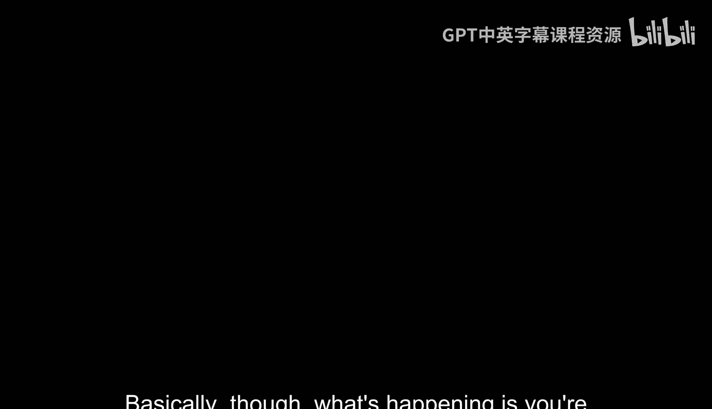

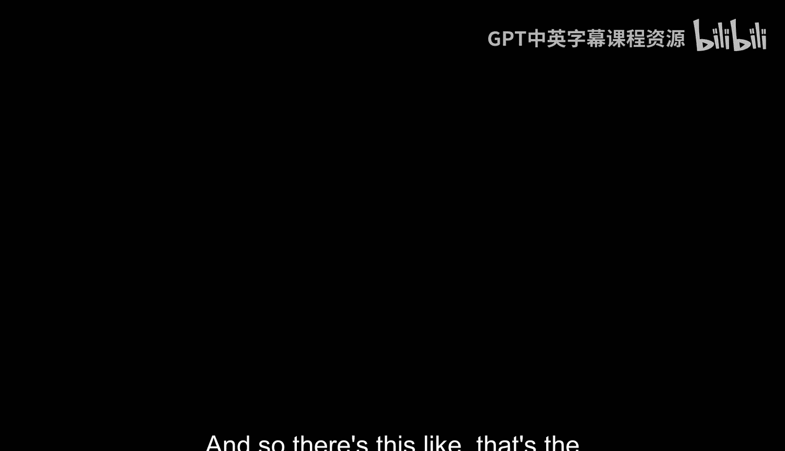

我 go我 get to。I think the， the thing they learn for now。Is that。

This kind of causes funky things like the parallel lines do not necessarily remain parallel。

 And now the ratios are also not going to be preserved。

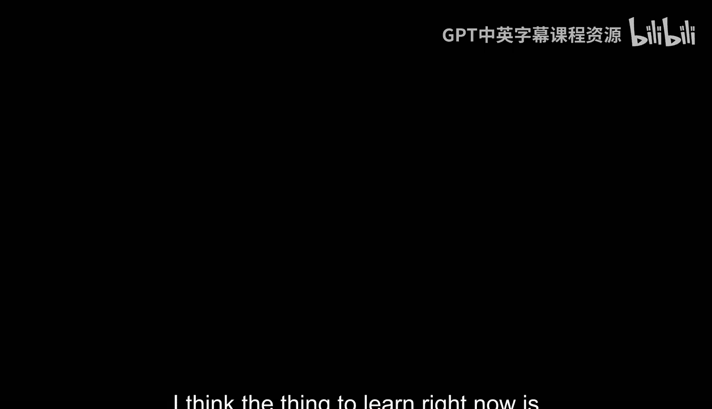

You can， you know， it's gonna change the shape。嗯。You know， okay， and so。Its。

So there are different types of image transformation。😊，So what is this。Last one over here。

Translation and how many degrees of freedom。2 to， because I can。If this is 2D， right， again。

That curved。 So that's not really good cause you don't want to curve it。 Okay， if I just fish this。

 there's like one direction。😊，And then one direction and why， okay。那お。M。

 there is such a thing called rigid transformation。 I think rigid transformation， anything like that。

Well， I can't。 I， O， this， this is not good cause it's not rigid。That's not rigid。 Okay。

 rigidt means I am just。Like， not even changing the scale。 I'm like， rotating this。

I am shifting this， right， Nothing about this changes。 This is why it's called rigid。

 The names are so initive， except you don't really internalize this。 I was like， oh， rigid。

 I didn't really understand it。 It's just rigid。 Okay， so how many degrees of freedom is this。😊，Okay。

3， because I still have the translation。Right， and then I get to rotate this。 And then okay。

 now I'm doing this in the 3D world， but like。😊，Suppose we live in a2D world。 Okay。

 then the only rotation I can do is this direction， right， There's only one theta， one freedom。O。😊，呀。

Why change， Why change change the next。Anle rotation。Okay。😊，So what， so what is similarity。Yes。

 yeah at scale。 So I can't do this。 But if I could match it， okay， you， you go on preview。

Take this rectangle， like shrinket。But you have to make sure you keep the shift on。

 you know what I mean。Right you have to right。 you do this entirely PowerPoint。

 But you press the shift。 That similarity。 Okay， you can rotate it。 You can translate it。

 but you can now change the shape。 It's also called Yeah similarity transform。😊，It's similar。OK啊。😊。

Yeah， I guess that's there's another way of calling about blank out， okay。

 how many do use of freedom here。Yes， what was added。Yeah， scaling factor is  one D。Okay， so then呢。

What is a sign， So in a sign， you could kind of go like。被个。You can， you can get rid of your shift。呵呵。

😊，Like in PowerPoint。As then you can change your aspect to ratio。So which means you can like。

 scale things in this direction。A shift the holding。

 the shift in PowerPoint means that the scale that you apply is same in X and y direction， right。

 This is why the aspect ratio never changes。If you get rid of the shift。

 you can like change it in any kind of shape you want。 And that means you're like。

Changing the scale and the X and the Y differently。

So how many did we How。 So this is two， those three， those4。Its 6。不不是。はは。😊，Okay， let's 6。呀。😮，Right。

 because you have four rules rotation skill， Trans， X， D， X， E， Y， X X， S， Y， perfect。😊，Now。

 projective is like this funky thing I just talked about。😊，And how， it's a tricky point。

 How many unknowns in this matrix。

Like， O。Yeah， predictive。You know， we talked about this here。

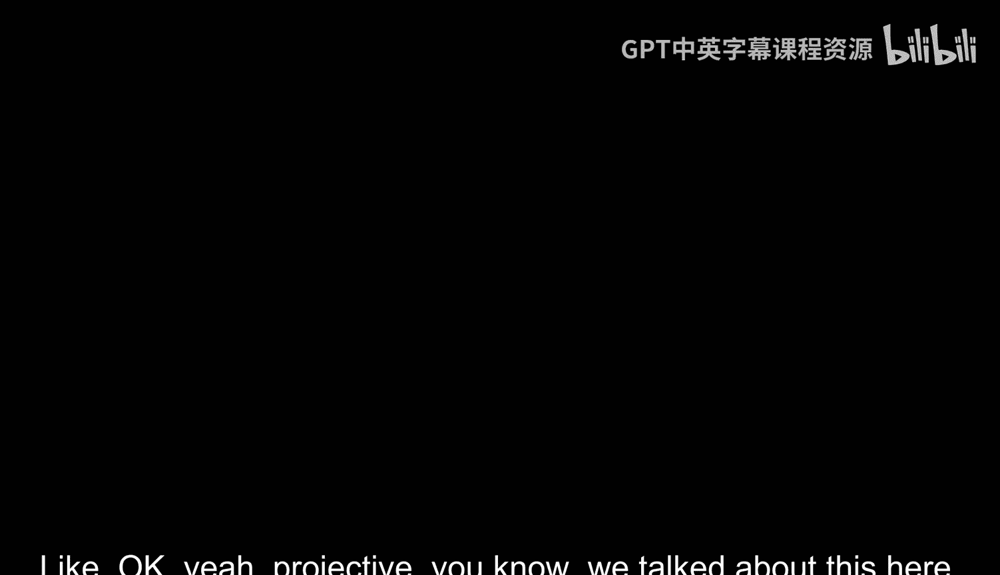

Like now the bottom thing is not 0，0，1。Okay， so we were at 6。Right， the 0，01 is now unknown。

 So how many is that total。9， except it's actually 8。😀So。😊，Why it's become。

You can always introduce a skill factor。😊，In this matrix， so。So I have this A X。Right。

 and so that this is like 3 by 3 matrix。😊，O。😊，And then this is 3 by one matrix。Okay。

 I can always do this thing where it's like， I'm gonna multiply this with some scalar here。😊。

You can always multiply this with a single scalr。 I'm gonna。Divide that thing by yes。Right。

 so then they castle each other out。

Like， when you do it all together。It's like as if this didn't matter。

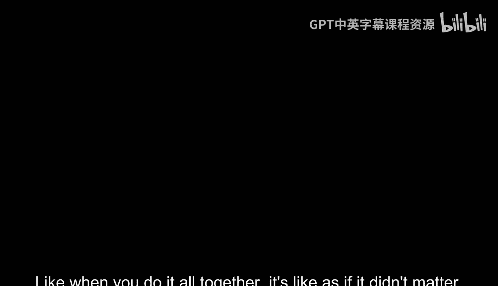

I mean， maybe it's simpler if I just put it like。Like a hear。You know， and then when I do this。

 I mean， you can multiply this with an identity matrix or something like this， right。

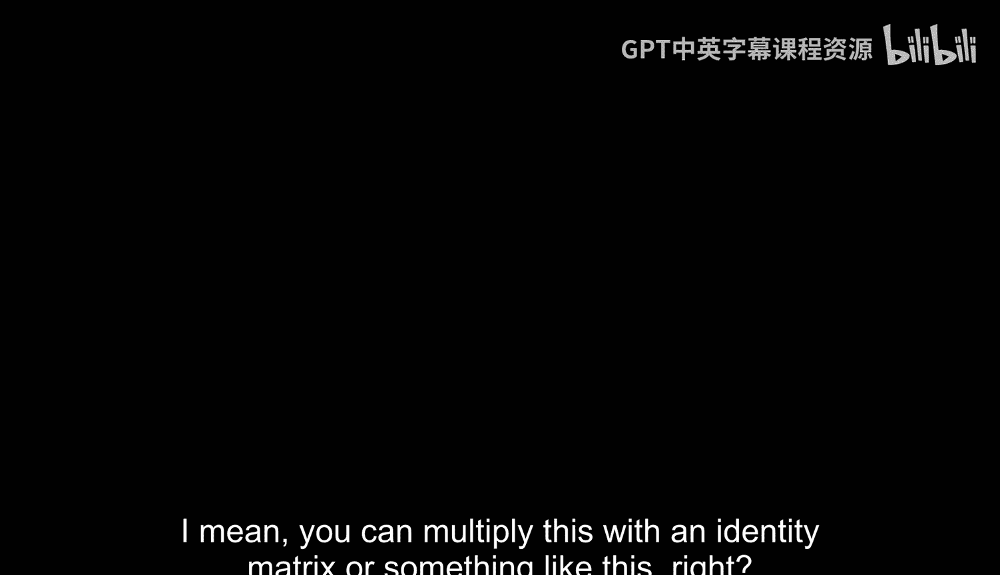

Are you seeing the the。Transformation matrix itself is skilled and the。Yes。It当个。Exactly， exactly。

 So basically， somebody can like miss with you。And be like。

 I'm saying that the scale of this thing is like， this is as big as like， I don't know。 I。

 I would say this is nicely ortho normalmal。 I did everything so that everything， you know。

 scale of this thing is one or something。 Okay， But then like whenever you multiply or something。

 somebody could have missed with you。 and actually multiply the， you know。

 added the multiplication factor and then divided this thing。 Okay。

 another way of thinking about it is like。😊。

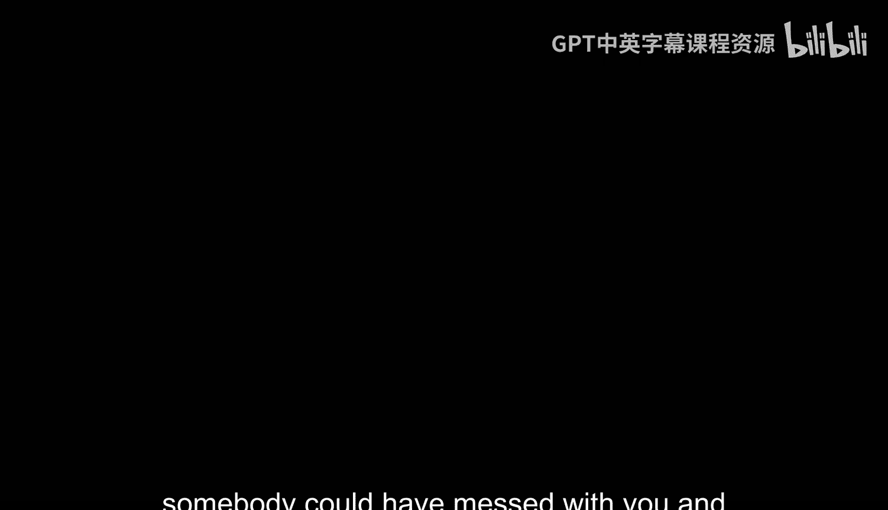

I'm just， it's easy in 3D。It's like a black box。 It's like， you never know the scale。

I think it's kind of more like， I think I know how tall I am。Okay， relative to that。

 I think I know how big this thing is。But then somebody could have just multipied the world by。5。

Or like， I could just multiply myself by 5 and then divide the relationship is gonna be the same。

Is it。 Can you say that again， maybe。要。What was the4 degrees is the scale that it we're adding on it。

Gal the whole thing。It still all。Yeah， yeah。 I think you can think about it like that。 but you。

 you could still scale each one independently。 But then you you add another additional skill on top of it。

いくら大し。Yes。Yes， yes。 You can think about it like this。 Like youll see， it's more like， yeah。

 it's like such an interesting thing。 It's like， there's no absolute scale， really。

 because of this kind of weird funky thing， yeah。😊，In the previous slide。那个到设计的。Exactly， exactly。

 It's also because of this funky thing that we said that the homogeneous coordinates need to go through。

 right， Like no matter what this is， I'm just always gonna divide by this doubling。

 So that's also where like one scale factor is being。😊，Subsent。Okay， so。We will get to this more。

 but it's very good to remember this number of degrees of freedom， hint。😊。

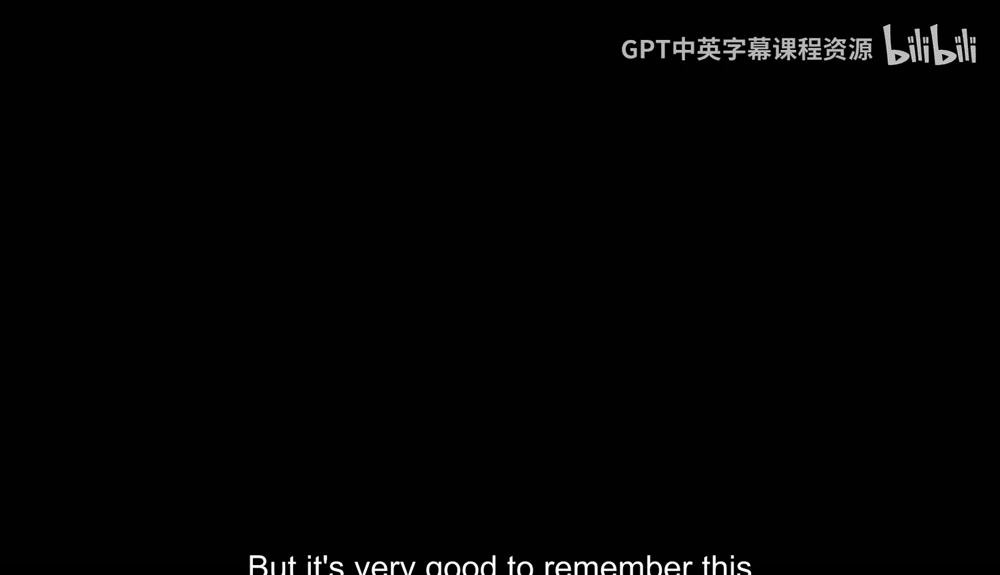

Forourth exam is such。It done good thing to remember。Okay。😊，Okay。

 these transformations get or like it's nested set of groups。

 as in like projective is the biggest thing。 A is a part of a subset of projective similarities。

 a subject of assign rigid subject of similarity and then translation and so forth。

 It's closed under composition and inverse。 as in you can like multiply。

 You can do lots and lots of rigid transformation。 It'll still always gonna be rigid transformation。

 I can like throw it around。 It's not gonna ever get smaller。😊，Assuming it's rigid。

Right maybe if it's like a weird manar over like every single time I hit it。

 it will change a shape or something。 That's a different situation。

 But this is nice and linear world。 So that doesn't happen。Okay， good。All right。Okay。

 so you might be like， why is this so。Interesting， and， you know。

 Professor Eross describes it really well。 But like back in the day。

 when people were trying to do this like evolution， people were like， well。

 if we're supposed to have evolved from monkeys， why is it that our brain shape is so far away from the monkey's brain shape。

😊。

But then they were like， you know what。 Actually， you can figure out a very simple transformation。

 These are very， very simple transformations because you only need six numbers。😊，Okay。

 so this is say a fine or maybe some projective， some， some linear transformation。😊。

This one is definitely a fine。喂。This is a little bit nonlinear。 actually。 But this is。

 this one is fine。 You can map these two。 That means you only need six numbers to go from monkeys to humans。

 Were related。😊。

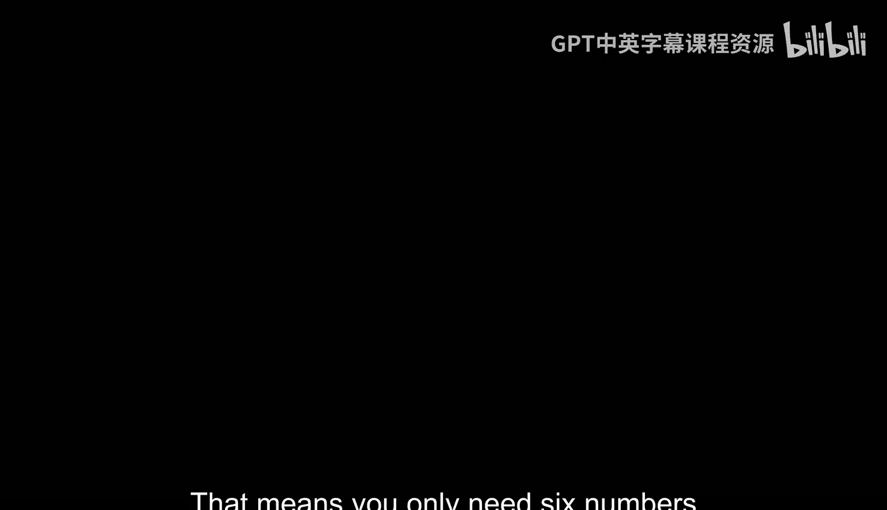

That's kind of a。Yeah， it's important stuff。It's Darcy Thompson。

 Oh it doesn't have the ear in which this is written， but。Crap， yes， I should know that here。Okay。

 alright。 So why am I asking you about all of the numbers of freedom。Okay。

 because we're gonna be in a situation。 You know the F， You know the G。

And you want to know， what was the transformation that goes from FG。

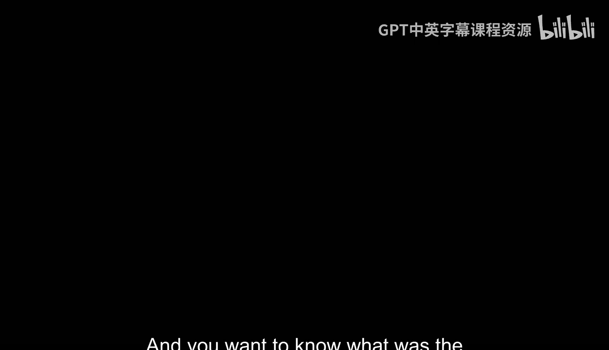

O。So。In Project 1， we did this。 and then the degrees of freedom there was how many or what kind of transformation was it。

Translation， exactly。 And then we only need two。O。Or to the degrees of freedom， so。If we want。

 if we can ask humans to be like， click on this point then click on that point where it's the same。

 This is called the correspondences， which is very important。

 I'm sure you did it in your hybrid images。 You had to like shift it around and like， you know。

 so they're the same。How。What point clicks do we need from human。If it's translation。If it or。

 or if it's translation， okay， let's go over here。

So if O， suppose the this is the image。 And that's the。

Transformation applied。 some， somebody applied this transformation。

 You don't exactly know what the transformation is。 But you know that it's translation。Okay。

 so you need to figure out the two numbers。

Correspondence is， if you had， would you be able to solve this problem。

Oh， I see  one or I see 2。啊。1 or two，1，1 point or two point。1 because。Ex one point And see things。

 okay。All right。So。Yeah， and then transformation matrix is that of the translation。So it would be 0。

 except for the T X， U Y。Okay， so so what， what do you do with these correspondences。

What did you do with this correspondences， I say， this is here。😊，That is there。有。You。

Do what we did sometime earlier？We like， yeah。Okay， let's do this。I have a point X Y in English one。

O。嗯。Which way do we go。We're gonna apply transformation。 Okay， I'm not gonna say this is image 2。😊。

User no， user clicked it。 So we know this， right。User click this in image1。 So I also know。

What is the matrix form in this translation。T t x。Okay， so I think you guys get the idea。0，0， one。

 okay。And then， okay， I mean， in this case， it's。 Okay， So， so do。

 do this fun homogeneal coordinate things。 And then this is the two。😊，So how can you solve this。

 I mean， I'm solving this kind of。 But how do you solve this。

 what What is the process in which I'm doing this。Yes， I'm sitting up。m of equation。

And then you can now it brightly and write this， right， I mean， this is。😊，I mean， yeah。

 so subtract is， yes， correct in your case。 But yes， setting up the system equations。Right。

 and then so this is the final solution for this thing， because。It's gonna be this thing。

 minus nothing。

Okay， so then how many correspondence do you need for translation and rotation。

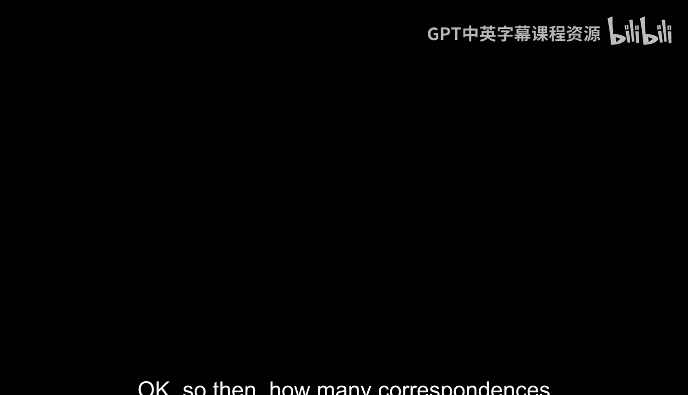

How many degrees of freedom first。Okay， what is this transformation。Ne。Visit。

 and then how many degrees of freedom was it。3， so how many points do we need correspondences。2。

 because two points will give you how many equations。4 equations，3 unknowns。Okay。

 so you can go like this。啊。两首。Oh， wait。Yeah，2，2， cause2 gives you4。 There's three unknown don。 Okay。

 okay good。 I find same situations。 I find how many degrees of medium。😊，6， so how many points。3， yes。

 you， you need to know that corner。 You need to know that corner。 You need to know that corner。

 If you know that already， you can do it。I think you get the idea with the perspective。

 You need four。Okay， projective， project。 you need4。Okay， so。

What we're going to do in Project 3 is that。Wow。啊。Okay， maybe you will do project D。 you given this。

Okay。ABC to A V， A prime B， prime C， prime in 2 D。What kind of transformation is this。Or like， yeah。

 well， what kind of transformation is it。Is it only translation。No， certainly， you can rotate it。

 I mean， you can move this。Right， if you rotate this， all ABC will change。So rotations involved。

 Can you scale it。Yeah， can you scale each axis differently。有， so then that。A fine。

 So that's looking like a fine。 So you have six unknowns。O。

So the transformation is a fine transformation。 So it's gonna look something like this， right。😊。

And how。ニュー送部です。不。We could just do what we were talking about， right？ So we have。12 numbers。

12 equations。 We have 6 unknowns。 We can write this out。 you know， we have a solution。😊。

But can you think about another way to do this。There's two places in this。

 algebraic is kind of like what we're writing over here。What is the geometric way of doing this。

And it's using ideas we talked about in this class already。Oh， similarly， yes， this kind of。

I done expand。Thisscribe。Oh， well， yes there。 You can change different coordinates exactly with the change in basis thing。

😊，So in this case， what are the bases。Have you multiple choices。There's many answers。

Let's pick one basis。Or like this thing。要ABBC，hen this will be the version。A BAC C is fine。

 And so basically， if you define you are basis to be these two。😊，Then you get new， new basiss。Right。

 and then so you can do this kind of thing where you go from your。

 your triangle to go to this canonical triangle。Right。

 and then we kind of wrote it somewhere earlier。 how to do that。Right， it was like a system。

 a linear equation。 You multiply with the basis。 Oh this is the inverse。 This is why the inverse。

 you do the inverse first。 to go to the。😊，Identity， and then you apply this new destination one。Okay。

 and you will implement it。In project 3， and I highly recommend you to implement it in two ways。

 The algebraic， you can write it out the equation。 It's closed form。 You can compute this。😊。

啊Or you can。😮，Do this change a business method and make sure that it works。

 And both should get you the same answer。And so， you know。

 you can do stack these ver columns vertically and make the thing and。

I highly encourage you to try it out。O。That's like， a quick。Basically， a recap。Okay。

 don't forget to move the origin too。 when you do this as a basis method。呀。

You need to make sure that that origin needs to be accounted for。

 The best way is just subtract the origin first， like make it come to the origin one corner。Okay。

 do your transformation， added back in。If you don't account for the origin。

It's like you're trying to do change of basis， but their origin is not the same。

 So it's kind of like nonsensical。

You need。 you need somewhere to be the same。Like in linear algebra， whenever you make a basis。

 like 0 always goes to 0。

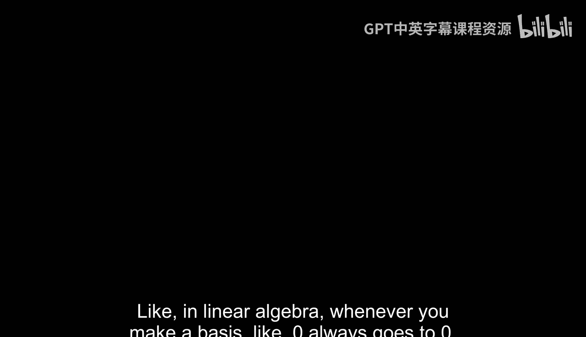

And you want that make sure that the zeros are the same。Okay， alright。

 So the project 3 is a thing called morphing， which you saw earlier。

Which is a super deep bold old technique。And the goal is to find an average between two objects。

Not on the average of two images of objects， which would look like that。

 You can just take every single pixel， You know， take 0。5 of one and add 0。5 of the other。

 But that's gonna give you this thing。 What we want is。😊。

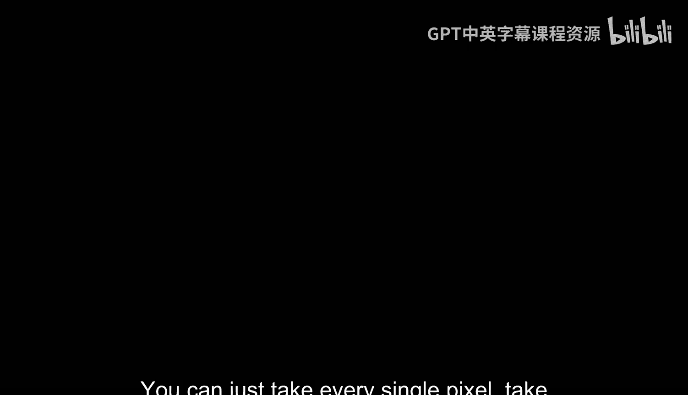

Aver object。Yeah， somebody did my cat and me。 I will show you later。Okay。

 then you can make it smooth。Wow， it's super cool。Look super nice。Okay。And so like， w， what is。

over here， which is that。Well， we will describe it。 We will go over it。 Okay， okay。

 how do we know what an object the average object is like。I mean， we have no idea。I mean。

 who knows what the average is this thing， But we can often like set up correspondences。

 like to mean average means you need correspondences like this is same as that。

 And I'm gonna take an average。 But there that doesn't make any sense really。

 it does for because you're saying like what's the correspondence between the human face and the chitah face。

 And the thing is humans are remarkable because we know semantically you know， the eyes for the same。

 I mean， but how do you notice。😊。

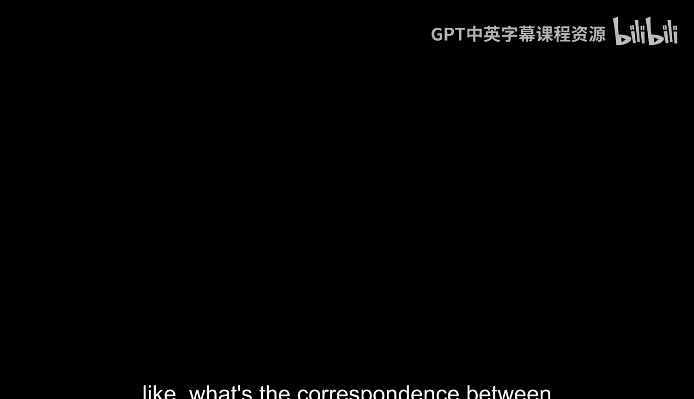

I mean， I think it's because we know that it's an eye， right， And it's also a face， right。

 So you can map this corner to that corner。 And then it will look nice。 But then it's like。

 if you just look at the pixel， they don't look anything similar。 I mean， you know。

 you have to this is a very， very deep， deep question in computer vision。

 How do we know that the same things are kind of the same。😊。

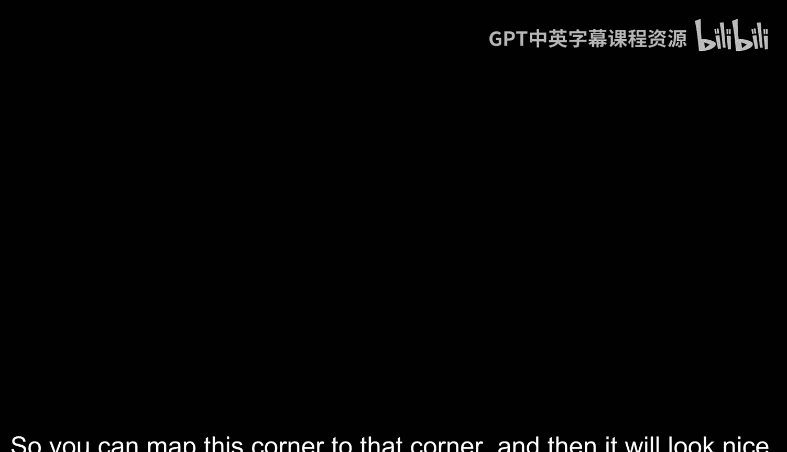

You know， it's， it's a really fascinating question。But， but we're gonna bypass that。

 but we're gonna talk about this。 But before。Let's us go over and linger your algebra。

 How do you average P and Q。

Yes， now let's think geometrically though。You have a point P。

Which is also a vector pointing from some origin P。 cu。 I mean but it's really just this line。

 So like， you could just point to it。What is that phrase you point this， Okay。

 I hope you're pointing here。Right。O。😊，So what is this blue vi。Yeah he must be。

And so what is the average of this。Yeah you what else do I do。Bi。No， actually。 oh， crap。

If not， Q minus is divided by two would be like a vector over here， but it's like short。😊。

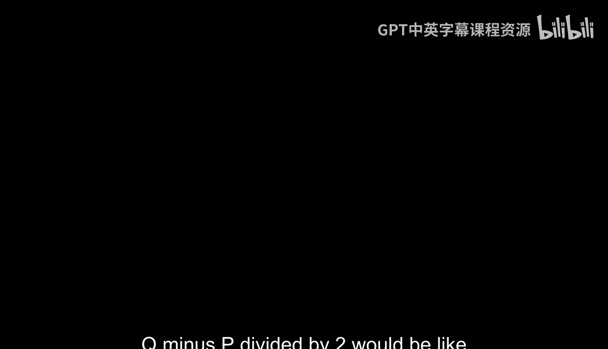

哪个。Yeah， so it's， its， it's basically P plus key minus p divided by2。Where can you start from here。

I you can有。It's half a P， half a P plus， I mean comes out to be like this。 And then you know， okay。

Alright， so like， remember when you did the alpha channel thing where one image is whatever alpha。

 the other one is 1 minus alpha。 And you like summit and it's always one because it's alpha plus1 minus alpha is always one。

😊，You can do the same thing。 And so you can like， move this green point from here。

Which means that alpha is close to one。Okay， because this is， you know， a， alpha 1。

 This is where alpha is 0。 So you can like kind of go in between。😊，Okay， so earlier。

 when we were showing this pictures of this like woman turning into cheetah。

 like the average is is the middle。😊，Okay， but youre basically slowly walking in here。Right。

 and then going all the way back in here。 That's kind of what the this animation is doing。

Can you go over。Actually， can you like extrapolate too。If I wanted to extrapolate。Like。Like。

 not staying here。But like， kind of overshoot。You use negative ah。Yeah。

 or you can use the a that's bigger。Then one。Or listen than one。s。

So you can say like extrapolation here。 That's like far away。 And you can do that。 It's kind of like。

 if you did the thing between the women and the cheetah， it's like you that you're averaging it。

 you can like。

Kind of like。Make it more。 like， make it like a caricature。So when you do this average image。

 I encourage you to。Not just stay within the two images。

 but you can also like extrapolate and be like， this is like， you know， extra shoota。

On top of this woman's face and he see anything， okay。嗯。So this is like， you know。

 idea in Victors space。But the P and the Q can mean anything because an image of1 hundred by0。

Is what dimensional point。An name is1 hundred，800。You can write it as a vector。

 And how long is that vector going to be。Hundred by00 exactly。 So you can just do this as an image。

 I mean， won't look good。 That's what the that's what the initial thing is。

 is if you just like this first ghosty one is basically you just take a point as like vector like very high dimensional vector。

 And then you average it。 But that's not what you want to do。 But okay。

 But then like the P and the Q can be points on the plane So 2 d coordinates or 3 d coordinates。

 you can also be color。 So you can do exactly the same thing。 And in fact。

 you will be doing this spatially in the 2 d coordinates like spatial， know， you change the domain。

 but you're also going to do this over the color。😊，Okay， and so this is called the cross dissolve。

And this is like a really cheap way to interpolate between two images。

 I'm sure like a presets in your like phone camera would do this。😊。

Or like you can judge the quality of the production of a TV that you're watching by how many of these up here。

Okay， because the longer the cross dissolve， cheaper it is to make those frames。

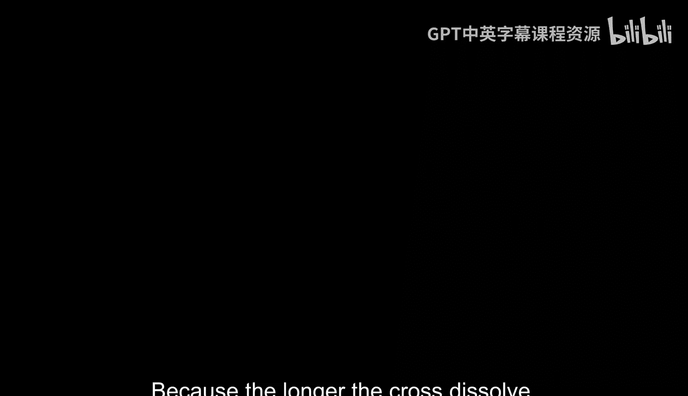

Okay， so the cross dissolve is exactly the same thing you were talking about。😊，啊，You take some of。

Of finish 2，1 minus alpha of that over here A T。 That's your halfway。 Uni is like this。😊，And。Yeah。

 so like， you know， if I play this fast， it would be like a cross dissolving。I think。

 I think this is a Pittsburgh River that Profesor Erostic。Over multiple days。Apparently。

 it was like flooding or something like this。 And it's not normally like that。

 And so it's like a cool kind of like， you know， going in between。😊，O。😊。

Okay， but the problem is that over here。These three images are not exactly the same。

Well， I think it's edited to be the same。 So what happens if the images are not aligned。Yeah。

 I heard ghosting somewhere in the back like a ghost。We ghost think exactly。 Okay。

 so then you really want to do alignment and the cross dissolve。 Okay。

 so here's another picture of the Pittsburgh Bridge。😊，O。And then you want to do this like。

 you w to solve the alignment between this。

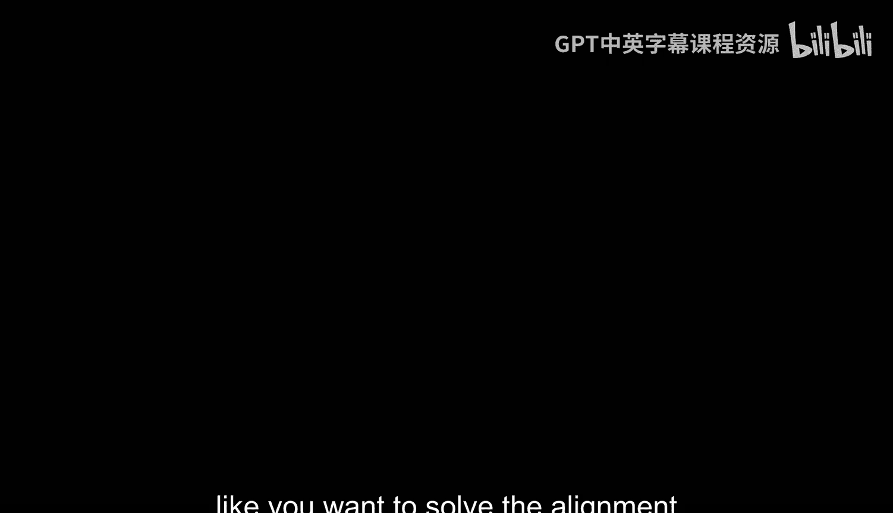

And then， they cross dissolve。O。😊，Okay， so we' gonna think about questions。

 questions this do you get this is like image。Image， image 1， like this this image。

 but transform so that it will match this。Can somebody guess what's the transformation here from the shape。

不加行了。😔，Projective。这。Yeah， project。 why， why。Yeah， lines are no longer your parallel。 Yeah， yeah。

 okay， good。😊，Okay， so that's what morphing is。 You're gonna warp。

And then you're gonna cross this all。 And so it's like basically doing two things at the same time that we learn in this class。

 right， because。😊，Why is this。I mean， yeah， you know， like in the beginning of the class。

 we talked about cross dissolving or changing the photometric values of the pixels， right。

 And then we now learned about how to transform them。 So you're gonna do both at the same time。😊。

So this is what your project is going to be。 Take two images。And you want to make an average dog。

G anyone the first。That means you have to do the special stuff。

Which means you have to change the shape of this to the average shape。Go the mean dog。In my。

 in my research， I did this thing for birds，3D birds。 We had me birds。You have learn the mean bird。

Yes， first moment， Doug。Okay， and so you're gonna to do this with waring。

And then you're gonna do this with average color。Okay。不得。Is a single transformation enough。

It doesn't look like it's enough because it's ghosting。Right， so if it's not really so surprise plus。

 you know， you're like， I have。The state of transformations， translation。Rotation with translation。

 rigid， similarity。 And then I find and projective。 Let me try the most powerful one。

 which is projective。😊，And then it doesn't really do。 It doesn't。 It's still not really good。

So then that's not really good。 It's that one， one global transformation doesn't really align。

So they have any idea。 How can we fix this。

Ha。😊，Great okay。

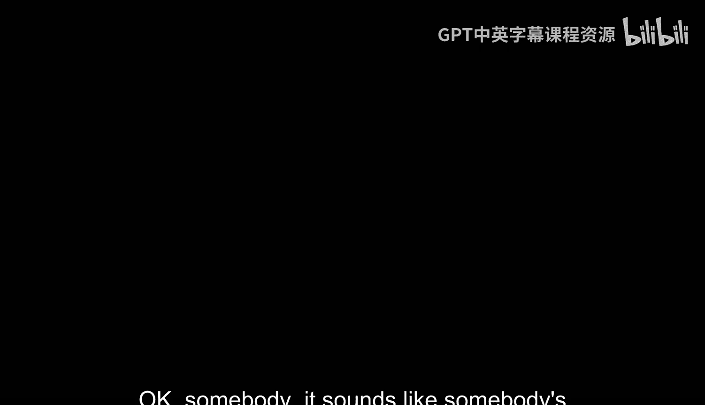

It sounds like you somebody speaking of the Fredick Doty。 great。 It doesn't have to be triangles。

 The triangles are nice。😊，Basically， the idea is that you break it down into smaller pieces and every single pieces are going to be applied this simple transformation。

 But you can do it。 This is actually a very， very， very powerful thing in computer graphics。

 It's called peacewise linear or peace wise are fine。 I mean， like， I think a lot of the functions。

 no matter how complex。 right， You can explain it with like peace wise。😊。

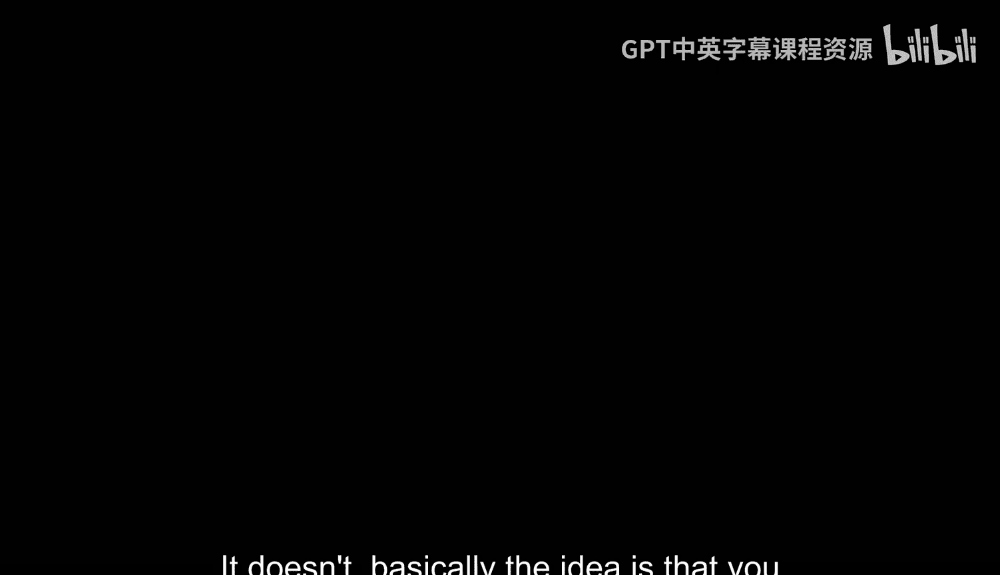

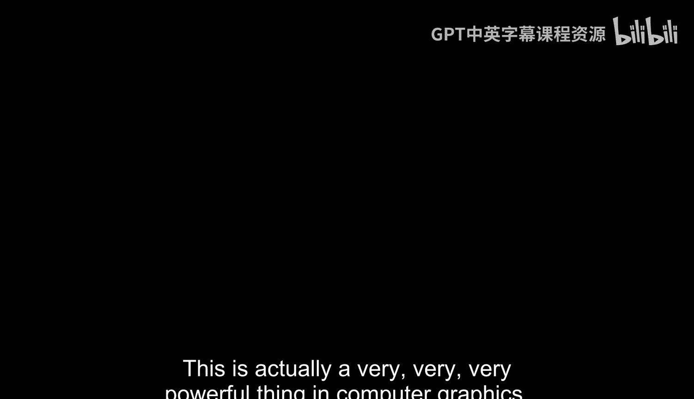

Right， like this。 remember the trapezoid rule， It's really kind of like。

 you can always approximate a complex， you know， curve with like lots of linear curves。😊，O， well。

To do that requires triangulation or knowing what goes to what。

 I think this is about this correspondences。And I think we got this idea， which we got this answer。

 which is using triangular mesh。 Why triangular mesh。😊，Like。If you。How triangular mesh。

 How many points do you need to specify between those triangles。3 yeah so。If you didn't have the。

 what is like the most ultimate way of doing this without triangles like。

You can break it down into every。 I I said， you know， you can do any transformation， right。

 You can compose it。 You can have a global transformation， but you can cut up the image into pieces。

😊，And then do go， and then do transformation in each one of them。

 What is like the extreme most extreme version of this。Exactly， every single point in the image。

 you're like， this pixel。Goes to that pixel。 And then the next pixel goes over here。

 Nixus will go over there。 That's like， way too much。😊，This is called optical flow。

 which people will learn too。But so this is the reason why the triangle is nice because once you define the triangles。

 you're like， everything in the triangle should move according to that triangle。

 How that triangle should move。😊，Right， so it really prevents you from having to do like， super。

 super dense。Correspondence。It just kind of like， move this block。

O。So what's you going to do。Is input correspondence at key future points。

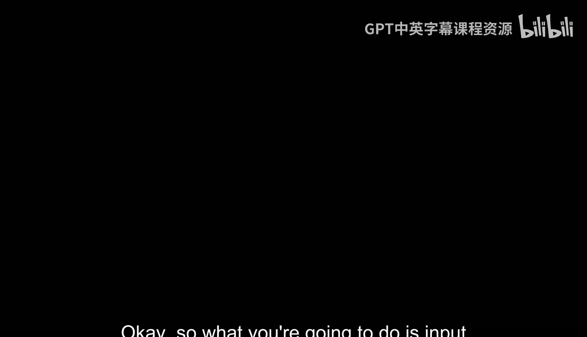

我当认是你。😡，In your project， what does this mean， actually。

 if you have two images and you need correspondence， is key feature point。呀。原。Po， okay。

 you're gonna manually select the point。 You have to write some interface in which you click on it。😊。

F。't get， I think don't get over like there's a lot more to the project， right？I think。

AndSome people right， like super nice UI。For like clicking stuff， which if you。

Certainly take a screenshot and put it in your project。 right， if it's nice and really easy。

 But remember， there's more to go。 So don't use so much time fitting this up。😊。

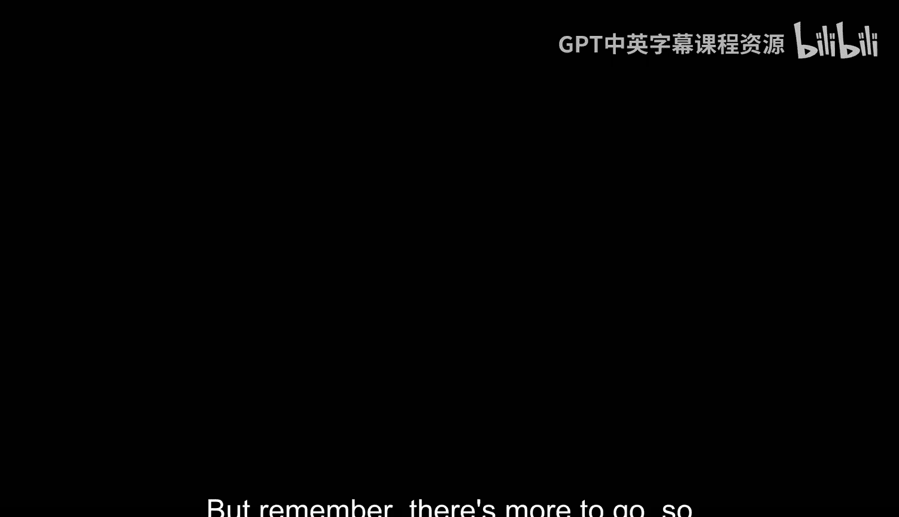

There's like inputs， inputs。 It's a simple stuff。 Do it as fast as possible。 I don't know。 It's okay。

 if you want to make really good results， it's nice to invest in this a little bit because like。

 you want to save this as like some intermediate file because later， you might be like。

 you know what， I actually need another point because it's not really good enough。😊。

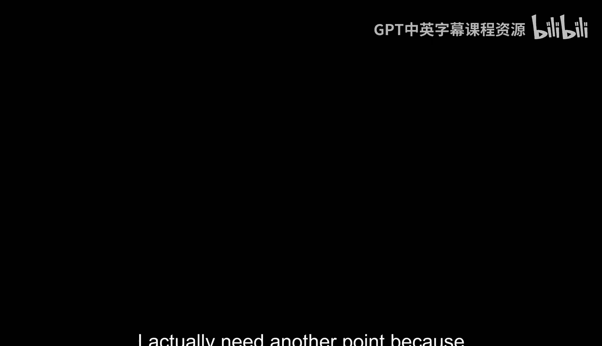

Right， so you wna like kind of add to your current that it gets kind of fancy。O。😊。

Deine a triangular mesh over these points。We will go over the details of how。same mission。

 both emissions。Okay， it has to be vertex， the vertex alignment， meaning。What does this point。

 Where does this go， It has to have the same， like semantic meaning， same meaning。

 like they need to be the same place in the average average image。Okay， or you。

 you mean triangle to triangle。 like this triangle。 Okay， so like， for example， let's see。

 I can find like the。😊，Like this triangle it's， it's kind of like a shoulder。 left' shoulder。

That corresponds to Dutch。S。Probably。Yeah， they have to。 they have to that they're gonna get merged。

 right， So you want to make sure that they are all the same。 So same number of points， right。

 same number of meanings， okay。All right。O。😊，And then you wore beach triangle separate from source to destination。

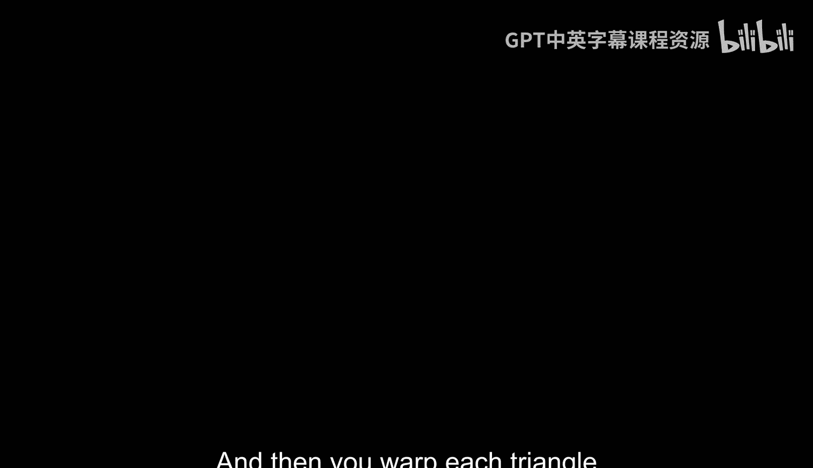

And we're going to talk about each of these steps， but。Any question。啊，不好等一下。

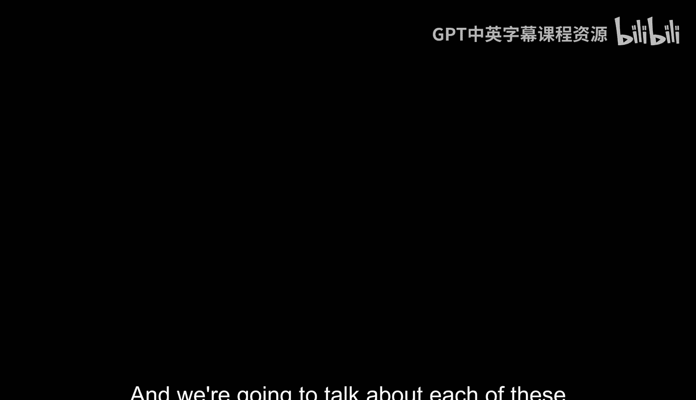

No， no。 You really want the human， human input of which one is which。

 So the order doesn't really matter， but the twoole matters。Right。

 like left point in the right point。So you can write your clicker thing so that like you click on the left image。

 you have some U I， you show another image， you click on the other。

 and those two points are saved together。 and that you never break。😊，And you can always ask me stuff。

O。嗯。Andmanuel。嗯。Actually。Actually， this is kind of for faces， yes。We will do。

 That's what project 5 is going be like automatically detecting these key points。

 But you will find out that it's also how you do it is by clicking lots of images to say that these are。

😊。

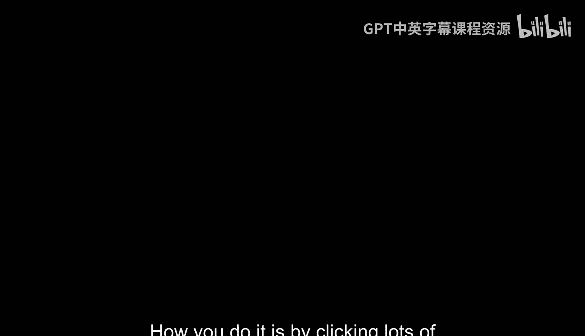

Okay， I， this is like a very， very big。 actually， it's part of my research。

 which is to figure out how do you find out on supervised correspondences。😊。

But you don't really say which Johns our correspondence is， how do you know， I mean。

 this is a very deep question in intelligence。 It's kind of like， you know。

 you can relate one thing to the other。Hums are super good at it。

 And then sometimes the correspondence don't even exist。 So， for example， take this chair and like。

 take that chair。Like on the back， you could be like， yeah， there are some correspondences。

But there's a lot of correspondences that don't exist。 You know， like， there's no arm。

In the other one。The legs don't。 There's 5。Legs， there's four legs。 So like， what do you do， And so。

After a while， correspondences become like。

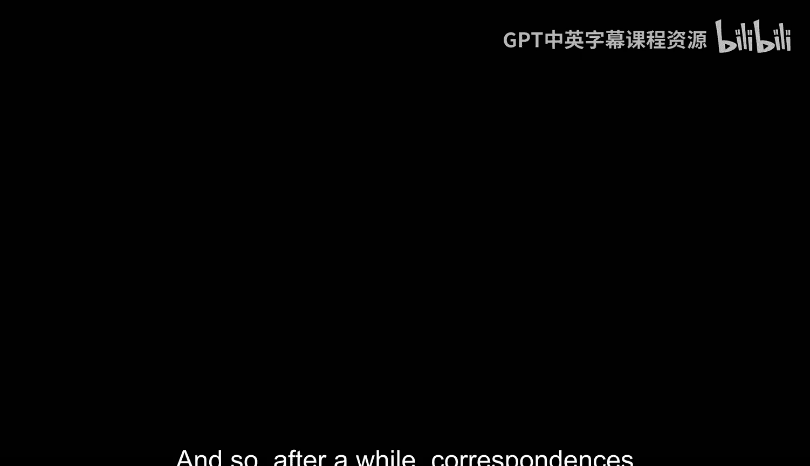

Pointtable things。 It becomes more like conceptualual。 Conly， there's correspondences。 this is legs。

 and those are legs， but。So it's a really interesting question。 Anyway， it's hard。

And this is what humans are super good at。 And machine learning is still hard。

 And there are ways to do unservised point cloud point stuff。

 It could be something you could try for your。😊，I know。

because you need to do some deep learning and deep learning。People learning you have to do。

You have to have lots of GPS。 It's just hard。啊。呀。You讲一讲。

I think that requires them to be somewhat aligned to begin with。So my， after doing this many times。

 my recommendation is just。😊，Click one after the other。You will see。

 I think it depends on the images that you start with。 Like sometimes they're like super off。

 and you gotta like fix every single one。 And then you might as well as。 And then like。

 if you did it， then you don't know which you might have made a mistake， you know， of like， you know。

 and it just gets so complicated。 whenever you click， make sure you color the right things。

 You know what I mean， like over here。Right， like red goes to red。 we might see red goes to red。

 Green goes to green。 If your transformation is not working。

 it's probably because you like mess it up when you're clicking or something like this。

 You w to make sure there's no bug introduced in that way。 So color。Make sure they look right。Like。

 this one should be colored。I heard like。我跟你说。Is Obama and former president of Brazil。

This was a class project。Now， we need to talk about how to war triangles。 Okay， oh my God。 alright。

 okay。How do you warp triangles， as in this。Forehead the triangle over here。 Okay。

 corresponds to that forehead triangle。

And you have to warp it。Meaning every single pixel in here needs to go where somewhere。

 But then like these see， what's the problem。 Like Obamas face is a little bigger in here， right？

 So Obama's triangle is much bigger than the corresponding triangle in this Brazilian。😊。

P。So like。How do you do this for being a triangle。Like。呀。Yes， exactly。

 So that's exactly what we talked about。 This is good。 So now you have the ABC， right。

 We have the A prime， B prime C prime from people clicking it， right？

 So you know how you computed it。😊，Okay， transformation is this applying matrix。 You solve this。 see。

 there's a lot to this homework。 right， So you have to compute this。 first of all， get the points。

 Comp this per triangle now。😊，I think the problem is now we have to copy the pixels。

 according to this transformation。Okay， so like。The thing is we computed this。

 So now I know the B goes to be prime。 and this point in the middle will go somewhere in here。

 And I know exactly this X， Y goes through this X prime Y by applying this T， X， Y。

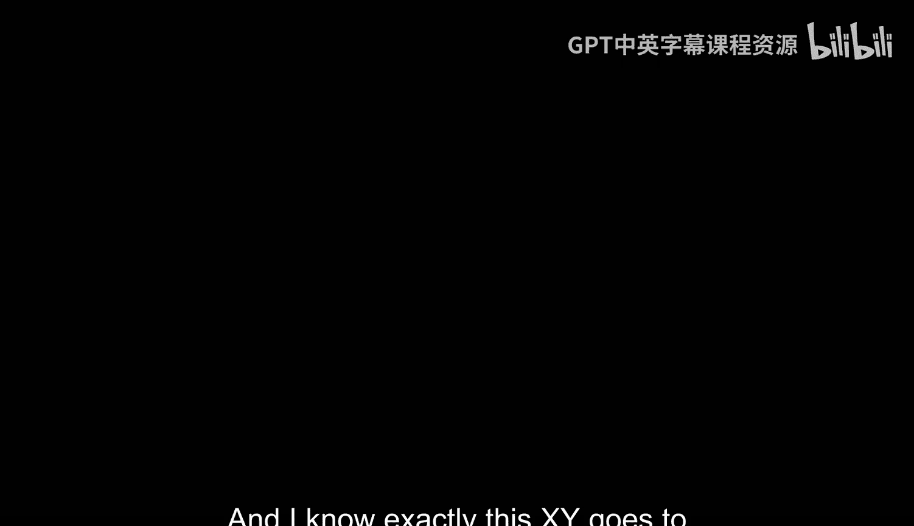

好。拍手わて。This way， what is the first thing that comes into mind。When you war it。Like， take， like。

 you know， this pixel color。 You know the transformation now， it's gonna go over here。 What。

 what do you do。那个。Or like you have this color pixel。 it needs to go to that pixel。

You just blend the pixel all Or for this one， I'm just going to apply the transformation。

 I just want to warp the images。So no aaging at all。

 I just w to make this new image on the right side， right， Like， suppose you knew the transformation。

 You knew every single pixel has to go over here。 I need to make this image。

 How do you actually make the pixel color。Yes， the linear inter is good， but that's well。What's like。

Yeah， what's like the。I think you do， like I mean。You do what。Beijing for very centric coordinates。

Yeah， yeah。 So that's a good one， too。 That's something you learned in1， 84。😊。

But like that basically only tells you this pixel goes to that pixel。 Now。

 I want to grab the color from one pixel。 Okay， I know where this goes。 I have to。😊。

Sid put the color over here。Okay， so that will give you the special location。

 But now I need to actually copy over the pixel values。😊，And so what's the。It or something。

 But like I mean， I guess I'm kind of describing the simplest algorithm。啊。Square， okay。

 I have a pixel。 Okay， I have a color or height intensity，56。Okay， I know where I'm supposed to go。

 because I'm supposed to be here。Okay， what do I do。Copy past。 Just copy me pace。 just。Ssest thing。

 okay， that's what I'm asking you。 Simst thing。Okay， that's。Fixel values。 throw it over there。

 and then wherever it goes， write it。Now， what is the problem？T， okay。

 triangle might be different sizes。 And what does that mean。 So what if， yeah， what。

 what's the problem？ So like， what happens if you go from like。

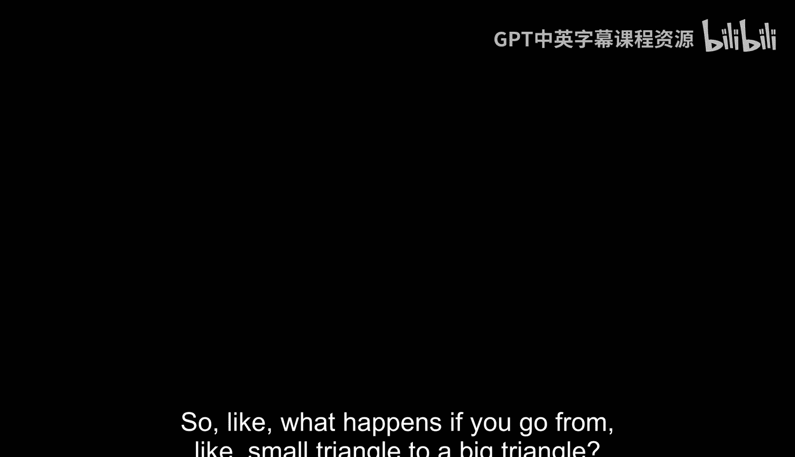

Small triangle to a big triangle。说慢好。That's， that's the other way around Yeah。

 if you go from big pixel to the small pixel。Exactly， you throw all these things over there。

 and many of them will go to the same place。 So there's a collision issue。Okay。

 what if you go from small triangle to like a big triangle。Yeah。

 you gonna to have jobs in You're gonna to have these holes， so。This is called the forward warping。

 This is really like， you know， how is in Re is implemented， That's kind of what I'm asking。

 I Rea is like the simplest operation Just scale， right， How do you actually write that。😊，Okay。

 and then that。Well， that's how you do the coordinates。 But how do you actually change the colors。

 Like， this is kind of more like drawing。 How do you actually figure out the pixel values。

 So it's kind of like rustization， but。😊，So you see the problem， right？ Okay。

 there's another problem， which is that if you do this forward warping， it might go like in between。

Right。And so what is the pixel ones in between。Like。average your。Or you were saying earlier。

Oh interpolation， interpolation， right， If you seem be， you can interpolate it。😊，Right， so。

This is called spting。 It's like sp in。 Are you guys playing sping 3。😊，Oh my God。

 You guys too busy to play S 3。Oh my God。 Are you guys not playing with these3。33。3。

Tk you about then。 I mean， okay， you kind never know what I'm talking about。Okay， all right。

I got it recently。My， my， I know， I'm too busy。 I'm like， I'll have time My husband plays it。I did。

 okay， because you take this thing。For in one place。 Okay， you just get。That's not basically。

 this thing。It's not good because you're gonna get holes。Okay。

 it's not good because multiple things are gonna go to the same place。 Okay， well。

 you can now come here and be like， I'm gonna count how many balls are gonna be spotted at me。 Okay。

 and I'm gonna take an average。Okay， but that's like very time consuming。 You。

 you don't know how many are gonna go there， right。It's not very good。

 So what is the nicer way of doing this。그。はいでズにもけた。Yeah。Okay。

 so you say something of an inverse exactly。 So you do it the other way around。 Okay。

 which is instead。😊。

Find this over here。

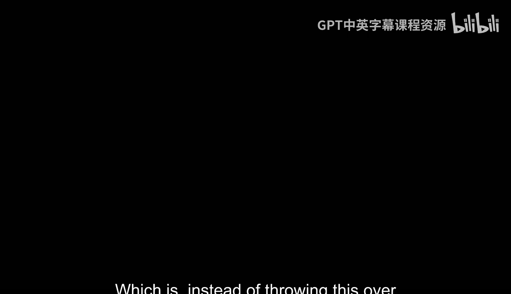

it's not a spell doing anymore。 It's more like， where did I come from。Okay。

 you take a pixel here and be like， what was， Where did I come from by applying inverse transformation。

And then， take average there。

Or interpolate there。 Okay， so heres， is there an animation。 Okay， so now I'm gonna be like。

 I want to know what is the color of this pixel。😊。

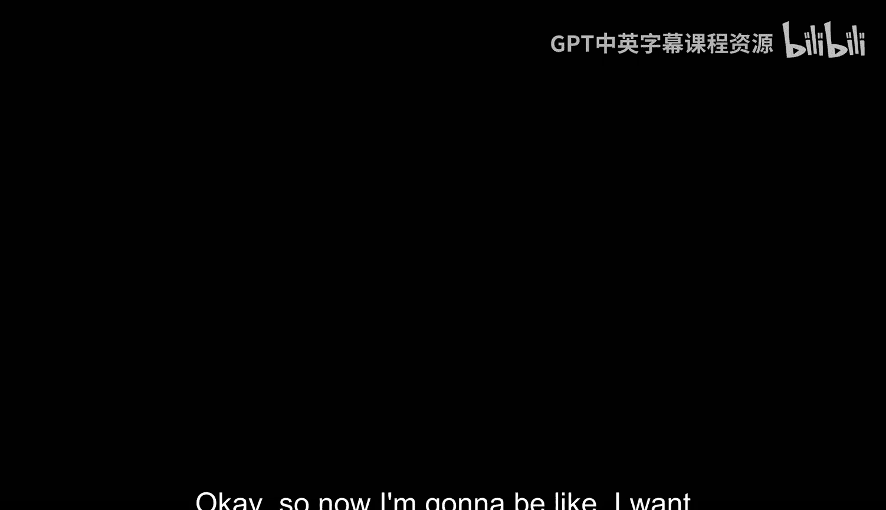

I'm gonna look where I came from， using T， X T inverse。O。😊，And。你好。😮。

Pixels might come from between two pixels。 Certainly， this is going to happen。But the nice thing is。

You already know like what's there。 You know， you don't have to wait for what's gonna be there。 Like。

 you know what I mean， like， if you were spting right， and then multiple things went over here。

 then you have to like stand here and like have everything thrown at you to count like how many things actually came here and then take the average。

 Okay， But if you are。Doing it the other way around， you're gonna be like， I am the target pixel。

 I want to know what the color of what color I am。 I'm gonna go back。And I'm gonna be here。

 but I definitely know what is the four neighbors of this。 Like， it's already there for you。

 You don't need to like， wait。 So like。This is the situation。

Right you go here and you go over here and you have something in between。

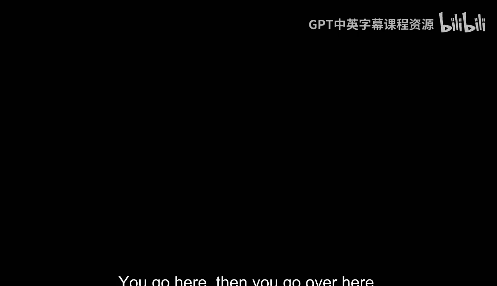

And this is something you might learn in 184。 But what kind of possible interpolations are there。

Like bilinear simplest one is neighbor， Just take nearest neighbor is also okay。

And biling interpolation。It's like， literally。To in in linear interpolation。 Okay。

 this is your point P。 I came from another image。 I apply inver， I have one pixel I want a color。

I go there and be like， what should that my color be， What you do is I go over here and be like。

 what am I in between here， do linear interpolation here， You do linear interpolation there。

 And then you do linear interpolation between that thing。

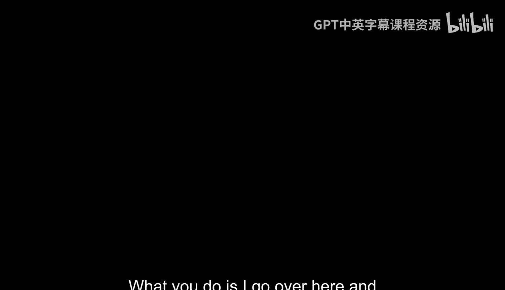

It's also kind of this is a nice picture。 You mean， like， if it's here， you w to be like this much。

 this area much yellow because you're closest to yellow。😊，This。

 this little area much red because you're furthest away from it。IAnother thinking about it。Okay， so。

W it better。Split in or in。In。Okay， it's because it doesn't have it holes。

 Like you can just enumerate the entire way around。 Okay， from that。

 And it's like the forward is also super expensive If the final image is much smaller or something。

 because then you have to throw all the pixels over there。 if you， if you went the other way around。

 you only exactly know color the exact same thing that you're doing。😊，Okay， good。 I can do this。

 Any questions， though。牙。说。

It's using triangles， but triangles is really only a way to figure out the perfect pixelixel transformation。

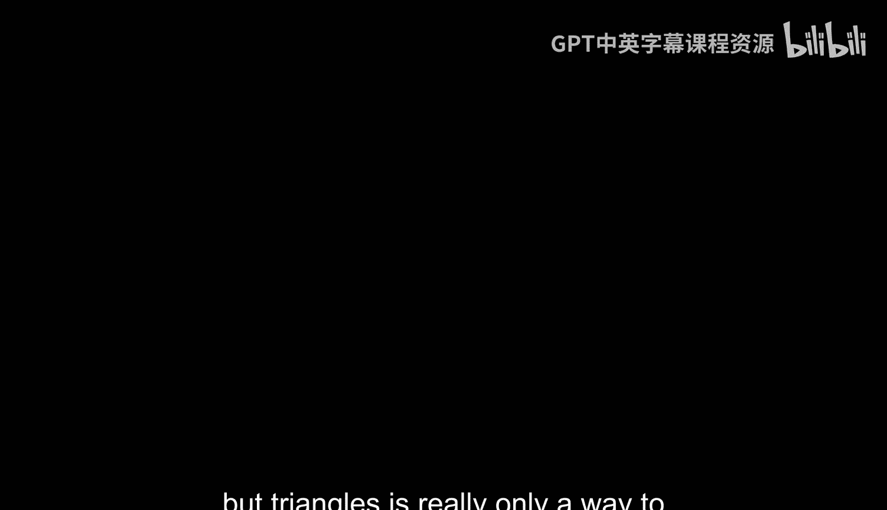

So that's a really good question。 you're gonna implement this using Inter 2 from Python or sfi。

 There's an interpolation thing。 Inter2， make sure you don't like do loops。 Again， don't。

 if you're writing four loops going over every single triangle， every single pixel in the triangle。

 not very good， not very good。😊，Okay， then you're doing something wrong。 You're gonna do inverse。

 So go to the target image。 And for every single pixel， you will know what triangle this is。

 You transform it， you get the target， collect all of these things first。 right， Every single pixel。

 You know where it goes。 Use your triangle to figure this out。

 Now you have this like one to one correspondence。 And then you use interpret 2。😊，去。Do it。

 Just in one go。啊。完全关。So one2 un trying correspondence is there because humans said that this vertex is same as that vertex。

呀。You're gonna densely sample this point and that point。 And that point。

 and that point is if I clicked another， you already have a triangle。 It's a very， very big triangle。

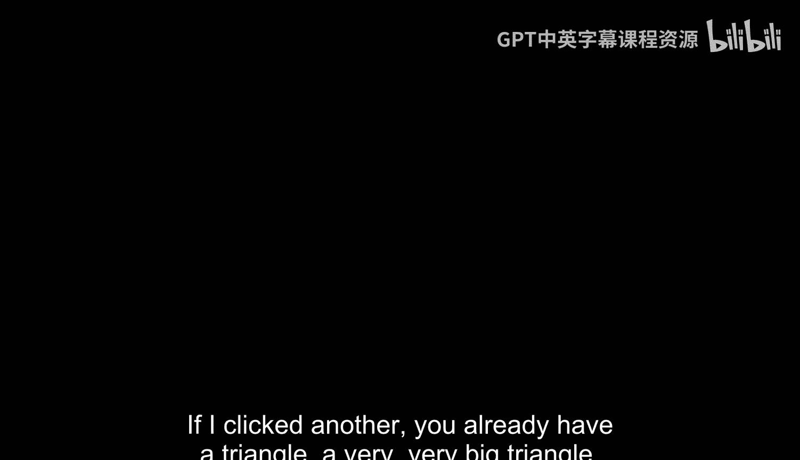

要。Good， so it's like humans basically label it to you。Like， after you've clicked all of these things。

 you should know exactly which points。 Go to which point。

AndMaybe the question that you you you're asking maybe is like， how。

 how how the hell do I get these triangles。Okay。😊，The now you。be the triangles。 Oh my god。

 they have to the triangles。 Oh wow， this is a lot of things to do in this homework。ok。So。

 triangulation。It's just a way to partition。Convet all of triangles。 Basically。

 you wna connect all of the atices。😊，You know， and then that will give you these triangles， but。

There are good triangles， and they're bad triangles。给。Which is what what。

 which one do you think is the bad triangle。Which one I did it like yeah， what why。Bad triangle。Yeah。

 its。Yeah， it's like， why is it so skewed to begin with。It's not。numericalumly。Right。

 then linear algebra。 And then you don't want anything。 you know， the cold， more keener this is。

 Okay， the transformation that has to be applied on this has or like， think about it。

 Think about transforming this nice， even triangle to that super skewed triangle。

 You're gonna restrict it so much。 It's actually really deep。😊。

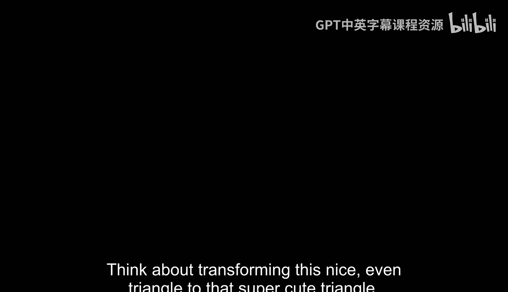

This matrix A that you compute， if you take numerical analysis。

 there's such a thing called conditioning number， conditioning number of a matrix。

 It's the same thing。 Or you can think of a singular value of this matrix。 And like。

 if it's super stretchy， the singular values are really high or really small。

 not very good transformation。 It's numerically， very unstable。 It's very bad。😊。

So you want these nice ones。Okay， so the dumbest giant。something you can do。Is randomly select2。

Point。Connected。If it doesn't。Se with the previous one。 Keep it。R呢。然后呢。不不不。不不。no， that's not good。

 So I don't do that。Find the next one， random them。run down run down， run them run them。No。p okay。

 so this is N cubeed algorithm。But this is gonna give you really bad stuff。Okay。

 you want a good one and not your bad triangles， okay。So then you could go in。

And this is a trick that you learn in this is something if you take 1，84。

 you will actually implement this。 Yeah， yeah， question。😊，Yes， you can do in exactly， so。

You can do this thing where you can take a bad triangle。Or like， can I， O。

 It's more like self improvement algorithm。 It's like， can I make myself better。😀呵呵。😊。

Can I be a better triangle。Okay， so you take， take a quad qua quadre lateral。

 take oneish and be like， what if I slipped in。Is the angle between all the triangle be better。

 larger。If so， then you flip。O。😊，So you could do do all of these things。

 this then thing going to every single triangle or quadrilateral and be like， should I edge flip。

Do edge you flip So that edge flip edge you flip， and then like repeat this forever。But obviously。

 that is not very efficient。And we're not gonna really talk about in this class of how this is really。

 if you're interested in this topic， you should take computational geometry。😊，Okay。

 so this is the naive algorithm。 You have done this n squared to get N cubed algorithm to get your initialization。

 Now， take random quadri laterral flip。😊，我。喂。Okay， so it could take a very long time， but eventually。

 you will get there。But there's a nice thing in computational geometry。

Wch is assuming no four points are on the same circle。

Here are the points you want to figure out the triangulation for。

What you're going to do is you compute the border diagram。

The board diagram is just like your zip code。 Actually， this is what your zip code is。

 not zip code just says。😊，The closest post office， right。So for every single house。

 you figure out the closest zip post office， which is this one。 And then you draw this boundary。

 This is your zip code and。😊。

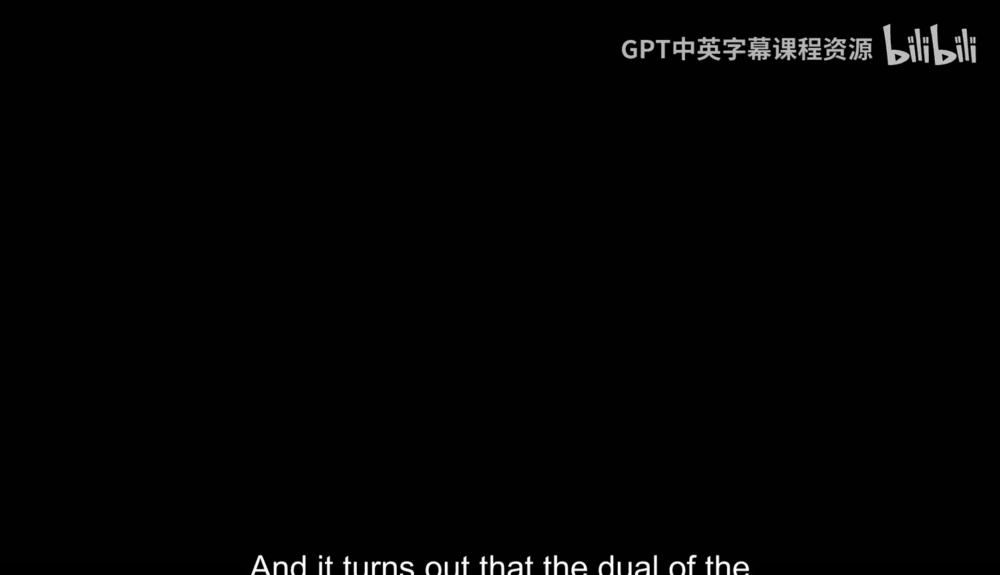

Without that the duel of the world noise is the diony triangulation， which is the nice triangulation。

😊，Pretty cool stuff。 So this is a triangulation。 This is a bo annoying duel。

 And this is one on top of each other。 And then you do this by like putting circles。

 figuring out the centers， all these things， which fun things that you can read in computational geometry。

 But luckily in your class， in this homework， you can just implement it with the Dna。😊，Using sfi。

 So you don't have to implement the edge flips and stuff like， you're welcome to。

 I think that's what it is。 You should check。😊，The sixth。I hope you don't have to implement this。

 I don't think you do。 but I don know whatever it says on the spec。

 So this might be a very long homework one more。一目で。我没。I have one man。 okay， okay。You basically。

Get this歌。Get the course。Com transform them。 Okay， we'll go over this again。 But then and then you。

HowWhere' is the color。Okay， so there's a lot of things to do in this。啊。This is。Iデア。

What's the difference。Yeah。😊，なんだ？喂。😮，less the better than the one on the left。1 on the right。

 better than one on the left。okay， I think it's more like。

 I think that one with my cat is more ghostly， ghostly。Right， and then why is that。I mean。

 a correspond。But there's some。我们干本。This。This is really convincing。Because it's gradual。 Ex。

 the frame rate is really， really fine， right？ There's like so many steps in between this。

 As opposed to this one， you take one step it did too much。😊。

